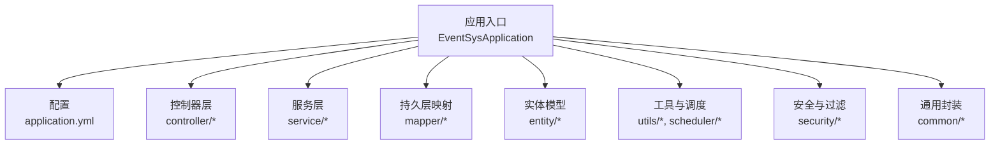
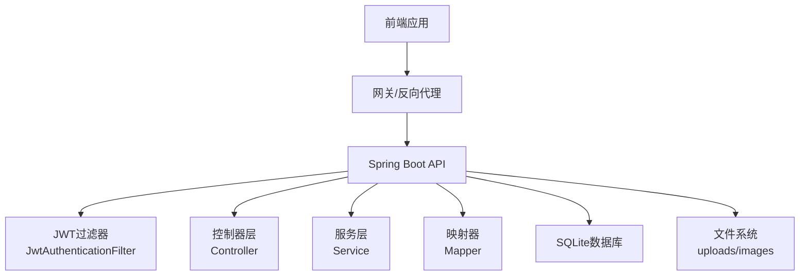
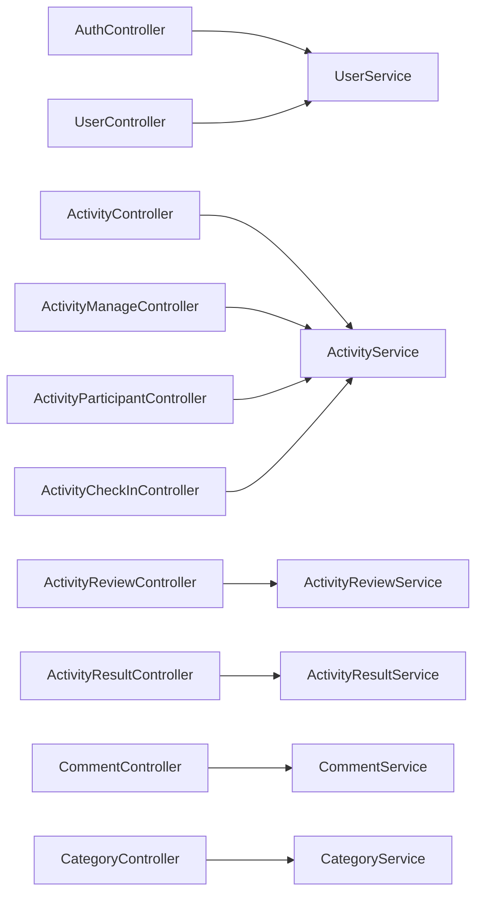

# API接口文档

<cite>
**本文档引用的文件**
- [EventSysApplication.java](file://src/main/java/com/campus/eventsys/EventSysApplication.java)
- [application.yml](file://src/main/resources/application.yml)
- [Result.java](file://src/main/java/com/campus/eventsys/common/Result.java)
- [BusinessException.java](file://src/main/java/com/campus/eventsys/common/BusinessException.java)
- [AuthController.java](file://src/main/java/com/campus/eventsys/controller/AuthController.java)
- [UserController.java](file://src/main/java/com/campus/eventsys/controller/UserController.java)
- [ActivityController.java](file://src/main/java/com/campus/eventsys/controller/ActivityController.java)
- [ActivityManageController.java](file://src/main/java/com/campus/eventsys/controller/ActivityManageController.java)
- [ActivityParticipantController.java](file://src/main/java/com/campus/eventsys/controller/ActivityParticipantController.java)
- [ActivityReviewController.java](file://src/main/java/com/campus/eventsys/controller/ActivityReviewController.java)
- [ActivityResultController.java](file://src/main/java/com/campus/eventsys/controller/ActivityResultController.java)
- [ActivityCheckInController.java](file://src/main/java/com/campus/eventsys/controller/ActivityCheckInController.java)
- [CategoryController.java](file://src/main/java/com/campus/eventsys/controller/CategoryController.java)
- [CommentController.java](file://src/main/java/com/campus/eventsys/controller/CommentController.java)
- [url.txt](file://url.txt)
</cite>

## 目录
1. [简介](#简介)
2. [项目结构](#项目结构)
3. [核心组件](#核心组件)
4. [架构总览](#架构总览)
5. [详细组件分析](#详细组件分析)
6. [依赖关系分析](#依赖关系分析)
7. [性能考虑](#性能考虑)
8. [故障排查指南](#故障排查指南)
9. [结论](#结论)
10. [附录](#附录)

## 简介
本项目为校园活动管理系统，提供完整的活动全生命周期管理能力，包括用户认证与信息管理、活动公开查询、活动管理（组织者）、活动参与（报名/签到/评价/成果展示）、评论互动、分类管理等模块。系统采用Spring Boot + MyBatis-Plus + JWT鉴权，统一响应结构，支持Swagger UI可视化调试。

- 服务端口与上下文路径：8080/api
- Swagger UI：/api/swagger-ui.html
- OpenAPI JSON：/api/v3/api-docs
- 默认测试用户密码：test

**章节来源**
- [url.txt:1-9](file://url.txt#L1-L9)
- [application.yml:1-76](file://src/main/resources/application.yml#L1-L76)

## 项目结构
后端采用标准Spring Boot结构，按功能域划分控制器、实体、服务、映射器、配置等包，便于维护与扩展。

**图表来源**
- [EventSysApplication.java:1-17](file://src/main/java/com/campus/eventsys/EventSysApplication.java#L1-L17)
- [application.yml:1-76](file://src/main/resources/application.yml#L1-L76)

**章节来源**
- [EventSysApplication.java:1-17](file://src/main/java/com/campus/eventsys/EventSysApplication.java#L1-L17)
- [application.yml:1-76](file://src/main/resources/application.yml#L1-L76)

## 核心组件
- 统一响应包装：Result<T>，统一返回code/message/data结构，便于前端解析与错误处理。
- 业务异常：BusinessException，支持自定义错误码与消息。
- 认证与鉴权：基于JWT的Bearer Token，拦截器校验，接口按需标注SecurityRequirement。
- 分页查询：MyBatis-Plus Page分页，支持公开查询与后台管理查询。
- 文件上传：支持多图上传，按活动ID分目录存储，支持头像与成果展示贴图片。

**章节来源**
- [Result.java:1-55](file://src/main/java/com/campus/eventsys/common/Result.java#L1-L55)
- [BusinessException.java:1-20](file://src/main/java/com/campus/eventsys/common/BusinessException.java#L1-L20)

## 架构总览
系统采用前后端分离架构，后端提供RESTful API，前端通过Authorization: Bearer {token}携带JWT访问受保护接口。

**图表来源**
- [application.yml:1-76](file://src/main/resources/application.yml#L1-L76)
- [AuthController.java:38-106](file://src/main/java/com/campus/eventsys/controller/AuthController.java#L38-L106)

**章节来源**
- [application.yml:1-76](file://src/main/resources/application.yml#L1-L76)

## 详细组件分析

### 认证与用户模块
- 认证管理（/auth）
  - POST /auth/login：用户名+密码登录，返回token与用户信息
  - POST /auth/register：注册新用户
- 用户信息管理（/user）
  - GET /user/info：获取当前登录用户信息
  - POST /user/upload-avatar：上传头像（multipart/form-data）
  - PUT /user/update-info：更新个人信息（可选字段）

认证方式与权限
- 所有受保护接口均需在Header中携带Authorization: Bearer {token}
- 未登录或令牌无效返回401
- 注册时用户名不可重复

请求与响应示例（以登录为例）
- 请求：POST /api/auth/login
  - Content-Type: application/json
  - Body: {"username":"admin","password":"123456"}
- 响应：{
  "code":200,
  "message":"登录成功",
  "data":{"token":"...","user":{...}}
}

错误码
- 400：请求参数错误
- 401：用户名或密码错误/未登录
- 500：服务器内部错误

**章节来源**
- [AuthController.java:42-106](file://src/main/java/com/campus/eventsys/controller/AuthController.java#L42-L106)
- [UserController.java:36-146](file://src/main/java/com/campus/eventsys/controller/UserController.java#L36-L146)

### 活动公开查询模块
- GET /activities/list：分页查询活动列表（公开接口）
  - 参数：page、size、keyword、status、categoryId
  - 仅返回已审核通过（状态>=2）的活动，按创建时间倒序
- GET /activities/detail/{id}：获取活动详情（公开接口），浏览次数+1

分页与筛选
- 默认每页10条，支持关键词、状态、分类筛选
- 状态码：2-报名中、3-即将开始、4-进行中、5-已结束

**章节来源**
- [ActivityController.java:44-111](file://src/main/java/com/campus/eventsys/controller/ActivityController.java#L44-L111)

### 活动管理（组织者）模块
- 创建活动：POST /activities/manage/create
- 更新活动：PUT /activities/manage/update/{id}
- 删除活动：DELETE /activities/manage/delete/{id}
- 我创建的活动：GET /activities/manage/my-created
- 报名人员管理
  - GET /activities/manage/{activityId}/registrations：报名列表
  - GET /activities/manage/{activityId}/participants：参与者列表
  - POST /activities/manage/registrations/{registrationId}/review：审核报名
  - POST /activities/manage/registrations/{registrationId}/remove：移除参与者
- 管理者管理
  - GET /activities/manage/{activityId}/organizers：管理者列表
  - POST /activities/manage/{activityId}/organizers：添加管理者
  - POST /activities/manage/{activityId}/organizers/{targetUserId}/remove：移除管理者
- 封面图片上传：POST /activities/manage/upload-cover/{activityId}（见下方说明）

权限说明
- 仅活动组织者可操作对应活动
- 审核通过后活动才对外展示
- 删除活动会级联清理报名记录、成果展示贴等

**章节来源**
- [ActivityManageController.java:78-882](file://src/main/java/com/campus/eventsys/controller/ActivityManageController.java#L78-L882)

### 活动参与（参与者）模块
- 报名活动：POST /activities/participant/join/{activityId}（支持图片上传）
- 取消报名：POST /activities/participant/cancel/{activityId}
- 获取活动角色：GET /activities/participant/role/{activityId}
- 我参与的活动：GET /activities/participant/my-activities

图片上传规范
- 支持最多3张，单张不超过10MB，仅图片格式
- 存储路径：uploads/images/activity_{activityId}/
- 访问URL：/uploads/images/activity_{activityId}/文件名

**章节来源**
- [ActivityParticipantController.java:52-371](file://src/main/java/com/campus/eventsys/controller/ActivityParticipantController.java#L52-L371)

### 活动签到模块
- 活动签到：POST /activities/checkin/{activityId}
- 检查签到状态：GET /activities/checkin/status/{activityId}
- 活动签到列表：GET /activities/checkin/list/{activityId}（组织者）
- 我的签到记录：GET /activities/checkin/my-records

签到前提
- 用户必须是已审核通过的参与者
- 活动必须处于进行中(4)状态

**章节来源**
- [ActivityCheckInController.java:42-172](file://src/main/java/com/campus/eventsys/controller/ActivityCheckInController.java#L42-L172)

### 活动评价模块
- 提交评价：POST /reviews/create（仅已结束且已签到的参与者）
- 查看活动评价列表：GET /reviews/activity/{activityId}（分页）
- 我的评价：GET /reviews/my（分页）
- 组织者查看评价：GET /reviews/organizer（可选activityId）
- 组织者回复评价：POST /reviews/reply/{reviewId}
- 管理员删除评价：DELETE /reviews/delete/{reviewId}
- 评价统计：GET /reviews/statistics/{activityId}

业务规则
- 仅已结束且已签到的参与者可评价
- 每用户对同一活动仅限一次评价
- 组织者回复可覆盖更新

**章节来源**
- [ActivityReviewController.java:47-254](file://src/main/java/com/campus/eventsys/controller/ActivityReviewController.java#L47-L254)

### 成果展示模块
- 获取成果展示贴：GET /results/activity/{activityId}（浏览次数+1）
- 检查是否存在：GET /results/exists/{activityId}
- 创建成果展示贴：POST /results/create/{activityId}
- 更新成果展示贴：PUT /results/update/{id}
- 删除成果展示贴：DELETE /results/delete/{id}
- 上传图片：POST /results/upload-images/{activityId}（最多9张，单张≤10MB）

权限说明
- 创建/更新/删除：活动组织者或管理员
- 查询：公开接口

图片上传规范
- 存储路径：uploads/images/activity_{activityId}/
- 访问URL：/uploads/images/activity_{activityId}/文件名

**章节来源**
- [ActivityResultController.java:53-376](file://src/main/java/com/campus/eventsys/controller/ActivityResultController.java#L53-L376)

### 评论模块
- 获取评论列表：GET /comments/list（公开接口）
- 获取评论数量：GET /comments/count（公开接口）
- 发表评论：POST /comments/post（登录）
- 回复评论：POST /comments/reply/{parentId}（登录）
- 删除评论：DELETE /comments/delete/{id}（作者/组织者/管理员）

权限说明
- 发表/回复/删除需登录
- 删除权限：评论作者、目标所有者（组织者/创建者）、管理员

**章节来源**
- [CommentController.java:48-327](file://src/main/java/com/campus/eventsys/controller/CommentController.java#L48-L327)

### 活动分类模块
- 获取启用的分类列表：GET /categories/list（公开接口）
- 获取分类详情：GET /categories/detail/{id}（公开接口）

**章节来源**
- [CategoryController.java:30-64](file://src/main/java/com/campus/eventsys/controller/CategoryController.java#L30-L64)

## 依赖关系分析
控制器层依赖服务层，服务层依赖映射器与实体；统一响应包装与业务异常贯穿各层，保证接口一致性与可维护性。

**图表来源**
- [AuthController.java:38-106](file://src/main/java/com/campus/eventsys/controller/AuthController.java#L38-L106)
- [ActivityController.java:42-111](file://src/main/java/com/campus/eventsys/controller/ActivityController.java#L42-L111)
- [ActivityManageController.java:67-882](file://src/main/java/com/campus/eventsys/controller/ActivityManageController.java#L67-L882)
- [ActivityParticipantController.java:46-371](file://src/main/java/com/campus/eventsys/controller/ActivityParticipantController.java#L46-L371)
- [ActivityCheckInController.java:37-172](file://src/main/java/com/campus/eventsys/controller/ActivityCheckInController.java#L37-L172)
- [ActivityReviewController.java:43-254](file://src/main/java/com/campus/eventsys/controller/ActivityReviewController.java#L43-L254)
- [ActivityResultController.java:46-376](file://src/main/java/com/campus/eventsys/controller/ActivityResultController.java#L46-L376)
- [CommentController.java:41-327](file://src/main/java/com/campus/eventsys/controller/CommentController.java#L41-L327)
- [CategoryController.java:28-64](file://src/main/java/com/campus/eventsys/controller/CategoryController.java#L28-L64)

## 性能考虑
- 分页查询：使用MyBatis-Plus Page，建议前端合理设置page与size，避免一次性加载过多数据。
- 文件上传：限制单文件大小与数量，避免占用过多磁盘空间；图片路径按活动ID分目录，便于清理与管理。
- 缓存策略：可结合Redis缓存热门活动列表与分类数据，降低数据库压力。
- 并发控制：签到、报名等关键操作建议使用数据库事务与唯一索引，防止超卖与重复提交。

## 故障排查指南
常见错误码
- 400：请求参数错误/业务异常（如重复报名、图片格式不符、数量超限等）
- 401：未登录或Token无效
- 403：无权限（非活动组织者/管理员）
- 404：资源不存在（活动/用户/评论/成果贴等）
- 500：服务器内部错误

定位步骤
- 检查Authorization头是否正确携带Bearer Token
- 确认接口是否需要登录（SecurityRequirement标注）
- 核对请求参数与文件格式、大小限制
- 查看服务端日志（application.yml中已开启debug级别）

**章节来源**
- [Result.java:14-53](file://src/main/java/com/campus/eventsys/common/Result.java#L14-L53)
- [BusinessException.java:8-18](file://src/main/java/com/campus/eventsys/common/BusinessException.java#L8-L18)

## 结论
本API文档覆盖了校园活动管理系统的全部核心接口，明确了认证方式、权限要求、分页与批量操作实现细节以及错误处理规范。建议前端与第三方集成方严格遵循本文档的请求格式、响应结构与错误码约定，确保系统稳定运行与良好的用户体验。

## 附录

### 统一响应结构
- 成功：{"code":200,"message":"操作成功","data":...}
- 失败：{"code":xxx,"message":"错误描述","data":null}

**章节来源**
- [Result.java:25-53](file://src/main/java/com/campus/eventsys/common/Result.java#L25-L53)

### API版本管理
- 当前API根路径为/api，版本号体现在OpenAPI文档路径/api/v3/api-docs
- 建议在URL中加入版本前缀（如/api/v1/...）以便未来演进

**章节来源**
- [application.yml:55-62](file://src/main/resources/application.yml#L55-L62)

### 分页查询规范
- 参数：page（默认1）、size（默认10）
- 返回：Page对象，包含records、total、current、size、pages等字段

**章节来源**
- [ActivityController.java:54-87](file://src/main/java/com/campus/eventsys/controller/ActivityController.java#L54-L87)
- [ActivityReviewController.java:98-125](file://src/main/java/com/campus/eventsys/controller/ActivityReviewController.java#L98-L125)

### 文件上传与访问
- 上传路径：uploads/images（由file.upload.path配置）
- 访问URL：/images/（由file.access.url配置）
- 活动相关图片按activity_{id}目录存放

**章节来源**
- [application.yml:64-70](file://src/main/resources/application.yml#L64-L70)
- [ActivityManageController.java:793-800](file://src/main/java/com/campus/eventsys/controller/ActivityManageController.java#L793-L800)
- [ActivityParticipantController.java:56-62](file://src/main/java/com/campus/eventsys/controller/ActivityParticipantController.java#L56-L62)
- [ActivityResultController.java:268-291](file://src/main/java/com/campus/eventsys/controller/ActivityResultController.java#L268-L291)