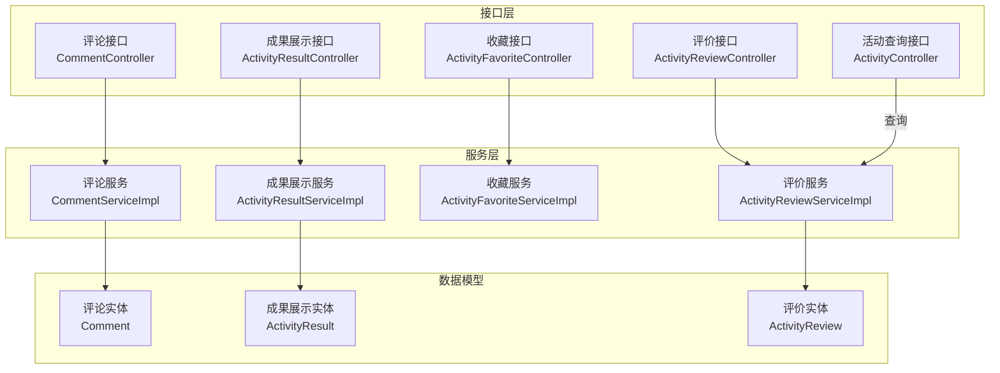
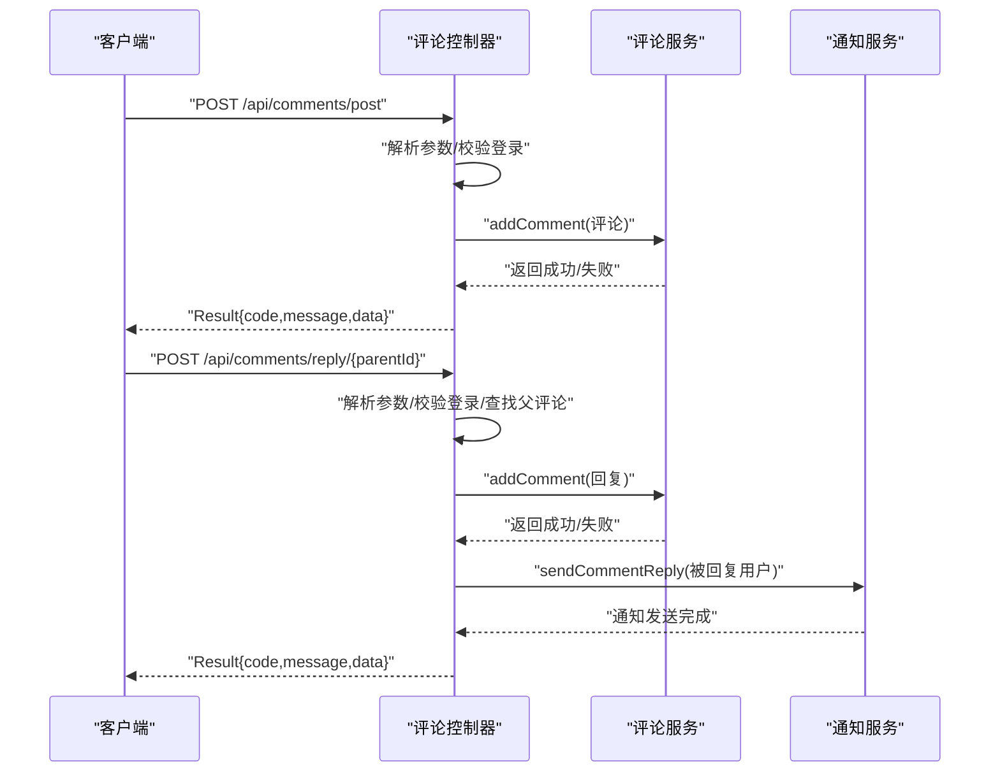
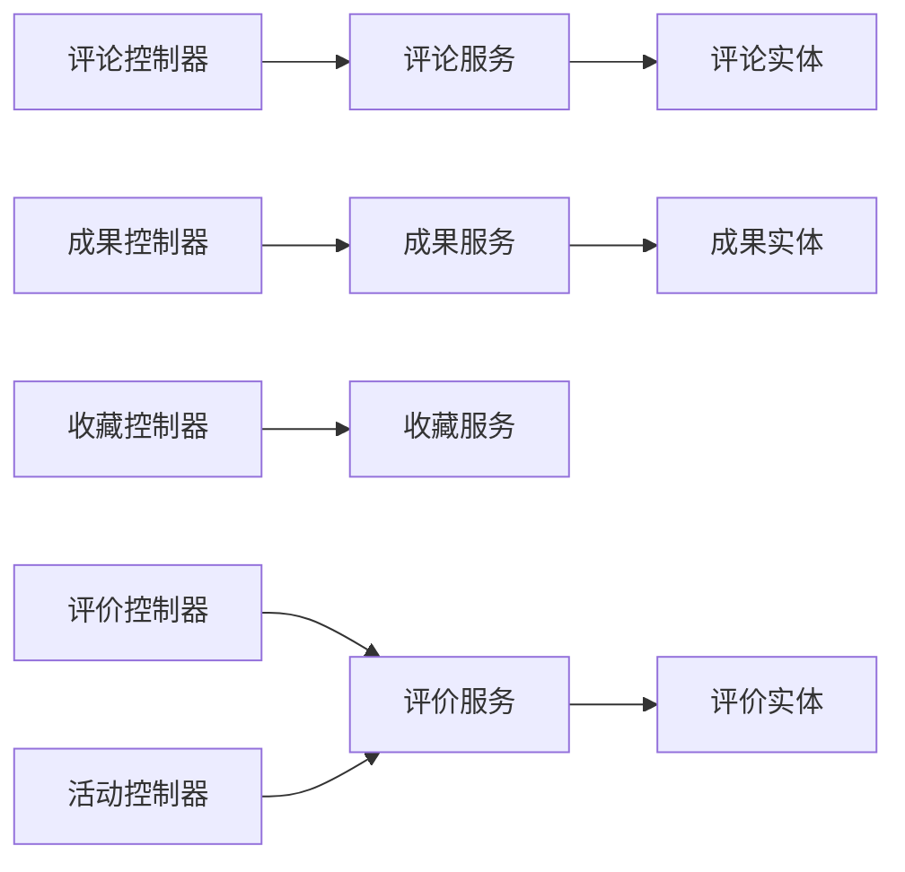

# 内容管理接口

<cite>
**本文引用的文件**
- [CommentController.java](file://src/main/java/com/campus/eventsys/controller/CommentController.java)
- [CommentServiceImpl.java](file://src/main/java/com/campus/eventsys/service/impl/CommentServiceImpl.java)
- [Comment.java](file://src/main/java/com/campus/eventsys/entity/Comment.java)
- [ActivityResultController.java](file://src/main/java/com/campus/eventsys/controller/ActivityResultController.java)
- [ActivityResultServiceImpl.java](file://src/main/java/com/campus/eventsys/service/impl/ActivityResultServiceImpl.java)
- [ActivityResult.java](file://src/main/java/com/campus/eventsys/entity/ActivityResult.java)
- [ActivityFavoriteController.java](file://src/main/java/com/campus/eventsys/controller/ActivityFavoriteController.java)
- [ActivityFavoriteServiceImpl.java](file://src/main/java/com/campus/eventsys/service/impl/ActivityFavoriteServiceImpl.java)
- [ActivityReviewController.java](file://src/main/java/com/campus/eventsys/controller/ActivityReviewController.java)
- [ActivityReviewServiceImpl.java](file://src/main/java/com/campus/eventsys/service/impl/ActivityReviewServiceImpl.java)
- [ActivityReview.java](file://src/main/java/com/campus/eventsys/entity/ActivityReview.java)
- [ActivityController.java](file://src/main/java/com/campus/eventsys/controller/ActivityController.java)
- [Result.java](file://src/main/java/com/campus/eventsys/common/Result.java)
- [application.yml](file://src/main/resources/application.yml)
- [url.txt](file://url.txt)
</cite>

## 目录
1. [简介](#简介)
2. [项目结构](#项目结构)
3. [核心组件](#核心组件)
4. [架构总览](#架构总览)
5. [详细组件分析](#详细组件分析)
6. [依赖分析](#依赖分析)
7. [性能考虑](#性能考虑)
8. [故障排查指南](#故障排查指南)
9. [结论](#结论)
10. [附录](#附录)

## 简介
本文件为“内容管理模块”的完整API接口参考手册，覆盖评论发布、活动评价、成果展示、收藏管理等用户交互相关接口，并补充内容审核、点赞收藏、互动评论、分页搜索与排序、权限控制与审核机制、内容安全过滤与垃圾内容检测的接口体现。文档基于实际代码实现，提供HTTP方法、URL模式、请求参数、响应格式与错误码说明，帮助前后端协作与集成。

## 项目结构
后端采用Spring Boot + MyBatis-Plus架构，接口集中在controller包，业务逻辑在service层，数据模型在entity包，统一响应封装在common包。应用上下文路径为/api，Swagger UI位于/api/swagger-ui.html。

图表来源
- [CommentController.java:36-327](file://src/main/java/com/campus/eventsys/controller/CommentController.java#L36-L327)
- [ActivityResultController.java:42-376](file://src/main/java/com/campus/eventsys/controller/ActivityResultController.java#L42-L376)
- [ActivityFavoriteController.java:31-184](file://src/main/java/com/campus/eventsys/controller/ActivityFavoriteController.java#L31-L184)
- [ActivityReviewController.java:39-254](file://src/main/java/com/campus/eventsys/controller/ActivityReviewController.java#L39-L254)
- [ActivityController.java:38-111](file://src/main/java/com/campus/eventsys/controller/ActivityController.java#L38-L111)
- [CommentServiceImpl.java:27-173](file://src/main/java/com/campus/eventsys/service/impl/CommentServiceImpl.java#L27-L173)
- [ActivityResultServiceImpl.java:25-193](file://src/main/java/com/campus/eventsys/service/impl/ActivityResultServiceImpl.java#L25-L193)
- [ActivityFavoriteServiceImpl.java:23-137](file://src/main/java/com/campus/eventsys/service/impl/ActivityFavoriteServiceImpl.java#L23-L137)
- [ActivityReviewServiceImpl.java:33-316](file://src/main/java/com/campus/eventsys/service/impl/ActivityReviewServiceImpl.java#L33-L316)
- [Comment.java:14-67](file://src/main/java/com/campus/eventsys/entity/Comment.java#L14-L67)
- [ActivityResult.java:14-69](file://src/main/java/com/campus/eventsys/entity/ActivityResult.java#L14-L69)
- [ActivityReview.java:14-56](file://src/main/java/com/campus/eventsys/entity/ActivityReview.java#L14-L56)

章节来源
- [application.yml:1-76](file://src/main/resources/application.yml#L1-L76)
- [url.txt:1-9](file://url.txt#L1-L9)

## 核心组件
- 统一响应包装：所有接口返回统一结构，包含状态码、消息与数据体，便于前端处理。
- 安全认证：除公开查询外，多数接口需携带JWT Bearer Token。
- 权限控制：围绕活动组织者、创建者、管理员与普通用户划分不同操作权限。
- 逻辑删除：评论、收藏、成果展示贴、评价均采用逻辑删除，保障数据完整性与审计需求。
- 分页与排序：活动列表、评价列表、我的收藏等接口支持分页与排序。

章节来源
- [Result.java:10-55](file://src/main/java/com/campus/eventsys/common/Result.java#L10-L55)
- [application.yml:49-53](file://src/main/resources/application.yml#L49-L53)

## 架构总览
以下序列图展示“发表评论”与“回复评论”的典型流程，体现鉴权、权限校验、服务调用与通知发送：

图表来源
- [CommentController.java:104-207](file://src/main/java/com/campus/eventsys/controller/CommentController.java#L104-L207)
- [CommentServiceImpl.java:84-118](file://src/main/java/com/campus/eventsys/service/impl/CommentServiceImpl.java#L84-L118)

## 详细组件分析

### 评论管理
- 接口概览
  - 获取评论列表（公开）
    - 方法与路径：GET /api/comments/list
    - 请求参数：targetId（目标ID）、targetType（目标类型：1-活动，2-成果展示贴）
    - 响应：树形结构的评论列表，包含用户信息与回复对象信息
  - 获取评论数量（公开）
    - 方法与路径：GET /api/comments/count
    - 请求参数：同上
    - 响应：Long类型的评论总数
  - 发表评论（需登录）
    - 方法与路径：POST /api/comments/post
    - 请求参数：targetId、targetType、content
    - 响应：Result.success
  - 回复评论（需登录）
    - 方法与路径：POST /api/comments/reply/{parentId}
    - 路径参数：parentId（父评论ID）
    - 请求参数：content、replyToUserId（可选，默认回复给父评论作者）
    - 响应：Result.success，并向被回复用户发送通知
  - 删除评论（需登录；作者、目标所有者或管理员）
    - 方法与路径：DELETE /api/comments/delete/{id}
    - 路径参数：id（评论ID）
    - 响应：Result.success

- 权限与安全
  - 登录态：使用JWT Bearer认证
  - 权限判定：评论作者、活动组织者、成果展示贴创建者、管理员
  - 内容安全：空内容校验，回复对象默认策略

- 数据模型
  - 评论实体包含目标ID/类型、用户ID、内容、父子关系、逻辑删除字段等

章节来源
- [CommentController.java:48-254](file://src/main/java/com/campus/eventsys/controller/CommentController.java#L48-L254)
- [CommentServiceImpl.java:33-171](file://src/main/java/com/campus/eventsys/service/impl/CommentServiceImpl.java#L33-L171)
- [Comment.java:14-67](file://src/main/java/com/campus/eventsys/entity/Comment.java#L14-L67)

### 活动成果展示
- 接口概览
  - 获取成果展示贴详情（公开）
    - 方法与路径：GET /api/results/activity/{activityId}
    - 响应：成果贴详情 + 创建者信息 + 活动信息；浏览次数+1
  - 检查成果贴是否存在（公开）
    - 方法与路径：GET /api/results/exists/{activityId}
    - 响应：Boolean
  - 创建成果贴（需登录；组织者或管理员）
    - 方法与路径：POST /api/results/create/{activityId}
    - 请求参数：title（必填）、content（可选，Markdown）、images（可选，JSON数组）
    - 响应：Result.success；成功后通知已审核参与者
  - 更新成果贴（需登录；创建者或管理员）
    - 方法与路径：PUT /api/results/update/{id}
    - 请求参数：title/content/images（均可选）
    - 响应：Result.success
  - 删除成果贴（需登录；创建者或管理员）
    - 方法与路径：DELETE /api/results/delete/{id}
    - 响应：Result.success
  - 上传图片（成果贴，需登录）
    - 方法与路径：POST /api/results/upload-images/{activityId}（multipart/form-data）
    - 请求参数：files（图片文件列表，最多9张，单张≤10MB，仅图片）
    - 响应：图片URL字符串数组

- 权限与安全
  - 组织者/管理员：创建、更新、删除
  - 创建者：更新、删除
  - 图片存储：按活动ID分目录，UUID命名，访问URL规范

- 数据模型
  - 成果展示贴实体包含活动ID、标题、内容、图片列表、浏览/评论计数、状态、逻辑删除字段等

章节来源
- [ActivityResultController.java:53-347](file://src/main/java/com/campus/eventsys/controller/ActivityResultController.java#L53-L347)
- [ActivityResultServiceImpl.java:34-191](file://src/main/java/com/campus/eventsys/service/impl/ActivityResultServiceImpl.java#L34-L191)
- [ActivityResult.java:14-69](file://src/main/java/com/campus/eventsys/entity/ActivityResult.java#L14-L69)

### 活动收藏
- 接口概览
  - 收藏活动（需登录）
    - 方法与路径：POST /api/favorites/add/{activityId}
    - 响应：Result.success；收藏计数+1
  - 取消收藏（需登录）
    - 方法与路径：POST /api/favorites/remove/{activityId}
    - 响应：Result.success；收藏计数-1
  - 检查收藏状态（需登录）
    - 方法与路径：GET /api/favorites/status/{activityId}
    - 响应：Boolean
  - 我的收藏列表（需登录）
    - 方法与路径：GET /api/favorites/my-favorites
    - 响应：活动列表（按收藏时间倒序）
  - 收藏数量（公开）
    - 方法与路径：GET /api/favorites/count/{activityId}
    - 响应：Long

- 权限与安全
  - 登录态：JWT Bearer
  - 逻辑删除：支持恢复已删除的收藏记录

章节来源
- [ActivityFavoriteController.java:39-182](file://src/main/java/com/campus/eventsys/controller/ActivityFavoriteController.java#L39-L182)
- [ActivityFavoriteServiceImpl.java:28-135](file://src/main/java/com/campus/eventsys/service/impl/ActivityFavoriteServiceImpl.java#L28-L135)

### 活动评价
- 接口概览
  - 提交评价（需登录；仅已结束且签到成功的参与者）
    - 方法与路径：POST /api/reviews/create
    - 请求体：activityId、rating（1-5）、content（≤500字）
    - 响应：Result.success，data包含reviewId
  - 获取活动评价列表（公开，分页）
    - 方法与路径：GET /api/reviews/activity/{activityId}?page=&size=
    - 响应：分页对象，包含records与用户信息
  - 我的评价列表（需登录，分页）
    - 方法与路径：GET /api/reviews/my?page=&size=
    - 响应：分页对象
  - 组织者查看评价（需登录；仅其自身活动）
    - 方法与路径：GET /api/reviews/organizer?activityId=&page=&size=
    - 响应：分页对象
  - 组织者回复评价（需登录；仅其自身活动）
    - 方法与路径：POST /api/reviews/reply/{reviewId}?reply=
    - 响应：Result.success（覆盖式回复）
  - 管理员删除评价（需登录；管理员）
    - 方法与路径：DELETE /api/reviews/delete/{reviewId}
    - 响应：Result.success；自动重算活动平均评分与评价数
  - 获取活动评价统计（公开）
    - 方法与路径：GET /api/reviews/statistics/{activityId}
    - 响应：平均评分、总评分数、各星级分布

- 权限与安全
  - 仅已结束活动（status=5）且签到成功的参与者可评价
  - 每用户对同一活动仅能评价一次
  - 组织者可回复，管理员可删除
  - 评价提交后不可修改

- 数据模型
  - 评价实体包含活动ID、用户ID、评分、内容、组织者回复、逻辑删除字段等

章节来源
- [ActivityReviewController.java:47-240](file://src/main/java/com/campus/eventsys/controller/ActivityReviewController.java#L47-L240)
- [ActivityReviewServiceImpl.java:41-314](file://src/main/java/com/campus/eventsys/service/impl/ActivityReviewServiceImpl.java#L41-L314)
- [ActivityReview.java:14-56](file://src/main/java/com/campus/eventsys/entity/ActivityReview.java#L14-L56)

### 活动查询（公开）
- 接口概览
  - 获取活动列表（公开，分页）
    - 方法与路径：GET /api/activities/list?page=&size=&keyword=&status=&categoryId=
    - 响应：分页对象（仅返回已通过审核的状态≥2的活动，按创建时间倒序）
  - 获取活动详情（公开）
    - 方法与路径：GET /api/activities/detail/{id}
    - 响应：活动详情；浏览次数+1

- 搜索与排序
  - 支持关键词（标题）、状态筛选、分类筛选
  - 默认按创建时间倒序

章节来源
- [ActivityController.java:44-109](file://src/main/java/com/campus/eventsys/controller/ActivityController.java#L44-L109)

## 依赖分析
- 控制器依赖服务层，服务层依赖Mapper与实体，统一通过Result封装响应
- 权限控制贯穿多个控制器：组织者/创建者/管理员/普通用户
- 逻辑删除广泛应用于评论、收藏、成果贴、评价，配合自定义SQL实现“恢复”能力
- 文件上传与访问URL在成果贴上传接口中集中体现

图表来源
- [CommentController.java:39-46](file://src/main/java/com/campus/eventsys/controller/CommentController.java#L39-L46)
- [ActivityResultController.java:46-51](file://src/main/java/com/campus/eventsys/controller/ActivityResultController.java#L46-L51)
- [ActivityFavoriteController.java:35-37](file://src/main/java/com/campus/eventsys/controller/ActivityFavoriteController.java#L35-L37)
- [ActivityReviewController.java:43-45](file://src/main/java/com/campus/eventsys/controller/ActivityReviewController.java#L43-L45)
- [ActivityController.java](file://src/main/java/com/campus/eventsys/controller/ActivityController.java#L42)

## 性能考虑
- 分页查询：活动列表、评价列表、我的收藏均支持分页，建议前端合理设置page与size，避免一次性拉取过多数据
- 排序策略：默认按创建时间倒序，满足“新内容优先”展示需求
- 读写分离：公开查询接口（如活动列表、评论列表、统计）无需登录，适合高并发读取
- 事务边界：收藏、评价、评论的新增/删除均在事务中执行，保证一致性与原子性

## 故障排查指南
- 通用错误码
  - 401 未登录/Token无效
  - 403 无权限（非组织者、非创建者、非管理员）
  - 404 对象不存在（活动、成果贴、评价、评论）
  - 400 参数错误/业务异常（重复收藏、重复评价、内容为空、超长等）

- 常见问题定位
  - 评论/回复失败：检查content是否为空、父评论是否存在、登录态是否有效
  - 收藏/取消收藏失败：确认活动存在、用户存在、重复收藏/未收藏场景
  - 评价失败：确认活动状态为已结束、用户为参与者且已完成签到、未重复评价、评分与内容符合长度要求
  - 成果贴创建/更新失败：确认组织者或管理员身份、未重复创建、图片上传合规
  - 图片上传失败：确认文件数量≤9、单张≤10MB、图片格式、活动存在

章节来源
- [CommentController.java:118-137](file://src/main/java/com/campus/eventsys/controller/CommentController.java#L118-L137)
- [ActivityFavoriteController.java:68-78](file://src/main/java/com/campus/eventsys/controller/ActivityFavoriteController.java#L68-L78)
- [ActivityReviewController.java:75-81](file://src/main/java/com/campus/eventsys/controller/ActivityReviewController.java#L75-L81)
- [ActivityResultController.java:305-346](file://src/main/java/com/campus/eventsys/controller/ActivityResultController.java#L305-L346)

## 结论
内容管理模块围绕“评论/回复/删除”、“成果展示贴创建/更新/删除/上传图片”、“收藏/取消收藏/查询收藏状态/收藏列表/收藏数量”、“活动评价提交/查看/回复/删除/统计”构建了完整的用户交互闭环。接口遵循统一响应、JWT认证与严格的权限控制，结合逻辑删除与分页排序，兼顾可用性与可维护性。建议在生产环境进一步完善内容安全过滤与垃圾内容检测的接口与策略，以提升平台内容质量与用户体验。

## 附录
- 统一响应结构
  - 字段：code（状态码）、message（消息）、data（数据）
  - 示例：成功返回code=200，错误返回code=500或具体业务码

- Swagger UI与OpenAPI
  - Swagger UI：http://localhost:8080/api/swagger-ui.html
  - OpenAPI JSON：http://localhost:8080/api/v3/api-docs

章节来源
- [Result.java:12-54](file://src/main/java/com/campus/eventsys/common/Result.java#L12-L54)
- [url.txt:3-6](file://url.txt#L3-L6)