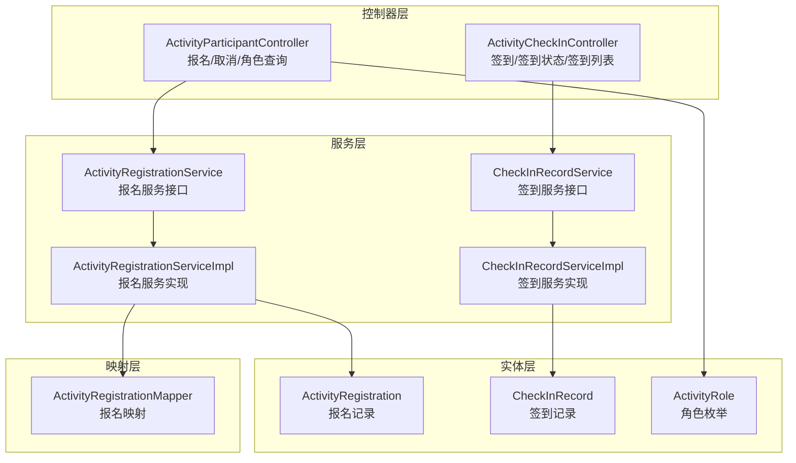
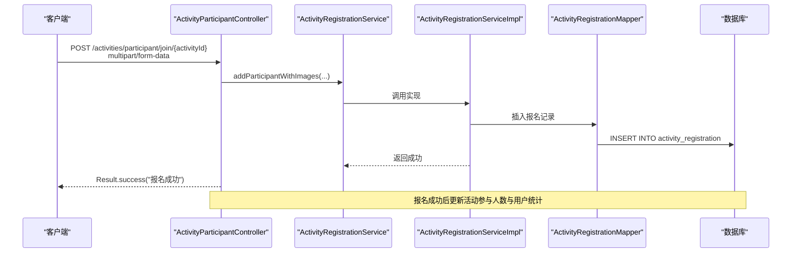
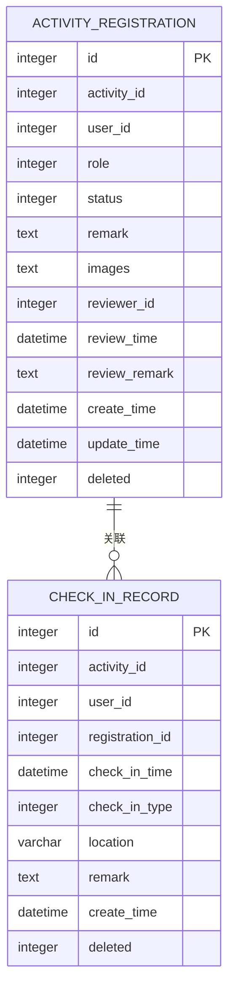
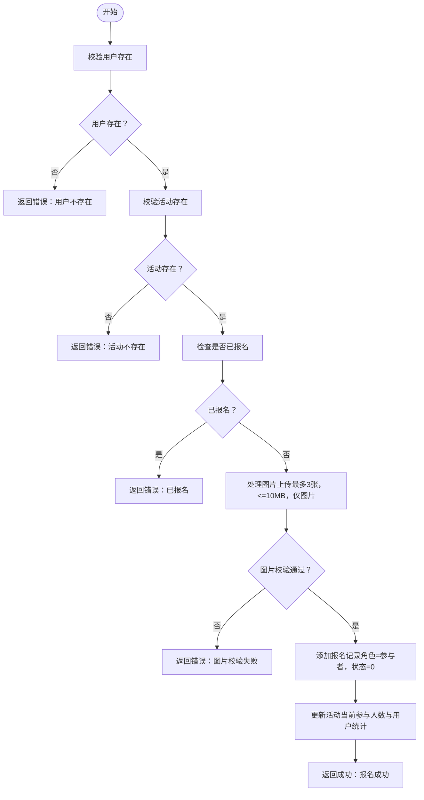
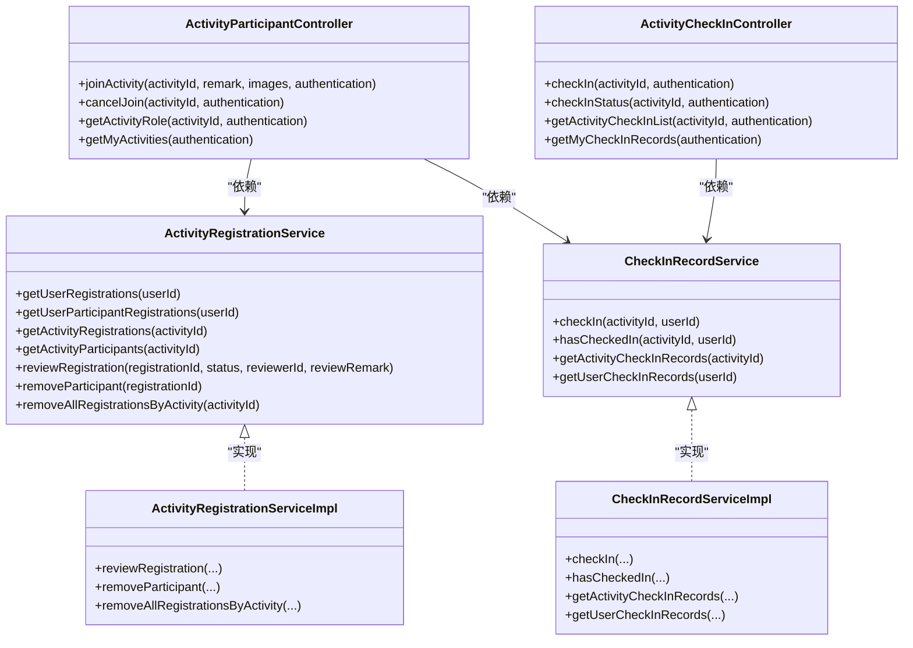

# 报名管理接口

<cite>
**本文档引用的文件**
- [ActivityParticipantController.java](file://src/main/java/com/campus/eventsys/controller/ActivityParticipantController.java)
- [ActivityCheckInController.java](file://src/main/java/com/campus/eventsys/controller/ActivityCheckInController.java)
- [ActivityRegistration.java](file://src/main/java/com/campus/eventsys/entity/ActivityRegistration.java)
- [CheckInRecord.java](file://src/main/java/com/campus/eventsys/entity/CheckInRecord.java)
- [ActivityRegistrationService.java](file://src/main/java/com/campus/eventsys/service/ActivityRegistrationService.java)
- [ActivityRegistrationServiceImpl.java](file://src/main/java/com/campus/eventsys/service/impl/ActivityRegistrationServiceImpl.java)
- [CheckInRecordService.java](file://src/main/java/com/campus/eventsys/service/CheckInRecordService.java)
- [CheckInRecordServiceImpl.java](file://src/main/java/com/campus/eventsys/service/impl/CheckInRecordServiceImpl.java)
- [ActivityRegistrationMapper.java](file://src/main/java/com/campus/eventsys/mapper/ActivityRegistrationMapper.java)
- [ActivityRole.java](file://src/main/java/com/campus/eventsys/enums/ActivityRole.java)
- [schema.sql](file://src/main/resources/db/schema.sql)
- [ActivityParticipantControllerTest.java](file://src/test/java/com/campus/eventsys/controller/ActivityParticipantControllerTest.java)
- [ActivityCheckInControllerTest.java](file://src/test/java/com/campus/eventsys/controller/ActivityCheckInControllerTest.java)
</cite>

## 目录
1. [简介](#简介)
2. [项目结构](#项目结构)
3. [核心组件](#核心组件)
4. [架构总览](#架构总览)
5. [详细组件分析](#详细组件分析)
6. [依赖关系分析](#依赖关系分析)
7. [性能考虑](#性能考虑)
8. [故障排查指南](#故障排查指南)
9. [结论](#结论)
10. [附录](#附录)

## 简介
本文件为“报名管理模块”的API接口文档，覆盖活动报名、取消报名、审核、签到等全流程。文档详细说明各接口的HTTP方法、URL模式、请求参数、响应格式，并阐述报名状态管理、签到记录、报名统计等功能的接口规范。同时给出报名流程中的状态转换、业务逻辑、人数控制、重复报名检测、签到验证的实现细节，以及安全控制与权限验证机制，帮助开发者快速集成与运维。

## 项目结构
报名管理模块主要涉及以下层次：
- 控制器层：提供REST接口，负责接收请求、校验参数、调用服务层并返回结果
- 服务层：封装业务逻辑，处理状态变更、统计更新、通知发送等
- 实体层：定义数据库表映射模型，包含报名记录与签到记录
- 映射层：MyBatis Plus Mapper，提供数据访问能力
- 测试层：单元测试验证接口行为与边界条件

图表来源
- [ActivityParticipantController.java:1-371](file://src/main/java/com/campus/eventsys/controller/ActivityParticipantController.java#L1-L371)
- [ActivityCheckInController.java:1-172](file://src/main/java/com/campus/eventsys/controller/ActivityCheckInController.java#L1-L172)
- [ActivityRegistrationService.java:1-74](file://src/main/java/com/campus/eventsys/service/ActivityRegistrationService.java#L1-L74)
- [ActivityRegistrationServiceImpl.java:1-201](file://src/main/java/com/campus/eventsys/service/impl/ActivityRegistrationServiceImpl.java#L1-L201)
- [CheckInRecordService.java:1-47](file://src/main/java/com/campus/eventsys/service/CheckInRecordService.java#L1-L47)
- [CheckInRecordServiceImpl.java:1-102](file://src/main/java/com/campus/eventsys/service/impl/CheckInRecordServiceImpl.java#L1-L102)
- [ActivityRegistration.java:1-62](file://src/main/java/com/campus/eventsys/entity/ActivityRegistration.java#L1-L62)
- [CheckInRecord.java:1-59](file://src/main/java/com/campus/eventsys/entity/CheckInRecord.java#L1-L59)
- [ActivityRegistrationMapper.java:1-35](file://src/main/java/com/campus/eventsys/mapper/ActivityRegistrationMapper.java#L1-L35)
- [ActivityRole.java:1-38](file://src/main/java/com/campus/eventsys/enums/ActivityRole.java#L1-L38)

章节来源
- [ActivityParticipantController.java:1-371](file://src/main/java/com/campus/eventsys/controller/ActivityParticipantController.java#L1-L371)
- [ActivityCheckInController.java:1-172](file://src/main/java/com/campus/eventsys/controller/ActivityCheckInController.java#L1-L172)

## 核心组件
- 报名控制器：提供报名、取消报名、查询角色、查询我参与的活动等接口
- 签到控制器：提供签到、查询签到状态、查询活动签到列表、查询我的签到记录等接口
- 报名服务：处理报名审核、统计更新、批量清理等
- 签到服务：处理签到、重复签到检测、查询签到列表等
- 实体模型：报名记录与签到记录的数据结构
- 角色枚举：组织者与参与者的角色定义

章节来源
- [ActivityParticipantController.java:29-371](file://src/main/java/com/campus/eventsys/controller/ActivityParticipantController.java#L29-L371)
- [ActivityCheckInController.java:23-172](file://src/main/java/com/campus/eventsys/controller/ActivityCheckInController.java#L23-L172)
- [ActivityRegistrationService.java:8-74](file://src/main/java/com/campus/eventsys/service/ActivityRegistrationService.java#L8-L74)
- [CheckInRecordService.java:8-47](file://src/main/java/com/campus/eventsys/service/CheckInRecordService.java#L8-L47)
- [ActivityRegistration.java:9-62](file://src/main/java/com/campus/eventsys/entity/ActivityRegistration.java#L9-L62)
- [CheckInRecord.java:9-59](file://src/main/java/com/campus/eventsys/entity/CheckInRecord.java#L9-L59)
- [ActivityRole.java:8-38](file://src/main/java/com/campus/eventsys/enums/ActivityRole.java#L8-L38)

## 架构总览
报名管理采用典型的分层架构：
- 接口层：基于Spring MVC的REST控制器
- 业务层：服务接口与实现，封装状态机与业务规则
- 数据访问层：MyBatis Plus Mapper，提供基础CRUD与自定义SQL
- 数据模型层：实体类映射数据库表结构

图表来源
- [ActivityParticipantController.java:80-161](file://src/main/java/com/campus/eventsys/controller/ActivityParticipantController.java#L80-L161)
- [ActivityRegistrationServiceImpl.java:76-130](file://src/main/java/com/campus/eventsys/service/impl/ActivityRegistrationServiceImpl.java#L76-L130)
- [ActivityRegistrationMapper.java:17-33](file://src/main/java/com/campus/eventsys/mapper/ActivityRegistrationMapper.java#L17-L33)

## 详细组件分析

### 报名接口
- 接口1：报名活动（支持图片上传）
  - 方法与路径：POST /activities/participant/join/{activityId}
  - 请求头：Content-Type: multipart/form-data
  - 路径参数：
    - activityId：活动ID（必填）
  - 表单参数：
    - remark：报名备注/留言（可选）
    - images：图片文件列表（可选，最多3张，单张≤10MB，仅支持图片格式）
  - 权限要求：需要Bearer Token认证
  - 业务逻辑要点：
    - 校验用户存在与活动存在
    - 检测重复报名（已存在报名记录则拒绝）
    - 图片上传校验（数量、类型、大小）
    - 成功后更新活动当前参与人数与用户参与统计
  - 响应：
    - 成功：200，message为“报名成功”，data为null
    - 失败：400/401/404，具体见错误码说明

- 接口2：取消报名
  - 方法与路径：POST /activities/participant/cancel/{activityId}
  - 路径参数：activityId（必填）
  - 权限要求：需要Bearer Token认证
  - 业务逻辑要点：
    - 校验用户存在与已报名
    - 逻辑删除报名记录
    - 更新活动当前参与人数与用户参与统计
  - 响应：
    - 成功：200，message为“取消报名成功”
    - 失败：401/404，具体见错误码说明

- 接口3：获取活动角色
  - 方法与路径：GET /activities/participant/role/{activityId}
  - 路径参数：activityId（必填）
  - 权限要求：需要Bearer Token认证
  - 响应数据：
    - role：角色代码（1-组织者，2-参与者，null-未报名）
    - roleName：角色名称（组织者/参与者/未报名）
    - status：报名状态（0-待审核，1-已通过，3-已签到）
    - remark：报名备注/留言
    - images：报名图片列表（JSON数组格式）
    - canModify：是否可以修改活动
    - canCheckIn：是否可以签到
  - 业务逻辑要点：
    - 若活动已删除或已下架，视为未报名
    - 活动创建者自动识别为组织者

- 接口4：我的活动
  - 方法与路径：GET /activities/participant/my-activities
  - 权限要求：需要Bearer Token认证
  - 业务逻辑要点：
    - 查询用户作为参与者的所有报名记录
    - 过滤已删除与已下架活动
    - 按报名时间倒序排列
  - 响应：活动列表

章节来源
- [ActivityParticipantController.java:52-343](file://src/main/java/com/campus/eventsys/controller/ActivityParticipantController.java#L52-L343)
- [ActivityRegistrationService.java:13-73](file://src/main/java/com/campus/eventsys/service/ActivityRegistrationService.java#L13-L73)
- [ActivityRegistrationServiceImpl.java:32-74](file://src/main/java/com/campus/eventsys/service/impl/ActivityRegistrationServiceImpl.java#L32-L74)

### 签到接口
- 接口1：活动签到
  - 方法与路径：POST /activities/checkin/{activityId}
  - 路径参数：activityId（必填）
  - 权限要求：需要Bearer Token认证
  - 业务逻辑要点：
    - 校验用户存在与活动存在
    - 校验签到权限（需为已审核通过的参与者且活动处于进行中）
    - 重复签到检测（若已签到则失败）
    - 成功后创建签到记录并更新报名状态为“已签到”
  - 响应：
    - 成功：200，message为“签到成功”
    - 失败：400/401/403/404，具体见错误码说明

- 接口2：检查签到状态
  - 方法与路径：GET /activities/checkin/status/{activityId}
  - 路径参数：activityId（必填）
  - 权限要求：需要Bearer Token认证
  - 响应：布尔值（true/false）

- 接口3：活动签到列表
  - 方法与路径：GET /activities/checkin/list/{activityId}
  - 路径参数：activityId（必填）
  - 权限要求：需要Bearer Token认证
  - 权限限制：仅活动组织者可查看
  - 响应：签到记录列表（包含用户信息）

- 接口4：我的签到记录
  - 方法与路径：GET /activities/checkin/my-records
  - 权限要求：需要Bearer Token认证
  - 响应：签到记录列表（按签到时间倒序）

章节来源
- [ActivityCheckInController.java:42-171](file://src/main/java/com/campus/eventsys/controller/ActivityCheckInController.java#L42-L171)
- [CheckInRecordService.java:13-46](file://src/main/java/com/campus/eventsys/service/CheckInRecordService.java#L13-L46)
- [CheckInRecordServiceImpl.java:29-100](file://src/main/java/com/campus/eventsys/service/impl/CheckInRecordServiceImpl.java#L29-L100)

### 数据模型与状态机

图表来源
- [ActivityRegistration.java:18-60](file://src/main/java/com/campus/eventsys/entity/ActivityRegistration.java#L18-L60)
- [CheckInRecord.java:17-49](file://src/main/java/com/campus/eventsys/entity/CheckInRecord.java#L17-L49)
- [schema.sql:82-100](file://src/main/resources/db/schema.sql#L82-L100)
- [schema.sql:159-173](file://src/main/resources/db/schema.sql#L159-L173)

报名状态管理与业务逻辑：
- 报名状态：
  - 0：待审核
  - 1：已通过
  - 2：已拒绝
  - 3：已签到
  - 4：已取消
- 角色：
  - 1：组织者
  - 2：参与者
- 状态转换：
  - 报名提交：默认状态0（待审核）
  - 审核通过：状态从0→1，活动当前参与人数+1
  - 取消报名：逻辑删除，状态从1→4（或直接删除），活动当前参与人数-1
  - 签到：状态从1→3，创建签到记录

章节来源
- [ActivityRegistration.java:31-32](file://src/main/java/com/campus/eventsys/entity/ActivityRegistration.java#L31-L32)
- [ActivityRole.java:9-37](file://src/main/java/com/campus/eventsys/enums/ActivityRole.java#L9-L37)
- [ActivityRegistrationServiceImpl.java:76-130](file://src/main/java/com/campus/eventsys/service/impl/ActivityRegistrationServiceImpl.java#L76-L130)
- [CheckInRecordServiceImpl.java:29-74](file://src/main/java/com/campus/eventsys/service/impl/CheckInRecordServiceImpl.java#L29-L74)

### 报名流程与权限控制

图表来源
- [ActivityParticipantController.java:80-161](file://src/main/java/com/campus/eventsys/controller/ActivityParticipantController.java#L80-L161)

权限验证机制：
- 所有接口均需Bearer Token认证
- 角色判定：
  - 活动创建者自动为组织者
  - 报名记录中的role字段决定角色
- 签到权限：
  - 必须为已审核通过的参与者
  - 活动状态必须为“进行中”

章节来源
- [ActivityParticipantController.java:79-286](file://src/main/java/com/campus/eventsys/controller/ActivityParticipantController.java#L79-L286)
- [ActivityCheckInController.java:54-147](file://src/main/java/com/campus/eventsys/controller/ActivityCheckInController.java#L54-L147)

## 依赖关系分析

图表来源
- [ActivityParticipantController.java:46-50](file://src/main/java/com/campus/eventsys/controller/ActivityParticipantController.java#L46-L50)
- [ActivityCheckInController.java:37-40](file://src/main/java/com/campus/eventsys/controller/ActivityCheckInController.java#L37-L40)
- [ActivityRegistrationService.java:11-73](file://src/main/java/com/campus/eventsys/service/ActivityRegistrationService.java#L11-L73)
- [ActivityRegistrationServiceImpl.java:26-27](file://src/main/java/com/campus/eventsys/service/impl/ActivityRegistrationServiceImpl.java#L26-L27)
- [CheckInRecordService.java:11-46](file://src/main/java/com/campus/eventsys/service/CheckInRecordService.java#L11-L46)
- [CheckInRecordServiceImpl.java:24-25](file://src/main/java/com/campus/eventsys/service/impl/CheckInRecordServiceImpl.java#L24-L25)

章节来源
- [ActivityParticipantController.java:46-50](file://src/main/java/com/campus/eventsys/controller/ActivityParticipantController.java#L46-L50)
- [ActivityCheckInController.java:37-40](file://src/main/java/com/campus/eventsys/controller/ActivityCheckInController.java#L37-L40)
- [ActivityRegistrationService.java:11-73](file://src/main/java/com/campus/eventsys/service/ActivityRegistrationService.java#L11-L73)
- [CheckInRecordService.java:11-46](file://src/main/java/com/campus/eventsys/service/CheckInRecordService.java#L11-L46)

## 性能考虑
- 数据库索引：
  - 报名表：activity_id、user_id、status等字段建立索引，提升查询效率
  - 签到表：activity_id、user_id、registration_id等字段建立索引，支持快速查询
- 事务与并发：
  - 审核与统计更新在事务中执行，避免并发导致的计数不一致
  - 签到操作先检查重复签到，再写入记录，减少冲突
- 缓存与批量操作：
  - 对高频查询（如我的活动列表）可在应用层做缓存优化
  - 批量删除报名记录时逐条处理，保证一致性

章节来源
- [schema.sql:260-280](file://src/main/resources/db/schema.sql#L260-L280)
- [ActivityRegistrationServiceImpl.java:76-130](file://src/main/java/com/campus/eventsys/service/impl/ActivityRegistrationServiceImpl.java#L76-L130)
- [CheckInRecordServiceImpl.java:29-74](file://src/main/java/com/campus/eventsys/service/impl/CheckInRecordServiceImpl.java#L29-L74)

## 故障排查指南
- 常见错误与定位：
  - 401 未登录：确认请求头携带正确的Bearer Token
  - 404 活动不存在：确认活动ID有效且未被删除/下架
  - 400 业务错误：报名图片数量超限、文件类型不支持、文件过大、重复报名、重复签到等
  - 403 无权限：非活动参与者尝试签到，或非组织者查看签到列表
- 单元测试参考：
  - 报名接口测试覆盖了用户不存在、活动不存在、重复报名、图片校验失败、取消报名成功等场景
  - 签到接口测试覆盖了用户不存在、活动不存在、无权限、重复签到、签到列表权限不足等场景

章节来源
- [ActivityParticipantControllerTest.java:84-342](file://src/test/java/com/campus/eventsys/controller/ActivityParticipantControllerTest.java#L84-L342)
- [ActivityCheckInControllerTest.java:69-262](file://src/test/java/com/campus/eventsys/controller/ActivityCheckInControllerTest.java#L69-L262)

## 结论
报名管理模块提供了完整的活动报名、取消报名、审核、签到与统计功能，具备清晰的状态机与严格的权限控制。通过合理的接口设计与完善的错误处理，能够满足校园活动场景下的报名与签到需求。建议在生产环境中结合缓存策略与监控告警，进一步提升系统稳定性与用户体验。

## 附录
- 数据库初始化脚本与表结构定义可参考数据库初始化脚本文件
- 角色枚举与状态定义可参考对应枚举类与实体类注释

章节来源
- [schema.sql:1-295](file://src/main/resources/db/schema.sql#L1-L295)
- [ActivityRole.java:8-38](file://src/main/java/com/campus/eventsys/enums/ActivityRole.java#L8-L38)