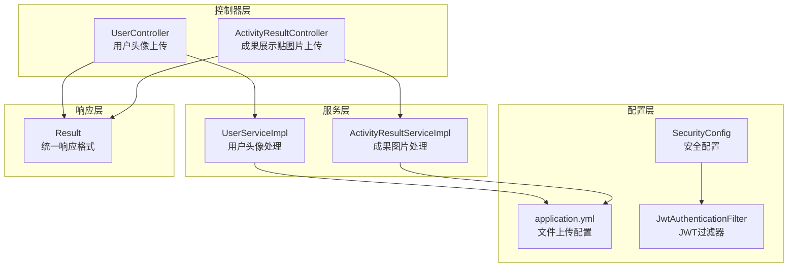
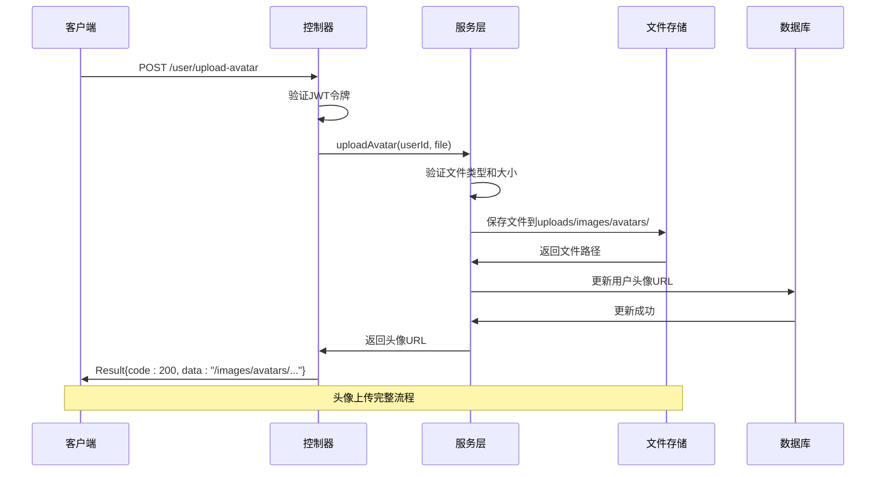
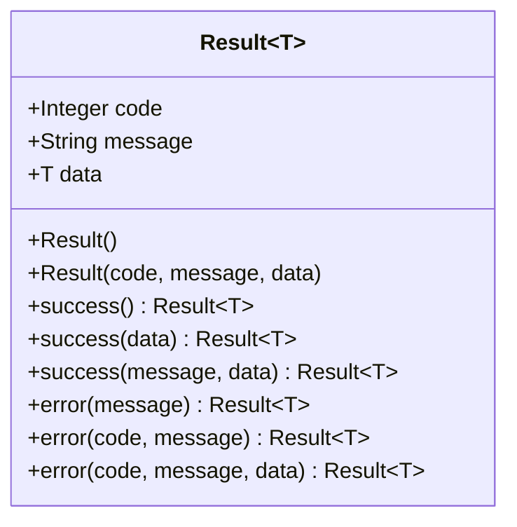
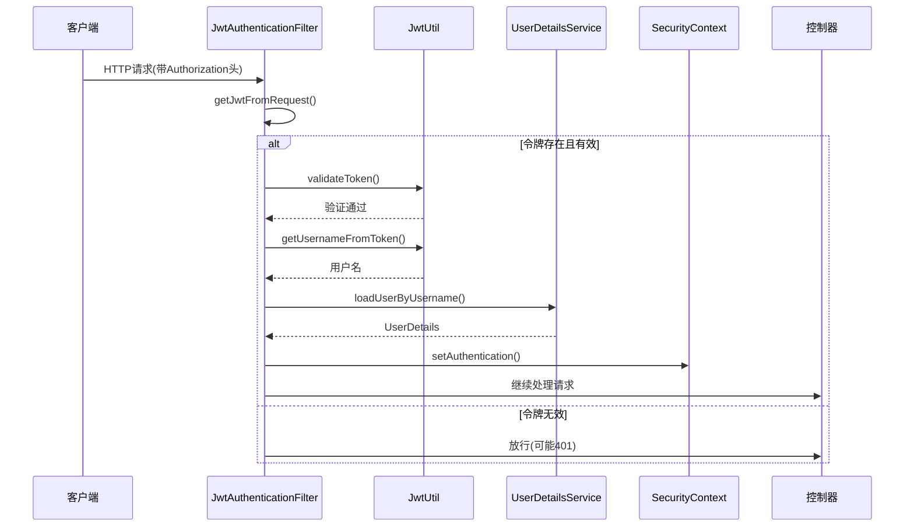

# 文件上传接口

<cite>
**本文档引用的文件**
- [UserController.java](file://src/main/java/com/campus/eventsys/controller/UserController.java)
- [ActivityResultController.java](file://src/main/java/com/campus/eventsys/controller/ActivityResultController.java)
- [UserServiceImpl.java](file://src/main/java/com/campus/eventsys/service/impl/UserServiceImpl.java)
- [ActivityResultServiceImpl.java](file://src/main/java/com/campus/eventsys/service/impl/ActivityResultServiceImpl.java)
- [application.yml](file://src/main/resources/application.yml)
- [Result.java](file://src/main/java/com/campus/eventsys/common/Result.java)
- [JwtAuthenticationFilter.java](file://src/main/java/com/campus/eventsys/security/JwtAuthenticationFilter.java)
- [SecurityConfig.java](file://src/main/java/com/campus/eventsys/config/SecurityConfig.java)
- [url.txt](file://url.txt)
</cite>

## 目录
1. [简介](#简介)
2. [项目结构](#项目结构)
3. [核心组件](#核心组件)
4. [架构概览](#架构概览)
5. [详细组件分析](#详细组件分析)
6. [依赖关系分析](#依赖关系分析)
7. [性能考虑](#性能考虑)
8. [故障排除指南](#故障排除指南)
9. [结论](#结论)
10. [附录](#附录)

## 简介
本文件上传接口文档详细记录了活动系统中的文件上传功能，包括用户头像上传、活动成果展示贴图片上传等核心接口。文档涵盖了HTTP方法、URL模式、请求参数、响应格式、文件大小限制、格式验证、安全检查机制，并提供了完整的接口使用指南。

## 项目结构
文件上传功能主要分布在以下模块中：



**图表来源**
- [UserController.java:1-146](file://src/main/java/com/campus/eventsys/controller/UserController.java#L1-L146)
- [ActivityResultController.java:1-376](file://src/main/java/com/campus/eventsys/controller/ActivityResultController.java#L1-L376)
- [UserServiceImpl.java:1-158](file://src/main/java/com/campus/eventsys/service/impl/UserServiceImpl.java#L1-L158)
- [ActivityResultServiceImpl.java:1-193](file://src/main/java/com/campus/eventsys/service/impl/ActivityResultServiceImpl.java#L1-L193)

**章节来源**
- [UserController.java:1-146](file://src/main/java/com/campus/eventsys/controller/UserController.java#L1-L146)
- [ActivityResultController.java:1-376](file://src/main/java/com/campus/eventsys/controller/ActivityResultController.java#L1-L376)
- [application.yml:1-76](file://src/main/resources/application.yml#L1-L76)

## 核心组件
文件上传系统由四个核心组件构成：

### 1. 用户头像上传组件
- **控制器**: UserController.uploadAvatar()
- **服务实现**: UserServiceImpl.uploadAvatar()
- **功能**: 处理用户头像上传，支持jpg/png/gif格式，大小不超过10MB

### 2. 成果展示贴图片上传组件
- **控制器**: ActivityResultController.uploadImages()
- **服务实现**: ActivityResultServiceImpl.saveImage()
- **功能**: 支持多图上传，单次最多9张，单张不超过10MB

### 3. 安全认证组件
- **JWT过滤器**: JwtAuthenticationFilter
- **安全配置**: SecurityConfig
- **功能**: 基于JWT的认证授权机制

### 4. 统一响应组件
- **响应格式**: Result<T>
- **功能**: 标准化的API响应格式

**章节来源**
- [UserServiceImpl.java:60-126](file://src/main/java/com/campus/eventsys/service/impl/UserServiceImpl.java#L60-L126)
- [ActivityResultServiceImpl.java:115-146](file://src/main/java/com/campus/eventsys/service/impl/ActivityResultServiceImpl.java#L115-L146)
- [Result.java:10-54](file://src/main/java/com/campus/eventsys/common/Result.java#L10-L54)

## 架构概览
文件上传采用分层架构设计，确保功能分离和代码可维护性：



**图表来源**
- [UserController.java:72-93](file://src/main/java/com/campus/eventsys/controller/UserController.java#L72-L93)
- [UserServiceImpl.java:60-126](file://src/main/java/com/campus/eventsys/service/impl/UserServiceImpl.java#L60-L126)

**章节来源**
- [JwtAuthenticationFilter.java:26-57](file://src/main/java/com/campus/eventsys/security/JwtAuthenticationFilter.java#L26-L57)
- [SecurityConfig.java:35-57](file://src/main/java/com/campus/eventsys/config/SecurityConfig.java#L35-L57)

## 详细组件分析

### 用户头像上传接口

#### 接口规范
- **HTTP方法**: POST
- **URL模式**: `/user/upload-avatar`
- **请求格式**: multipart/form-data
- **认证要求**: 需要Bearer Token

#### 请求参数
| 参数名 | 类型 | 必填 | 描述 | 示例 |
|--------|------|------|------|------|
| avatar | file | 是 | 头像图片文件 | jpg/png/gif格式 |
| Authorization | header | 是 | JWT访问令牌 | Bearer xxx.yyy.zzz |

#### 响应格式
```json
{
  "code": 200,
  "message": "头像上传成功",
  "data": "/images/avatars/user_1_a1b2c3d4e5f6.png"
}
```

#### 业务规则
- 支持格式: jpg, png, gif
- 最大文件大小: 10MB
- 自动删除旧头像文件
- 文件命名: user_{userId}_{uuid}.扩展名

#### 错误处理
- 401: 未登录或令牌无效
- 400: 文件为空、格式不支持、大小超限
- 500: 服务器内部错误

**章节来源**
- [UserController.java:57-93](file://src/main/java/com/campus/eventsys/controller/UserController.java#L57-L93)
- [UserServiceImpl.java:60-126](file://src/main/java/com/campus/eventsys/service/impl/UserServiceImpl.java#L60-L126)

### 成果展示贴图片上传接口

#### 接口规范
- **HTTP方法**: POST
- **URL模式**: `/results/upload-images/{activityId}`
- **请求格式**: multipart/form-data
- **认证要求**: 需要Bearer Token

#### 请求参数
| 参数名 | 类型 | 必填 | 描述 | 示例 |
|--------|------|------|------|------|
| files | file[] | 是 | 图片文件列表 | 支持多文件上传 |
| activityId | path | 是 | 活动ID | 1, 2, 3... |
| Authorization | header | 是 | JWT访问令牌 | Bearer xxx.yyy.zzz |

#### 响应格式
```json
{
  "code": 200,
  "message": "上传成功",
  "data": [
    "/images/activity_1/image1.jpg",
    "/images/activity_1/image2.png"
  ]
}
```

#### 业务规则
- 支持格式: 所有图片格式
- 单次最大文件数: 9张
- 单张最大文件大小: 10MB
- 按活动ID分目录存储
- 文件命名: UUID随机生成

#### 存储策略
- 存储路径: `uploads/images/activity_{activityId}/`
- 访问URL: `/images/activity_{activityId}/文件名`
- 目录结构: 自动创建活动专属目录

**章节来源**
- [ActivityResultController.java:267-347](file://src/main/java/com/campus/eventsys/controller/ActivityResultController.java#L267-L347)
- [ActivityResultServiceImpl.java:115-146](file://src/main/java/com/campus/eventsys/service/impl/ActivityResultServiceImpl.java#L115-L146)

### 统一响应格式

#### Result<T> 结构


**图表来源**
- [Result.java:10-54](file://src/main/java/com/campus/eventsys/common/Result.java#L10-L54)

#### 状态码规范
- **200**: 操作成功
- **400**: 参数错误/业务逻辑错误
- **401**: 未授权/认证失败
- **403**: 权限不足
- **404**: 资源不存在
- **500**: 服务器内部错误

**章节来源**
- [Result.java:10-54](file://src/main/java/com/campus/eventsys/common/Result.java#L10-L54)

## 依赖关系分析

### 安全认证流程



**图表来源**
- [JwtAuthenticationFilter.java:26-57](file://src/main/java/com/campus/eventsys/security/JwtAuthenticationFilter.java#L26-L57)
- [SecurityConfig.java:35-57](file://src/main/java/com/campus/eventsys/config/SecurityConfig.java#L35-L57)

### 文件上传配置

#### 应用配置
| 配置项 | 默认值 | 描述 |
|--------|--------|------|
| file.upload.path | uploads/images | 文件上传根目录 |
| file.access.url | /images/ | 文件访问URL前缀 |
| spring.servlet.multipart.max-file-size | 10MB | 单个文件最大大小 |
| spring.servlet.multipart.max-request-size | 20MB | 请求最大总大小 |

#### 配置文件位置
- **主配置**: `src/main/resources/application.yml`
- **配置项**: 第21-27行(文件上传配置)，第64-69行(文件访问配置)

**章节来源**
- [application.yml:21-27](file://src/main/resources/application.yml#L21-L27)
- [application.yml:64-69](file://src/main/resources/application.yml#L64-L69)

## 性能考虑

### 文件上传优化建议

#### 1. 并发处理
- 当前实现为同步阻塞处理
- 建议: 考虑异步处理大量文件上传请求

#### 2. 内存管理
- 大文件上传可能导致内存压力
- 建议: 实现流式处理，避免将整个文件加载到内存

#### 3. 存储优化
- 按活动ID分目录存储，便于管理和清理
- 建议: 实现定期清理无用文件的定时任务

#### 4. 缓存策略
- 头像文件可考虑CDN缓存
- 建议: 配置适当的缓存头和压缩

## 故障排除指南

### 常见问题及解决方案

#### 1. 上传失败
**症状**: 返回400错误，提示"上传失败"
**原因分析**:
- 文件格式不支持
- 文件大小超限
- 服务器磁盘空间不足

**解决步骤**:
1. 检查文件格式是否为支持的图片格式
2. 确认文件大小不超过10MB限制
3. 验证服务器磁盘空间充足

#### 2. 权限错误
**症状**: 返回403错误，提示"无权限"
**原因分析**:
- 未登录或令牌过期
- 用户权限不足
- 活动权限检查失败

**解决步骤**:
1. 确保请求头包含有效的Bearer Token
2. 验证用户具有相应的操作权限
3. 检查活动状态和用户角色

#### 3. 路径访问问题
**症状**: 文件上传成功但无法访问
**原因分析**:
- 文件存储路径配置错误
- Web服务器未正确映射静态资源

**解决步骤**:
1. 检查`file.upload.path`配置
2. 验证Web服务器静态资源映射
3. 确认文件权限设置正确

**章节来源**
- [UserServiceImpl.java:122-125](file://src/main/java/com/campus/eventsys/service/impl/UserServiceImpl.java#L122-L125)
- [ActivityResultServiceImpl.java:142-145](file://src/main/java/com/campus/eventsys/service/impl/ActivityResultServiceImpl.java#L142-L145)

## 结论
文件上传模块实现了完整的图片上传功能，包括用户头像和活动成果展示贴图片上传。系统采用分层架构设计，具备完善的认证授权机制、文件验证规则和统一的响应格式。通过合理的配置管理和安全控制，确保了文件上传的安全性和可靠性。

## 附录

### 接口使用示例

#### 用户头像上传示例
```bash
curl -X POST http://localhost:8080/api/user/upload-avatar \
  -H "Authorization: Bearer YOUR_JWT_TOKEN" \
  -H "Content-Type: multipart/form-data" \
  -F "avatar=@/path/to/avatar.jpg"
```

#### 成果展示贴图片上传示例
```bash
curl -X POST http://localhost:8080/api/results/upload-images/1 \
  -H "Authorization: Bearer YOUR_JWT_TOKEN" \
  -H "Content-Type: multipart/form-data" \
  -F "files=@/path/to/image1.jpg" \
  -F "files=@/path/to/image2.png"
```

### 配置参考
- **基础URL**: `http://localhost:8080/api/`
- **Swagger UI**: `http://localhost:8080/api/swagger-ui.html`
- **OpenAPI文档**: `http://localhost:8080/api/v3/api-docs`

**章节来源**
- [url.txt:1-9](file://url.txt#L1-L9)