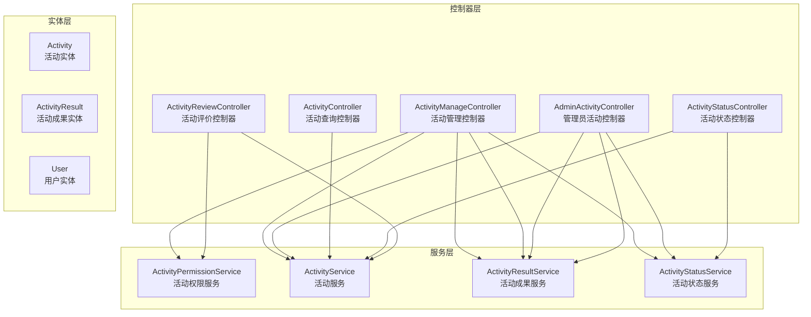
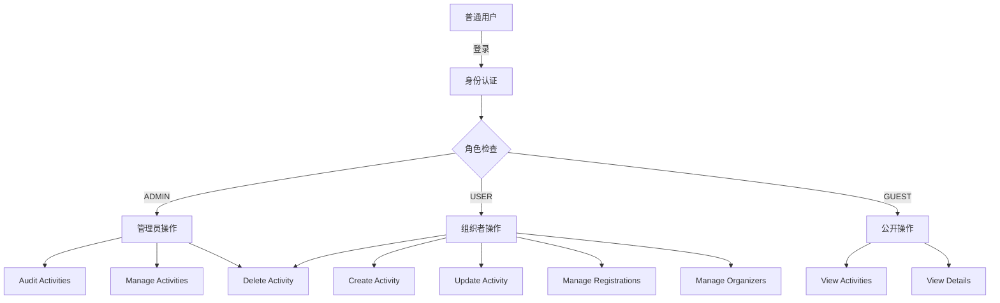
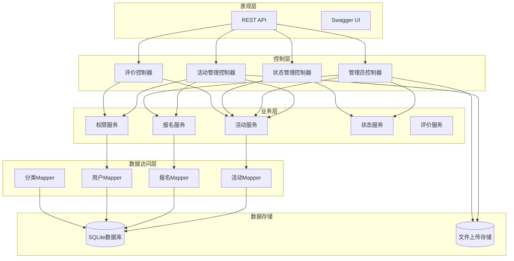
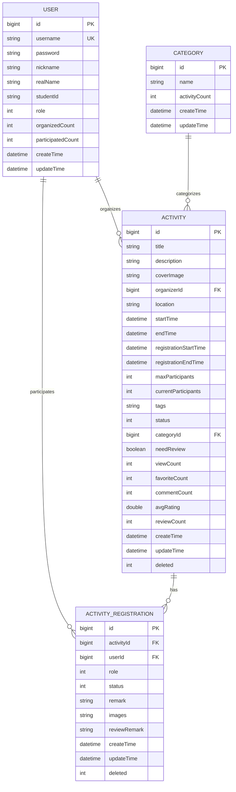
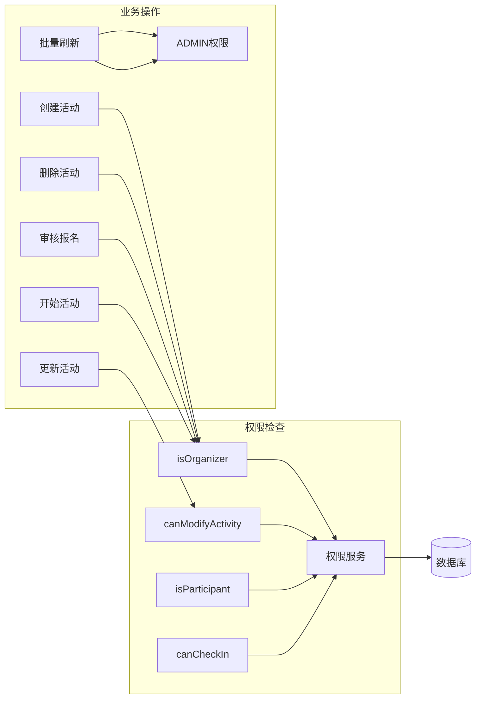

# 活动管理接口

<cite>
**本文档引用的文件**
- [ActivityManageController.java](file://src/main/java/com/campus/eventsys/controller/ActivityManageController.java)
- [AdminActivityController.java](file://src/main/java/com/campus/eventsys/controller/AdminActivityController.java)
- [ActivityController.java](file://src/main/java/com/campus/eventsys/controller/ActivityController.java)
- [ActivityStatusController.java](file://src/main/java/com/campus/eventsys/controller/ActivityStatusController.java)
- [ActivityReviewController.java](file://src/main/java/com/campus/eventsys/controller/ActivityReviewController.java)
- [Activity.java](file://src/main/java/com/campus/eventsys/entity/Activity.java)
- [ActivityPermissionService.java](file://src/main/java/com/campus/eventsys/service/ActivityPermissionService.java)
- [ActivityRole.java](file://src/main/java/com/campus/eventsys/enums/ActivityRole.java)
- [application.yml](file://src/main/resources/application.yml)
- [url.txt](file://url.txt)
</cite>

## 目录
1. [简介](#简介)
2. [项目结构](#项目结构)
3. [核心组件](#核心组件)
4. [架构概览](#架构概览)
5. [详细组件分析](#详细组件分析)
6. [依赖分析](#依赖分析)
7. [性能考虑](#性能考虑)
8. [故障排除指南](#故障排除指南)
9. [结论](#结论)

## 简介

活动管理模块是校园活动管理系统的核心功能模块，提供完整的活动生命周期管理能力。该模块支持活动创建、编辑、删除、查询等基础管理功能，包含完善的审核流程、状态管理、分类管理、权限控制等核心特性。

系统采用基于角色的权限控制机制，区分管理员和活动组织者两种角色，分别提供不同的操作权限和功能范围。活动状态管理实现了自动流转机制，确保活动状态与实际业务进程保持同步。

## 项目结构

活动管理模块主要包含以下核心组件：

**图表来源**
- [ActivityManageController.java:1-882](file://src/main/java/com/campus/eventsys/controller/ActivityManageController.java#L1-L882)
- [AdminActivityController.java:1-485](file://src/main/java/com/campus/eventsys/controller/AdminActivityController.java#L1-L485)
- [ActivityController.java:1-111](file://src/main/java/com/campus/eventsys/controller/ActivityController.java#L1-L111)
- [ActivityStatusController.java:1-236](file://src/main/java/com/campus/eventsys/controller/ActivityStatusController.java#L1-L236)
- [ActivityReviewController.java:1-254](file://src/main/java/com/campus/eventsys/controller/ActivityReviewController.java#L1-L254)

**章节来源**
- [ActivityManageController.java:1-882](file://src/main/java/com/campus/eventsys/controller/ActivityManageController.java#L1-L882)
- [AdminActivityController.java:1-485](file://src/main/java/com/campus/eventsys/controller/AdminActivityController.java#L1-L485)
- [ActivityController.java:1-111](file://src/main/java/com/campus/eventsys/controller/ActivityController.java#L1-L111)
- [ActivityStatusController.java:1-236](file://src/main/java/com/campus/eventsys/controller/ActivityStatusController.java#L1-L236)
- [ActivityReviewController.java:1-254](file://src/main/java/com/campus/eventsys/controller/ActivityReviewController.java#L1-L254)

## 核心组件

### 活动状态管理

系统实现了完整的活动状态管理体系，包含以下状态码：

| 状态码 | 状态名称 | 描述 |
|--------|----------|------|
| -2 | 已下架 | 管理员强制下架活动 |
| -1 | 已拒绝 | 审核未通过 |
| 0 | 草稿 | 预留状态 |
| 1 | 待审核 | 创建后默认状态 |
| 2 | 报名中 | 审核通过，接受报名 |
| 3 | 即将开始 | 开始前30分钟内 |
| 4 | 进行中 | 活动已开始 |
| 5 | 已结束 | 超过结束时间 |

### 权限模型

系统采用基于角色的权限控制机制：

**图表来源**
- [ActivityPermissionService.java:1-124](file://src/main/java/com/campus/eventsys/service/ActivityPermissionService.java#L1-L124)
- [ActivityRole.java:1-38](file://src/main/java/com/campus/eventsys/enums/ActivityRole.java#L1-L38)

**章节来源**
- [ActivityPermissionService.java:1-124](file://src/main/java/com/campus/eventsys/service/ActivityPermissionService.java#L1-L124)
- [ActivityRole.java:1-38](file://src/main/java/com/campus/eventsys/enums/ActivityRole.java#L1-L38)

## 架构概览

活动管理模块采用分层架构设计，清晰分离了不同职责的组件：

**图表来源**
- [ActivityManageController.java:62-65](file://src/main/java/com/campus/eventsys/controller/ActivityManageController.java#L62-L65)
- [AdminActivityController.java:51-54](file://src/main/java/com/campus/eventsys/controller/AdminActivityController.java#L51-L54)
- [ActivityStatusController.java:56-59](file://src/main/java/com/campus/eventsys/controller/ActivityStatusController.java#L56-L59)

**章节来源**
- [ActivityManageController.java:62-65](file://src/main/java/com/campus/eventsys/controller/ActivityManageController.java#L62-L65)
- [AdminActivityController.java:51-54](file://src/main/java/com/campus/eventsys/controller/AdminActivityController.java#L51-L54)
- [ActivityStatusController.java:56-59](file://src/main/java/com/campus/eventsys/controller/ActivityStatusController.java#L56-L59)

## 详细组件分析

### 活动管理控制器

活动管理控制器为活动组织者提供完整的活动管理功能：

#### 基础管理接口

| 接口 | 方法 | URL | 权限 | 描述 |
|------|------|-----|------|------|
| 创建活动 | POST | `/api/activities/manage/create` | 组织者 | 创建新活动，状态默认为待审核 |
| 更新活动 | PUT | `/api/activities/manage/update/{id}` | 组织者 | 更新活动信息 |
| 删除活动 | DELETE | `/api/activities/manage/delete/{id}` | 组织者 | 删除活动（逻辑删除） |
| 我创建的活动 | GET | `/api/activities/manage/my-created` | 组织者 | 获取组织者创建的所有活动 |

#### 报名管理接口

| 接口 | 方法 | URL | 权限 | 描述 |
|------|------|-----|------|------|
| 获取报名列表 | GET | `/api/activities/manage/{activityId}/registrations` | 组织者 | 获取活动所有报名人员列表 |
| 获取参与者列表 | GET | `/api/activities/manage/{activityId}/participants` | 组织者 | 获取活动参与者列表（不含组织者） |
| 审核报名 | POST | `/api/activities/manage/registrations/{registrationId}/review` | 组织者 | 审核活动报名申请 |
| 移除参与者 | POST | `/api/activities/manage/registrations/{registrationId}/remove` | 组织者 | 移除活动参与者 |

#### 管理者管理接口

| 接口 | 方法 | URL | 权限 | 描述 |
|------|------|-----|------|------|
| 获取管理者列表 | GET | `/api/activities/manage/{activityId}/organizers` | 组织者 | 获取活动所有管理者列表 |
| 添加管理者 | POST | `/api/activities/manage/{activityId}/organizers` | 组织者 | 添加活动管理者 |
| 移除管理者 | POST | `/api/activities/manage/{activityId}/organizers/{targetUserId}/remove` | 组织者 | 移除活动管理者 |

**章节来源**
- [ActivityManageController.java:82-141](file://src/main/java/com/campus/eventsys/controller/ActivityManageController.java#L82-L141)
- [ActivityManageController.java:146-183](file://src/main/java/com/campus/eventsys/controller/ActivityManageController.java#L146-L183)
- [ActivityManageController.java:188-253](file://src/main/java/com/campus/eventsys/controller/ActivityManageController.java#L188-L253)
- [ActivityManageController.java:258-283](file://src/main/java/com/campus/eventsys/controller/ActivityManageController.java#L258-L283)
- [ActivityManageController.java:289-351](file://src/main/java/com/campus/eventsys/controller/ActivityManageController.java#L289-L351)
- [ActivityManageController.java:356-417](file://src/main/java/com/campus/eventsys/controller/ActivityManageController.java#L356-L417)
- [ActivityManageController.java:422-466](file://src/main/java/com/campus/eventsys/controller/ActivityManageController.java#L422-L466)
- [ActivityManageController.java:469-514](file://src/main/java/com/campus/eventsys/controller/ActivityManageController.java#L469-L514)
- [ActivityManageController.java:519-586](file://src/main/java/com/campus/eventsys/controller/ActivityManageController.java#L519-L586)
- [ActivityManageController.java:589-711](file://src/main/java/com/campus/eventsys/controller/ActivityManageController.java#L589-L711)

### 管理员活动控制器

管理员控制器提供完整的活动审核和管理功能：

#### 审核管理接口

| 接口 | 方法 | URL | 权限 | 描述 |
|------|------|-----|------|------|
| 待审核活动 | GET | `/api/admin/activities/pending` | ADMIN | 获取待审核活动列表 |
| 活动列表 | GET | `/api/admin/activities/list` | ADMIN | 获取所有活动列表（支持筛选） |
| 活动详情 | GET | `/api/admin/activities/detail/{id}` | ADMIN | 获取活动详情（包含组织者信息） |
| 审核通过 | POST | `/api/admin/activities/approve/{id}` | ADMIN | 审核通过活动 |
| 审核拒绝 | POST | `/api/admin/activities/reject/{id}` | ADMIN | 审核拒绝活动 |
| 强制下架 | POST | `/api/admin/activities/take-down/{id}` | ADMIN | 强制下架活动 |
| 删除活动 | DELETE | `/api/admin/activities/delete/{id}` | ADMIN | 删除活动（逻辑删除） |
| 批量刷新状态 | POST | `/api/admin/activities/refresh-status` | ADMIN | 批量刷新活动状态 |

**章节来源**
- [AdminActivityController.java:66-97](file://src/main/java/com/campus/eventsys/controller/AdminActivityController.java#L66-L97)
- [AdminActivityController.java:101-142](file://src/main/java/com/campus/eventsys/controller/AdminActivityController.java#L101-L142)
- [AdminActivityController.java:145-163](file://src/main/java/com/campus/eventsys/controller/AdminActivityController.java#L145-L163)
- [AdminActivityController.java:166-201](file://src/main/java/com/campus/eventsys/controller/AdminActivityController.java#L166-L201)
- [AdminActivityController.java:204-235](file://src/main/java/com/campus/eventsys/controller/AdminActivityController.java#L204-L235)
- [AdminActivityController.java:296-355](file://src/main/java/com/campus/eventsys/controller/AdminActivityController.java#L296-L355)
- [AdminActivityController.java:238-293](file://src/main/java/com/campus/eventsys/controller/AdminActivityController.java#L238-L293)
- [AdminActivityController.java:358-371](file://src/main/java/com/campus/eventsys/controller/AdminActivityController.java#L358-L371)

### 活动状态控制器

活动状态控制器提供状态查询和手动状态变更功能：

#### 状态管理接口

| 接口 | 方法 | URL | 权限 | 描述 |
|------|------|-----|------|------|
| 获取状态信息 | GET | `/api/activities/status/info/{activityId}` | 任意用户 | 获取活动当前状态和预期状态 |
| 开始活动 | POST | `/api/activities/status/start/{activityId}` | 组织者/管理员 | 手动开始活动 |
| 刷新状态 | GET | `/api/activities/status/refresh/{activityId}` | 任意用户 | 根据时间自动更新活动状态 |
| 批量刷新状态 | POST | `/api/activities/status/refresh-all` | ADMIN | 管理员批量刷新所有活动状态 |

**章节来源**
- [ActivityStatusController.java:66-103](file://src/main/java/com/campus/eventsys/controller/ActivityStatusController.java#L66-L103)
- [ActivityStatusController.java:109-149](file://src/main/java/com/campus/eventsys/controller/ActivityStatusController.java#L109-L149)
- [ActivityStatusController.java:154-185](file://src/main/java/com/campus/eventsys/controller/ActivityStatusController.java#L154-L185)
- [ActivityStatusController.java:188-203](file://src/main/java/com/campus/eventsys/controller/ActivityStatusController.java#L188-L203)

### 活动查询控制器

活动查询控制器提供公开的活动查询功能：

#### 查询接口

| 接口 | 方法 | URL | 权限 | 描述 |
|------|------|-----|------|------|
| 活动列表 | GET | `/api/activities/list` | 任意用户 | 分页查询活动列表（公开接口） |
| 活动详情 | GET | `/api/activities/detail/{id}` | 任意用户 | 获取活动详情（公开接口） |

**章节来源**
- [ActivityController.java:45-87](file://src/main/java/com/campus/eventsys/controller/ActivityController.java#L45-L87)
- [ActivityController.java:90-109](file://src/main/java/com/campus/eventsys/controller/ActivityController.java#L90-L109)

### 活动评价控制器

活动评价控制器提供完整的评价管理功能：

#### 评价管理接口

| 接口 | 方法 | URL | 权限 | 描述 |
|------|------|-----|------|------|
| 提交评价 | POST | `/api/reviews/create` | 参与者 | 对已结束活动提交评价 |
| 活动评价列表 | GET | `/api/reviews/activity/{activityId}` | 任意用户 | 获取活动评价列表（公开） |
| 我的评价 | GET | `/api/reviews/my` | 参与者 | 获取我的评价列表 |
| 组织者查看评价 | GET | `/api/reviews/organizer` | 组织者 | 组织者查看自己活动的评价 |
| 回复评价 | POST | `/api/reviews/reply/{reviewId}` | 组织者 | 组织者回复评价 |
| 删除评价 | DELETE | `/api/reviews/delete/{reviewId}` | ADMIN | 管理员删除评价 |
| 评价统计 | GET | `/api/reviews/statistics/{activityId}` | 任意用户 | 获取活动评价统计 |

**章节来源**
- [ActivityReviewController.java:48-82](file://src/main/java/com/campus/eventsys/controller/ActivityReviewController.java#L48-L82)
- [ActivityReviewController.java:85-105](file://src/main/java/com/campus/eventsys/controller/ActivityReviewController.java#L85-L105)
- [ActivityReviewController.java:108-125](file://src/main/java/com/campus/eventsys/controller/ActivityReviewController.java#L108-L125)
- [ActivityReviewController.java:128-157](file://src/main/java/com/campus/eventsys/controller/ActivityReviewController.java#L128-L157)
- [ActivityReviewController.java:160-185](file://src/main/java/com/campus/eventsys/controller/ActivityReviewController.java#L160-L185)
- [ActivityReviewController.java:188-216](file://src/main/java/com/campus/eventsys/controller/ActivityReviewController.java#L188-L216)
- [ActivityReviewController.java:219-240](file://src/main/java/com/campus/eventsys/controller/ActivityReviewController.java#L219-L240)

## 依赖分析

### 数据模型关系

**图表来源**
- [Activity.java:15-95](file://src/main/java/com/campus/eventsys/entity/Activity.java#L15-L95)

### 权限依赖关系

**图表来源**
- [ActivityPermissionService.java:15-61](file://src/main/java/com/campus/eventsys/service/ActivityPermissionService.java#L15-L61)

**章节来源**
- [Activity.java:15-95](file://src/main/java/com/campus/eventsys/entity/Activity.java#L15-L95)
- [ActivityPermissionService.java:15-61](file://src/main/java/com/campus/eventsys/service/ActivityPermissionService.java#L15-L61)

## 性能考虑

### 缓存策略

系统采用多级缓存策略优化性能：

1. **数据库查询缓存**：对常用查询结果进行缓存
2. **状态计算缓存**：活动状态计算结果缓存
3. **权限检查缓存**：用户权限信息缓存

### 分页查询优化

- 使用MyBatis-Plus分页插件
- 合理设置分页大小（默认10条）
- 优化查询条件索引

### 文件上传优化

- 支持多文件上传
- 文件大小限制（单文件≤10MB，总大小≤20MB）
- 图片格式支持（JPG/PNG/GIF）

## 故障排除指南

### 常见问题

#### 权限相关问题

| 问题 | 可能原因 | 解决方案 |
|------|----------|----------|
| 403 无权限 | 用户不是活动组织者 | 确认用户角色和活动权限 |
| 401 未登录 | 缺少JWT令牌 | 重新登录获取令牌 |
| 404 活动不存在 | 活动ID错误 | 检查活动ID有效性 |

#### 状态相关问题

| 问题 | 可能原因 | 解决方案 |
|------|----------|----------|
| 状态无法更新 | 时间计算错误 | 检查系统时间和时区设置 |
| 自动状态不生效 | 定时任务未运行 | 手动触发批量刷新 |
| 手动开始失败 | 活动状态不允许 | 确认活动当前状态 |

#### 数据一致性问题

| 问题 | 可能原因 | 解决方案 |
|------|----------|----------|
| 统计数据不准确 | 业务逻辑异常 | 检查统计更新逻辑 |
| 报名记录异常 | 数据库事务问题 | 检查事务边界和回滚机制 |

**章节来源**
- [ActivityManageController.java:173-175](file://src/main/java/com/campus/eventsys/controller/ActivityManageController.java#L173-L175)
- [ActivityStatusController.java:139-141](file://src/main/java/com/campus/eventsys/controller/ActivityStatusController.java#L139-L141)

## 结论

活动管理模块提供了完整的企业级活动管理解决方案，具有以下特点：

1. **完整的功能覆盖**：从活动创建到结束的全生命周期管理
2. **严格的权限控制**：基于角色的细粒度权限管理
3. **智能的状态管理**：自动状态流转确保业务一致性
4. **完善的审核机制**：支持管理员审核和组织者管理
5. **丰富的扩展性**：模块化设计便于功能扩展

该模块为校园活动管理提供了可靠的技术支撑，能够满足复杂业务场景的需求。通过合理的架构设计和完善的权限控制，确保了系统的安全性、稳定性和可维护性。