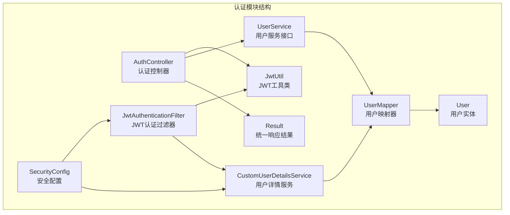
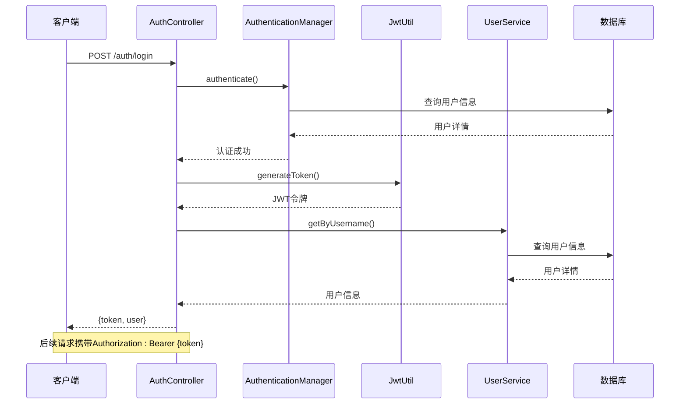
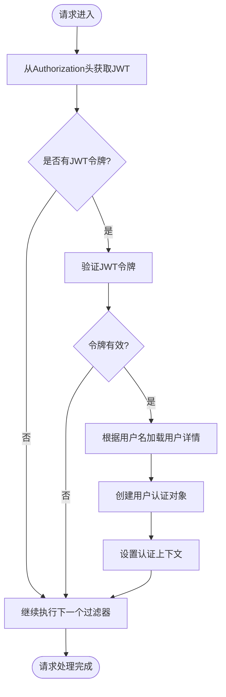
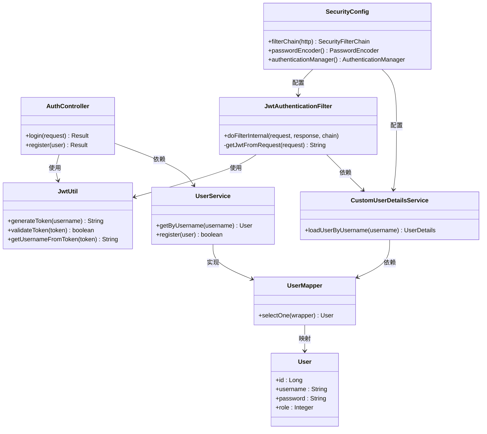
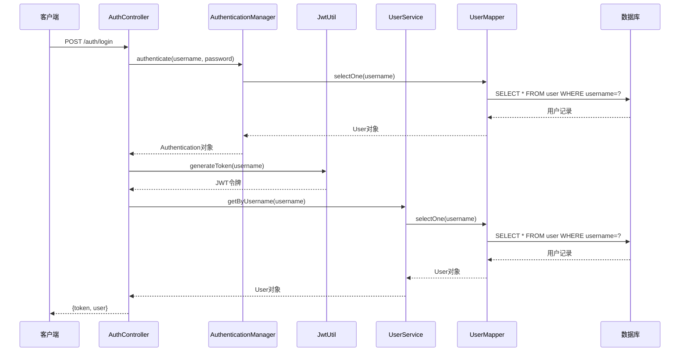

# 用户认证接口

<cite>
**本文档引用的文件**
- [AuthController.java](file://src/main/java/com/campus/eventsys/controller/AuthController.java)
- [JwtUtil.java](file://src/main/java/com/campus/eventsys/security/JwtUtil.java)
- [JwtAuthenticationFilter.java](file://src/main/java/com/campus/eventsys/security/JwtAuthenticationFilter.java)
- [CustomUserDetailsService.java](file://src/main/java/com/campus/eventsys/security/CustomUserDetailsService.java)
- [SecurityConfig.java](file://src/main/java/com/campus/eventsys/config/SecurityConfig.java)
- [Result.java](file://src/main/java/com/campus/eventsys/common/Result.java)
- [User.java](file://src/main/java/com/campus/eventsys/entity/User.java)
- [UserService.java](file://src/main/java/com/campus/eventsys/service/UserService.java)
- [UserMapper.java](file://src/main/java/com/campus/eventsys/mapper/UserMapper.java)
- [application.yml](file://src/main/resources/application.yml)
- [schema.sql](file://src/main/resources/db/schema.sql)
- [AuthControllerTest.java](file://src/test/java/com/campus/eventsys/controller/AuthControllerTest.java)
</cite>

## 目录
1. [简介](#简介)
2. [项目结构](#项目结构)
3. [核心组件](#核心组件)
4. [架构概览](#架构概览)
5. [详细组件分析](#详细组件分析)
6. [依赖关系分析](#依赖关系分析)
7. [性能考虑](#性能考虑)
8. [故障排除指南](#故障排除指南)
9. [结论](#结论)

## 简介

本文档详细记录了校园活动系统的用户认证模块API接口，包括用户注册、登录等认证相关接口的HTTP方法、URL模式、请求参数和响应格式。文档还涵盖了JWT令牌生成、验证和刷新机制的实现细节，认证接口的权限要求、安全考虑和最佳实践，以及完整的请求响应示例。

该系统采用Spring Security + JWT的认证方案，实现了RESTful API的安全访问控制，支持普通用户和管理员两种角色权限管理。

## 项目结构

用户认证模块位于以下目录结构中：



**图表来源**
- [AuthController.java:1-106](file://src/main/java/com/campus/eventsys/controller/AuthController.java#L1-L106)
- [SecurityConfig.java:1-100](file://src/main/java/com/campus/eventsys/config/SecurityConfig.java#L1-L100)

**章节来源**
- [AuthController.java:1-106](file://src/main/java/com/campus/eventsys/controller/AuthController.java#L1-L106)
- [SecurityConfig.java:1-100](file://src/main/java/com/campus/eventsys/config/SecurityConfig.java#L1-L100)

## 核心组件

### 认证控制器 (AuthController)

认证控制器提供用户登录和注册功能，位于 `/auth` 路径下：

- **登录接口**: `POST /auth/login`
- **注册接口**: `POST /auth/register`

### 安全配置 (SecurityConfig)

配置了基于JWT的无状态认证机制：
- 禁用CSRF保护
- 启用CORS跨域支持
- 设置会话策略为STATELESS
- 定义了认证接口放行规则

### JWT工具类 (JwtUtil)

提供JWT令牌的生成、验证和解析功能：
- 令牌生成：包含用户名、签发时间和过期时间
- 令牌验证：检查签名有效性
- 用户名提取：从令牌中解析用户名

### 用户详情服务 (CustomUserDetailsService)

实现Spring Security的UserDetailsService接口，负责用户认证信息的加载：
- 根据用户名查询用户信息
- 将数据库中的角色转换为Spring Security的权限
- 返回UserDetails对象用于认证

**章节来源**
- [AuthController.java:26-106](file://src/main/java/com/campus/eventsys/controller/AuthController.java#L26-L106)
- [SecurityConfig.java:35-100](file://src/main/java/com/campus/eventsys/config/SecurityConfig.java#L35-L100)
- [JwtUtil.java:1-71](file://src/main/java/com/campus/eventsys/security/JwtUtil.java#L1-L71)
- [CustomUserDetailsService.java:1-40](file://src/main/java/com/campus/eventsys/security/CustomUserDetailsService.java#L1-L40)

## 架构概览

系统采用分层架构设计，认证流程如下：



**图表来源**
- [AuthController.java:57-73](file://src/main/java/com/campus/eventsys/controller/AuthController.java#L57-L73)
- [JwtUtil.java:25-35](file://src/main/java/com/campus/eventsys/security/JwtUtil.java#L25-L35)
- [CustomUserDetailsService.java:22-38](file://src/main/java/com/campus/eventsys/security/CustomUserDetailsService.java#L22-L38)

## 详细组件分析

### 认证接口定义

#### 登录接口

**HTTP方法**: `POST`
**URL模式**: `/auth/login`
**请求参数**: LoginRequest 对象

**请求体结构**:
```json
{
  "username": "string",
  "password": "string"
}
```

**响应结构**:
```json
{
  "code": 200,
  "message": "登录成功",
  "data": {
    "token": "string",
    "user": {
      "id": 1,
      "username": "string",
      "nickname": "string",
      "avatar": "string",
      "role": 0
    }
  }
}
```

**成功响应示例**:
```json
{
  "code": 200,
  "message": "登录成功",
  "data": {
    "token": "eyJhbGciOiJIUzI1NiIsInR5cCI6IkpXVCJ9...",
    "user": {
      "id": 1,
      "username": "admin",
      "nickname": "管理员",
      "avatar": "/avatars/admin.jpg",
      "role": 1
    }
  }
}
```

**失败响应示例**:
```json
{
  "code": 401,
  "message": "用户名或密码错误",
  "data": null
}
```

#### 注册接口

**HTTP方法**: `POST`
**URL模式**: `/auth/register`
**请求参数**: User 对象

**请求体结构**:
```json
{
  "username": "string",
  "password": "string",
  "nickname": "string",
  "email": "string",
  "phone": "string",
  "realName": "string",
  "studentId": "string",
  "college": "string",
  "major": "string",
  "grade": "string",
  "gender": 1,
  "bio": "string",
  "role": 0,
  "status": 1
}
```

**响应结构**:
```json
{
  "code": 200,
  "message": "注册成功",
  "data": null
}
```

**成功响应示例**:
```json
{
  "code": 200,
  "message": "注册成功",
  "data": null
}
```

**失败响应示例**:
```json
{
  "code": 400,
  "message": "用户名已存在或参数错误",
  "data": null
}
```

### JWT令牌机制

#### 令牌生成

JWT令牌包含以下声明：
- **sub**: 用户名 (subject)
- **iat**: 签发时间 (issued at)
- **exp**: 过期时间 (expiration)

令牌使用HMAC SHA-256算法进行签名，密钥来自配置文件。

#### 令牌验证

验证过程包括：
1. 解析JWT令牌
2. 验证签名完整性
3. 检查令牌是否过期
4. 提取用户名信息

#### 令牌刷新

当前实现不支持自动刷新机制，建议客户端在令牌即将过期时重新登录获取新令牌。

### 认证中间件工作原理

#### JwtAuthenticationFilter

JWT认证过滤器的工作流程：



**图表来源**
- [JwtAuthenticationFilter.java:26-48](file://src/main/java/com/campus/eventsys/security/JwtAuthenticationFilter.java#L26-L48)

#### SecurityConfig配置

安全配置的关键设置：
- **会话管理**: STATELESS（无状态）
- **认证规则**: 
  - `/auth/**` - 允许所有用户访问
  - 公开查询接口 - 允许所有用户访问
  - `/admin/**` - 仅管理员访问
  - 其他接口 - 需要认证
- **CORS配置**: 允许所有域名和凭证

**章节来源**
- [AuthController.java:45-93](file://src/main/java/com/campus/eventsys/controller/AuthController.java#L45-L93)
- [JwtUtil.java:25-56](file://src/main/java/com/campus/eventsys/security/JwtUtil.java#L25-L56)
- [JwtAuthenticationFilter.java:26-56](file://src/main/java/com/campus/eventsys/security/JwtAuthenticationFilter.java#L26-L56)
- [SecurityConfig.java:36-68](file://src/main/java/com/campus/eventsys/config/SecurityConfig.java#L36-L68)

## 依赖关系分析

### 组件依赖图



**图表来源**
- [AuthController.java:38-40](file://src/main/java/com/campus/eventsys/controller/AuthController.java#L38-L40)
- [JwtUtil.java:13-23](file://src/main/java/com/campus/eventsys/security/JwtUtil.java#L13-L23)
- [JwtAuthenticationFilter.java:23-24](file://src/main/java/com/campus/eventsys/security/JwtAuthenticationFilter.java#L23-L24)
- [CustomUserDetailsService.java:19-38](file://src/main/java/com/campus/eventsys/security/CustomUserDetailsService.java#L19-L38)
- [SecurityConfig.java:32-33](file://src/main/java/com/campus/eventsys/config/SecurityConfig.java#L32-L33)
- [UserService.java:9-37](file://src/main/java/com/campus/eventsys/service/UserService.java#L9-L37)
- [UserMapper.java:8](file://src/main/java/com/campus/eventsys/mapper/UserMapper.java#L8)

### 数据流分析

#### 用户登录流程



**图表来源**
- [AuthController.java:61-72](file://src/main/java/com/campus/eventsys/controller/AuthController.java#L61-L72)
- [JwtUtil.java:29-35](file://src/main/java/com/campus/eventsys/security/JwtUtil.java#L29-L35)
- [CustomUserDetailsService.java:23-29](file://src/main/java/com/campus/eventsys/security/CustomUserDetailsService.java#L23-L29)

**章节来源**
- [AuthController.java:57-73](file://src/main/java/com/campus/eventsys/controller/AuthController.java#L57-L73)
- [JwtUtil.java:25-35](file://src/main/java/com/campus/eventsys/security/JwtUtil.java#L25-L35)
- [CustomUserDetailsService.java:22-38](file://src/main/java/com/campus/eventsys/security/CustomUserDetailsService.java#L22-L38)

## 性能考虑

### JWT令牌性能特性

1. **无状态设计**: JWT令牌包含所有必要信息，服务器无需存储会话状态
2. **内存效率**: 令牌大小通常较小，减少网络传输开销
3. **验证效率**: 基于HMAC的签名验证计算量小
4. **过期处理**: 服务器只需检查过期时间，无需查询数据库

### 安全最佳实践

1. **令牌有效期**: 默认24小时，可根据业务需求调整
2. **密钥管理**: 使用强随机密钥，定期轮换
3. **传输安全**: 建议使用HTTPS传输JWT令牌
4. **存储安全**: 客户端应安全存储JWT令牌，避免泄露
5. **权限控制**: 实施最小权限原则，区分普通用户和管理员权限

### 性能优化建议

1. **令牌缓存**: 可考虑实现令牌黑名单缓存以提高验证性能
2. **并发处理**: 使用线程安全的JWT工具类
3. **日志管理**: 合理配置日志级别，避免过多的调试日志影响性能

## 故障排除指南

### 常见问题及解决方案

#### 登录失败

**问题**: 用户名或密码错误
**原因**: 凭证不正确或用户不存在
**解决方案**: 
- 确认用户名和密码
- 检查用户是否被禁用
- 验证密码是否正确加密

#### 令牌验证失败

**问题**: JWT令牌无效或过期
**原因**: 
- 令牌被篡改
- 令牌已过期
- 密钥不匹配
- 令牌格式错误

**解决方案**:
- 重新登录获取新令牌
- 检查服务器时间同步
- 验证JWT库版本兼容性

#### 权限不足

**问题**: 访问受保护资源时返回403
**原因**: 用户权限不足或未登录
**解决方案**:
- 确认用户角色为管理员
- 检查Authorization头格式
- 验证令牌有效性

#### CORS跨域问题

**问题**: 浏览器阻止跨域请求
**原因**: CORS配置不正确
**解决方案**:
- 检查allowedOriginPatterns配置
- 确认credentials设置为true
- 验证预检请求处理

**章节来源**
- [AuthControllerTest.java:58-77](file://src/test/java/com/campus/eventsys/controller/AuthControllerTest.java#L58-L77)
- [AuthControllerTest.java:79-96](file://src/test/java/com/campus/eventsys/controller/AuthControllerTest.java#L79-L96)
- [SecurityConfig.java:87-98](file://src/main/java/com/campus/eventsys/config/SecurityConfig.java#L87-L98)

## 结论

该用户认证模块提供了完整的用户身份验证和授权机制，具有以下特点：

1. **安全性**: 采用JWT无状态认证，支持HTTPS传输
2. **易用性**: RESTful API设计，接口简洁明了
3. **扩展性**: 基于Spring Security框架，易于扩展
4. **可靠性**: 完善的错误处理和异常管理

系统支持普通用户和管理员两种角色，通过Authorization头携带JWT令牌进行身份验证。建议在生产环境中启用HTTPS，定期轮换JWT密钥，并实施适当的监控和日志记录机制。