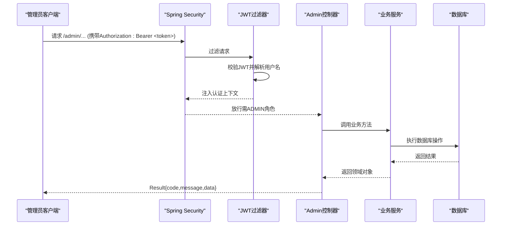
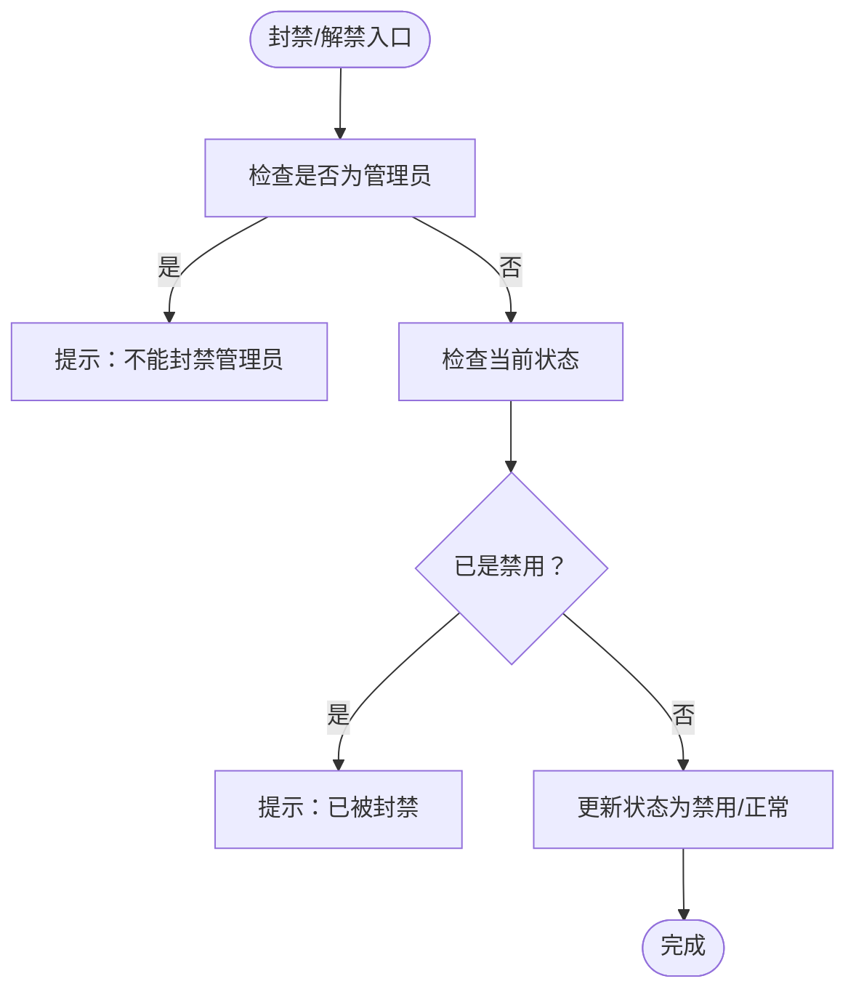
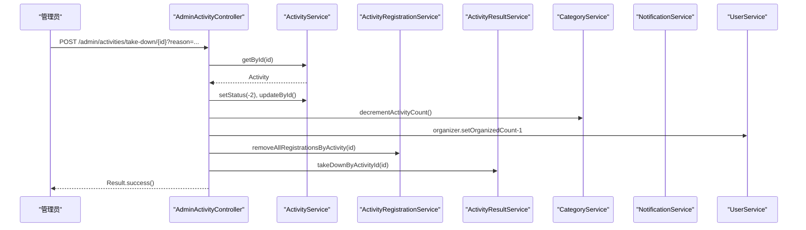
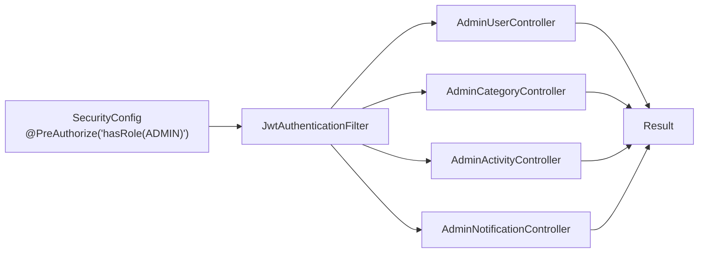

# 管理员管理接口

<cite>
**本文引用的文件**
- [AdminUserController.java](file://src/main/java/com/campus/eventsys/controller/AdminUserController.java)
- [AdminCategoryController.java](file://src/main/java/com/campus/eventsys/controller/AdminCategoryController.java)
- [AdminActivityController.java](file://src/main/java/com/campus/eventsys/controller/AdminActivityController.java)
- [AdminNotificationController.java](file://src/main/java/com/campus/eventsys/controller/AdminNotificationController.java)
- [JwtAuthenticationFilter.java](file://src/main/java/com/campus/eventsys/security/JwtAuthenticationFilter.java)
- [SecurityConfig.java](file://src/main/java/com/campus/eventsys/config/SecurityConfig.java)
- [Result.java](file://src/main/java/com/campus/eventsys/common/Result.java)
- [User.java](file://src/main/java/com/campus/eventsys/entity/User.java)
- [Category.java](file://src/main/java/com/campus/eventsys/entity/Category.java)
- [application.yml](file://src/main/resources/application.yml)
- [AdminUserControllerTest.java](file://src/test/java/com/campus/eventsys/controller/AdminUserControllerTest.java)
- [AdminActivityControllerTest.java](file://src/test/java/com/campus/eventsys/controller/AdminActivityControllerTest.java)
</cite>

## 目录
1. [简介](#简介)
2. [项目结构](#项目结构)
3. [核心组件](#核心组件)
4. [架构总览](#架构总览)
5. [详细组件分析](#详细组件分析)
6. [依赖分析](#依赖分析)
7. [性能考虑](#性能考虑)
8. [故障排查指南](#故障排查指南)
9. [结论](#结论)
10. [附录](#附录)

## 简介
本文件为“管理员管理模块”的完整API接口文档，覆盖用户管理、分类管理、活动审核与管理、公告管理等后台管理相关接口。文档明确HTTP方法、URL模式、请求参数、响应格式与业务规则；说明管理员权限验证、批量操作、数据统计更新、日志与审计机制；并提供用户列表查询、分类维护、活动审核与强制下架的实现示例与最佳实践。

## 项目结构
- 后端采用Spring Boot + MyBatis-Plus，基于注解式REST控制器提供API。
- 管理员接口统一位于/admin前缀，均需ADMIN角色权限。
- 安全层通过JWT过滤器与Spring Security配置实现无状态认证与授权。
- 统一响应封装Result类，便于前后端一致处理。

```mermaid
graph TB
subgraph "客户端"
C["管理端应用/接口测试工具"]
end
subgraph "网关/安全层"
SEC["Spring Security<br/>@PreAuthorize(\"hasRole('ADMIN')\")"]
JWT["JWT认证过滤器"]
end
subgraph "控制器层"
U["AdminUserController<br/>用户管理"]
CAT["AdminCategoryController<br/>分类管理"]
ACT["AdminActivityController<br/>活动管理/审核"]
NOTI["AdminNotificationController<br/>公告管理"]
end
subgraph "服务与数据层"
SVC["UserService/CategoryService/..."]
DB["SQLite数据库"]
end
C --> JWT --> SEC --> U
C --> JWT --> SEC --> CAT
C --> JWT --> SEC --> ACT
C --> JWT --> SEC --> NOTI
U --> SVC
CAT --> SVC
ACT --> SVC
NOTI --> SVC
SVC --> DB
```

图表来源
- [SecurityConfig.java:36-71](file://src/main/java/com/campus/eventsys/config/SecurityConfig.java#L36-L71)
- [JwtAuthenticationFilter.java:26-48](file://src/main/java/com/campus/eventsys/security/JwtAuthenticationFilter.java#L26-L48)
- [AdminUserController.java:32-36](file://src/main/java/com/campus/eventsys/controller/AdminUserController.java#L32-L36)
- [AdminCategoryController.java:30-34](file://src/main/java/com/campus/eventsys/controller/AdminCategoryController.java#L30-L34)
- [AdminActivityController.java:50-55](file://src/main/java/com/campus/eventsys/controller/AdminActivityController.java#L50-L55)
- [AdminNotificationController.java:48-53](file://src/main/java/com/campus/eventsys/controller/AdminNotificationController.java#L48-L53)

章节来源
- [application.yml:1-76](file://src/main/resources/application.yml#L1-L76)
- [SecurityConfig.java:35-71](file://src/main/java/com/campus/eventsys/config/SecurityConfig.java#L35-L71)

## 核心组件
- 管理员用户管理控制器：提供用户列表、详情、更新、重置密码、删除、设置/取消管理员、封禁/解禁等接口。
- 管理员分类管理控制器：提供分类列表、创建、更新、删除接口。
- 管理员活动管理控制器：提供待审核列表、活动列表（含状态筛选）、活动详情、审核通过/拒绝、删除、强制下架、批量刷新状态等接口。
- 管理员公告管理控制器：提供公告创建、列表、详情、更新、撤回等接口。
- 安全与认证：JWT过滤器解析Authorization头中的Bearer Token，注入认证上下文；SecurityConfig对/admin/*统一要求ADMIN角色。
- 统一响应：Result类封装code/message/data，便于前后端约定。

章节来源
- [AdminUserController.java:32-344](file://src/main/java/com/campus/eventsys/controller/AdminUserController.java#L32-L344)
- [AdminCategoryController.java:30-122](file://src/main/java/com/campus/eventsys/controller/AdminCategoryController.java#L30-L122)
- [AdminActivityController.java:50-485](file://src/main/java/com/campus/eventsys/controller/AdminActivityController.java#L50-L485)
- [AdminNotificationController.java:48-219](file://src/main/java/com/campus/eventsys/controller/AdminNotificationController.java#L48-L219)
- [JwtAuthenticationFilter.java:26-58](file://src/main/java/com/campus/eventsys/security/JwtAuthenticationFilter.java#L26-L58)
- [SecurityConfig.java:35-71](file://src/main/java/com/campus/eventsys/config/SecurityConfig.java#L35-L71)
- [Result.java:12-55](file://src/main/java/com/campus/eventsys/common/Result.java#L12-L55)

## 架构总览
管理员接口遵循“控制器-服务-数据访问-数据库”的分层架构，安全层在控制器之前统一拦截并校验权限。



图表来源
- [SecurityConfig.java:63-67](file://src/main/java/com/campus/eventsys/config/SecurityConfig.java#L63-L67)
- [JwtAuthenticationFilter.java:31-42](file://src/main/java/com/campus/eventsys/security/JwtAuthenticationFilter.java#L31-L42)
- [AdminActivityController.java:177-201](file://src/main/java/com/campus/eventsys/controller/AdminActivityController.java#L177-L201)

## 详细组件分析

### 管理员-用户管理接口
- 接口前缀：/api/admin/users
- 权限：ADMIN
- 认证：Bearer Token（Authorization头）

1) 用户列表（支持模糊搜索与筛选）
- 方法与路径：GET /api/admin/users/list
- 查询参数：
  - page：页码，默认1
  - size：每页大小，默认10
  - keyword：关键词（用户名/昵称/学号/邮箱）
  - role：角色筛选（0-普通用户，1-管理员）
  - status：状态筛选（0-禁用，1-正常）
- 响应：Result<Page<User>>
- 业务要点：
  - 模糊匹配多字段
  - 支持按角色与状态过滤
  - 默认按创建时间倒序

2) 用户详情
- 方法与路径：GET /api/admin/users/detail/{id}
- 路径参数：id（Long）
- 响应：Result<User>（密码字段隐藏）
- 错误：用户不存在返回错误

3) 更新用户信息
- 方法与路径：PUT /api/admin/users/update/{id}
- 路径参数：id（Long）
- 查询参数（可选）：nickname、email、phone、realName、college、major、grade、gender、bio
- 说明：封禁/解禁请使用专门接口，不要通过此接口修改status

4) 重置用户密码
- 方法与路径：POST /api/admin/users/reset-password/{id}
- 参数：newPassword（字符串，长度>=6）
- 安全：使用BCrypt加密存储

5) 删除用户（逻辑删除）
- 方法与路径：DELETE /api/admin/users/delete/{id}

6) 设置管理员
- 方法与路径：POST /api/admin/users/set-admin/{id}
- 将role从0更新为1

7) 取消管理员
- 方法与路径：POST /api/admin/users/cancel-admin/{id}
- 将role从1更新为0

8) 封禁用户
- 方法与路径：POST /api/admin/users/ban/{id}
- 限制：不能封禁管理员（需先取消管理员权限）
- 限制：若已禁用则提示无需重复封禁

9) 解禁用户
- 方法与路径：POST /api/admin/users/unban/{id}
- 限制：若状态正常则提示无需解禁



图表来源
- [AdminUserController.java:279-342](file://src/main/java/com/campus/eventsys/controller/AdminUserController.java#L279-L342)

章节来源
- [AdminUserController.java:53-342](file://src/main/java/com/campus/eventsys/controller/AdminUserController.java#L53-L342)
- [User.java:15-85](file://src/main/java/com/campus/eventsys/entity/User.java#L15-L85)

### 管理员-分类管理接口
- 接口前缀：/api/admin/categories
- 权限：ADMIN

1) 获取所有分类（含禁用）
- 方法与路径：GET /api/admin/categories/list
- 响应：Result<List<Category>>

2) 创建分类
- 方法与路径：POST /api/admin/categories/create
- 请求体：Category对象（name/icon/sortOrder/status）
- 响应：Result<Void>

3) 更新分类
- 方法与路径：PUT /api/admin/categories/update/{id}
- 路径参数：id（Long）
- 请求体：Category对象（可部分字段）
- 说明：可通过status=0禁用分类

4) 删除分类（逻辑删除）
- 方法与路径：DELETE /api/admin/categories/delete/{id}
- 说明：删除前请确认该分类下无活动，避免影响统计

章节来源
- [AdminCategoryController.java:50-121](file://src/main/java/com/campus/eventsys/controller/AdminCategoryController.java#L50-L121)
- [Category.java:15-52](file://src/main/java/com/campus/eventsys/entity/Category.java#L15-L52)

### 管理员-活动管理/审核接口
- 接口前缀：/api/admin/activities
- 权限：ADMIN
- 活动状态码：
  - -2：已下架（管理员强制下架）
  - -1：已拒绝（审核未通过）
  - 0：草稿（预留）
  - 1：待审核（用户创建后等待审核）
  - 2：报名中（审核通过，接受报名）
  - 3：即将开始（开始前30分钟内）
  - 4：进行中（活动已开始）
  - 5：已结束（超过结束时间）

1) 待审核活动列表
- 方法与路径：GET /api/admin/activities/pending
- 查询参数：page、size
- 响应：Result<Page<ActivityWithOrganizerVO>>

2) 所有活动列表（管理员视角）
- 方法与路径：GET /api/admin/activities/list
- 查询参数：page、size、status（-2..5）、keyword（标题）
- 响应：Result<Page<ActivityWithOrganizerVO>>

3) 活动详情（管理员）
- 方法与路径：GET /api/admin/activities/detail/{id}
- 响应：Result<ActivityWithOrganizerVO>
- 说明：不修改浏览次数等统计数据

4) 审核通过
- 方法与路径：POST /api/admin/activities/approve/{id}
- 说明：将状态从1更新为2，并向组织者发送通知

5) 审核拒绝
- 方法与路径：POST /api/admin/activities/reject/{id}
- 查询参数：reason（拒绝原因）
- 说明：将状态更新为-1，并发送通知

6) 删除活动（逻辑删除）
- 方法与路径：DELETE /api/admin/activities/delete/{id}
- 说明：同时清理报名记录、成果展示贴，并更新相关统计数据

7) 强制下架
- 方法与路径：POST /api/admin/activities/take-down/{id}
- 查询参数：reason（下架原因）
- 说明：将状态更新为-2，清理报名与成果贴，更新统计

8) 批量刷新活动状态
- 方法与路径：POST /api/admin/activities/refresh-status
- 说明：强制检查并更新所有活动状态（通常由定时任务调用）



图表来源
- [AdminActivityController.java:308-355](file://src/main/java/com/campus/eventsys/controller/AdminActivityController.java#L308-L355)

章节来源
- [AdminActivityController.java:77-371](file://src/main/java/com/campus/eventsys/controller/AdminActivityController.java#L77-L371)

### 管理员-公告管理接口
- 接口前缀：/api/admin/notifications
- 权限：ADMIN

1) 创建公告
- 方法与路径：POST /api/admin/notifications/announcement
- 查询参数：title、content、publishScope（ALL/USER/ADMIN）、isPinned、publishTime、status（0/1）、announceCategory（SYSTEM/ACTIVITY/URGENT）
- 响应：Result<Notification>

2) 公告列表（管理员）
- 方法与路径：GET /api/admin/notifications/announcements
- 查询参数：page、size
- 响应：Result<Page<Notification>>

3) 公告详情（管理员）
- 方法与路径：GET /api/admin/notifications/announcement/{id}
- 响应：Result<Notification>

4) 更新公告
- 方法与路径：PUT /api/admin/notifications/announcement/{id}
- 查询参数：title、content、publishScope、isPinned、publishTime、status、announceCategory
- 响应：Result<Void>

5) 撤回公告
- 方法与路径：POST /api/admin/notifications/announcement/{id}/recall
- 响应：Result<Void>

章节来源
- [AdminNotificationController.java:77-184](file://src/main/java/com/campus/eventsys/controller/AdminNotificationController.java#L77-L184)

## 依赖分析
- 控制器层统一使用@PreAuthorize("hasRole('ADMIN')")进行方法级权限控制。
- 安全配置对/admin/**路径强制ADMIN角色，其余接口需登录。
- JWT过滤器从Authorization头提取Bearer Token，校验通过后注入认证上下文。
- 统一响应Result封装了标准的code/message/data结构，便于前端处理。



图表来源
- [SecurityConfig.java:63-67](file://src/main/java/com/campus/eventsys/config/SecurityConfig.java#L63-L67)
- [JwtAuthenticationFilter.java:31-42](file://src/main/java/com/campus/eventsys/security/JwtAuthenticationFilter.java#L31-L42)
- [Result.java:12-55](file://src/main/java/com/campus/eventsys/common/Result.java#L12-L55)

章节来源
- [SecurityConfig.java:35-71](file://src/main/java/com/campus/eventsys/config/SecurityConfig.java#L35-L71)
- [JwtAuthenticationFilter.java:26-58](file://src/main/java/com/campus/eventsys/security/JwtAuthenticationFilter.java#L26-L58)
- [Result.java:12-55](file://src/main/java/com/campus/eventsys/common/Result.java#L12-L55)

## 性能考虑
- 分页查询：用户列表、活动列表、公告列表均支持分页，建议前端按需请求，避免一次性加载过多数据。
- 状态批量刷新：提供批量刷新活动状态接口，适合定时任务执行，降低频繁人工操作带来的压力。
- 数据统计更新：删除/下架活动时同步更新分类与用户统计，避免脏数据导致后续统计偏差。
- 安全过滤链：开启无状态会话（STATELESS），减少会话开销；CORS允许凭据，便于跨域调试。

## 故障排查指南
- 未携带或无效的Bearer Token：返回401未授权。
- 非ADMIN角色访问/admin/**：返回403无权限。
- 资源不存在（用户/活动/分类/公告）：返回404不存在。
- 业务约束错误（如封禁管理员、重复封禁、状态异常）：返回500并给出明确提示。
- 统一响应结构：前端可依据Result.code判断成功与否，message用于提示，data承载具体数据。

章节来源
- [AdminUserController.java:94-111](file://src/main/java/com/campus/eventsys/controller/AdminUserController.java#L94-L111)
- [AdminActivityController.java:177-201](file://src/main/java/com/campus/eventsys/controller/AdminActivityController.java#L177-L201)
- [AdminNotificationController.java:175-184](file://src/main/java/com/campus/eventsys/controller/AdminNotificationController.java#L175-L184)

## 结论
管理员管理模块提供了完善的后台管理能力，涵盖用户、分类、活动与公告的全生命周期管理。通过严格的权限控制、统一的响应格式与清晰的业务流程，确保后台操作的安全性与一致性。建议在生产环境中配合定时任务执行批量状态刷新，并完善日志与审计追踪以满足合规要求。

## 附录

### 统一响应结构
- 字段：code（状态码）、message（消息）、data（数据）
- 示例：成功返回200，错误返回500；分页接口data为Page对象

章节来源
- [Result.java:12-55](file://src/main/java/com/campus/eventsys/common/Result.java#L12-L55)

### 安全与认证配置摘要
- 端口与上下文：server.port=8080，context-path=/api
- JWT密钥与过期：application.yml中配置secret与expiration
- CORS：允许凭据，支持任意来源
- 管理员接口：/admin/**统一要求ADMIN角色

章节来源
- [application.yml:1-76](file://src/main/resources/application.yml#L1-L76)
- [SecurityConfig.java:87-98](file://src/main/java/com/campus/eventsys/config/SecurityConfig.java#L87-L98)

### 实现示例（基于测试用例）
- 用户管理：列表、详情、更新、重置密码、删除、设置/取消管理员、封禁/解禁的断言与行为验证
- 活动管理：待审核列表、活动列表（含状态与关键词筛选）、审核通过/拒绝、强制下架、删除的断言与行为验证

章节来源
- [AdminUserControllerTest.java:62-393](file://src/test/java/com/campus/eventsys/controller/AdminUserControllerTest.java#L62-L393)
- [AdminActivityControllerTest.java:93-353](file://src/test/java/com/campus/eventsys/controller/AdminActivityControllerTest.java#L93-L353)