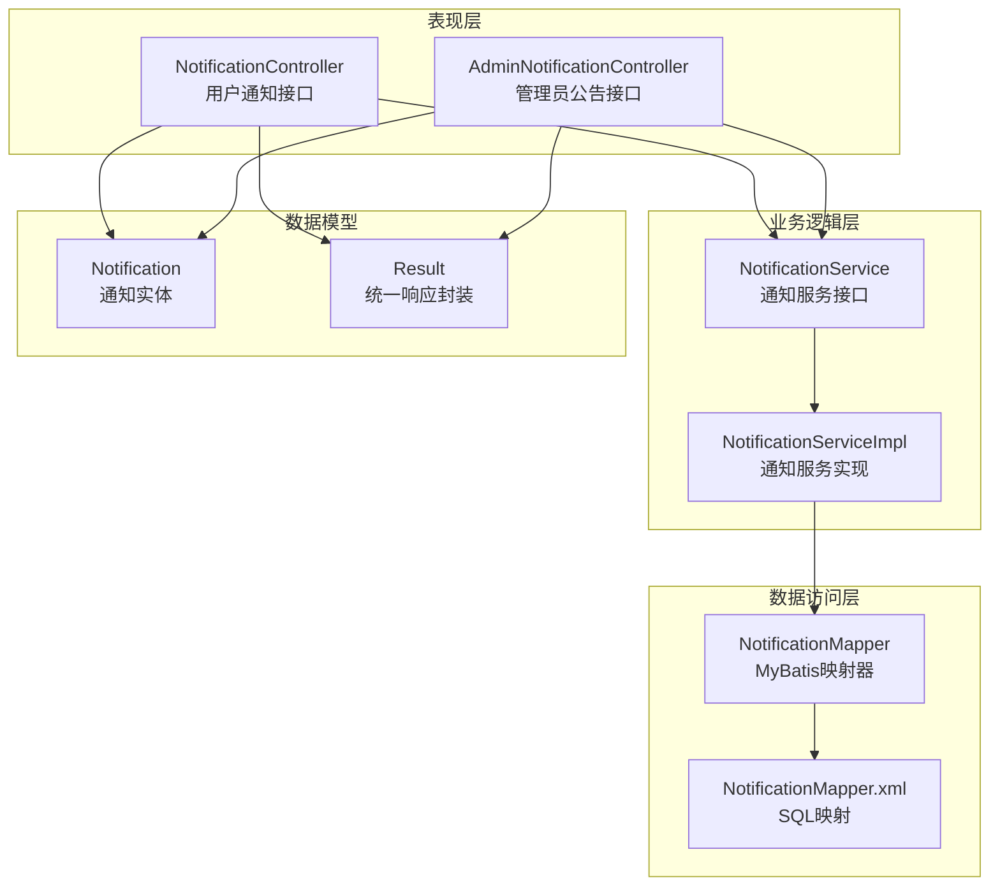
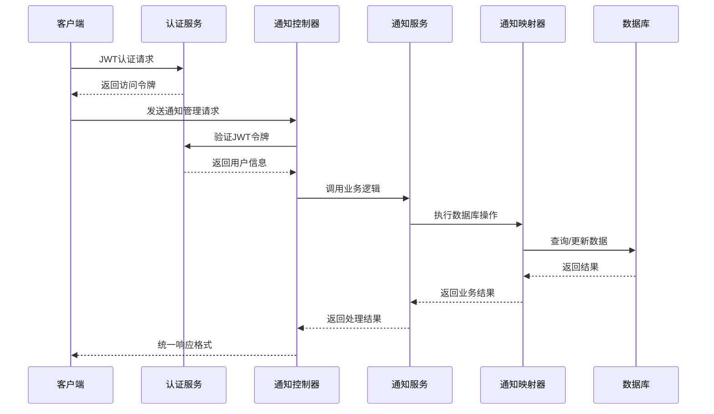
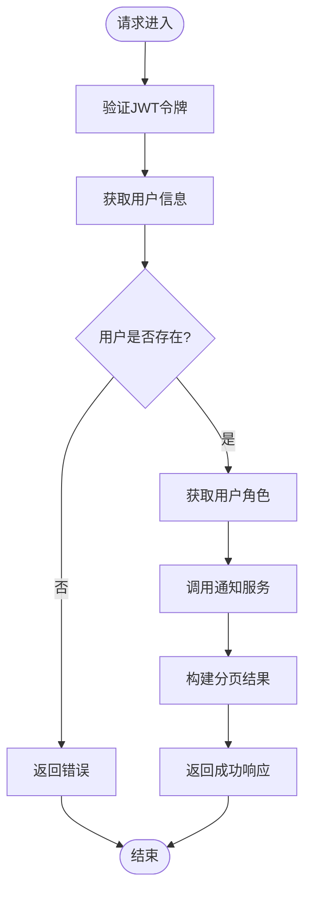
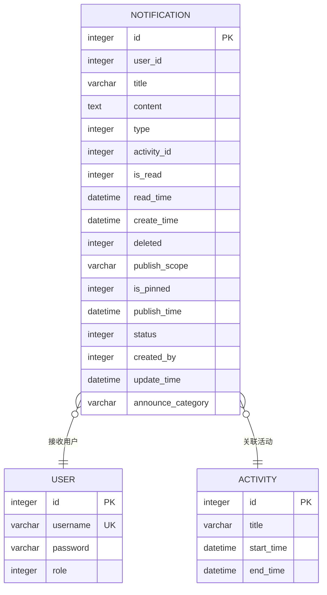
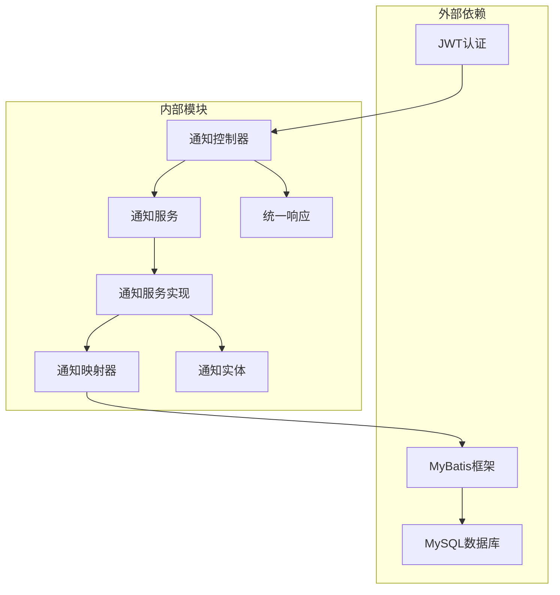

# 通知管理接口

<cite>
**本文档引用的文件**
- [NotificationController.java](file://src/main/java/com/campus/eventsys/controller/NotificationController.java)
- [AdminNotificationController.java](file://src/main/java/com/campus/eventsys/controller/AdminNotificationController.java)
- [NotificationService.java](file://src/main/java/com/campus/eventsys/service/NotificationService.java)
- [NotificationServiceImpl.java](file://src/main/java/com/campus/eventsys/service/impl/NotificationServiceImpl.java)
- [NotificationMapper.java](file://src/main/java/com/campus/eventsys/mapper/NotificationMapper.java)
- [NotificationMapper.xml](file://src/main/resources/mapper/NotificationMapper.xml)
- [Notification.java](file://src/main/java/com/campus/eventsys/entity/Notification.java)
- [Result.java](file://src/main/java/com/campus/eventsys/common/Result.java)
- [schema.sql](file://src/main/resources/db/schema.sql)
- [migration_notification_announcement_fields.sql](file://src/main/resources/db/migration_notification_announcement_fields.sql)
- [ActivityStartReminderService.java](file://src/main/java/com/campus/eventsys/service/ActivityStartReminderService.java)
- [ActivityStatusServiceImpl.java](file://src/main/java/com/campus/eventsys/service/impl/ActivityStatusServiceImpl.java)
- [NotificationControllerTest.java](file://src/test/java/com/campus/eventsys/controller/NotificationControllerTest.java)
</cite>

## 目录
1. [简介](#简介)
2. [项目结构](#项目结构)
3. [核心组件](#核心组件)
4. [架构概览](#架构概览)
5. [详细组件分析](#详细组件分析)
6. [依赖关系分析](#依赖关系分析)
7. [性能考虑](#性能考虑)
8. [故障排除指南](#故障排除指南)
9. [结论](#结论)
10. [附录](#附录)

## 简介

通知管理模块是校园活动综合管理系统的核心功能之一，负责处理系统通知的发送、接收、查看和管理。该模块提供了完整的用户通知管理接口，包括个人通知和系统公告两大类通知类型，并实现了智能的推送策略和优先级管理。

系统通知类型涵盖活动提醒、审核结果、状态变更、评论回复等多种场景，支持基于用户角色和权限的差异化展示。管理员可以通过专门的公告管理接口进行系统公告的创建、更新、撤回和管理。

## 项目结构

通知管理模块采用典型的三层架构设计，包含控制器层、服务层和数据访问层：



**图表来源**
- [NotificationController.java:1-235](file://src/main/java/com/campus/eventsys/controller/NotificationController.java#L1-L235)
- [AdminNotificationController.java:1-219](file://src/main/java/com/campus/eventsys/controller/AdminNotificationController.java#L1-L219)
- [NotificationService.java:1-192](file://src/main/java/com/campus/eventsys/service/NotificationService.java#L1-L192)
- [NotificationServiceImpl.java:1-455](file://src/main/java/com/campus/eventsys/service/impl/NotificationServiceImpl.java#L1-L455)

**章节来源**
- [NotificationController.java:1-235](file://src/main/java/com/campus/eventsys/controller/NotificationController.java#L1-L235)
- [AdminNotificationController.java:1-219](file://src/main/java/com/campus/eventsys/controller/AdminNotificationController.java#L1-L219)
- [NotificationService.java:1-192](file://src/main/java/com/campus/eventsys/service/NotificationService.java#L1-L192)
- [NotificationServiceImpl.java:1-455](file://src/main/java/com/campus/eventsys/service/impl/NotificationServiceImpl.java#L1-L455)

## 核心组件

通知管理模块包含以下核心组件：

### 通知实体模型
通知实体支持两种主要类型：
- **个人通知**：用户特定的通知，如活动提醒、审核结果等
- **系统公告**：面向全体用户或特定角色的公告信息

### 通知服务接口
提供完整的通知管理功能，包括：
- 通知发送和接收
- 通知状态管理（已读/未读）
- 通知删除和逻辑删除
- 公告管理功能

### 控制器层
- **用户通知控制器**：处理用户通知的查看、标记已读、删除等操作
- **管理员公告控制器**：处理系统公告的创建、更新、撤回等管理操作

**章节来源**
- [Notification.java:1-81](file://src/main/java/com/campus/eventsys/entity/Notification.java#L1-L81)
- [NotificationService.java:1-192](file://src/main/java/com/campus/eventsys/service/NotificationService.java#L1-L192)
- [NotificationController.java:20-36](file://src/main/java/com/campus/eventsys/controller/NotificationController.java#L20-L36)

## 架构概览

通知管理模块采用RESTful API设计，遵循统一的响应格式和安全认证机制：



**图表来源**
- [NotificationController.java:60-76](file://src/main/java/com/campus/eventsys/controller/NotificationController.java#L60-L76)
- [NotificationServiceImpl.java:396-411](file://src/main/java/com/campus/eventsys/service/impl/NotificationServiceImpl.java#L396-L411)

**章节来源**
- [NotificationController.java:60-180](file://src/main/java/com/campus/eventsys/controller/NotificationController.java#L60-L180)
- [NotificationServiceImpl.java:396-453](file://src/main/java/com/campus/eventsys/service/impl/NotificationServiceImpl.java#L396-L453)

## 详细组件分析

### 用户通知接口

#### 通知列表查询
- **HTTP方法**：GET
- **URL模式**：`/notifications/list`
- **功能描述**：获取当前登录用户的通知列表，包含个人通知和系统公告
- **分页参数**：
  - `page`：页码，默认1
  - `size`：每页大小，默认10



**图表来源**
- [NotificationController.java:61-76](file://src/main/java/com/campus/eventsys/controller/NotificationController.java#L61-L76)
- [NotificationServiceImpl.java:396-403](file://src/main/java/com/campus/eventsys/service/impl/NotificationServiceImpl.java#L396-L403)

#### 未读通知数量
- **HTTP方法**：GET
- **URL模式**：`/notifications/unread-count`
- **功能描述**：获取当前用户的未读通知数量，用于消息角标显示

#### 标记通知为已读
- **HTTP方法**：POST
- **URL模式**：`/notifications/read/{id}`
- **功能描述**：将指定通知标记为已读状态
- **路径参数**：
  - `id`：通知ID（必需）

#### 全部标记为已读
- **HTTP方法**：POST
- **URL模式**：`/notifications/read-all`
- **功能描述**：将当前用户的所有未读通知标记为已读

#### 删除通知
- **HTTP方法**：DELETE
- **URL模式**：`/notifications/delete/{id}`
- **功能描述**：删除指定通知（逻辑删除）
- **路径参数**：
  - `id`：通知ID（必需）

**章节来源**
- [NotificationController.java:41-180](file://src/main/java/com/campus/eventsys/controller/NotificationController.java#L41-L180)
- [NotificationControllerTest.java:63-242](file://src/test/java/com/campus/eventsys/controller/NotificationControllerTest.java#L63-L242)

### 管理员公告接口

#### 创建系统公告
- **HTTP方法**：POST
- **URL模式**：`/admin/notifications/announcement`
- **功能描述**：管理员创建系统公告
- **请求参数**：
  - `title`：公告标题（必需）
  - `content`：公告内容（必需）
  - `publishScope`：发布范围（ALL/USER/ADMIN，默认ALL）
  - `isPinned`：是否置顶（默认false）
  - `publishTime`：发布时间（可选）
  - `status`：状态（0-草稿/1-已发布，默认1）
  - `announceCategory`：公告分类（SYSTEM/ACTIVITY/URGENT，默认SYSTEM）

#### 公告列表查询
- **HTTP方法**：GET
- **URL模式**：`/admin/notifications/announcements`
- **功能描述**：分页获取所有系统公告列表

#### 公告详情查询
- **HTTP方法**：GET
- **URL模式**：`/admin/notifications/announcement/{id}`
- **功能描述**：根据ID获取系统公告详情

#### 更新公告
- **HTTP方法**：PUT
- **URL模式**：`/admin/notifications/announcement/{id}`
- **功能描述**：更新系统公告信息

#### 撤回公告
- **HTTP方法**：POST
- **URL模式**：`/admin/notifications/announcement/{id}/recall`
- **功能描述**：撤回已发布的系统公告

**章节来源**
- [AdminNotificationController.java:58-184](file://src/main/java/com/campus/eventsys/controller/AdminNotificationController.java#L58-L184)

### 通知类型管理

系统支持五种通知类型：

| 类型编号 | 类型名称 | 描述 | 适用场景 |
|---------|----------|------|----------|
| 1 | 系统公告 | 管理员发送的全局公告 | 系统通知、重要信息发布 |
| 2 | 活动提醒 | 活动即将开始时的提醒通知 | 活动开始前的智能提醒 |
| 3 | 审核结果 | 活动审核通过/拒绝通知 | 活动创建审核结果 |
| 4 | 状态变更 | 活动状态变化通知 | 活动状态更新提醒 |
| 5 | 评论回复 | 有人回复了你的评论 | 社交互动通知 |

**章节来源**
- [Notification.java:28-35](file://src/main/java/com/campus/eventsys/entity/Notification.java#L28-L35)
- [NotificationController.java:27-32](file://src/main/java/com/campus/eventsys/controller/NotificationController.java#L27-L32)

### 推送策略和优先级

通知系统实现了智能的推送策略和优先级管理：

#### 时间优先级策略
- **活动提醒**：基于活动开始时间的智能提醒
  - 3天前提醒：`sendActivityThreeDaysCalendarReminder`
  - 1天前提醒：`sendActivityOneDayCalendarReminder`
  - 即时提醒：`sendActivityJustStartedReminder`

#### 权限控制策略
- **系统公告**：支持发布范围控制（ALL/USER/ADMIN）
- **个人通知**：严格的身份验证和权限检查
- **管理员功能**：基于角色的访问控制

#### 去重机制
- 活动提醒支持基于标题标记的去重
- 避免重复发送相同类型的提醒通知

**章节来源**
- [NotificationService.java:91-111](file://src/main/java/com/campus/eventsys/service/NotificationService.java#L91-L111)
- [NotificationServiceImpl.java:246-258](file://src/main/java/com/campus/eventsys/service/impl/NotificationServiceImpl.java#L246-L258)

### 数据模型设计

通知表结构支持完整的公告管理功能：



**图表来源**
- [schema.sql:178-197](file://src/main/resources/db/schema.sql#L178-L197)
- [Notification.java:15-80](file://src/main/java/com/campus/eventsys/entity/Notification.java#L15-L80)

**章节来源**
- [schema.sql:178-197](file://src/main/resources/db/schema.sql#L178-L197)
- [Notification.java:15-80](file://src/main/java/com/campus/eventsys/entity/Notification.java#L15-L80)

## 依赖关系分析

通知管理模块的依赖关系清晰明确：



**图表来源**
- [NotificationController.java:16-18](file://src/main/java/com/campus/eventsys/controller/NotificationController.java#L16-L18)
- [NotificationServiceImpl.java:34](file://src/main/java/com/campus/eventsys/service/impl/NotificationServiceImpl.java#L34)

**章节来源**
- [NotificationController.java:16-18](file://src/main/java/com/campus/eventsys/controller/NotificationController.java#L16-L18)
- [NotificationServiceImpl.java:34](file://src/main/java/com/campus/eventsys/service/impl/NotificationServiceImpl.java#L34)

## 性能考虑

通知系统在设计时充分考虑了性能优化：

### 数据库优化
- **索引设计**：为常用查询字段建立索引
  - `idx_notif_user`：用户ID索引
  - `idx_notif_type`：通知类型索引  
  - `idx_notif_read`：已读状态索引
- **分页查询**：支持大数据量的分页浏览
- **逻辑删除**：使用软删除避免物理删除开销

### 缓存策略
- **内存缓存**：热点数据的内存缓存
- **查询优化**：针对高频查询的SQL优化

### 并发处理机制
- **事务管理**：使用Spring事务确保数据一致性
- **线程安全**：通知ID生成使用ThreadLocalRandom保证线程安全
- **锁机制**：避免重复发送相同类型的提醒通知

### 异步处理
- **定时任务**：活动开始前的提醒通知
- **批处理**：批量标记已读和删除操作

**章节来源**
- [schema.sql:282-286](file://src/main/resources/db/schema.sql#L282-L286)
- [NotificationServiceImpl.java:19](file://src/main/java/com/campus/eventsys/service/impl/NotificationServiceImpl.java#L19)
- [ActivityStartReminderService.java:50-84](file://src/main/java/com/campus/eventsys/service/ActivityStartReminderService.java#L50-L84)

## 故障排除指南

### 常见问题及解决方案

#### 认证失败
**问题**：返回401未授权错误
**原因**：JWT令牌无效或过期
**解决**：重新登录获取新的访问令牌

#### 权限不足
**问题**：管理员接口返回403无权限
**原因**：用户角色不是ADMIN
**解决**：使用管理员账户登录

#### 通知不存在
**问题**：标记已读或删除返回通知不存在
**原因**：通知ID错误或已被删除
**解决**：确认通知ID的有效性

#### 数据库连接问题
**问题**：查询或更新操作失败
**原因**：数据库连接异常
**解决**：检查数据库服务状态和连接配置

**章节来源**
- [NotificationController.java:118-128](file://src/main/java/com/campus/eventsys/controller/NotificationController.java#L118-L128)
- [NotificationControllerTest.java:142-168](file://src/test/java/com/campus/eventsys/controller/NotificationControllerTest.java#L142-L168)

### 日志监控

系统提供了完善的日志记录机制：
- **操作日志**：记录重要的业务操作
- **错误日志**：捕获和记录异常信息
- **性能日志**：监控关键操作的执行时间

**章节来源**
- [NotificationServiceImpl.java:45](file://src/main/java/com/campus/eventsys/service/impl/NotificationServiceImpl.java#L45)
- [NotificationServiceImpl.java:414-426](file://src/main/java/com/campus/eventsys/service/impl/NotificationServiceImpl.java#L414-L426)

## 结论

通知管理模块是一个功能完整、设计合理的系统通知解决方案。它提供了：

1. **完整的API覆盖**：从基本的通知查看到高级的公告管理
2. **灵活的推送策略**：支持多种通知类型和智能推送机制
3. **良好的性能表现**：通过索引优化和缓存策略提升系统性能
4. **严格的权限控制**：基于角色的访问控制确保系统安全
5. **完善的错误处理**：提供详细的错误信息和故障排除指南

该模块为校园活动综合管理系统提供了可靠的通知基础设施，能够满足各种通知场景的需求。

## 附录

### 统一响应格式

所有接口都使用统一的响应格式：

```json
{
  "code": 200,
  "message": "操作成功",
  "data": {}
}
```

### 错误码定义

| 错误码 | 含义 | 说明 |
|--------|------|------|
| 200 | 成功 | 操作成功 |
| 401 | 未登录 | JWT认证失败 |
| 403 | 无权限 | 权限不足 |
| 404 | 不存在 | 请求资源不存在 |
| 500 | 错误 | 服务器内部错误 |

### 数据库迁移

如果需要升级现有数据库，可以执行以下SQL语句：

```sql
-- 添加公告相关字段
ALTER TABLE notification ADD COLUMN publish_scope VARCHAR(10) DEFAULT 'ALL';
ALTER TABLE notification ADD COLUMN is_pinned INTEGER DEFAULT 0;
ALTER TABLE notification ADD COLUMN publish_time DATETIME;
ALTER TABLE notification ADD COLUMN status INTEGER DEFAULT 1;
ALTER TABLE notification ADD COLUMN created_by INTEGER;
ALTER TABLE notification ADD COLUMN update_time DATETIME;
ALTER TABLE notification ADD COLUMN announce_category VARCHAR(20) DEFAULT 'SYSTEM';
```

**章节来源**
- [migration_notification_announcement_fields.sql:1-22](file://src/main/resources/db/migration_notification_announcement_fields.sql#L1-L22)