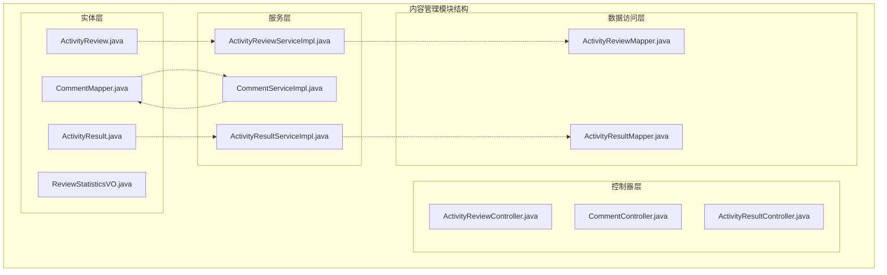
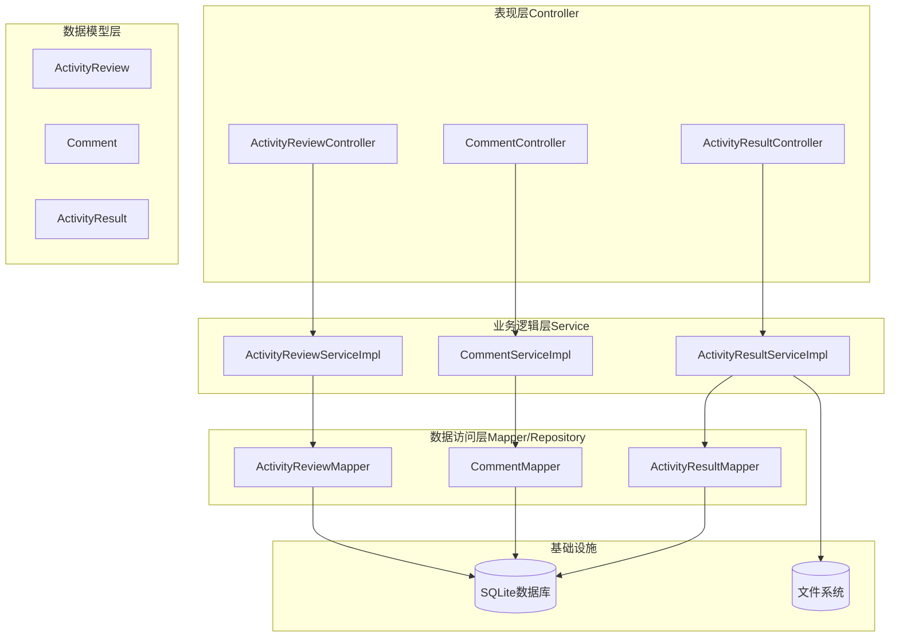
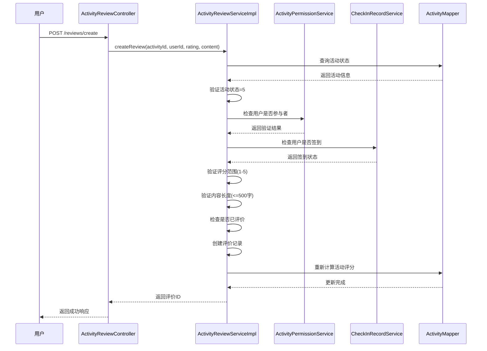
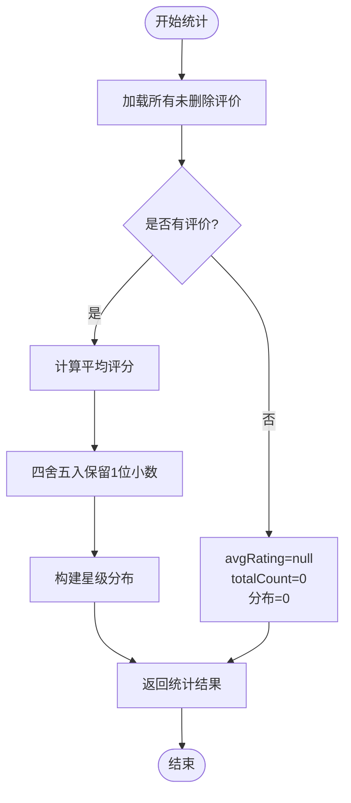
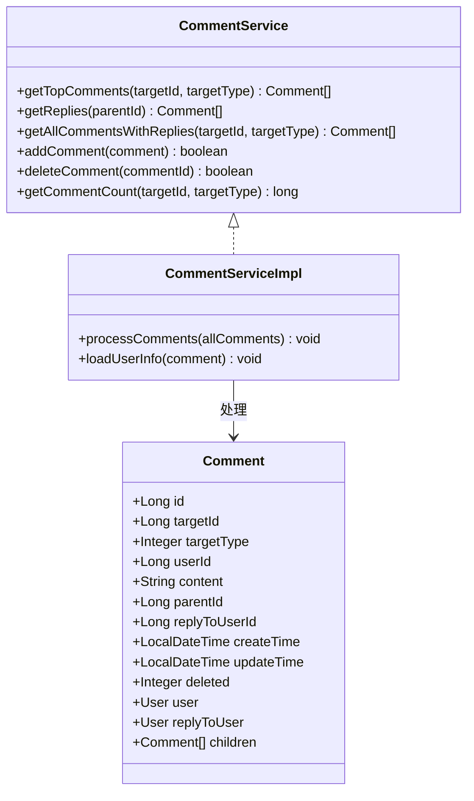
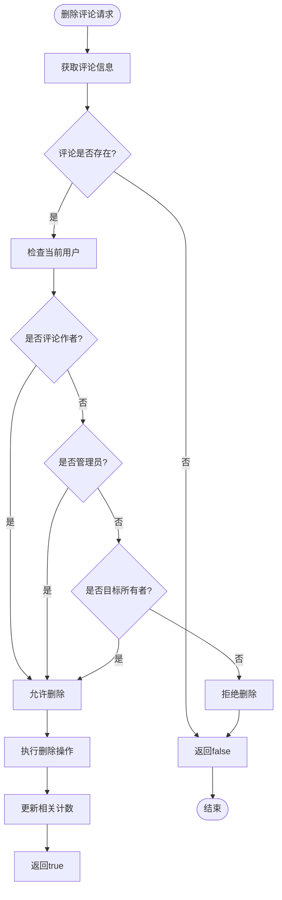
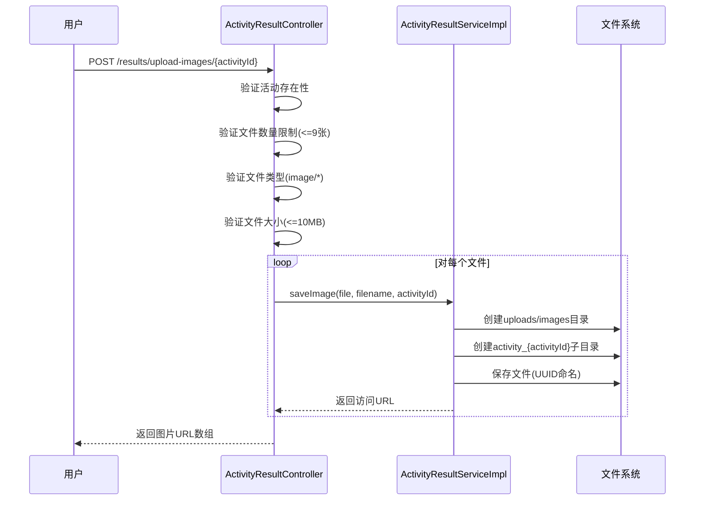
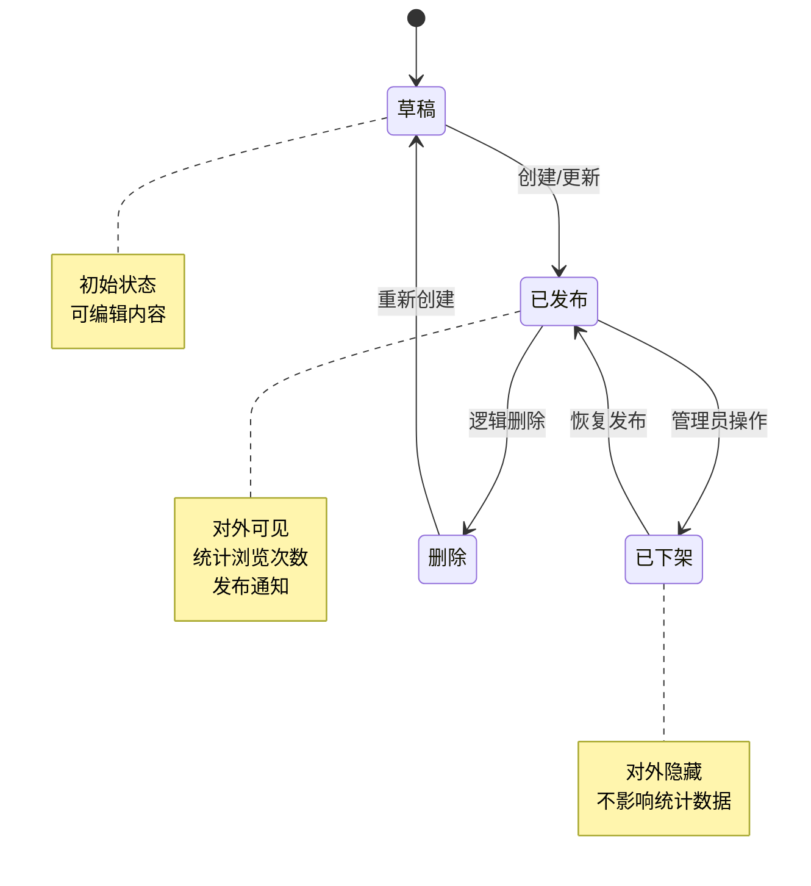
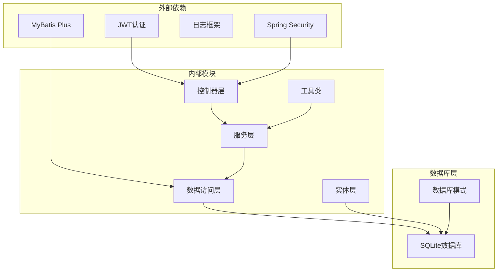
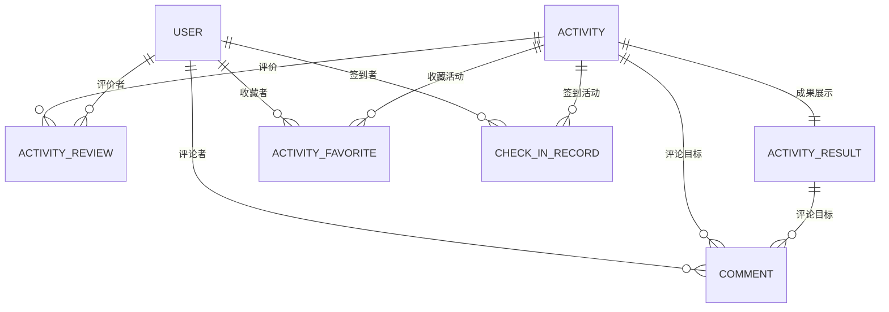

# 内容管理模块

<cite>
**本文档引用的文件**
- [ActivityReview.java](file://src/main/java/com/campus/eventsys/entity/ActivityReview.java)
- [Comment.java](file://src/main/java/com/campus/eventsys/entity/Comment.java)
- [ActivityResult.java](file://src/main/java/com/campus/eventsys/entity/ActivityResult.java)
- [ReviewStatisticsVO.java](file://src/main/java/com/campus/eventsys/entity/ReviewStatisticsVO.java)
- [ActivityReviewServiceImpl.java](file://src/main/java/com/campus/eventsys/service/impl/ActivityReviewServiceImpl.java)
- [CommentServiceImpl.java](file://src/main/java/com/campus/eventsys/service/impl/CommentServiceImpl.java)
- [ActivityResultServiceImpl.java](file://src/main/java/com/campus/eventsys/service/impl/ActivityResultServiceImpl.java)
- [ActivityReviewController.java](file://src/main/java/com/campus/eventsys/controller/ActivityReviewController.java)
- [CommentController.java](file://src/main/java/com/campus/eventsys/controller/CommentController.java)
- [ActivityResultController.java](file://src/main/java/com/campus/eventsys/controller/ActivityResultController.java)
- [application.yml](file://src/main/resources/application.yml)
- [schema.sql](file://src/main/resources/db/schema.sql)
- [ActivityReviewControllerTest.java](file://src/test/java/com/campus/eventsys/controller/ActivityReviewControllerTest.java)
- [CommentControllerTest.java](file://src/test/java/com/campus/eventsys/controller/CommentControllerTest.java)
</cite>

## 目录
1. [简介](#简介)
2. [项目结构](#项目结构)
3. [核心组件](#核心组件)
4. [架构概览](#架构概览)
5. [详细组件分析](#详细组件分析)
6. [依赖关系分析](#依赖关系分析)
7. [性能考虑](#性能考虑)
8. [故障排除指南](#故障排除指南)
9. [结论](#结论)
10. [附录](#附录)

## 简介

内容管理模块是校园活动管理系统的核心功能模块之一，主要负责以下三大核心功能：

1. **活动评价系统**：提供活动结束后用户对活动进行评分和评价的功能，包括评分机制、评价统计和组织者回复
2. **评论互动系统**：支持对活动和成果展示贴的评论与回复功能，实现完整的互动生态
3. **活动成果展示**：提供活动结束后成果展示贴的创建、管理和展示功能

该模块采用分层架构设计，包含实体层、服务层、控制器层和数据访问层，确保了良好的代码组织和可维护性。

## 项目结构

内容管理模块在项目中的组织结构如下：



**图表来源**
- [ActivityReview.java:1-56](file://src/main/java/com/campus/eventsys/entity/ActivityReview.java#L1-L56)
- [Comment.java:1-67](file://src/main/java/com/campus/eventsys/entity/Comment.java#L1-L67)
- [ActivityResult.java:1-69](file://src/main/java/com/campus/eventsys/entity/ActivityResult.java#L1-L69)

**章节来源**
- [ActivityReviewController.java:1-254](file://src/main/java/com/campus/eventsys/controller/ActivityReviewController.java#L1-L254)
- [CommentController.java:1-327](file://src/main/java/com/campus/eventsys/controller/CommentController.java#L1-L327)
- [ActivityResultController.java:1-376](file://src/main/java/com/campus/eventsys/controller/ActivityResultController.java#L1-L376)

## 核心组件

### 活动评价系统

活动评价系统是内容管理模块的重要组成部分，提供了完整的评价生命周期管理：

#### 业务规则
- **评价资格**：仅已结束活动（状态=5）且已完成签到的参与者可以评价
- **唯一性约束**：每个用户对同一活动只能评价一次
- **评分范围**：1-5星评分机制
- **内容限制**：评价内容长度限制在500字以内

#### 核心功能
- 评价创建与验证
- 评价列表查询（分页）
- 组织者回复功能
- 评价统计分析
- 管理员删除权限

**章节来源**
- [ActivityReviewController.java:29-37](file://src/main/java/com/campus/eventsys/controller/ActivityReviewController.java#L29-L37)
- [ActivityReviewServiceImpl.java:41-111](file://src/main/java/com/campus/eventsys/service/impl/ActivityReviewServiceImpl.java#L41-L111)

### 评论互动系统

评论互动系统支持对活动和成果展示贴的多层次评论功能：

#### 支持的目标类型
- **活动评论**：targetType=1，针对具体活动的讨论
- **成果展示贴评论**：targetType=2，针对活动成果的深入交流

#### 评论结构
- **顶级评论**：直接对目标对象的评论
- **回复评论**：对其他评论的回复，支持多级嵌套
- **用户关联**：自动加载评论用户的简要信息

#### 权限控制
- **发表权限**：所有登录用户均可发表评论
- **删除权限**：评论作者、目标所有者（组织者/创建者）或管理员
- **回复通知**：自动向被回复用户发送通知

**章节来源**
- [CommentController.java:30-35](file://src/main/java/com/campus/eventsys/controller/CommentController.java#L30-L35)
- [CommentServiceImpl.java:34-82](file://src/main/java/com/campus/eventsys/service/impl/CommentServiceImpl.java#L34-L82)

### 活动成果展示

活动成果展示功能为活动结束后提供成果分享平台：

#### 功能特性
- **Markdown支持**：支持富文本内容编辑
- **图片管理**：支持多图上传和管理
- **状态控制**：草稿、发布、下架等状态管理
- **访问统计**：自动统计浏览次数

#### 存储策略
- **按活动分目录**：每个活动拥有独立的图片存储目录
- **UUID命名**：确保文件名唯一性和安全性
- **统一访问**：通过标准化URL访问资源

**章节来源**
- [ActivityResultController.java:36-40](file://src/main/java/com/campus/eventsys/controller/ActivityResultController.java#L36-L40)
- [ActivityResultServiceImpl.java:115-146](file://src/main/java/com/campus/eventsys/service/impl/ActivityResultServiceImpl.java#L115-L146)

## 架构概览

内容管理模块采用经典的三层架构模式，实现了清晰的关注点分离：



**图表来源**
- [ActivityReviewController.java:41-46](file://src/main/java/com/campus/eventsys/controller/ActivityReviewController.java#L41-L46)
- [CommentController.java:41-46](file://src/main/java/com/campus/eventsys/controller/CommentController.java#L41-L46)
- [ActivityResultController.java:46-51](file://src/main/java/com/campus/eventsys/controller/ActivityResultController.java#L46-L51)

## 详细组件分析

### 活动评价系统详细分析

#### 评价创建流程



**图表来源**
- [ActivityReviewController.java:64-82](file://src/main/java/com/campus/eventsys/controller/ActivityReviewController.java#L64-L82)
- [ActivityReviewServiceImpl.java:42-111](file://src/main/java/com/campus/eventsys/service/impl/ActivityReviewServiceImpl.java#L42-L111)

#### 评价统计算法



**图表来源**
- [ActivityReviewServiceImpl.java:231-270](file://src/main/java/com/campus/eventsys/service/impl/ActivityReviewServiceImpl.java#L231-L270)

**章节来源**
- [ActivityReviewServiceImpl.java:272-298](file://src/main/java/com/campus/eventsys/service/impl/ActivityReviewServiceImpl.java#L272-L298)
- [ReviewStatisticsVO.java:1-28](file://src/main/java/com/campus/eventsys/entity/ReviewStatisticsVO.java#L1-L28)

### 评论互动系统详细分析

#### 评论树形结构处理



**图表来源**
- [Comment.java:14-66](file://src/main/java/com/campus/eventsys/entity/Comment.java#L14-L66)
- [CommentServiceImpl.java:27-173](file://src/main/java/com/campus/eventsys/service/impl/CommentServiceImpl.java#L27-L173)

#### 权限验证流程



**图表来源**
- [CommentController.java:258-283](file://src/main/java/com/campus/eventsys/controller/CommentController.java#L258-L283)

**章节来源**
- [CommentServiceImpl.java:120-161](file://src/main/java/com/campus/eventsys/service/impl/CommentServiceImpl.java#L120-L161)

### 活动成果展示详细分析

#### 图片上传与存储流程



**图表来源**
- [ActivityResultController.java:293-347](file://src/main/java/com/campus/eventsys/controller/ActivityResultController.java#L293-L347)
- [ActivityResultServiceImpl.java:115-146](file://src/main/java/com/campus/eventsys/service/impl/ActivityResultServiceImpl.java#L115-L146)

#### 成果展示生命周期



**图表来源**
- [ActivityResult.java:44-45](file://src/main/java/com/campus/eventsys/entity/ActivityResult.java#L44-L45)
- [ActivityResultController.java:104-171](file://src/main/java/com/campus/eventsys/controller/ActivityResultController.java#L104-L171)

**章节来源**
- [ActivityResultServiceImpl.java:84-112](file://src/main/java/com/campus/eventsys/service/impl/ActivityResultServiceImpl.java#L84-L112)

## 依赖关系分析

内容管理模块的依赖关系体现了清晰的分层架构：



**图表来源**
- [application.yml:10-52](file://src/main/resources/application.yml#L10-L52)
- [schema.sql:1-295](file://src/main/resources/db/schema.sql#L1-L295)

### 核心依赖关系

#### 控制器层依赖
- **认证依赖**：基于JWT的用户认证
- **权限控制**：基于角色的权限验证
- **异常处理**：统一的业务异常处理

#### 服务层依赖
- **数据访问**：MyBatis Plus ORM框架
- **业务逻辑**：复杂的业务规则验证
- **外部服务**：通知服务、文件存储服务

#### 数据访问层依赖
- **数据库连接**：SQLite JDBC驱动
- **SQL映射**：XML配置文件
- **事务管理**：Spring声明式事务

**章节来源**
- [ActivityReviewController.java:17-23](file://src/main/java/com/campus/eventsys/controller/ActivityReviewController.java#L17-L23)
- [CommentController.java:13-23](file://src/main/java/com/campus/eventsys/controller/CommentController.java#L13-L23)
- [ActivityResultController.java:14-25](file://src/main/java/com/campus/eventsys/controller/ActivityResultController.java#L14-L25)

## 性能考虑

### 数据库优化策略

#### 索引设计
模块为关键查询建立了专门的索引以提升性能：

| 索引名称 | 目标表 | 查询场景 | 性能收益 |
|---------|--------|----------|----------|
| idx_review_activity | activity_review | 按活动查询评价 | O(log n)查询时间 |
| idx_review_user | activity_review | 按用户查询评价 | O(log n)查询时间 |
| idx_comment_target | comment | 按目标查询评论 | O(log n)查询时间 |
| idx_comment_parent | comment | 查询回复评论 | O(log n)查询时间 |

#### 查询优化
- **分页查询**：所有列表查询都支持分页，避免大数据量查询
- **延迟加载**：用户信息采用延迟加载，减少不必要的数据库查询
- **批量操作**：评论树形结构一次性查询所有相关数据

### 缓存策略

#### 应用层缓存
- **用户信息缓存**：常用用户信息缓存，减少数据库查询
- **活动统计缓存**：评价统计结果缓存，降低计算开销
- **文件路径缓存**：图片访问URL缓存，提升响应速度

#### 数据库层优化
- **连接池配置**：合理配置数据库连接池大小
- **事务隔离**：使用适当的事务隔离级别
- **批量插入**：大量数据插入时使用批量操作

## 故障排除指南

### 常见问题诊断

#### 评价功能问题

| 问题现象 | 可能原因 | 解决方案 |
|----------|----------|----------|
| 无法创建评价 | 活动未结束 | 确保活动状态为已结束(5) |
| 重复评价错误 | 用户已评价过 | 检查唯一约束触发器 |
| 评分范围错误 | 评分超出1-5范围 | 验证评分输入范围 |
| 内容长度超限 | 评价内容超过500字 | 截断或提示用户缩短内容 |

#### 评论功能问题

| 问题现象 | 可能原因 | 解决方案 |
|----------|----------|----------|
| 评论显示异常 | 评论树形结构处理错误 | 检查父子关系映射 |
| 权限验证失败 | 用户身份认证问题 | 验证JWT令牌有效性 |
| 通知发送失败 | 通知服务异常 | 检查通知服务配置 |
| 删除权限错误 | 权限检查逻辑问题 | 验证用户角色和目标关系 |

#### 成果展示问题

| 问题现象 | 可能原因 | 解决方案 |
|----------|----------|----------|
| 图片上传失败 | 文件大小超限 | 检查文件大小限制(10MB) |
| 存储路径错误 | 目录权限问题 | 验证上传目录可写权限 |
| URL访问失败 | 文件路径配置错误 | 检查访问URL前缀配置 |
| 状态更新异常 | 事务处理问题 | 检查数据库事务配置 |

### 调试建议

#### 开启调试日志
在application.yml中调整日志级别：
```yaml
logging:
  level:
    com.campus.eventsys: debug
    org.springframework.security: debug
```

#### 单元测试验证
利用现有的单元测试验证功能正确性：
- 运行ActivityReviewControllerTest验证评价功能
- 运行CommentControllerTest验证评论功能
- 检查测试覆盖率和边界条件处理

**章节来源**
- [ActivityReviewControllerTest.java:1-370](file://src/test/java/com/campus/eventsys/controller/ActivityReviewControllerTest.java#L1-L370)
- [CommentControllerTest.java:1-378](file://src/test/java/com/campus/eventsys/controller/CommentControllerTest.java#L1-L378)

## 结论

内容管理模块通过精心设计的架构和完善的业务逻辑，为校园活动管理系统提供了强大的内容管理能力。模块的主要优势包括：

### 技术优势
- **清晰的分层架构**：职责分离明确，便于维护和扩展
- **完善的权限控制**：基于角色的细粒度权限管理
- **健壮的业务规则**：严格的业务验证和异常处理
- **高性能设计**：合理的索引设计和查询优化

### 功能完整性
- **评价系统**：完整的评价生命周期管理
- **评论系统**：支持多层级的互动评论
- **成果展示**：丰富的活动成果分享平台

### 安全保障
- **数据安全**：逻辑删除机制保护数据完整性
- **访问控制**：严格的权限验证和JWT认证
- **输入验证**：全面的参数验证和安全检查

该模块为后续的功能扩展奠定了坚实的基础，可以根据实际需求进一步增强功能和优化性能。

## 附录

### API接口文档

#### 活动评价接口

| 接口 | 方法 | 路径 | 权限 | 描述 |
|------|------|------|------|------|
| 创建评价 | POST | `/api/reviews/create` | 用户 | 提交活动评价 |
| 评价列表 | GET | `/api/reviews/activity/{activityId}` | 公开 | 获取活动评价列表 |
| 我的评价 | GET | `/api/reviews/my` | 用户 | 获取当前用户评价 |
| 组织者查看 | GET | `/api/reviews/organizer` | 组织者 | 查看自己活动评价 |
| 回复评价 | POST | `/api/reviews/reply/{reviewId}` | 组织者 | 组织者回复评价 |
| 删除评价 | DELETE | `/api/reviews/delete/{reviewId}` | 管理员 | 管理员删除评价 |
| 评价统计 | GET | `/api/reviews/statistics/{activityId}` | 公开 | 获取评价统计 |

#### 评论接口

| 接口 | 方法 | 路径 | 权限 | 描述 |
|------|------|------|------|------|
| 评论列表 | GET | `/api/comments/list` | 公开 | 获取评论列表 |
| 评论数量 | GET | `/api/comments/count` | 公开 | 获取评论数量 |
| 发表评论 | POST | `/api/comments/post` | 用户 | 发表顶级评论 |
| 回复评论 | POST | `/api/comments/reply/{parentId}` | 用户 | 回复指定评论 |
| 删除评论 | DELETE | `/api/comments/delete/{id}` | 用户/组织者/管理员 | 删除评论 |

#### 成果展示接口

| 接口 | 方法 | 路径 | 权限 | 描述 |
|------|------|------|------|------|
| 成果详情 | GET | `/api/results/activity/{activityId}` | 公开 | 获取成果展示详情 |
| 检查成果 | GET | `/api/results/exists/{activityId}` | 公开 | 检查成果是否存在 |
| 创建成果 | POST | `/api/results/create/{activityId}` | 组织者/管理员 | 创建成果展示贴 |
| 更新成果 | PUT | `/api/results/update/{id}` | 创建者/管理员 | 更新成果展示贴 |
| 删除成果 | DELETE | `/api/results/delete/{id}` | 创建者/管理员 | 删除成果展示贴 |
| 上传图片 | POST | `/api/results/upload-images/{activityId}` | 组织者/管理员 | 上传成果图片 |

### 数据模型关系



**图表来源**
- [schema.sql:50-121](file://src/main/resources/db/schema.sql#L50-L121)

### 配置说明

#### 文件上传配置
```yaml
file:
  upload:
    path: uploads/images  # 上传目录
  access:
    url: /images/         # 访问URL前缀
```

#### 数据库配置
```yaml
spring:
  datasource:
    driver-class-name: org.sqlite.JDBC
    url: jdbc:sqlite:${user.dir}/event_database.db
```

#### JWT配置
```yaml
jwt:
  secret: campusEventSystemSecretKey2024ForJwtTokenGeneration
  expiration: 86400000  # 24小时
```