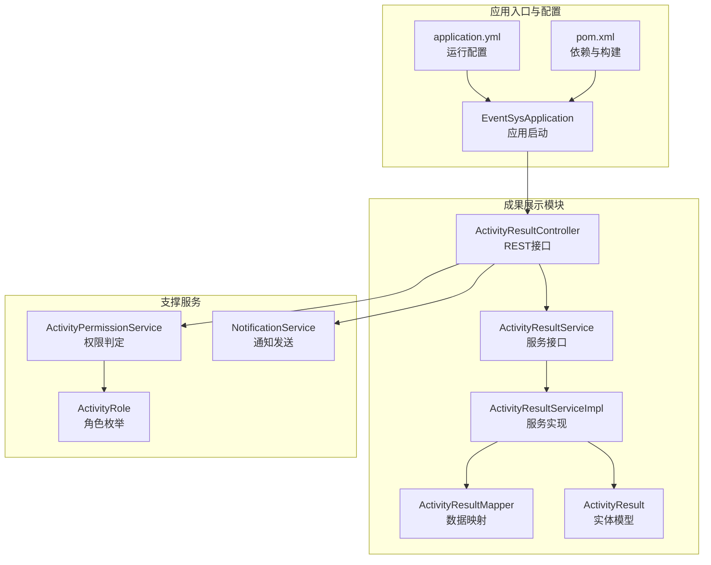
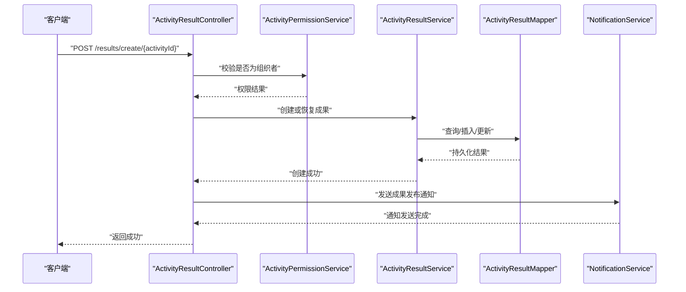
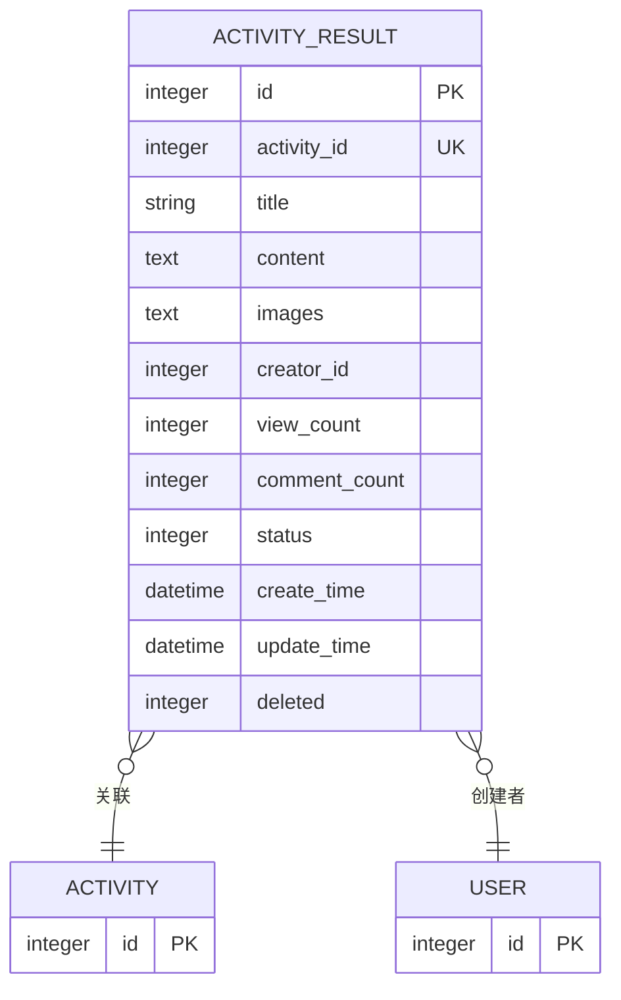
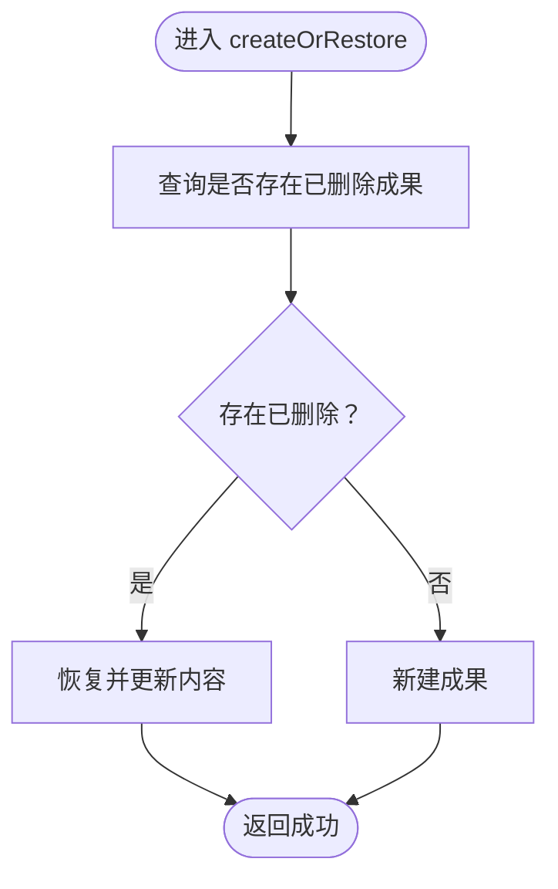
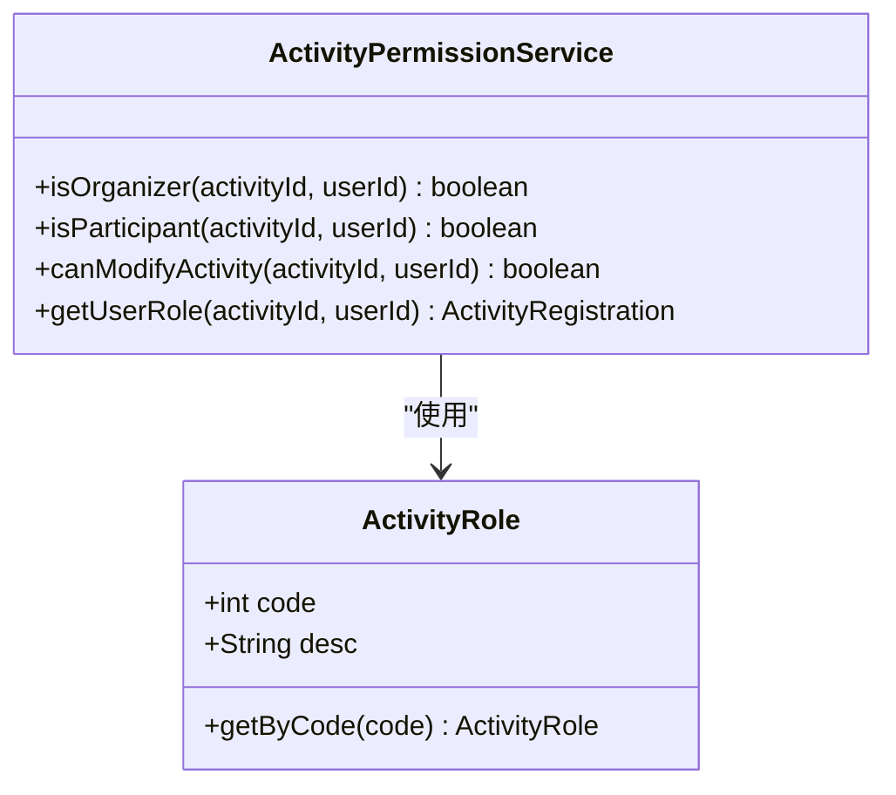
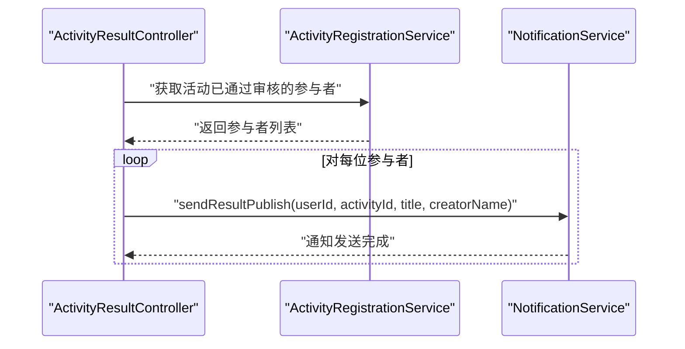
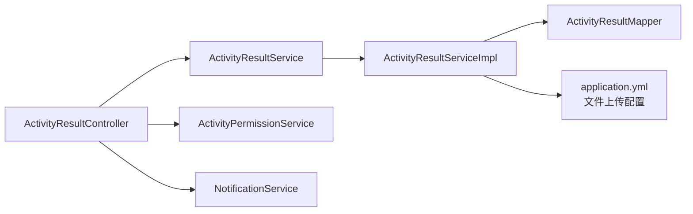

# 活动成果展示

<cite>
**本文引用的文件**
- [EventSysApplication.java](file://src/main/java/com/campus/eventsys/EventSysApplication.java)
- [application.yml](file://src/main/resources/application.yml)
- [pom.xml](file://pom.xml)
- [ActivityResultController.java](file://src/main/java/com/campus/eventsys/controller/ActivityResultController.java)
- [ActivityResultService.java](file://src/main/java/com/campus/eventsys/service/ActivityResultService.java)
- [ActivityResultServiceImpl.java](file://src/main/java/com/campus/eventsys/service/impl/ActivityResultServiceImpl.java)
- [ActivityResult.java](file://src/main/java/com/campus/eventsys/entity/ActivityResult.java)
- [ActivityResultMapper.java](file://src/main/java/com/campus/eventsys/mapper/ActivityResultMapper.java)
- [ActivityPermissionService.java](file://src/main/java/com/campus/eventsys/service/ActivityPermissionService.java)
- [ActivityPermissionServiceImpl.java](file://src/main/java/com/campus/eventsys/service/impl/ActivityPermissionServiceImpl.java)
- [NotificationService.java](file://src/main/java/com/campus/eventsys/service/NotificationService.java)
- [NotificationServiceImpl.java](file://src/main/java/com/campus/eventsys/service/impl/NotificationServiceImpl.java)
- [ActivityRole.java](file://src/main/java/com/campus/eventsys/enums/ActivityRole.java)
- [schema.sql](file://src/main/resources/db/schema.sql)
- [ActivityResultControllerTest.java](file://src/test/java/com/campus/eventsys/controller/ActivityResultControllerTest.java)
</cite>

## 目录
1. [简介](#简介)
2. [项目结构](#项目结构)
3. [核心组件](#核心组件)
4. [架构总览](#架构总览)
5. [详细组件分析](#详细组件分析)
6. [依赖关系分析](#依赖关系分析)
7. [性能考量](#性能考量)
8. [故障排查指南](#故障排查指南)
9. [结论](#结论)
10. [附录：API接口文档](#附录api接口文档)

## 简介
本技术文档围绕“活动成果展示”功能展开，系统性阐述成果创建、编辑与发布流程，成果内容管理（文本、图片、多媒体资源）、审核与状态管理、权限控制策略、服务层业务逻辑（统计、热门排行与推荐建议），以及完整的API接口说明与使用示例。旨在帮助开发者快速理解并扩展该功能。

## 项目结构
后端采用Spring Boot + MyBatis Plus + JWT + Swagger（OpenAPI）技术栈，数据库为SQLite。成果展示模块位于controller、service、mapper、entity包中，并通过权限服务与通知服务协同工作。

图表来源
- [EventSysApplication.java:1-17](file://src/main/java/com/campus/eventsys/EventSysApplication.java#L1-L17)
- [application.yml:1-76](file://src/main/resources/application.yml#L1-L76)
- [pom.xml:1-131](file://pom.xml#L1-L131)
- [ActivityResultController.java:1-376](file://src/main/java/com/campus/eventsys/controller/ActivityResultController.java#L1-L376)
- [ActivityResultService.java:1-88](file://src/main/java/com/campus/eventsys/service/ActivityResultService.java#L1-L88)
- [ActivityResultServiceImpl.java:1-193](file://src/main/java/com/campus/eventsys/service/impl/ActivityResultServiceImpl.java#L1-L193)
- [ActivityResultMapper.java:1-19](file://src/main/java/com/campus/eventsys/mapper/ActivityResultMapper.java#L1-L19)
- [ActivityResult.java:1-69](file://src/main/java/com/campus/eventsys/entity/ActivityResult.java#L1-L69)
- [ActivityPermissionService.java:1-124](file://src/main/java/com/campus/eventsys/service/ActivityPermissionService.java#L1-L124)
- [NotificationService.java:1-192](file://src/main/java/com/campus/eventsys/service/NotificationService.java#L1-L192)
- [ActivityRole.java:1-38](file://src/main/java/com/campus/eventsys/enums/ActivityRole.java#L1-L38)

章节来源
- [EventSysApplication.java:1-17](file://src/main/java/com/campus/eventsys/EventSysApplication.java#L1-L17)
- [application.yml:1-76](file://src/main/resources/application.yml#L1-L76)
- [pom.xml:1-131](file://pom.xml#L1-L131)

## 核心组件
- 控制器：提供成果详情查询、存在性检查、创建、更新、删除、图片上传等REST接口。
- 服务层：封装成果查询、存在性判断、浏览量/评论数增减、创建或恢复、图片保存、逻辑删除与下架等业务逻辑。
- 实体与映射：定义成果表结构、非持久化字段（用于展示）、自定义查询以兼容逻辑删除场景。
- 权限服务：判定用户是否为活动组织者/参与者，决定成果创建/更新/删除权限。
- 通知服务：在成果发布后向已通过审核的参与者发送通知。

章节来源
- [ActivityResultController.java:1-376](file://src/main/java/com/campus/eventsys/controller/ActivityResultController.java#L1-L376)
- [ActivityResultService.java:1-88](file://src/main/java/com/campus/eventsys/service/ActivityResultService.java#L1-L88)
- [ActivityResultServiceImpl.java:1-193](file://src/main/java/com/campus/eventsys/service/impl/ActivityResultServiceImpl.java#L1-L193)
- [ActivityResult.java:1-69](file://src/main/java/com/campus/eventsys/entity/ActivityResult.java#L1-L69)
- [ActivityResultMapper.java:1-19](file://src/main/java/com/campus/eventsys/mapper/ActivityResultMapper.java#L1-L19)
- [ActivityPermissionService.java:1-124](file://src/main/java/com/campus/eventsys/service/ActivityPermissionService.java#L1-L124)
- [NotificationService.java:1-192](file://src/main/java/com/campus/eventsys/service/NotificationService.java#L1-L192)

## 架构总览
成果展示模块遵循典型的三层架构：表现层（控制器）、领域服务层（服务接口与实现）、数据访问层（Mapper）。权限与通知通过服务注入协作，形成清晰的职责边界。

图表来源
- [ActivityResultController.java:104-171](file://src/main/java/com/campus/eventsys/controller/ActivityResultController.java#L104-L171)
- [ActivityPermissionService.java:31-37](file://src/main/java/com/campus/eventsys/service/ActivityPermissionService.java#L31-L37)
- [ActivityResultService.java:57-112](file://src/main/java/com/campus/eventsys/service/ActivityResultService.java#L57-L112)
- [ActivityResultMapper.java:16-17](file://src/main/java/com/campus/eventsys/mapper/ActivityResultMapper.java#L16-L17)
- [NotificationService.java:125-134](file://src/main/java/com/campus/eventsys/service/NotificationService.java#L125-L134)

## 详细组件分析

### 成果实体与表结构
- 实体字段覆盖标题、内容（Markdown）、图片列表（JSON数组）、浏览/评论计数、状态、创建者、时间戳与逻辑删除标志。
- 非持久化字段用于在响应中携带创建者与活动信息，便于前端展示。
- 表结构定义了成果表与活动表的外键约束，确保数据一致性。

图表来源
- [ActivityResult.java:17-68](file://src/main/java/com/campus/eventsys/entity/ActivityResult.java#L17-L68)
- [schema.sql:106-121](file://src/main/resources/db/schema.sql#L106-L121)

章节来源
- [ActivityResult.java:1-69](file://src/main/java/com/campus/eventsys/entity/ActivityResult.java#L1-L69)
- [schema.sql:106-121](file://src/main/resources/db/schema.sql#L106-L121)

### 成果服务层业务逻辑
- 查询与存在性：按活动ID查询未删除且未下架的成果，支持存在性检查。
- 计数维护：浏览量与评论数增减，确保统计准确性。
- 创建/恢复：若存在已删除成果则恢复并更新内容，否则新建。
- 图片保存：按活动ID分目录存储，返回访问URL。
- 清理与下架：支持按活动ID逻辑删除或状态更新为已下架。

图表来源
- [ActivityResultServiceImpl.java:84-112](file://src/main/java/com/campus/eventsys/service/impl/ActivityResultServiceImpl.java#L84-L112)

章节来源
- [ActivityResultService.java:12-88](file://src/main/java/com/campus/eventsys/service/ActivityResultService.java#L12-L88)
- [ActivityResultServiceImpl.java:1-193](file://src/main/java/com/campus/eventsys/service/impl/ActivityResultServiceImpl.java#L1-L193)
- [ActivityResultMapper.java:1-19](file://src/main/java/com/campus/eventsys/mapper/ActivityResultMapper.java#L1-L19)

### 权限控制机制
- 成果创建：仅活动组织者或管理员可创建。
- 成果更新/删除：仅成果创建者或管理员可操作。
- 权限判定基于活动报名记录的角色与状态，结合用户角色进行综合判断。

图表来源
- [ActivityPermissionService.java:13-123](file://src/main/java/com/campus/eventsys/service/ActivityPermissionService.java#L13-L123)
- [ActivityRole.java:8-38](file://src/main/java/com/campus/eventsys/enums/ActivityRole.java#L8-L38)

章节来源
- [ActivityResultController.java:139-144](file://src/main/java/com/campus/eventsys/controller/ActivityResultController.java#L139-L144)
- [ActivityPermissionService.java:31-37](file://src/main/java/com/campus/eventsys/service/ActivityPermissionService.java#L31-L37)
- [ActivityPermissionServiceImpl.java:31-37](file://src/main/java/com/campus/eventsys/service/impl/ActivityPermissionServiceImpl.java#L31-L37)
- [ActivityRole.java:8-38](file://src/main/java/com/campus/eventsys/enums/ActivityRole.java#L8-L38)

### 通知与发布联动
- 成功创建成果后，系统向所有已通过审核的参与者发送“成果发布”通知，提升用户参与感与传播效果。

图表来源
- [ActivityResultController.java:354-374](file://src/main/java/com/campus/eventsys/controller/ActivityResultController.java#L354-L374)
- [NotificationService.java:125-134](file://src/main/java/com/campus/eventsys/service/NotificationService.java#L125-L134)
- [NotificationServiceImpl.java:352-368](file://src/main/java/com/campus/eventsys/service/impl/NotificationServiceImpl.java#L352-L368)

章节来源
- [ActivityResultController.java:167-170](file://src/main/java/com/campus/eventsys/controller/ActivityResultController.java#L167-L170)
- [NotificationService.java:125-134](file://src/main/java/com/campus/eventsys/service/NotificationService.java#L125-L134)
- [NotificationServiceImpl.java:352-368](file://src/main/java/com/campus/eventsys/service/impl/NotificationServiceImpl.java#L352-L368)

### 成果内容管理（文本、图片、多媒体）
- 文本内容：支持Markdown格式，便于富文本展示。
- 图片附件：支持多图上传，按活动ID分目录存储，单次最多9张，单张不超过10MB，仅支持图片格式。
- 多媒体资源：通过图片URL列表承载，可在前端渲染为相册或轮播图。

章节来源
- [ActivityResultController.java:267-347](file://src/main/java/com/campus/eventsys/controller/ActivityResultController.java#L267-L347)
- [ActivityResultServiceImpl.java:114-146](file://src/main/java/com/campus/eventsys/service/impl/ActivityResultServiceImpl.java#L114-L146)

### 成果状态管理与审核流程
- 状态定义：-2已下架、0草稿、1已发布。
- 审核流程：成果创建即为发布（状态1），若需审核可扩展状态机；下架通过状态更新实现。
- 下架与清理：支持按活动ID逻辑删除或状态更新为已下架，保障数据一致性。

章节来源
- [ActivityResult.java:44-45](file://src/main/java/com/campus/eventsys/entity/ActivityResult.java#L44-L45)
- [ActivityResultServiceImpl.java:148-191](file://src/main/java/com/campus/eventsys/service/impl/ActivityResultServiceImpl.java#L148-L191)

### 展示页面设计思路
- 列表展示：按活动维度聚合成果，支持分页与排序（如按发布时间、浏览量）。
- 详情页面：加载成果正文、图片列表、创建者信息与活动信息，增加浏览量统计。
- 搜索功能：可基于活动标题、成果标题、关键词检索，结合索引优化查询性能。

章节来源
- [ActivityResultController.java:57-83](file://src/main/java/com/campus/eventsys/controller/ActivityResultController.java#L57-L83)
- [schema.sql:265-267](file://src/main/resources/db/schema.sql#L265-L267)

## 依赖关系分析
- 控制器依赖服务接口与权限/通知服务，解耦业务逻辑与外部系统。
- 服务实现依赖Mapper与配置项（文件上传路径与访问URL），确保可配置性。
- 实体与映射层通过MyBatis Plus实现CRUD与自定义SQL，兼容逻辑删除场景。

图表来源
- [ActivityResultController.java:46-51](file://src/main/java/com/campus/eventsys/controller/ActivityResultController.java#L46-L51)
- [ActivityResultService.java:12-88](file://src/main/java/com/campus/eventsys/service/ActivityResultService.java#L12-L88)
- [ActivityResultServiceImpl.java:28-32](file://src/main/java/com/campus/eventsys/service/impl/ActivityResultServiceImpl.java#L28-L32)
- [application.yml:64-70](file://src/main/resources/application.yml#L64-L70)

章节来源
- [application.yml:64-70](file://src/main/resources/application.yml#L64-L70)

## 性能考量
- 索引优化：成果表对活动ID建立索引，提升按活动查询效率。
- 逻辑删除：通过deleted字段与状态字段组合过滤，避免全表扫描。
- 文件存储：按活动ID分目录存储，减少单目录文件数量，提高IO性能。
- 缓存建议：对热门活动成果可引入Redis缓存，降低数据库压力。

章节来源
- [schema.sql:265-267](file://src/main/resources/db/schema.sql#L265-L267)
- [ActivityResultServiceImpl.java:114-146](file://src/main/java/com/campus/eventsys/service/impl/ActivityResultServiceImpl.java#L114-L146)

## 故障排查指南
- 权限不足：检查用户是否为活动组织者或管理员，确认报名记录角色与状态。
- 成果不存在：确认活动是否已结束、成果是否被逻辑删除或下架。
- 图片上传失败：检查文件类型、大小限制与上传目录权限。
- 通知发送异常：确认通知服务可用性与参与者状态。

章节来源
- [ActivityResultControllerTest.java:144-222](file://src/test/java/com/campus/eventsys/controller/ActivityResultControllerTest.java#L144-L222)
- [ActivityResultController.java:139-144](file://src/main/java/com/campus/eventsys/controller/ActivityResultController.java#L139-L144)
- [ActivityResultServiceImpl.java:142-145](file://src/main/java/com/campus/eventsys/service/impl/ActivityResultServiceImpl.java#L142-L145)

## 结论
活动成果展示模块以清晰的分层架构与完善的权限控制为基础，实现了从创建、编辑到发布的完整闭环，并通过通知与文件管理增强用户体验。建议后续扩展成果审核流程、热门排行与推荐算法，进一步提升平台活跃度与内容质量。

## 附录API接口文档

- 获取成果详情
  - 方法：GET
  - 路径：/results/activity/{activityId}
  - 权限：公开接口，无需登录
  - 响应：成果详情 + 创建者信息 + 活动信息
  - 异常：成果不存在时返回错误

- 检查成果是否存在
  - 方法：GET
  - 路径：/results/exists/{activityId}
  - 权限：公开接口，无需登录
  - 响应：布尔值表示是否存在

- 创建成果
  - 方法：POST
  - 路径：/results/create/{activityId}
  - 权限：活动组织者或管理员
  - 参数：
    - title：成果标题（必填）
    - content：内容（Markdown，可选）
    - images：图片URL列表（JSON数组，可选）
  - 行为：每个活动仅允许一个成果；创建成功后通知所有已通过审核的参与者

- 更新成果
  - 方法：PUT
  - 路径：/results/update/{id}
  - 权限：成果创建者或管理员
  - 参数：title/content/images（均可选，仅更新传入字段）

- 删除成果
  - 方法：DELETE
  - 路径：/results/delete/{id}
  - 权限：成果创建者或管理员
  - 行为：逻辑删除

- 上传图片（成果）
  - 方法：POST
  - 路径：/results/upload-images/{activityId}
  - 权限：登录用户
  - 参数：files（多图上传，form-data）
  - 限制：单次最多9张，单张≤10MB，仅图片格式
  - 返回：图片URL数组

章节来源
- [ActivityResultController.java:57-347](file://src/main/java/com/campus/eventsys/controller/ActivityResultController.java#L57-L347)