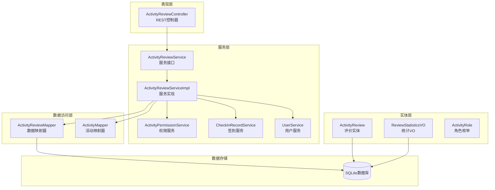
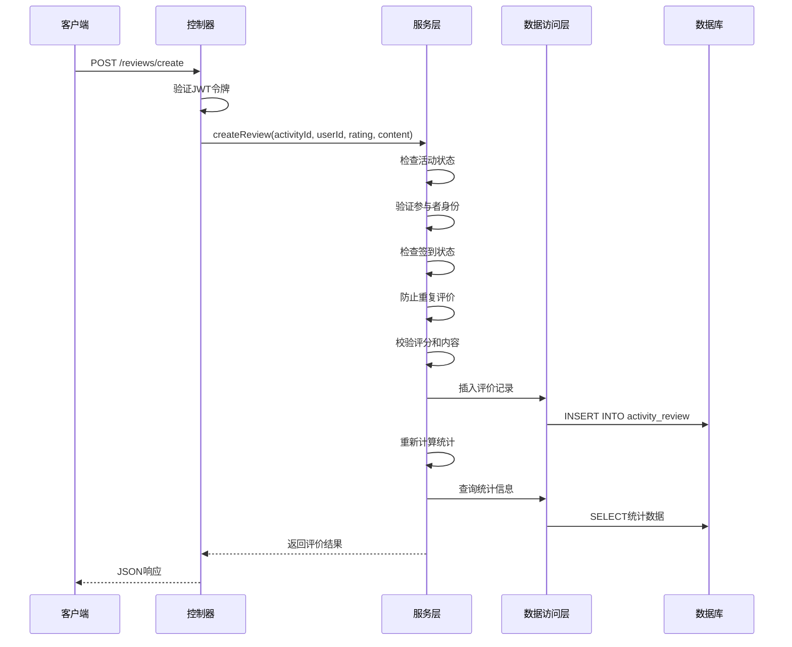
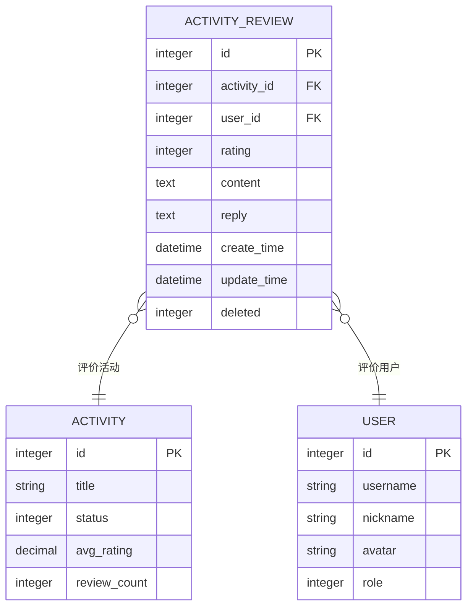
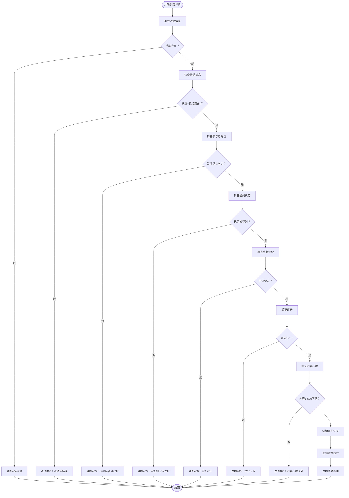
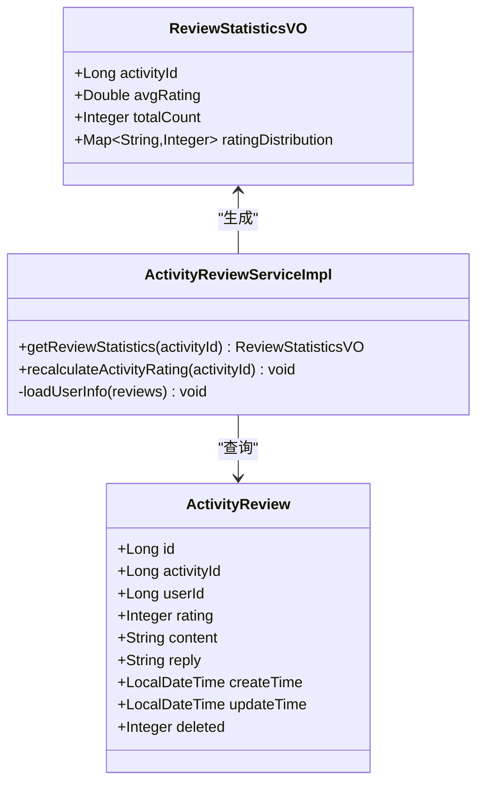
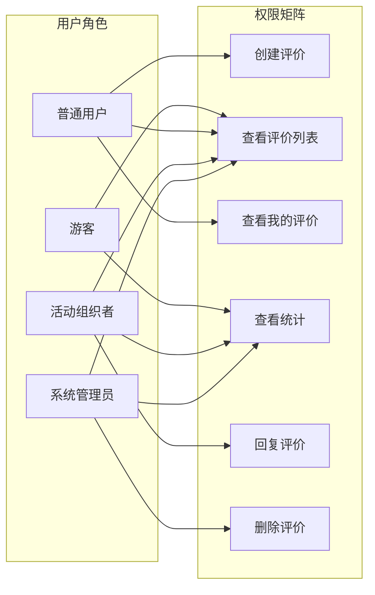
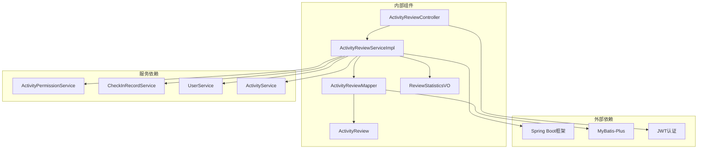

# 活动评价系统

<cite>
**本文档引用的文件**
- [ActivityReview.java](file://src/main/java/com/campus/eventsys/entity/ActivityReview.java)
- [ActivityReviewService.java](file://src/main/java/com/campus/eventsys/service/ActivityReviewService.java)
- [ActivityReviewServiceImpl.java](file://src/main/java/com/campus/eventsys/service/impl/ActivityReviewServiceImpl.java)
- [ActivityReviewController.java](file://src/main/java/com/campus/eventsys/controller/ActivityReviewController.java)
- [ActivityReviewMapper.java](file://src/main/java/com/campus/eventsys/mapper/ActivityReviewMapper.java)
- [ReviewStatisticsVO.java](file://src/main/java/com/campus/eventsys/entity/ReviewStatisticsVO.java)
- [ActivityPermissionService.java](file://src/main/java/com/campus/eventsys/service/ActivityPermissionService.java)
- [ActivityPermissionServiceImpl.java](file://src/main/java/com/campus/eventsys/service/impl/ActivityPermissionServiceImpl.java)
- [ActivityRole.java](file://src/main/java/com/campus/eventsys/enums/ActivityRole.java)
- [schema.sql](file://src/main/resources/db/schema.sql)
- [ActivityReviewControllerTest.java](file://src/test/java/com/campus/eventsys/controller/ActivityReviewControllerTest.java)
- [用例图11_活动评价模块.plantuml](file://picture/用例图11_活动评价模块.plantuml)
- [ER图11_活动评价.plantuml](file://picture/ER图11_活动评价.plantuml)
</cite>

## 目录
1. [简介](#简介)
2. [项目结构](#项目结构)
3. [核心组件](#核心组件)
4. [架构概览](#架构概览)
5. [详细组件分析](#详细组件分析)
6. [依赖关系分析](#依赖关系分析)
7. [性能考虑](#性能考虑)
8. [故障排除指南](#故障排除指南)
9. [结论](#结论)
10. [附录](#附录)

## 简介
活动评价系统是校园活动综合管理系统的核心功能模块之一，为用户提供对已结束活动进行评分和文字评价的能力。该系统实现了完整的评价生命周期管理，包括评价创建、验证、统计分析、组织者回复和管理员管理等功能。

系统采用Spring Boot + MyBatis-Plus技术栈构建，基于RESTful API设计，支持多角色权限控制和实时统计计算。评价数据采用SQLite数据库存储，通过唯一约束确保每个用户对同一活动只能评价一次。

## 项目结构
活动评价系统遵循标准的分层架构设计，主要包含以下层次：

**图表来源**
- [ActivityReviewController.java:1-254](file://src/main/java/com/campus/eventsys/controller/ActivityReviewController.java#L1-L254)
- [ActivityReviewServiceImpl.java:1-316](file://src/main/java/com/campus/eventsys/service/impl/ActivityReviewServiceImpl.java#L1-L316)
- [ActivityReviewMapper.java:1-10](file://src/main/java/com/campus/eventsys/mapper/ActivityReviewMapper.java#L1-L10)

**章节来源**
- [ActivityReviewController.java:1-254](file://src/main/java/com/campus/eventsys/controller/ActivityReviewController.java#L1-L254)
- [ActivityReviewServiceImpl.java:1-316](file://src/main/java/com/campus/eventsys/service/impl/ActivityReviewServiceImpl.java#L1-L316)

## 核心组件
活动评价系统由多个核心组件构成，每个组件都有明确的职责分工：

### 数据模型组件
- **ActivityReview实体**：表示单个评价记录，包含评分、内容、回复等信息
- **ReviewStatisticsVO**：评价统计结果的数据传输对象
- **ActivityRole枚举**：定义活动中的角色类型（组织者、参与者）

### 服务组件
- **ActivityReviewService**：定义评价相关的业务接口
- **ActivityReviewServiceImpl**：实现具体的业务逻辑和数据处理
- **ActivityPermissionService**：提供活动权限验证功能

### 控制器组件
- **ActivityReviewController**：暴露REST API接口，处理HTTP请求

**章节来源**
- [ActivityReview.java:1-56](file://src/main/java/com/campus/eventsys/entity/ActivityReview.java#L1-L56)
- [ReviewStatisticsVO.java:1-28](file://src/main/java/com/campus/eventsys/entity/ReviewStatisticsVO.java#L1-L28)
- [ActivityRole.java:1-38](file://src/main/java/com/campus/eventsys/enums/ActivityRole.java#L1-L38)

## 架构概览
系统采用经典的三层架构模式，通过清晰的职责分离实现松耦合的设计：

**图表来源**
- [ActivityReviewController.java:47-82](file://src/main/java/com/campus/eventsys/controller/ActivityReviewController.java#L47-L82)
- [ActivityReviewServiceImpl.java:41-111](file://src/main/java/com/campus/eventsys/service/impl/ActivityReviewServiceImpl.java#L41-L111)

**章节来源**
- [ActivityReviewController.java:25-38](file://src/main/java/com/campus/eventsys/controller/ActivityReviewController.java#L25-L38)
- [ActivityReviewServiceImpl.java:27-34](file://src/main/java/com/campus/eventsys/service/impl/ActivityReviewServiceImpl.java#L27-L34)

## 详细组件分析

### 数据模型设计
活动评价系统采用简洁而完整的数据模型设计：

**图表来源**
- [schema.sql:224-237](file://src/main/resources/db/schema.sql#L224-L237)
- [ActivityReview.java:17-55](file://src/main/java/com/campus/eventsys/entity/ActivityReview.java#L17-L55)

#### 评价实体属性详解
- **id**：评价记录的唯一标识符
- **activityId**：关联的活动标识符
- **userId**：评价用户的标识符
- **rating**：评分值，范围1-5星
- **content**：评价内容，最大500字符
- **reply**：组织者回复内容
- **createTime/updateTime**：记录创建和更新时间
- **deleted**：逻辑删除标志

#### 评分范围和内容规范
系统严格规定了评分和内容的规范：
- **评分范围**：1-5星，必须为整数
- **内容长度**：1-500字符，不能为空
- **唯一性约束**：每个用户对同一活动只能评价一次

**章节来源**
- [ActivityReview.java:29-33](file://src/main/java/com/campus/eventsys/entity/ActivityReview.java#L29-L33)
- [schema.sql:228-236](file://src/main/resources/db/schema.sql#L228-L236)

### 评价创建流程
评价创建是系统最核心的功能，包含严格的业务验证：

**图表来源**
- [ActivityReviewServiceImpl.java:41-111](file://src/main/java/com/campus/eventsys/service/impl/ActivityReviewServiceImpl.java#L41-L111)

#### 业务规则验证
系统在创建评价时执行以下验证：
1. **活动存在性验证**：确保活动未被删除
2. **活动状态验证**：仅已结束的活动允许评价
3. **参与者身份验证**：仅活动参与者可评价
4. **签到状态验证**：需要完成签到才能评价
5. **唯一性验证**：防止重复评价
6. **数据完整性验证**：评分和内容格式检查

**章节来源**
- [ActivityReviewServiceImpl.java:41-111](file://src/main/java/com/campus/eventsys/service/impl/ActivityReviewServiceImpl.java#L41-L111)

### 评价统计功能
系统提供实时的评价统计功能，支持多种统计维度：

**图表来源**
- [ReviewStatisticsVO.java:14-27](file://src/main/java/com/campus/eventsys/entity/ReviewStatisticsVO.java#L14-L27)
- [ActivityReviewServiceImpl.java:230-298](file://src/main/java/com/campus/eventsys/service/impl/ActivityReviewServiceImpl.java#L230-L298)

#### 统计指标计算
系统计算以下统计指标：
- **平均评分**：所有评价的加权平均，保留1位小数
- **总评价数**：活动的评价总数
- **星级分布**：按星级分组的评价数量分布

**章节来源**
- [ActivityReviewServiceImpl.java:230-298](file://src/main/java/com/campus/eventsys/service/impl/ActivityReviewServiceImpl.java#L230-L298)

### 权限控制机制
系统采用多层级权限控制，确保评价功能的安全性：

**图表来源**
- [ActivityReviewController.java:29-37](file://src/main/java/com/campus/eventsys/controller/ActivityReviewController.java#L29-L37)
- [用例图11_活动评价模块.plantuml:16-46](file://picture/用例图11_活动评价模块.plantuml#L16-L46)

#### 权限验证规则
- **评价创建**：需要登录且为活动参与者，已完成签到
- **评价查看**：公开接口，无需登录即可查看
- **组织者回复**：仅活动创建者可回复
- **管理员删除**：需要管理员权限

**章节来源**
- [ActivityReviewController.java:140-157](file://src/main/java/com/campus/eventsys/controller/ActivityReviewController.java#L140-L157)
- [ActivityReviewController.java:198-216](file://src/main/java/com/campus/eventsys/controller/ActivityReviewController.java#L198-L216)

### API接口文档
系统提供完整的REST API接口，支持评价的全生命周期管理：

#### 评价创建接口
- **URL**: `POST /reviews/create`
- **权限**: 需要JWT认证
- **请求参数**:
  - `activityId`: 活动ID
  - `rating`: 评分（1-5）
  - `content`: 评价内容（1-500字符）
- **响应**: 包含`reviewId`的成功响应

#### 评价列表接口
- **URL**: `GET /reviews/activity/{activityId}`
- **权限**: 无需登录
- **参数**:
  - `page`: 页码，默认1
  - `size`: 每页大小，默认10
- **响应**: 分页的评价列表

#### 统计查询接口
- **URL**: `GET /reviews/statistics/{activityId}`
- **权限**: 无需登录
- **响应**: 包含平均评分、总评价数和星级分布的统计信息

**章节来源**
- [ActivityReviewController.java:47-82](file://src/main/java/com/campus/eventsys/controller/ActivityReviewController.java#L47-L82)
- [ActivityReviewController.java:84-105](file://src/main/java/com/campus/eventsys/controller/ActivityReviewController.java#L84-L105)
- [ActivityReviewController.java:218-240](file://src/main/java/com/campus/eventsys/controller/ActivityReviewController.java#L218-L240)

## 依赖关系分析
系统各组件之间的依赖关系清晰明确，遵循依赖倒置原则：

**图表来源**
- [ActivityReviewController.java:43-45](file://src/main/java/com/campus/eventsys/controller/ActivityReviewController.java#L43-L45)
- [ActivityReviewServiceImpl.java:36-39](file://src/main/java/com/campus/eventsys/service/impl/ActivityReviewServiceImpl.java#L36-L39)

### 关键依赖点
- **控制器依赖服务层**：控制器只依赖抽象接口，便于测试和扩展
- **服务层依赖多个服务**：实现层依赖权限、签到、用户等多个服务
- **数据访问层依赖实体**：Mapper直接操作实体对象
- **权限验证**：通过ActivityPermissionService统一管理

**章节来源**
- [ActivityReviewServiceImpl.java:1-316](file://src/main/java/com/campus/eventsys/service/impl/ActivityReviewServiceImpl.java#L1-L316)

## 性能考虑
系统在设计时充分考虑了性能优化：

### 数据库优化
- **唯一索引**：`UNIQUE(activity_id, user_id)`确保评价唯一性
- **复合索引**：为常用查询字段建立索引
- **逻辑删除**：使用deleted字段而非物理删除

### 缓存策略
- **统计缓存**：评价统计结果可缓存以减少数据库查询
- **用户信息缓存**：评价列表中的用户信息可批量加载

### 查询优化
- **分页查询**：所有列表查询都支持分页
- **批量加载**：用户信息采用批量查询方式
- **条件过滤**：默认过滤已删除记录

## 故障排除指南
常见问题及解决方案：

### 评价创建失败
**问题**: "活动尚未结束，无法评价"
**原因**: 活动状态不是已结束(5)
**解决**: 确保活动已正常结束

**问题**: "仅活动参与者可以评价"
**原因**: 用户未完成活动报名或审核未通过
**解决**: 确保用户已通过活动报名审核

**问题**: "您未完成签到，无法评价"
**原因**: 用户未完成活动签到
**解决**: 确保用户已完成签到流程

### 权限相关错误
**问题**: "您不是该活动的组织者，无权查看评价"
**原因**: 非活动组织者尝试查看评价
**解决**: 确保操作用户为活动组织者

**问题**: "仅管理员可删除评价"
**原因**: 普通用户尝试删除评价
**解决**: 确保操作用户具有管理员权限

**章节来源**
- [ActivityReviewControllerTest.java:102-190](file://src/test/java/com/campus/eventsys/controller/ActivityReviewControllerTest.java#L102-L190)
- [ActivityReviewControllerTest.java:262-323](file://src/test/java/com/campus/eventsys/controller/ActivityReviewControllerTest.java#L262-L323)

## 结论
活动评价系统通过合理的架构设计和严格的业务验证，为校园活动提供了完善的评价管理功能。系统具备以下优势：

1. **完整的功能覆盖**：从评价创建到统计分析的全流程支持
2. **严格的数据验证**：多重验证确保数据质量和业务正确性
3. **灵活的权限控制**：多角色权限体系满足不同用户需求
4. **良好的扩展性**：清晰的分层架构便于功能扩展和维护

系统采用的技术栈成熟稳定，能够满足校园活动管理的实际需求，并为未来的功能扩展奠定了坚实基础。

## 附录

### 数据库表结构
活动评价相关的数据库表结构如下：
- **activity_review表**：存储评价记录，包含评分、内容、回复等字段
- **activity表**：扩展了avg_rating和review_count字段用于统计
- **唯一约束**：确保每个用户对同一活动只能评价一次

### 测试覆盖
系统提供了完整的单元测试，覆盖以下场景：
- 正常评价创建流程
- 各种异常情况的处理
- 权限验证测试
- 统计功能测试

**章节来源**
- [schema.sql:224-237](file://src/main/resources/db/schema.sql#L224-L237)
- [ActivityReviewControllerTest.java:1-370](file://src/test/java/com/campus/eventsys/controller/ActivityReviewControllerTest.java#L1-L370)