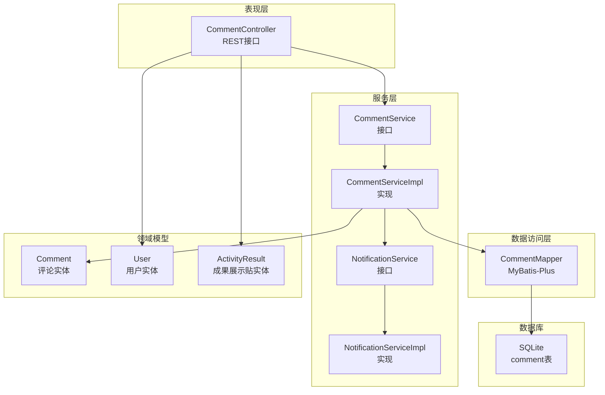
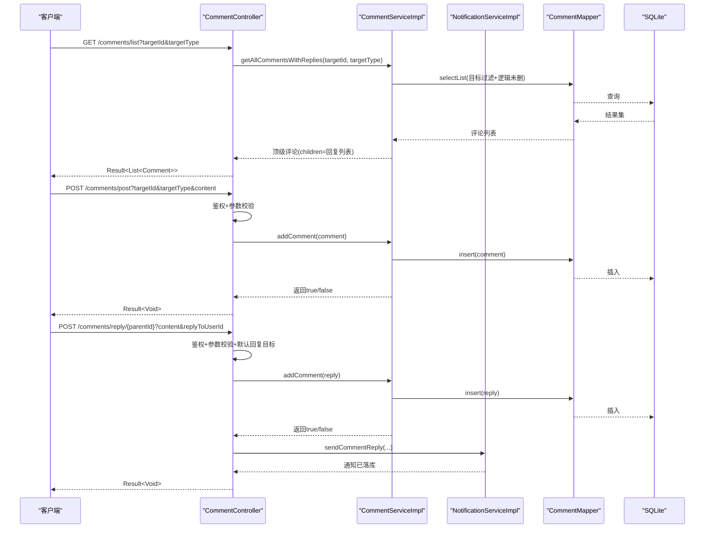
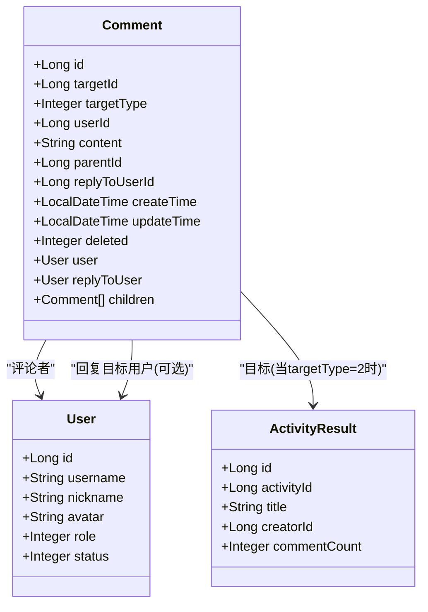
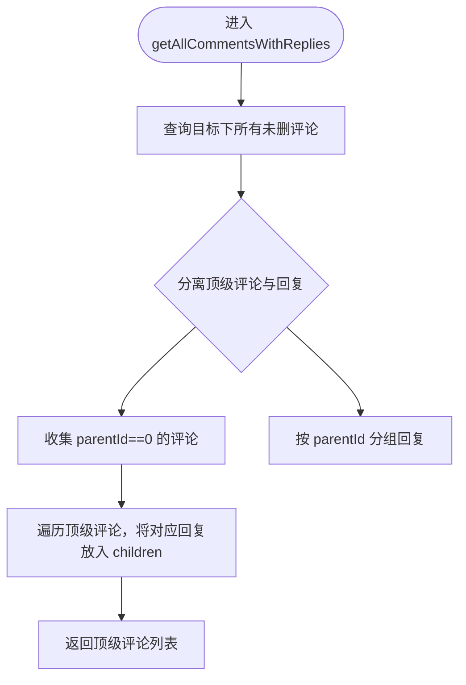
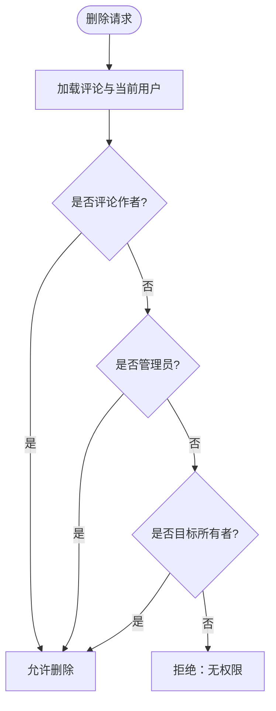
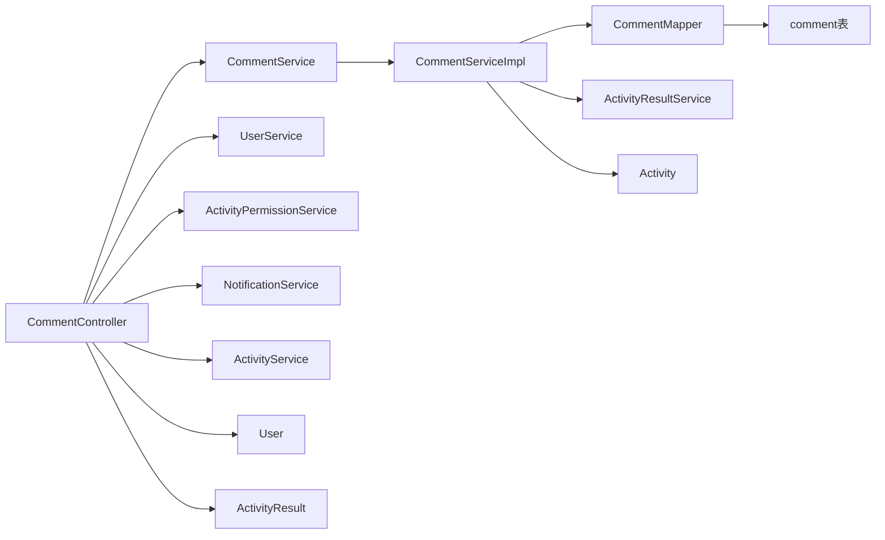
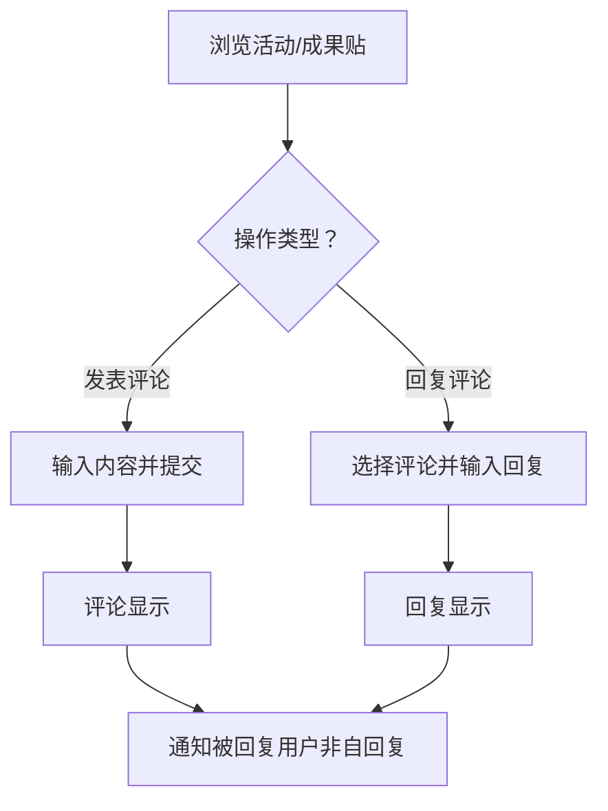

# 评论互动系统

<cite>
**本文引用的文件**
- [Comment.java](file://src/main/java/com/campus/eventsys/entity/Comment.java)
- [CommentService.java](file://src/main/java/com/campus/eventsys/service/CommentService.java)
- [CommentServiceImpl.java](file://src/main/java/com/campus/eventsys/service/impl/CommentServiceImpl.java)
- [CommentController.java](file://src/main/java/com/campus/eventsys/controller/CommentController.java)
- [CommentMapper.java](file://src/main/java/com/campus/eventsys/mapper/CommentMapper.java)
- [User.java](file://src/main/java/com/campus/eventsys/entity/User.java)
- [ActivityResult.java](file://src/main/java/com/campus/eventsys/entity/ActivityResult.java)
- [NotificationService.java](file://src/main/java/com/campus/eventsys/service/NotificationService.java)
- [NotificationServiceImpl.java](file://src/main/java/com/campus/eventsys/service/impl/NotificationServiceImpl.java)
- [schema.sql](file://src/main/resources/db/schema.sql)
- [CommentControllerTest.java](file://src/test/java/com/campus/eventsys/controller/CommentControllerTest.java)
- [流程图4_评论互动.plantuml](file://picture/流程图4_评论互动.plantuml)
</cite>

## 目录
1. [简介](#简介)
2. [项目结构](#项目结构)
3. [核心组件](#核心组件)
4. [架构总览](#架构总览)
5. [详细组件分析](#详细组件分析)
6. [依赖关系分析](#依赖关系分析)
7. [性能考虑](#性能考虑)
8. [故障排查指南](#故障排查指南)
9. [结论](#结论)
10. [附录](#附录)

## 简介
本技术文档面向“评论互动系统”，围绕评论与回复功能展开，涵盖以下主题：
- 顶级评论发布、回复机制与评论树状结构管理
- 权限控制策略（用户权限验证、删除权限、内容审核机制）
- 服务层核心业务逻辑（查询、嵌套回复、评论数量统计）
- 通知系统实现（回复通知触发条件与内容格式）
- 数据模型设计（实体属性、父子关系映射、用户信息关联）
- 完整API接口文档与使用示例

## 项目结构
评论互动系统采用典型的分层架构：
- 控制器层：对外暴露REST接口，负责请求解析、鉴权与响应封装
- 服务层：封装业务逻辑，处理评论树构建、计数增减、权限校验等
- 数据访问层：基于MyBatis-Plus的Mapper接口，提供基础CRUD能力
- 实体层：定义评论、用户、成果展示贴等核心实体
- 通知服务：独立模块，负责系统内各类通知的生成与落库

图表来源
- [CommentController.java:1-327](file://src/main/java/com/campus/eventsys/controller/CommentController.java#L1-L327)
- [CommentService.java:1-66](file://src/main/java/com/campus/eventsys/service/CommentService.java#L1-L66)
- [CommentServiceImpl.java:1-173](file://src/main/java/com/campus/eventsys/service/impl/CommentServiceImpl.java#L1-L173)
- [CommentMapper.java:1-10](file://src/main/java/com/campus/eventsys/mapper/CommentMapper.java#L1-L10)
- [Comment.java:1-67](file://src/main/java/com/campus/eventsys/entity/Comment.java#L1-L67)
- [User.java:1-85](file://src/main/java/com/campus/eventsys/entity/User.java#L1-L85)
- [ActivityResult.java:1-69](file://src/main/java/com/campus/eventsys/entity/ActivityResult.java#L1-L69)
- [NotificationService.java:1-192](file://src/main/java/com/campus/eventsys/service/NotificationService.java#L1-L192)
- [NotificationServiceImpl.java:1-455](file://src/main/java/com/campus/eventsys/service/impl/NotificationServiceImpl.java#L1-L455)
- [schema.sql:128-140](file://src/main/resources/db/schema.sql#L128-L140)

章节来源
- [CommentController.java:1-327](file://src/main/java/com/campus/eventsys/controller/CommentController.java#L1-L327)
- [CommentService.java:1-66](file://src/main/java/com/campus/eventsys/service/CommentService.java#L1-L66)
- [CommentServiceImpl.java:1-173](file://src/main/java/com/campus/eventsys/service/impl/CommentServiceImpl.java#L1-L173)
- [CommentMapper.java:1-10](file://src/main/java/com/campus/eventsys/mapper/CommentMapper.java#L1-L10)
- [Comment.java:1-67](file://src/main/java/com/campus/eventsys/entity/Comment.java#L1-L67)
- [User.java:1-85](file://src/main/java/com/campus/eventsys/entity/User.java#L1-L85)
- [ActivityResult.java:1-69](file://src/main/java/com/campus/eventsys/entity/ActivityResult.java#L1-L69)
- [NotificationService.java:1-192](file://src/main/java/com/campus/eventsys/service/NotificationService.java#L1-L192)
- [NotificationServiceImpl.java:1-455](file://src/main/java/com/campus/eventsys/service/impl/NotificationServiceImpl.java#L1-L455)
- [schema.sql:128-140](file://src/main/resources/db/schema.sql#L128-L140)

## 核心组件
- 评论实体：支持活动与成果展示贴两类目标，具备父子关系与用户信息关联
- 评论服务接口与实现：提供顶级评论、回复查询、树形结构组装、新增与删除、计数统计
- 评论控制器：统一对外接口，负责鉴权、参数校验、调用服务层并返回Result封装
- 通知服务：提供评论回复通知的发送能力
- 数据库表：comment表支持目标类型、父评论ID、回复目标用户ID等字段

章节来源
- [Comment.java:10-67](file://src/main/java/com/campus/eventsys/entity/Comment.java#L10-L67)
- [CommentService.java:8-66](file://src/main/java/com/campus/eventsys/service/CommentService.java#L8-L66)
- [CommentServiceImpl.java:21-173](file://src/main/java/com/campus/eventsys/service/impl/CommentServiceImpl.java#L21-L173)
- [CommentController.java:25-327](file://src/main/java/com/campus/eventsys/controller/CommentController.java#L25-L327)
- [NotificationService.java:10-192](file://src/main/java/com/campus/eventsys/service/NotificationService.java#L10-L192)
- [NotificationServiceImpl.java:333-350](file://src/main/java/com/campus/eventsys/service/impl/NotificationServiceImpl.java#L333-L350)
- [schema.sql:128-140](file://src/main/resources/db/schema.sql#L128-L140)

## 架构总览
评论互动系统遵循“控制器-服务-数据访问-实体-数据库”的分层设计，核心交互如下：

图表来源
- [CommentController.java:48-207](file://src/main/java/com/campus/eventsys/controller/CommentController.java#L48-L207)
- [CommentServiceImpl.java:55-118](file://src/main/java/com/campus/eventsys/service/impl/CommentServiceImpl.java#L55-L118)
- [NotificationServiceImpl.java:333-350](file://src/main/java/com/campus/eventsys/service/impl/NotificationServiceImpl.java#L333-L350)
- [CommentMapper.java:1-10](file://src/main/java/com/campus/eventsys/mapper/CommentMapper.java#L1-L10)

## 详细组件分析

### 数据模型设计
- 评论实体属性
  - 主键ID、目标ID与目标类型（1-活动，2-成果展示贴）、用户ID、内容
  - 父评论ID（0表示顶级评论）、回复目标用户ID
  - 创建/更新时间、逻辑删除标志
  - 非持久化字段：用户信息、回复目标用户信息、子评论列表
- 关系映射
  - 一对多：一个评论对应多个回复（children）
  - 多对一：评论归属用户与目标（活动/成果展示贴）
- 用户信息关联
  - 控制器在返回时加载简要用户信息（ID、昵称、头像）

图表来源
- [Comment.java:14-67](file://src/main/java/com/campus/eventsys/entity/Comment.java#L14-L67)
- [User.java:12-85](file://src/main/java/com/campus/eventsys/entity/User.java#L12-L85)
- [ActivityResult.java:14-69](file://src/main/java/com/campus/eventsys/entity/ActivityResult.java#L14-L69)

章节来源
- [Comment.java:10-67](file://src/main/java/com/campus/eventsys/entity/Comment.java#L10-L67)
- [User.java:9-85](file://src/main/java/com/campus/eventsys/entity/User.java#L9-L85)
- [ActivityResult.java:9-69](file://src/main/java/com/campus/eventsys/entity/ActivityResult.java#L9-L69)

### 评论树状结构管理
- 顶级评论查询：按目标ID与类型过滤，父ID为0，按创建时间倒序
- 回复查询：按父评论ID过滤，按创建时间正序
- 树形组装：先取全部评论，分离顶级与回复，再将回复归入对应顶级评论的children字段
- 展示时加载用户信息：对顶级评论与回复分别注入简要用户信息

图表来源
- [CommentServiceImpl.java:55-82](file://src/main/java/com/campus/eventsys/service/impl/CommentServiceImpl.java#L55-L82)

章节来源
- [CommentServiceImpl.java:33-82](file://src/main/java/com/campus/eventsys/service/impl/CommentServiceImpl.java#L33-L82)
- [CommentController.java:57-74](file://src/main/java/com/campus/eventsys/controller/CommentController.java#L57-L74)

### 评论权限控制策略
- 发布/回复/删除均需登录态
- 删除权限判定规则：
  - 评论作者可删除自己的评论
  - 管理员可删除任意评论
  - 活动评论：活动组织者可删除该活动下的评论
  - 成果展示贴评论：成果创建者可删除该贴下的评论
- 内容审核机制
  - 评论内容与回复内容均进行非空校验
  - 未提供专门的“内容审核”字段或流程，删除权限即为当前的审核约束手段

图表来源
- [CommentController.java:256-283](file://src/main/java/com/campus/eventsys/controller/CommentController.java#L256-L283)

章节来源
- [CommentController.java:91-138](file://src/main/java/com/campus/eventsys/controller/CommentController.java#L91-L138)
- [CommentController.java:140-207](file://src/main/java/com/campus/eventsys/controller/CommentController.java#L140-L207)
- [CommentController.java:209-283](file://src/main/java/com/campus/eventsys/controller/CommentController.java#L209-L283)

### 服务层核心业务逻辑
- 查询
  - 顶级评论：按目标过滤、父ID=0、未删、按创建时间排序
  - 回复：按父ID过滤、未删、按创建时间排序
  - 树形：全量查询后组装children
  - 数量：按目标过滤、未删计数
- 新增
  - 默认父ID=0、回复目标ID=0
  - 插入后根据目标类型更新活动或成果贴的评论计数
- 删除
  - 逻辑删除主评论与所有回复
  - 根据目标类型减少活动或成果贴的评论计数
- 通知
  - 回复成功后，若非自回复，则向被回复用户发送通知

章节来源
- [CommentService.java:8-66](file://src/main/java/com/campus/eventsys/service/CommentService.java#L8-L66)
- [CommentServiceImpl.java:33-171](file://src/main/java/com/campus/eventsys/service/impl/CommentServiceImpl.java#L33-L171)
- [CommentController.java:199-206](file://src/main/java/com/campus/eventsys/controller/CommentController.java#L199-L206)

### 通知系统实现
- 触发条件
  - 回复评论且非自回复时触发
- 通知内容格式
  - 标题：固定“评论回复提醒”
  - 内容：包含回复者昵称、活动/成果标题与回复内容
- 存储
  - 通知类型为业务通知（type=5），与用户、活动关联，标记未读并写入创建时间

章节来源
- [NotificationService.java:113-123](file://src/main/java/com/campus/eventsys/service/NotificationService.java#L113-L123)
- [NotificationServiceImpl.java:333-350](file://src/main/java/com/campus/eventsys/service/impl/NotificationServiceImpl.java#L333-L350)
- [CommentController.java:199-206](file://src/main/java/com/campus/eventsys/controller/CommentController.java#L199-L206)

### API接口文档
- 获取评论列表
  - 方法：GET
  - 路径：/comments/list
  - 参数：targetId（目标ID）、targetType（1-活动，2-成果贴）
  - 返回：Result<List<Comment>>，Comment包含user、replyToUser与children
  - 权限：公开接口
- 获取评论数量
  - 方法：GET
  - 路径：/comments/count
  - 参数：targetId、targetType
  - 返回：Result<Long>
  - 权限：公开接口
- 发表评论（顶级）
  - 方法：POST
  - 路径：/comments/post
  - 参数：targetId、targetType、content
  - 返回：Result<Void>
  - 权限：Bearer认证
- 回复评论
  - 方法：POST
  - 路径：/comments/reply/{parentId}
  - 参数：content（必填）、replyToUserId（可选，默认父评论作者）
  - 返回：Result<Void>
  - 权限：Bearer认证
  - 通知：非自回复时发送通知
- 删除评论
  - 方法：DELETE
  - 路径：/comments/delete/{id}
  - 返回：Result<Void>
  - 权限：Bearer认证
  - 权限判定：作者、目标所有者或管理员

章节来源
- [CommentController.java:48-283](file://src/main/java/com/campus/eventsys/controller/CommentController.java#L48-L283)

## 依赖关系分析
- 控制器依赖服务、用户、权限、通知与活动服务
- 服务实现依赖Mapper与活动成果服务以维护计数
- 实体间存在用户与目标（活动/成果）的关联
- 数据库层面通过外键与索引支撑查询与一致性

图表来源
- [CommentController.java:41-46](file://src/main/java/com/campus/eventsys/controller/CommentController.java#L41-L46)
- [CommentServiceImpl.java:30-31](file://src/main/java/com/campus/eventsys/service/impl/CommentServiceImpl.java#L30-L31)
- [CommentMapper.java:1-10](file://src/main/java/com/campus/eventsys/mapper/CommentMapper.java#L1-L10)
- [schema.sql:128-140](file://src/main/resources/db/schema.sql#L128-L140)

章节来源
- [CommentController.java:41-46](file://src/main/java/com/campus/eventsys/controller/CommentController.java#L41-L46)
- [CommentServiceImpl.java:30-31](file://src/main/java/com/campus/eventsys/service/impl/CommentServiceImpl.java#L30-L31)
- [CommentMapper.java:1-10](file://src/main/java/com/campus/eventsys/mapper/CommentMapper.java#L1-L10)
- [schema.sql:128-140](file://src/main/resources/db/schema.sql#L128-L140)

## 性能考虑
- 查询优化
  - 评论表已建立目标ID+类型、用户ID、父ID索引，有利于按目标查询、按作者过滤与按父子关系检索
- 事务与一致性
  - 新增/删除评论与计数更新在同一事务中执行，避免并发导致的计数不一致
- 展示性能
  - 树形组装在内存中完成，建议在高并发场景下对热门目标增加缓存策略

章节来源
- [schema.sql:268-271](file://src/main/resources/db/schema.sql#L268-L271)
- [CommentServiceImpl.java:84-118](file://src/main/java/com/campus/eventsys/service/impl/CommentServiceImpl.java#L84-L118)
- [CommentServiceImpl.java:120-161](file://src/main/java/com/campus/eventsys/service/impl/CommentServiceImpl.java#L120-L161)

## 故障排查指南
- 常见问题与定位
  - 未登录：接口均需Bearer认证，返回401
  - 用户不存在：鉴权后根据用户名查询用户，不存在则返回错误
  - 内容为空：评论/回复内容为空或仅空白字符时拒绝
  - 父评论不存在：回复时父评论ID无效
  - 无删除权限：非作者、非目标所有者且非管理员
  - 删除失败：服务层异常捕获并返回false
- 单元测试参考
  - 测试覆盖了列表、数量、发表、回复、删除等场景，可作为行为验证依据

章节来源
- [CommentControllerTest.java:111-377](file://src/test/java/com/campus/eventsys/controller/CommentControllerTest.java#L111-L377)
- [CommentController.java:91-138](file://src/main/java/com/campus/eventsys/controller/CommentController.java#L91-L138)
- [CommentController.java:140-207](file://src/main/java/com/campus/eventsys/controller/CommentController.java#L140-L207)
- [CommentController.java:209-283](file://src/main/java/com/campus/eventsys/controller/CommentController.java#L209-L283)

## 结论
评论互动系统通过清晰的分层设计与完善的权限控制，实现了对活动与成果展示贴的评论与回复管理，并提供了树形结构展示与通知提醒。服务层在事务与索引的支持下具备良好的一致性与可扩展性。后续可在热点目标引入缓存、增强内容审核策略与通知模板化等方面进一步优化。

## 附录
- 业务流程概览（概念图）

[此图为概念流程示意，不直接映射具体源码文件，故不提供图表来源]