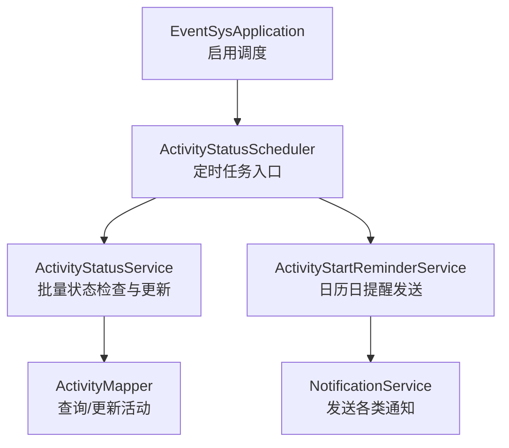
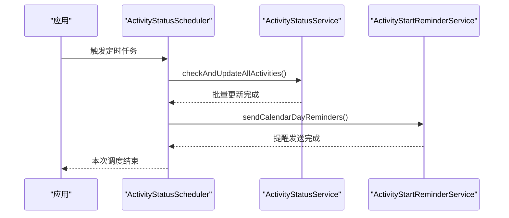
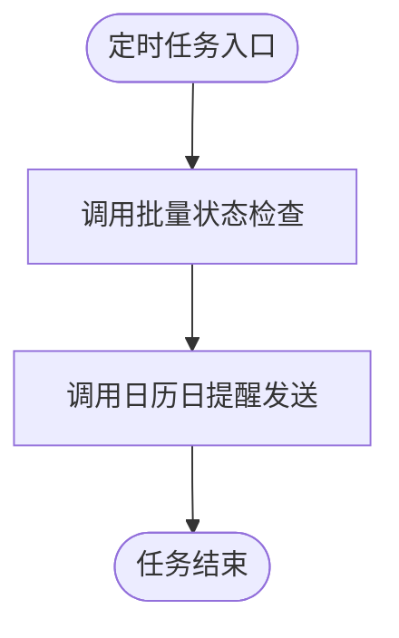
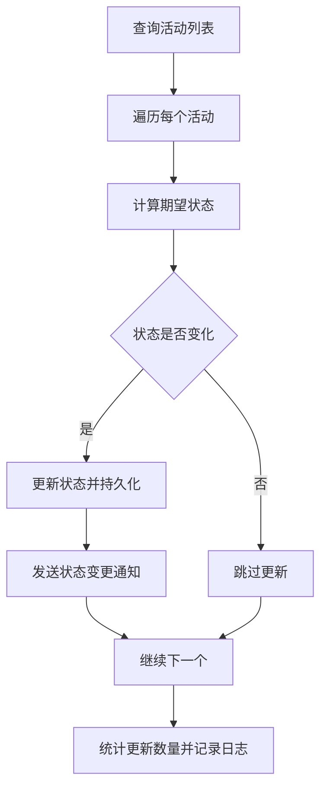
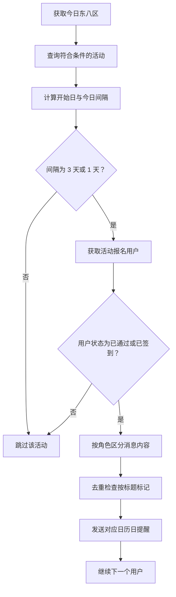
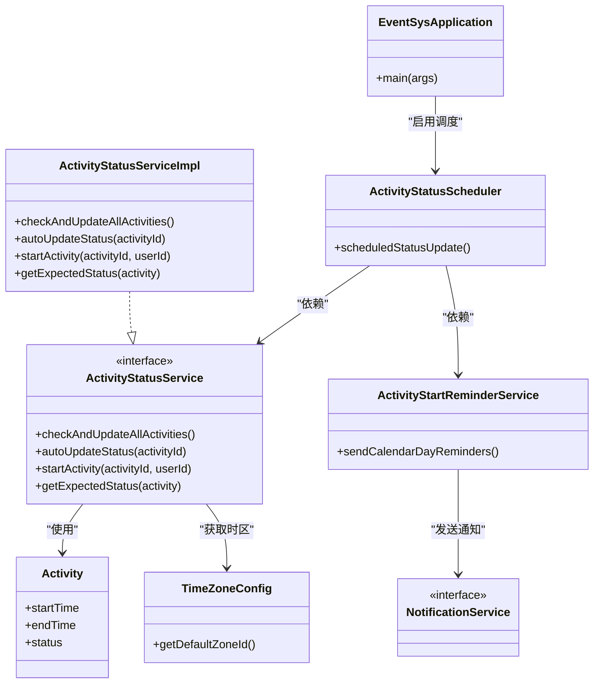

# 定时任务模块

<cite>
**本文引用的文件**
- [EventSysApplication.java](file://src/main/java/com/campus/eventsys/EventSysApplication.java)
- [ActivityStatusScheduler.java](file://src/main/java/com/campus/eventsys/scheduler/ActivityStatusScheduler.java)
- [ActivityStatusServiceImpl.java](file://src/main/java/com/campus/eventsys/service/impl/ActivityStatusServiceImpl.java)
- [ActivityStartReminderService.java](file://src/main/java/com/campus/eventsys/service/ActivityStartReminderService.java)
- [ActivityStatusService.java](file://src/main/java/com/campus/eventsys/service/ActivityStatusService.java)
- [NotificationService.java](file://src/main/java/com/campus/eventsys/service/NotificationService.java)
- [ActivityStatusUtil.java](file://src/main/java/com/campus/eventsys/utils/ActivityStatusUtil.java)
- [TimeZoneConfig.java](file://src/main/java/com/campus/eventsys/config/TimeZoneConfig.java)
- [Activity.java](file://src/main/java/com/campus/eventsys/entity/Activity.java)
- [application.yml](file://src/main/resources/application.yml)
</cite>

## 目录
1. [简介](#简介)
2. [项目结构](#项目结构)
3. [核心组件](#核心组件)
4. [架构总览](#架构总览)
5. [详细组件分析](#详细组件分析)
6. [依赖关系分析](#依赖关系分析)
7. [性能考虑](#性能考虑)
8. [故障排查指南](#故障排查指南)
9. [结论](#结论)
10. [附录](#附录)

## 简介
本文件面向“定时任务模块”的技术文档，聚焦于活动状态自动更新机制的实现原理与运行策略。内容涵盖：
- Cron 表达式与任务调度策略
- 触发条件、执行逻辑与异常处理
- 监控与日志记录（状态跟踪与性能观测）
- 扩展接口与自定义任务开发指南
- 配置示例与调试技巧

## 项目结构
定时任务模块位于应用启动类启用调度能力，并通过一个调度器组件驱动状态检查与提醒发送两大子流程。

图表来源
- [EventSysApplication.java:10](file://src/main/java/com/campus/eventsys/EventSysApplication.java#L10)
- [ActivityStatusScheduler.java:17](file://src/main/java/com/campus/eventsys/scheduler/ActivityStatusScheduler.java#L17)
- [ActivityStatusServiceImpl.java:28](file://src/main/java/com/campus/eventsys/service/impl/ActivityStatusServiceImpl.java#L28)
- [ActivityStartReminderService.java:24](file://src/main/java/com/campus/eventsys/service/ActivityStartReminderService.java#L24)

章节来源
- [EventSysApplication.java:10](file://src/main/java/com/campus/eventsys/EventSysApplication.java#L10)
- [ActivityStatusScheduler.java:17](file://src/main/java/com/campus/eventsys/scheduler/ActivityStatusScheduler.java#L17)

## 核心组件
- 定时任务调度器：负责周期性触发状态检查与日历日提醒。
- 活动状态服务：计算期望状态、批量更新、发送状态变更通知。
- 日历日提醒服务：基于东八区日历日，向符合条件的用户发送“3天后/明天开始”提醒。
- 通知服务：统一发送系统公告、活动状态变更、活动提醒等通知。
- 时区配置：统一应用默认时区，确保时间计算一致性。
- 实体与映射：活动实体与 MyBatis Mapper，支撑查询与更新。

章节来源
- [ActivityStatusScheduler.java:17](file://src/main/java/com/campus/eventsys/scheduler/ActivityStatusScheduler.java#L17)
- [ActivityStatusServiceImpl.java:28](file://src/main/java/com/campus/eventsys/service/impl/ActivityStatusServiceImpl.java#L28)
- [ActivityStartReminderService.java:24](file://src/main/java/com/campus/eventsys/service/ActivityStartReminderService.java#L24)
- [NotificationService.java:13](file://src/main/java/com/campus/eventsys/service/NotificationService.java#L13)
- [TimeZoneConfig.java:16](file://src/main/java/com/campus/eventsys/config/TimeZoneConfig.java#L16)
- [Activity.java:15](file://src/main/java/com/campus/eventsys/entity/Activity.java#L15)

## 架构总览
定时任务在应用启动时启用调度，调度器每固定周期执行一次，分别调用状态服务与提醒服务。状态服务对满足条件的活动批量计算期望状态并更新，同时发送状态变更通知；提醒服务按日历日向已通过报名或已签到的用户发送提醒。

图表来源
- [ActivityStatusScheduler.java:31](file://src/main/java/com/campus/eventsys/scheduler/ActivityStatusScheduler.java#L31)
- [ActivityStatusServiceImpl.java:100](file://src/main/java/com/campus/eventsys/service/impl/ActivityStatusServiceImpl.java#L100)
- [ActivityStartReminderService.java:34](file://src/main/java/com/campus/eventsys/service/ActivityStartReminderService.java#L34)

## 详细组件分析

### 定时任务调度器（ActivityStatusScheduler）
- 触发策略：使用固定速率调度，周期为 30 秒。
- 执行内容：依次调用活动状态服务的批量更新方法与日历日提醒服务。
- 异常处理：捕获执行过程中的异常并记录错误日志，避免中断后续任务。

图表来源
- [ActivityStatusScheduler.java:31](file://src/main/java/com/campus/eventsys/scheduler/ActivityStatusScheduler.java#L31)

章节来源
- [ActivityStatusScheduler.java:31](file://src/main/java/com/campus/eventsys/scheduler/ActivityStatusScheduler.java#L31)

### 活动状态服务（ActivityStatusServiceImpl）
- 批量更新逻辑：查询状态在“已通过审核至未结束”范围内的活动，逐个计算期望状态并更新，同时发送状态变更通知。
- 期望状态计算规则：
  - 已结束（5）状态不再变更；
  - 结束时间已过则进入“已结束”；
  - 进行中（4）保持进行中或转“已结束”，不可回退；
  - 即将开始（3）若已开始则转“进行中”，否则保持；
  - 报名中（2）若已开始则转“进行中”，若距离开始前 30 分钟则转“即将开始”，否则保持。
- 事务与通知：更新与通知均在服务层进行，确保一致性与可观测性。

图表来源
- [ActivityStatusServiceImpl.java:100](file://src/main/java/com/campus/eventsys/service/impl/ActivityStatusServiceImpl.java#L100)
- [ActivityStatusServiceImpl.java:128](file://src/main/java/com/campus/eventsys/service/impl/ActivityStatusServiceImpl.java#L128)

章节来源
- [ActivityStatusServiceImpl.java:100](file://src/main/java/com/campus/eventsys/service/impl/ActivityStatusServiceImpl.java#L100)
- [ActivityStatusServiceImpl.java:128](file://src/main/java/com/campus/eventsys/service/impl/ActivityStatusServiceImpl.java#L128)

### 日历日提醒服务（ActivityStartReminderService）
- 触发条件：仅针对状态在“报名中/即将开始/进行中”且开始时间非空的活动。
- 计算逻辑：以东八区日历日为基准，计算与开始日相隔 3 天或 1 天的活动。
- 发送策略：仅对“已通过报名”或“已签到”的用户发送提醒，区分组织者与普通参与者，避免重复发送（基于标题标记去重）。

图表来源
- [ActivityStartReminderService.java:34](file://src/main/java/com/campus/eventsys/service/ActivityStartReminderService.java#L34)
- [ActivityStartReminderService.java:50](file://src/main/java/com/campus/eventsys/service/ActivityStartReminderService.java#L50)

章节来源
- [ActivityStartReminderService.java:34](file://src/main/java/com/campus/eventsys/service/ActivityStartReminderService.java#L34)
- [ActivityStartReminderService.java:50](file://src/main/java/com/campus/eventsys/service/ActivityStartReminderService.java#L50)

### 通知服务（NotificationService）
- 职责：统一管理各类通知的发送与去重校验，包括系统公告、活动审核结果、状态变更、活动提醒（即将开始/已开始）、评论回复、成果发布、管理者变更等。
- 去重机制：通过“类型 + 标题包含特定标记”进行去重，避免重复打扰用户。

章节来源
- [NotificationService.java:13](file://src/main/java/com/campus/eventsys/service/NotificationService.java#L13)
- [NotificationService.java:94](file://src/main/java/com/campus/eventsys/service/NotificationService.java#L94)

### 时区配置（TimeZoneConfig）
- 默认时区：应用默认时区设置为 UTC。
- 获取方式：提供静态方法获取默认时区 ID，供状态计算与提醒服务使用。

章节来源
- [TimeZoneConfig.java:18](file://src/main/java/com/campus/eventsys/config/TimeZoneConfig.java#L18)
- [TimeZoneConfig.java:30](file://src/main/java/com/campus/eventsys/config/TimeZoneConfig.java#L30)

### 活动实体（Activity）
- 关键字段：开始时间、结束时间、状态等，支撑状态计算与提醒逻辑。
- 状态枚举：包含草稿、待审核、报名中、即将开始、进行中、已结束等。

章节来源
- [Activity.java:58](file://src/main/java/com/campus/eventsys/entity/Activity.java#L58)

### 状态名称工具（ActivityStatusUtil）
- 职责：提供活动状态与报名状态的中文名称映射，便于日志与通知展示。

章节来源
- [ActivityStatusUtil.java:15](file://src/main/java/com/campus/eventsys/utils/ActivityStatusUtil.java#L15)

## 依赖关系分析
- 启动类启用调度：应用启动类开启调度注解，使定时任务可用。
- 调度器依赖服务：调度器注入状态服务与提醒服务，形成“调度-执行”的依赖链。
- 服务层依赖映射：状态服务依赖活动映射进行查询与更新；提醒服务依赖活动映射与通知服务。
- 时区依赖：状态计算与提醒计算均依赖统一时区配置。

图表来源
- [EventSysApplication.java:10](file://src/main/java/com/campus/eventsys/EventSysApplication.java#L10)
- [ActivityStatusScheduler.java:19](file://src/main/java/com/campus/eventsys/scheduler/ActivityStatusScheduler.java#L19)
- [ActivityStatusService.java:9](file://src/main/java/com/campus/eventsys/service/ActivityStatusService.java#L9)
- [ActivityStatusServiceImpl.java:28](file://src/main/java/com/campus/eventsys/service/impl/ActivityStatusServiceImpl.java#L28)
- [ActivityStartReminderService.java:24](file://src/main/java/com/campus/eventsys/service/ActivityStartReminderService.java#L24)
- [NotificationService.java:13](file://src/main/java/com/campus/eventsys/service/NotificationService.java#L13)
- [TimeZoneConfig.java:30](file://src/main/java/com/campus/eventsys/config/TimeZoneConfig.java#L30)
- [Activity.java:38](file://src/main/java/com/campus/eventsys/entity/Activity.java#L38)

章节来源
- [EventSysApplication.java:10](file://src/main/java/com/campus/eventsys/EventSysApplication.java#L10)
- [ActivityStatusScheduler.java:19](file://src/main/java/com/campus/eventsys/scheduler/ActivityStatusScheduler.java#L19)
- [ActivityStatusServiceImpl.java:28](file://src/main/java/com/campus/eventsys/service/impl/ActivityStatusServiceImpl.java#L28)
- [ActivityStartReminderService.java:24](file://src/main/java/com/campus/eventsys/service/ActivityStartReminderService.java#L24)
- [NotificationService.java:13](file://src/main/java/com/campus/eventsys/service/NotificationService.java#L13)
- [TimeZoneConfig.java:30](file://src/main/java/com/campus/eventsys/config/TimeZoneConfig.java#L30)
- [Activity.java:38](file://src/main/java/com/campus/eventsys/entity/Activity.java#L38)

## 性能考虑
- 批量更新策略：状态服务对满足条件的活动进行批量计算与更新，减少数据库往返；建议结合数据库索引优化查询性能。
- 去重与幂等：提醒服务通过标题标记去重，避免重复发送；通知服务也提供去重校验，降低无效调用。
- 时间计算一致性：统一使用时区配置，避免跨时区导致的时间偏差与重复触发。
- 调度频率：当前固定周期为 30 秒，可根据活动规模与服务器负载调整；过短可能增加数据库压力，过长可能影响状态时效性。

## 故障排查指南
- 任务未执行
  - 检查应用是否启用调度注解。
  - 确认调度器组件是否被容器管理。
- 状态未更新
  - 核对活动状态范围与时间条件，确认活动满足批量更新条件。
  - 查看状态计算逻辑与边界条件（如结束时间、开始前 30 分钟）。
- 提醒未发送
  - 确认活动开始时间非空且日历日间隔为 3 天或 1 天。
  - 检查用户状态是否为“已通过报名”或“已签到”，并确认去重标记是否已存在。
- 日志与监控
  - 关注调度器与服务层的日志输出，定位异常发生点。
  - 在应用配置中适当提高日志级别以辅助排查。

章节来源
- [EventSysApplication.java:10](file://src/main/java/com/campus/eventsys/EventSysApplication.java#L10)
- [ActivityStatusScheduler.java:32](file://src/main/java/com/campus/eventsys/scheduler/ActivityStatusScheduler.java#L32)
- [ActivityStatusServiceImpl.java:100](file://src/main/java/com/campus/eventsys/service/impl/ActivityStatusServiceImpl.java#L100)
- [ActivityStartReminderService.java:34](file://src/main/java/com/campus/eventsys/service/ActivityStartReminderService.java#L34)
- [application.yml:74](file://src/main/resources/application.yml#L74)

## 结论
定时任务模块通过“固定速率调度 + 批量状态更新 + 日历日提醒”的组合，实现了活动生命周期的关键自动化。其设计强调：
- 明确的触发条件与状态流转规则
- 事务内的一致性更新与通知
- 基于日历日的精准提醒与去重
- 统一时区与可观测的日志体系

在实际部署中，建议结合业务规模与资源情况，合理设置调度周期与数据库索引，持续关注日志与告警，确保系统稳定运行。

## 附录

### Cron 表达式与调度策略
- 当前采用固定速率调度（30 秒），非标准 Cron 表达式。
- 如需改为 Cron 表达式，可在调度器方法上使用相应注解并配置表达式字符串。

章节来源
- [ActivityStatusScheduler.java:31](file://src/main/java/com/campus/eventsys/scheduler/ActivityStatusScheduler.java#L31)

### 配置示例与调试技巧
- 应用日志级别：可提升至调试级别以便观察任务执行细节。
- 调试技巧：
  - 在状态服务中打印“检查/更新”计数，验证批量更新效果。
  - 在提醒服务中打印“去重命中率”，评估去重策略有效性。
  - 对关键时间点（开始前 30 分钟、开始时间、结束时间）进行边界测试。

章节来源
- [application.yml:74](file://src/main/resources/application.yml#L74)
- [ActivityStatusServiceImpl.java:100](file://src/main/java/com/campus/eventsys/service/impl/ActivityStatusServiceImpl.java#L100)
- [ActivityStartReminderService.java:34](file://src/main/java/com/campus/eventsys/service/ActivityStartReminderService.java#L34)