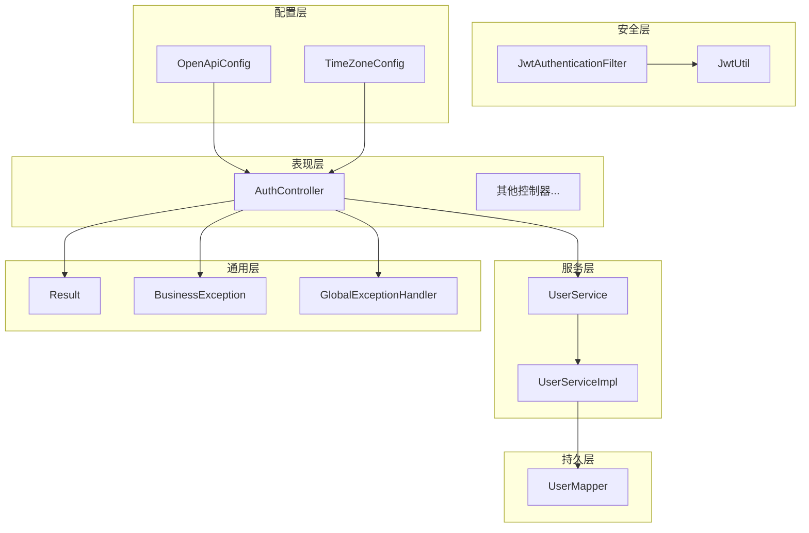
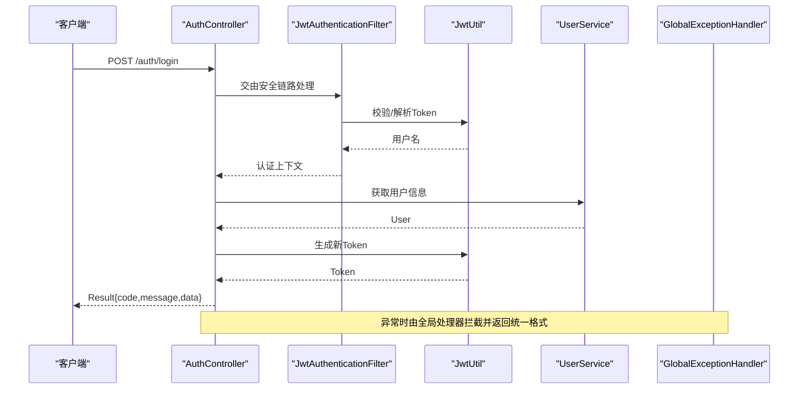
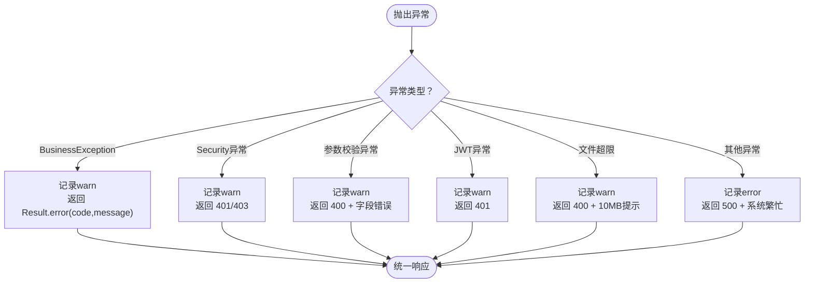
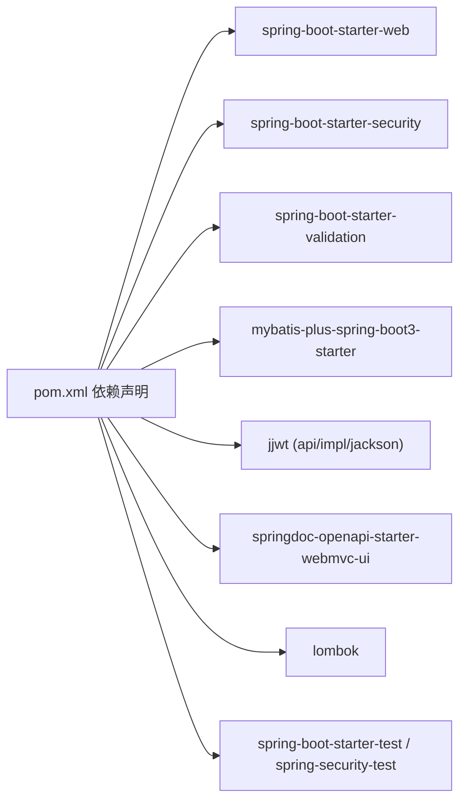

# 代码规范

<cite>
**本文引用的文件**
- [Result.java](file://src/main/java/com/campus/eventsys/common/Result.java)
- [BusinessException.java](file://src/main/java/com/campus/eventsys/common/BusinessException.java)
- [GlobalExceptionHandler.java](file://src/main/java/com/campus/eventsys/common/GlobalExceptionHandler.java)
- [OpenApiConfig.java](file://src/main/java/com/campus/eventsys/config/OpenApiConfig.java)
- [application.yml](file://src/main/resources/application.yml)
- [AuthController.java](file://src/main/java/com/campus/eventsys/controller/AuthController.java)
- [User.java](file://src/main/java/com/campus/eventsys/entity/User.java)
- [UserService.java](file://src/main/java/com/campus/eventsys/service/UserService.java)
- [UserServiceImpl.java](file://src/main/java/com/campus/eventsys/service/impl/UserServiceImpl.java)
- [JwtUtil.java](file://src/main/java/com/campus/eventsys/security/JwtUtil.java)
- [JwtAuthenticationFilter.java](file://src/main/java/com/campus/eventsys/security/JtAuthenticationFilter.java)
- [TimeZoneConfig.java](file://src/main/java/com/campus/eventsys/config/TimeZoneConfig.java)
- [AuthControllerTest.java](file://src/test/java/com/campus/eventsys/controller/AuthControllerTest.java)
- [pom.xml](file://pom.xml)
</cite>

## 目录
1. [引言](#引言)
2. [项目结构](#项目结构)
3. [核心组件](#核心组件)
4. [架构总览](#架构总览)
5. [详细组件分析](#详细组件分析)
6. [依赖分析](#依赖分析)
7. [性能考虑](#性能考虑)
8. [故障排查指南](#故障排查指南)
9. [结论](#结论)
10. [附录](#附录)

## 引言
本文件面向“校园活动管理系统”的开发团队，旨在建立统一、可维护、可扩展的代码规范与最佳实践。内容覆盖：
- Java 编码规范与命名约定
- 注释规范与代码格式化标准
- 统一响应包装类 Result 的使用规范
- 业务异常 BusinessException 与全局异常 GlobalExceptionHandler 的实现标准
- Lombok 注解与 Swagger 注解使用规范
- 日志记录标准
- 代码审查检查清单与质量保证措施

## 项目结构
项目采用按层次与功能分层的组织方式：
- common：统一响应、异常与全局异常处理
- config：配置类（数据库、MyBatis、OpenAPI、安全、时区）
- controller：REST 控制器，负责请求入口与参数校验
- entity：实体类，映射数据库表
- mapper：MyBatis Mapper 接口
- service：服务接口与实现
- security：安全相关（JWT、过滤器、用户详情）
- utils：工具类
- scheduler：定时任务
- resources：配置文件、SQL 脚本、XML 映射
- tests：控制器单元测试

**图表来源**
- [AuthController.java:1-106](file://src/main/java/com/campus/eventsys/controller/AuthController.java#L1-L106)
- [UserService.java:1-38](file://src/main/java/com/campus/eventsys/service/UserService.java#L1-L38)
- [UserServiceImpl.java:1-158](file://src/main/java/com/campus/eventsys/service/impl/UserServiceImpl.java#L1-L158)
- [JwtAuthenticationFilter.java:1-34](file://src/main/java/com/campus/eventsys/security/JwtAuthenticationFilter.java#L1-L34)
- [JwtUtil.java:1-71](file://src/main/java/com/campus/eventsys/security/JwtUtil.java#L1-L71)
- [OpenApiConfig.java:1-52](file://src/main/java/com/campus/eventsys/config/OpenApiConfig.java#L1-L52)
- [TimeZoneConfig.java:1-33](file://src/main/java/com/campus/eventsys/config/TimeZoneConfig.java#L1-L33)
- [Result.java:1-55](file://src/main/java/com/campus/eventsys/common/Result.java#L1-L55)
- [BusinessException.java:1-20](file://src/main/java/com/campus/eventsys/common/BusinessException.java#L1-L20)
- [GlobalExceptionHandler.java:1-108](file://src/main/java/com/campus/eventsys/common/GlobalExceptionHandler.java#L1-L108)

**章节来源**
- [AuthController.java:1-106](file://src/main/java/com/campus/eventsys/controller/AuthController.java#L1-L106)
- [UserService.java:1-38](file://src/main/java/com/campus/eventsys/service/UserService.java#L1-L38)
- [UserServiceImpl.java:1-158](file://src/main/java/com/campus/eventsys/service/impl/UserServiceImpl.java#L1-L158)
- [OpenApiConfig.java:1-52](file://src/main/java/com/campus/eventsys/config/OpenApiConfig.java#L1-L52)
- [application.yml:1-76](file://src/main/resources/application.yml#L1-L76)

## 核心组件
- 统一响应包装类 Result：提供静态方法封装成功/错误响应，统一返回结构与状态码语义。
- 业务异常 BusinessException：用于表达业务层面的错误，可携带业务状态码。
- 全局异常 GlobalExceptionHandler：集中捕获各类异常，输出统一响应与日志。

**章节来源**
- [Result.java:1-55](file://src/main/java/com/campus/eventsys/common/Result.java#L1-L55)
- [BusinessException.java:1-20](file://src/main/java/com/campus/eventsys/common/BusinessException.java#L1-L20)
- [GlobalExceptionHandler.java:1-108](file://src/main/java/com/campus/eventsys/common/GlobalExceptionHandler.java#L1-L108)

## 架构总览
系统采用 Spring Boot + Spring MVC + Spring Security + MyBatis-Plus 架构，结合 JWT 进行无状态认证，使用 Swagger/OpenAPI 自动生成接口文档，并通过全局异常处理器统一输出响应。

**图表来源**
- [AuthController.java:1-106](file://src/main/java/com/campus/eventsys/controller/AuthController.java#L1-L106)
- [JwtAuthenticationFilter.java:1-34](file://src/main/java/com/campus/eventsys/security/JwtAuthenticationFilter.java#L1-L34)
- [JwtUtil.java:1-71](file://src/main/java/com/campus/eventsys/security/JwtUtil.java#L1-L71)
- [UserService.java:1-38](file://src/main/java/com/campus/eventsys/service/UserService.java#L1-L38)
- [GlobalExceptionHandler.java:1-108](file://src/main/java/com/campus/eventsys/common/GlobalExceptionHandler.java#L1-L108)

## 详细组件分析

### 统一响应 Result 使用规范
- 返回结构
  - code：整型状态码，200 表示成功；500 表示系统错误；401/403/400 等表示认证、权限或参数问题。
  - message：字符串提示信息。
  - data：泛型数据体。
- 使用建议
  - 成功场景优先使用 Result.success(data) 或 Result.success(message, data)。
  - 错误场景优先使用 Result.error(code, message[, data])，保持与 BusinessException/code 一致。
  - 对于无数据的成功响应，使用 Result.success()。
- 与 Swagger 的集成
  - 实体类与控制器方法上使用 @Schema/@Tag/@Operation 等注解，确保文档一致性。

**章节来源**
- [Result.java:1-55](file://src/main/java/com/campus/eventsys/common/Result.java#L1-L55)
- [AuthController.java:1-106](file://src/main/java/com/campus/eventsys/controller/AuthController.java#L1-L106)
- [User.java:1-85](file://src/main/java/com/campus/eventsys/entity/User.java#L1-L85)

### 业务异常 BusinessException 与全局异常 GlobalExceptionHandler
- BusinessException
  - 用于业务断言失败或前置条件不满足的场景，默认 code=500，也可指定业务 code。
- GlobalExceptionHandler
  - 捕获并分类处理：
    - 通用 Exception：记录错误日志并返回 Result.error(500, "系统繁忙，请稍后重试")。
    - BusinessException：记录告警日志并返回 Result.error(e.getCode(), e.getMessage())。
    - Spring Security 相关异常：如 BadCredentialsException、AccessDeniedException、InsufficientAuthenticationException 等，分别返回相应 401/403。
    - 参数绑定 BindException：提取首个字段错误信息，返回 400。
    - JWT 相关异常：ExpiredJwtException、JwtException 等，返回 401。
    - 文件上传超限：MaxUploadSizeExceededException，返回 400 并提示最大 10MB。
- 日志记录
  - 使用 SLF4J 记录错误/告警级别日志，便于定位问题。

**图表来源**
- [GlobalExceptionHandler.java:1-108](file://src/main/java/com/campus/eventsys/common/GlobalExceptionHandler.java#L1-L108)
- [BusinessException.java:1-20](file://src/main/java/com/campus/eventsys/common/BusinessException.java#L1-L20)

**章节来源**
- [BusinessException.java:1-20](file://src/main/java/com/campus/eventsys/common/BusinessException.java#L1-L20)
- [GlobalExceptionHandler.java:1-108](file://src/main/java/com/campus/eventsys/common/GlobalExceptionHandler.java#L1-L108)

### Lombok 注解使用规范
- @Data：在实体类与 DTO 上使用，自动生成 getter/setter/toString 等，避免冗余代码。
- @RequiredArgsConstructor：在控制器与服务实现类上使用，通过构造器注入依赖，提升不可变性与可测试性。
- @Slf4j：在服务与异常处理器上使用，统一日志记录。
- @TableName/@TableId/@TableLogic 等：在实体类上标注 MyBatis-Plus 映射元信息。
- 注意事项
  - 避免在复杂业务类上滥用 @Data，必要时拆分为不可变值对象与可变实体。
  - 在接口与 DTO 中谨慎使用 @Setter，优先使用不可变对象或显式更新方法。

**章节来源**
- [User.java:1-85](file://src/main/java/com/campus/eventsys/entity/User.java#L1-L85)
- [UserServiceImpl.java:1-158](file://src/main/java/com/campus/eventsys/service/impl/UserServiceImpl.java#L1-L158)
- [GlobalExceptionHandler.java:1-108](file://src/main/java/com/campus/eventsys/common/GlobalExceptionHandler.java#L1-L108)
- [AuthController.java:1-106](file://src/main/java/com/campus/eventsys/controller/AuthController.java#L1-L106)

### Swagger/OpenAPI 注解规范
- @Tag：为控制器分组，明确模块职责。
- @Operation/@ApiResponses：描述接口摘要、行为与响应码。
- @Parameter/@Schema：对请求参数、响应体与模型字段进行详细说明，包括示例与必填性。
- OpenApiConfig：统一配置 OpenAPI 基本信息与 Bearer JWT 安全方案。
- 文档路径
  - Swagger UI：/swagger-ui.html
  - API Docs：/v3/api-docs

**章节来源**
- [AuthController.java:1-106](file://src/main/java/com/campus/eventsys/controller/AuthController.java#L1-L106)
- [OpenApiConfig.java:1-52](file://src/main/java/com/campus/eventsys/config/OpenApiConfig.java#L1-L52)
- [application.yml:54-62](file://src/main/resources/application.yml#L54-L62)

### 日志记录标准
- 日志级别
  - 错误：系统异常、IO 失败等，使用 error。
  - 告警：业务异常、认证失败、权限不足等，使用 warn。
  - 信息：常规流程、文件上传成功等，使用 info。
  - 调试：开发阶段辅助定位问题，使用 debug。
- 日志内容
  - 包含关键上下文（如 userId、异常堆栈），避免记录敏感信息。
  - 统一格式，便于检索与聚合分析。
- 配置参考
  - application.yml 中 logging.level 指定包级日志级别。

**章节来源**
- [GlobalExceptionHandler.java:1-108](file://src/main/java/com/campus/eventsys/common/GlobalExceptionHandler.java#L1-L108)
- [UserServiceImpl.java:1-158](file://src/main/java/com/campus/eventsys/service/impl/UserServiceImpl.java#L1-L158)
- [application.yml:71-76](file://src/main/resources/application.yml#L71-L76)

### 安全与认证
- JWT
  - JwtUtil：生成、解析与校验 Token，支持过期判断。
  - JwtAuthenticationFilter：从请求头提取 Bearer Token，验证后写入 SecurityContext。
- 配置
  - application.yml 中 jwt.secret 与 jwt.expiration。
  - OpenApiConfig 中配置 Bearer 安全方案。

**章节来源**
- [JwtUtil.java:1-71](file://src/main/java/com/campus/eventsys/security/JwtUtil.java#L1-L71)
- [JwtAuthenticationFilter.java:1-34](file://src/main/java/com/campus/eventsys/security/JwtAuthenticationFilter.java#L1-L34)
- [OpenApiConfig.java:1-52](file://src/main/java/com/campus/eventsys/config/OpenApiConfig.java#L1-L52)
- [application.yml:49-52](file://src/main/resources/application.yml#L49-L52)

### 数据模型与 MyBatis-Plus
- 实体类 User 使用 @TableName、@TableId、@TableLogic 等注解，配合 MyBatis-Plus 自动填充与逻辑删除。
- application.yml 中 mybatis-plus.global-config.db-config 配置逻辑删除字段与 ID 类型。

**章节来源**
- [User.java:1-85](file://src/main/java/com/campus/eventsys/entity/User.java#L1-L85)
- [application.yml:34-47](file://src/main/resources/application.yml#L34-L47)

### 文件上传与访问
- 上传路径与访问 URL 通过 application.yml 配置。
- UserServiceImpl 中实现头像上传、类型与大小校验、旧文件清理、URL 生成与回写。

**章节来源**
- [application.yml:64-69](file://src/main/resources/application.yml#L64-L69)
- [UserServiceImpl.java:1-158](file://src/main/java/com/campus/eventsys/service/impl/UserServiceImpl.java#L1-L158)

### 时区与时钟
- TimeZoneConfig 统一时区为 UTC，确保时间显示一致性。

**章节来源**
- [TimeZoneConfig.java:1-33](file://src/main/java/com/campus/eventsys/config/TimeZoneConfig.java#L1-L33)

## 依赖分析
- Spring 生态：Web、Security、Validation、Test、Security-Test。
- ORM：MyBatis-Plus Starter。
- JWT：jjwt-api/impl/jackson。
- 文档：springdoc-openapi-starter-webmvc-ui。
- Lombok：简化 POJO 与日志。

**图表来源**
- [pom.xml:1-131](file://pom.xml#L1-L131)

**章节来源**
- [pom.xml:1-131](file://pom.xml#L1-L131)

## 性能考虑
- IO 与文件上传
  - 严格控制文件大小（最大 10MB），避免内存溢出与磁盘压力。
  - 上传目录按用户隔离，减少锁竞争与并发冲突。
- 序列化与时间
  - Jackson 时间格式与时区统一，避免跨时区显示问题。
- 安全链路
  - JWT 解析与校验在过滤器中完成，减少控制器重复逻辑。
- 日志
  - 避免在高频路径打印大量细节日志，降低 IO 压力。

## 故障排查指南
- 统一响应
  - 若前端收到非 200 的 code，请根据 message 判断是业务异常、参数异常还是系统异常。
- 认证与权限
  - 401：检查 Authorization 头是否正确携带 Bearer Token，确认 Token 未过期。
  - 403：检查用户角色与资源权限。
- 参数校验
  - 400：查看字段错误提示，修正请求体。
- 文件上传
  - 400：确认文件类型为 image/* 且不超过 10MB。
- 日志定位
  - 查看 application.yml 中 com.campus.eventsys 与 org.springframework.security 的日志级别，结合异常堆栈快速定位。

**章节来源**
- [GlobalExceptionHandler.java:1-108](file://src/main/java/com/campus/eventsys/common/GlobalExceptionHandler.java#L1-L108)
- [application.yml:71-76](file://src/main/resources/application.yml#L71-L76)

## 结论
本规范以 Result、BusinessException、GlobalExceptionHandler 为核心，结合 Lombok 与 Swagger，形成统一的响应、异常与文档标准；配合 JWT、MyBatis-Plus、日志与配置，构建清晰、可维护、可扩展的后端体系。建议在开发过程中严格遵循命名、注释与格式化规范，持续完善测试与审查机制，保障系统质量与稳定性。

## 附录

### Java 编码规范与命名约定
- 包名：全部小写，如 com.campus.eventsys。
- 类名：帕斯卡命名，如 UserService、JwtUtil。
- 方法名：驼峰命名，如 getByUsername、generateToken。
- 常量：全大写加下划线，如 MAX_FILE_SIZE。
- 变量与参数：驼峰命名，避免缩写，必要时使用语义化名称。
- 接口：以能力词缀命名，如 UserService、ActivityService。
- 异常类：以 Exception 结尾，如 BusinessException。

### 注释规范
- 类与方法：使用 JavaDoc 注释，说明用途、参数、返回值与异常。
- 字段：简述含义与取值范围。
- 复杂逻辑：在方法内添加行内注释，解释关键步骤与边界条件。
- Swagger 注解：为每个接口与模型字段补充 @Schema/@Description，提供示例与必填性。

### 代码格式化标准
- 缩进：统一使用 4 空格。
- 行宽：建议不超过 120 列。
- 空行：类成员之间空一行，逻辑块之间空一行。
- 括号：左花括号不单独占行，控制结构与方法名后空一格。
- 导入：按字母顺序排列，避免通配符导入。

### 代码审查检查清单
- 规范性
  - 是否使用 Result 统一返回？
  - 是否使用 BusinessException 表达业务错误？
  - 是否存在未捕获的异常？
  - 是否使用 Lombok 简化代码？
  - 是否使用 Swagger 注解完善文档？
- 安全性
  - 是否对输入参数进行校验？
  - 是否正确处理 JWT 与权限？
  - 是否记录敏感信息？
- 可维护性
  - 方法是否单一职责？
  - 是否存在重复代码？
  - 是否合理使用日志级别？
- 性能与可靠性
  - 文件上传是否限制大小与类型？
  - 是否存在潜在的 N+1 查询？
  - 是否正确处理空值与边界条件？

### 质量保证措施
- 单元测试
  - 控制器：覆盖成功、失败与异常分支。
  - 服务层：模拟外部依赖，验证业务逻辑。
- 集成测试
  - 使用 @WebMvcTest 或 @Import 测试安全链路与全局异常。
- 文档与评审
  - 接口文档与注释同步更新。
  - 代码评审中重点检查异常处理与日志记录。