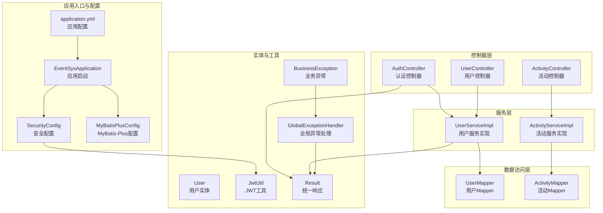
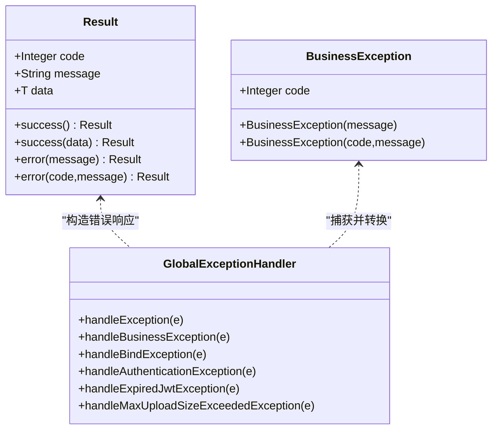
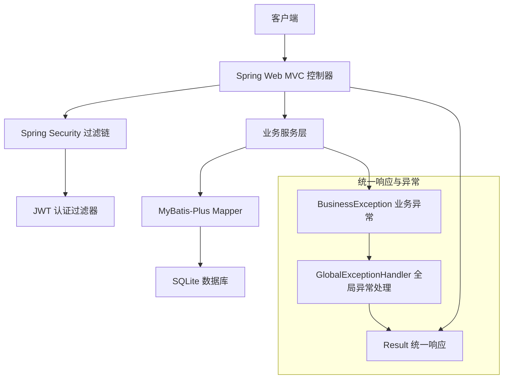
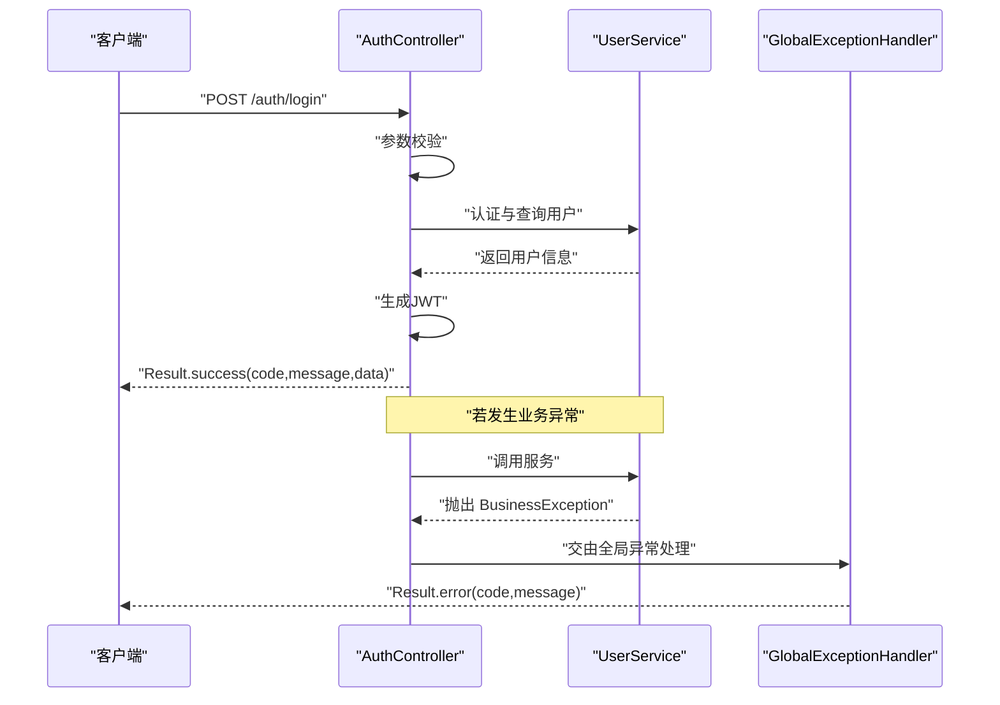
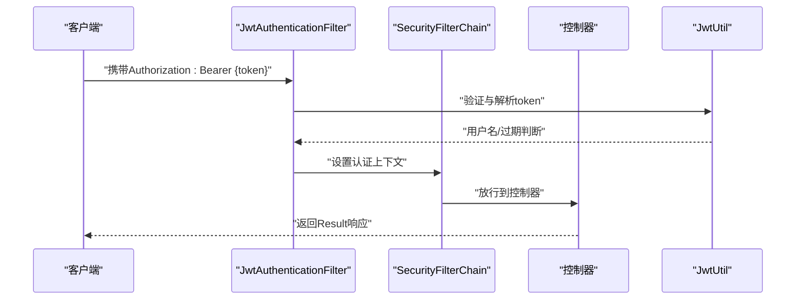
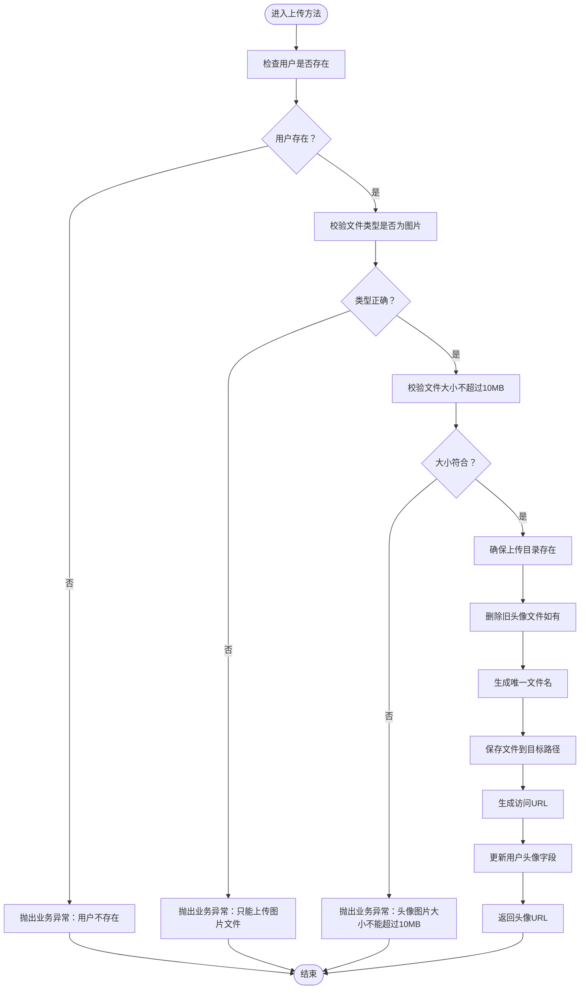
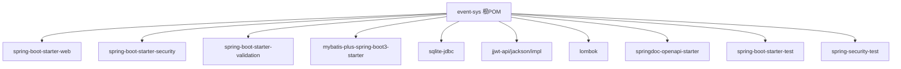

# 开发指南

<cite>
**本文引用的文件**
- [EventSysApplication.java](file://src/main/java/com/campus/eventsys/EventSysApplication.java)
- [Result.java](file://src/main/java/com/campus/eventsys/common/Result.java)
- [BusinessException.java](file://src/main/java/com/campus/eventsys/common/BusinessException.java)
- [GlobalExceptionHandler.java](file://src/main/java/com/campus/eventsys/common/GlobalExceptionHandler.java)
- [SecurityConfig.java](file://src/main/java/com/campus/eventsys/config/SecurityConfig.java)
- [MyBatisPlusConfig.java](file://src/main/java/com/campus/eventsys/config/MyBatisPlusConfig.java)
- [JwtUtil.java](file://src/main/java/com/campus/eventsys/security/JwtUtil.java)
- [AuthController.java](file://src/main/java/com/campus/eventsys/controller/AuthController.java)
- [UserServiceImpl.java](file://src/main/java/com/campus/eventsys/service/impl/UserServiceImpl.java)
- [User.java](file://src/main/java/com/campus/eventsys/entity/User.java)
- [application.yml](file://src/main/resources/application.yml)
- [schema.sql](file://src/main/resources/db/schema.sql)
- [pom.xml](file://pom.xml)
- [AuthControllerTest.java](file://src/test/java/com/campus/eventsys/controller/AuthControllerTest.java)
- [url.txt](file://url.txt)
</cite>

## 目录
1. [简介](#简介)
2. [项目结构](#项目结构)
3. [核心组件](#核心组件)
4. [架构总览](#架构总览)
5. [详细组件分析](#详细组件分析)
6. [依赖关系分析](#依赖关系分析)
7. [性能考虑](#性能考虑)
8. [故障排查指南](#故障排查指南)
9. [结论](#结论)
10. [附录](#附录)

## 简介
本指南面向新加入团队的开发者，提供校园活动管理系统（event-sys）的完整开发流程与技术指导。内容涵盖代码规范、开发环境搭建、调试技巧、统一响应包装类、业务异常与全局异常处理机制、单元测试编写与策略、代码审查标准、性能优化建议与最佳实践。

## 项目结构
项目采用基于功能域的分层组织方式，主要模块包括：
- 应用入口与配置：应用启动类、安全配置、MyBatis-Plus配置、OpenAPI配置、时区配置、Web MVC配置、数据库初始化器
- 控制器层：各业务模块控制器（如认证、活动、用户、通知等）
- 服务层：业务实现（如用户、活动、报名、签到、通知等）
- 数据访问层：MyBatis Mapper接口
- 实体与枚举：领域模型与枚举
- 工具与安全：JWT工具、用户详情服务、过滤器
- 调度：定时任务（如活动状态调度）
- 资源：数据库初始化脚本、MyBatis XML映射、应用配置
- 测试：控制器单元测试



图表来源
- [EventSysApplication.java:1-17](file://src/main/java/com/campus/eventsys/EventSysApplication.java#L1-L17)
- [SecurityConfig.java:1-100](file://src/main/java/com/campus/eventsys/config/SecurityConfig.java#L1-L100)
- [MyBatisPlusConfig.java:1-58](file://src/main/java/com/campus/eventsys/config/MyBatisPlusConfig.java#L1-L58)
- [application.yml:1-76](file://src/main/resources/application.yml#L1-L76)
- [AuthController.java:1-106](file://src/main/java/com/campus/eventsys/controller/AuthController.java#L1-L106)
- [UserServiceImpl.java:1-158](file://src/main/java/com/campus/eventsys/service/impl/UserServiceImpl.java#L1-L158)
- [User.java:1-85](file://src/main/java/com/campus/eventsys/entity/User.java#L1-L85)
- [JwtUtil.java:1-71](file://src/main/java/com/campus/eventsys/security/JwtUtil.java#L1-L71)
- [Result.java:1-55](file://src/main/java/com/campus/eventsys/common/Result.java#L1-L55)
- [BusinessException.java:1-20](file://src/main/java/com/campus/eventsys/common/BusinessException.java#L1-L20)
- [GlobalExceptionHandler.java:1-108](file://src/main/java/com/campus/eventsys/common/GlobalExceptionHandler.java#L1-L108)

章节来源
- [EventSysApplication.java:1-17](file://src/main/java/com/campus/eventsys/EventSysApplication.java#L1-L17)
- [application.yml:1-76](file://src/main/resources/application.yml#L1-L76)

## 核心组件
本节聚焦统一响应包装类、业务异常与全局异常处理机制，以及它们在控制器与服务中的使用方式。

- 统一响应包装类 Result
  - 作用：标准化接口返回格式，包含状态码、消息与数据体
  - 使用场景：控制器层返回统一结构；服务层抛出业务异常时由全局异常处理器转换
  - 关键点：提供成功与错误静态工厂方法，支持泛型数据封装

- 业务异常 BusinessException
  - 作用：承载业务层面的错误码与消息，便于前端区分业务错误与系统错误
  - 使用场景：服务层检测到业务违规时抛出，由全局异常处理器捕获并返回对应状态码

- 全局异常处理 GlobalExceptionHandler
  - 作用：集中处理各类运行时异常、业务异常、认证/授权异常、参数校验异常、文件上传异常等
  - 设计原则：将异常转换为 Result 结构，确保前后端一致的错误契约



图表来源
- [Result.java:1-55](file://src/main/java/com/campus/eventsys/common/Result.java#L1-L55)
- [BusinessException.java:1-20](file://src/main/java/com/campus/eventsys/common/BusinessException.java#L1-L20)
- [GlobalExceptionHandler.java:1-108](file://src/main/java/com/campus/eventsys/common/GlobalExceptionHandler.java#L1-L108)

章节来源
- [Result.java:1-55](file://src/main/java/com/campus/eventsys/common/Result.java#L1-L55)
- [BusinessException.java:1-20](file://src/main/java/com/campus/eventsys/common/BusinessException.java#L1-L20)
- [GlobalExceptionHandler.java:1-108](file://src/main/java/com/campus/eventsys/common/GlobalExceptionHandler.java#L1-L108)

## 架构总览
系统采用 Spring Boot + Spring Security + MyBatis-Plus 技术栈，结合 JWT 进行无状态认证。控制器层负责请求接入与参数校验，服务层承载业务逻辑，数据访问层通过 MyBatis-Plus 操作 SQLite 数据库。统一响应与异常处理贯穿整个调用链。



图表来源
- [SecurityConfig.java:1-100](file://src/main/java/com/campus/eventsys/config/SecurityConfig.java#L1-L100)
- [JwtUtil.java:1-71](file://src/main/java/com/campus/eventsys/security/JwtUtil.java#L1-L71)
- [MyBatisPlusConfig.java:1-58](file://src/main/java/com/campus/eventsys/config/MyBatisPlusConfig.java#L1-L58)
- [Result.java:1-55](file://src/main/java/com/campus/eventsys/common/Result.java#L1-L55)
- [BusinessException.java:1-20](file://src/main/java/com/campus/eventsys/common/BusinessException.java#L1-L20)
- [GlobalExceptionHandler.java:1-108](file://src/main/java/com/campus/eventsys/common/GlobalExceptionHandler.java#L1-L108)

## 详细组件分析

### 统一响应与异常处理工作流
以下序列图展示了从控制器到服务层再到异常处理的整体流程，体现统一响应与异常处理的协作。



图表来源
- [AuthController.java:1-106](file://src/main/java/com/campus/eventsys/controller/AuthController.java#L1-L106)
- [UserServiceImpl.java:1-158](file://src/main/java/com/campus/eventsys/service/impl/UserServiceImpl.java#L1-L158)
- [BusinessException.java:1-20](file://src/main/java/com/campus/eventsys/common/BusinessException.java#L1-L20)
- [GlobalExceptionHandler.java:1-108](file://src/main/java/com/campus/eventsys/common/GlobalExceptionHandler.java#L1-L108)
- [Result.java:1-55](file://src/main/java/com/campus/eventsys/common/Result.java#L1-L55)

章节来源
- [AuthController.java:1-106](file://src/main/java/com/campus/eventsys/controller/AuthController.java#L1-L106)
- [UserServiceImpl.java:1-158](file://src/main/java/com/campus/eventsys/service/impl/UserServiceImpl.java#L1-L158)
- [BusinessException.java:1-20](file://src/main/java/com/campus/eventsys/common/BusinessException.java#L1-L20)
- [GlobalExceptionHandler.java:1-108](file://src/main/java/com/campus/eventsys/common/GlobalExceptionHandler.java#L1-L108)
- [Result.java:1-55](file://src/main/java/com/campus/eventsys/common/Result.java#L1-L55)

### 安全与认证流程
系统采用基于 JWT 的无状态认证，通过自定义过滤器在请求进入控制器前完成鉴权与授权。



图表来源
- [SecurityConfig.java:1-100](file://src/main/java/com/campus/eventsys/config/SecurityConfig.java#L1-L100)
- [JwtUtil.java:1-71](file://src/main/java/com/campus/eventsys/security/JwtUtil.java#L1-L71)

章节来源
- [SecurityConfig.java:1-100](file://src/main/java/com/campus/eventsys/config/SecurityConfig.java#L1-L100)
- [JwtUtil.java:1-71](file://src/main/java/com/campus/eventsys/security/JwtUtil.java#L1-L71)

### 头像上传流程（服务层）
头像上传涉及文件类型与大小校验、旧头像清理、文件写入与URL生成、用户头像字段更新。



图表来源
- [UserServiceImpl.java:60-126](file://src/main/java/com/campus/eventsys/service/impl/UserServiceImpl.java#L60-L126)

章节来源
- [UserServiceImpl.java:1-158](file://src/main/java/com/campus/eventsys/service/impl/UserServiceImpl.java#L1-L158)

### 数据模型概览
系统核心实体围绕“用户”“活动”“报名”“成果”“评论”“收藏”“签到”“通知”“审核”“评价”展开，采用逻辑删除与索引优化提升查询性能。

```mermaid
erDiagram
USER {
integer id PK
string username UK
string password
string nickname
string avatar
string email
string phone
string real_name
string student_id
string college
string major
string grade
integer gender
text bio
integer role
integer status
integer organized_count
integer participated_count
datetime create_time
datetime update_time
integer deleted
}
CATEGORY {
integer id PK
string name
string description
string icon
integer sort_order
integer status
integer activity_count
datetime create_time
datetime update_time
integer deleted
}
ACTIVITY {
integer id PK
string title
text description
string cover_image
integer organizer_id FK
string location
datetime start_time
datetime end_time
datetime registration_start_time
datetime registration_end_time
integer max_participants
integer current_participants
string tags
integer status
integer category_id FK
integer need_review
integer view_count
integer favorite_count
integer comment_count
decimal avg_rating
integer review_count
datetime create_time
datetime update_time
integer deleted
}
ACTIVITY_REGISTRATION {
integer id PK
integer activity_id FK
integer user_id FK
integer role
integer status
text remark
text images
integer reviewer_id FK
datetime review_time
text review_remark
datetime create_time
datetime update_time
integer deleted
}
ACTIVITY_RESULT {
integer id PK
integer activity_id FK UK
string title
text content
text images
integer creator_id FK
integer view_count
integer comment_count
integer status
datetime create_time
datetime update_time
integer deleted
}
COMMENT {
integer id PK
integer target_id
integer target_type
integer user_id FK
text content
integer parent_id
integer reply_to_user_id
datetime create_time
datetime update_time
integer deleted
}
ACTIVITY_FAVORITE {
integer id PK
integer activity_id FK
integer user_id FK
datetime create_time
integer deleted
}
CHECK_IN_RECORD {
integer id PK
integer activity_id FK
integer user_id FK
integer registration_id FK
datetime check_in_time
integer check_in_type
string location
text remark
datetime create_time
datetime update_time
integer deleted
}
NOTIFICATION {
integer id PK
integer user_id
string title
text content
integer type
integer activity_id FK
integer is_read
datetime read_time
datetime create_time
datetime update_time
integer deleted
string publish_scope
integer is_pinned
datetime publish_time
integer status
integer created_by
string announce_category
}
ACTIVITY_AUDIT {
integer id PK
integer activity_id FK
integer audit_type
integer status
integer submitter_id FK
datetime submit_time
integer auditor_id FK
datetime audit_time
text audit_opinion
datetime create_time
datetime update_time
integer deleted
}
ACTIVITY_REVIEW {
integer id PK
integer activity_id FK
integer user_id FK
integer rating
text content
text reply
datetime create_time
datetime update_time
integer deleted
}
USER ||--o{ ACTIVITY : "组织"
USER ||--o{ ACTIVITY_REGISTRATION : "报名"
USER ||--o{ ACTIVITY_RESULT : "创建成果"
USER ||--o{ COMMENT : "发表评论"
USER ||--o{ ACTIVITY_FAVORITE : "收藏"
USER ||--o{ CHECK_IN_RECORD : "签到"
USER ||--o{ NOTIFICATION : "接收通知"
USER ||--o{ ACTIVITY_AUDIT : "提交/审核"
USER ||--o{ ACTIVITY_REVIEW : "评价"
CATEGORY ||--o{ ACTIVITY : "分类"
ACTIVITY ||--o{ ACTIVITY_REGISTRATION : "被报名"
ACTIVITY ||--o{ ACTIVITY_RESULT : "产生成果"
ACTIVITY ||--o{ COMMENT : "被评论"
ACTIVITY ||--o{ ACTIVITY_FAVORITE : "被收藏"
ACTIVITY ||--o{ CHECK_IN_RECORD : "产生签到"
ACTIVITY ||--o{ NOTIFICATION : "触发通知"
ACTIVITY ||--o{ ACTIVITY_AUDIT : "被审核"
ACTIVITY ||--o{ ACTIVITY_REVIEW : "被评价"
```

图表来源
- [schema.sql:1-295](file://src/main/resources/db/schema.sql#L1-L295)
- [User.java:1-85](file://src/main/java/com/campus/eventsys/entity/User.java#L1-L85)

章节来源
- [schema.sql:1-295](file://src/main/resources/db/schema.sql#L1-L295)
- [User.java:1-85](file://src/main/java/com/campus/eventsys/entity/User.java#L1-L85)

## 依赖关系分析
系统依赖以 Maven 管理，核心依赖包括 Spring Web、Security、Validation、MyBatis-Plus、SQLite、JWT、Lombok、OpenAPI 等。构建阶段启用 Maven Surefire 插件执行测试。



图表来源
- [pom.xml:1-131](file://pom.xml#L1-L131)

章节来源
- [pom.xml:1-131](file://pom.xml#L1-L131)

## 性能考虑
- 数据库与ORM
  - 使用 MyBatis-Plus 分页插件，针对 SQLite 设置分页溢出与上限策略，避免超大分页导致性能问题
  - 自动填充字段（创建/更新时间、逻辑删除），减少重复代码与遗漏
  - 为高频查询字段建立索引（如用户角色、活动状态、报名状态等）

- 安全与认证
  - 无状态会话（JWT），避免服务器端会话存储开销
  - 严格 CORS 配置，支持凭据传递，降低跨域风险

- 文件上传
  - 限制单文件大小（10MB），控制内存占用与磁盘压力
  - 上传目录按用户隔离，便于清理与迁移

- 日志与监控
  - 合理的日志级别，避免生产环境过多调试日志
  - 异常统一处理，避免敏感信息泄露

章节来源
- [MyBatisPlusConfig.java:1-58](file://src/main/java/com/campus/eventsys/config/MyBatisPlusConfig.java#L1-L58)
- [SecurityConfig.java:1-100](file://src/main/java/com/campus/eventsys/config/SecurityConfig.java#L1-L100)
- [application.yml:1-76](file://src/main/resources/application.yml#L1-L76)
- [UserServiceImpl.java:1-158](file://src/main/java/com/campus/eventsys/service/impl/UserServiceImpl.java#L1-L158)

## 故障排查指南
- 统一响应与异常
  - 若出现系统异常，检查全局异常处理器是否捕获并返回标准 Result 错误结构
  - 对于业务异常，确认服务层抛出 BusinessException 并带有合理错误码

- 认证与授权
  - 401/403 错误：检查请求头 Authorization 是否携带有效 JWT，或用户角色是否满足接口要求
  - JWT 过期：前端需重新登录获取新令牌

- 参数校验
  - 参数绑定异常：检查请求体字段与控制器参数注解（如非空、长度限制）是否匹配

- 文件上传
  - 文件过大：确认上传大小限制与前端选择器
  - 上传失败：检查上传目录权限、磁盘空间与旧头像清理逻辑

- 数据库初始化
  - 若首次启动报错，确认数据库文件路径与初始化脚本加载顺序

章节来源
- [GlobalExceptionHandler.java:1-108](file://src/main/java/com/campus/eventsys/common/GlobalExceptionHandler.java#L1-L108)
- [SecurityConfig.java:1-100](file://src/main/java/com/campus/eventsys/config/SecurityConfig.java#L1-L100)
- [application.yml:1-76](file://src/main/resources/application.yml#L1-L76)
- [UserServiceImpl.java:1-158](file://src/main/java/com/campus/eventsys/service/impl/UserServiceImpl.java#L1-L158)

## 结论
本指南提供了从环境搭建、统一响应与异常处理、安全认证、服务与数据层到测试与性能优化的全流程开发指导。建议新成员在熟悉上述组件与流程后，结合单元测试与代码审查标准推进迭代开发，持续提升系统稳定性与可维护性。

## 附录

### 开发环境搭建与调试
- 环境要求
  - JDK 17+
  - Maven
  - SQLite（随依赖自动引入）
- 启动步骤
  - 使用 Maven 启动应用
  - 访问 Swagger UI：[Swagger UI](file://url.txt#L4)
  - 访问 OpenAPI JSON：[OpenAPI JSON](file://url.txt#L6)
  - 默认端口与上下文路径见应用配置
- 调试建议
  - 在控制器与服务层添加必要日志
  - 使用断点定位异常抛出处，结合全局异常处理器输出定位问题
  - 对认证流程使用有效 JWT 进行接口联调

章节来源
- [url.txt:1-9](file://url.txt#L1-L9)
- [application.yml:1-76](file://src/main/resources/application.yml#L1-L76)

### 代码规范与最佳实践
- 命名规范
  - 类名使用帕斯卡命名，方法与变量使用驼峰命名
  - 包名全部小写，按功能域分包
- 注释与文档
  - 控制器与方法使用 OpenAPI 注解描述参数、响应与异常
  - 关键业务流程补充注释说明
- 安全
  - 密码使用 BCrypt 加密存储
  - 接口权限明确，管理员接口显式标注角色
- 返回一致性
  - 控制器统一返回 Result 结构
  - 业务异常使用 BusinessException，避免直接抛出 RuntimeException
- 配置
  - 将敏感配置（如 JWT 密钥、文件上传路径）放入外部配置文件或环境变量

章节来源
- [SecurityConfig.java:1-100](file://src/main/java/com/campus/eventsys/config/SecurityConfig.java#L1-L100)
- [application.yml:1-76](file://src/main/resources/application.yml#L1-L76)
- [Result.java:1-55](file://src/main/java/com/campus/eventsys/common/Result.java#L1-L55)
- [BusinessException.java:1-20](file://src/main/java/com/campus/eventsys/common/BusinessException.java#L1-L20)

### 单元测试编写指南与策略
- 测试范围
  - 控制器：覆盖成功、参数缺失、文件为空、业务异常等分支
  - 服务层：模拟外部依赖（如文件上传、数据库），验证业务逻辑与异常路径
- 测试策略
  - 使用 Mockito 模拟依赖，断言 Result 的 code/message/data
  - 对认证与授权相关接口，模拟 Authentication 上下文
  - 对文件上传接口，构造 MockMultipartFile 并断言异常与成功路径
- 示例参考
  - 认证控制器测试用例覆盖登录、注册、获取用户信息、头像上传与更新信息等场景

章节来源
- [AuthControllerTest.java:1-251](file://src/test/java/com/campus/eventsys/controller/AuthControllerTest.java#L1-L251)

### 代码审查清单
- 结构与职责
  - 控制器仅做参数校验与调用服务，不包含复杂业务逻辑
  - 服务层职责单一，异常处理清晰
- 安全
  - 是否使用 JWT 无状态认证
  - 是否对敏感字段进行脱敏返回
- 可靠性
  - 是否对关键异常进行捕获并转换为 Result
  - 是否对输入参数进行校验
- 可维护性
  - 是否使用统一响应 Result
  - 是否有充分的 OpenAPI 文档注释
- 性能
  - 是否存在 N+1 查询
  - 是否使用索引与分页插件优化查询

章节来源
- [Result.java:1-55](file://src/main/java/com/campus/eventsys/common/Result.java#L1-L55)
- [GlobalExceptionHandler.java:1-108](file://src/main/java/com/campus/eventsys/common/GlobalExceptionHandler.java#L1-L108)
- [MyBatisPlusConfig.java:1-58](file://src/main/java/com/campus/eventsys/config/MyBatisPlusConfig.java#L1-L58)