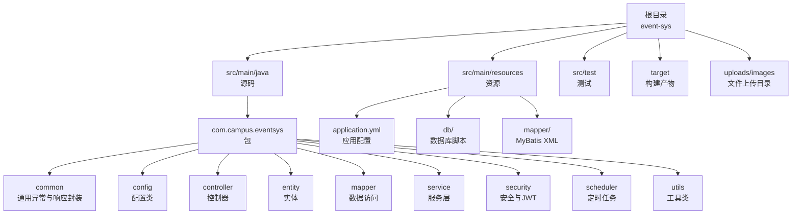
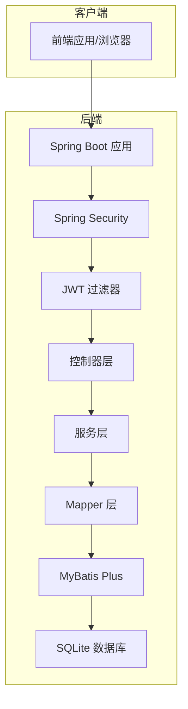
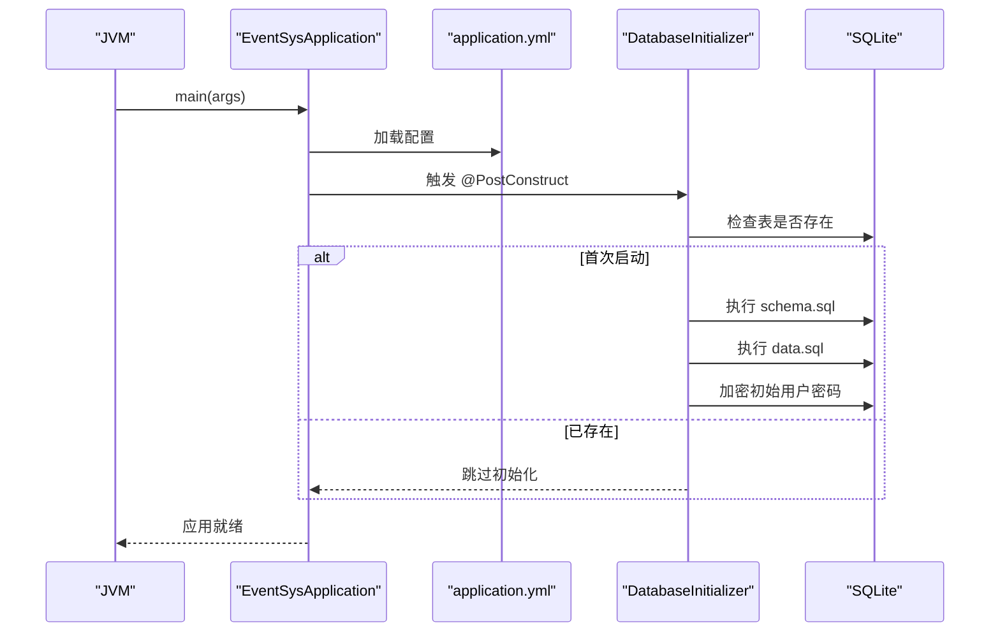
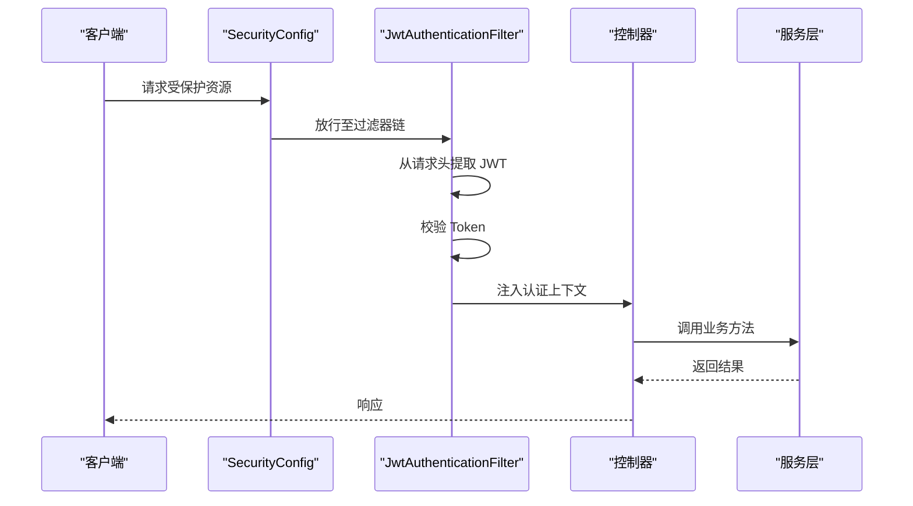
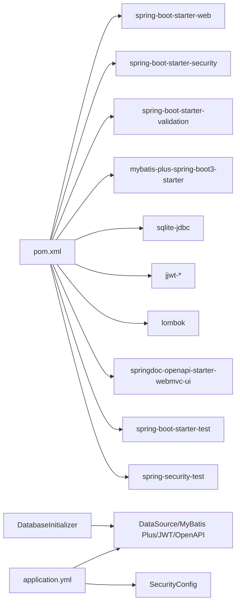

# 开发流程

<cite>
**本文引用的文件**
- [pom.xml](file://pom.xml)
- [application.yml](file://src/main/resources/application.yml)
- [EventSysApplication.java](file://src/main/java/com/campus/eventsys/EventSysApplication.java)
- [DatabaseInitializer.java](file://src/main/java/com/campus/eventsys/config/DatabaseInitializer.java)
- [schema.sql](file://src/main/resources/db/schema.sql)
- [data.sql](file://src/main/resources/db/data.sql)
- [SecurityConfig.java](file://src/main/java/com/campus/eventsys/config/SecurityConfig.java)
- [JwtAuthenticationFilter.java](file://src/main/java/com/campus/eventsys/security/JwtAuthenticationFilter.java)
- [表设计.md](file://picture/表设计.md)
- [url.txt](file://url.txt)
- [AuthControllerTest.java](file://src/test/java/com/campus/eventsys/controller/AuthControllerTest.java)
</cite>

## 目录
1. [简介](#简介)
2. [项目结构](#项目结构)
3. [核心组件](#核心组件)
4. [架构总览](#架构总览)
5. [详细组件分析](#详细组件分析)
6. [依赖分析](#依赖分析)
7. [性能考虑](#性能考虑)
8. [故障排查指南](#故障排查指南)
9. [结论](#结论)
10. [附录](#附录)

## 简介
本指南面向校园活动管理系统（event-sys）的开发团队，提供从环境搭建、构建与运行、测试、到本地与生产部署的全流程说明。内容覆盖：
- Maven 构建配置与依赖管理
- Spring Boot 应用启动流程与核心配置
- 开发环境配置要点与数据库初始化机制
- 代码提交规范、分支管理策略与合并流程建议
- 开发工具推荐、IDE 配置与效率提升技巧
- 本地开发、测试部署与生产发布的完整流程

## 项目结构
项目采用标准 Spring Boot Maven 工程布局，核心目录与职责如下：
- src/main/java：Java 源码，按包划分领域层（entity、mapper、service、controller、config、security、scheduler、utils）
- src/main/resources：资源文件，包括数据库脚本、MyBatis Mapper XML、应用配置
- src/test：单元测试与集成测试
- target：Maven 构建产物目录
- uploads/images：本地文件上传存储目录（由配置映射）



图表来源
- [EventSysApplication.java:1-17](file://src/main/java/com/campus/eventsys/EventSysApplication.java#L1-L17)
- [application.yml:1-76](file://src/main/resources/application.yml#L1-L76)

章节来源
- [EventSysApplication.java:1-17](file://src/main/java/com/campus/eventsys/EventSysApplication.java#L1-L17)
- [application.yml:1-76](file://src/main/resources/application.yml#L1-L76)

## 核心组件
- 应用入口与扫描：Spring Boot 启动类负责扫描 Mapper 与启用调度
- 配置体系：application.yml 管理服务器、数据源、MyBatis Plus、JWT、OpenAPI、文件上传与日志级别
- 安全与认证：基于 JWT 的无状态认证过滤器与 Spring Security 配置
- 数据库初始化：启动时自动执行 schema.sql 与 data.sql，并对初始密码进行加密
- 测试：使用 Spring Boot Test 与 Mockito 进行控制器与服务层测试

章节来源
- [EventSysApplication.java:1-17](file://src/main/java/com/campus/eventsys/EventSysApplication.java#L1-L17)
- [application.yml:1-76](file://src/main/resources/application.yml#L1-L76)
- [SecurityConfig.java:1-100](file://src/main/java/com/campus/eventsys/config/SecurityConfig.java#L1-L100)
- [JwtAuthenticationFilter.java:1-58](file://src/main/java/com/campus/eventsys/security/JwtAuthenticationFilter.java#L1-L58)
- [DatabaseInitializer.java:1-115](file://src/main/java/com/campus/eventsys/config/DatabaseInitializer.java#L1-L115)

## 架构总览
系统采用前后端分离架构，后端提供 REST API，前端通过 Swagger UI 进行接口调试与文档浏览。认证采用 JWT，安全策略通过 Spring Security 控制放行与鉴权路径。



图表来源
- [SecurityConfig.java:35-71](file://src/main/java/com/campus/eventsys/config/SecurityConfig.java#L35-L71)
- [JwtAuthenticationFilter.java:26-48](file://src/main/java/com/campus/eventsys/security/JwtAuthenticationFilter.java#L26-L48)
- [application.yml:10-48](file://src/main/resources/application.yml#L10-L48)

## 详细组件分析

### Maven 构建与依赖管理
- 父 POM：继承 Spring Boot Starter Parent，统一版本与插件配置
- Java 版本：17
- 核心依赖：Web、Security、Validation、MyBatis Plus、SQLite JDBC、JWT、Lombok、SpringDoc OpenAPI、测试相关
- 插件：spring-boot-maven-plugin（排除 Lombok）、Surefire（启用测试）

章节来源
- [pom.xml:1-131](file://pom.xml#L1-L131)

### Spring Boot 应用启动流程
- 启动类：扫描 Mapper 包、启用调度
- 配置加载：application.yml 中的 server、datasource、mybatis-plus、jwt、springdoc、file、logging 等
- 初始化：DatabaseInitializer 在首次启动时执行 schema.sql 与 data.sql，并对初始密码进行加密



图表来源
- [EventSysApplication.java:13-15](file://src/main/java/com/campus/eventsys/EventSysApplication.java#L13-L15)
- [DatabaseInitializer.java:34-53](file://src/main/java/com/campus/eventsys/config/DatabaseInitializer.java#L34-L53)
- [schema.sql:1-20](file://src/main/resources/db/schema.sql#L1-L20)
- [data.sql:1-20](file://src/main/resources/db/data.sql#L1-L20)

章节来源
- [EventSysApplication.java:1-17](file://src/main/java/com/campus/eventsys/EventSysApplication.java#L1-L17)
- [application.yml:1-76](file://src/main/resources/application.yml#L1-L76)
- [DatabaseInitializer.java:1-115](file://src/main/java/com/campus/eventsys/config/DatabaseInitializer.java#L1-L115)

### 安全与认证
- Spring Security：禁用 CSRF，启用 CORS，无状态 Session，按路径放行公开接口，其余接口需认证；管理员接口统一拦截
- JWT：请求头 Authorization: Bearer <token>，过滤器解析并注入认证上下文
- 密码编码：BCryptPasswordEncoder



图表来源
- [SecurityConfig.java:35-71](file://src/main/java/com/campus/eventsys/config/SecurityConfig.java#L35-L71)
- [JwtAuthenticationFilter.java:26-48](file://src/main/java/com/campus/eventsys/security/JwtAuthenticationFilter.java#L26-L48)

章节来源
- [SecurityConfig.java:1-100](file://src/main/java/com/campus/eventsys/config/SecurityConfig.java#L1-L100)
- [JwtAuthenticationFilter.java:1-58](file://src/main/java/com/campus/eventsys/security/JwtAuthenticationFilter.java#L1-L58)

### 数据库初始化与模型
- 初始化策略：首次启动检测 user 表，不存在则执行 schema.sql 与 data.sql，并对明文密码进行加密
- 数据模型：用户、分类、活动、报名、成果、评论、收藏、签到、通知、审核、评价等，含逻辑删除与索引
- MyBatis Plus：映射 locations、类型别名、驼峰映射、日志输出、ID 策略（INPUT）

```mermaid
erDiagram
USER {
integer id PK
varchar username UK
varchar password
varchar nickname
varchar avatar
varchar email
varchar phone
varchar real_name
varchar student_id
varchar college
varchar major
varchar grade
integer gender
text bio
integer role
integer status
integer organized_count
integer participated_count
datetime create_time
datetime update_time
integer deleted
}
CATEGORY {
integer id PK
varchar name
varchar description
varchar icon
integer sort_order
integer status
integer activity_count
datetime create_time
datetime update_time
integer deleted
}
ACTIVITY {
integer id PK
varchar title
text description
varchar cover_image
integer organizer_id FK
varchar location
datetime start_time
datetime end_time
datetime registration_start_time
datetime registration_end_time
integer max_participants
integer current_participants
varchar tags
integer status
integer category_id FK
integer need_review
integer view_count
integer favorite_count
integer comment_count
decimal avg_rating
integer review_count
datetime create_time
datetime update_time
integer deleted
}
ACTIVITY_REGISTRATION {
integer id PK
integer activity_id FK
integer user_id FK
integer role
integer status
text remark
text images
integer reviewer_id FK
datetime review_time
text review_remark
datetime create_time
datetime update_time
integer deleted
}
ACTIVITY_RESULT {
integer id PK
integer activity_id FK UK
varchar title
text content
text images
integer creator_id FK
integer view_count
integer comment_count
integer status
datetime create_time
datetime update_time
integer deleted
}
COMMENT {
integer id PK
integer target_id
integer target_type
integer user_id FK
text content
integer parent_id
integer reply_to_user_id
datetime create_time
datetime update_time
integer deleted
}
ACTIVITY_FAVORITE {
integer id PK
integer activity_id FK
integer user_id FK
datetime create_time
integer deleted
}
CHECK_IN_RECORD {
integer id PK
integer activity_id FK
integer user_id FK
integer registration_id FK
datetime check_in_time
integer check_in_type
varchar location
text remark
datetime create_time
integer deleted
}
NOTIFICATION {
integer id PK
integer user_id
varchar title
text content
integer type
integer activity_id FK
integer is_read
datetime read_time
datetime publish_time
integer status
integer created_by
datetime create_time
datetime update_time
integer deleted
}
ACTIVITY_AUDIT {
integer id PK
integer activity_id FK
integer audit_type
integer status
integer submitter_id FK
datetime submit_time
integer auditor_id FK
datetime audit_time
text audit_opinion
datetime create_time
datetime update_time
integer deleted
}
ACTIVITY_REVIEW {
integer id PK
integer activity_id FK
integer user_id FK
integer rating
text content
text reply
datetime create_time
datetime update_time
integer deleted
}
USER ||--o{ ACTIVITY : "organizer_id"
CATEGORY ||--o{ ACTIVITY : "category_id"
ACTIVITY ||--o{ ACTIVITY_REGISTRATION : "activity_id"
USER ||--o{ ACTIVITY_REGISTRATION : "user_id"
USER ||--o{ ACTIVITY_RESULT : "creator_id"
ACTIVITY ||--o{ ACTIVITY_RESULT : "activity_id"
USER ||--o{ COMMENT : "user_id"
ACTIVITY ||--o{ COMMENT : "target_id (target_type=1)"
ACTIVITY_RESULT ||--o{ COMMENT : "target_id (target_type=2)"
ACTIVITY ||--o{ ACTIVITY_FAVORITE : "activity_id"
USER ||--o{ ACTIVITY_FAVORITE : "user_id"
ACTIVITY ||--o{ CHECK_IN_RECORD : "activity_id"
USER ||--o{ CHECK_IN_RECORD : "user_id"
ACTIVITY_REGISTRATION ||--o{ CHECK_IN_RECORD : "registration_id"
ACTIVITY ||--o{ NOTIFICATION : "activity_id"
ACTIVITY ||--o{ ACTIVITY_AUDIT : "activity_id"
USER ||--o{ ACTIVITY_AUDIT : "submitter_id/auditor_id"
ACTIVITY ||--o{ ACTIVITY_REVIEW : "activity_id"
USER ||--o{ ACTIVITY_REVIEW : "user_id"
```

图表来源
- [schema.sql:1-295](file://src/main/resources/db/schema.sql#L1-L295)
- [表设计.md:1-206](file://picture/表设计.md#L1-L206)

章节来源
- [DatabaseInitializer.java:1-115](file://src/main/java/com/campus/eventsys/config/DatabaseInitializer.java#L1-L115)
- [schema.sql:1-295](file://src/main/resources/db/schema.sql#L1-L295)
- [data.sql:1-335](file://src/main/resources/db/data.sql#L1-L335)
- [application.yml:34-48](file://src/main/resources/application.yml#L34-L48)
- [表设计.md:1-206](file://picture/表设计.md#L1-L206)

### 测试与验证
- 单元测试：使用 Spring Boot Test 与 Mockito，覆盖认证控制器的关键场景（登录、注册、头像上传、用户信息更新）
- 测试关注点：成功路径、空文件、用户不存在、运行时异常等边界条件

章节来源
- [AuthControllerTest.java:1-251](file://src/test/java/com/campus/eventsys/controller/AuthControllerTest.java#L1-L251)

## 依赖分析
- 运行时依赖：Spring Web、Security、Validation、MyBatis Plus、SQLite JDBC、JWT、Lombok、SpringDoc OpenAPI
- 构建插件：spring-boot-maven-plugin、maven-surefire-plugin
- 配置耦合：application.yml 与 DatabaseInitializer、SecurityConfig、MyBatis Plus、JWT 配置紧密耦合



图表来源
- [pom.xml:27-104](file://pom.xml#L27-L104)
- [application.yml:10-76](file://src/main/resources/application.yml#L10-L76)

章节来源
- [pom.xml:1-131](file://pom.xml#L1-L131)
- [application.yml:1-76](file://src/main/resources/application.yml#L1-L76)

## 性能考虑
- 数据库索引：针对常用查询字段建立索引，降低查询成本
- MyBatis Plus：开启驼峰映射与日志输出便于开发调试，生产可关闭日志
- 文件上传：限制单文件与请求大小，避免内存压力
- 定时任务：合理安排任务频率，避免对数据库造成瞬时压力

章节来源
- [schema.sql:240-295](file://src/main/resources/db/schema.sql#L240-L295)
- [application.yml:21-33](file://src/main/resources/application.yml#L21-L33)
- [EventSysApplication.java:10-10](file://src/main/java/com/campus/eventsys/EventSysApplication.java#L10-L10)

## 故障排查指南
- 启动失败：检查 application.yml 中的数据库连接字符串与 MyBatis Plus 配置，确认 schema.sql 与 data.sql 路径正确
- 登录失败：确认用户密码是否已加密；检查 SecurityConfig 的放行路径与 JWT 过滤器是否生效
- 文件上传失败：确认 uploads/images 目录可写，multipart 配置与文件大小限制是否合理
- 接口 403/401：检查 SecurityConfig 的路径匹配与管理员角色配置

章节来源
- [DatabaseInitializer.java:99-113](file://src/main/java/com/campus/eventsys/config/DatabaseInitializer.java#L99-L113)
- [SecurityConfig.java:35-71](file://src/main/java/com/campus/eventsys/config/SecurityConfig.java#L35-L71)
- [application.yml:10-27](file://src/main/resources/application.yml#L10-L27)

## 结论
本指南提供了从构建、配置、安全、数据库初始化到测试与部署的完整开发流程。建议团队遵循统一的分支与提交规范，结合 IDE 与工具链提升效率，并在本地与生产环境中严格对照配置文件与数据库脚本，确保一致性与可追溯性。

## 附录

### 开发环境配置清单
- JDK：17
- IDE：推荐 IntelliJ IDEA（启用 Lombok 插件）
- 数据库：SQLite（随应用启动自动初始化）
- 构建工具：Maven
- 文档：Swagger UI 地址与后端 API 基础路径见 url.txt

章节来源
- [application.yml:1-76](file://src/main/resources/application.yml#L1-L76)
- [url.txt:1-9](file://url.txt#L1-L9)

### 本地开发、测试与发布流程
- 本地开发
  - 启动应用：mvn spring-boot:run 或 IDE 直接运行 EventSysApplication
  - 访问 Swagger UI：根据 url.txt 中的路径
  - 修改配置：调整 application.yml 后重启生效
- 测试
  - 单元测试：mvn test
  - 集成测试：使用 @WebMvcTest 或 @DataJpaTest 配合 MockMvc
- 生产发布
  - 打包：mvn clean package
  - 运行：java -jar target/event-sys-1.0.0.jar
  - 注意：生产环境建议替换为 MySQL/PostgreSQL，并调整 DataSource 与 MyBatis Plus 配置

章节来源
- [pom.xml:106-129](file://pom.xml#L106-L129)
- [url.txt:1-9](file://url.txt#L1-L9)

### 代码提交规范与分支管理建议
- 分支命名
  - feature/功能主题
  - fix/问题修复
  - hotfix/紧急修复
  - refactor/重构
- 提交信息
  - 类型: 概述（不超过 50 字）
  - 详细说明（可选，解释动机与影响）
- 合并流程
  - 通过 Pull Request/Merge Request 进行代码审查
  - 通过 CI 测试后再合并
  - 合并后清理分支

[本节为通用实践建议，不直接分析具体文件，故不附“章节来源”]

### 开发工具与 IDE 配置建议
- IntelliJ IDEA
  - 启用 Lombok 插件与注解处理
  - 设置代码风格与检查规则（Spring Boot 官方风格）
  - 配置 Maven 工具窗口与 Spring Boot Dashboard
- VS Code（可选）
  - Spring Boot Extension Pack、Language Support for Java、MyBatis Log、REST Client
- Postman/Insomnia
  - 导入 OpenAPI JSON（/api/v3/api-docs）生成接口集合

[本节为通用工具建议，不直接分析具体文件，故不附“章节来源”]