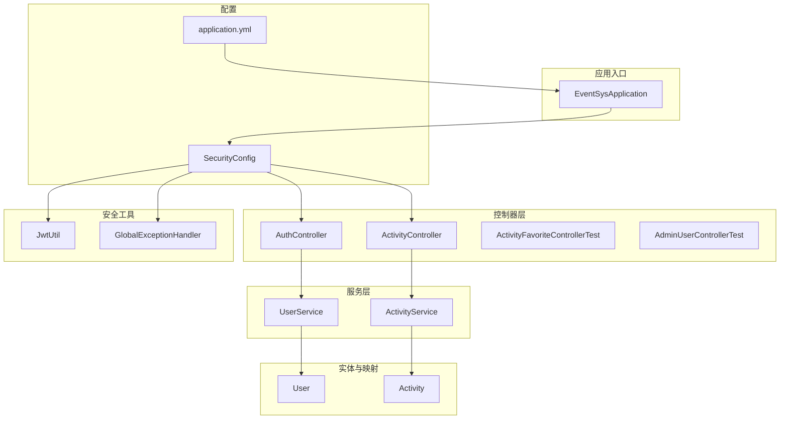
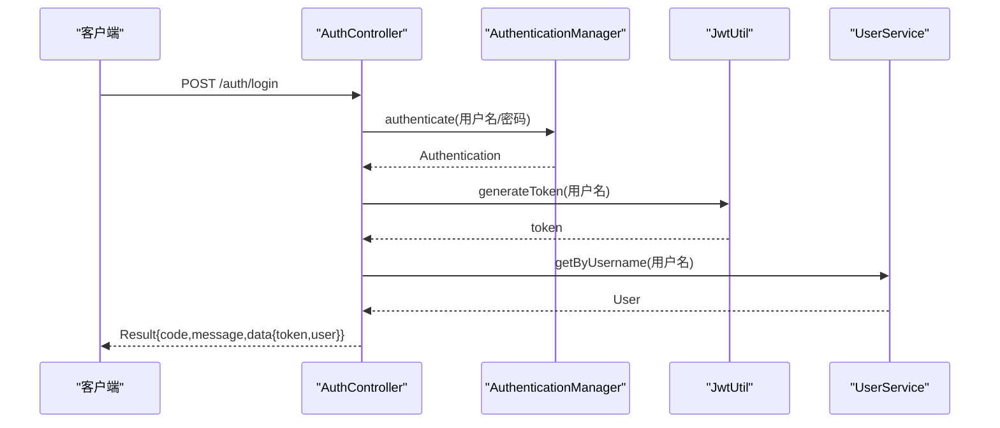
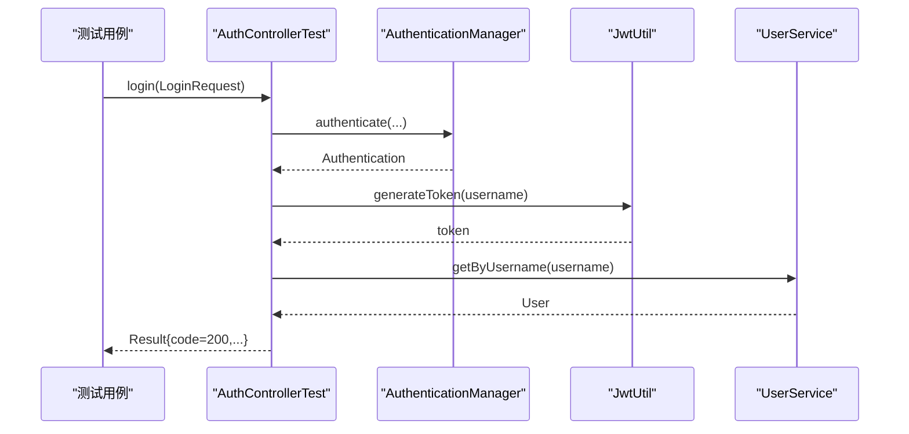
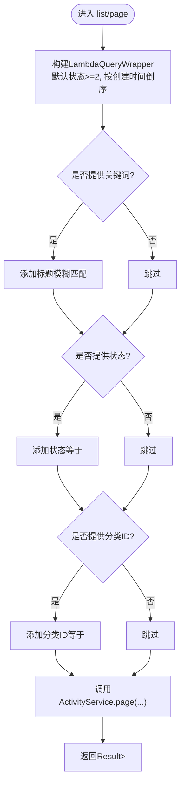
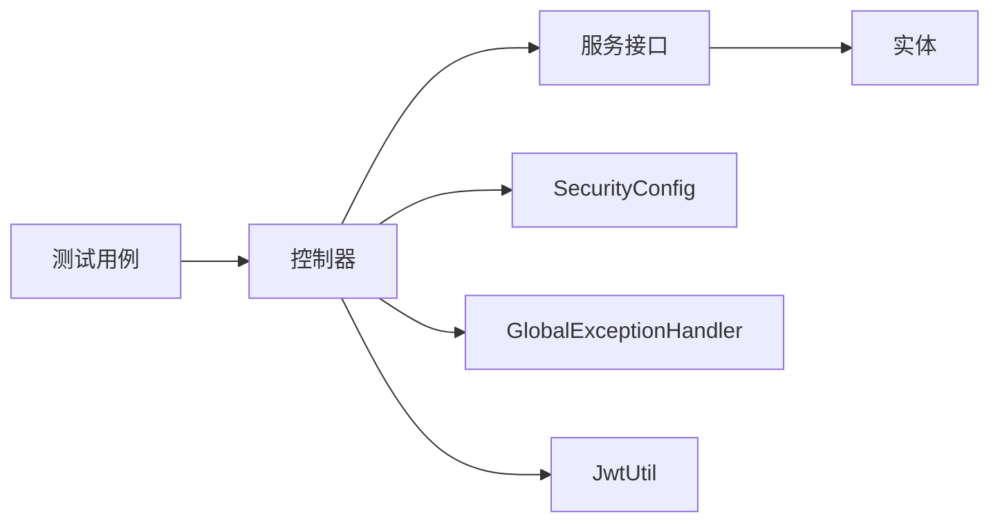

# 测试指南

<cite>
**本文引用的文件**   
- [EventSysApplication.java](file://src/main/java/com/campus/eventsys/EventSysApplication.java)
- [pom.xml](file://pom.xml)
- [AuthController.java](file://src/main/java/com/campus/eventsys/controller/AuthController.java)
- [ActivityController.java](file://src/main/java/com/campus/eventsys/controller/ActivityController.java)
- [Result.java](file://src/main/java/com/campus/eventsys/common/Result.java)
- [GlobalExceptionHandler.java](file://src/main/java/com/campus/eventsys/common/GlobalExceptionHandler.java)
- [SecurityConfig.java](file://src/main/java/com/campus/eventsys/config/SecurityConfig.java)
- [JwtUtil.java](file://src/main/java/com/campus/eventsys/security/JwtUtil.java)
- [UserService.java](file://src/main/java/com/campus/eventsys/service/UserService.java)
- [ActivityService.java](file://src/main/java/com/campus/eventsys/service/ActivityService.java)
- [User.java](file://src/main/java/com/campus/eventsys/entity/User.java)
- [Activity.java](file://src/main/java/com/campus/eventsys/entity/Activity.java)
- [AuthControllerTest.java](file://src/test/java/com/campus/eventsys/controller/AuthControllerTest.java)
- [ActivityControllerTest.java](file://src/test/java/com/campus/eventsys/controller/ActivityControllerTest.java)
- [ActivityFavoriteControllerTest.java](file://src/test/java/com/campus/eventsys/controller/ActivityFavoriteControllerTest.java)
- [AdminUserControllerTest.java](file://src/test/java/com/campus/eventsys/controller/AdminUserControllerTest.java)
- [application.yml](file://src/main/resources/application.yml)
</cite>

## 目录
1. [引言](#引言)
2. [项目结构](#项目结构)
3. [核心组件](#核心组件)
4. [架构总览](#架构总览)
5. [详细组件分析](#详细组件分析)
6. [依赖分析](#依赖分析)
7. [性能考虑](#性能考虑)
8. [故障排查指南](#故障排查指南)
9. [结论](#结论)
10. [附录](#附录)

## 引言
本测试指南面向校园活动管理系统，旨在提供一套完整的测试方法论与实践规范，覆盖单元测试、集成测试、测试数据准备、Controller层测试规范、Mock对象使用、HTTP请求模拟与响应断言、测试覆盖率要求、测试环境配置以及持续集成测试流程。同时给出测试用例设计原则、边界条件与异常场景测试方法，帮助开发团队在不同阶段高效发现缺陷、提升质量。

## 项目结构
系统采用Spring Boot + MyBatis-Plus架构，核心模块包括：
- 控制器层：提供REST接口，如认证、活动查询、收藏、管理员功能等
- 服务层：封装业务逻辑，调用Mapper与工具类
- 数据访问层：基于MyBatis-Plus的Mapper接口
- 安全层：基于JWT的无状态认证与授权
- 配置层：数据库、文件上传、OpenAPI、跨域、定时任务等配置
- 测试层：基于JUnit 5 + Mockito的单元测试，覆盖主要控制器

图表来源
- [EventSysApplication.java:1-17](file://src/main/java/com/campus/eventsys/EventSysApplication.java#L1-L17)
- [SecurityConfig.java:1-100](file://src/main/java/com/campus/eventsys/config/SecurityConfig.java#L1-L100)
- [AuthController.java:1-106](file://src/main/java/com/campus/eventsys/controller/AuthController.java#L1-L106)
- [ActivityController.java:1-111](file://src/main/java/com/campus/eventsys/controller/ActivityController.java#L1-L111)
- [UserService.java:1-38](file://src/main/java/com/campus/eventsys/service/UserService.java#L1-L38)
- [ActivityService.java:1-8](file://src/main/java/com/campus/eventsys/service/ActivityService.java#L1-L8)
- [User.java:1-85](file://src/main/java/com/campus/eventsys/entity/User.java#L1-L85)
- [Activity.java:1-95](file://src/main/java/com/campus/eventsys/entity/Activity.java#L1-L95)
- [JwtUtil.java:1-71](file://src/main/java/com/campus/eventsys/security/JwtUtil.java#L1-L71)
- [GlobalExceptionHandler.java:1-108](file://src/main/java/com/campus/eventsys/common/GlobalExceptionHandler.java#L1-L108)
- [application.yml:1-76](file://src/main/resources/application.yml#L1-L76)

章节来源
- [EventSysApplication.java:1-17](file://src/main/java/com/campus/eventsys/EventSysApplication.java#L1-L17)
- [pom.xml:1-131](file://pom.xml#L1-L131)
- [application.yml:1-76](file://src/main/resources/application.yml#L1-L76)

## 核心组件
- 统一响应包装类：Result，用于标准化接口返回结构（状态码、消息、数据），便于测试断言
- 全局异常处理器：GlobalExceptionHandler，集中处理业务异常、认证异常、参数绑定异常、文件大小异常等，确保测试能稳定捕获预期错误码
- 安全配置：SecurityConfig，定义放行规则（认证、活动公开查询、分类、成果、评论、评价、收藏统计、Swagger、静态资源等）与JWT过滤链
- JWT工具：JwtUtil，生成与验证令牌，支持过期判断
- 实体模型：User、Activity，承载业务数据与字段约束
- 控制器：AuthController、ActivityController等，提供REST接口；测试重点覆盖其行为与边界

章节来源
- [Result.java:1-55](file://src/main/java/com/campus/eventsys/common/Result.java#L1-L55)
- [GlobalExceptionHandler.java:1-108](file://src/main/java/com/campus/eventsys/common/GlobalExceptionHandler.java#L1-L108)
- [SecurityConfig.java:1-100](file://src/main/java/com/campus/eventsys/config/SecurityConfig.java#L1-L100)
- [JwtUtil.java:1-71](file://src/main/java/com/campus/eventsys/security/JwtUtil.java#L1-L71)
- [User.java:1-85](file://src/main/java/com/campus/eventsys/entity/User.java#L1-L85)
- [Activity.java:1-95](file://src/main/java/com/campus/eventsys/entity/Activity.java#L1-L95)
- [AuthController.java:1-106](file://src/main/java/com/campus/eventsys/controller/AuthController.java#L1-L106)
- [ActivityController.java:1-111](file://src/main/java/com/campus/eventsys/controller/ActivityController.java#L1-L111)

## 架构总览
系统采用前后端分离的REST架构，控制器层负责接收请求、参数校验与调用服务层；服务层封装业务规则；数据持久化通过MyBatis-Plus与SQLite完成；安全层通过JWT实现无状态认证，并在SecurityConfig中配置放行与拦截策略。

图表来源
- [AuthController.java:57-73](file://src/main/java/com/campus/eventsys/controller/AuthController.java#L57-L73)
- [JwtUtil.java:25-35](file://src/main/java/com/campus/eventsys/security/JwtUtil.java#L25-L35)
- [UserService.java:9](file://src/main/java/com/campus/eventsys/service/UserService.java#L9)
- [Result.java:31-49](file://src/main/java/com/campus/eventsys/common/Result.java#L31-L49)

## 详细组件分析

### 认证控制器测试规范
- 目标：验证登录、注册、获取用户信息、头像上传、用户信息更新等接口的行为与异常分支
- Mock对象使用：
  - AuthenticationManager：模拟认证成功/失败
  - JwtUtil：模拟令牌生成
  - UserService：模拟用户查询、注册、头像上传、信息更新
  - Authentication：模拟当前登录主体
- HTTP请求模拟与响应断言：
  - 使用Result中的code/message/data进行断言
  - 对文件上传场景使用MockMultipartFile
  - 对异常场景断言全局异常处理器返回的错误码与消息
- 边界与异常：
  - 用户不存在、空文件、空参数、运行时异常、密码长度校验等

图表来源
- [AuthControllerTest.java:58-77](file://src/test/java/com/campus/eventsys/controller/AuthControllerTest.java#L58-L77)
- [AuthController.java:57-73](file://src/main/java/com/campus/eventsys/controller/AuthController.java#L57-L73)
- [JwtUtil.java:25-35](file://src/main/java/com/campus/eventsys/security/JwtUtil.java#L25-L35)
- [UserService.java:9](file://src/main/java/com/campus/eventsys/service/UserService.java#L9)
- [Result.java:31-49](file://src/main/java/com/campus/eventsys/common/Result.java#L31-L49)

章节来源
- [AuthControllerTest.java:1-251](file://src/test/java/com/campus/eventsys/controller/AuthControllerTest.java#L1-L251)
- [AuthController.java:1-106](file://src/main/java/com/campus/eventsys/controller/AuthController.java#L1-L106)
- [UserService.java:1-38](file://src/main/java/com/campus/eventsys/service/UserService.java#L1-L38)
- [JwtUtil.java:1-71](file://src/main/java/com/campus/eventsys/security/JwtUtil.java#L1-L71)
- [Result.java:1-55](file://src/main/java/com/campus/eventsys/common/Result.java#L1-L55)

### 活动公开查询控制器测试规范
- 目标：验证活动列表分页查询、关键词/状态/分类筛选、详情查询与浏览量+1等行为
- Mock对象使用：
  - ActivityService：模拟分页查询与单条查询
- 断言要点：
  - 分页总数、记录数、排序条件
  - 浏览量自增逻辑
  - 不存在时返回错误码与消息
- 边界与异常：
  - 空结果集、活动不存在、参数为空等

图表来源
- [ActivityControllerTest.java:55-154](file://src/test/java/com/campus/eventsys/controller/ActivityControllerTest.java#L55-L154)
- [ActivityController.java:54-87](file://src/main/java/com/campus/eventsys/controller/ActivityController.java#L54-L87)
- [ActivityService.java:1-8](file://src/main/java/com/campus/eventsys/service/ActivityService.java#L1-L8)

章节来源
- [ActivityControllerTest.java:1-231](file://src/test/java/com/campus/eventsys/controller/ActivityControllerTest.java#L1-L231)
- [ActivityController.java:1-111](file://src/main/java/com/campus/eventsys/controller/ActivityController.java#L1-L111)
- [ActivityService.java:1-8](file://src/main/java/com/campus/eventsys/service/ActivityService.java#L1-L8)

### 收藏控制器测试规范
- 目标：验证收藏/取消收藏、查询是否收藏、查询我的收藏、查询收藏数等
- Mock对象使用：
  - ActivityFavoriteService、ActivityService、UserService
  - Authentication
- 断言要点：
  - 成功/失败消息与状态码
  - 我的收藏列表对不存在活动的过滤
- 边界与异常：
  - 用户不存在、活动不存在、已收藏/未收藏、服务层失败等

章节来源
- [ActivityFavoriteControllerTest.java:1-375](file://src/test/java/com/campus/eventsys/controller/ActivityFavoriteControllerTest.java#L1-L375)

### 管理员用户控制器测试规范
- 目标：验证用户列表、详情、更新、重置密码、删除、设置/取消管理员、封禁/解禁等
- Mock对象使用：
  - UserService、PasswordEncoder
- 断言要点：
  - 分页总数、字段更新、密码加密、角色与状态变更
- 边界与异常：
  - 用户不存在、密码过短、管理员自身不可封禁、状态异常等

章节来源
- [AdminUserControllerTest.java:1-394](file://src/test/java/com/campus/eventsys/controller/AdminUserControllerTest.java#L1-L394)

## 依赖分析
- 测试框架：JUnit 5 + Mockito，使用@ExtendWith(MockitoExtension.class)启用Mock注入
- Spring测试：spring-boot-starter-test、spring-security-test
- 依赖耦合：
  - 控制器依赖服务接口，服务依赖实体与Mapper
  - 安全配置影响控制器的访问控制与放行规则
  - 全局异常处理器统一处理异常，保证测试断言一致性

图表来源
- [pom.xml:93-103](file://pom.xml#L93-L103)
- [AuthControllerTest.java:1-251](file://src/test/java/com/campus/eventsys/controller/AuthControllerTest.java#L1-L251)
- [ActivityControllerTest.java:1-231](file://src/test/java/com/campus/eventsys/controller/ActivityControllerTest.java#L1-L231)
- [ActivityFavoriteControllerTest.java:1-375](file://src/test/java/com/campus/eventsys/controller/ActivityFavoriteControllerTest.java#L1-L375)
- [AdminUserControllerTest.java:1-394](file://src/test/java/com/campus/eventsys/controller/AdminUserControllerTest.java#L1-L394)

章节来源
- [pom.xml:1-131](file://pom.xml#L1-L131)

## 性能考虑
- 单元测试优先：通过Mock隔离外部依赖，确保测试执行快速稳定
- 分页查询测试：验证分页参数与查询条件组合，避免全表扫描
- 文件上传测试：使用MockMultipartFile模拟不同大小与类型，结合application.yml中的上传限制进行边界测试
- 安全过滤链：通过SecurityConfig放行公开接口，减少不必要的认证开销

## 故障排查指南
- 参数校验失败：GlobalExceptionHandler将BindException转换为400错误，检查请求体与字段注解
- 认证失败/过期：BadCredentialsException、ExpiredJwtException、InsufficientAuthenticationException分别映射为401，检查JWT生成与传递
- 权限不足：AccessDeniedException映射为403，检查角色与放行规则
- 文件大小超限：MaxUploadSizeExceededException映射为400，核对application.yml中的上传限制
- 业务异常：BusinessException通过全局异常处理器返回自定义状态码与消息，便于测试断言

章节来源
- [GlobalExceptionHandler.java:20-107](file://src/main/java/com/campus/eventsys/common/GlobalExceptionHandler.java#L20-L107)
- [application.yml:21-26](file://src/main/resources/application.yml#L21-L26)

## 结论
通过以Result为统一输出、以GlobalExceptionHandler为统一异常出口、以SecurityConfig为统一安全边界、以Mockito为Mock策略，本项目的测试体系具备良好的可维护性与可扩展性。建议在CI流水线中开启测试执行与覆盖率统计，持续保障代码质量。

## 附录

### 单元测试编写方法
- 测试命名：使用“方法名_场景_期望”的命名风格，如login_Success
- 测试夹具：使用@BeforeEach准备测试数据，使用@Mock/@InjectMocks构造测试对象
- 断言策略：优先断言Result的code/message/data；对复杂逻辑使用ArgumentCaptor捕获参数并断言
- 异常断言：通过全局异常处理器返回的错误码与消息进行断言

章节来源
- [AuthControllerTest.java:1-251](file://src/test/java/com/campus/eventsys/controller/AuthControllerTest.java#L1-L251)
- [ActivityControllerTest.java:1-231](file://src/test/java/com/campus/eventsys/controller/ActivityControllerTest.java#L1-L231)
- [ActivityFavoriteControllerTest.java:1-375](file://src/test/java/com/campus/eventsys/controller/ActivityFavoriteControllerTest.java#L1-L375)
- [AdminUserControllerTest.java:1-394](file://src/test/java/com/campus/eventsys/controller/AdminUserControllerTest.java#L1-L394)

### 集成测试策略
- 端到端场景：使用SpringBootTest启动完整上下文，验证控制器到服务再到数据库的完整链路
- 数据库：使用SQLite内存数据库或测试专用数据库，配合迁移脚本初始化schema与基础数据
- 安全集成：通过SecurityConfig放行规则与JWT过滤链，验证认证与授权流程
- 文件上传：结合application.yml中的multipart配置，验证上传路径与大小限制

章节来源
- [application.yml:10-26](file://src/main/resources/application.yml#L10-L26)
- [SecurityConfig.java:36-71](file://src/main/java/com/campus/eventsys/config/SecurityConfig.java#L36-L71)

### 测试数据准备
- 用户数据：用户名、昵称、角色、状态、密码（加密后）等
- 活动数据：标题、描述、时间范围、状态、分类、报名人数上限等
- 收藏数据：用户ID与活动ID的关联
- 文件数据：MockMultipartFile模拟头像上传

章节来源
- [User.java:1-85](file://src/main/java/com/campus/eventsys/entity/User.java#L1-L85)
- [Activity.java:1-95](file://src/main/java/com/campus/eventsys/entity/Activity.java#L1-L95)
- [AuthControllerTest.java:44-47](file://src/test/java/com/campus/eventsys/controller/AuthControllerTest.java#L44-L47)
- [ActivityFavoriteControllerTest.java:46-69](file://src/test/java/com/campus/eventsys/controller/ActivityFavoriteControllerTest.java#L46-L69)

### Controller层测试规范
- Mock对象：对AuthenticationManager、JwtUtil、UserService、ActivityService、ActivityFavoriteService、PasswordEncoder等进行Mock
- HTTP请求模拟：使用MockMvc或直接调用控制器方法（推荐直接调用，配合Mock）
- 响应断言：断言Result的code/message/data；对文件上传断言URL；对异常断言全局异常处理器返回值
- 安全断言：通过SecurityConfig放行规则验证公开接口与受保护接口的行为差异

章节来源
- [AuthControllerTest.java:1-251](file://src/test/java/com/campus/eventsys/controller/AuthControllerTest.java#L1-L251)
- [ActivityControllerTest.java:1-231](file://src/test/java/com/campus/eventsys/controller/ActivityControllerTest.java#L1-L231)
- [ActivityFavoriteControllerTest.java:1-375](file://src/test/java/com/campus/eventsys/controller/ActivityFavoriteControllerTest.java#L1-L375)
- [AdminUserControllerTest.java:1-394](file://src/test/java/com/campus/eventsys/controller/AdminUserControllerTest.java#L1-L394)
- [SecurityConfig.java:41-68](file://src/main/java/com/campus/eventsys/config/SecurityConfig.java#L41-L68)

### 测试覆盖率要求
- 建议目标：语句覆盖率≥80%，分支覆盖率≥70%，行覆盖率≥80%
- 关键路径：控制器、服务、异常处理、安全配置、实体与Mapper映射
- 工具：JaCoCo插件集成在Maven中，可在CI中生成报告并设置阈值

章节来源
- [pom.xml:120-127](file://pom.xml#L120-L127)

### 测试环境配置
- 数据源：SQLite，使用${user.dir}/event_database.db作为数据库文件路径
- 文件上传：multipart.enabled=true，最大文件大小10MB，请求总大小20MB
- 日志：调试级别开启，便于定位问题
- OpenAPI：Swagger UI与API文档路径配置

章节来源
- [application.yml:10-26](file://src/main/resources/application.yml#L10-L26)
- [application.yml:64-76](file://src/main/resources/application.yml#L64-L76)

### 持续集成测试流程
- Maven插件：maven-surefire-plugin默认启用测试执行
- CI建议步骤：
  - 安装Java 17与Maven
  - 执行mvn test（Surefire自动执行）
  - 生成覆盖率报告（JaCoCo）
  - 上传测试报告与覆盖率指标

章节来源
- [pom.xml:120-127](file://pom.xml#L120-L127)

### 测试用例设计原则
- 等价类划分：用户名/密码长度、活动状态枚举、性别枚举等
- 边界值：密码最小长度、文件大小边界、分页参数边界
- 决策表：多条件组合（关键词+状态+分类）、角色+状态+封禁状态
- 异常场景：用户不存在、活动不存在、认证失败、权限不足、文件异常

章节来源
- [AuthControllerTest.java:133-198](file://src/test/java/com/campus/eventsys/controller/AuthControllerTest.java#L133-L198)
- [ActivityControllerTest.java:156-229](file://src/test/java/com/campus/eventsys/controller/ActivityControllerTest.java#L156-L229)
- [ActivityFavoriteControllerTest.java:103-149](file://src/test/java/com/campus/eventsys/controller/ActivityFavoriteControllerTest.java#L103-L149)
- [AdminUserControllerTest.java:228-239](file://src/test/java/com/campus/eventsys/controller/AdminUserControllerTest.java#L228-L239)