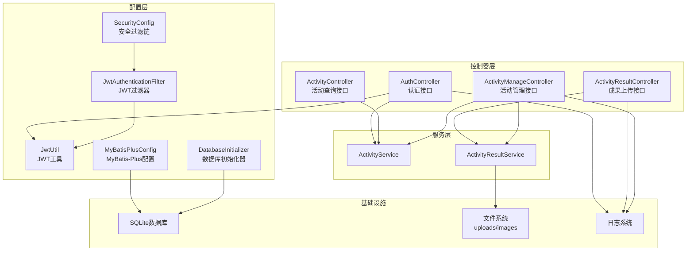
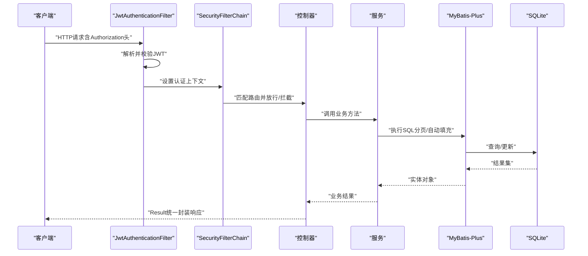
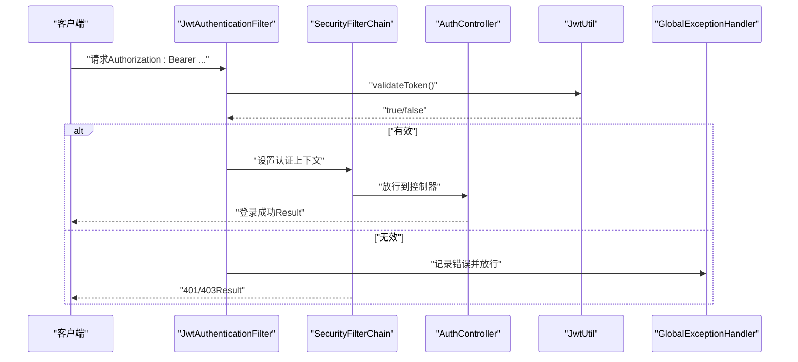
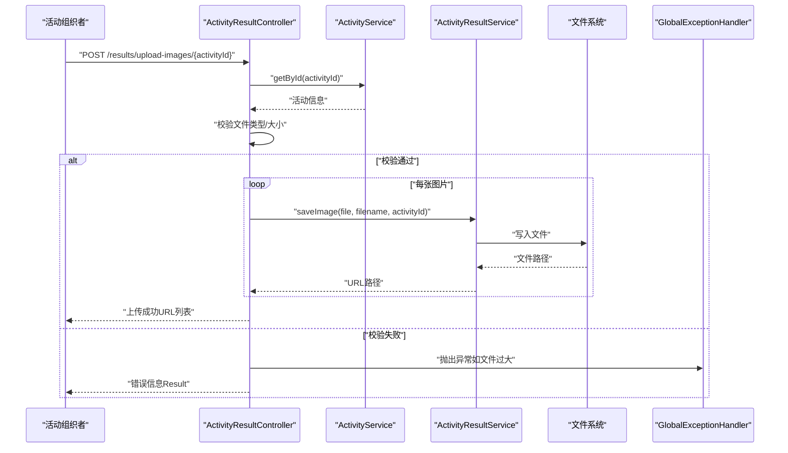
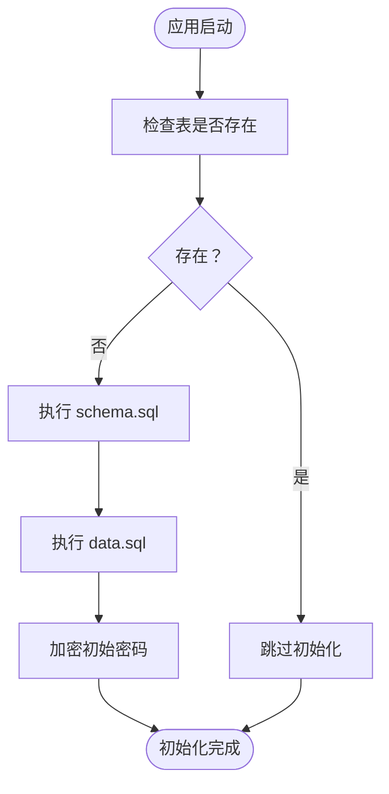
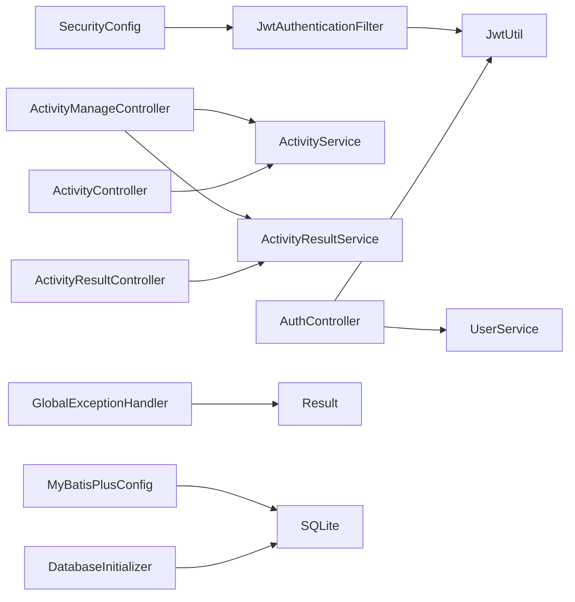

# 调试与故障排除

<cite>
**本文引用的文件**
- [application.yml](file://src/main/resources/application.yml)
- [SecurityConfig.java](file://src/main/java/com/campus/eventsys/config/SecurityConfig.java)
- [JwtAuthenticationFilter.java](file://src/main/java/com/campus/eventsys/security/JwtAuthenticationFilter.java)
- [JwtUtil.java](file://src/main/java/com/campus/eventsys/security/JwtUtil.java)
- [GlobalExceptionHandler.java](file://src/main/java/com/campus/eventsys/common/GlobalExceptionHandler.java)
- [Result.java](file://src/main/java/com/campus/eventsys/common/Result.java)
- [BusinessException.java](file://src/main/java/com/campus/eventsys/common/BusinessException.java)
- [DatabaseInitializer.java](file://src/main/java/com/campus/eventsys/config/DatabaseInitializer.java)
- [MyBatisPlusConfig.java](file://src/main/java/com/campus/eventsys/config/MyBatisPlusConfig.java)
- [AuthController.java](file://src/main/java/com/campus/eventsys/controller/AuthController.java)
- [ActivityController.java](file://src/main/java/com/campus/eventsys/controller/ActivityController.java)
- [ActivityResultController.java](file://src/main/java/com/campus/eventsys/controller/ActivityResultController.java)
- [ActivityResultServiceImpl.java](file://src/main/java/com/campus/eventsys/service/impl/ActivityResultServiceImpl.java)
- [ActivityManageController.java](file://src/main/java/com/campus/eventsys/controller/ActivityManageController.java)
- [AuthControllerTest.java](file://src/test/java/com/campus/eventsys/controller/AuthControllerTest.java)
- [ActivityParticipantControllerTest.java](file://src/test/java/com/campus/eventsys/controller/ActivityParticipantControllerTest.java)
- [时序图5_图片上传.plantuml](file://picture/时序图5_图片上传.plantuml)
</cite>

## 目录
1. [简介](#简介)
2. [项目结构](#项目结构)
3. [核心组件](#核心组件)
4. [架构总览](#架构总览)
5. [详细组件分析](#详细组件分析)
6. [依赖分析](#依赖分析)
7. [性能考虑](#性能考虑)
8. [故障排除指南](#故障排除指南)
9. [结论](#结论)
10. [附录](#附录)

## 简介
本指南面向校园活动管理系统的开发与运维人员，聚焦于开发环境调试技巧、日志分析方法、常见问题诊断流程与系统监控实践。内容涵盖断点调试、参数验证、异常追踪、数据库连接问题、JWT认证失败、文件上传异常等，并提供性能问题排查与内存泄漏检测建议。

## 项目结构
系统采用Spring Boot + MyBatis-Plus架构，核心模块包括：
- 配置层：安全过滤链、JWT工具、MyBatis-Plus配置、数据库初始化器
- 控制器层：认证、活动查询、成果上传等对外接口
- 服务与实现：业务逻辑与持久化交互
- 异常处理：全局异常捕获与统一响应封装
- 测试：控制器单元测试覆盖典型场景

图表来源
- [SecurityConfig.java:35-71](file://src/main/java/com/campus/eventsys/config/SecurityConfig.java#L35-L71)
- [JwtAuthenticationFilter.java:26-48](file://src/main/java/com/campus/eventsys/security/JwtAuthenticationFilter.java#L26-L48)
- [JwtUtil.java:25-56](file://src/main/java/com/campus/eventsys/security/JwtUtil.java#L25-L56)
- [MyBatisPlusConfig.java:25-34](file://src/main/java/com/campus/eventsys/config/MyBatisPlusConfig.java#L25-L34)
- [DatabaseInitializer.java:34-53](file://src/main/java/com/campus/eventsys/config/DatabaseInitializer.java#L34-L53)
- [AuthController.java:57-73](file://src/main/java/com/campus/eventsys/controller/AuthController.java#L57-L73)
- [ActivityController.java:54-87](file://src/main/java/com/campus/eventsys/controller/ActivityController.java#L54-L87)
- [ActivityResultController.java:328-347](file://src/main/java/com/campus/eventsys/controller/ActivityResultController.java#L328-L347)
- [ActivityManageController.java:823-855](file://src/main/java/com/campus/eventsys/controller/ActivityManageController.java#L823-L855)

章节来源
- [application.yml:1-76](file://src/main/resources/application.yml#L1-L76)
- [SecurityConfig.java:35-71](file://src/main/java/com/campus/eventsys/config/SecurityConfig.java#L35-L71)

## 核心组件
- 统一响应与异常处理
  - 统一响应包装类用于前后端一致的数据结构输出
  - 全局异常处理器对业务异常、认证异常、参数校验异常、文件大小异常等进行分类处理与日志记录
- 安全与认证
  - 基于JWT的无状态认证，过滤器在请求进入时解析Authorization头并校验Token
  - 安全配置定义放行规则与拦截策略，支持跨域
- 数据访问与初始化
  - MyBatis-Plus配置分页与自动填充
  - 自定义数据库初始化器负责建表、初始化数据与密码加密
- 文件上传
  - 控制器与服务实现图片上传、目录创建与访问URL生成
  - 配置文件限制单文件与总请求大小

章节来源
- [Result.java:31-49](file://src/main/java/com/campus/eventsys/common/Result.java#L31-L49)
- [GlobalExceptionHandler.java:20-106](file://src/main/java/com/campus/eventsys/common/GlobalExceptionHandler.java#L20-L106)
- [JwtAuthenticationFilter.java:26-48](file://src/main/java/com/campus/eventsys/security/JwtAuthenticationFilter.java#L26-L48)
- [SecurityConfig.java:35-71](file://src/main/java/com/campus/eventsys/config/SecurityConfig.java#L35-L71)
- [MyBatisPlusConfig.java:25-56](file://src/main/java/com/campus/eventsys/config/MyBatisPlusConfig.java#L25-L56)
- [DatabaseInitializer.java:34-78](file://src/main/java/com/campus/eventsys/config/DatabaseInitializer.java#L34-L78)
- [application.yml:21-26](file://src/main/resources/application.yml#L21-L26)

## 架构总览
系统采用“控制器-服务-数据访问”的分层架构，配合全局异常处理与安全过滤链，形成清晰的请求处理闭环。

图表来源
- [JwtAuthenticationFilter.java:26-48](file://src/main/java/com/campus/eventsys/security/JwtAuthenticationFilter.java#L26-L48)
- [SecurityConfig.java:35-71](file://src/main/java/com/campus/eventsys/config/SecurityConfig.java#L35-L71)
- [AuthController.java:57-73](file://src/main/java/com/campus/eventsys/controller/AuthController.java#L57-L73)
- [MyBatisPlusConfig.java:25-34](file://src/main/java/com/campus/eventsys/config/MyBatisPlusConfig.java#L25-L34)
- [DatabaseInitializer.java:34-53](file://src/main/java/com/campus/eventsys/config/DatabaseInitializer.java#L34-L53)

## 详细组件分析

### 组件A：认证与安全过滤链
- 关键点
  - 过滤器从Authorization头提取Bearer Token，校验通过后设置认证上下文
  - 安全配置对公开接口放行，其余接口需登录；管理员接口统一拦截
  - 认证异常由全局异常处理器捕获并返回标准错误码
- 调试要点
  - 断点位置：过滤器doFilterInternal入口、认证管理器authenticate调用处
  - 参数验证：登录请求参数校验、角色权限校验
  - 异常追踪：BadCredentialsException、AccessDeniedException、InsufficientAuthenticationException

图表来源
- [JwtAuthenticationFilter.java:26-48](file://src/main/java/com/campus/eventsys/security/JwtAuthenticationFilter.java#L26-L48)
- [JwtUtil.java:46-56](file://src/main/java/com/campus/eventsys/security/JwtUtil.java#L46-L56)
- [SecurityConfig.java:41-68](file://src/main/java/com/campus/eventsys/config/SecurityConfig.java#L41-L68)
- [AuthController.java:57-73](file://src/main/java/com/campus/eventsys/controller/AuthController.java#L57-L73)
- [GlobalExceptionHandler.java:32-97](file://src/main/java/com/campus/eventsys/common/GlobalExceptionHandler.java#L32-L97)

章节来源
- [JwtAuthenticationFilter.java:26-48](file://src/main/java/com/campus/eventsys/security/JwtAuthenticationFilter.java#L26-L48)
- [SecurityConfig.java:41-68](file://src/main/java/com/campus/eventsys/config/SecurityConfig.java#L41-L68)
- [AuthController.java:57-73](file://src/main/java/com/campus/eventsys/controller/AuthController.java#L57-L73)
- [GlobalExceptionHandler.java:32-97](file://src/main/java/com/campus/eventsys/common/GlobalExceptionHandler.java#L32-L97)

### 组件B：文件上传流程
- 关键点
  - 控制器接收多文件，逐个生成UUID文件名并保存至按活动ID分目录的文件系统
  - 校验文件类型（image/*）、大小（默认10MB），异常统一由全局异常处理器捕获
  - 失败时记录错误日志并返回统一错误响应
- 调试要点
  - 断点位置：文件校验、UUID生成、transferTo写盘、URL拼接
  - 参数验证：文件类型、大小、空文件
  - 异常追踪：MaxUploadSizeExceededException、IOException

图表来源
- [时序图5_图片上传.plantuml:10-28](file://picture/时序图5_图片上传.plantuml#L10-L28)
- [ActivityResultController.java:328-347](file://src/main/java/com/campus/eventsys/controller/ActivityResultController.java#L328-L347)
- [ActivityResultServiceImpl.java:124-146](file://src/main/java/com/campus/eventsys/service/impl/ActivityResultServiceImpl.java#L124-L146)
- [GlobalExceptionHandler.java:102-106](file://src/main/java/com/campus/eventsys/common/GlobalExceptionHandler.java#L102-L106)

章节来源
- [ActivityResultController.java:328-347](file://src/main/java/com/campus/eventsys/controller/ActivityResultController.java#L328-L347)
- [ActivityResultServiceImpl.java:124-146](file://src/main/java/com/campus/eventsys/service/impl/ActivityResultServiceImpl.java#L124-L146)
- [ActivityManageController.java:834-848](file://src/main/java/com/campus/eventsys/controller/ActivityManageController.java#L834-L848)
- [GlobalExceptionHandler.java:102-106](file://src/main/java/com/campus/eventsys/common/GlobalExceptionHandler.java#L102-L106)

### 组件C：数据库初始化与MyBatis-Plus配置
- 关键点
  - 初始化器在应用启动时检查表是否存在，不存在则执行schema与data脚本并加密初始密码
  - MyBatis-Plus配置分页插件与自动填充（创建/更新时间、逻辑删除字段）
- 调试要点
  - 断点位置：初始化脚本执行、表存在性检查、密码加密循环
  - 参数验证：脚本路径有效性、SQL状态码与异常信息
  - 性能关注：分页上限、自动填充字段数量

图表来源
- [DatabaseInitializer.java:34-53](file://src/main/java/com/campus/eventsys/config/DatabaseInitializer.java#L34-L53)
- [DatabaseInitializer.java:99-113](file://src/main/java/com/campus/eventsys/config/DatabaseInitializer.java#L99-L113)
- [MyBatisPlusConfig.java:25-56](file://src/main/java/com/campus/eventsys/config/MyBatisPlusConfig.java#L25-L56)

章节来源
- [DatabaseInitializer.java:34-78](file://src/main/java/com/campus/eventsys/config/DatabaseInitializer.java#L34-L78)
- [MyBatisPlusConfig.java:25-56](file://src/main/java/com/campus/eventsys/config/MyBatisPlusConfig.java#L25-L56)

## 依赖分析
- 组件耦合
  - 控制器依赖服务接口，服务依赖Mapper与工具类
  - 安全过滤链依赖JWT工具与用户详情服务
  - 全局异常处理器统一承接业务与认证异常
- 外部依赖
  - 数据源：SQLite（JDBC驱动）
  - JSON处理：Jackson
  - 安全框架：Spring Security
  - 文档：SpringDoc OpenAPI

图表来源
- [AuthController.java:38-40](file://src/main/java/com/campus/eventsys/controller/AuthController.java#L38-L40)
- [ActivityController.java:42](file://src/main/java/com/campus/eventsys/controller/ActivityController.java#L42)
- [ActivityResultController.java:328-347](file://src/main/java/com/campus/eventsys/controller/ActivityResultController.java#L328-L347)
- [ActivityManageController.java:67-76](file://src/main/java/com/campus/eventsys/controller/ActivityManageController.java#L67-L76)
- [JwtAuthenticationFilter.java:23-24](file://src/main/java/com/campus/eventsys/security/JwtAuthenticationFilter.java#L23-L24)
- [SecurityConfig.java:32-33](file://src/main/java/com/campus/eventsys/config/SecurityConfig.java#L32-L33)
- [GlobalExceptionHandler.java:20-106](file://src/main/java/com/campus/eventsys/common/GlobalExceptionHandler.java#L20-L106)
- [DatabaseInitializer.java:29-32](file://src/main/java/com/campus/eventsys/config/DatabaseInitializer.java#L29-L32)
- [MyBatisPlusConfig.java:25-34](file://src/main/java/com/campus/eventsys/config/MyBatisPlusConfig.java#L25-L34)

## 性能考虑
- 分页与查询
  - 合理设置分页上限，避免一次性加载过多数据
  - 在高频查询上增加必要索引（如活动状态、分类ID、创建时间）
- 缓存与静态资源
  - 图片等静态资源可结合Nginx缓存与CDN加速
- 日志级别
  - 生产环境建议降低调试日志级别，避免I/O瓶颈
- 并发与线程池
  - 文件上传与数据库操作注意线程池配置，避免阻塞

## 故障排除指南

### 开发环境调试技巧
- IDE断点调试
  - 认证流程：在过滤器入口与控制器登录方法设置断点，观察Token解析与认证上下文
  - 文件上传：在控制器文件校验与服务写盘处设置断点，检查文件名生成与目录创建
  - 数据库：在初始化器脚本执行与Mapper调用处断点，核对SQL与异常栈
- 参数验证
  - 使用Swagger UI构造请求，观察全局异常处理器返回的字段校验信息
  - 单元测试覆盖边界条件（空文件、超大文件、非法类型）

章节来源
- [AuthController.java:57-73](file://src/main/java/com/campus/eventsys/controller/AuthController.java#L57-L73)
- [ActivityResultController.java:328-347](file://src/main/java/com/campus/eventsys/controller/ActivityResultController.java#L328-L347)
- [DatabaseInitializer.java:99-113](file://src/main/java/com/campus/eventsys/config/DatabaseInitializer.java#L99-L113)
- [AuthControllerTest.java:58-77](file://src/test/java/com/campus/eventsys/controller/AuthControllerTest.java#L58-L77)
- [ActivityParticipantControllerTest.java:176-203](file://src/test/java/com/campus/eventsys/controller/ActivityParticipantControllerTest.java#L176-L203)

### 日志分析方法
- 关键日志定位
  - 认证失败：全局异常处理器记录的认证异常日志
  - 文件上传失败：服务实现类中的错误日志与异常抛出
  - 数据库初始化：初始化器的日志与SQL状态码
- 日志级别
  - application.yml中开启调试级别，便于快速定位问题

章节来源
- [GlobalExceptionHandler.java:20-106](file://src/main/java/com/campus/eventsys/common/GlobalExceptionHandler.java#L20-L106)
- [ActivityResultServiceImpl.java:142-145](file://src/main/java/com/campus/eventsys/service/impl/ActivityResultServiceImpl.java#L142-L145)
- [DatabaseInitializer.java:34-53](file://src/main/java/com/campus/eventsys/config/DatabaseInitializer.java#L34-L53)
- [application.yml:71-76](file://src/main/resources/application.yml#L71-L76)

### 常见问题诊断流程

#### 数据库连接问题
- 症状
  - 启动时报错或查询异常
- 诊断步骤
  - 检查数据源URL与驱动配置
  - 核对初始化器脚本执行情况与SQL状态码
  - 确认数据库文件路径与权限
- 解决方案
  - 修正application.yml中的数据源配置
  - 确保schema与data脚本存在且可读
  - 检查SQLite驱动版本兼容性

章节来源
- [application.yml:10-16](file://src/main/resources/application.yml#L10-L16)
- [DatabaseInitializer.java:99-113](file://src/main/java/com/campus/eventsys/config/DatabaseInitializer.java#L99-L113)

#### JWT认证失败
- 症状
  - 401未登录或Token无效
- 诊断步骤
  - 检查Authorization头格式与Token有效期
  - 观察过滤器日志与全局异常处理器的认证异常分支
- 解决方案
  - 确保前端正确携带Bearer Token
  - 重新登录获取新Token，检查密钥与过期时间配置

章节来源
- [JwtAuthenticationFilter.java:30-44](file://src/main/java/com/campus/eventsys/security/JwtAuthenticationFilter.java#L30-L44)
- [GlobalExceptionHandler.java:32-97](file://src/main/java/com/campus/eventsys/common/GlobalExceptionHandler.java#L32-L97)
- [application.yml:49-52](file://src/main/resources/application.yml#L49-L52)

#### 文件上传异常
- 症状
  - 文件过大、类型不符、保存失败
- 诊断步骤
  - 检查文件大小与类型校验逻辑
  - 查看服务实现类的异常日志与IO异常
- 解决方案
  - 调整application.yml中的文件大小限制
  - 仅允许image/*类型，确保目录可写

章节来源
- [application.yml:21-26](file://src/main/resources/application.yml#L21-L26)
- [ActivityResultController.java:328-347](file://src/main/java/com/campus/eventsys/controller/ActivityResultController.java#L328-L347)
- [ActivityResultServiceImpl.java:142-145](file://src/main/java/com/campus/eventsys/service/impl/ActivityResultServiceImpl.java#L142-L145)
- [ActivityManageController.java:834-848](file://src/main/java/com/campus/eventsys/controller/ActivityManageController.java#L834-L848)
- [GlobalExceptionHandler.java:102-106](file://src/main/java/com/campus/eventsys/common/GlobalExceptionHandler.java#L102-L106)

### 性能问题排查
- 排查手段
  - 使用JProfiler或VisualVM观察CPU与堆内存使用
  - 关注文件上传与数据库查询热点
- 优化建议
  - 合理设置分页大小与查询条件
  - 对频繁查询建立索引
  - 控制并发上传数量，避免磁盘I/O瓶颈

### 内存泄漏检测
- 建议
  - 使用内存分析工具识别未释放的对象引用
  - 关注大对象（图片文件）的生命周期管理
  - 定期清理临时文件与过期缓存

### 系统监控方法
- 建议
  - 结合日志聚合与告警（如ELK Stack）
  - 监控数据库连接数与慢查询
  - 监控文件系统空间与上传成功率

## 结论
通过统一的异常处理、安全过滤链与清晰的分层架构，系统具备良好的可调试性与可观测性。建议在开发与生产环境中结合日志、断点与单元测试，快速定位并解决认证、数据库与文件上传等常见问题；同时持续优化分页、索引与并发控制，提升系统整体性能与稳定性。

## 附录
- 快速参考
  - 统一响应：[Result.java:31-49](file://src/main/java/com/campus/eventsys/common/Result.java#L31-L49)
  - 全局异常：[GlobalExceptionHandler.java:20-106](file://src/main/java/com/campus/eventsys/common/GlobalExceptionHandler.java#L20-L106)
  - 安全配置：[SecurityConfig.java:35-71](file://src/main/java/com/campus/eventsys/config/SecurityConfig.java#L35-L71)
  - JWT工具：[JwtUtil.java:25-56](file://src/main/java/com/campus/eventsys/security/JwtUtil.java#L25-L56)
  - 数据库初始化：[DatabaseInitializer.java:34-78](file://src/main/java/com/campus/eventsys/config/DatabaseInitializer.java#L34-78)
  - 文件上传：[ActivityResultController.java:328-347](file://src/main/java/com/campus/eventsys/controller/ActivityResultController.java#L328-L347)、[ActivityResultServiceImpl.java:124-146](file://src/main/java/com/campus/eventsys/service/impl/ActivityResultServiceImpl.java#L124-L146)