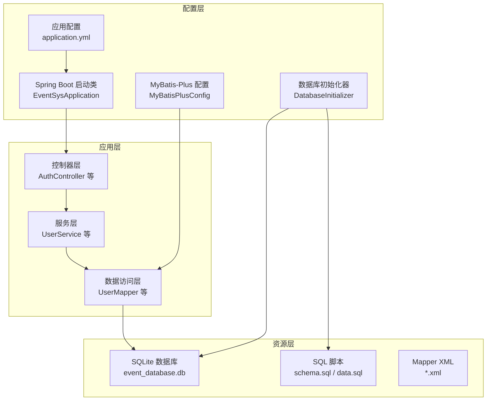
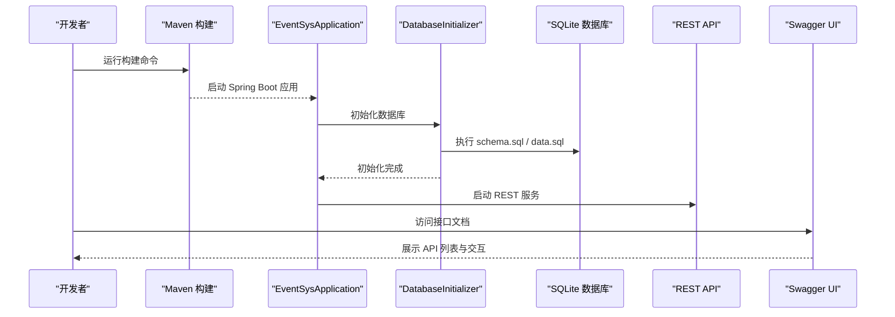
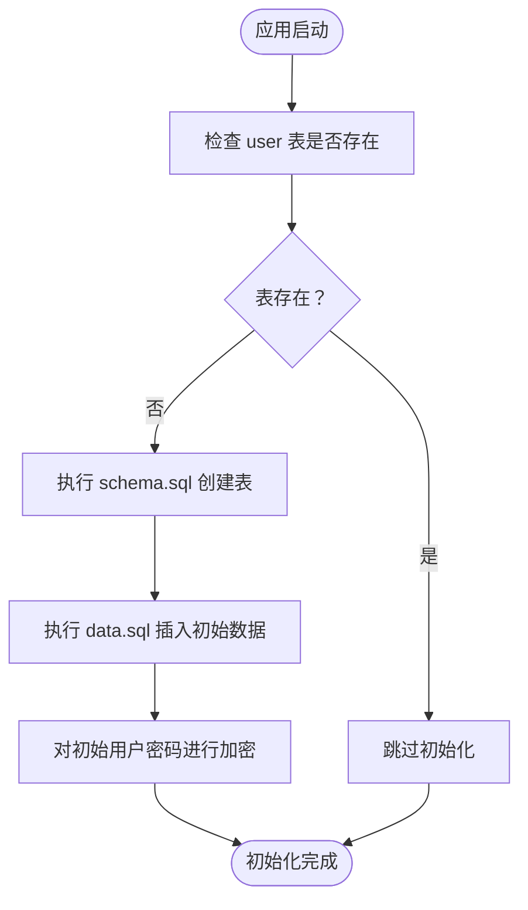
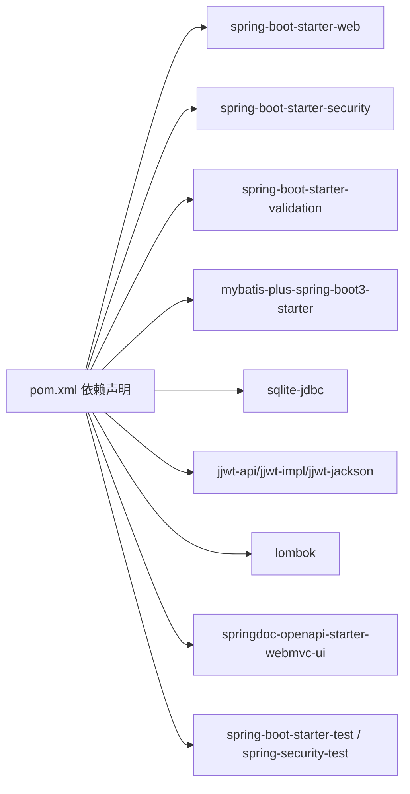

# 快速开始

<cite>
**本文引用的文件**
- [pom.xml](file://pom.xml)
- [application.yml](file://src/main/resources/application.yml)
- [EventSysApplication.java](file://src/main/java/com/campus/eventsys/EventSysApplication.java)
- [DatabaseInitializer.java](file://src/main/java/com/campus/eventsys/config/DatabaseInitializer.java)
- [MyBatisPlusConfig.java](file://src/main/java/com/campus/eventsys/config/MyBatisPlusConfig.java)
- [schema.sql](file://src/main/resources/db/schema.sql)
- [data.sql](file://src/main/resources/db/data.sql)
- [AuthController.java](file://src/main/java/com/campus/eventsys/controller/AuthController.java)
- [User.java](file://src/main/java/com/campus/eventsys/entity/User.java)
- [Activity.java](file://src/main/java/com/campus/eventsys/entity/Activity.java)
- [url.txt](file://url.txt)
- [AuthControllerTest.java](file://src/test/java/com/campus/eventsys/controller/AuthControllerTest.java)
- [ActivityControllerTest.java](file://src/test/java/com/campus/eventsys/controller/ActivityControllerTest.java)
</cite>

## 目录
1. [简介](#简介)
2. [项目结构](#项目结构)
3. [核心组件](#核心组件)
4. [架构总览](#架构总览)
5. [详细组件分析](#详细组件分析)
6. [依赖关系分析](#依赖关系分析)
7. [性能注意事项](#性能注意事项)
8. [故障排除指南](#故障排除指南)
9. [结论](#结论)
10. [附录](#附录)

## 简介
本指南面向新手开发者，帮助你在约30分钟内完成校园活动管理系统的本地环境搭建、数据库初始化与应用启动，并体验基本功能。你将了解项目的环境要求、安装步骤、配置要点以及常见问题的排查方法。

## 项目结构
该系统基于 Spring Boot 3 + MyBatis-Plus + SQLite 实现，采用分层架构：
- 控制器层：对外暴露 REST API，如认证、活动查询等
- 服务层：封装业务逻辑
- 数据访问层：MyBatis-Plus Mapper + XML 映射
- 配置层：数据库初始化、MyBatis-Plus、Web 安全、OpenAPI 等
- 资源层：数据库脚本、YAML 配置、XML 映射文件

图表来源
- [EventSysApplication.java:1-17](file://src/main/java/com/campus/eventsys/EventSysApplication.java#L1-L17)
- [DatabaseInitializer.java:1-115](file://src/main/java/com/campus/eventsys/config/DatabaseInitializer.java#L1-L115)
- [MyBatisPlusConfig.java:1-58](file://src/main/java/com/campus/eventsys/config/MyBatisPlusConfig.java#L1-L58)
- [application.yml:1-76](file://src/main/resources/application.yml#L1-L76)
- [schema.sql:1-295](file://src/main/resources/db/schema.sql#L1-L295)
- [data.sql:1-335](file://src/main/resources/db/data.sql#L1-L335)

章节来源
- [EventSysApplication.java:1-17](file://src/main/java/com/campus/eventsys/EventSysApplication.java#L1-L17)
- [application.yml:1-76](file://src/main/resources/application.yml#L1-L76)

## 核心组件
- 启动类：负责扫描组件、启动 Web 容器与定时任务
- 数据库初始化器：应用启动时自动检测并创建表、插入初始数据，同时对初始用户密码进行加密
- MyBatis-Plus 配置：分页插件、自动填充（创建/更新时间、逻辑删除）、SQLite 特定配置
- 应用配置：服务器端口、数据库连接、文件上传、OpenAPI 文档路径、日志级别等

章节来源
- [EventSysApplication.java:1-17](file://src/main/java/com/campus/eventsys/EventSysApplication.java#L1-L17)
- [DatabaseInitializer.java:1-115](file://src/main/java/com/campus/eventsys/config/DatabaseInitializer.java#L1-L115)
- [MyBatisPlusConfig.java:1-58](file://src/main/java/com/campus/eventsys/config/MyBatisPlusConfig.java#L1-L58)
- [application.yml:1-76](file://src/main/resources/application.yml#L1-L76)

## 架构总览
系统采用前后端分离模式，后端提供 REST API，前端可通过 Swagger UI 或任意客户端调用。JWT 用于认证授权，OpenAPI 提供接口文档。

图表来源
- [EventSysApplication.java:13-15](file://src/main/java/com/campus/eventsys/EventSysApplication.java#L13-L15)
- [DatabaseInitializer.java:34-53](file://src/main/java/com/campus/eventsys/config/DatabaseInitializer.java#L34-L53)
- [application.yml:1-76](file://src/main/resources/application.yml#L1-L76)

## 详细组件分析

### 环境要求
- JDK：17（Java 17）
- Maven：3.6+（推荐使用较新的稳定版本）
- 数据库：SQLite（无需额外安装，运行时自动创建）
- IDE：推荐 IntelliJ IDEA 或 VS Code（可选）

章节来源
- [pom.xml:21-25](file://pom.xml#L21-L25)

### 安装与运行步骤
1) 克隆仓库
- 使用 Git 克隆项目到本地目录
- 示例命令：git clone <仓库地址>（请替换为实际仓库地址）

2) 安装依赖
- 在项目根目录执行 Maven 安装命令，下载依赖
- 示例命令：mvn clean install

3) 启动应用
- 在项目根目录执行 Spring Boot 启动命令
- 示例命令：mvn spring-boot:run

4) 访问接口文档
- 启动完成后，打开浏览器访问 Swagger UI
- 默认地址：http://localhost:8080/api/swagger-ui.html
- OpenAPI JSON 地址：http://localhost:8080/api/v3/api-docs

5) 登录与体验
- 使用内置测试账户登录（默认密码见“默认密码”）
- 示例：admin/test
- 登录成功后，可在 Swagger 中查看并调用认证相关接口

章节来源
- [url.txt:1-9](file://url.txt#L1-L9)
- [AuthController.java:57-73](file://src/main/java/com/campus/eventsys/controller/AuthController.java#L57-L73)

### 数据库初始化流程
应用启动时，初始化器会：
- 检测 user 表是否存在
- 若不存在，则执行 schema.sql 创建表结构
- 执行 data.sql 插入初始数据
- 对初始用户的明文密码进行加密并回写

图表来源
- [DatabaseInitializer.java:34-53](file://src/main/java/com/campus/eventsys/config/DatabaseInitializer.java#L34-L53)
- [schema.sql:1-295](file://src/main/resources/db/schema.sql#L1-L295)
- [data.sql:1-335](file://src/main/resources/db/data.sql#L1-L335)

章节来源
- [DatabaseInitializer.java:1-115](file://src/main/java/com/campus/eventsys/config/DatabaseInitializer.java#L1-L115)
- [schema.sql:1-295](file://src/main/resources/db/schema.sql#L1-L295)
- [data.sql:1-335](file://src/main/resources/db/data.sql#L1-L335)

### 关键配置说明
- 服务器端口与上下文路径：server.port、server.servlet.context-path
- 数据源：driver-class-name、url（SQLite）、username/password（为空）
- 文件上传：multipart 启用、大小限制
- Jackson 时间格式与时区：日期格式、时区、时间戳输出策略
- MyBatis-Plus：Mapper 扫描路径、类型别名包、驼峰映射、日志实现、ID 策略（SQLite 使用 INPUT）、逻辑删除字段
- JWT：密钥与过期时间
- OpenAPI：Swagger UI 路径、API 文档路径
- 文件上传存储路径与访问 URL：file.upload.path、file.access.url
- 日志级别：项目包与 Spring Security 的调试日志

章节来源
- [application.yml:1-76](file://src/main/resources/application.yml#L1-L76)

### 基本功能体验
- 认证接口：登录、注册
- 活动查询：分页列表、详情浏览（浏览次数自动+1）
- 用户信息：头像上传、信息更新（单元测试覆盖）

章节来源
- [AuthController.java:57-93](file://src/main/java/com/campus/eventsys/controller/AuthController.java#L57-L93)
- [ActivityControllerTest.java:55-229](file://src/test/java/com/campus/eventsys/controller/ActivityControllerTest.java#L55-L229)
- [AuthControllerTest.java:58-249](file://src/test/java/com/campus/eventsys/controller/AuthControllerTest.java#L58-L249)

## 依赖关系分析
- Spring Boot Starter：Web、Security、Validation、Test、Security Test
- MyBatis-Plus：Spring Boot 3 Starter、分页插件、自动填充
- SQLite JDBC：org.xerial:sqlite-jdbc
- JWT：io.jsonwebtoken
- Lombok：简化实体类
- SpringDoc OpenAPI：Swagger UI

图表来源
- [pom.xml:27-104](file://pom.xml#L27-L104)

章节来源
- [pom.xml:1-131](file://pom.xml#L1-L131)

## 性能注意事项
- SQLite 适合开发与演示，生产环境建议迁移到 MySQL/PostgreSQL
- MyBatis-Plus 分页插件已针对 SQLite 配置，注意最大限制与溢出策略
- 自动填充字段统一使用 GMT+8 时区，避免跨时区问题
- 文件上传大小限制已在配置中设置，可根据需要调整

章节来源
- [MyBatisPlusConfig.java:25-34](file://src/main/java/com/campus/eventsys/config/MyBatisPlusConfig.java#L25-L34)
- [application.yml:22-26](file://src/main/resources/application.yml#L22-L26)

## 故障排除指南
- 启动报错找不到主类或无法解析符号
  - 确认 JDK 17 已正确安装并在 IDE 中设置
  - 清理并重新安装依赖：mvn clean install
- 数据库初始化失败
  - 检查 SQLite JDBC 是否可用
  - 查看控制台日志中的 SQL 错误信息，确认 schema.sql 与 data.sql 路径正确
- 登录失败或密码错误
  - 初始密码为 test（已在初始化时加密）
  - 确认用户名拼写正确
- Swagger UI 无法访问
  - 确认应用已启动且端口 8080 未被占用
  - 访问 http://localhost:8080/api/swagger-ui.html
- 文件上传失败
  - 检查 uploads/images 目录权限与磁盘空间
  - 确认 multipart 已启用且文件大小未超过限制

章节来源
- [DatabaseInitializer.java:50-53](file://src/main/java/com/campus/eventsys/config/DatabaseInitializer.java#L50-L53)
- [application.yml:10-15](file://src/main/resources/application.yml#L10-L15)
- [url.txt:1-9](file://url.txt#L1-L9)

## 结论
按照本指南，你可以在 30 分钟内完成环境准备、依赖安装、数据库初始化与应用启动，并通过 Swagger UI 体验核心功能。若需进一步扩展，可参考实体类与控制器的结构，逐步添加新功能模块。

## 附录

### 常用命令清单
- 克隆仓库：git clone <仓库地址>
- 安装依赖：mvn clean install
- 启动应用：mvn spring-boot:run
- 访问 Swagger UI：http://localhost:8080/api/swagger-ui.html
- 访问 OpenAPI JSON：http://localhost:8080/api/v3/api-docs

### 默认账户与密码
- admin/test
- 其他测试账户详见初始数据脚本

章节来源
- [url.txt:1-9](file://url.txt#L1-L9)
- [data.sql:9-23](file://src/main/resources/db/data.sql#L9-L23)