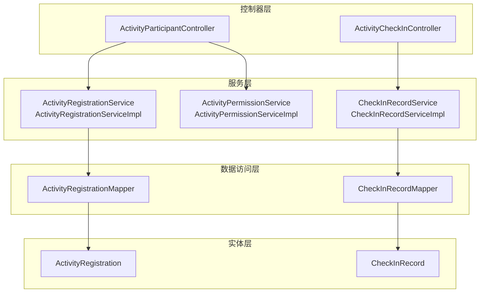
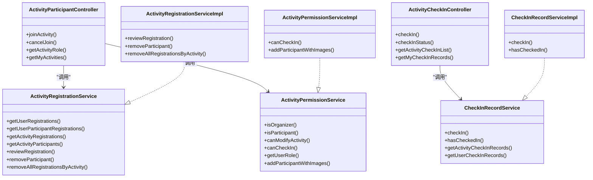
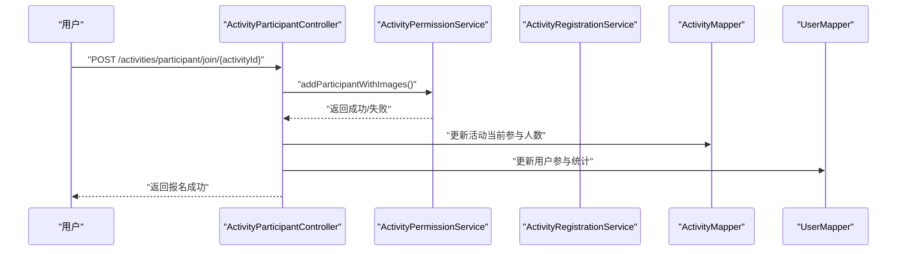
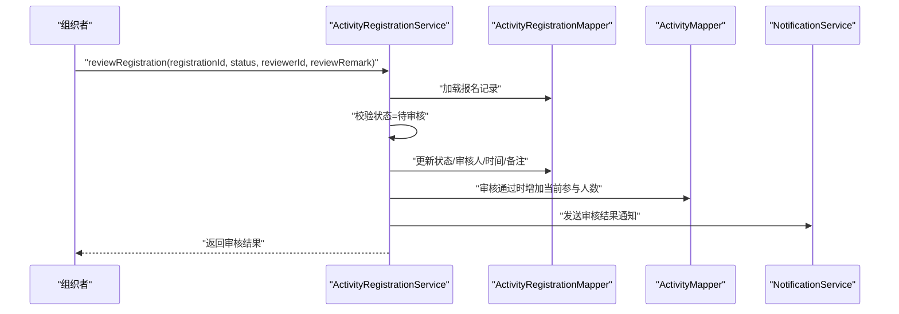
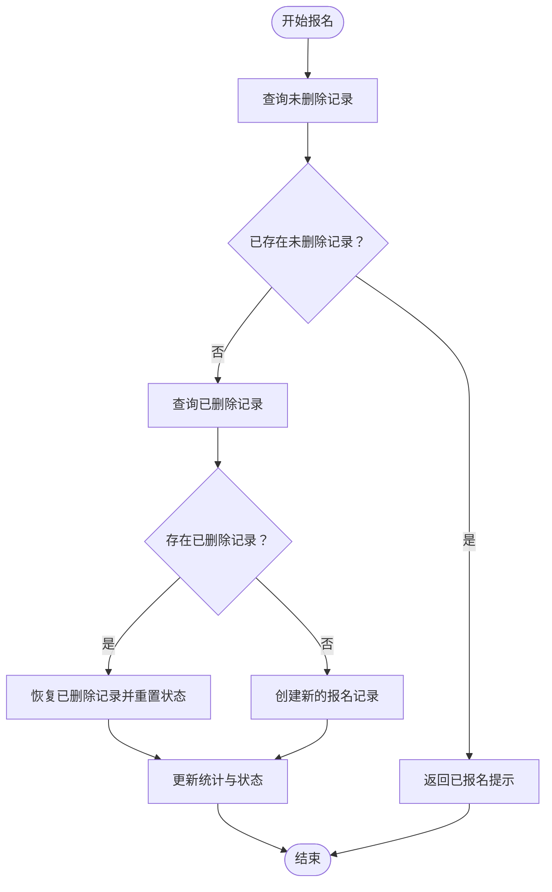
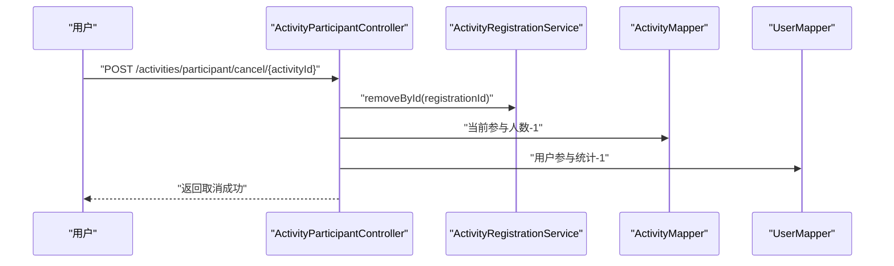
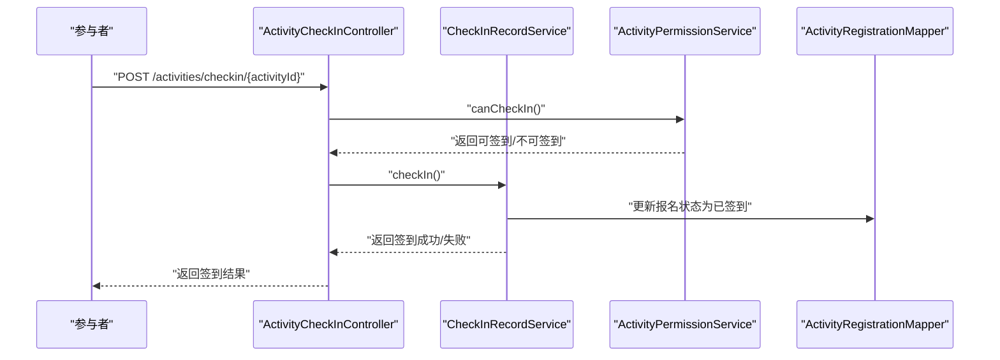
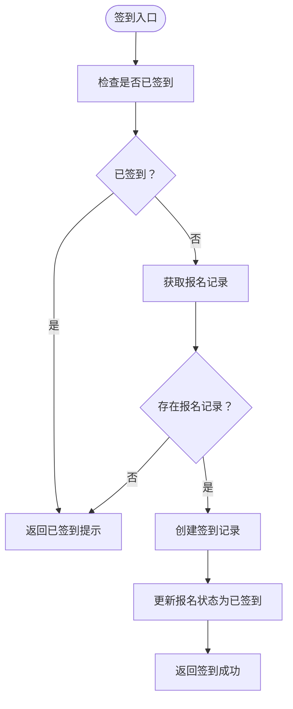
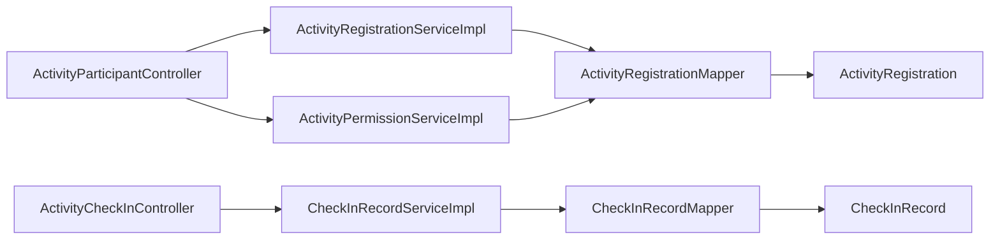

# 报名管理模块

<cite>
**本文档引用的文件**
- [ActivityRegistration.java](file://src/main/java/com/campus/eventsys/entity/ActivityRegistration.java)
- [ActivityRegistrationService.java](file://src/main/java/com/campus/eventsys/service/ActivityRegistrationService.java)
- [ActivityRegistrationServiceImpl.java](file://src/main/java/com/campus/eventsys/service/impl/ActivityRegistrationServiceImpl.java)
- [ActivityParticipantController.java](file://src/main/java/com/campus/eventsys/controller/ActivityParticipantController.java)
- [ActivityRegistrationMapper.java](file://src/main/java/com/campus/eventsys/mapper/ActivityRegistrationMapper.java)
- [ActivityRole.java](file://src/main/java/com/campus/eventsys/enums/ActivityRole.java)
- [ActivityPermissionService.java](file://src/main/java/com/campus/eventsys/service/ActivityPermissionService.java)
- [ActivityPermissionServiceImpl.java](file://src/main/java/com/campus/eventsys/service/impl/ActivityPermissionServiceImpl.java)
- [schema.sql](file://src/main/resources/db/schema.sql)
- [ActivityCheckInController.java](file://src/main/java/com/campus/eventsys/controller/ActivityCheckInController.java)
- [CheckInRecord.java](file://src/main/java/com/campus/eventsys/entity/CheckInRecord.java)
- [CheckInRecordService.java](file://src/main/java/com/campus/eventsys/service/CheckInRecordService.java)
- [CheckInRecordServiceImpl.java](file://src/main/java/com/campus/eventsys/service/impl/CheckInRecordServiceImpl.java)
- [CheckInRecordMapper.java](file://src/main/java/com/campus/eventsys/mapper/CheckInRecordMapper.java)
</cite>

## 目录
1. [简介](#简介)
2. [项目结构](#项目结构)
3. [核心组件](#核心组件)
4. [架构概览](#架构概览)
5. [详细组件分析](#详细组件分析)
6. [依赖关系分析](#依赖关系分析)
7. [性能考虑](#性能考虑)
8. [故障排查指南](#故障排查指南)
9. [结论](#结论)
10. [附录](#附录)

## 简介
本文件为报名管理模块的详细技术文档，覆盖在线报名流程、审核机制、状态管理、报名人数控制、重复报名检测、报名取消流程、签到管理、签到统计与验证机制，以及报名数据统计与报表生成的技术实现。文档同时提供API接口说明与最佳实践建议，帮助开发者理解与优化报名管理功能。

## 项目结构
报名管理模块围绕活动报名与签到两大核心业务展开，采用分层架构：
- 控制器层：对外提供REST API，负责请求接入与响应封装
- 服务层：实现业务逻辑，包括报名、审核、签到、权限校验等
- 数据访问层：MyBatis-Plus映射数据库表，提供基础CRUD与自定义查询
- 实体层：描述数据库表结构及字段含义
- 枚举与工具：角色枚举、时区配置等支撑业务

**图表来源**
- [ActivityParticipantController.java:42-371](file://src/main/java/com/campus/eventsys/controller/ActivityParticipantController.java#L42-L371)
- [ActivityCheckInController.java:33-172](file://src/main/java/com/campus/eventsys/controller/ActivityCheckInController.java#L33-L172)
- [ActivityRegistrationService.java:11-74](file://src/main/java/com/campus/eventsys/service/ActivityRegistrationService.java#L11-L74)
- [ActivityRegistrationServiceImpl.java:26-201](file://src/main/java/com/campus/eventsys/service/impl/ActivityRegistrationServiceImpl.java#L26-L201)
- [ActivityPermissionService.java:13-124](file://src/main/java/com/campus/eventsys/service/ActivityPermissionService.java#L13-L124)
- [ActivityPermissionServiceImpl.java:26-266](file://src/main/java/com/campus/eventsys/service/impl/ActivityPermissionServiceImpl.java#L26-L266)
- [CheckInRecordService.java:11-47](file://src/main/java/com/campus/eventsys/service/CheckInRecordService.java#L11-L47)
- [CheckInRecordServiceImpl.java:24-102](file://src/main/java/com/campus/eventsys/service/impl/CheckInRecordServiceImpl.java#L24-L102)
- [ActivityRegistrationMapper.java:11-35](file://src/main/java/com/campus/eventsys/mapper/ActivityRegistrationMapper.java#L11-L35)
- [CheckInRecordMapper.java:11-25](file://src/main/java/com/campus/eventsys/mapper/CheckInRecordMapper.java#L11-L25)
- [ActivityRegistration.java:13-62](file://src/main/java/com/campus/eventsys/entity/ActivityRegistration.java#L13-L62)
- [CheckInRecord.java:12-59](file://src/main/java/com/campus/eventsys/entity/CheckInRecord.java#L12-L59)

**章节来源**
- [ActivityParticipantController.java:42-371](file://src/main/java/com/campus/eventsys/controller/ActivityParticipantController.java#L42-L371)
- [ActivityCheckInController.java:33-172](file://src/main/java/com/campus/eventsys/controller/ActivityCheckInController.java#L33-L172)
- [ActivityRegistrationService.java:11-74](file://src/main/java/com/campus/eventsys/service/ActivityRegistrationService.java#L11-L74)
- [ActivityRegistrationServiceImpl.java:26-201](file://src/main/java/com/campus/eventsys/service/impl/ActivityRegistrationServiceImpl.java#L26-L201)
- [ActivityPermissionService.java:13-124](file://src/main/java/com/campus/eventsys/service/ActivityPermissionService.java#L13-L124)
- [ActivityPermissionServiceImpl.java:26-266](file://src/main/java/com/campus/eventsys/service/impl/ActivityPermissionServiceImpl.java#L26-L266)
- [CheckInRecordService.java:11-47](file://src/main/java/com/campus/eventsys/service/CheckInRecordService.java#L11-L47)
- [CheckInRecordServiceImpl.java:24-102](file://src/main/java/com/campus/eventsys/service/impl/CheckInRecordServiceImpl.java#L24-L102)
- [ActivityRegistrationMapper.java:11-35](file://src/main/java/com/campus/eventsys/mapper/ActivityRegistrationMapper.java#L11-L35)
- [CheckInRecordMapper.java:11-25](file://src/main/java/com/campus/eventsys/mapper/CheckInRecordMapper.java#L11-L25)
- [ActivityRegistration.java:13-62](file://src/main/java/com/campus/eventsys/entity/ActivityRegistration.java#L13-L62)
- [CheckInRecord.java:12-59](file://src/main/java/com/campus/eventsys/entity/CheckInRecord.java#L12-L59)

## 核心组件
- 活动报名实体：记录报名者角色、状态、审核信息与附件
- 报名服务接口与实现：提供报名、审核、移除参与者、批量清理等功能
- 权限服务接口与实现：校验组织者/参与者身份、签到权限、修改权限
- 签到服务接口与实现：执行签到、查询签到状态与记录
- 控制器：面向前端的API入口，封装业务调用与响应

**章节来源**
- [ActivityRegistration.java:13-62](file://src/main/java/com/campus/eventsys/entity/ActivityRegistration.java#L13-L62)
- [ActivityRegistrationService.java:11-74](file://src/main/java/com/campus/eventsys/service/ActivityRegistrationService.java#L11-L74)
- [ActivityRegistrationServiceImpl.java:26-201](file://src/main/java/com/campus/eventsys/service/impl/ActivityRegistrationServiceImpl.java#L26-L201)
- [ActivityPermissionService.java:13-124](file://src/main/java/com/campus/eventsys/service/ActivityPermissionService.java#L13-L124)
- [ActivityPermissionServiceImpl.java:26-266](file://src/main/java/com/campus/eventsys/service/impl/ActivityPermissionServiceImpl.java#L26-L266)
- [CheckInRecordService.java:11-47](file://src/main/java/com/campus/eventsys/service/CheckInRecordService.java#L11-L47)
- [CheckInRecordServiceImpl.java:24-102](file://src/main/java/com/campus/eventsys/service/impl/CheckInRecordServiceImpl.java#L24-L102)

## 架构概览
报名管理模块遵循典型的分层架构，控制器负责HTTP请求处理，服务层承载业务规则，数据访问层负责持久化，实体层映射数据库表。模块间通过接口解耦，事务边界清晰，异常统一处理。

**图表来源**
- [ActivityParticipantController.java:42-371](file://src/main/java/com/campus/eventsys/controller/ActivityParticipantController.java#L42-L371)
- [ActivityCheckInController.java:33-172](file://src/main/java/com/campus/eventsys/controller/ActivityCheckInController.java#L33-L172)
- [ActivityRegistrationService.java:11-74](file://src/main/java/com/campus/eventsys/service/ActivityRegistrationService.java#L11-L74)
- [ActivityRegistrationServiceImpl.java:26-201](file://src/main/java/com/campus/eventsys/service/impl/ActivityRegistrationServiceImpl.java#L26-L201)
- [ActivityPermissionService.java:13-124](file://src/main/java/com/campus/eventsys/service/ActivityPermissionService.java#L13-L124)
- [ActivityPermissionServiceImpl.java:26-266](file://src/main/java/com/campus/eventsys/service/impl/ActivityPermissionServiceImpl.java#L26-L266)
- [CheckInRecordService.java:11-47](file://src/main/java/com/campus/eventsys/service/CheckInRecordService.java#L11-L47)
- [CheckInRecordServiceImpl.java:24-102](file://src/main/java/com/campus/eventsys/service/impl/CheckInRecordServiceImpl.java#L24-L102)

## 详细组件分析

### 在线报名流程
- 报名提交：参与者通过控制器提交报名，支持上传图片；服务层检查重复报名并处理恢复逻辑；创建报名记录并更新活动当前参与人数与用户参与统计
- 审核机制：组织者可对报名进行审核，更新报名状态与审核信息，并根据结果通知用户
- 状态管理：报名状态包括待审核、已通过、已拒绝、已签到、已取消；状态变更影响后续权限与统计
- 重复报名检测：通过查询未删除记录与已删除记录的恢复逻辑，避免重复报名
- 报名取消：逻辑删除报名记录，同步更新活动当前参与人数与用户参与统计

**图表来源**
- [ActivityParticipantController.java:80-161](file://src/main/java/com/campus/eventsys/controller/ActivityParticipantController.java#L80-L161)
- [ActivityPermissionServiceImpl.java:125-171](file://src/main/java/com/campus/eventsys/service/impl/ActivityPermissionServiceImpl.java#L125-L171)
- [ActivityRegistrationServiceImpl.java:32-40](file://src/main/java/com/campus/eventsys/service/impl/ActivityRegistrationServiceImpl.java#L32-L40)

**章节来源**
- [ActivityParticipantController.java:80-161](file://src/main/java/com/campus/eventsys/controller/ActivityParticipantController.java#L80-L161)
- [ActivityPermissionServiceImpl.java:125-171](file://src/main/java/com/campus/eventsys/service/impl/ActivityPermissionServiceImpl.java#L125-L171)
- [ActivityRegistrationServiceImpl.java:32-40](file://src/main/java/com/campus/eventsys/service/impl/ActivityRegistrationServiceImpl.java#L32-L40)

### 审核机制与状态管理
- 审核入口：组织者通过报名服务对报名进行审核，仅允许对“待审核”状态进行处理
- 状态更新：审核通过时增加活动当前参与人数；审核拒绝时记录拒绝原因
- 通知机制：审核完成后向用户发送通知，告知审核结果

**图表来源**
- [ActivityRegistrationServiceImpl.java:76-130](file://src/main/java/com/campus/eventsys/service/impl/ActivityRegistrationServiceImpl.java#L76-L130)

**章节来源**
- [ActivityRegistrationServiceImpl.java:76-130](file://src/main/java/com/campus/eventsys/service/impl/ActivityRegistrationServiceImpl.java#L76-L130)

### 报名人数控制与重复报名检测
- 人数控制：活动表包含最大参与人数与当前参与人数字段，服务层在审核通过或报名时更新当前人数
- 重复检测：先查询未删除记录，若存在则不允许重复报名；若存在已删除记录，则通过恢复逻辑重建报名并重置状态

**图表来源**
- [ActivityPermissionServiceImpl.java:125-171](file://src/main/java/com/campus/eventsys/service/impl/ActivityPermissionServiceImpl.java#L125-L171)
- [ActivityRegistrationMapper.java:13-33](file://src/main/java/com/campus/eventsys/mapper/ActivityRegistrationMapper.java#L13-L33)

**章节来源**
- [ActivityPermissionServiceImpl.java:125-171](file://src/main/java/com/campus/eventsys/service/impl/ActivityPermissionServiceImpl.java#L125-L171)
- [ActivityRegistrationMapper.java:13-33](file://src/main/java/com/campus/eventsys/mapper/ActivityRegistrationMapper.java#L13-L33)

### 报名取消流程
- 取消入口：参与者通过控制器取消报名，执行逻辑删除并回滚统计
- 统计回滚：活动当前参与人数与用户参与统计分别减一

**图表来源**
- [ActivityParticipantController.java:174-210](file://src/main/java/com/campus/eventsys/controller/ActivityParticipantController.java#L174-L210)
- [ActivityRegistrationServiceImpl.java:132-167](file://src/main/java/com/campus/eventsys/service/impl/ActivityRegistrationServiceImpl.java#L132-L167)

**章节来源**
- [ActivityParticipantController.java:174-210](file://src/main/java/com/campus/eventsys/controller/ActivityParticipantController.java#L174-L210)
- [ActivityRegistrationServiceImpl.java:132-167](file://src/main/java/com/campus/eventsys/service/impl/ActivityRegistrationServiceImpl.java#L132-L167)

### 签到管理
- 签到前提：参与者已通过报名，活动处于进行中且已开始
- 签到执行：创建签到记录并更新报名状态为“已签到”
- 状态查询：支持查询用户某活动的签到状态与个人历史签到记录
- 列表查询：组织者可查看活动签到列表，包含用户信息

**图表来源**
- [ActivityCheckInController.java:54-84](file://src/main/java/com/campus/eventsys/controller/ActivityCheckInController.java#L54-L84)
- [CheckInRecordServiceImpl.java:30-74](file://src/main/java/com/campus/eventsys/service/impl/CheckInRecordServiceImpl.java#L30-L74)
- [ActivityPermissionServiceImpl.java:64-82](file://src/main/java/com/campus/eventsys/service/impl/ActivityPermissionServiceImpl.java#L64-L82)

**章节来源**
- [ActivityCheckInController.java:54-84](file://src/main/java/com/campus/eventsys/controller/ActivityCheckInController.java#L54-L84)
- [CheckInRecordServiceImpl.java:30-74](file://src/main/java/com/campus/eventsys/service/impl/CheckInRecordServiceImpl.java#L30-L74)
- [ActivityPermissionServiceImpl.java:64-82](file://src/main/java/com/campus/eventsys/service/impl/ActivityPermissionServiceImpl.java#L64-L82)

### 签到验证机制
- 重复签到防护：签到前检查是否已存在签到记录
- 报名关联：签到时关联报名记录，确保用户确为活动参与者
- 状态一致性：签到成功后报名状态更新为“已签到”，便于统计与展示

**图表来源**
- [CheckInRecordServiceImpl.java:30-74](file://src/main/java/com/campus/eventsys/service/impl/CheckInRecordServiceImpl.java#L30-L74)

**章节来源**
- [CheckInRecordServiceImpl.java:30-74](file://src/main/java/com/campus/eventsys/service/impl/CheckInRecordServiceImpl.java#L30-L74)

### 报名数据统计与报表
- 参与者统计：服务层提供获取活动参与者列表的方法，便于统计实际参与人数
- 用户参与历史：提供获取个人签到记录列表，支持导出与报表生成
- 活动维度统计：结合活动表的当前参与人数与最大参与人数，计算占用率

**章节来源**
- [ActivityRegistrationService.java:38-44](file://src/main/java/com/campus/eventsys/service/ActivityRegistrationService.java#L38-L44)
- [CheckInRecordService.java:39-45](file://src/main/java/com/campus/eventsys/service/CheckInRecordService.java#L39-L45)

## 依赖关系分析
- 控制器依赖服务接口，服务实现依赖Mapper与实体
- 权限服务贯穿报名与签到流程，确保业务规则正确执行
- 数据库层面通过索引优化查询性能，特别是活动报名与签到记录的关键字段

**图表来源**
- [ActivityParticipantController.java:42-371](file://src/main/java/com/campus/eventsys/controller/ActivityParticipantController.java#L42-L371)
- [ActivityCheckInController.java:33-172](file://src/main/java/com/campus/eventsys/controller/ActivityCheckInController.java#L33-L172)
- [ActivityRegistrationServiceImpl.java:26-201](file://src/main/java/com/campus/eventsys/service/impl/ActivityRegistrationServiceImpl.java#L26-L201)
- [ActivityPermissionServiceImpl.java:26-266](file://src/main/java/com/campus/eventsys/service/impl/ActivityPermissionServiceImpl.java#L26-L266)
- [CheckInRecordServiceImpl.java:24-102](file://src/main/java/com/campus/eventsys/service/impl/CheckInRecordServiceImpl.java#L24-L102)
- [ActivityRegistrationMapper.java:11-35](file://src/main/java/com/campus/eventsys/mapper/ActivityRegistrationMapper.java#L11-L35)
- [CheckInRecordMapper.java:11-25](file://src/main/java/com/campus/eventsys/mapper/CheckInRecordMapper.java#L11-L25)
- [ActivityRegistration.java:13-62](file://src/main/java/com/campus/eventsys/entity/ActivityRegistration.java#L13-L62)
- [CheckInRecord.java:12-59](file://src/main/java/com/campus/eventsys/entity/CheckInRecord.java#L12-L59)

**章节来源**
- [schema.sql:80-100](file://src/main/resources/db/schema.sql#L80-L100)
- [schema.sql:157-173](file://src/main/resources/db/schema.sql#L157-L173)

## 性能考虑
- 索引优化：活动报名与签到记录表对关键字段建立索引，提升查询效率
- 事务边界：审核与签到均在事务内执行，保证状态一致性
- 逻辑删除：报名与签到记录采用逻辑删除，避免物理删除带来的统计与审计问题
- 批量清理：提供批量逻辑删除接口，便于活动下架或删除后的数据清理

**章节来源**
- [schema.sql:260-281](file://src/main/resources/db/schema.sql#L260-L281)
- [ActivityRegistrationServiceImpl.java:169-199](file://src/main/java/com/campus/eventsys/service/impl/ActivityRegistrationServiceImpl.java#L169-L199)

## 故障排查指南
- 报名失败：检查重复报名、图片限制、用户与活动有效性
- 审核失败：确认报名记录状态为“待审核”，审核人权限
- 签到失败：确认用户为活动参与者、活动处于进行中且已开始
- 统计异常：核对活动当前参与人数与用户参与统计的增减逻辑

**章节来源**
- [ActivityParticipantController.java:100-161](file://src/main/java/com/campus/eventsys/controller/ActivityParticipantController.java#L100-L161)
- [ActivityRegistrationServiceImpl.java:76-130](file://src/main/java/com/campus/eventsys/service/impl/ActivityRegistrationServiceImpl.java#L76-L130)
- [CheckInRecordServiceImpl.java:30-74](file://src/main/java/com/campus/eventsys/service/impl/CheckInRecordServiceImpl.java#L30-L74)

## 结论
报名管理模块通过清晰的分层设计与严格的业务规则，实现了从报名、审核、统计到签到的完整闭环。模块具备良好的扩展性与可维护性，建议在后续迭代中进一步完善报表导出与更细粒度的权限控制。

## 附录

### API接口文档

- 报名接口
  - 方法：POST
  - 路径：/activities/participant/join/{activityId}
  - 请求体：multipart/form-data
    - activityId：活动ID（路径参数，必填）
    - remark：报名备注/留言（可选）
    - images：图片文件列表（可选，最多3张）
  - 返回：Result<Void>，message为“报名成功，等待审核”，data为null

- 取消报名接口
  - 方法：POST
  - 路径：/activities/participant/cancel/{activityId}
  - 返回：Result<Void>，message为“取消报名成功”

- 获取活动角色接口
  - 方法：GET
  - 路径：/activities/participant/role/{activityId}
  - 返回：Result<ActivityRoleInfo>，包含角色代码、状态、备注、图片、权限标识等

- 我的活动接口
  - 方法：GET
  - 路径：/activities/participant/my-activities
  - 返回：Result<List<Activity>>，按报名时间倒序排列

- 活动签到接口
  - 方法：POST
  - 路径：/activities/checkin/{activityId}
  - 返回：Result<Void>，message为“签到成功”

- 检查签到状态接口
  - 方法：GET
  - 路径：/activities/checkin/status/{activityId}
  - 返回：Result<Boolean>，表示是否已签到

- 活动签到列表接口
  - 方法：GET
  - 路径：/activities/checkin/list/{activityId}
  - 返回：Result<List<CheckInRecord>>，仅组织者可访问

- 我的签到记录接口
  - 方法：GET
  - 路径：/activities/checkin/my-records
  - 返回：Result<List<CheckInRecord>>，按签到时间倒序排列

**章节来源**
- [ActivityParticipantController.java:80-343](file://src/main/java/com/campus/eventsys/controller/ActivityParticipantController.java#L80-L343)
- [ActivityCheckInController.java:54-170](file://src/main/java/com/campus/eventsys/controller/ActivityCheckInController.java#L54-L170)