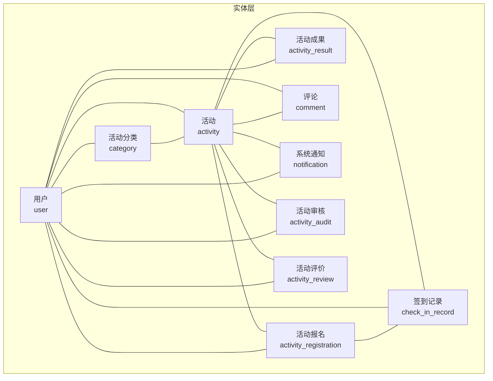
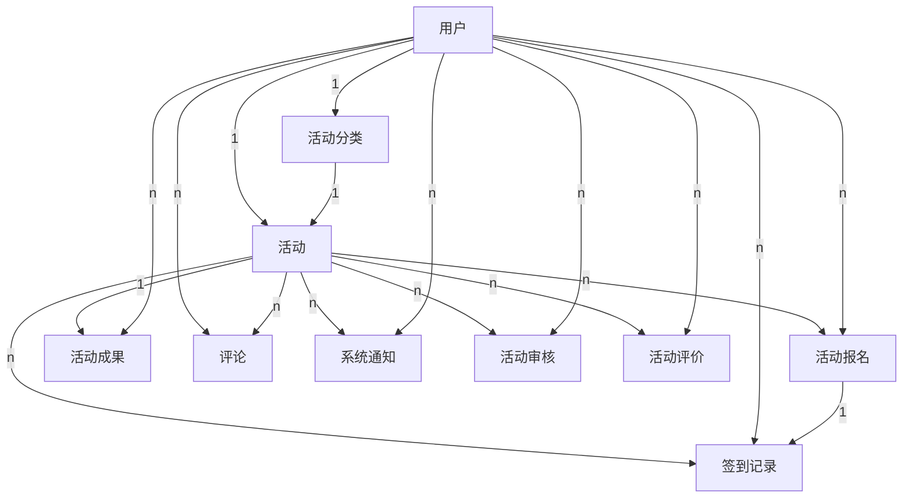
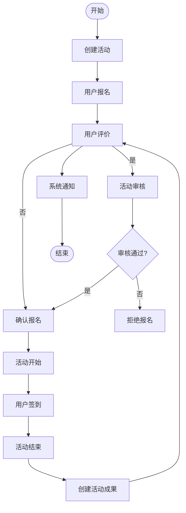

# ER关系图

<cite>
**本文引用的文件**
- [User.java](file://src/main/java/com/campus/eventsys/entity/User.java)
- [Activity.java](file://src/main/java/com/campus/eventsys/entity/Activity.java)
- [Category.java](file://src/main/java/com/campus/eventsys/entity/Category.java)
- [ActivityRegistration.java](file://src/main/java/com/campus/eventsys/entity/ActivityRegistration.java)
- [CheckInRecord.java](file://src/main/java/com/campus/eventsys/entity/CheckInRecord.java)
- [ActivityResult.java](file://src/main/java/com/campus/eventsys/entity/ActivityResult.java)
- [Comment.java](file://src/main/java/com/campus/eventsys/entity/Comment.java)
- [Notification.java](file://src/main/java/com/campus/eventsys/entity/Notification.java)
- [ActivityReview.java](file://src/main/java/com/campus/eventsys/entity/ActivityReview.java)
- [ActivityAudit.java](file://src/main/java/com/campus/eventsys/entity/ActivityAudit.java)
- [schema.sql](file://src/main/resources/db/schema.sql)
- [表设计.md](file://picture/表设计.md)
- [ER图1_用户.plantuml](file://picture/ER图1_用户.plantuml)
- [ER图3_活动.plantuml](file://picture/ER图3_活动.plantuml)
- [ER图_汇总版.drawio](file://picture/ER图_汇总版.drawio)
</cite>

## 目录
1. [引言](#引言)
2. [项目结构](#项目结构)
3. [核心组件](#核心组件)
4. [架构总览](#架构总览)
5. [详细组件分析](#详细组件分析)
6. [依赖分析](#依赖分析)
7. [性能考虑](#性能考虑)
8. [故障排查指南](#故障排查指南)
9. [结论](#结论)
10. [附录](#附录)

## 引言
本文件面向数据库设计者与系统分析师，系统性梳理“校园活动管理系统”的实体-关系（ER）模型，明确各实体间的关联关系（一对一、一对多、多对多），解释外键约束与参照完整性的设计原则，并提供ER图的解读指南与建模最佳实践。文档以仓库中的实体类定义、数据库初始化脚本及可视化ER图为基础，辅以索引与唯一约束说明，帮助读者快速理解业务数据模型。

## 项目结构
系统采用分层架构，后端基于Java/Spring Boot，数据库为SQLite，实体对象通过MyBatis-Plus映射至数据库表。ER模型围绕“用户”“活动”两大核心实体展开，辐射“活动分类”“活动报名”“签到记录”“活动成果”“评论”“系统通知”“活动审核”“活动评价”等支撑实体。

图表来源
- [schema.sql:1-295](file://src/main/resources/db/schema.sql#L1-L295)
- [User.java:1-85](file://src/main/java/com/campus/eventsys/entity/User.java#L1-L85)
- [Activity.java:1-95](file://src/main/java/com/campus/eventsys/entity/Activity.java#L1-L95)
- [Category.java:1-52](file://src/main/java/com/campus/eventsys/entity/Category.java#L1-L52)
- [ActivityRegistration.java:1-62](file://src/main/java/com/campus/eventsys/entity/ActivityRegistration.java#L1-L62)
- [CheckInRecord.java:1-59](file://src/main/java/com/campus/eventsys/entity/CheckInRecord.java#L1-L59)
- [ActivityResult.java:1-69](file://src/main/java/com/campus/eventsys/entity/ActivityResult.java#L1-L69)
- [Comment.java:1-67](file://src/main/java/com/campus/eventsys/entity/Comment.java#L1-L67)
- [Notification.java:1-81](file://src/main/java/com/campus/eventsys/entity/Notification.java#L1-L81)
- [ActivityReview.java:1-56](file://src/main/java/com/campus/eventsys/entity/ActivityReview.java#L1-L56)
- [ActivityAudit.java:1-63](file://src/main/java/com/campus/eventsys/entity/ActivityAudit.java#L1-L63)

章节来源
- [schema.sql:1-295](file://src/main/resources/db/schema.sql#L1-L295)

## 核心组件
- 用户（user）：系统基础主体，承载身份、角色、状态与统计计数等信息。
- 活动（activity）：核心业务对象，包含时间、地点、报名窗口、状态、分类、统计指标等。
- 活动分类（category）：对活动进行语义分组，支持排序与状态控制。
- 活动报名（activity_registration）：记录用户参与活动的角色与审核状态。
- 签到记录（check_in_record）：记录活动参与者的签到行为与来源报名记录。
- 活动成果（activity_result）：活动结束后生成的回顾内容，支持图文与状态管理。
- 评论（comment）：对活动或成果进行评论，支持树形父子关系。
- 系统通知（notification）：面向用户的各类消息与公告。
- 活动审核（activity_audit）：活动发布/修改/取消的审批流程记录。
- 活动评价（activity_review）：活动结束后的评分与评价，确保每用户对同活动仅一次评价。

章节来源
- [User.java:1-85](file://src/main/java/com/campus/eventsys/entity/User.java#L1-L85)
- [Activity.java:1-95](file://src/main/java/com/campus/eventsys/entity/Activity.java#L1-L95)
- [Category.java:1-52](file://src/main/java/com/campus/eventsys/entity/Category.java#L1-L52)
- [ActivityRegistration.java:1-62](file://src/main/java/com/campus/eventsys/entity/ActivityRegistration.java#L1-L62)
- [CheckInRecord.java:1-59](file://src/main/java/com/campus/eventsys/entity/CheckInRecord.java#L1-L59)
- [ActivityResult.java:1-69](file://src/main/java/com/campus/eventsys/entity/ActivityResult.java#L1-L69)
- [Comment.java:1-67](file://src/main/java/com/campus/eventsys/entity/Comment.java#L1-L67)
- [Notification.java:1-81](file://src/main/java/com/campus/eventsys/entity/Notification.java#L1-L81)
- [ActivityReview.java:1-56](file://src/main/java/com/campus/eventsys/entity/ActivityReview.java#L1-L56)
- [ActivityAudit.java:1-63](file://src/main/java/com/campus/eventsys/entity/ActivityAudit.java#L1-L63)

## 架构总览
下图展示实体间的主要关系与基数约束，标注“1”表示“一方”，“n”表示“多方”。该视图来源于可视化ER图，便于快速把握系统数据模型骨架。

图表来源
- [ER图_汇总版.drawio:1-393](file://picture/ER图_汇总版.drawio#L1-L393)

## 详细组件分析

### 实体与属性概览
- 用户（user）
  - 主键：id
  - 唯一：username
  - 关键字段：角色、状态、统计计数
- 活动分类（category）
  - 主键：id
  - 关键字段：排序、状态、活动数量
- 活动（activity）
  - 主键：id
  - 外键：organizer_id → user.id，category_id → category.id
  - 关键字段：时间窗口、报名限制、状态、评分统计
- 活动报名（activity_registration）
  - 主键：id
  - 外键：activity_id → activity.id，user_id → user.id，reviewer_id → user.id
  - 唯一：(activity_id, user_id)
  - 关键字段：角色、状态、审核信息
- 签到记录（check_in_record）
  - 主键：id
  - 外键：activity_id → activity.id，user_id → user.id，registration_id → activity_registration.id
  - 关键字段：签到时间、类型、地点
- 活动成果（activity_result）
  - 主键：id
  - 外键：activity_id → activity.id（唯一），creator_id → user.id
  - 关键字段：标题、内容、状态、浏览/评论计数
- 评论（comment）
  - 主键：id
  - 外键：user_id → user.id
  - 关键字段：目标类型（活动/成果）、父子关系
- 系统通知（notification）
  - 主键：id
  - 外键：activity_id → activity.id
  - 关键字段：类型、发布范围、状态、阅读标记
- 活动审核（activity_audit）
  - 主键：id
  - 外键：activity_id → activity.id，submitter_id → user.id，auditor_id → user.id
  - 关键字段：审核类型、状态、意见
- 活动评价（activity_review）
  - 主键：id
  - 外键：activity_id → activity.id，user_id → user.id
  - 唯一：(activity_id, user_id)
  - 关键字段：评分、内容、回复

章节来源
- [schema.sql:1-295](file://src/main/resources/db/schema.sql#L1-L295)
- [表设计.md:1-206](file://picture/表设计.md#L1-L206)

### 关系建模与参照完整性
- 一对一
  - 活动 ←→ 活动成果：每活动对应一条成果记录（activity_result.activity_id唯一）
  - 用户 ←→ 活动成果：成果由组织者或管理者创建（activity_result.creator_id → user.id）
- 一对多
  - 用户 ←→ 活动：用户可发起多个活动（activity.organizer_id → user.id）
  - 活动分类 ←→ 活动：分类包含多个活动（activity.category_id → category.id）
  - 活动 ←→ 活动报名：活动有多条报名记录（activity_registration.activity_id → activity.id）
  - 用户 ←→ 活动报名：用户有多条报名记录（activity_registration.user_id → user.id）
  - 活动 ←→ 签到记录：活动有多条签到记录（check_in_record.activity_id → activity.id）
  - 用户 ←→ 签到记录：用户有多条签到记录（check_in_record.user_id → user.id）
  - 活动报名 ←→ 签到记录：报名记录唯一对应一条签到记录（check_in_record.registration_id → activity_registration.id）
  - 用户 ←→ 评论：用户可发表多条评论（comment.user_id → user.id）
  - 活动/成果 ←→ 评论：活动与成果均可被评论（comment.target_type区分）
  - 活动 ←→ 系统通知：活动可产生多条通知（notification.activity_id → activity.id）
  - 用户 ←→ 系统通知：用户可接收多条通知（notification.user_id）
  - 活动 ←→ 活动审核：活动可有多次审核记录（activity_audit.activity_id → activity.id）
  - 用户 ←→ 活动审核：提交/审核人员可多条（activity_audit.submitter_id/auditor_id → user.id）
  - 活动 ←→ 活动评价：活动有多条评价（activity_review.activity_id → activity.id）
  - 用户 ←→ 活动评价：用户对活动的评价唯一（activity_review.user_id → user.id）
- 多对多
  - 无直接多对多表：通过“活动收藏”“活动报名”等中间态体现多对多关系的业务意图，但数据库层面通过唯一约束与外键实现“多对一+唯一性”替代。例如“活动收藏”通过(activity_id, user_id)唯一约束实现多对多的去重效果。

章节来源
- [schema.sql:1-295](file://src/main/resources/db/schema.sql#L1-L295)
- [表设计.md:1-206](file://picture/表设计.md#L1-L206)

### 外键约束与参照完整性保障
- 外键定义
  - activity.organizer_id → user.id
  - activity.category_id → category.id
  - activity_registration.activity_id → activity.id
  - activity_registration.user_id → user.id
  - activity_registration.reviewer_id → user.id
  - check_in_record.activity_id → activity.id
  - check_in_record.user_id → user.id
  - check_in_record.registration_id → activity_registration.id
  - activity_result.activity_id → activity.id
  - activity_result.creator_id → user.id
  - comment.user_id → user.id
  - notification.activity_id → activity.id
  - activity_audit.activity_id → activity.id
  - activity_audit.submitter_id → user.id
  - activity_audit.auditor_id → user.id
  - activity_review.activity_id → activity.id
  - activity_review.user_id → user.id
- 唯一约束
  - activity_registration(activity_id, user_id)
  - activity_result.activity_id（唯一）
  - activity_review(activity_id, user_id)
- 参照完整性
  - 所有外键均指向主键，删除/更新策略遵循业务需求（如软删除deleted字段），避免破坏关系完整性。
  - 唯一约束确保“多对多”场景下的去重与一致性。

章节来源
- [schema.sql:1-295](file://src/main/resources/db/schema.sql#L1-L295)

### ER图解读指南
- 实体形状
  - 矩形：强实体（如用户、活动、分类）
  - 菱形：关系（如“创建”“包含”“接收”“评价”等）
- 线段旁标注
  - “1”：一方
  - “n”：多方
- 业务含义示例
  - 用户“创建”活动成果：用户与成果之间存在“创建”关系，基数为1对1
  - 活动“包含”活动报名：活动与报名之间存在“包含”关系，基数为1对多
  - 用户“接收”系统通知：用户与通知之间存在“接收”关系，基数为1对多
  - 用户“评价”活动：用户与活动评价之间存在“评价”关系，基数为多对多（通过唯一约束实现）

章节来源
- [ER图_汇总版.drawio:1-393](file://picture/ER图_汇总版.drawio#L1-L393)

### 具体实体关系示例
- 用户与活动
  - 关系：组织者
  - 基数：1（用户）对n（活动）
  - 依据：activity.organizer_id → user.id
- 活动与活动报名
  - 关系：参与/审核
  - 基数：1（活动）对n（报名）
  - 唯一性：(activity_id, user_id)
- 活动与签到记录
  - 关系：签到
  - 基数：1（活动）对n（签到）
  - 关联：check_in_record.registration_id → activity_registration.id
- 活动与活动成果
  - 关系：创建
  - 基数：1（活动）对1（成果）
  - 唯一性：activity_result.activity_id唯一
- 用户与评论
  - 关系：发表
  - 基数：1（用户）对n（评论）
  - 目标区分：comment.target_type区分活动/成果
- 活动与系统通知
  - 关系：关联
  - 基数：1（活动）对n（通知）
- 活动与活动审核
  - 关系：执行/反馈
  - 基数：1（活动）对n（审核）
- 用户与活动评价
  - 关系：评价
  - 基数：1（用户）对n（评价）
  - 唯一性：(activity_id, user_id)

章节来源
- [schema.sql:1-295](file://src/main/resources/db/schema.sql#L1-L295)
- [表设计.md:1-206](file://picture/表设计.md#L1-L206)

### 建模最佳实践
- 主键与唯一性
  - 使用自增主键或显式输入主键（SQLite不支持getGeneratedKeys时），并在需要去重的场景添加唯一约束
- 外键与参照完整性
  - 明确外键方向，确保引用关系清晰；对软删除场景，保持外键链路完整
- 索引优化
  - 在高频过滤/连接字段上建立索引（如用户角色、活动状态、报名状态、评论目标组合索引等）
- 字段设计
  - 合理拆分强相关字段，避免冗余；对枚举类状态统一编码，便于维护与扩展
- 关系表达
  - 对多对多场景，优先通过唯一约束与外键表达“多对一+唯一性”，减少中间表复杂度

章节来源
- [schema.sql:240-295](file://src/main/resources/db/schema.sql#L240-L295)
- [表设计.md:1-206](file://picture/表设计.md#L1-L206)

## 依赖分析
- 实体依赖
  - activity依赖user（organizer）与category
  - activity_registration依赖activity、user（报名人/审核人）
  - check_in_record依赖activity、user、activity_registration
  - activity_result依赖activity、user
  - comment依赖user
  - notification依赖activity
  - activity_audit依赖activity、user（提交/审核）
  - activity_review依赖activity、user
- 控制流示意（概念图）

（本图为概念流程，不直接映射具体源码文件）

## 性能考虑
- 查询热点
  - 活动列表按状态/时间/分类筛选；用户侧按角色/状态检索
- 索引建议
  - 用户：username、role、status
  - 活动：organizer_id、category_id、status、start_time
  - 报名：activity_id、user_id、status
  - 成果：activity_id
  - 评论：target_id+target_type、user_id、parent_id
  - 收藏：activity_id、user_id
  - 签到：activity_id、user_id、registration_id
  - 通知：user_id、type、is_read
  - 审核：activity_id、status、submitter_id
  - 评价：activity_id、user_id
- 批量操作
  - 对高频写入场景（报名、签到、通知）建议批量插入与事务控制

章节来源
- [schema.sql:240-295](file://src/main/resources/db/schema.sql#L240-L295)

## 故障排查指南
- 常见问题
  - 外键约束失败：检查被引用主键是否存在且未软删除
  - 唯一冲突：报名/收藏/评价重复提交，需先校验唯一性
  - 时间字段异常：注意时区配置与默认值（CURRENT_TIMESTAMP）
- 排查步骤
  - 确认外键链路：从子表回溯到父表，定位缺失或非法值
  - 校验唯一约束：针对(activity_id, user_id)类组合进行去重判断
  - 检查索引覆盖：确认WHERE/JOIN列是否命中索引
- 相关实现参考
  - 外键与唯一约束定义：参见数据库初始化脚本
  - 实体字段与默认值：参见实体类注解与字段定义

章节来源
- [schema.sql:1-295](file://src/main/resources/db/schema.sql#L1-L295)
- [User.java:1-85](file://src/main/java/com/campus/eventsys/entity/User.java#L1-L85)
- [ActivityRegistration.java:1-62](file://src/main/java/com/campus/eventsys/entity/ActivityRegistration.java#L1-L62)
- [ActivityReview.java:1-56](file://src/main/java/com/campus/eventsys/entity/ActivityReview.java#L1-L56)

## 结论
本ER模型以“用户—活动”为核心，围绕报名、签到、成果、评论、通知、审核、评价等环节构建完整的业务闭环。通过明确的外键约束与唯一约束，系统在数据库层面保障了参照完整性与数据一致性；配合索引优化，能够满足常见查询与写入性能需求。建议在后续迭代中持续完善索引覆盖与状态机演进，确保模型与业务同步演进。

## 附录
- 可视化ER图
  - 用户实体图：[ER图1_用户.plantuml:1-22](file://picture/ER图1_用户.plantuml#L1-L22)
  - 活动实体图：[ER图3_活动.plantuml:1-34](file://picture/ER图3_活动.plantuml#L1-L34)
  - 汇总版ER图：[ER图_汇总版.drawio:1-393](file://picture/ER图_汇总版.drawio#L1-L393)
- 数据库初始化与表结构
  - 初始化脚本：[schema.sql:1-295](file://src/main/resources/db/schema.sql#L1-L295)
  - 表设计明细：[表设计.md:1-206](file://picture/表设计.md#L1-L206)