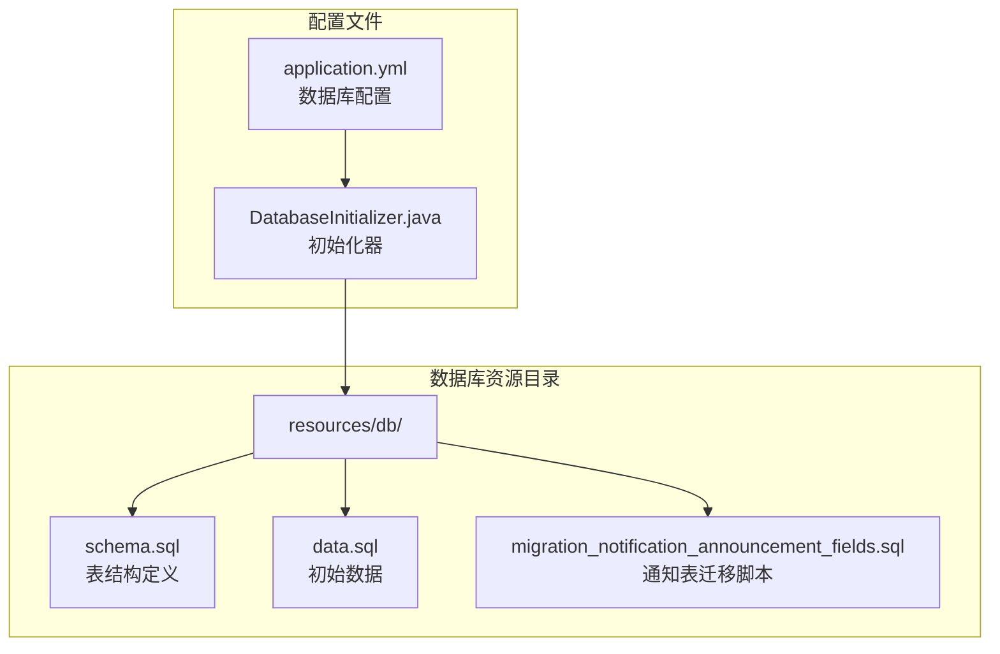
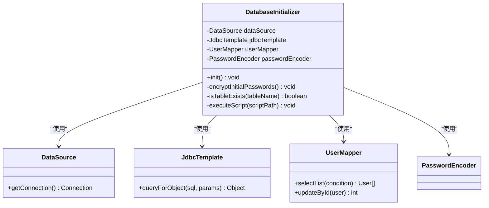
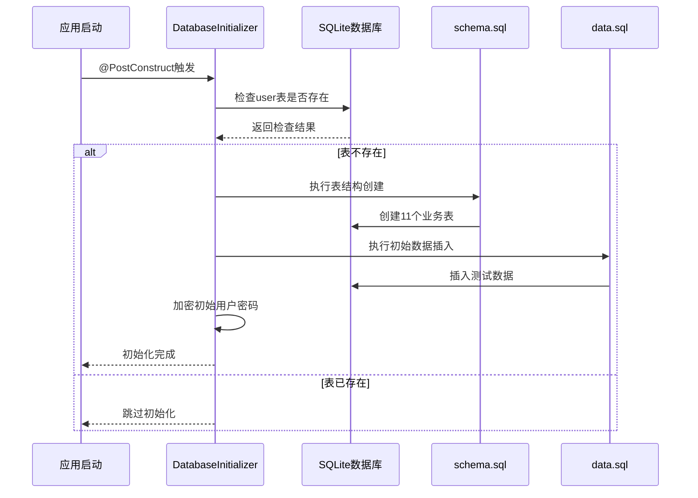
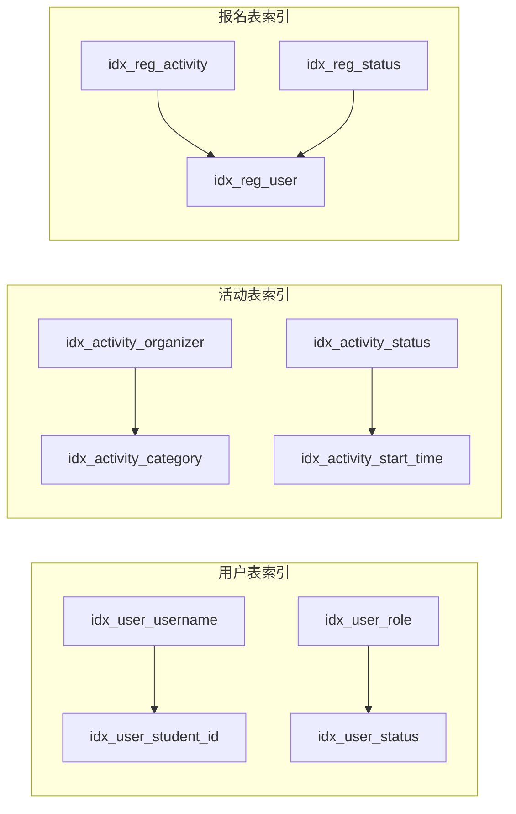
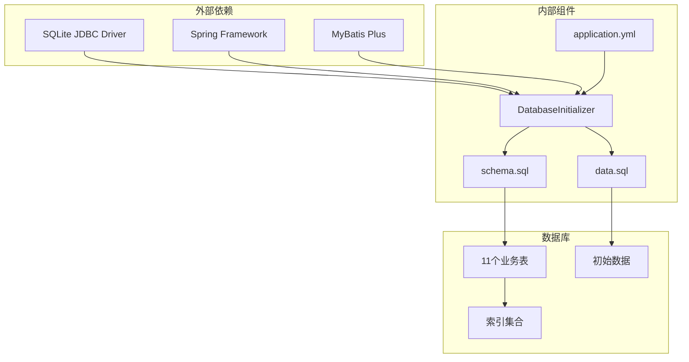

# 数据库初始化脚本

<cite>
**本文档引用的文件**
- [schema.sql](file://src/main/resources/db/schema.sql)
- [data.sql](file://src/main/resources/db/data.sql)
- [application.yml](file://src/main/resources/application.yml)
- [DatabaseInitializer.java](file://src/main/java/com/campus/eventsys/config/DatabaseInitializer.java)
- [migration_notification_announcement_fields.sql](file://src/main/resources/db/migration_notification_announcement_fields.sql)
</cite>

## 目录
1. [简介](#简介)
2. [项目结构](#项目结构)
3. [核心组件](#核心组件)
4. [架构概览](#架构概览)
5. [详细组件分析](#详细组件分析)
6. [依赖关系分析](#依赖关系分析)
7. [性能考虑](#性能考虑)
8. [故障排除指南](#故障排除指南)
9. [结论](#结论)
10. [附录](#附录)

## 简介

校园活动管理系统采用SQLite作为数据库引擎，通过精心设计的初始化脚本实现完整的数据库部署。本文档详细说明了数据库初始化的完整流程、脚本执行顺序以及最佳实践，为系统部署工程师提供完整的操作手册。

该系统支持11个核心业务表，涵盖用户管理、活动组织、报名管理、成果展示、评论互动等多个功能模块，为校园活动的全生命周期管理提供数据支撑。

## 项目结构

系统数据库相关文件主要位于以下目录结构中：



**图表来源**
- [schema.sql:1-295](file://src/main/resources/db/schema.sql#L1-L295)
- [data.sql:1-335](file://src/main/resources/db/data.sql#L1-L335)
- [application.yml:10-16](file://src/main/resources/application.yml#L10-L16)
- [DatabaseInitializer.java:34-53](file://src/main/java/com/campus/eventsys/config/DatabaseInitializer.java#L34-L53)

**章节来源**
- [schema.sql:1-295](file://src/main/resources/db/schema.sql#L1-L295)
- [data.sql:1-335](file://src/main/resources/db/data.sql#L1-L335)
- [application.yml:10-16](file://src/main/resources/application.yml#L10-L16)
- [DatabaseInitializer.java:24-53](file://src/main/java/com/campus/eventsys/config/DatabaseInitializer.java#L24-L53)

## 核心组件

### 数据库初始化器

DatabaseInitializer是系统的核心组件，负责在应用启动时自动执行数据库初始化流程：



**图表来源**
- [DatabaseInitializer.java:29-32](file://src/main/java/com/campus/eventsys/config/DatabaseInitializer.java#L29-L32)
- [DatabaseInitializer.java:34-53](file://src/main/java/com/campus/eventsys/config/DatabaseInitializer.java#L34-L53)

### 数据库配置

系统使用SQLite作为本地数据库，配置文件中定义了完整的连接参数：

- **驱动程序**: org.sqlite.JDBC
- **数据库URL**: jdbc:sqlite:${user.dir}/event_database.db
- **初始化模式**: never（禁用Spring Boot默认初始化，使用自定义初始化器）

**章节来源**
- [application.yml:10-19](file://src/main/resources/application.yml#L10-L19)
- [DatabaseInitializer.java:34-53](file://src/main/java/com/campus/eventsys/config/DatabaseInitializer.java#L34-L53)

## 架构概览

系统采用自动初始化架构，确保数据库在首次启动时自动创建所需表结构和初始数据：



**图表来源**
- [DatabaseInitializer.java:34-53](file://src/main/java/com/campus/eventsys/config/DatabaseInitializer.java#L34-L53)
- [schema.sql:6-28](file://src/main/resources/db/schema.sql#L6-L28)
- [data.sql:9-23](file://src/main/resources/db/data.sql#L9-L23)

## 详细组件分析

### 表结构设计

系统采用11个核心业务表，每个表都针对特定的业务功能进行设计：

#### 用户表 (user)
- **主键**: id (INTEGER PRIMARY KEY AUTOINCREMENT)
- **唯一约束**: username
- **扩展字段**: 学号、学院、专业、年级等校园信息
- **状态管理**: deleted逻辑删除字段

#### 活动分类表 (category)
- **状态控制**: status字段管理分类启用状态
- **排序机制**: sort_order字段支持自定义排序
- **统计字段**: activity_count记录分类下活动数量

#### 活动表 (activity)
- **状态枚举**: -2(已下架)到5(已结束)的状态机
- **时间字段**: 多个时间戳字段管理活动生命周期
- **审核机制**: need_review字段控制是否需要审核

**章节来源**
- [schema.sql:6-28](file://src/main/resources/db/schema.sql#L6-L28)
- [schema.sql:33-44](file://src/main/resources/db/schema.sql#L33-L44)
- [schema.sql:50-77](file://src/main/resources/db/schema.sql#L50-L77)

### 索引优化策略

系统为所有常用查询字段建立了复合索引：



**图表来源**
- [schema.sql:243-295](file://src/main/resources/db/schema.sql#L243-L295)

### 数据初始化流程

初始数据脚本包含完整的测试数据，覆盖所有业务场景：

#### 用户数据
- **管理员账户**: admin (系统管理员)
- **普通用户**: 12个测试用户，涵盖不同学院和专业
- **角色分配**: 1个管理员，11个普通用户

#### 活动数据
- **状态分布**: 各种活动状态的代表性数据
- **类型覆盖**: 文艺、技术、体育、艺术、志愿、学术六大分类
- **时间安排**: 过去、现在、未来的活动时间线

**章节来源**
- [data.sql:9-23](file://src/main/resources/db/data.sql#L9-L23)
- [data.sql:39-58](file://src/main/resources/db/data.sql#L39-L58)

## 依赖关系分析

系统数据库初始化涉及多个组件的协同工作：



**图表来源**
- [DatabaseInitializer.java:10-12](file://src/main/java/com/campus/eventsys/config/DatabaseInitializer.java#L10-L12)
- [application.yml:10-15](file://src/main/resources/application.yml#L10-L15)

**章节来源**
- [DatabaseInitializer.java:10-12](file://src/main/java/com/campus/eventsys/config/DatabaseInitializer.java#L10-L12)
- [application.yml:10-15](file://src/main/resources/application.yml#L10-L15)

## 性能考虑

### 索引策略
- **复合索引**: 针对常用查询组合建立复合索引
- **选择性优化**: 在高选择性的字段上建立索引
- **维护成本**: 平衡查询性能和写入性能

### 数据库配置
- **逻辑删除**: 使用deleted字段替代物理删除
- **时间戳**: 统一使用DATETIME字段存储时间
- **字符集**: 使用UTF-8编码支持中文

## 故障排除指南

### 常见问题及解决方案

#### 初始化失败
**症状**: 应用启动时报数据库初始化错误
**可能原因**:
- 数据库文件权限不足
- schema.sql或data.sql文件缺失
- SQLite驱动未正确加载

**解决步骤**:
1. 检查数据库文件路径和权限
2. 验证SQL脚本文件完整性
3. 确认SQLite驱动依赖正确

#### 密码加密失败
**症状**: 用户无法登录，提示密码错误
**可能原因**:
- 初始密码加密过程异常
- 用户表数据损坏

**解决步骤**:
1. 检查加密日志输出
2. 验证用户表数据完整性
3. 重新执行初始化流程

#### 索引创建失败
**症状**: 查询性能异常
**可能原因**:
- 索引重复创建
- 字段类型不匹配

**解决步骤**:
1. 检查现有索引状态
2. 验证字段类型和长度
3. 重新执行索引创建

### 回滚策略

#### 完全回滚
1. 删除数据库文件: `event_database.db`
2. 清空应用缓存
3. 重新启动应用自动初始化

#### 部分回滚
1. 使用事务回滚特定操作
2. 手动删除相关数据记录
3. 重新同步数据状态

**章节来源**
- [DatabaseInitializer.java:50-52](file://src/main/java/com/campus/eventsys/config/DatabaseInitializer.java#L50-L52)
- [DatabaseInitializer.java:109-112](file://src/main/java/com/campus/eventsys/config/DatabaseInitializer.java#L109-L112)

## 结论

校园活动管理系统的数据库初始化方案设计合理，实现了自动化、可维护的数据库部署。通过精心设计的表结构、索引策略和初始数据，系统能够满足校园活动管理的各种需求。

关键优势包括：
- **自动化初始化**: 应用启动时自动完成数据库部署
- **完整测试数据**: 提供丰富的测试场景覆盖
- **性能优化**: 合理的索引设计确保查询效率
- **易于维护**: 清晰的脚本结构便于后续升级

## 附录

### 部署最佳实践

#### 开发环境部署
1. 确保Java运行环境正确配置
2. 验证SQLite数据库文件权限
3. 检查应用端口(8080)可用性
4. 验证数据库文件路径

#### 生产环境部署
1. 使用独立的数据库文件存储
2. 配置适当的文件权限
3. 设置合理的备份策略
4. 监控数据库文件大小

#### 常见部署场景

**单机部署**:
- 适合小型校园或演示环境
- 数据库文件存储在应用服务器
- 简单易部署，维护成本低

**集群部署**:
- 需要共享存储或数据库集群
- 考虑数据一致性问题
- 建议使用MySQL或其他企业级数据库

### 升级和维护

#### 数据库迁移
对于已存在的数据库，可以使用迁移脚本进行升级：

```sql
-- 通知表字段扩展
ALTER TABLE notification ADD COLUMN publish_scope VARCHAR(10) DEFAULT 'ALL';
ALTER TABLE notification ADD COLUMN is_pinned INTEGER DEFAULT 0;
-- ... 其他字段
```

#### 备份策略
1. 定期备份数据库文件
2. 验证备份文件完整性
3. 测试恢复流程
4. 存储在安全位置

**章节来源**
- [migration_notification_announcement_fields.sql:7-22](file://src/main/resources/db/migration_notification_announcement_fields.sql#L7-L22)