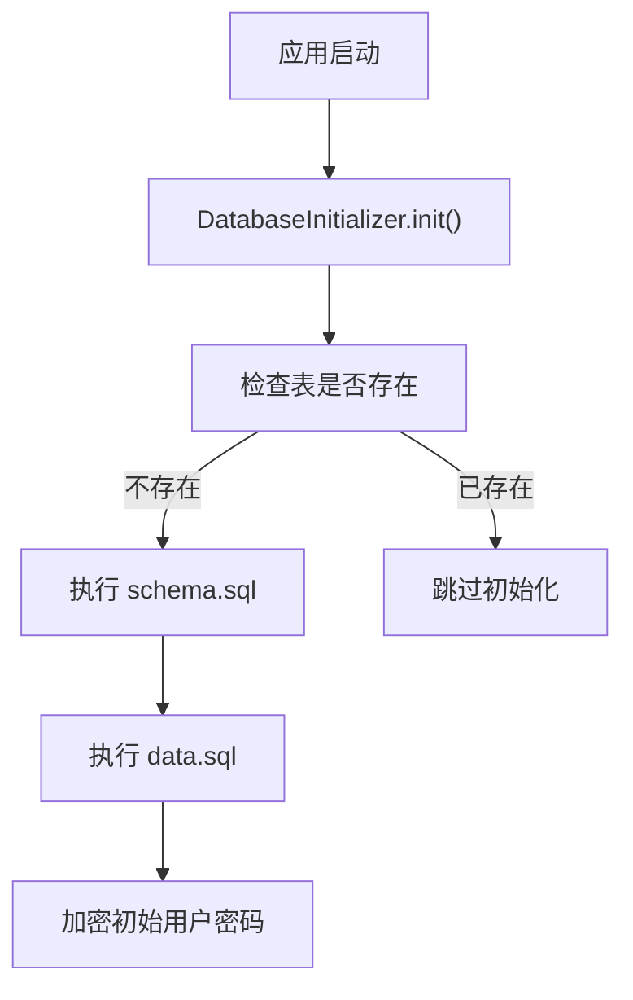
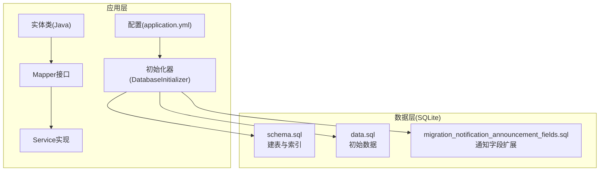

# 数据库设计

<cite>
**本文引用的文件**
- [schema.sql](file://src/main/resources/db/schema.sql)
- [data.sql](file://src/main/resources/db/data.sql)
- [migration_notification_announcement_fields.sql](file://src/main/resources/db/migration_notification_announcement_fields.sql)
- [application.yml](file://src/main/resources/application.yml)
- [DatabaseInitializer.java](file://src/main/java/com/campus/eventsys/config/DatabaseInitializer.java)
- [表设计.md](file://picture/表设计.md)
- [User.java](file://src/main/java/com/campus/eventsys/entity/User.java)
- [Activity.java](file://src/main/java/com/campus/eventsys/entity/Activity.java)
- [Category.java](file://src/main/java/com/campus/eventsys/entity/Category.java)
- [ActivityRegistration.java](file://src/main/java/com/campus/eventsys/entity/ActivityRegistration.java)
- [ActivityResult.java](file://src/main/java/com/campus/eventsys/entity/ActivityResult.java)
- [Comment.java](file://src/main/java/com/campus/eventsys/entity/Comment.java)
- [ActivityFavorite.java](file://src/main/java/com/campus/eventsys/entity/ActivityFavorite.java)
- [CheckInRecord.java](file://src/main/java/com/campus/eventsys/entity/CheckInRecord.java)
- [Notification.java](file://src/main/java/com/campus/eventsys/entity/Notification.java)
- [ActivityAudit.java](file://src/main/java/com/campus/eventsys/entity/ActivityAudit.java)
- [ActivityReview.java](file://src/main/java/com/campus/eventsys/entity/ActivityReview.java)
</cite>

## 目录
1. [引言](#引言)
2. [项目结构](#项目结构)
3. [核心组件](#核心组件)
4. [架构总览](#架构总览)
5. [详细组件分析](#详细组件分析)
6. [依赖分析](#依赖分析)
7. [性能考虑](#性能考虑)
8. [故障排查指南](#故障排查指南)
9. [结论](#结论)
10. [附录](#附录)

## 引言
本文件为“校园活动管理系统”的数据库设计参考手册，面向数据库管理员与后端开发者，覆盖ER关系图、实体关系模型、数据表结构、字段定义、主外键与索引设计、业务规则与数据完整性保障、数据库初始化脚本与迁移策略、实际数据示例与查询优化建议。系统采用SQLite作为存储引擎，配合Spring Boot与MyBatis-Plus，通过自定义初始化器在应用启动时自动创建表结构并注入测试数据。

## 项目结构
数据库相关资源集中于以下位置：
- 初始化脚本：src/main/resources/db/schema.sql（建表与索引）
- 初始数据：src/main/resources/db/data.sql（用户、活动、报名、收藏、签到、评论、通知、审核、成果、评价）
- 通知表字段扩展脚本：src/main/resources/db/migration_notification_announcement_fields.sql（增量升级）
- 应用配置：src/main/resources/application.yml（数据源、MyBatis-Plus、文件上传）
- 初始化器：src/main/java/com/campus/eventsys/config/DatabaseInitializer.java（启动时执行脚本、加密初始密码）



图表来源
- [DatabaseInitializer.java:34-53](file://src/main/java/com/campus/eventsys/config/DatabaseInitializer.java#L34-L53)
- [schema.sql:1-295](file://src/main/resources/db/schema.sql#L1-L295)
- [data.sql:1-335](file://src/main/resources/db/data.sql#L1-L335)

章节来源
- [application.yml:10-15](file://src/main/resources/application.yml#L10-L15)
- [DatabaseInitializer.java:34-53](file://src/main/java/com/campus/eventsys/config/DatabaseInitializer.java#L34-L53)

## 核心组件
本系统围绕11个核心数据表构建，涵盖用户、活动、报名、成果、评论、收藏、签到、通知、审核与评价等业务域。每个表均具备逻辑删除字段deleted，并在实体类中映射MyBatis-Plus的逻辑删除配置。

- 用户表 user：存储用户基本信息、角色与统计字段
- 活动分类表 category：活动分类与排序
- 活动表 activity：活动元数据、状态与统计
- 活动报名表 activity_registration：报名记录与审核
- 活动成果表 activity_result：活动结束后发布的成果贴
- 评论表 comment：对活动与成果贴的评论与回复
- 活动收藏表 activity_favorite：用户收藏活动
- 签到记录表 check_in_record：活动签到与类型
- 系统通知表 notification：公告与消息
- 活动审核表 activity_audit：活动发布/修改/取消的审核轨迹
- 活动评价表 activity_review：用户对已结束活动的评分与评价

章节来源
- [schema.sql:6-28](file://src/main/resources/db/schema.sql#L6-L28)
- [schema.sql:33-44](file://src/main/resources/db/schema.sql#L33-L44)
- [schema.sql:50-77](file://src/main/resources/db/schema.sql#L50-L77)
- [schema.sql:82-100](file://src/main/resources/db/schema.sql#L82-L100)
- [schema.sql:106-121](file://src/main/resources/db/schema.sql#L106-L121)
- [schema.sql:128-140](file://src/main/resources/db/schema.sql#L128-L140)
- [schema.sql:145-154](file://src/main/resources/db/schema.sql#L145-L154)
- [schema.sql:159-173](file://src/main/resources/db/schema.sql#L159-L173)
- [schema.sql:178-197](file://src/main/resources/db/schema.sql#L178-L197)
- [schema.sql:202-218](file://src/main/resources/db/schema.sql#L202-L218)
- [schema.sql:224-237](file://src/main/resources/db/schema.sql#L224-L237)

## 架构总览
系统采用“SQLite本地数据库 + Spring Boot + MyBatis-Plus”架构。应用启动时由初始化器自动执行建表与初始化脚本，随后业务层通过Mapper/Service进行数据操作。实体类与数据库表字段一一映射，逻辑删除统一通过deleted字段实现。



图表来源
- [application.yml:10-15](file://src/main/resources/application.yml#L10-L15)
- [DatabaseInitializer.java:34-53](file://src/main/java/com/campus/eventsys/config/DatabaseInitializer.java#L34-L53)
- [schema.sql:1-295](file://src/main/resources/db/schema.sql#L1-L295)
- [data.sql:1-335](file://src/main/resources/db/data.sql#L1-L335)
- [migration_notification_announcement_fields.sql:7-22](file://src/main/resources/db/migration_notification_announcement_fields.sql#L7-L22)

## 详细组件分析

### 用户表 user
- 字段要点：id（主键）、username（唯一）、password、nickname、avatar、email、phone、real_name、student_id、college、major、grade、gender、bio、role、status、organized_count、participated_count、create_time、update_time、deleted
- 约束与索引：UNIQUE(username)，并为username、student_id、college、role、status建立索引
- 实体映射：User.java中@TableId(type = IdType.INPUT)、@TableLogic deleted

章节来源
- [schema.sql:6-28](file://src/main/resources/db/schema.sql#L6-L28)
- [schema.sql:244-248](file://src/main/resources/db/schema.sql#L244-L248)
- [User.java:17-83](file://src/main/java/com/campus/eventsys/entity/User.java#L17-L83)

### 活动分类表 category
- 字段要点：id（主键）、name（非空）、description、icon、sort_order、status、activity_count、create_time、update_time、deleted
- 约束与索引：status、sort_order索引
- 实体映射：Category.java中@TableId(type = IdType.INPUT)、@TableLogic deleted

章节来源
- [schema.sql:33-44](file://src/main/resources/db/schema.sql#L33-L44)
- [schema.sql:250-252](file://src/main/resources/db/schema.sql#L250-L252)
- [Category.java:17-50](file://src/main/java/com/campus/eventsys/entity/Category.java#L17-L50)

### 活动表 activity
- 字段要点：id（主键）、title（非空）、description、cover_image、organizer_id（外键→user.id）、location、start_time、end_time、registration_start_time、registration_end_time、max_participants、current_participants、tags、status、category_id（外键→category.id）、need_review、view_count、favorite_count、comment_count、avg_rating、review_count、create_time、update_time、deleted
- 约束与索引：外键organizer_id、category_id；索引organizer_id、category_id、status、start_time
- 实体映射：Activity.java中@TableId(type = IdType.INPUT)、@TableLogic deleted

章节来源
- [schema.sql:50-77](file://src/main/resources/db/schema.sql#L50-L77)
- [schema.sql:254-258](file://src/main/resources/db/schema.sql#L254-L258)
- [Activity.java:17-93](file://src/main/java/com/campus/eventsys/entity/Activity.java#L17-L93)

### 活动报名表 activity_registration
- 字段要点：id（主键）、activity_id（外键→activity.id）、user_id（外键→user.id）、role、status、remark、images、reviewer_id（外键→user.id）、review_time、review_remark、create_time、update_time、deleted
- 约束与索引：UNIQUE(activity_id, user_id)；外键activity_id、user_id、reviewer_id；索引activity_id、user_id、status
- 实体映射：ActivityRegistration.java中@TableId(type = IdType.INPUT)、@TableLogic deleted

章节来源
- [schema.sql:82-100](file://src/main/resources/db/schema.sql#L82-L100)
- [schema.sql:260-263](file://src/main/resources/db/schema.sql#L260-L263)
- [ActivityRegistration.java:18-60](file://src/main/java/com/campus/eventsys/entity/ActivityRegistration.java#L18-L60)

### 活动成果表 activity_result
- 字段要点：id（主键）、activity_id（唯一、外键→activity.id）、title（非空）、content、images、creator_id（外键→user.id）、view_count、comment_count、status、create_time、update_time、deleted
- 约束与索引：UNIQUE(activity_id)；外键activity_id、creator_id
- 实体映射：ActivityResult.java中@TableId(type = IdType.INPUT)、@TableLogic deleted

章节来源
- [schema.sql:106-121](file://src/main/resources/db/schema.sql#L106-L121)
- [schema.sql:265-266](file://src/main/resources/db/schema.sql#L265-L266)
- [ActivityResult.java:19-58](file://src/main/java/com/campus/eventsys/entity/ActivityResult.java#L19-L58)

### 评论表 comment
- 字段要点：id（主键）、target_id、target_type（默认1）、user_id（外键→user.id）、content（非空）、parent_id（默认0）、reply_to_user_id（默认0）、create_time、update_time、deleted
- 约束与索引：外键user_id；索引target_id+target_type、user_id、parent_id
- 实体映射：Comment.java中@TableId(type = IdType.INPUT)、@TableLogic deleted

章节来源
- [schema.sql:128-140](file://src/main/resources/db/schema.sql#L128-L140)
- [schema.sql:268-271](file://src/main/resources/db/schema.sql#L268-L271)
- [Comment.java:19-51](file://src/main/java/com/campus/eventsys/entity/Comment.java#L19-L51)

### 活动收藏表 activity_favorite
- 字段要点：id（主键）、activity_id（外键→activity.id）、user_id（外键→user.id）、create_time、deleted
- 约束与索引：UNIQUE(activity_id, user_id)；外键activity_id、user_id；索引activity_id、user_id
- 实体映射：ActivityFavorite.java中@TableId(type = IdType.INPUT)、@TableLogic deleted

章节来源
- [schema.sql:145-154](file://src/main/resources/db/schema.sql#L145-L154)
- [schema.sql:273-275](file://src/main/resources/db/schema.sql#L273-L275)
- [ActivityFavorite.java:15-30](file://src/main/java/com/campus/eventsys/entity/ActivityFavorite.java#L15-L30)

### 签到记录表 check_in_record
- 字段要点：id（主键）、activity_id（外键→activity.id）、user_id（外键→user.id）、registration_id（外键→activity_registration.id）、check_in_time（默认CURRENT_TIMESTAMP）、check_in_type、location、remark、create_time、deleted
- 约束与索引：外键activity_id、user_id、registration_id；索引activity_id、user_id、registration_id
- 实体映射：CheckInRecord.java中@TableId(type = IdType.INPUT)、@TableLogic deleted

章节来源
- [schema.sql:159-173](file://src/main/resources/db/schema.sql#L159-L173)
- [schema.sql:277-280](file://src/main/resources/db/schema.sql#L277-L280)
- [CheckInRecord.java:17-49](file://src/main/java/com/campus/eventsys/entity/CheckInRecord.java#L17-L49)

### 系统通知表 notification
- 字段要点：id（主键）、user_id（默认0）、title（非空）、content、type、activity_id（外键→activity.id）、is_read、read_time、publish_scope（默认ALL）、is_pinned、publish_time、status、created_by、update_time、announce_category（默认SYSTEM）、create_time、deleted
- 约束与索引：外键activity_id；索引user_id、type、is_read
- 实体映射：Notification.java中@TableId(type = IdType.INPUT)、@TableLogic deleted

章节来源
- [schema.sql:178-197](file://src/main/resources/db/schema.sql#L178-L197)
- [schema.sql:282-285](file://src/main/resources/db/schema.sql#L282-L285)
- [Notification.java:15-79](file://src/main/java/com/campus/eventsys/entity/Notification.java#L15-L79)

### 活动审核表 activity_audit
- 字段要点：id（主键）、activity_id（外键→activity.id）、audit_type、status、submitter_id（外键→user.id）、submit_time（默认CURRENT_TIMESTAMP）、auditor_id（外键→user.id）、audit_time、audit_opinion、create_time、update_time、deleted
- 约束与索引：外键activity_id、submitter_id、auditor_id；索引activity_id、status、submitter_id
- 实体映射：ActivityAudit.java中@TableId(type = IdType.INPUT)、@TableLogic deleted

章节来源
- [schema.sql:202-218](file://src/main/resources/db/schema.sql#L202-L218)
- [schema.sql:287-290](file://src/main/resources/db/schema.sql#L287-L290)
- [ActivityAudit.java:15-61](file://src/main/java/com/campus/eventsys/entity/ActivityAudit.java#L15-L61)

### 活动评价表 activity_review
- 字段要点：id（主键）、activity_id（外键→activity.id）、user_id（外键→user.id）、rating（非空）、content、reply、create_time、update_time、deleted
- 约束与索引：UNIQUE(activity_id, user_id)；外键activity_id、user_id；索引activity_id、user_id
- 实体映射：ActivityReview.java中@TableId(type = IdType.INPUT)、@TableLogic deleted

章节来源
- [schema.sql:224-237](file://src/main/resources/db/schema.sql#L224-L237)
- [schema.sql:292-294](file://src/main/resources/db/schema.sql#L292-L294)
- [ActivityReview.java:19-48](file://src/main/java/com/campus/eventsys/entity/ActivityReview.java#L19-L48)

## 依赖分析
- 外键关系：activity.organizer_id → user.id；activity.category_id → category.id；activity_registration.activity_id → activity.id；activity_registration.user_id → user.id；activity_registration.reviewer_id → user.id；activity_result.activity_id → activity.id；activity_result.creator_id → user.id；comment.user_id → user.id；activity_favorite.activity_id → activity.id；activity_favorite.user_id → user.id；check_in_record.activity_id → activity.id；check_in_record.user_id → user.id；check_in_record.registration_id → activity_registration.id；notification.activity_id → activity.id；activity_audit.activity_id → activity.id；activity_audit.submitter_id → user.id；activity_audit.auditor_id → user.id；activity_review.activity_id → activity.id；activity_review.user_id → user.id
- 约束关系：UNIQUE(activity_id, user_id)（报名、收藏、评价）
- 索引覆盖：用户、分类、活动、报名、成果、评论、收藏、签到、通知、审核、评价表的关键查询字段

```mermaid
erDiagram
USER {
integer id PK
varchar username UK
varchar password
varchar nickname
varchar avatar
varchar email
varchar phone
varchar real_name
varchar student_id
varchar college
varchar major
varchar grade
integer gender
text bio
integer role
integer status
integer organized_count
integer participated_count
datetime create_time
datetime update_time
integer deleted
}
CATEGORY {
integer id PK
varchar name
varchar description
varchar icon
integer sort_order
integer status
integer activity_count
datetime create_time
datetime update_time
integer deleted
}
ACTIVITY {
integer id PK
varchar title
text description
varchar cover_image
integer organizer_id FK
varchar location
datetime start_time
datetime end_time
datetime registration_start_time
datetime registration_end_time
integer max_participants
integer current_participants
varchar tags
integer status
integer category_id FK
integer need_review
integer view_count
integer favorite_count
integer comment_count
decimal avg_rating
integer review_count
datetime create_time
datetime update_time
integer deleted
}
ACTIVITY_REGISTRATION {
integer id PK
integer activity_id FK
integer user_id FK
integer role
integer status
text remark
text images
integer reviewer_id FK
datetime review_time
text review_remark
datetime create_time
datetime update_time
integer deleted
}
ACTIVITY_RESULT {
integer id PK
integer activity_id UK FK
varchar title
text content
text images
integer creator_id FK
integer view_count
integer comment_count
integer status
datetime create_time
datetime update_time
integer deleted
}
COMMENT {
integer id PK
integer target_id
integer target_type
integer user_id FK
text content
integer parent_id
integer reply_to_user_id
datetime create_time
datetime update_time
integer deleted
}
ACTIVITY_FAVORITE {
integer id PK
integer activity_id FK
integer user_id FK
datetime create_time
integer deleted
}
CHECK_IN_RECORD {
integer id PK
integer activity_id FK
integer user_id FK
integer registration_id FK
datetime check_in_time
integer check_in_type
varchar location
text remark
datetime create_time
integer deleted
}
NOTIFICATION {
integer id PK
integer user_id
varchar title
text content
integer type
integer activity_id FK
integer is_read
datetime read_time
varchar publish_scope
integer is_pinned
datetime publish_time
integer status
integer created_by
datetime update_time
varchar announce_category
datetime create_time
integer deleted
}
ACTIVITY_AUDIT {
integer id PK
integer activity_id FK
integer audit_type
integer status
integer submitter_id FK
datetime submit_time
integer auditor_id FK
datetime audit_time
text audit_opinion
datetime create_time
datetime update_time
integer deleted
}
ACTIVITY_REVIEW {
integer id PK
integer activity_id FK
integer user_id FK
integer rating
text content
text reply
datetime create_time
datetime update_time
integer deleted
}
USER ||--o{ ACTIVITY : "organizer"
CATEGORY ||--o{ ACTIVITY : "categorizes"
ACTIVITY ||--o{ ACTIVITY_REGISTRATION : "registered_by"
USER ||--o{ ACTIVITY_REGISTRATION : "registers"
USER ||--o{ ACTIVITY_REGISTRATION : "reviews"
ACTIVITY ||--|| ACTIVITY_RESULT : "has"
USER ||--o{ ACTIVITY_RESULT : "creates"
USER ||--o{ COMMENT : "writes"
ACTIVITY ||--o{ COMMENT : "target_of"
ACTIVITY ||--o{ ACTIVITY_FAVORITE : "favorited_by"
USER ||--o{ ACTIVITY_FAVORITE : "favorites"
ACTIVITY ||--o{ CHECK_IN_RECORD : "checked_in_by"
USER ||--o{ CHECK_IN_RECORD : "checks_in"
ACTIVITY_REGISTRATION ||--|| CHECK_IN_RECORD : "generates"
ACTIVITY ||--o{ NOTIFICATION : "notifies"
ACTIVITY ||--o{ ACTIVITY_AUDIT : "audits"
USER ||--o{ ACTIVITY_AUDIT : "submits/reviews"
ACTIVITY ||--o{ ACTIVITY_REVIEW : "rated_by"
USER ||--o{ ACTIVITY_REVIEW : "rates"
```

图表来源
- [schema.sql:6-28](file://src/main/resources/db/schema.sql#L6-L28)
- [schema.sql:33-44](file://src/main/resources/db/schema.sql#L33-L44)
- [schema.sql:50-77](file://src/main/resources/db/schema.sql#L50-L77)
- [schema.sql:82-100](file://src/main/resources/db/schema.sql#L82-L100)
- [schema.sql:106-121](file://src/main/resources/db/schema.sql#L106-L121)
- [schema.sql:128-140](file://src/main/resources/db/schema.sql#L128-L140)
- [schema.sql:145-154](file://src/main/resources/db/schema.sql#L145-L154)
- [schema.sql:159-173](file://src/main/resources/db/schema.sql#L159-L173)
- [schema.sql:178-197](file://src/main/resources/db/schema.sql#L178-L197)
- [schema.sql:202-218](file://src/main/resources/db/schema.sql#L202-L218)
- [schema.sql:224-237](file://src/main/resources/db/schema.sql#L224-L237)

## 性能考虑
- 索引策略
  - 用户：按username、student_id、college、role、status建立索引，便于登录、搜索与权限过滤
  - 分类：按status、sort_order建立索引，支持分类筛选与排序
  - 活动：按organizer_id、category_id、status、start_time建立索引，支持组织者查询、分类筛选、状态过滤与时间范围查询
  - 报名：按activity_id、user_id、status建立索引，支持活动报名列表、用户报名历史与状态筛选
  - 成果：按activity_id建立索引，支持成果贴唯一性与查询
  - 评论：按target_id+target_type、user_id、parent_id建立索引，支持目标对象评论树查询
  - 收藏：按activity_id、user_id建立索引，支持收藏列表与去重
  - 签到：按activity_id、user_id、registration_id建立索引，支持签到统计与报表
  - 通知：按user_id、type、is_read建立索引，支持消息列表与已读状态
  - 审核：按activity_id、status、submitter_id建立索引，支持审核流程查询
  - 评价：按activity_id、user_id建立索引，支持评价统计与去重
- 查询优化建议
  - 使用复合索引覆盖常见过滤条件（如活动状态+时间范围、用户角色+状态）
  - 限制返回字段，避免SELECT *
  - 对分页查询使用LIMIT/OFFSET，结合合适索引
  - 评论树查询建议先查顶级评论，再按parent_id拉取回复
  - 通知列表建议按publish_time倒序，必要时增加索引
- 逻辑删除
  - 所有表均含deleted字段，查询时需添加WHERE deleted=0，避免扫描全表

章节来源
- [schema.sql:243-295](file://src/main/resources/db/schema.sql#L243-L295)
- [application.yml:42-47](file://src/main/resources/application.yml#L42-L47)

## 故障排查指南
- 初始化失败
  - 症状：启动时报错，无法执行SQL脚本
  - 排查：确认schema.sql与data.sql路径正确；检查SQLite驱动与JDBC URL；查看日志中SQL状态码
  - 参考：DatabaseInitializer.executeScript()与init()
- 初始密码未加密
  - 症状：首次登录失败或密码异常
  - 排查：确认encryptInitialPasswords()执行；检查密码是否已为BCrypt格式
  - 参考：DatabaseInitializer.encryptInitialPasswords()
- 表结构不一致
  - 症状：运行期出现约束错误或查询异常
  - 排查：确认schema.sql已执行；检查UNIQUE约束与外键关系；必要时执行迁移脚本migration_notification_announcement_fields.sql
  - 参考：migration_notification_announcement_fields.sql
- 通知字段缺失
  - 症状：公告字段（publish_scope、is_pinned、publish_time、status、created_by、update_time、announce_category）不存在
  - 排查：在现有数据库上逐条执行迁移脚本，忽略“列已存在”错误
  - 参考：migration_notification_announcement_fields.sql

章节来源
- [DatabaseInitializer.java:58-78](file://src/main/java/com/campus/eventsys/config/DatabaseInitializer.java#L58-L78)
- [DatabaseInitializer.java:99-113](file://src/main/java/com/campus/eventsys/config/DatabaseInitializer.java#L99-L113)
- [migration_notification_announcement_fields.sql:7-22](file://src/main/resources/db/migration_notification_announcement_fields.sql#L7-L22)

## 结论
本数据库设计以清晰的ER模型与完善的索引策略支撑校园活动管理的核心业务，通过逻辑删除与严格的外键约束确保数据一致性与可追溯性。初始化器与迁移脚本提供了可靠的部署与演进路径，适合中小型校园场景的快速落地与后续扩展。

## 附录

### 数据库初始化脚本说明
- schema.sql：创建11张表及全部索引，定义主外键与约束
- data.sql：插入初始用户、分类、活动、报名、收藏、签到、评论、通知、审核、成果、评价数据
- migration_notification_announcement_fields.sql：为已有数据库补充公告相关字段与默认值

章节来源
- [schema.sql:1-295](file://src/main/resources/db/schema.sql#L1-L295)
- [data.sql:1-335](file://src/main/resources/db/data.sql#L1-L335)
- [migration_notification_announcement_fields.sql:1-22](file://src/main/resources/db/migration_notification_announcement_fields.sql#L1-L22)

### 数据表字段定义与索引清单
- 用户表 user：主键id、唯一username、索引username、student_id、college、role、status
- 活动分类表 category：主键id、索引status、sort_order
- 活动表 activity：主键id、外键organizer_id、category_id、索引organizer_id、category_id、status、start_time
- 活动报名表 activity_registration：主键id、UNIQUE(activity_id,user_id)、外键activity_id、user_id、reviewer_id、索引activity_id、user_id、status
- 活动成果表 activity_result：主键id、UNIQUE(activity_id)、外键activity_id、creator_id
- 评论表 comment：主键id、外键user_id、索引target_id+target_type、user_id、parent_id
- 活动收藏表 activity_favorite：主键id、UNIQUE(activity_id,user_id)、外键activity_id、user_id、索引activity_id、user_id
- 签到记录表 check_in_record：主键id、外键activity_id、user_id、registration_id、索引activity_id、user_id、registration_id
- 系统通知表 notification：主键id、外键activity_id、索引user_id、type、is_read
- 活动审核表 activity_audit：主键id、外键activity_id、submitter_id、auditor_id、索引activity_id、status、submitter_id
- 活动评价表 activity_review：主键id、UNIQUE(activity_id,user_id)、外键activity_id、user_id、索引activity_id、user_id

章节来源
- [schema.sql:243-295](file://src/main/resources/db/schema.sql#L243-L295)

### 实际数据示例
- 用户：admin（管理员）、多条学生用户，包含基本信息与统计字段
- 分类：文艺活动、技术竞赛、体育赛事、艺术展览、志愿服务、学术讲座
- 活动：包含已结束、进行中、报名中、待审核、已拒绝、已下架等状态
- 报名：组织者与参与者记录，含审核状态与备注
- 收藏：用户对活动的收藏
- 签到：活动签到记录，含签到类型与地点
- 评论：对活动与成果贴的评论与回复
- 通知：系统公告、活动提醒、审核结果、评论回复、成果贴通知
- 审核：活动发布/修改/取消的审核记录
- 成果：活动结束后发布的成果贴
- 评价：对已结束活动的评分与评价

章节来源
- [data.sql:9-23](file://src/main/resources/db/data.sql#L9-L23)
- [data.sql:28-34](file://src/main/resources/db/data.sql#L28-L34)
- [data.sql:39-58](file://src/main/resources/db/data.sql#L39-L58)
- [data.sql:63-117](file://src/main/resources/db/data.sql#L63-L117)
- [data.sql:122-149](file://src/main/resources/db/data.sql#L122-L149)
- [data.sql:154-170](file://src/main/resources/db/data.sql#L154-L170)
- [data.sql:176-238](file://src/main/resources/db/data.sql#L176-L238)
- [data.sql:243-280](file://src/main/resources/db/data.sql#L243-L280)
- [data.sql:285-302](file://src/main/resources/db/data.sql#L285-L302)
- [data.sql:307-324](file://src/main/resources/db/data.sql#L307-L324)
- [data.sql:332-334](file://src/main/resources/db/data.sql#L332-L334)

### 查询优化建议
- 使用EXPLAIN QUERY PLAN分析慢查询
- 为高频过滤字段建立复合索引（如活动状态+开始时间）
- 限制返回字段，避免SELECT *
- 分页查询使用LIMIT/OFFSET，结合合适索引
- 评论树查询建议先查顶级评论，再按parent_id拉取回复
- 通知列表建议按publish_time倒序，必要时增加索引

章节来源
- [schema.sql:243-295](file://src/main/resources/db/schema.sql#L243-L295)