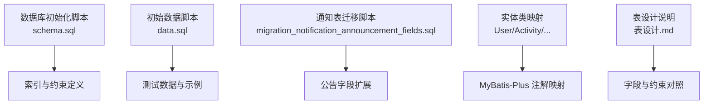
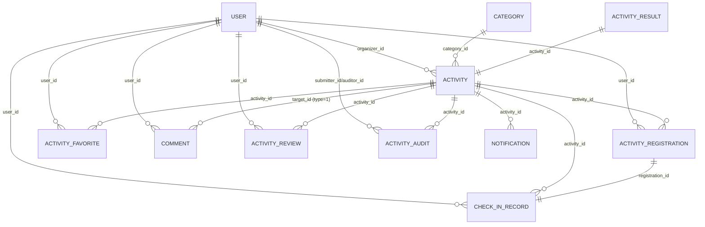
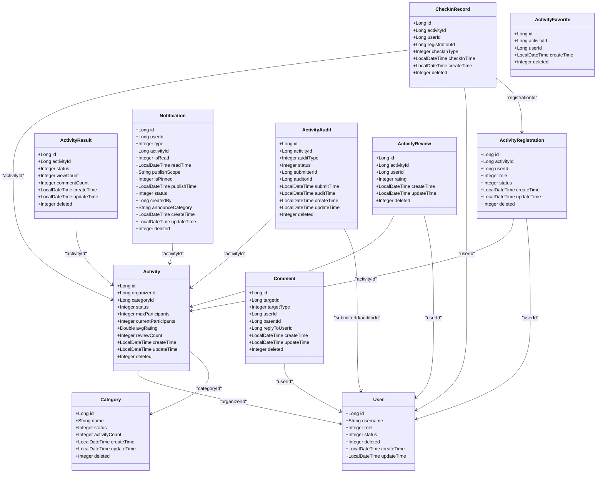

# 数据表结构

<cite>
**本文引用的文件**
- [schema.sql](file://src/main/resources/db/schema.sql)
- [data.sql](file://src/main/resources/db/data.sql)
- [migration_notification_announcement_fields.sql](file://src/main/resources/db/migration_notification_announcement_fields.sql)
- [表设计.md](file://picture/表设计.md)
- [User.java](file://src/main/java/com/campus/eventsys/entity/User.java)
- [Activity.java](file://src/main/java/com/campus/eventsys/entity/Activity.java)
- [Category.java](file://src/main/java/com/campus/eventsys/entity/Category.java)
- [ActivityRegistration.java](file://src/main/java/com/campus/eventsys/entity/ActivityRegistration.java)
- [ActivityResult.java](file://src/main/java/com/campus/eventsys/entity/ActivityResult.java)
- [Comment.java](file://src/main/java/com/campus/eventsys/entity/Comment.java)
- [ActivityFavorite.java](file://src/main/java/com/campus/eventsys/entity/ActivityFavorite.java)
- [CheckInRecord.java](file://src/main/java/com/campus/eventsys/entity/CheckInRecord.java)
- [Notification.java](file://src/main/java/com/campus/eventsys/entity/Notification.java)
- [ActivityAudit.java](file://src/main/java/com/campus/eventsys/entity/ActivityAudit.java)
- [ActivityReview.java](file://src/main/java/com/campus/eventsys/entity/ActivityReview.java)
</cite>

## 目录
1. [引言](#引言)
2. [项目结构](#项目结构)
3. [核心组件](#核心组件)
4. [架构总览](#架构总览)
5. [详细组件分析](#详细组件分析)
6. [依赖分析](#依赖分析)
7. [性能考虑](#性能考虑)
8. [故障排查指南](#故障排查指南)
9. [结论](#结论)
10. [附录](#附录)

## 引言
本文件面向数据库管理员与后端开发者，系统化梳理校园活动管理系统的数据表结构，覆盖每个表的创建语句、字段定义、约束条件、索引设计、业务映射与版本演进策略，并给出最佳实践与排障建议。文档以仓库中的数据库初始化脚本、迁移脚本与实体类为依据，确保与实际实现保持一致。

## 项目结构
数据库相关资源集中于 resources/db 目录，包含：
- 初始化脚本：schema.sql
- 初始数据：data.sql
- 通知表扩展迁移：migration_notification_announcement_fields.sql
- 表设计说明：picture/表设计.md
- 实体类映射：src/main/java/com/campus/eventsys/entity/*.java

**图表来源**
- [schema.sql:1-295](file://src/main/resources/db/schema.sql#L1-L295)
- [data.sql:1-335](file://src/main/resources/db/data.sql#L1-L335)
- [migration_notification_announcement_fields.sql:1-22](file://src/main/resources/db/migration_notification_announcement_fields.sql#L1-L22)
- [User.java:1-85](file://src/main/java/com/campus/eventsys/entity/User.java#L1-L85)
- [Activity.java:1-95](file://src/main/java/com/campus/eventsys/entity/Activity.java#L1-L95)

**章节来源**
- [schema.sql:1-295](file://src/main/resources/db/schema.sql#L1-L295)
- [data.sql:1-335](file://src/main/resources/db/data.sql#L1-L335)
- [migration_notification_announcement_fields.sql:1-22](file://src/main/resources/db/migration_notification_announcement_fields.sql#L1-L22)
- [表设计.md:1-206](file://picture/表设计.md#L1-L206)

## 核心组件
本系统围绕“用户—活动—报名—成果—评价—通知—审核—签到—评论—收藏”构建核心数据域，采用逻辑删除与状态枚举控制生命周期，配合索引优化常见查询路径。

- 用户域：user
- 活动域：category、activity
- 参与域：activity_registration、check_in_record
- 展示域：activity_result、comment
- 互动域：activity_favorite、activity_review
- 管理域：activity_audit、notification

**章节来源**
- [schema.sql:6-28](file://src/main/resources/db/schema.sql#L6-L28)
- [schema.sql:33-44](file://src/main/resources/db/schema.sql#L33-L44)
- [schema.sql:50-77](file://src/main/resources/db/schema.sql#L50-L77)
- [schema.sql:82-100](file://src/main/resources/db/schema.sql#L82-L100)
- [schema.sql:106-121](file://src/main/resources/db/schema.sql#L106-L121)
- [schema.sql:128-140](file://src/main/resources/db/schema.sql#L128-L140)
- [schema.sql:145-154](file://src/main/resources/db/schema.sql#L145-L154)
- [schema.sql:159-173](file://src/main/resources/db/schema.sql#L159-L173)
- [schema.sql:178-197](file://src/main/resources/db/schema.sql#L178-L197)
- [schema.sql:202-218](file://src/main/resources/db/schema.sql#L202-L218)
- [schema.sql:224-237](file://src/main/resources/db/schema.sql#L224-L237)

## 架构总览
下图展示表之间的主外键关系与典型查询方向：

**图表来源**
- [schema.sql:75-76](file://src/main/resources/db/schema.sql#L75-L76)
- [schema.sql:96-98](file://src/main/resources/db/schema.sql#L96-L98)
- [schema.sql:170-172](file://src/main/resources/db/schema.sql#L170-L172)
- [schema.sql:151-153](file://src/main/resources/db/schema.sql#L151-L153)
- [schema.sql:139](file://src/main/resources/db/schema.sql#L139)
- [schema.sql:119-120](file://src/main/resources/db/schema.sql#L119-L120)
- [schema.sql:234-235](file://src/main/resources/db/schema.sql#L234-L235)
- [schema.sql:215-217](file://src/main/resources/db/schema.sql#L215-L217)
- [schema.sql:196](file://src/main/resources/db/schema.sql#L196)

## 详细组件分析

### 用户表 user
- 设计要点
  - 主键：自增整数ID
  - 唯一约束：username
  - 逻辑删除：deleted 字段
  - 时间字段：create_time、update_time
- 字段与约束
  - id: 主键，自增
  - username: 非空，唯一
  - password: 非空
  - role/status/deleted: 角色、状态、逻辑删除
  - 统计字段：organized_count、participated_count
- 索引
  - idx_user_username、idx_user_student_id、idx_user_college、idx_user_role、idx_user_status
- 业务映射
  - 与活动的组织者关联；与报名、签到、收藏、评论、评价、审核记录中的用户身份关联

**章节来源**
- [schema.sql:6-28](file://src/main/resources/db/schema.sql#L6-L28)
- [schema.sql:243-248](file://src/main/resources/db/schema.sql#L243-L248)
- [User.java:17-83](file://src/main/java/com/campus/eventsys/entity/User.java#L17-L83)
- [表设计.md:2-26](file://picture/表设计.md#L2-L26)

### 活动分类表 category
- 设计要点
  - 主键：自增整数ID
  - 排序与状态：sort_order、status
  - 统计字段：activity_count
- 字段与约束
  - id: 主键，自增
  - name/description/icon: 名称、描述、图标
  - status/sort_order/activity_count: 状态、排序、活动计数
- 索引
  - idx_category_status、idx_category_sort

**章节来源**
- [schema.sql:33-44](file://src/main/resources/db/schema.sql#L33-L44)
- [schema.sql:250-252](file://src/main/resources/db/schema.sql#L250-L252)
- [Category.java:17-50](file://src/main/java/com/campus/eventsys/entity/Category.java#L17-L50)
- [表设计.md:28-41](file://picture/表设计.md#L28-L41)

### 活动表 activity
- 设计要点
  - 主键：自增整数ID
  - 外键：organizer_id → user(id)、category_id → category(id)
  - 状态枚举：-2已下架/-1已拒绝/0草稿/1待审核/2报名中/3即将开始/4进行中/5已结束
  - 统计字段：view_count、favorite_count、comment_count、avg_rating、review_count
- 字段与约束
  - 时间窗口：start_time、end_time、registration_start_time、registration_end_time
  - 报名限制：max_participants、current_participants
  - 审核开关：need_review
- 索引
  - idx_activity_organizer、idx_activity_category、idx_activity_status、idx_activity_start_time

**章节来源**
- [schema.sql:50-77](file://src/main/resources/db/schema.sql#L50-L77)
- [schema.sql:254-258](file://src/main/resources/db/schema.sql#L254-L258)
- [Activity.java:17-93](file://src/main/java/com/campus/eventsys/entity/Activity.java#L17-L93)
- [表设计.md:43-70](file://picture/表设计.md#L43-L70)

### 活动报名表 activity_registration
- 设计要点
  - 主键：自增整数ID
  - 复合唯一：(activity_id, user_id)，保证用户对活动仅一次有效报名
  - 角色：role（1-组织者，2-普通参与者）
  - 审核：status、reviewer_id、review_time、review_remark
- 字段与约束
  - remark/images：报名备注与材料
  - 审核相关：reviewer_id 外键指向 user
- 索引
  - idx_reg_activity、idx_reg_user、idx_reg_status

**章节来源**
- [schema.sql:82-100](file://src/main/resources/db/schema.sql#L82-L100)
- [schema.sql:260-263](file://src/main/resources/db/schema.sql#L260-L263)
- [ActivityRegistration.java:18-60](file://src/main/java/com/campus/eventsys/entity/ActivityRegistration.java#L18-L60)
- [表设计.md:72-90](file://picture/表设计.md#L72-L90)

### 活动成果表 activity_result
- 设计要点
  - 主键：自增整数ID
  - 唯一约束：activity_id 唯一，确保每活动仅一条成果贴
  - 状态：-2已下架/0草稿/1已发布
  - 统计字段：view_count、comment_count
- 字段与约束
  - images：图片列表（JSON数组）
  - creator_id 外键指向 user
- 索引
  - idx_result_activity

**章节来源**
- [schema.sql:106-121](file://src/main/resources/db/schema.sql#L106-L121)
- [schema.sql:265-266](file://src/main/resources/db/schema.sql#L265-L266)
- [ActivityResult.java:19-58](file://src/main/java/com/campus/eventsys/entity/ActivityResult.java#L19-L58)
- [表设计.md:92-107](file://picture/表设计.md#L92-L107)

### 评论表 comment
- 设计要点
  - 主键：自增整数ID
  - 多目标支持：target_type=1 活动，=2 成果展示贴
  - 递归回复：parent_id、reply_to_user_id
- 字段与约束
  - target_id+target_type：联合定位目标
  - content 非空
- 索引
  - idx_comment_target、idx_comment_user、idx_comment_parent

**章节来源**
- [schema.sql:128-140](file://src/main/resources/db/schema.sql#L128-L140)
- [schema.sql:268-271](file://src/main/resources/db/schema.sql#L268-L271)
- [Comment.java:19-51](file://src/main/java/com/campus/eventsys/entity/Comment.java#L19-L51)
- [表设计.md:109-124](file://picture/表设计.md#L109-L124)

### 活动收藏表 activity_favorite
- 设计要点
  - 主键：自增整数ID
  - 复合唯一：(activity_id, user_id)，防止重复收藏
- 索引
  - idx_fav_activity、idx_fav_user

**章节来源**
- [schema.sql:145-154](file://src/main/resources/db/schema.sql#L145-L154)
- [schema.sql:273-275](file://src/main/resources/db/schema.sql#L273-L275)
- [ActivityFavorite.java:15-30](file://src/main/java/com/campus/eventsys/entity/ActivityFavorite.java#L15-L30)
- [表设计.md:126-136](file://picture/表设计.md#L126-L136)

### 签到记录表 check_in_record
- 设计要点
  - 主键：自增整数ID
  - 三重外键：activity、user、registration
  - check_in_type：1-扫码，2-手动，3-自动
  - 默认值：check_in_time 使用当前时间
- 索引
  - idx_checkin_activity、idx_checkin_user、idx_checkin_reg

**章节来源**
- [schema.sql:159-173](file://src/main/resources/db/schema.sql#L159-L173)
- [schema.sql:277-280](file://src/main/resources/db/schema.sql#L277-L280)
- [CheckInRecord.java:17-49](file://src/main/java/com/campus/eventsys/entity/CheckInRecord.java#L17-L49)
- [表设计.md:138-151](file://picture/表设计.md#L138-L151)

### 系统通知表 notification
- 设计要点
  - 主键：自增整数ID
  - 类型：1-系统公告、2-活动提醒、3-审核结果、4-活动状态变更、5-评论回复
  - 公告扩展：publish_scope、is_pinned、publish_time、status、created_by、announce_category
  - user_id=0 表示广播（全体用户）
- 索引
  - idx_notif_user、idx_notif_type、idx_notif_read

**章节来源**
- [schema.sql:178-197](file://src/main/resources/db/schema.sql#L178-L197)
- [schema.sql:282-285](file://src/main/resources/db/schema.sql#L282-L285)
- [Notification.java:15-79](file://src/main/java/com/campus/eventsys/entity/Notification.java#L15-L79)
- [表设计.md:153-173](file://picture/表设计.md#L153-L173)

### 活动审核表 activity_audit
- 设计要点
  - 主键：自增整数ID
  - 审核类型：1-发布、2-修改、3-取消
  - 审核状态：0-待审核、1-已通过、2-已拒绝
  - submitter_id/auditor_id 外键指向 user
- 索引
  - idx_audit_activity、idx_audit_status、idx_audit_submitter

**章节来源**
- [schema.sql:202-218](file://src/main/resources/db/schema.sql#L202-L218)
- [schema.sql:287-290](file://src/main/resources/db/schema.sql#L287-L290)
- [ActivityAudit.java:15-61](file://src/main/java/com/campus/eventsys/entity/ActivityAudit.java#L15-L61)
- [表设计.md:175-190](file://picture/表设计.md#L175-L190)

### 活动评价表 activity_review
- 设计要点
  - 主键：自增整数ID
  - 复合唯一：(activity_id, user_id)，限制用户对同一活动仅一次评价
  - rating：1-5星
  - reply：组织者回复
- 索引
  - idx_review_activity、idx_review_user

**章节来源**
- [schema.sql:224-237](file://src/main/resources/db/schema.sql#L224-L237)
- [schema.sql:292-293](file://src/main/resources/db/schema.sql#L292-L293)
- [ActivityReview.java:19-49](file://src/main/java/com/campus/eventsys/entity/ActivityReview.java#L19-L49)
- [表设计.md:192-204](file://picture/表设计.md#L192-L204)

## 依赖分析
- 外键依赖
  - activity.organizer_id → user.id
  - activity.category_id → category.id
  - activity_registration.* → user/id、activity/id
  - check_in_record.* → activity/id、user/id、activity_registration/id
  - activity_result.activity_id → activity.id（唯一）
  - comment.user_id → user.id
  - activity_review.* → activity/id、user/id
  - activity_audit.* → activity/id、user.id（提交人/审核人）
  - notification.activity_id → activity.id
- 约束与索引
  - 复合唯一：报名、收藏、评价
  - 多维索引：用户、活动、状态、时间等维度
- 实体映射一致性
  - 实体类字段命名与注解（@TableName、@TableId、@TableLogic、@TableField）与表结构一一对应

**图表来源**
- [User.java:17-83](file://src/main/java/com/campus/eventsys/entity/User.java#L17-L83)
- [Category.java:17-50](file://src/main/java/com/campus/eventsys/entity/Category.java#L17-L50)
- [Activity.java:17-93](file://src/main/java/com/campus/eventsys/entity/Activity.java#L17-L93)
- [ActivityRegistration.java:18-60](file://src/main/java/com/campus/eventsys/entity/ActivityRegistration.java#L18-L60)
- [CheckInRecord.java:17-49](file://src/main/java/com/campus/eventsys/entity/CheckInRecord.java#L17-L49)
- [ActivityResult.java:19-58](file://src/main/java/com/campus/eventsys/entity/ActivityResult.java#L19-L58)
- [Comment.java:19-51](file://src/main/java/com/campus/eventsys/entity/Comment.java#L19-L51)
- [ActivityReview.java:19-49](file://src/main/java/com/campus/eventsys/entity/ActivityReview.java#L19-L49)
- [ActivityAudit.java:15-61](file://src/main/java/com/campus/eventsys/entity/ActivityAudit.java#L15-L61)
- [Notification.java:15-79](file://src/main/java/com/campus/eventsys/entity/Notification.java#L15-L79)

**章节来源**
- [schema.sql:75-76](file://src/main/resources/db/schema.sql#L75-L76)
- [schema.sql:96-98](file://src/main/resources/db/schema.sql#L96-L98)
- [schema.sql:119-120](file://src/main/resources/db/schema.sql#L119-L120)
- [schema.sql:139](file://src/main/resources/db/schema.sql#L139)
- [schema.sql:151-153](file://src/main/resources/db/schema.sql#L151-L153)
- [schema.sql:170-172](file://src/main/resources/db/schema.sql#L170-L172)
- [schema.sql:196](file://src/main/resources/db/schema.sql#L196)
- [schema.sql:215-217](file://src/main/resources/db/schema.sql#L215-L217)
- [schema.sql:234-235](file://src/main/resources/db/schema.sql#L234-L235)

## 性能考虑
- 索引策略
  - 用户：按角色、状态、学号、学院等维度建立索引，支撑登录、筛选与统计
  - 活动：按组织者、分类、状态、开始时间建立索引，支撑活动列表与状态流转
  - 报名/收藏/评价/签到：按 activity_id、user_id、status 建立复合索引，支撑高频查询
  - 评论：按 (target_id, target_type) 与 user_id 建立索引，支撑评论树与用户行为追踪
  - 通知：按 user_id、type、is_read 建立索引，支撑消息推送与阅读状态
- 查询模式
  - 活动列表：按状态、开始时间、分类排序
  - 用户活动：按组织者/参与者维度分页
  - 通知：按用户与类型过滤，结合 is_read/publish_time 排序
- 写入优化
  - 逻辑删除减少全表重建成本
  - 合理使用默认值与触发器（如 check_in_time）降低应用层负担

[本节为通用性能指导，无需具体文件引用]

## 故障排查指南
- 常见问题与定位
  - 复合唯一冲突：报名/收藏/评价失败，检查 (activity_id, user_id) 是否重复
  - 外键约束失败：插入/更新时检查关联对象是否存在且未被逻辑删除
  - 索引缺失导致慢查询：根据查询SQL确认是否缺少必要索引
  - 通知字段异常：确认是否执行了公告字段迁移脚本
- 排查步骤
  - 核对实体类与表结构字段一致性（@TableName/@TableId/@TableLogic/@TableField）
  - 使用 EXPLAIN/EXPLAIN QUERY PLAN 分析慢查询
  - 检查 deleted 字段是否正确参与过滤
  - 验证状态枚举与业务流程是否匹配
- 迁移与回滚
  - 通知表扩展：先执行迁移脚本，再验证默认值与业务逻辑
  - 回滚：删除新增列需谨慎，建议备份后操作

**章节来源**
- [migration_notification_announcement_fields.sql:7-13](file://src/main/resources/db/migration_notification_announcement_fields.sql#L7-L13)
- [ActivityRegistration.java:28-32](file://src/main/java/com/campus/eventsys/entity/ActivityRegistration.java#L28-L32)
- [ActivityFavorite.java:19-23](file://src/main/java/com/campus/eventsys/entity/ActivityFavorite.java#L19-L23)
- [ActivityReview.java:23-27](file://src/main/java/com/campus/eventsys/entity/ActivityReview.java#L23-L27)

## 结论
本系统通过清晰的表结构设计、严格的外键与唯一约束、完善的索引体系以及实体类映射，实现了从用户、活动到互动与管理的全链路数据支撑。遵循本文档的约束与索引策略，可确保系统在高并发场景下的稳定性与可维护性。后续版本演进应优先考虑字段扩展的兼容性与迁移脚本的幂等性。

[本节为总结性内容，无需具体文件引用]

## 附录

### 表结构版本演进与迁移策略
- 初始版本
  - 通过 schema.sql 完成全量初始化，包含表结构、约束与索引
- 通知表扩展
  - 通过 migration_notification_announcement_fields.sql 增量升级，添加公告相关字段并补全历史数据默认值
  - 注意：SQLite 中逐条执行 ALTER，若列已存在会报错，可跳过该条
- 数据初始化
  - 通过 data.sql 插入测试数据，便于功能验证与演示

**章节来源**
- [schema.sql:1-5](file://src/main/resources/db/schema.sql#L1-L5)
- [migration_notification_announcement_fields.sql:1-5](file://src/main/resources/db/migration_notification_announcement_fields.sql#L1-L5)
- [migration_notification_announcement_fields.sql:15-22](file://src/main/resources/db/migration_notification_announcement_fields.sql#L15-L22)
- [data.sql:1-5](file://src/main/resources/db/data.sql#L1-L5)

### 字段与约束对照（摘要）
- user：username 唯一；role/status/deleted；统计字段
- category：sort_order/status/activity_count
- activity：organizer_id/category_id；状态枚举；报名与统计字段
- activity_registration：复合唯一(activity_id,user_id)；role/status；审核字段
- activity_result：activity_id 唯一；状态与统计字段
- comment：target_type=1/2；parent_id 递归回复
- activity_favorite：复合唯一(activity_id,user_id)
- check_in_record：三重外键；check_in_type；默认 check_in_time
- notification：type 分类；公告扩展字段；publish_scope/is_pinned/publish_time/status/created_by/announce_category
- activity_audit：audit_type/status；submitter_id/auditor_id
- activity_review：复合唯一(activity_id,user_id)；rating

**章节来源**
- [表设计.md:2-206](file://picture/表设计.md#L2-L206)