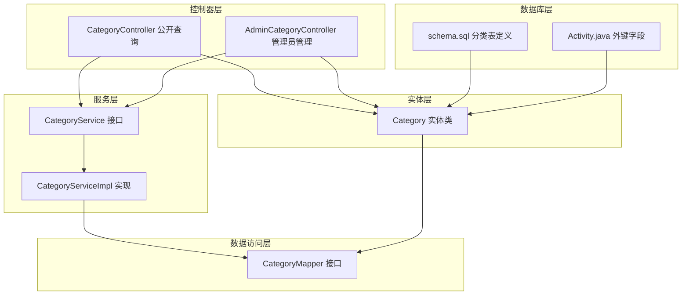
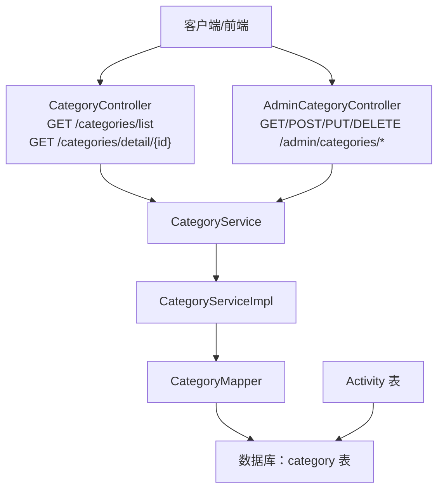
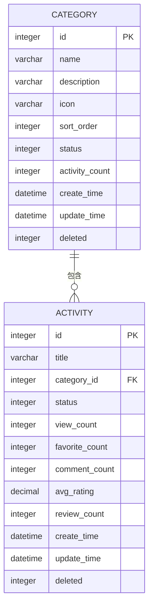
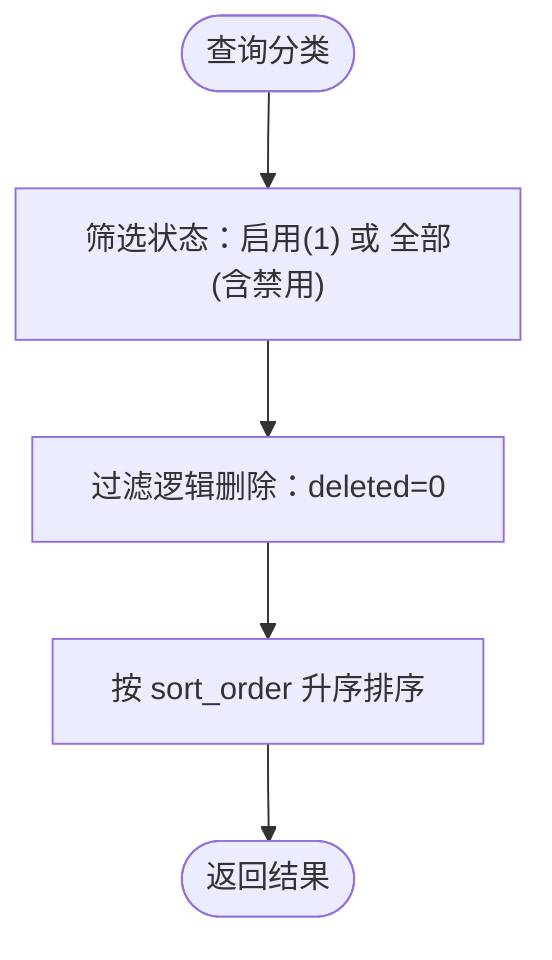
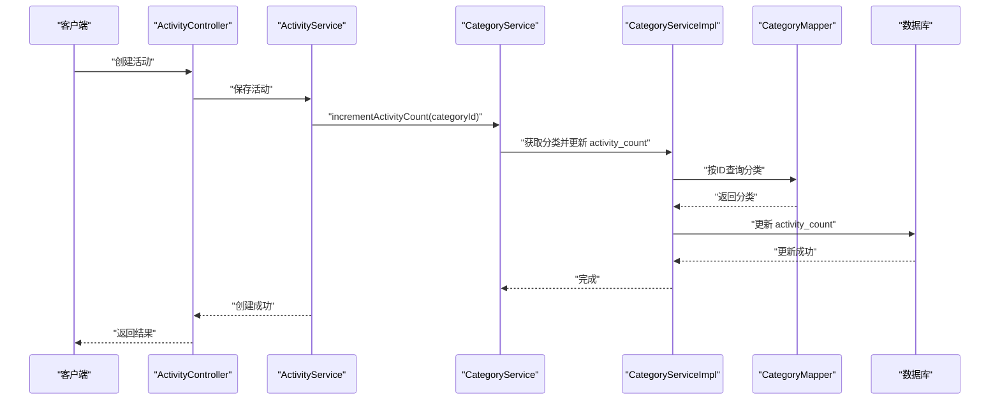
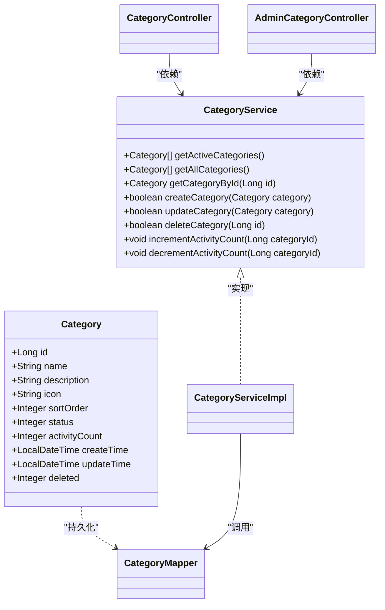

# 活动分类表 (category)

<cite>
**本文引用的文件**
- [Category.java](file://src/main/java/com/campus/eventsys/entity/Category.java)
- [CategoryMapper.java](file://src/main/java/com/campus/eventsys/mapper/CategoryMapper.java)
- [CategoryService.java](file://src/main/java/com/campus/eventsys/service/CategoryService.java)
- [CategoryServiceImpl.java](file://src/main/java/com/campus/eventsys/service/impl/CategoryServiceImpl.java)
- [CategoryController.java](file://src/main/java/com/campus/eventsys/controller/CategoryController.java)
- [AdminCategoryController.java](file://src/main/java/com/campus/eventsys/controller/AdminCategoryController.java)
- [schema.sql](file://src/main/resources/db/schema.sql)
- [Activity.java](file://src/main/java/com/campus/eventsys/entity/Activity.java)
</cite>

## 目录
1. [简介](#简介)
2. [项目结构](#项目结构)
3. [核心组件](#核心组件)
4. [架构总览](#架构总览)
5. [详细组件分析](#详细组件分析)
6. [依赖关系分析](#依赖关系分析)
7. [性能考量](#性能考量)
8. [故障排查指南](#故障排查指南)
9. [结论](#结论)
10. [附录](#附录)

## 简介
活动分类表（category）是校园活动综合管理系统中的基础数据表之一，用于对活动进行归类与展示。它与活动表（activity）形成一对多关系：一个分类可包含多个活动；一个活动仅属于一个分类。分类表包含名称、描述、图标、排序字段、状态等核心字段，并提供活动数量统计字段，用于前端展示与统计分析。

## 项目结构
围绕分类表的关键文件分布如下：
- 实体层：Category 实体类定义了分类的数据模型与注解映射
- 数据访问层：CategoryMapper 继承 MyBatis-Plus 基础 Mapper 接口
- 服务层：CategoryService 定义分类业务接口；CategoryServiceImpl 实现具体业务逻辑
- 控制器层：CategoryController 对外提供公开查询接口；AdminCategoryController 提供管理员管理接口
- 数据库层：schema.sql 定义分类表结构与索引；Activity.java 中的 categoryId 字段体现与活动的外键关系

**图表来源**
- [Category.java:12-51](file://src/main/java/com/campus/eventsys/entity/Category.java#L12-L51)
- [CategoryMapper.java:7-9](file://src/main/java/com/campus/eventsys/mapper/CategoryMapper.java#L7-L9)
- [CategoryService.java:11-52](file://src/main/java/com/campus/eventsys/service/CategoryService.java#L11-L52)
- [CategoryServiceImpl.java:16-74](file://src/main/java/com/campus/eventsys/service/impl/CategoryServiceImpl.java#L16-L74)
- [CategoryController.java:26-63](file://src/main/java/com/campus/eventsys/controller/CategoryController.java#L26-L63)
- [AdminCategoryController.java:34-121](file://src/main/java/com/campus/eventsys/controller/AdminCategoryController.java#L34-L121)
- [schema.sql:33-44](file://src/main/resources/db/schema.sql#L33-L44)
- [Activity.java:61](file://src/main/java/com/campus/eventsys/entity/Activity.java#L61)

**章节来源**
- [Category.java:12-51](file://src/main/java/com/campus/eventsys/entity/Category.java#L12-L51)
- [schema.sql:33-44](file://src/main/resources/db/schema.sql#L33-L44)

## 核心组件
- 实体类（Category）：定义分类的字段与注解映射，包含主键、名称、描述、图标、排序号、状态、活动数量、创建/更新时间、逻辑删除标记等
- Mapper（CategoryMapper）：继承 MyBatis-Plus 基础接口，提供通用 CRUD 能力
- Service（CategoryService/CategoryServiceImpl）：提供公开查询、全量查询、创建、更新、删除、活动数量增减等业务方法
- Controller（CategoryController/AdminCategoryController）：对外提供公开查询接口与管理员管理接口，区分权限与用途

**章节来源**
- [Category.java:12-51](file://src/main/java/com/campus/eventsys/entity/Category.java#L12-L51)
- [CategoryMapper.java:7-9](file://src/main/java/com/campus/eventsys/mapper/CategoryMapper.java#L7-L9)
- [CategoryService.java:11-52](file://src/main/java/com/campus/eventsys/service/CategoryService.java#L11-L52)
- [CategoryServiceImpl.java:16-74](file://src/main/java/com/campus/eventsys/service/impl/CategoryServiceImpl.java#L16-L74)
- [CategoryController.java:26-63](file://src/main/java/com/campus/eventsys/controller/CategoryController.java#L26-L63)
- [AdminCategoryController.java:34-121](file://src/main/java/com/campus/eventsys/controller/AdminCategoryController.java#L34-L121)

## 架构总览
分类模块遵循典型的分层架构：
- 表结构与索引定义于 schema.sql，确保数据完整性与查询性能
- 实体类通过注解映射数据库表字段，服务层封装业务逻辑，控制器层暴露 REST 接口
- 分类与活动之间通过外键建立一对多关系，活动数量字段用于前端展示与统计

**图表来源**
- [CategoryController.java:26-63](file://src/main/java/com/campus/eventsys/controller/CategoryController.java#L26-L63)
- [AdminCategoryController.java:34-121](file://src/main/java/com/campus/eventsys/controller/AdminCategoryController.java#L34-L121)
- [CategoryService.java:11-52](file://src/main/java/com/campus/eventsys/service/CategoryService.java#L11-L52)
- [CategoryServiceImpl.java:16-74](file://src/main/java/com/campus/eventsys/service/impl/CategoryServiceImpl.java#L16-L74)
- [CategoryMapper.java:7-9](file://src/main/java/com/campus/eventsys/mapper/CategoryMapper.java#L7-L9)
- [schema.sql:33-44](file://src/main/resources/db/schema.sql#L33-L44)
- [Activity.java:61](file://src/main/java/com/campus/eventsys/entity/Activity.java#L61)

## 详细组件分析

### 数据模型与字段定义
- 主键与标识：id（自增整型）
- 名称：name（非空字符串，用于分类展示）
- 描述：description（可选字符串，用于补充说明）
- 图标：icon（可选字符串，前端展示用图标标识）
- 排序字段：sort_order（整型，默认 0，用于前端排序）
- 状态：status（整型，默认 1，0-禁用，1-启用）
- 活动数量：activity_count（整型，默认 0，用于统计该分类下的活动数量）
- 时间戳：create_time、update_time（自动填充）
- 逻辑删除：deleted（整型，默认 0，0-未删除，1-已删除）

字段与默认值来源于数据库定义与实体类注解，确保一致性与可维护性。

**章节来源**
- [schema.sql:33-44](file://src/main/resources/db/schema.sql#L33-L44)
- [Category.java:17-50](file://src/main/java/com/campus/eventsys/entity/Category.java#L17-L50)

### 分类与活动的一对多关系
- 外键约束：activity.category_id 引用 category.id
- 关系说明：一个分类可包含多个活动；一个活动仅属于一个分类
- 查询路径：公开查询接口仅返回启用且未删除的分类；管理员接口返回全部分类（含禁用）

**图表来源**
- [schema.sql:33-44](file://src/main/resources/db/schema.sql#L33-L44)
- [schema.sql:50-77](file://src/main/resources/db/schema.sql#L50-L77)
- [Activity.java:61](file://src/main/java/com/campus/eventsys/entity/Activity.java#L61)

**章节来源**
- [schema.sql:50-77](file://src/main/resources/db/schema.sql#L50-L77)
- [Activity.java:61](file://src/main/java/com/campus/eventsys/entity/Activity.java#L61)

### 状态管理与排序机制
- 状态管理：
  - 启用/禁用：status=1 启用；status=0 禁用
  - 公开查询接口仅返回 status=1 的分类
  - 管理员接口返回全部分类（含禁用），便于统一管理
- 排序机制：
  - 使用 sort_order 升序排列
  - 公开查询与管理员查询均按排序号升序返回
- 逻辑删除：
  - deleted=0 未删除；deleted=1 已删除
  - 查询时默认过滤 deleted=0 的记录

**图表来源**
- [CategoryServiceImpl.java:18-33](file://src/main/java/com/campus/eventsys/service/impl/CategoryServiceImpl.java#L18-L33)
- [CategoryController.java:39-43](file://src/main/java/com/campus/eventsys/controller/CategoryController.java#L39-L43)
- [AdminCategoryController.java:50-54](file://src/main/java/com/campus/eventsys/controller/AdminCategoryController.java#L50-L54)

**章节来源**
- [CategoryServiceImpl.java:18-33](file://src/main/java/com/campus/eventsys/service/impl/CategoryServiceImpl.java#L18-L33)
- [CategoryController.java:39-43](file://src/main/java/com/campus/eventsys/controller/CategoryController.java#L39-L43)
- [AdminCategoryController.java:50-54](file://src/main/java/com/campus/eventsys/controller/AdminCategoryController.java#L50-L54)

### 活动数量统计（activity_count）的作用
- 作用：统计某分类下活动的数量，用于前端展示与运营统计
- 维护策略：
  - 创建活动时：调用分类服务的活动数量增加方法
  - 删除活动时：调用分类服务的活动数量减少方法
- 服务层实现：
  - incrementActivityCount：将指定分类的 activity_count 加 1
  - decrementActivityCount：将指定分类的 activity_count 减 1（确保不小于 0）

**图表来源**
- [CategoryServiceImpl.java:57-64](file://src/main/java/com/campus/eventsys/service/impl/CategoryServiceImpl.java#L57-L64)
- [CategoryMapper.java:7-9](file://src/main/java/com/campus/eventsys/mapper/CategoryMapper.java#L7-L9)

**章节来源**
- [CategoryServiceImpl.java:57-73](file://src/main/java/com/campus/eventsys/service/impl/CategoryServiceImpl.java#L57-L73)

### 分类表在活动管理中的作用与业务逻辑
- 展示层：公开查询接口返回启用的分类列表，按排序号升序排列，包含分类名称、图标、排序号、活动数量与状态
- 管理层：管理员接口提供全量查询、创建、更新、删除功能，支持禁用分类以控制前端展示
- 关联查询：活动列表可按分类 ID 进行筛选，实现分类维度的活动聚合
- 数据一致性：通过外键约束保证分类与活动的引用完整性；通过逻辑删除避免物理删除带来的数据丢失风险

**章节来源**
- [CategoryController.java:30-62](file://src/main/java/com/campus/eventsys/controller/CategoryController.java#L30-L62)
- [AdminCategoryController.java:38-120](file://src/main/java/com/campus/eventsys/controller/AdminCategoryController.java#L38-L120)
- [schema.sql:50-77](file://src/main/resources/db/schema.sql#L50-L77)

### 分类数据的维护策略与业务规则
- 维护策略：
  - 新建分类：初始化 activity_count=0，status=1（启用），sort_order 自定义
  - 更新分类：可修改名称、描述、图标、排序号、状态；禁用状态不影响历史活动归属
  - 删除分类：采用逻辑删除（deleted=1），删除前需清理该分类下的活动或迁移至其他分类
- 业务规则：
  - 公开查询仅返回启用且未删除的分类
  - 排序号决定前端展示顺序，数值越小优先显示
  - 活动数量字段由活动生命周期事件自动维护，确保统计准确性
  - 管理员权限：仅具备 ADMIN 角色方可访问管理员接口

**章节来源**
- [CategoryServiceImpl.java:40-55](file://src/main/java/com/campus/eventsys/service/impl/CategoryServiceImpl.java#L40-L55)
- [AdminCategoryController.java:38-120](file://src/main/java/com/campus/eventsys/controller/AdminCategoryController.java#L38-L120)
- [schema.sql:33-44](file://src/main/resources/db/schema.sql#L33-L44)

## 依赖关系分析
- 类关系图：实体类与服务实现类之间的依赖清晰，服务接口与实现分离，便于扩展与测试
- 控制器依赖：公开查询控制器与管理员控制器分别依赖服务接口，职责明确
- 数据库依赖：分类表与活动表通过外键关联，索引优化查询性能

**图表来源**
- [Category.java:12-51](file://src/main/java/com/campus/eventsys/entity/Category.java#L12-L51)
- [CategoryMapper.java:7-9](file://src/main/java/com/campus/eventsys/mapper/CategoryMapper.java#L7-L9)
- [CategoryService.java:11-52](file://src/main/java/com/campus/eventsys/service/CategoryService.java#L11-L52)
- [CategoryServiceImpl.java:16-74](file://src/main/java/com/campus/eventsys/service/impl/CategoryServiceImpl.java#L16-L74)
- [CategoryController.java:26-63](file://src/main/java/com/campus/eventsys/controller/CategoryController.java#L26-L63)
- [AdminCategoryController.java:34-121](file://src/main/java/com/campus/eventsys/controller/AdminCategoryController.java#L34-L121)

**章节来源**
- [Category.java:12-51](file://src/main/java/com/campus/eventsys/entity/Category.java#L12-L51)
- [CategoryService.java:11-52](file://src/main/java/com/campus/eventsys/service/CategoryService.java#L11-L52)
- [CategoryServiceImpl.java:16-74](file://src/main/java/com/campus/eventsys/service/impl/CategoryServiceImpl.java#L16-L74)
- [CategoryController.java:26-63](file://src/main/java/com/campus/eventsys/controller/CategoryController.java#L26-L63)
- [AdminCategoryController.java:34-121](file://src/main/java/com/campus/eventsys/controller/AdminCategoryController.java#L34-L121)

## 性能考量
- 索引优化：
  - 分类表索引：idx_category_status（status）、idx_category_sort（sort_order）
  - 活动表索引：idx_activity_category（category_id）
  - 通过索引提升查询效率，特别是按分类筛选与排序场景
- 查询策略：
  - 公开查询默认按排序号升序返回，减少前端排序成本
  - 逻辑删除字段统一过滤，避免扫描已删除数据
- 扩展建议：
  - 若分类数量增长，可考虑对 sort_order 建立复合索引以优化范围查询
  - 活动数量统计字段可结合缓存策略降低频繁读写带来的压力

**章节来源**
- [schema.sql:250-253](file://src/main/resources/db/schema.sql#L250-L253)
- [schema.sql:254-259](file://src/main/resources/db/schema.sql#L254-L259)

## 故障排查指南
- 公开查询无数据：
  - 检查分类状态是否为启用（status=1）且未被逻辑删除（deleted=0）
  - 确认排序号设置合理，避免出现异常排序
- 管理员接口报无权限：
  - 确认请求携带有效的 JWT 令牌并具备 ADMIN 角色
- 活动数量统计异常：
  - 检查活动生命周期事件是否正确调用分类服务的活动数量增减方法
  - 确保分类 ID 正确传递，避免跨分类统计错误
- 删除分类失败：
  - 确认该分类下无活动；如存在活动，请先迁移或删除后再执行删除操作

**章节来源**
- [CategoryController.java:30-62](file://src/main/java/com/campus/eventsys/controller/CategoryController.java#L30-L62)
- [AdminCategoryController.java:38-120](file://src/main/java/com/campus/eventsys/controller/AdminCategoryController.java#L38-L120)
- [CategoryServiceImpl.java:57-73](file://src/main/java/com/campus/eventsys/service/impl/CategoryServiceImpl.java#L57-L73)

## 结论
活动分类表（category）在系统中承担着分类展示与统计的核心职责。通过清晰的字段定义、严格的外键关系与完善的业务逻辑，实现了分类与活动的稳定关联。公开查询与管理员管理接口的职责分离，既满足了前端展示需求，又保障了后台管理的灵活性。配合索引与服务层的活动数量维护策略，整体架构具备良好的可扩展性与可维护性。

## 附录
- 数据库初始化脚本与索引定义参见 schema.sql
- 分类与活动的外键关系定义参见 schema.sql 中的 CREATE TABLE 语句
- 分类实体类字段定义参见 Category.java

**章节来源**
- [schema.sql:33-44](file://src/main/resources/db/schema.sql#L33-L44)
- [schema.sql:50-77](file://src/main/resources/db/schema.sql#L50-L77)
- [Category.java:12-51](file://src/main/java/com/campus/eventsys/entity/Category.java#L12-L51)