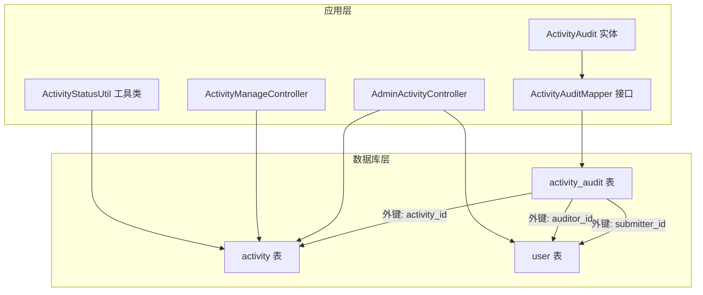
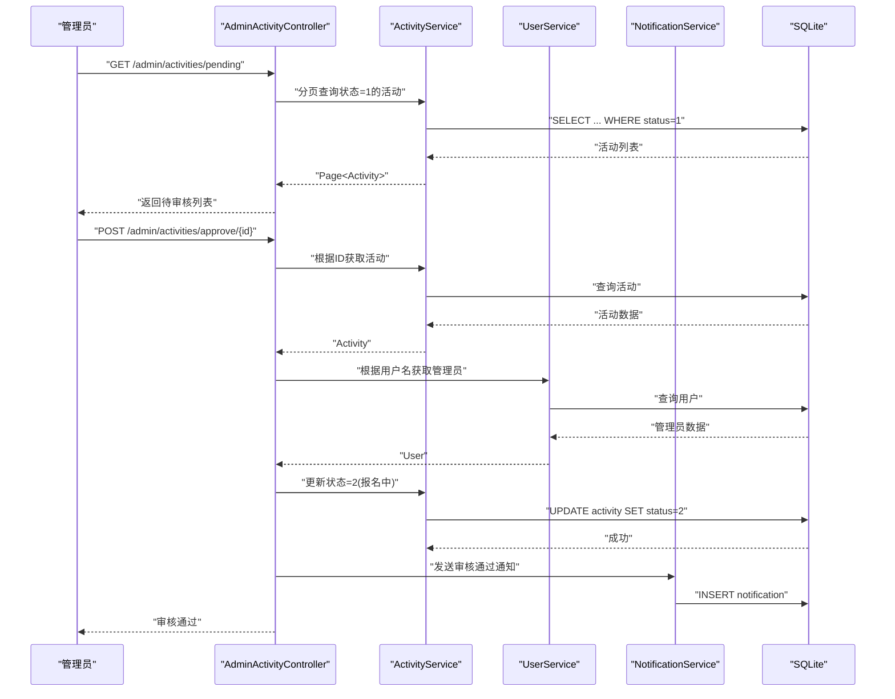
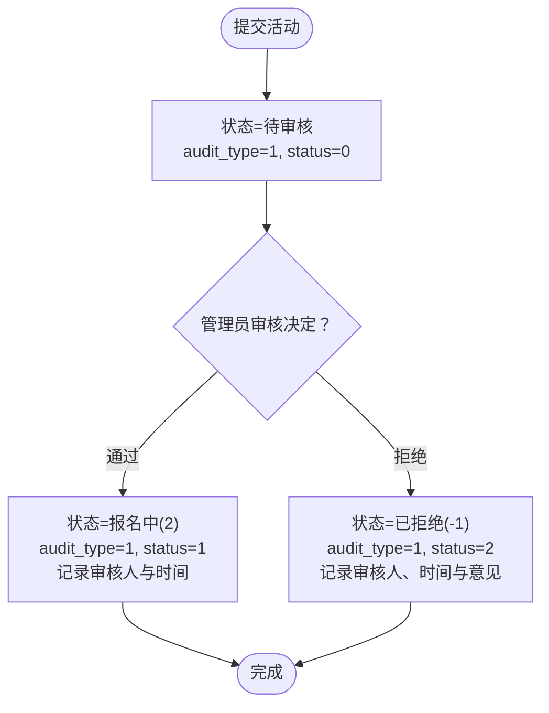
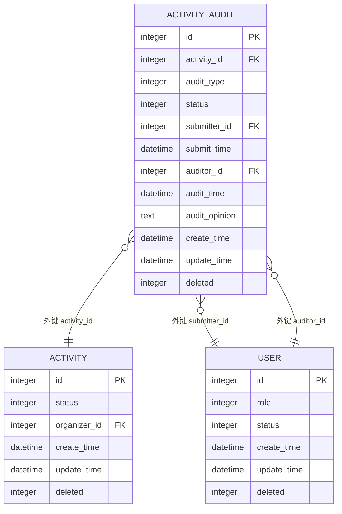
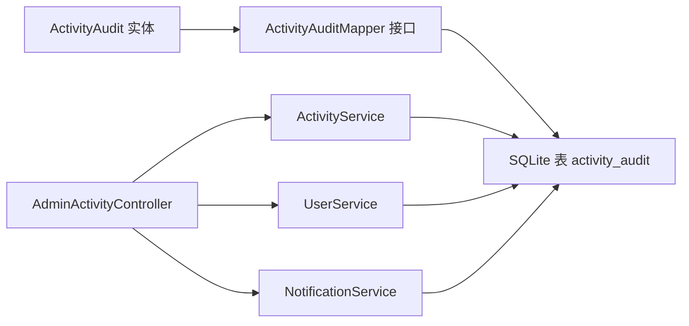

# 活动审核表 (activity_audit)

<cite>
**本文引用的文件**
- [ActivityAudit.java](file://src/main/java/com/campus/eventsys/entity/ActivityAudit.java)
- [ActivityAuditMapper.java](file://src/main/java/com/campus/eventsys/mapper/ActivityAuditMapper.java)
- [schema.sql](file://src/main/resources/db/schema.sql)
- [data.sql](file://src/main/resources/db/data.sql)
- [AdminActivityController.java](file://src/main/java/com/campus/eventsys/controller/AdminActivityController.java)
- [ActivityManageController.java](file://src/main/java/com/campus/eventsys/controller/ActivityManageController.java)
- [Activity.java](file://src/main/java/com/campus/eventsys/entity/Activity.java)
- [User.java](file://src/main/java/com/campus/eventsys/entity/User.java)
- [ActivityStatusUtil.java](file://src/main/java/com/campus/eventsys/utils/ActivityStatusUtil.java)
- [流程图5_活动审核.plantuml](file://picture/流程图5_活动审核.plantuml)
- [时序图3_活动审核.plantuml](file://picture/时序图3_活动审核.plantuml)
</cite>

## 目录
1. [简介](#简介)
2. [项目结构](#项目结构)
3. [核心组件](#核心组件)
4. [架构总览](#架构总览)
5. [详细组件分析](#详细组件分析)
6. [依赖关系分析](#依赖关系分析)
7. [性能考虑](#性能考虑)
8. [故障排查指南](#故障排查指南)
9. [结论](#结论)
10. [附录](#附录)

## 简介
活动审核表（activity_audit）用于完整记录活动在发布、修改、取消等场景下的审核过程，确保活动管理的合规性与可追溯性。该表记录提交人、审核人、审核类型、审核状态、提交与审核时间、审核意见等关键信息，并与活动表（activity）和用户表（user）建立外键关联，支撑管理员对活动的审批与管理。

## 项目结构
活动审核表位于数据库层，配合实体类、Mapper 接口与控制器共同实现完整的审核流程闭环。核心文件分布如下：
- 实体与映射：ActivityAudit 实体类与 ActivityAuditMapper 接口
- 数据库脚本：schema.sql 中定义表结构与索引；data.sql 提供示例数据
- 控制器：AdminActivityController 提供管理员审核接口；ActivityManageController 提供活动创建与状态流转说明
- 关联实体：Activity（活动）、User（用户）
- 工具类：ActivityStatusUtil 提供状态名称映射

**图表来源**
- [schema.sql:200-218](file://src/main/resources/db/schema.sql#L200-L218)
- [ActivityAudit.java:11-62](file://src/main/java/com/campus/eventsys/entity/ActivityAudit.java#L11-L62)
- [ActivityAuditMapper.java:1-10](file://src/main/java/com/campus/eventsys/mapper/ActivityAuditMapper.java#L1-L10)
- [AdminActivityController.java:55-235](file://src/main/java/com/campus/eventsys/controller/AdminActivityController.java#L55-L235)
- [ActivityManageController.java:65-141](file://src/main/java/com/campus/eventsys/controller/ActivityManageController.java#L65-L141)
- [ActivityStatusUtil.java:7-45](file://src/main/java/com/campus/eventsys/utils/ActivityStatusUtil.java#L7-L45)

**章节来源**
- [schema.sql:200-218](file://src/main/resources/db/schema.sql#L200-L218)
- [ActivityAudit.java:11-62](file://src/main/java/com/campus/eventsys/entity/ActivityAudit.java#L11-L62)
- [ActivityAuditMapper.java:1-10](file://src/main/java/com/campus/eventsys/mapper/ActivityAuditMapper.java#L1-L10)
- [AdminActivityController.java:55-235](file://src/main/java/com/campus/eventsys/controller/AdminActivityController.java#L55-L235)
- [ActivityManageController.java:65-141](file://src/main/java/com/campus/eventsys/controller/ActivityManageController.java#L65-L141)
- [ActivityStatusUtil.java:7-45](file://src/main/java/com/campus/eventsys/utils/ActivityStatusUtil.java#L7-L45)

## 核心组件
- 实体类 ActivityAudit：定义审核记录的字段与注解，包括主键、活动ID、审核类型、状态、提交人与审核人 ID、提交与审核时间、审核意见及通用审计字段（创建/更新时间、逻辑删除）。
- Mapper 接口 ActivityAuditMapper：基于 MyBatis-Plus 的基础接口，提供对 activity_audit 表的通用 CRUD 能力。
- 数据库脚本：schema.sql 定义表结构、外键约束与索引；data.sql 提供示例数据，覆盖“待审核”“已通过”“已拒绝”等状态。
- 控制器：AdminActivityController 提供管理员审核接口（通过/拒绝），并发送通知；ActivityManageController 说明活动创建后的状态流转（从待审核到报名中）。
- 关联实体：Activity（活动）与 User（用户）分别通过外键与审核记录关联，形成完整的审核轨迹。

**章节来源**
- [ActivityAudit.java:11-62](file://src/main/java/com/campus/eventsys/entity/ActivityAudit.java#L11-L62)
- [ActivityAuditMapper.java:1-10](file://src/main/java/com/campus/eventsys/mapper/ActivityAuditMapper.java#L1-L10)
- [schema.sql:200-218](file://src/main/resources/db/schema.sql#L200-L218)
- [data.sql:285-302](file://src/main/resources/db/data.sql#L285-L302)
- [AdminActivityController.java:167-235](file://src/main/java/com/campus/eventsys/controller/AdminActivityController.java#L167-L235)
- [ActivityManageController.java:78-141](file://src/main/java/com/campus/eventsys/controller/ActivityManageController.java#L78-L141)

## 架构总览
活动审核流程围绕 activity_audit 表展开，管理员通过控制器接口对活动进行审核，审核结果直接影响活动状态与通知发送。实体与映射层负责持久化，数据库层通过外键与索引保障数据一致性与查询效率。

**图表来源**
- [AdminActivityController.java:67-201](file://src/main/java/com/campus/eventsys/controller/AdminActivityController.java#L67-L201)
- [ActivityManageController.java:78-141](file://src/main/java/com/campus/eventsys/controller/ActivityManageController.java#L78-L141)
- [时序图3_活动审核.plantuml:1-36](file://picture/时序图3_活动审核.plantuml#L1-L36)

**章节来源**
- [AdminActivityController.java:67-201](file://src/main/java/com/campus/eventsys/controller/AdminActivityController.java#L67-L201)
- [ActivityManageController.java:78-141](file://src/main/java/com/campus/eventsys/controller/ActivityManageController.java#L78-L141)
- [时序图3_活动审核.plantuml:1-36](file://picture/时序图3_活动审核.plantuml#L1-L36)

## 详细组件分析

### 字段定义与含义
- id：审核记录主键（输入型 ID，SQLite 不支持自增主键生成）
- activity_id：关联活动 ID，外键指向 activity.id
- audit_type：审核类型，1-活动发布审核，2-活动修改审核，3-活动取消审核
- status：审核状态，0-待审核，1-已通过，2-已拒绝
- submitter_id：提交人 ID，外键指向 user.id
- submit_time：提交时间，默认当前时间戳
- auditor_id：审核人 ID，外键指向 user.id
- audit_time：审核时间
- audit_opinion：审核意见
- create_time/update_time：创建与更新时间（通用审计字段）
- deleted：逻辑删除标志（通用审计字段）

上述字段均在实体类与数据库脚本中明确声明，确保字段语义一致与持久化正确。

**章节来源**
- [ActivityAudit.java:19-61](file://src/main/java/com/campus/eventsys/entity/ActivityAudit.java#L19-L61)
- [schema.sql:202-218](file://src/main/resources/db/schema.sql#L202-L218)

### 审核流程与状态流转
- 提交：活动创建后状态为“待审核”，进入 activity_audit 记录，audit_type=1，status=0
- 审核通过：管理员将活动状态更新为“报名中”，同时更新 audit_type=1，status=1，并记录 auditor_id 与 audit_time
- 审核拒绝：管理员将活动状态更新为“已拒绝”，同时更新 audit_type=1，status=2，并记录 auditor_id、audit_time 与 audit_opinion
- 索引优化：数据库为 activity_audit 建立了 activity_id、status、submitter_id 等索引，便于按状态与活动快速检索

**图表来源**
- [流程图5_活动审核.plantuml:1-21](file://picture/流程图5_活动审核.plantuml#L1-L21)
- [AdminActivityController.java:167-235](file://src/main/java/com/campus/eventsys/controller/AdminActivityController.java#L167-L235)
- [schema.sql:287-291](file://src/main/resources/db/schema.sql#L287-L291)

**章节来源**
- [流程图5_活动审核.plantuml:1-21](file://picture/流程图5_活动审核.plantuml#L1-L21)
- [AdminActivityController.java:167-235](file://src/main/java/com/campus/eventsys/controller/AdminActivityController.java#L167-L235)
- [schema.sql:287-291](file://src/main/resources/db/schema.sql#L287-L291)

### 关联关系与数据模型
- 与活动表（activity）：一对多关系，一个活动可有多条审核记录；外键 activity_id 约束
- 与用户表（user）：两条外键，submitter_id 与 auditor_id 分别指向 user.id
- 索引策略：为 activity_id、status、submitter_id 建立索引，提升查询性能与并发安全性

**图表来源**
- [schema.sql:200-218](file://src/main/resources/db/schema.sql#L200-L218)

**章节来源**
- [schema.sql:200-218](file://src/main/resources/db/schema.sql#L200-L218)

### 审核历史追溯
- 审核历史通过 activity_audit 表完整记录，包含每次提交与审核的关键信息（提交人、审核人、时间、意见）
- 示例数据覆盖“待审核”“已通过”“已拒绝”等状态，便于测试与验证
- 通过 activity_id 可查询某活动的所有审核记录，形成完整的审计轨迹

**章节来源**
- [data.sql:285-302](file://src/main/resources/db/data.sql#L285-L302)

### 在活动管理中的作用与合规性要求
- 作用：确保活动发布、修改、取消等行为经过合规审核，防止违规内容上线；为运营与监管提供可追溯证据
- 合规性：记录审核人、审核时间、审核意见，满足审计留痕要求；通过逻辑删除与索引优化保障数据完整性与查询效率

**章节来源**
- [AdminActivityController.java:167-235](file://src/main/java/com/campus/eventsys/controller/AdminActivityController.java#L167-L235)
- [schema.sql:200-218](file://src/main/resources/db/schema.sql#L200-L218)

## 依赖关系分析
- ActivityAudit 实体依赖 MyBatis-Plus 注解与 Lombok，用于简化实体定义与自动填充
- ActivityAuditMapper 继承 MyBatis-Plus 基础接口，提供通用 CRUD 能力
- 控制器依赖 Service 层与通知服务，实现业务逻辑与通知发送
- 数据库层通过外键与索引保障数据一致性与查询性能

**图表来源**
- [ActivityAudit.java:11-62](file://src/main/java/com/campus/eventsys/entity/ActivityAudit.java#L11-L62)
- [ActivityAuditMapper.java:1-10](file://src/main/java/com/campus/eventsys/mapper/ActivityAuditMapper.java#L1-L10)
- [AdminActivityController.java:55-235](file://src/main/java/com/campus/eventsys/controller/AdminActivityController.java#L55-L235)

**章节来源**
- [ActivityAudit.java:11-62](file://src/main/java/com/campus/eventsys/entity/ActivityAudit.java#L11-L62)
- [ActivityAuditMapper.java:1-10](file://src/main/java/com/campus/eventsys/mapper/ActivityAuditMapper.java#L1-L10)
- [AdminActivityController.java:55-235](file://src/main/java/com/campus/eventsys/controller/AdminActivityController.java#L55-L235)

## 性能考虑
- 索引优化：为 activity_id、status、submitter_id 建立索引，提升按状态与活动查询效率
- 逻辑删除：deleted 字段统一管理软删除，避免全表扫描
- 时间字段：submit_time 与 audit_time 使用数据库默认值，减少应用层时间计算开销
- 批量查询：控制器按状态筛选与分页查询，降低单次响应负载

**章节来源**
- [schema.sql:287-291](file://src/main/resources/db/schema.sql#L287-L291)
- [ActivityAudit.java:53-61](file://src/main/java/com/campus/eventsys/entity/ActivityAudit.java#L53-L61)

## 故障排查指南
- 审核状态异常：检查 activity_audit 表中对应 activity_id 的记录，确认 status 是否正确更新
- 审核人缺失：确认 auditor_id 与 audit_time 是否被正确写入
- 查询性能问题：确认是否使用了 activity_id、status 等索引字段进行过滤
- 数据一致性：核对 activity 表状态与 activity_audit 记录是否匹配

**章节来源**
- [schema.sql:200-218](file://src/main/resources/db/schema.sql#L200-L218)
- [data.sql:285-302](file://src/main/resources/db/data.sql#L285-L302)

## 结论
活动审核表（activity_audit）通过标准化的字段定义与严格的外键约束，完整记录活动审核的全过程，为管理员审核、活动状态流转与合规审计提供了可靠的数据基础。结合数据库索引与控制器接口，系统实现了高效、可追溯的活动审核管理能力。

## 附录
- 状态码参考：-2-已下架，-1-已拒绝，0-草稿，1-待审核，2-报名中，3-即将开始，4-进行中，5-已结束
- 审核类型参考：1-活动发布审核，2-活动修改审核，3-活动取消审核

**章节来源**
- [ActivityStatusUtil.java:11-28](file://src/main/java/com/campus/eventsys/utils/ActivityStatusUtil.java#L11-L28)
- [ActivityManageController.java:42-50](file://src/main/java/com/campus/eventsys/controller/ActivityManageController.java#L42-L50)