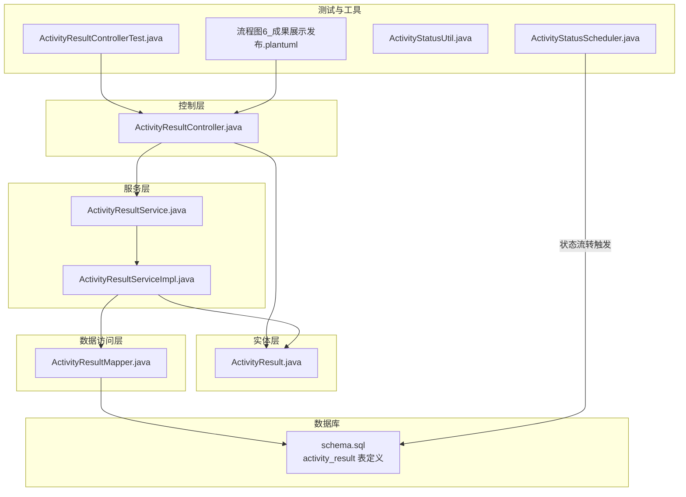
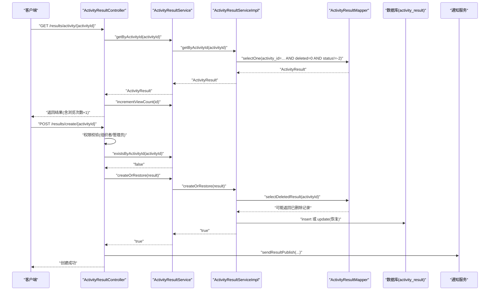
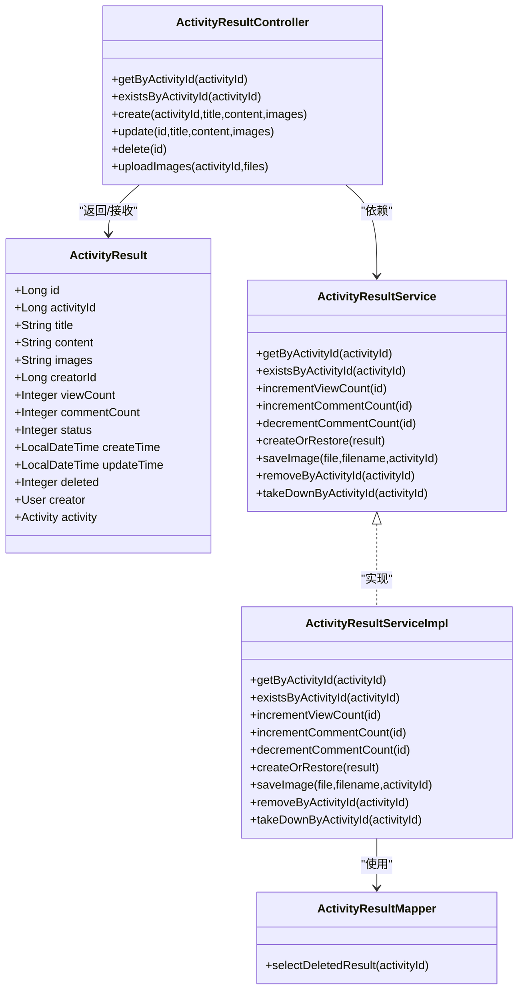
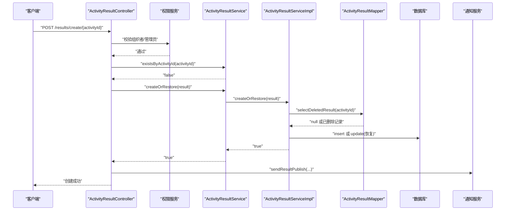
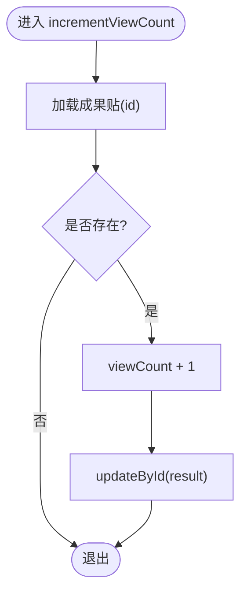
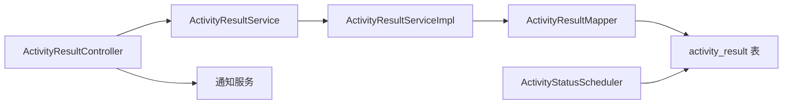

# 活动成果表 (activity_result)

<cite>
**本文引用的文件**
- [ActivityResult.java](file://src/main/java/com/campus/eventsys/entity/ActivityResult.java)
- [ActivityResultController.java](file://src/main/java/com/campus/eventsys/controller/ActivityResultController.java)
- [ActivityResultService.java](file://src/main/java/com/campus/eventsys/service/ActivityResultService.java)
- [ActivityResultServiceImpl.java](file://src/main/java/com/campus/eventsys/service/impl/ActivityResultServiceImpl.java)
- [ActivityResultMapper.java](file://src/main/java/com/campus/eventsys/mapper/ActivityResultMapper.java)
- [schema.sql](file://src/main/resources/db/schema.sql)
- [ActivityResultControllerTest.java](file://src/test/java/com/campus/eventsys/controller/ActivityResultControllerTest.java)
- [ActivityStatusScheduler.java](file://src/main/java/com/campus/eventsys/scheduler/ActivityStatusScheduler.java)
- [ActivityStatusUtil.java](file://src/main/java/com/campus/eventsys/utils/ActivityStatusUtil.java)
- [流程图6_成果展示发布.plantuml](file://picture/流程图6_成果展示发布.plantuml)
</cite>

## 目录
1. [简介](#简介)
2. [项目结构](#项目结构)
3. [核心组件](#核心组件)
4. [架构总览](#架构总览)
5. [详细组件分析](#详细组件分析)
6. [依赖关系分析](#依赖关系分析)
7. [性能考量](#性能考量)
8. [故障排查指南](#故障排查指南)
9. [结论](#结论)
10. [附录](#附录)

## 简介
活动成果表（activity_result）是校园活动综合管理系统中用于展示活动结束后成果的专用数据表。它与活动表（activity）形成一对一关系（UNIQUE(activity_id)），承载活动结束后的回顾内容，包括标题、内容（Markdown）、图片集合、浏览量、评论数、状态等字段，并提供完整的创建、更新、删除、浏览统计、图片上传等能力。本文档将从字段定义、业务定位、创建时机、审核机制、展示逻辑、生命周期与数据流等方面进行全面说明。

## 项目结构
围绕活动成果表的相关代码与资源分布如下：
- 实体层：ActivityResult.java
- 控制器层：ActivityResultController.java
- 服务层：ActivityResultService.java、ActivityResultServiceImpl.java
- 数据访问层：ActivityResultMapper.java
- 数据库脚本：schema.sql
- 单元测试：ActivityResultControllerTest.java
- 定时任务：ActivityStatusScheduler.java
- 工具类：ActivityStatusUtil.java
- 流程图：流程图6_成果展示发布.plantuml



图表来源
- [ActivityResult.java:1-69](file://src/main/java/com/campus/eventsys/entity/ActivityResult.java#L1-L69)
- [ActivityResultController.java:1-376](file://src/main/java/com/campus/eventsys/controller/ActivityResultController.java#L1-L376)
- [ActivityResultService.java:1-88](file://src/main/java/com/campus/eventsys/service/ActivityResultService.java#L1-L88)
- [ActivityResultServiceImpl.java:1-193](file://src/main/java/com/campus/eventsys/service/impl/ActivityResultServiceImpl.java#L1-L193)
- [ActivityResultMapper.java:1-19](file://src/main/java/com/campus/eventsys/mapper/ActivityResultMapper.java#L1-L19)
- [schema.sql:102-121](file://src/main/resources/db/schema.sql#L102-L121)
- [ActivityResultControllerTest.java:1-334](file://src/test/java/com/campus/eventsys/controller/ActivityResultControllerTest.java#L1-L334)
- [ActivityStatusScheduler.java:1-42](file://src/main/java/com/campus/eventsys/scheduler/ActivityStatusScheduler.java#L1-L42)
- [ActivityStatusUtil.java:1-46](file://src/main/java/com/campus/eventsys/utils/ActivityStatusUtil.java#L1-L46)
- [流程图6_成果展示发布.plantuml:1-26](file://picture/流程图6_成果展示发布.plantuml#L1-L26)

章节来源
- [ActivityResult.java:1-69](file://src/main/java/com/campus/eventsys/entity/ActivityResult.java#L1-L69)
- [ActivityResultController.java:1-376](file://src/main/java/com/campus/eventsys/controller/ActivityResultController.java#L1-L376)
- [ActivityResultService.java:1-88](file://src/main/java/com/campus/eventsys/service/ActivityResultService.java#L1-L88)
- [ActivityResultServiceImpl.java:1-193](file://src/main/java/com/campus/eventsys/service/impl/ActivityResultServiceImpl.java#L1-L193)
- [ActivityResultMapper.java:1-19](file://src/main/java/com/campus/eventsys/mapper/ActivityResultMapper.java#L1-L19)
- [schema.sql:102-121](file://src/main/resources/db/schema.sql#L102-L121)
- [ActivityResultControllerTest.java:1-334](file://src/test/java/com/campus/eventsys/controller/ActivityResultControllerTest.java#L1-L334)
- [ActivityStatusScheduler.java:1-42](file://src/main/java/com/campus/eventsys/scheduler/ActivityStatusScheduler.java#L1-L42)
- [ActivityStatusUtil.java:1-46](file://src/main/java/com/campus/eventsys/utils/ActivityStatusUtil.java#L1-L46)
- [流程图6_成果展示发布.plantuml:1-26](file://picture/流程图6_成果展示发布.plantuml#L1-L26)

## 核心组件
- 实体类：ActivityResult.java 定义了成果表的全部字段及注解，包括主键、关联活动ID、标题、内容（Markdown）、图片集合、创建者ID、浏览次数、评论次数、状态、时间戳与逻辑删除标志等。
- 控制器：ActivityResultController.java 提供对外接口，包括按活动ID获取成果详情、检查是否存在、创建、更新、删除、图片上传等。
- 服务接口与实现：ActivityResultService.java 定义业务方法；ActivityResultServiceImpl.java 实现查询、计数增减、创建/恢复、图片保存、按活动ID删除/下架等。
- 数据访问：ActivityResultMapper.java 提供自定义查询（含已删除记录）以支持“删除后恢复”的场景。
- 数据库脚本：schema.sql 中定义了 activity_result 的完整结构、外键约束与唯一约束（UNIQUE(activity_id)）。
- 测试：ActivityResultControllerTest.java 覆盖主要业务分支，验证权限、存在性、创建/更新/删除流程。
- 定时任务与工具：ActivityStatusScheduler.java 与 ActivityStatusUtil.java 为活动状态管理提供支撑，间接影响成果表的生命周期（如“已结束”状态下的成果发布）。

章节来源
- [ActivityResult.java:1-69](file://src/main/java/com/campus/eventsys/entity/ActivityResult.java#L1-L69)
- [ActivityResultController.java:1-376](file://src/main/java/com/campus/eventsys/controller/ActivityResultController.java#L1-L376)
- [ActivityResultService.java:1-88](file://src/main/java/com/campus/eventsys/service/ActivityResultService.java#L1-L88)
- [ActivityResultServiceImpl.java:1-193](file://src/main/java/com/campus/eventsys/service/impl/ActivityResultServiceImpl.java#L1-L193)
- [ActivityResultMapper.java:1-19](file://src/main/java/com/campus/eventsys/mapper/ActivityResultMapper.java#L1-L19)
- [schema.sql:102-121](file://src/main/resources/db/schema.sql#L102-L121)
- [ActivityResultControllerTest.java:1-334](file://src/test/java/com/campus/eventsys/controller/ActivityResultControllerTest.java#L1-L334)
- [ActivityStatusScheduler.java:1-42](file://src/main/java/com/campus/eventsys/scheduler/ActivityStatusScheduler.java#L1-L42)
- [ActivityStatusUtil.java:1-46](file://src/main/java/com/campus/eventsys/utils/ActivityStatusUtil.java#L1-L46)

## 架构总览
活动成果表在系统中的职责是承载活动结束后的成果展示内容，控制器负责权限校验与调用服务，服务层封装业务逻辑并访问数据库，实体类映射表结构，测试覆盖关键流程。



图表来源
- [ActivityResultController.java:57-83](file://src/main/java/com/campus/eventsys/controller/ActivityResultController.java#L57-L83)
- [ActivityResultController.java:119-171](file://src/main/java/com/campus/eventsys/controller/ActivityResultController.java#L119-L171)
- [ActivityResultServiceImpl.java:34-43](file://src/main/java/com/campus/eventsys/service/impl/ActivityResultServiceImpl.java#L34-L43)
- [ActivityResultServiceImpl.java:84-112](file://src/main/java/com/campus/eventsys/service/impl/ActivityResultServiceImpl.java#L84-L112)
- [ActivityResultMapper.java:12-17](file://src/main/java/com/campus/eventsys/mapper/ActivityResultMapper.java#L12-L17)

## 详细组件分析

### 字段定义与含义
- id：成果贴主键（自增）
- activity_id：关联活动ID，唯一约束（UNIQUE(activity_id)），确保每个活动仅有一条成果记录
- title：成果贴标题
- content：成果贴内容，采用 Markdown 格式
- images：图片URL集合，JSON数组格式
- creator_id：创建者ID（组织者或管理员）
- view_count：浏览次数，默认0
- comment_count：评论数量，默认0
- status：状态，-2已下架、0草稿、1已发布
- create_time/update_time：创建与更新时间（自动填充）
- deleted：逻辑删除标志，0未删除、1已删除

章节来源
- [ActivityResult.java:19-58](file://src/main/java/com/campus/eventsys/entity/ActivityResult.java#L19-L58)
- [schema.sql:106-121](file://src/main/resources/db/schema.sql#L106-L121)

### 一对一关系与业务定位
- 关系：activity_result.activity_id 唯一约束，与 activity.id 外键关联，形成一对一关系
- 业务定位：活动结束后由组织者或管理员创建，用于展示活动成果，支持 Markdown 内容与图片，提供浏览与评论统计
- 生命周期：活动状态达到“已结束”后，组织者方可创建；若活动被下架，成果贴状态同步为“已下架”

章节来源
- [schema.sql:108](file://src/main/resources/db/schema.sql#L108)
- [ActivityResultController.java:104-110](file://src/main/java/com/campus/eventsys/controller/ActivityResultController.java#L104-L110)
- [ActivityResultServiceImpl.java:170-191](file://src/main/java/com/campus/eventsys/service/impl/ActivityResultServiceImpl.java#L170-L191)

### 创建时机与审核机制
- 创建时机：活动状态为“已结束”后，组织者或管理员可创建成果贴
- 权限要求：仅活动组织者或系统管理员可创建
- 重复保护：每个活动仅允许一条未删除且未下架的成果贴；若已存在则提示使用更新接口
- 审核机制：成果贴创建即默认发布（status=1），不涉及后台人工审核流程

章节来源
- [ActivityResultController.java:139-149](file://src/main/java/com/campus/eventsys/controller/ActivityResultController.java#L139-L149)
- [ActivityResultServiceImpl.java:46-55](file://src/main/java/com/campus/eventsys/service/impl/ActivityResultServiceImpl.java#L46-L55)
- [ActivityStatusUtil.java:15-28](file://src/main/java/com/campus/eventsys/utils/ActivityStatusUtil.java#L15-L28)

### 展示逻辑与数据流
- 查询：按 activity_id 查询，自动过滤已删除与已下架记录
- 浏览：每次查询详情时浏览次数+1
- 展示：返回成果贴信息、创建者信息与活动信息
- 图片：支持多图上传，按活动ID分目录存储，返回访问URL数组
- 通知：创建成功后向已通过审核的参与者发送成果发布通知

章节来源
- [ActivityResultController.java:63-83](file://src/main/java/com/campus/eventsys/controller/ActivityResultController.java#L63-L83)
- [ActivityResultController.java:294-347](file://src/main/java/com/campus/eventsys/controller/ActivityResultController.java#L294-L347)
- [ActivityResultServiceImpl.java:57-64](file://src/main/java/com/campus/eventsys/service/impl/ActivityResultServiceImpl.java#L57-L64)
- [ActivityResultServiceImpl.java:114-146](file://src/main/java/com/campus/eventsys/service/impl/ActivityResultServiceImpl.java#L114-L146)

### 删除与下架策略
- 删除：逻辑删除（deleted=1），保留数据以便后续恢复
- 下架：将 status 更新为 -2，用于活动被下架时同步处理
- 清理：提供按活动ID删除/下架的服务方法，便于活动删除或状态变更时的联动处理

章节来源
- [ActivityResultServiceImpl.java:148-168](file://src/main/java/com/campus/eventsys/service/impl/ActivityResultServiceImpl.java#L148-L168)
- [ActivityResultServiceImpl.java:170-191](file://src/main/java/com/campus/eventsys/service/impl/ActivityResultServiceImpl.java#L170-L191)

### 类关系图


图表来源
- [ActivityResult.java:19-67](file://src/main/java/com/campus/eventsys/entity/ActivityResult.java#L19-L67)
- [ActivityResultController.java:44-376](file://src/main/java/com/campus/eventsys/controller/ActivityResultController.java#L44-L376)
- [ActivityResultService.java:12-87](file://src/main/java/com/campus/eventsys/service/ActivityResultService.java#L12-L87)
- [ActivityResultServiceImpl.java:25-192](file://src/main/java/com/campus/eventsys/service/impl/ActivityResultServiceImpl.java#L25-L192)
- [ActivityResultMapper.java:10-17](file://src/main/java/com/campus/eventsys/mapper/ActivityResultMapper.java#L10-L17)

### API 调用序列图（创建流程）


图表来源
- [ActivityResultController.java:119-171](file://src/main/java/com/campus/eventsys/controller/ActivityResultController.java#L119-L171)
- [ActivityResultServiceImpl.java:84-112](file://src/main/java/com/campus/eventsys/service/impl/ActivityResultServiceImpl.java#L84-L112)
- [ActivityResultMapper.java:12-17](file://src/main/java/com/campus/eventsys/mapper/ActivityResultMapper.java#L12-L17)

### 算法流程图（浏览计数）


图表来源
- [ActivityResultServiceImpl.java:57-64](file://src/main/java/com/campus/eventsys/service/impl/ActivityResultServiceImpl.java#L57-L64)

### 数据模型图（ER）
```mermaid
erDiagram
ACTIVITY {
integer id PK
string title
integer status
datetime start_time
datetime end_time
}
ACTIVITY_RESULT {
integer id PK
integer activity_id UK FK
string title
string content
string images
integer creator_id FK
integer view_count
integer comment_count
integer status
datetime create_time
datetime update_time
integer deleted
}
USER {
integer id PK
string username
integer role
}
ACTIVITY_RESULT }o--|| ACTIVITY : "一对一"
ACTIVITY_RESULT }o--|| USER : "创建者"
```

图表来源
- [schema.sql:106-121](file://src/main/resources/db/schema.sql#L106-L121)

## 依赖关系分析
- 控制器依赖服务接口，服务实现依赖数据访问层，数据访问层依赖数据库表结构
- 成功创建成果贴后，控制器会调用通知服务向已通过审核的参与者发送成果发布通知
- 定时任务负责活动状态的自动更新，间接影响成果贴的可见性（如活动被下架时同步下架成果贴）



图表来源
- [ActivityResultController.java:46-51](file://src/main/java/com/campus/eventsys/controller/ActivityResultController.java#L46-L51)
- [ActivityResultServiceImpl.java:25](file://src/main/java/com/campus/eventsys/service/impl/ActivityResultServiceImpl.java#L25)
- [ActivityResultMapper.java:10](file://src/main/java/com/campus/eventsys/mapper/ActivityResultMapper.java#L10)
- [schema.sql:106-121](file://src/main/resources/db/schema.sql#L106-L121)
- [ActivityStatusScheduler.java:31-40](file://src/main/java/com/campus/eventsys/scheduler/ActivityStatusScheduler.java#L31-L40)

章节来源
- [ActivityResultController.java:46-51](file://src/main/java/com/campus/eventsys/controller/ActivityResultController.java#L46-L51)
- [ActivityResultServiceImpl.java:25](file://src/main/java/com/campus/eventsys/service/impl/ActivityResultServiceImpl.java#L25)
- [ActivityResultMapper.java:10](file://src/main/java/com/campus/eventsys/mapper/ActivityResultMapper.java#L10)
- [schema.sql:106-121](file://src/main/resources/db/schema.sql#L106-L121)
- [ActivityStatusScheduler.java:31-40](file://src/main/java/com/campus/eventsys/scheduler/ActivityStatusScheduler.java#L31-L40)

## 性能考量
- 查询优化：为 activity_id 建立索引，提升按活动ID查询与去重效率
- 计数更新：浏览与评论计数采用单条更新，避免复杂事务
- 图片存储：按活动ID分目录存储，减少单目录文件数量，提高IO性能
- 逻辑删除：通过 deleted 字段实现软删除，降低物理删除带来的维护成本

章节来源
- [schema.sql:265-267](file://src/main/resources/db/schema.sql#L265-L267)
- [ActivityResultServiceImpl.java:57-82](file://src/main/java/com/campus/eventsys/service/impl/ActivityResultServiceImpl.java#L57-L82)
- [ActivityResultServiceImpl.java:114-146](file://src/main/java/com/campus/eventsys/service/impl/ActivityResultServiceImpl.java#L114-L146)

## 故障排查指南
- “成果贴不存在”：确认 activity_id 是否正确，且未被逻辑删除或下架
- “无权限”：仅活动组织者或管理员可创建/更新/删除；检查用户角色与活动组织者身份
- “已存在成果贴”：每个活动仅允许一条未删除且未下架的成果贴；请使用更新接口
- “图片上传失败”：检查文件数量（≤9张）、大小（≤10MB）、格式（仅图片）、存储目录权限
- “浏览次数未增加”：确认查询接口是否正常调用浏览计数更新逻辑

章节来源
- [ActivityResultController.java:67-72](file://src/main/java/com/campus/eventsys/controller/ActivityResultController.java#L67-L72)
- [ActivityResultController.java:139-149](file://src/main/java/com/campus/eventsys/controller/ActivityResultController.java#L139-L149)
- [ActivityResultController.java:299-346](file://src/main/java/com/campus/eventsys/controller/ActivityResultController.java#L299-L346)
- [ActivityResultControllerTest.java:106-122](file://src/test/java/com/campus/eventsys/controller/ActivityResultControllerTest.java#L106-L122)
- [ActivityResultControllerTest.java:191-222](file://src/test/java/com/campus/eventsys/controller/ActivityResultControllerTest.java#L191-L222)
- [ActivityResultControllerTest.java:241-277](file://src/test/java/com/campus/eventsys/controller/ActivityResultControllerTest.java#L241-L277)
- [ActivityResultControllerTest.java:296-332](file://src/test/java/com/campus/eventsys/controller/ActivityResultControllerTest.java#L296-L332)

## 结论
活动成果表（activity_result）在系统中承担活动结束后成果展示的核心职责，通过一对一关系与活动表紧密耦合。其设计强调易用性与可维护性：权限明确、创建即发布、浏览与评论计数自动化、图片上传规范化、逻辑删除与状态同步保障数据一致性。配合定时任务的状态管理与通知机制，实现了从活动结束到成果发布的完整闭环。

## 附录
- 业务流程参考：成果展示发布流程图展示了组织者创建成果贴、用户查看与评论、组织者管理与更新的典型流程
- 状态工具：ActivityStatusUtil 提供状态名称映射，便于前端展示与日志输出

章节来源
- [流程图6_成果展示发布.plantuml:1-26](file://picture/流程图6_成果展示发布.plantuml#L1-L26)
- [ActivityStatusUtil.java:15-28](file://src/main/java/com/campus/eventsys/utils/ActivityStatusUtil.java#L15-L28)