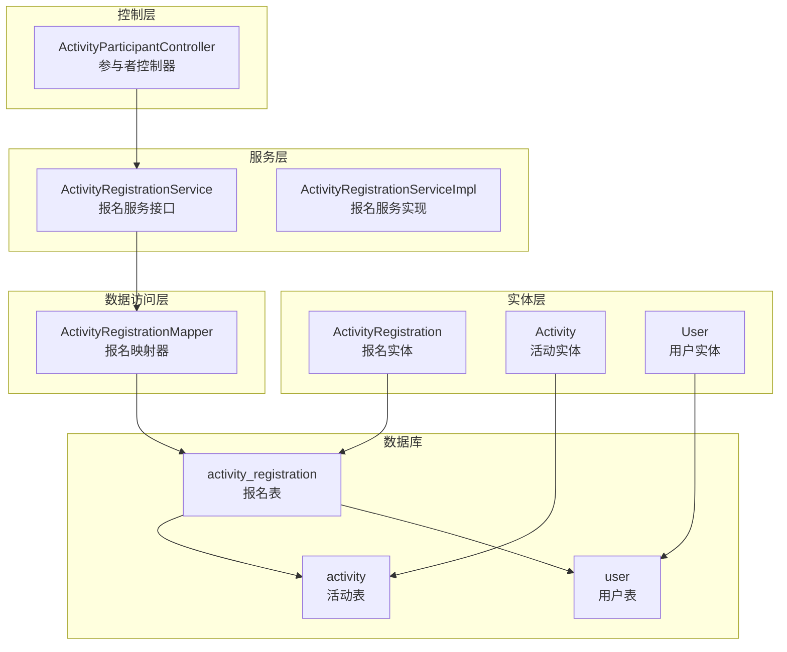
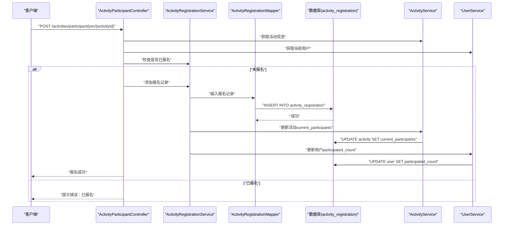
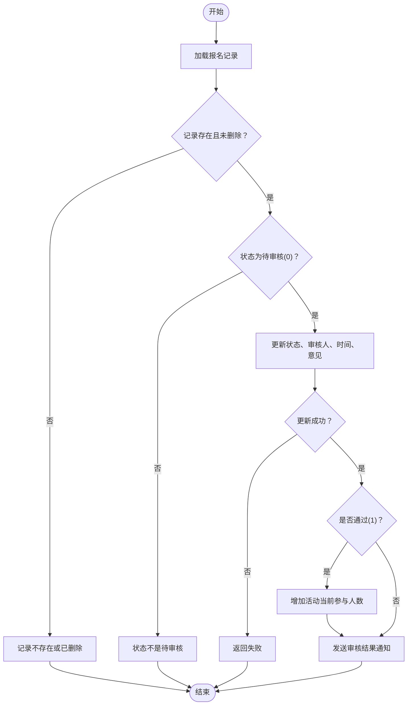
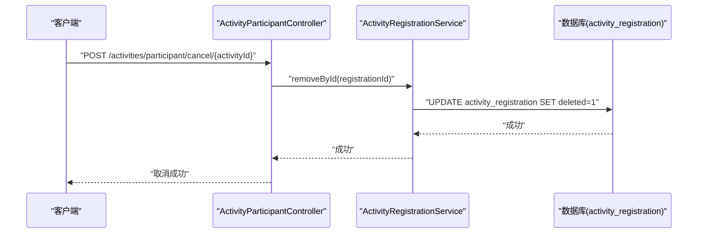
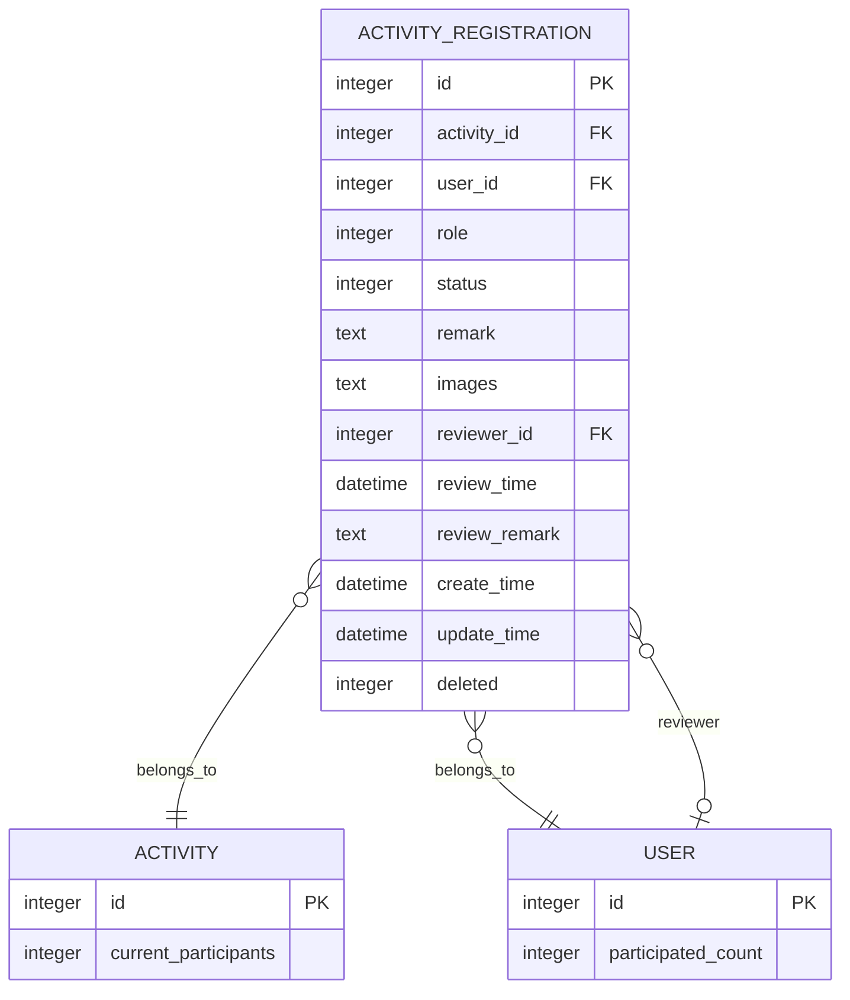
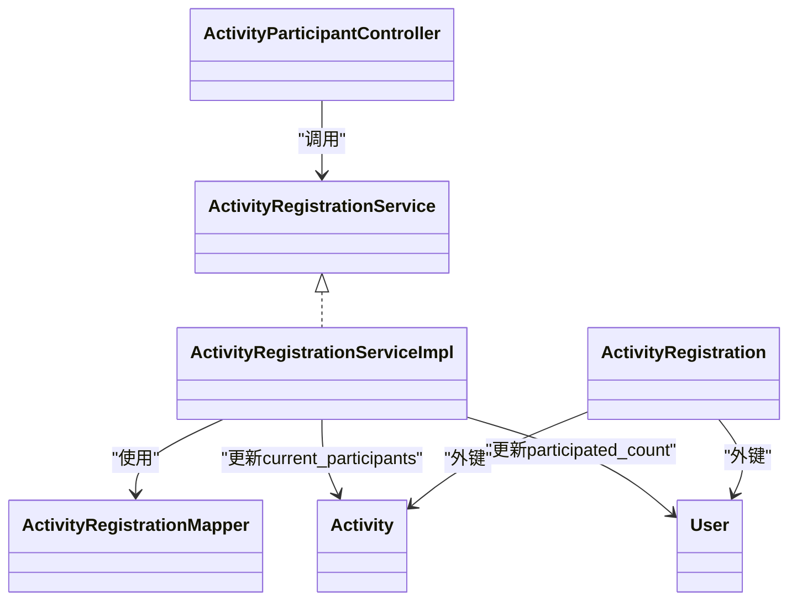
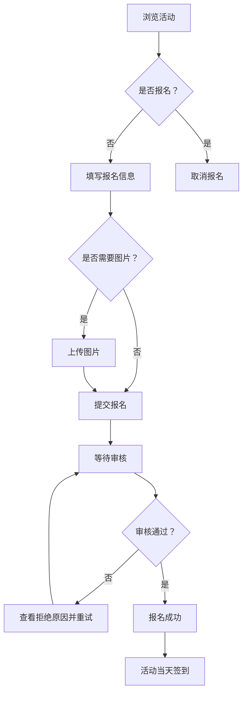

# 活动报名表 (activity_registration)

<cite>
**本文引用的文件**
- [ActivityRegistration.java](file://src/main/java/com/campus/eventsys/entity/ActivityRegistration.java)
- [ActivityRole.java](file://src/main/java/com/campus/eventsys/enums/ActivityRole.java)
- [ActivityRegistrationMapper.java](file://src/main/java/com/campus/eventsys/mapper/ActivityRegistrationMapper.java)
- [ActivityRegistrationServiceImpl.java](file://src/main/java/com/campus/eventsys/service/impl/ActivityRegistrationServiceImpl.java)
- [ActivityRegistrationService.java](file://src/main/java/com/campus/eventsys/service/ActivityRegistrationService.java)
- [ActivityParticipantController.java](file://src/main/java/com/campus/eventsys/controller/ActivityParticipantController.java)
- [Activity.java](file://src/main/java/com/campus/eventsys/entity/Activity.java)
- [User.java](file://src/main/java/com/campus/eventsys/entity/User.java)
- [schema.sql](file://src/main/resources/db/schema.sql)
- [ER图4_活动报名.plantuml](file://picture/ER图4_活动报名.plantuml)
- [时序图2_活动报名.plantuml](file://picture/时序图2_活动报名.plantuml)
- [流程图3_活动报名签到.plantuml](file://picture/流程图3_活动报名签到.plantuml)
</cite>

## 目录
1. [简介](#简介)
2. [项目结构](#项目结构)
3. [核心组件](#核心组件)
4. [架构总览](#架构总览)
5. [详细组件分析](#详细组件分析)
6. [依赖关系分析](#依赖关系分析)
7. [性能考量](#性能考量)
8. [故障排查指南](#故障排查指南)
9. [结论](#结论)
10. [附录](#附录)

## 简介
本文件围绕“活动报名表(activity_registration)”展开，系统性说明其字段定义、业务规则、数据完整性约束、与活动表与用户表的关联关系，以及报名审核流程。重点解释：
- 报名角色定义：组织者(1)、参与者(2)
- 审核状态流转：待审核(0)、已通过(1)、已拒绝(2)、已签到(3)、已取消(4)
- 唯一约束：(activity_id, user_id) 确保用户不可重复报名
- 报名表与活动表、用户表的外键关联
- 报名审核的完整流程与事务一致性保障

## 项目结构
活动报名表位于后端代码的实体层、映射层、服务层与控制层中，并在数据库层面通过外键与唯一约束实现数据完整性。

图表来源
- [ActivityRegistration.java:13-61](file://src/main/java/com/campus/eventsys/entity/ActivityRegistration.java#L13-L61)
- [ActivityRegistrationMapper.java:10-34](file://src/main/java/com/campus/eventsys/mapper/ActivityRegistrationMapper.java#L10-L34)
- [ActivityRegistrationServiceImpl.java:26-200](file://src/main/java/com/campus/eventsys/service/impl/ActivityRegistrationServiceImpl.java#L26-L200)
- [ActivityRegistrationService.java:11-73](file://src/main/java/com/campus/eventsys/service/ActivityRegistrationService.java#L11-L73)
- [ActivityParticipantController.java:44-371](file://src/main/java/com/campus/eventsys/controller/ActivityParticipantController.java#L44-L371)
- [schema.sql:82-100](file://src/main/resources/db/schema.sql#L82-L100)

章节来源
- [ActivityRegistration.java:13-61](file://src/main/java/com/campus/eventsys/entity/ActivityRegistration.java#L13-L61)
- [schema.sql:82-100](file://src/main/resources/db/schema.sql#L82-L100)

## 核心组件
- 实体类：ActivityRegistration，承载报名表的全部字段与注解
- 映射器：ActivityRegistrationMapper，提供查询与恢复逻辑删除记录的SQL
- 服务接口与实现：ActivityRegistrationService 与 ActivityRegistrationServiceImpl，封装报名审核、参与者移除、批量清理等业务逻辑
- 控制器：ActivityParticipantController，提供报名、取消报名、查询角色等对外接口
- 数据库表：activity_registration，定义外键与唯一约束，确保数据一致性

章节来源
- [ActivityRegistration.java:13-61](file://src/main/java/com/campus/eventsys/entity/ActivityRegistration.java#L13-L61)
- [ActivityRegistrationMapper.java:10-34](file://src/main/java/com/campus/eventsys/mapper/ActivityRegistrationMapper.java#L10-L34)
- [ActivityRegistrationService.java:11-73](file://src/main/java/com/campus/eventsys/service/ActivityRegistrationService.java#L11-L73)
- [ActivityRegistrationServiceImpl.java:26-200](file://src/main/java/com/campus/eventsys/service/impl/ActivityRegistrationServiceImpl.java#L26-L200)
- [ActivityParticipantController.java:44-371](file://src/main/java/com/campus/eventsys/controller/ActivityParticipantController.java#L44-L371)
- [schema.sql:82-100](file://src/main/resources/db/schema.sql#L82-L100)

## 架构总览
活动报名表在系统中的职责是记录用户对活动的参与意向、角色与审核状态，并在审核通过后联动更新活动的当前参与人数与用户参与统计。控制器负责接收前端请求，服务层执行业务逻辑并保证事务一致性，映射器负责与数据库交互，实体类与数据库表一一对应。

图表来源
- [ActivityParticipantController.java:80-161](file://src/main/java/com/campus/eventsys/controller/ActivityParticipantController.java#L80-L161)
- [ActivityRegistrationServiceImpl.java:32-53](file://src/main/java/com/campus/eventsys/service/impl/ActivityRegistrationServiceImpl.java#L32-L53)
- [schema.sql:82-100](file://src/main/resources/db/schema.sql#L82-L100)

## 详细组件分析

### 字段定义与业务含义
- activity_id：活动标识，外键关联活动表
- user_id：用户标识，外键关联用户表
- role：报名角色，1=组织者，2=参与者
- status：报名状态，0=待审核，1=已通过，2=已拒绝，3=已签到，4=已取消
- remark：报名备注/留言
- images：报名图片列表，JSON数组格式
- reviewer_id：审核人ID，外键关联用户表
- review_time：审核时间
- review_remark：审核意见
- create_time/update_time/deleted：通用审计与逻辑删除字段

章节来源
- [ActivityRegistration.java:18-61](file://src/main/java/com/campus/eventsys/entity/ActivityRegistration.java#L18-L61)
- [schema.sql:82-100](file://src/main/resources/db/schema.sql#L82-L100)

### 报名角色定义
- 组织者(1)：拥有修改活动信息的权限，通常由活动创建者自动识别为组织者
- 参与者(2)：普通报名用户，可参与活动并签到

章节来源
- [ActivityRole.java:9-37](file://src/main/java/com/campus/eventsys/enums/ActivityRole.java#L9-L37)
- [ActivityParticipantController.java:252-283](file://src/main/java/com/campus/eventsys/controller/ActivityParticipantController.java#L252-L283)

### 审核状态流转机制
- 初始状态：0(待审核)
- 审核通过：1(已通过)，同时增加活动当前参与人数
- 审核拒绝：2(已拒绝)，不增加活动人数
- 已签到：3(已签到)，用于签到流程标记
- 已取消：4(已取消)，逻辑删除报名记录

章节来源
- [ActivityRegistration.java:31-32](file://src/main/java/com/campus/eventsys/entity/ActivityRegistration.java#L31-L32)
- [ActivityRegistrationServiceImpl.java:78-130](file://src/main/java/com/campus/eventsys/service/impl/ActivityRegistrationServiceImpl.java#L78-L130)

### 唯一约束与业务规则
- 唯一约束：(activity_id, user_id)，确保同一用户对同一活动只能有一条有效报名记录
- 逻辑删除：deleted=1 表示软删除，查询默认过滤 deleted=0
- 取消报名：通过逻辑删除实现，不影响唯一约束；若需再次报名，需使用恢复接口

章节来源
- [schema.sql:99](file://src/main/resources/db/schema.sql#L99)
- [ActivityRegistrationMapper.java:17-33](file://src/main/java/com/campus/eventsys/mapper/ActivityRegistrationMapper.java#L17-L33)

### 关联关系与外键约束
- activity_id → activity.id
- user_id → user.id
- reviewer_id → user.id（审核人）

章节来源
- [schema.sql:96-98](file://src/main/resources/db/schema.sql#L96-L98)

### 报名审核流程
- 审核入口：仅对状态为0(待审核)的报名记录进行审核
- 审核通过：status=1，增加活动当前参与人数，发送通知
- 审核拒绝：status=2，不增加活动人数，发送通知
- 审核失败：日志记录并返回失败

图表来源
- [ActivityRegistrationServiceImpl.java:78-130](file://src/main/java/com/campus/eventsys/service/impl/ActivityRegistrationServiceImpl.java#L78-L130)

### 报名与取消报名流程
- 报名：检查是否已报名，上传图片（可选），插入报名记录，更新活动与用户统计
- 取消报名：逻辑删除报名记录，减少活动与用户统计（仅对已通过的参与者生效）

图表来源
- [ActivityParticipantController.java:174-210](file://src/main/java/com/campus/eventsys/controller/ActivityParticipantController.java#L174-L210)
- [ActivityRegistrationServiceImpl.java:134-167](file://src/main/java/com/campus/eventsys/service/impl/ActivityRegistrationServiceImpl.java#L134-L167)

### 数据模型与ER关系

图表来源
- [schema.sql:82-100](file://src/main/resources/db/schema.sql#L82-L100)
- [ActivityRegistration.java:22-47](file://src/main/java/com/campus/eventsys/entity/ActivityRegistration.java#L22-L47)
- [Activity.java:52-53](file://src/main/java/com/campus/eventsys/entity/Activity.java#L52-L53)
- [User.java:69-70](file://src/main/java/com/campus/eventsys/entity/User.java#L69-L70)

## 依赖关系分析
- 控制器依赖服务层接口，服务层依赖映射器与活动/用户服务
- 映射器提供基础查询与恢复逻辑删除记录的能力
- 实体类与数据库表字段一一对应，注解驱动MyBatis-Plus的自动填充与逻辑删除

图表来源
- [ActivityRegistration.java:13-61](file://src/main/java/com/campus/eventsys/entity/ActivityRegistration.java#L13-L61)
- [ActivityRegistrationService.java:11-73](file://src/main/java/com/campus/eventsys/service/ActivityRegistrationService.java#L11-L73)
- [ActivityRegistrationServiceImpl.java:26-200](file://src/main/java/com/campus/eventsys/service/impl/ActivityRegistrationServiceImpl.java#L26-L200)
- [ActivityRegistrationMapper.java:10-34](file://src/main/java/com/campus/eventsys/mapper/ActivityRegistrationMapper.java#L10-L34)
- [ActivityParticipantController.java:44-371](file://src/main/java/com/campus/eventsys/controller/ActivityParticipantController.java#L44-L371)
- [Activity.java:15-95](file://src/main/java/com/campus/eventsys/entity/Activity.java#L15-L95)
- [User.java:15-85](file://src/main/java/com/campus/eventsys/entity/User.java#L15-L85)

## 性能考量
- 查询优化：为 activity_id、user_id、status 建立索引，提升报名记录查询效率
- 事务边界：审核与统计更新在同一事务内完成，避免并发导致的数据不一致
- 逻辑删除：通过deleted字段实现软删除，减少物理删除带来的索引维护成本

章节来源
- [schema.sql:260-264](file://src/main/resources/db/schema.sql#L260-L264)
- [ActivityRegistrationServiceImpl.java:78-130](file://src/main/java/com/campus/eventsys/service/impl/ActivityRegistrationServiceImpl.java#L78-L130)

## 故障排查指南
- 报名失败：检查是否已报名、图片格式与大小限制、活动有效性
- 审核异常：确认报名记录状态为待审核(0)，检查审核人权限与日志
- 取消报名无效：确认报名记录存在且未被逻辑删除，仅对已通过的参与者减少统计

章节来源
- [ActivityParticipantController.java:100-161](file://src/main/java/com/campus/eventsys/controller/ActivityParticipantController.java#L100-L161)
- [ActivityRegistrationServiceImpl.java:134-167](file://src/main/java/com/campus/eventsys/service/impl/ActivityRegistrationServiceImpl.java#L134-L167)

## 结论
活动报名表通过明确的角色与状态定义、严格的唯一约束与外键关系，以及完善的审核与统计联动机制，实现了可靠的活动参与管理。结合控制器与服务层的事务保障，确保了业务流程的一致性与可追溯性。

## 附录
- 报名流程概念图

图表来源
- [流程图3_活动报名签到.plantuml:1-36](file://picture/流程图3_活动报名签到.plantuml#L1-L36)