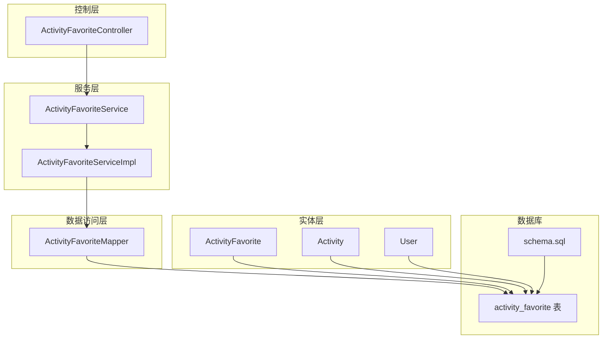
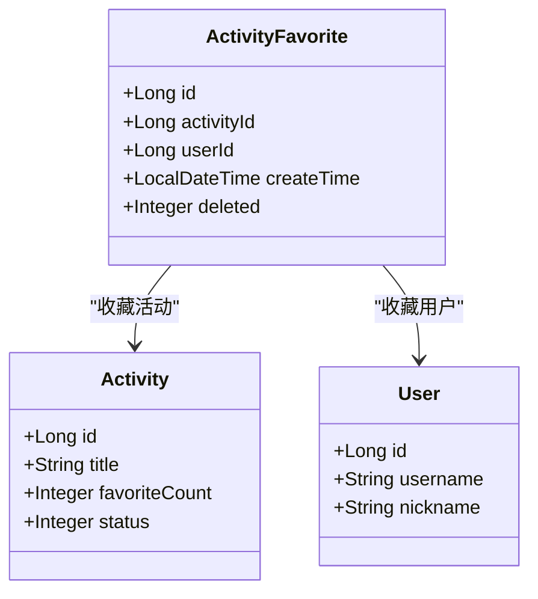
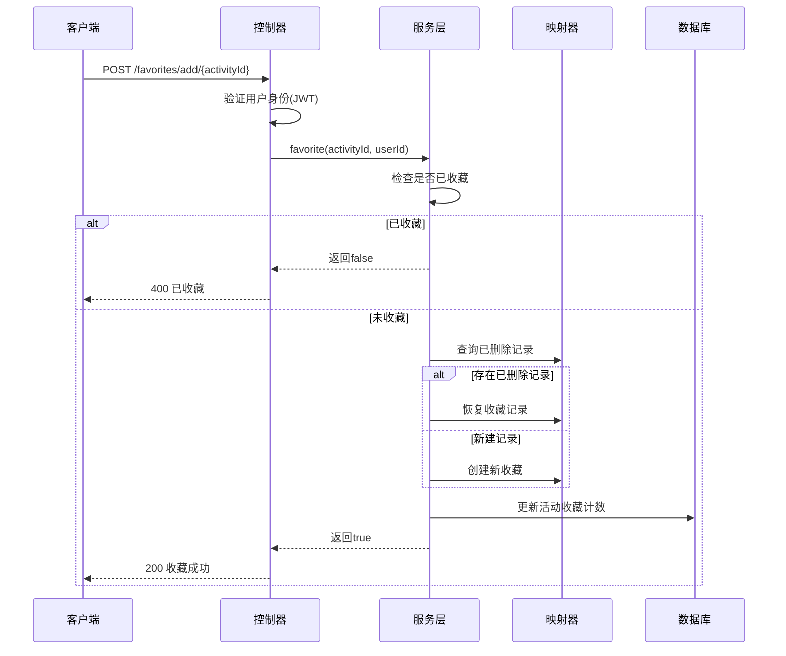
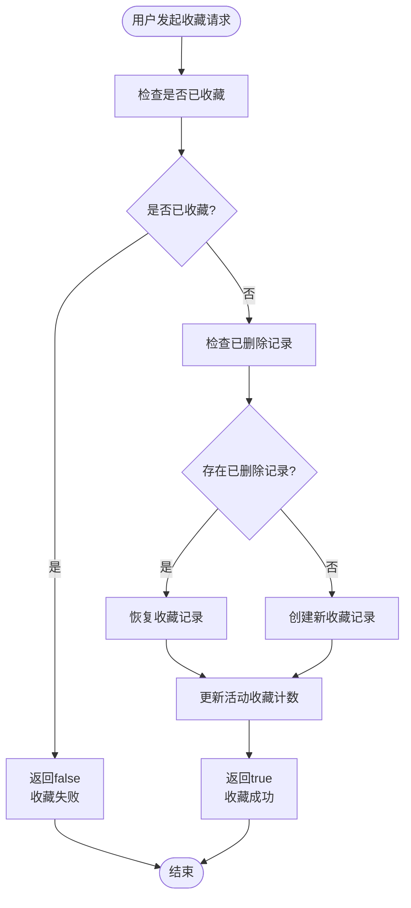
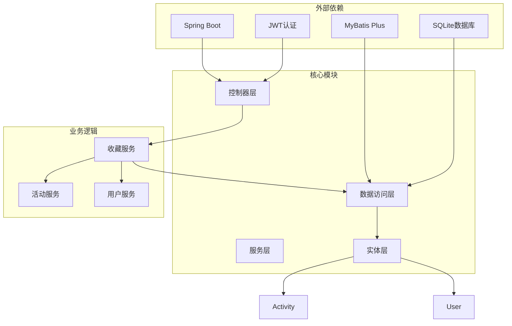
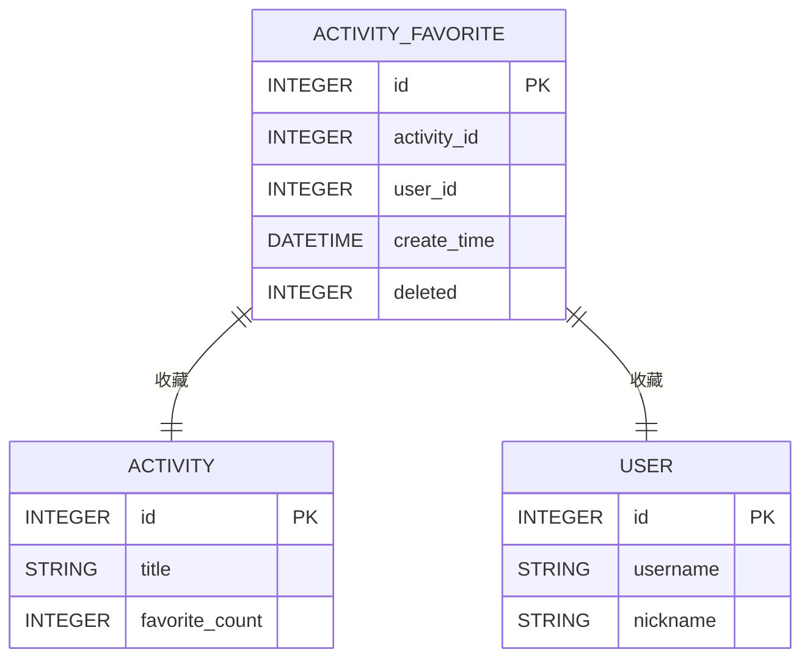
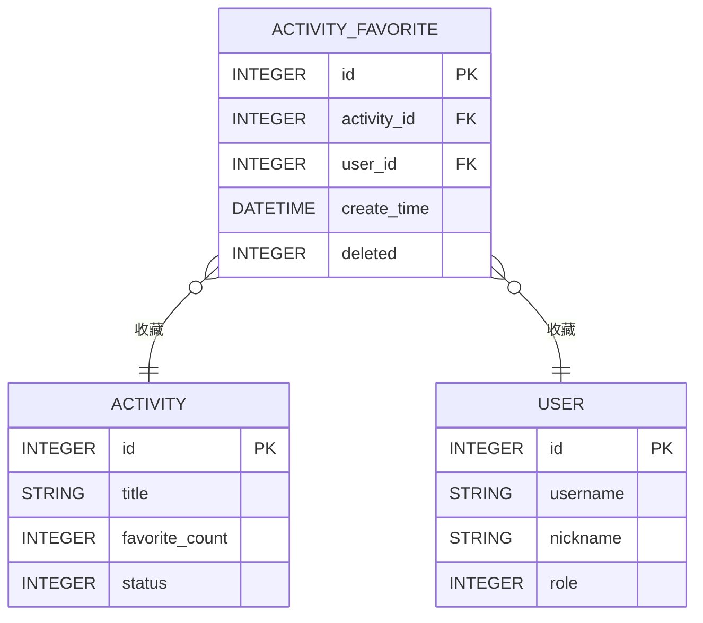

# 活动收藏表 (activity_favorite)

<cite>
**本文档引用的文件**
- [ActivityFavorite.java](file://src/main/java/com/campus/eventsys/entity/ActivityFavorite.java)
- [ActivityFavoriteMapper.java](file://src/main/java/com/campus/eventsys/mapper/ActivityFavoriteMapper.java)
- [ActivityFavoriteService.java](file://src/main/java/com/campus/eventsys/service/ActivityFavoriteService.java)
- [ActivityFavoriteServiceImpl.java](file://src/main/java/com/campus/eventsys/service/impl/ActivityFavoriteServiceImpl.java)
- [ActivityFavoriteController.java](file://src/main/java/com/campus/eventsys/controller/ActivityFavoriteController.java)
- [schema.sql](file://src/main/resources/db/schema.sql)
- [ER图7_活动收藏.plantuml](file://picture/ER图7_活动收藏.plantuml)
- [Activity.java](file://src/main/java/com/campus/eventsys/entity/Activity.java)
- [User.java](file://src/main/java/com/campus/eventsys/entity/User.java)
- [ActivityFavoriteControllerTest.java](file://src/test/java/com/campus/eventsys/controller/ActivityFavoriteControllerTest.java)
- [application.yml](file://src/main/resources/application.yml)
- [pom.xml](file://pom.xml)
</cite>

## 目录
1. [简介](#简介)
2. [项目结构](#项目结构)
3. [核心组件](#核心组件)
4. [架构概览](#架构概览)
5. [详细组件分析](#详细组件分析)
6. [依赖关系分析](#依赖关系分析)
7. [性能考虑](#性能考虑)
8. [故障排除指南](#故障排除指南)
9. [结论](#结论)
10. [附录](#附录)

## 简介

活动收藏表(activity_favorite)是校园活动综合管理系统中的重要数据表，用于记录用户对活动的关注和收藏行为。该表实现了用户与活动之间的一对多关系，通过唯一约束(activity_id, user_id)确保每个用户对每个活动只能收藏一次，同时支持软删除机制来维护数据完整性。

该表不仅为用户提供个性化的内容管理功能，还为系统的数据分析和推荐算法提供了重要的用户行为数据基础。通过收藏功能，系统能够追踪用户的兴趣偏好，为后续的个性化推荐和内容分发提供数据支撑。

## 项目结构

活动收藏功能采用典型的三层架构设计，包含实体层、服务层和控制层，以及相应的映射器和测试文件。

**图表来源**
- [ActivityFavoriteController.java:1-184](file://src/main/java/com/campus/eventsys/controller/ActivityFavoriteController.java#L1-L184)
- [ActivityFavoriteServiceImpl.java:1-137](file://src/main/java/com/campus/eventsys/service/impl/ActivityFavoriteServiceImpl.java#L1-L137)
- [ActivityFavoriteMapper.java:1-27](file://src/main/java/com/campus/eventsys/mapper/ActivityFavoriteMapper.java#L1-L27)
- [schema.sql:142-154](file://src/main/resources/db/schema.sql#L142-L154)

**章节来源**
- [ActivityFavoriteController.java:1-184](file://src/main/java/com/campus/eventsys/controller/ActivityFavoriteController.java#L1-L184)
- [ActivityFavoriteServiceImpl.java:1-137](file://src/main/java/com/campus/eventsys/service/impl/ActivityFavoriteServiceImpl.java#L1-L137)
- [ActivityFavoriteMapper.java:1-27](file://src/main/java/com/campus/eventsys/mapper/ActivityFavoriteMapper.java#L1-L27)
- [schema.sql:142-154](file://src/main/resources/db/schema.sql#L142-L154)

## 核心组件

### 实体类设计

活动收藏实体类采用Lombok注解简化代码，使用MyBatis-Plus注解进行数据库映射配置。

**图表来源**
- [ActivityFavorite.java:11-31](file://src/main/java/com/campus/eventsys/entity/ActivityFavorite.java#L11-L31)
- [Activity.java:15-94](file://src/main/java/com/campus/eventsys/entity/Activity.java#L15-L94)
- [User.java:15-84](file://src/main/java/com/campus/eventsys/entity/User.java#L15-L84)

### 数据库表结构

活动收藏表采用SQLite数据库，具有以下关键特性：

| 字段名 | 类型 | 约束 | 描述 |
|--------|------|------|------|
| id | INTEGER | PRIMARY KEY AUTOINCREMENT | 主键标识符 |
| activity_id | INTEGER | NOT NULL, FOREIGN KEY | 关联活动ID |
| user_id | INTEGER | NOT NULL, FOREIGN KEY | 关联用户ID |
| create_time | DATETIME |  | 记录创建时间 |
| deleted | INTEGER | DEFAULT 0 | 逻辑删除标志 |

**章节来源**
- [ActivityFavorite.java:13-31](file://src/main/java/com/campus/eventsys/entity/ActivityFavorite.java#L13-L31)
- [schema.sql:145-154](file://src/main/resources/db/schema.sql#L145-L154)

## 架构概览

活动收藏功能采用RESTful API设计，通过HTTP请求实现收藏和取消收藏操作。系统支持JWT认证，确保只有登录用户才能执行收藏操作。

**图表来源**
- [ActivityFavoriteController.java:52-79](file://src/main/java/com/campus/eventsys/controller/ActivityFavoriteController.java#L52-L79)
- [ActivityFavoriteServiceImpl.java:30-71](file://src/main/java/com/campus/eventsys/service/impl/ActivityFavoriteServiceImpl.java#L30-L71)

**章节来源**
- [ActivityFavoriteController.java:1-184](file://src/main/java/com/campus/eventsys/controller/ActivityFavoriteController.java#L1-L184)
- [ActivityFavoriteServiceImpl.java:1-137](file://src/main/java/com/campus/eventsys/service/impl/ActivityFavoriteServiceImpl.java#L1-L137)

## 详细组件分析

### 唯一约束与去重机制

活动收藏表通过`(activity_id, user_id)`的唯一约束实现天然的去重机制：

**图表来源**
- [ActivityFavoriteServiceImpl.java:30-71](file://src/main/java/com/campus/eventsys/service/impl/ActivityFavoriteServiceImpl.java#L30-L71)
- [ActivityFavoriteMapper.java:17-25](file://src/main/java/com/campus/eventsys/mapper/ActivityFavoriteMapper.java#L17-L25)

### 业务逻辑实现

#### 收藏操作流程

收藏操作包含完整的业务验证和异常处理机制：

1. **用户身份验证**：通过JWT令牌获取当前用户信息
2. **活动有效性检查**：确认目标活动存在且状态有效
3. **重复收藏检测**：使用唯一约束防止重复收藏
4. **软删除处理**：支持取消收藏后再收藏的场景
5. **计数更新**：同步更新活动表的收藏计数

#### 取消收藏流程

取消收藏采用软删除策略，保持数据完整性：

1. **记录查找**：定位有效的收藏记录
2. **逻辑删除**：设置deleted字段为1
3. **计数回滚**：减少活动收藏计数
4. **事务保证**：确保操作的原子性

**章节来源**
- [ActivityFavoriteServiceImpl.java:73-105](file://src/main/java/com/campus/eventsys/service/impl/ActivityFavoriteServiceImpl.java#L73-L105)
- [ActivityFavoriteServiceImpl.java:107-135](file://src/main/java/com/campus/eventsys/service/impl/ActivityFavoriteServiceImpl.java#L107-L135)

### 接口设计与API规范

活动收藏提供完整的RESTful API接口：

| 接口 | 方法 | 路径 | 功能 | 认证要求 |
|------|------|------|------|----------|
| 收藏活动 | POST | `/favorites/add/{activityId}` | 添加活动收藏 | Bearer Token |
| 取消收藏 | POST | `/favorites/remove/{activityId}` | 移除活动收藏 | Bearer Token |
| 收藏状态 | GET | `/favorites/status/{activityId}` | 检查收藏状态 | Bearer Token |
| 我的收藏 | GET | `/favorites/my-favorites` | 获取用户收藏列表 | Bearer Token |
| 收藏数量 | GET | `/favorites/count/{activityId}` | 获取活动收藏数量 | 无需认证 |

**章节来源**
- [ActivityFavoriteController.java:39-182](file://src/main/java/com/campus/eventsys/controller/ActivityFavoriteController.java#L39-L182)

## 依赖关系分析

活动收藏功能涉及多个层次的依赖关系，形成了清晰的分层架构：

**图表来源**
- [pom.xml:27-104](file://pom.xml#L27-L104)
- [application.yml:6-48](file://src/main/resources/application.yml#L6-L48)

### 外部依赖配置

系统使用以下关键技术栈：

- **Spring Boot 3.2.0**：提供Web应用框架和依赖注入
- **MyBatis Plus 3.5.5**：简化数据库操作和ORM映射
- **JWT 0.12.3**：实现用户认证和授权
- **SQLite 3.44.1.0**：轻量级本地数据库
- **Lombok**：简化Java代码生成

**章节来源**
- [pom.xml:27-104](file://pom.xml#L27-L104)
- [application.yml:6-48](file://src/main/resources/application.yml#L6-L48)

## 性能考虑

### 数据库索引优化

为了提升查询性能，系统在收藏表上建立了专门的索引：

**图表来源**
- [schema.sql:273-275](file://src/main/resources/db/schema.sql#L273-L275)

### 查询性能优化

系统通过以下方式优化查询性能：

1. **唯一索引**：`(activity_id, user_id)`确保快速去重
2. **单字段索引**：分别对`activity_id`和`user_id`建立索引
3. **逻辑删除过滤**：默认过滤已删除记录，减少无效查询
4. **批量查询**：支持用户收藏列表的批量获取

**章节来源**
- [schema.sql:273-275](file://src/main/resources/db/schema.sql#L273-L275)
- [ActivityFavoriteServiceImpl.java:118-126](file://src/main/java/com/campus/eventsys/service/impl/ActivityFavoriteServiceImpl.java#L118-L126)

## 故障排除指南

### 常见问题及解决方案

#### 收藏失败问题

**问题现象**：用户无法收藏活动，返回收藏失败

**可能原因**：
1. 活动不存在或已被删除
2. 用户身份验证失败
3. 数据库连接异常
4. 事务回滚导致操作失败

**解决步骤**：
1. 验证活动状态和存在性
2. 检查JWT令牌有效性
3. 查看数据库连接状态
4. 检查事务日志

#### 重复收藏问题

**问题现象**：用户尝试重复收藏同一活动

**解决方案**：
系统通过唯一约束自动阻止重复收藏，返回false并记录警告日志

#### 取消收藏后无法重新收藏

**问题现象**：用户取消收藏后再次收藏失败

**解决方法**：
系统支持软删除恢复机制，通过`restoreFavorite`方法恢复已删除记录

**章节来源**
- [ActivityFavoriteServiceImpl.java:30-71](file://src/main/java/com/campus/eventsys/service/impl/ActivityFavoriteServiceImpl.java#L30-L71)
- [ActivityFavoriteMapper.java:17-25](file://src/main/java/com/campus/eventsys/mapper/ActivityFavoriteMapper.java#L17-L25)

### 日志监控

系统提供详细的日志记录，便于问题诊断：

- **INFO级别**：成功操作的日志记录
- **WARN级别**：警告信息，如重复收藏
- **ERROR级别**：异常错误，如数据库操作失败

**章节来源**
- [ActivityFavoriteServiceImpl.java:34-70](file://src/main/java/com/campus/eventsys/service/impl/ActivityFavoriteServiceImpl.java#L34-L70)

## 结论

活动收藏表(activity_favorite)作为校园活动综合管理系统的重要组成部分，通过精心设计的数据结构和完善的业务逻辑，实现了用户对活动的个性化管理和追踪。该表的设计充分考虑了数据完整性、性能优化和用户体验，为系统的后续发展奠定了坚实的基础。

主要特点包括：
- **数据完整性**：通过唯一约束和软删除机制确保数据一致性
- **性能优化**：合理的索引设计和查询优化策略
- **用户体验**：简洁直观的API接口和完善的错误处理
- **扩展性**：清晰的架构设计支持功能扩展和维护

该收藏功能不仅满足了当前的业务需求，也为未来的个性化推荐、数据分析和智能服务提供了重要的数据基础。

## 附录

### 数据模型详细说明

**图表来源**
- [schema.sql:145-154](file://src/main/resources/db/schema.sql#L145-L154)
- [Activity.java:68-71](file://src/main/java/com/campus/eventsys/entity/Activity.java#L68-L71)
- [User.java:60-61](file://src/main/java/com/campus/eventsys/entity/User.java#L60-L61)

### 测试覆盖范围

系统提供了全面的单元测试，覆盖以下场景：

- 成功收藏和取消收藏
- 重复收藏和未收藏场景
- 用户不存在和活动不存在的边界情况
- 收藏列表获取和收藏数量统计

**章节来源**
- [ActivityFavoriteControllerTest.java:71-374](file://src/test/java/com/campus/eventsys/controller/ActivityFavoriteControllerTest.java#L71-L374)