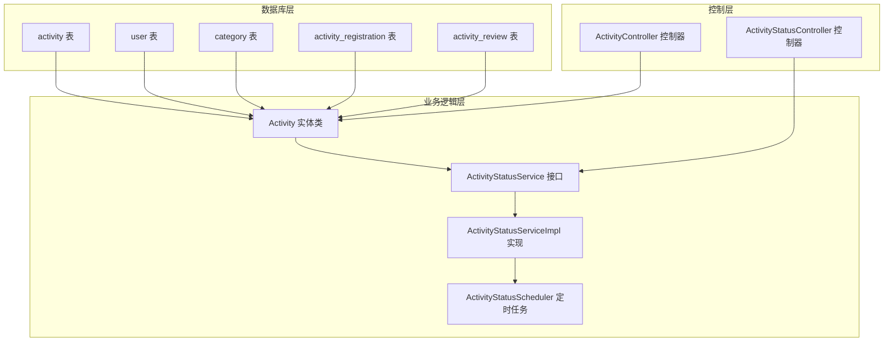
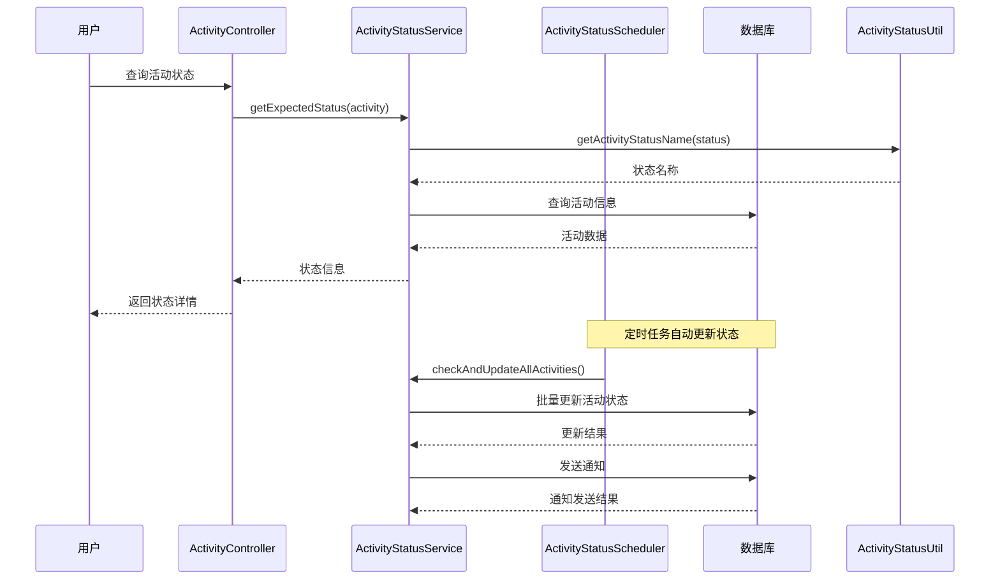
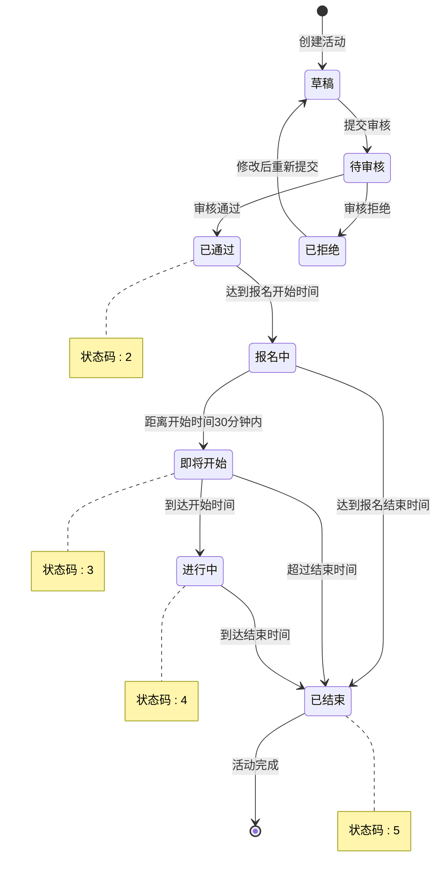
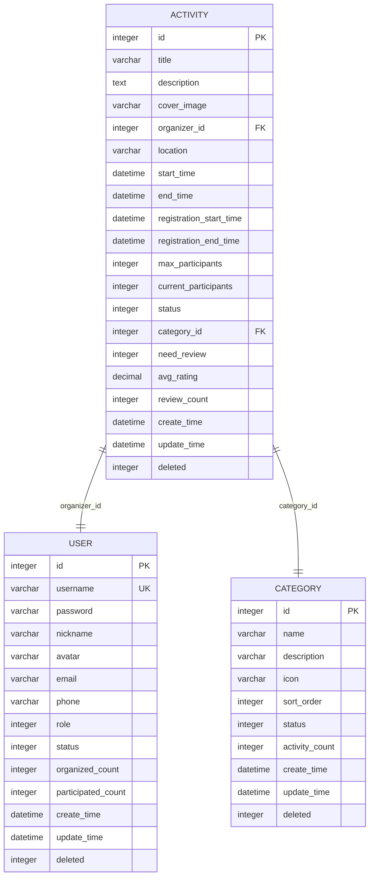
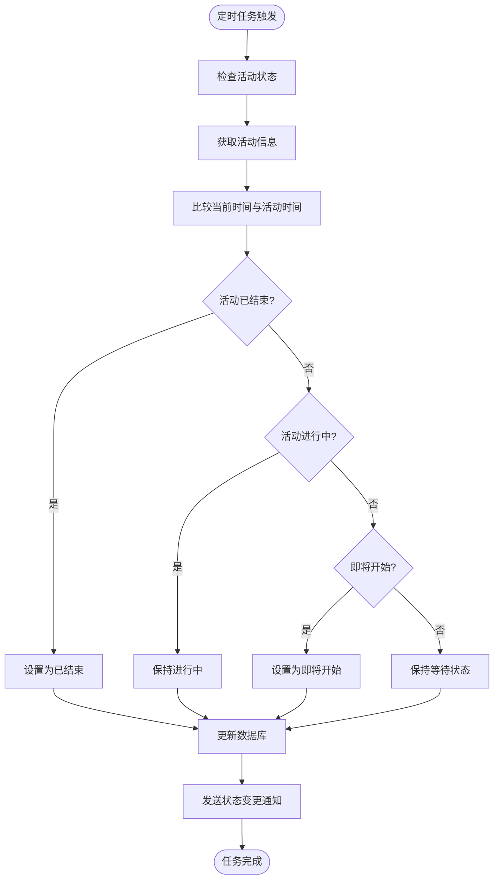
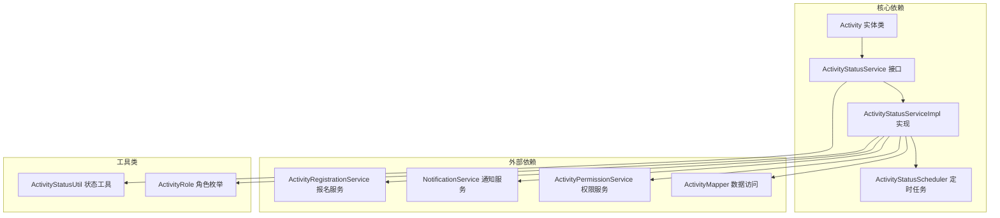

# 活动表 (activity)

<cite>
**本文档引用的文件**
- [Activity.java](file://src/main/java/com/campus/eventsys/entity/Activity.java)
- [schema.sql](file://src/main/resources/db/schema.sql)
- [表设计.md](file://picture/表设计.md)
- [ActivityStatusService.java](file://src/main/java/com/campus/eventsys/service/ActivityStatusService.java)
- [ActivityStatusServiceImpl.java](file://src/main/java/com/campus/eventsys/service/impl/ActivityStatusServiceImpl.java)
- [ActivityStatusScheduler.java](file://src/main/java/com/campus/eventsys/scheduler/ActivityStatusScheduler.java)
- [ActivityStatusUtil.java](file://src/main/java/com/campus/eventsys/utils/ActivityStatusUtil.java)
- [ActivityController.java](file://src/main/java/com/campus/eventsys/controller/ActivityController.java)
- [ActivityRegistrationService.java](file://src/main/java/com/campus/eventsys/service/ActivityRegistrationService.java)
- [ActivityStartReminderService.java](file://src/main/java/com/campus/eventsys/service/ActivityStartReminderService.java)
- [ActivityRole.java](file://src/main/java/com/campus/eventsys/enums/ActivityRole.java)
</cite>

## 目录
1. [简介](#简介)
2. [项目结构](#项目结构)
3. [核心组件](#核心组件)
4. [架构概览](#架构概览)
5. [详细组件分析](#详细组件分析)
6. [依赖关系分析](#依赖关系分析)
7. [性能考虑](#性能考虑)
8. [故障排除指南](#故障排除指南)
9. [结论](#结论)

## 简介
活动表(activity)是校园活动综合管理系统的核心数据表，用于存储和管理各类校园活动的完整信息。该表不仅包含活动的基本信息（如标题、描述、时间安排等），还包含了完整的活动生命周期管理、状态控制、统计信息收集等功能特性。

## 项目结构
活动表在系统中的组织结构如下：

**图表来源**
- [schema.sql:47-77](file://src/main/resources/db/schema.sql#L47-L77)
- [Activity.java:15-95](file://src/main/java/com/campus/eventsys/entity/Activity.java#L15-L95)

**章节来源**
- [schema.sql:47-77](file://src/main/resources/db/schema.sql#L47-L77)
- [Activity.java:15-95](file://src/main/java/com/campus/eventsys/entity/Activity.java#L15-L95)

## 核心组件
活动表包含以下核心字段和功能：

### 基础信息字段
- **标题(title)**: 活动的名称，最大200字符
- **描述(description)**: 活动的详细说明，支持文本格式
- **封面图片(coverImage)**: 活动的展示图片URL，最大500字符
- **地点(location)**: 活动举办的具体地址，最大200字符

### 时间管理字段
- **开始时间(startTime)**: 活动正式开始的时间点
- **结束时间(endTime)**: 活动正式结束的时间点
- **报名开始时间(registrationStartTime)**: 活动报名开放的时间点
- **报名结束时间(registrationEndTime)**: 活动报名截止的时间点

### 人员规模字段
- **最大参与人数(maxParticipants)**: 活动可容纳的最大人数，0表示不限制
- **当前参与人数(currentParticipants)**: 已报名参加活动的人数

### 状态管理字段
- **状态(status)**: 活动的当前状态，采用整数值编码
- **需要审核(needReview)**: 报名是否需要组织者审核

### 关系字段
- **组织者ID(organizerId)**: 外键关联到用户表(user.id)
- **分类ID(categoryId)**: 外键关联到活动分类表(category.id)
- **标签(tags)**: 活动的分类标签，多个标签以逗号分隔

### 统计信息字段
- **浏览次数(viewCount)**: 活动页面被浏览的次数
- **收藏次数(favoriteCount)**: 活动被收藏的次数
- **评论数量(commentCount)**: 活动相关的评论总数
- **平均评分(avgRating)**: 用户对活动的平均评分，保留1位小数
- **评价数量(reviewCount)**: 对活动进行评价的用户数量

### 时间戳字段
- **创建时间(createTime)**: 记录创建的时间
- **更新时间(updateTime)**: 记录最后更新的时间

### 逻辑删除字段
- **逻辑删除(deleted)**: 0表示未删除，1表示已删除

**章节来源**
- [Activity.java:22-95](file://src/main/java/com/campus/eventsys/entity/Activity.java#L22-L95)
- [schema.sql:50-77](file://src/main/resources/db/schema.sql#L50-L77)
- [表设计.md:43-70](file://picture/表设计.md#L43-L70)

## 架构概览
活动表在整个系统架构中的作用和交互关系如下：

**图表来源**
- [ActivityController.java:21-36](file://src/main/java/com/campus/eventsys/controller/ActivityController.java#L21-L36)
- [ActivityStatusService.java:9-43](file://src/main/java/com/campus/eventsys/service/ActivityStatusService.java#L9-L43)
- [ActivityStatusScheduler.java:22-40](file://src/main/java/com/campus/eventsys/scheduler/ActivityStatusScheduler.java#L22-L40)
- [ActivityStatusUtil.java:11-28](file://src/main/java/com/campus/eventsys/utils/ActivityStatusUtil.java#L11-L28)

## 详细组件分析

### 活动状态生命周期
活动表的状态管理采用完整的生命周期设计，涵盖从创建到结束的各个阶段：

**图表来源**
- [ActivityStatusUtil.java:15-28](file://src/main/java/com/campus/eventsys/utils/ActivityStatusUtil.java#L15-L28)
- [ActivityStatusServiceImpl.java:128-184](file://src/main/java/com/campus/eventsys/service/impl/ActivityStatusServiceImpl.java#L128-L184)

#### 状态转换规则详解

**草稿状态(0)**
- 创建活动时的初始状态
- 组织者可以随时修改活动信息
- 不对外展示给普通用户

**待审核状态(1)**
- 组织者提交活动后进入此状态
- 管理员需要审核活动信息
- 系统默认状态，便于后续扩展

**已通过状态(2)**
- 审核通过后进入报名阶段
- 活动正式对外展示
- 可以接受用户报名

**即将开始状态(3)**
- 距离活动开始时间30分钟内的特殊状态
- 仅对已批准的参与者发送提醒通知
- 组织者收到特别的开始提醒

**进行中状态(4)**
- 活动正式开始后的状态
- 系统自动监控活动进行情况
- 参与者可以进行签到操作

**已结束状态(5)**
- 活动结束后进入此状态
- 不再接收新的报名
- 可以创建活动成果展示

**已下架状态(-2)**
- 管理员强制下架活动
- 活动完全从公共展示中移除
- 仅组织者可见

**已拒绝状态(-1)**
- 审核未通过的活动
- 组织者可以看到拒绝原因
- 需要修改后重新提交

**章节来源**
- [ActivityStatusUtil.java:15-28](file://src/main/java/com/campus/eventsys/utils/ActivityStatusUtil.java#L15-L28)
- [ActivityStatusServiceImpl.java:128-184](file://src/main/java/com/campus/eventsys/service/impl/ActivityStatusServiceImpl.java#L128-L184)
- [ActivityController.java:21-36](file://src/main/java/com/campus/eventsys/controller/ActivityController.java#L21-L36)

### 外键关系分析
活动表与相关表的外键关系确保了数据的完整性和一致性：

**图表来源**
- [schema.sql:50-77](file://src/main/resources/db/schema.sql#L50-L77)
- [表设计.md:43-70](file://picture/表设计.md#L43-L70)

### 业务规则和约束
活动表遵循以下核心业务规则：

**时间约束规则**
- 报名开始时间必须早于报名结束时间
- 活动开始时间必须早于活动结束时间
- 当前时间必须在报名有效期内才能报名

**容量约束规则**
- 当前参与人数不能超过最大参与人数
- 最大参与人数为0时表示不限制人数
- 报名人数统计基于已批准的参与者

**状态约束规则**
- 状态值必须在预定义范围内
- 状态转换必须遵循合法的流程
- 已结束状态不允许再次变更

**章节来源**
- [schema.sql:59-60](file://src/main/resources/db/schema.sql#L59-L60)
- [schema.sql:57-58](file://src/main/resources/db/schema.sql#L57-L58)
- [ActivityStatusServiceImpl.java:128-184](file://src/main/java/com/campus/eventsys/service/impl/ActivityStatusServiceImpl.java#L128-L184)

### 自动状态管理机制
系统通过定时任务实现活动状态的自动化管理：

**图表来源**
- [ActivityStatusScheduler.java:22-40](file://src/main/java/com/campus/eventsys/scheduler/ActivityStatusScheduler.java#L22-L40)
- [ActivityStatusServiceImpl.java:35-60](file://src/main/java/com/campus/eventsys/service/impl/ActivityStatusServiceImpl.java#L35-L60)

**章节来源**
- [ActivityStatusScheduler.java:22-40](file://src/main/java/com/campus/eventsys/scheduler/ActivityStatusScheduler.java#L22-L40)
- [ActivityStatusServiceImpl.java:35-60](file://src/main/java/com/campus/eventsys/service/impl/ActivityStatusServiceImpl.java#L35-L60)

## 依赖关系分析
活动表与其他组件的依赖关系如下：

**图表来源**
- [Activity.java:15-95](file://src/main/java/com/campus/eventsys/entity/Activity.java#L15-L95)
- [ActivityStatusService.java:9-43](file://src/main/java/com/campus/eventsys/service/ActivityStatusService.java#L9-L43)
- [ActivityStatusServiceImpl.java:28-33](file://src/main/java/com/campus/eventsys/service/impl/ActivityStatusServiceImpl.java#L28-L33)
- [ActivityStatusScheduler.java:19-20](file://src/main/java/com/campus/eventsys/scheduler/ActivityStatusScheduler.java#L19-L20)

### 依赖注入关系
系统通过依赖注入实现松耦合的设计：

- **ActivityStatusServiceImpl** 依赖多个服务接口
- **ActivityStatusScheduler** 依赖状态服务和提醒服务
- **Activity 实体类** 通过注解实现MyBatis-Plus的ORM映射

**章节来源**
- [ActivityStatusServiceImpl.java:28-33](file://src/main/java/com/campus/eventsys/service/impl/ActivityStatusServiceImpl.java#L28-L33)
- [ActivityStatusScheduler.java:19-20](file://src/main/java/com/campus/eventsys/scheduler/ActivityStatusScheduler.java#L19-L20)

## 性能考虑
活动表在设计时充分考虑了性能优化：

### 索引策略
- **organizer_id 索引**: 加速组织者查询
- **category_id 索引**: 支持分类筛选
- **status 索引**: 快速状态过滤
- **start_time 索引**: 优化时间范围查询

### 查询优化
- 使用分页查询避免大量数据传输
- 状态过滤在数据库层面完成
- 时间范围查询使用索引优化

### 缓存策略
- 状态信息缓存减少重复计算
- 定时任务批量处理提高效率

## 故障排除指南
常见问题及解决方案：

### 状态更新异常
**问题**: 活动状态无法自动更新
**排查步骤**:
1. 检查定时任务是否正常运行
2. 验证系统时间设置
3. 查看状态服务日志

**解决方案**:
- 确认定时任务配置正确
- 检查数据库连接状态
- 验证时间区域设置

### 报名人数统计错误
**问题**: 当前参与人数与实际不符
**排查步骤**:
1. 检查报名状态是否正确
2. 验证逻辑删除标记
3. 确认统计更新逻辑

**解决方案**:
- 清理无效的报名记录
- 重新计算统计信息
- 检查权限控制逻辑

### 性能问题
**问题**: 活动查询响应缓慢
**排查步骤**:
1. 检查数据库索引使用情况
2. 分析查询执行计划
3. 优化查询条件

**解决方案**:
- 添加必要的索引
- 优化查询语句
- 实施分页策略

**章节来源**
- [ActivityStatusScheduler.java:34-40](file://src/main/java/com/campus/eventsys/scheduler/ActivityStatusScheduler.java#L34-L40)
- [ActivityStatusServiceImpl.java:192-237](file://src/main/java/com/campus/eventsys/service/impl/ActivityStatusServiceImpl.java#L192-L237)

## 结论
活动表(activity)作为校园活动管理系统的核心数据结构，通过精心设计的字段体系、完善的外键关系、智能化的状态管理和严格的业务规则，为整个系统的稳定运行提供了坚实的基础。其支持的完整生命周期管理、自动状态转换机制和丰富的统计信息收集功能，使得系统能够高效地管理各类校园活动，为用户提供优质的活动参与体验。

通过合理的索引设计、依赖注入架构和定时任务机制，系统在保证功能完整性的同时，也兼顾了性能和可维护性。未来可以根据实际使用情况进行进一步的优化和扩展。