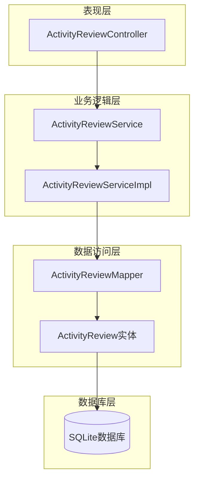
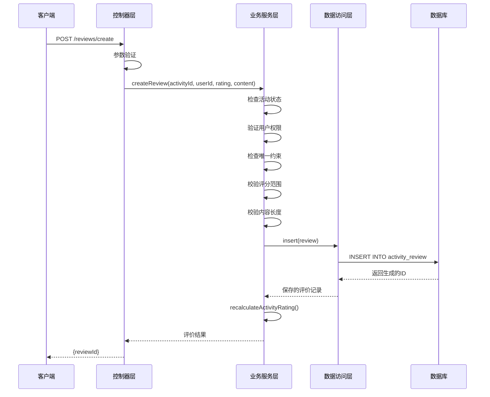
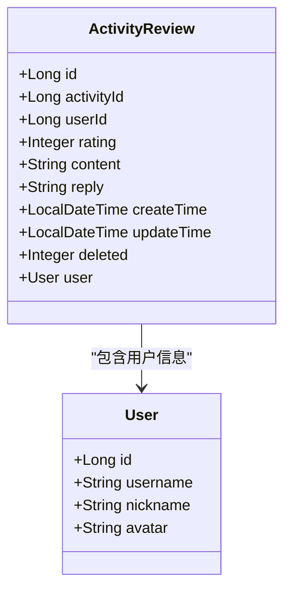
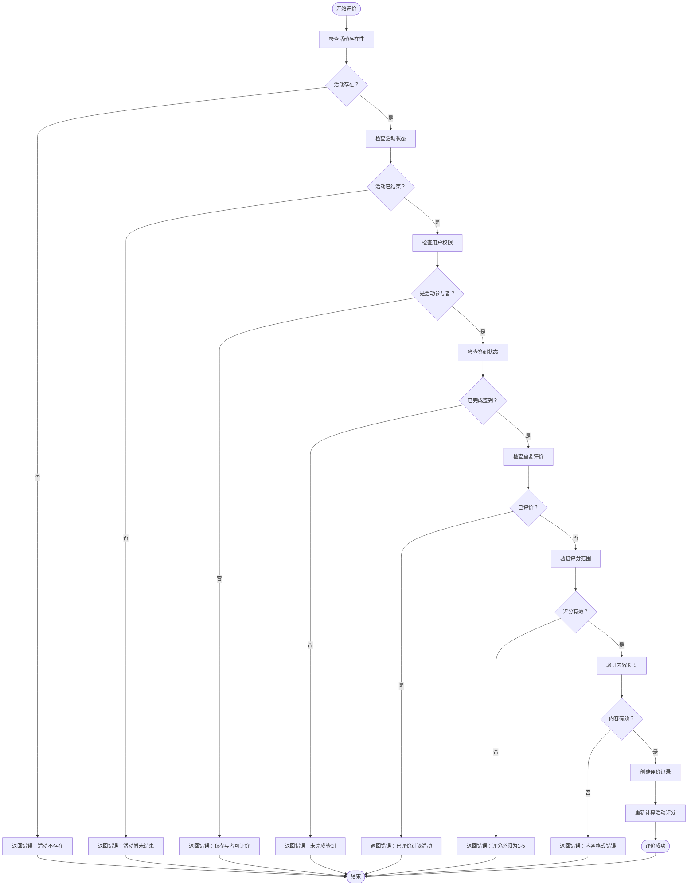
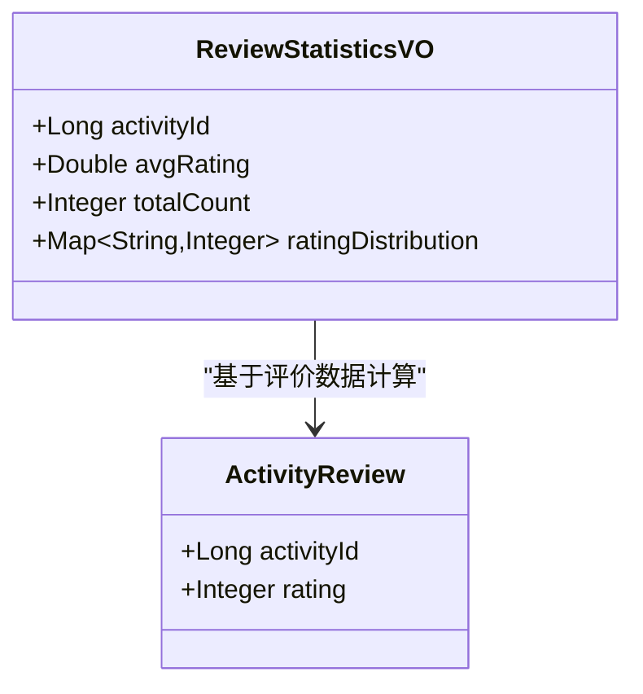
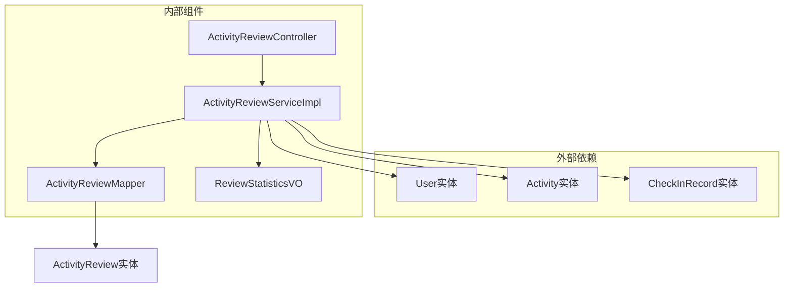
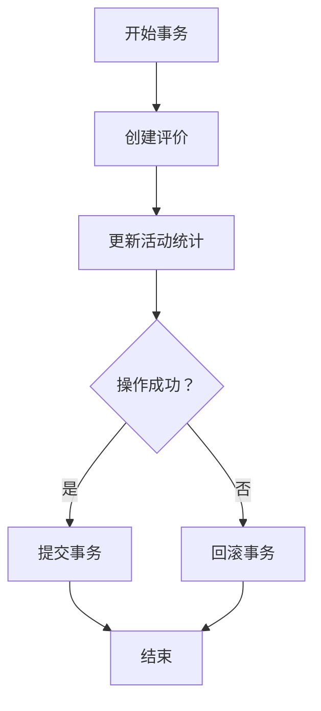
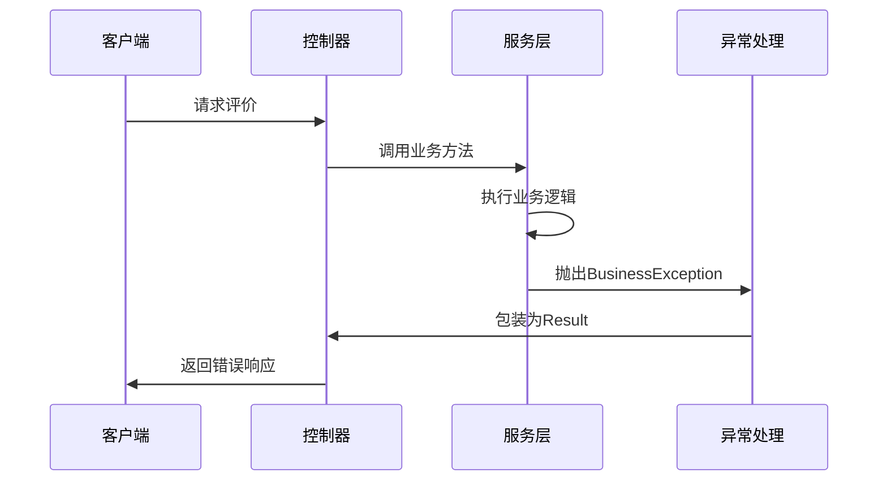

# 活动评价表 (activity_review)

<cite>
**本文档引用的文件**
- [ActivityReview.java](file://src/main/java/com/campus/eventsys/entity/ActivityReview.java)
- [ActivityReviewMapper.java](file://src/main/java/com/campus/eventsys/mapper/ActivityReviewMapper.java)
- [ActivityReviewServiceImpl.java](file://src/main/java/com/campus/eventsys/service/impl/ActivityReviewServiceImpl.java)
- [ActivityReviewService.java](file://src/main/java/com/campus/eventsys/service/ActivityReviewService.java)
- [ActivityReviewController.java](file://src/main/java/com/campus/eventsys/controller/ActivityReviewController.java)
- [schema.sql](file://src/main/resources/db/schema.sql)
- [ReviewStatisticsVO.java](file://src/main/java/com/campus/eventsys/entity/ReviewStatisticsVO.java)
- [ActivityReviewControllerTest.java](file://src/test/java/com/campus/eventsys/controller/ActivityReviewControllerTest.java)
- [ER图11_活动评价.plantuml](file://picture/ER图11_活动评价.plantuml)
- [表设计.md](file://picture/表设计.md)
</cite>

## 目录
1. [简介](#简介)
2. [项目结构](#项目结构)
3. [核心组件](#核心组件)
4. [架构概览](#架构概览)
5. [详细组件分析](#详细组件分析)
6. [依赖关系分析](#依赖关系分析)
7. [性能考虑](#性能考虑)
8. [故障排除指南](#故障排除指南)
9. [结论](#结论)

## 简介

活动评价表(activity_review)是校园活动综合管理系统中的核心数据表，用于记录用户对已结束活动的评分和文字评价。该表实现了严格的业务规则控制，确保每个用户对同一活动只能评价一次，并提供了完整的评价生命周期管理功能。

## 项目结构

活动评价模块采用标准的MVC架构模式，包含以下关键层次：

**图表来源**
- [ActivityReviewController.java:1-254](file://src/main/java/com/campus/eventsys/controller/ActivityReviewController.java#L1-L254)
- [ActivityReviewService.java:1-90](file://src/main/java/com/campus/eventsys/service/ActivityReviewService.java#L1-L90)
- [ActivityReviewServiceImpl.java:1-316](file://src/main/java/com/campus/eventsys/service/impl/ActivityReviewServiceImpl.java#L1-L316)

**章节来源**
- [ActivityReviewController.java:25-41](file://src/main/java/com/campus/eventsys/controller/ActivityReviewController.java#L25-L41)
- [ActivityReviewService.java:8-12](file://src/main/java/com/campus/eventsys/service/ActivityReviewService.java#L8-L12)

## 核心组件

### 数据模型设计

活动评价表采用关系型数据库设计，具有以下核心特征：

| 组件 | 类型 | 约束 | 描述 |
|------|------|------|------|
| id | INTEGER | 主键, 自增 | 评价记录唯一标识符 |
| activity_id | INTEGER | 外键, NOT NULL | 关联活动ID |
| user_id | INTEGER | 外键, NOT NULL | 评价用户ID |
| rating | INTEGER | NOT NULL | 评分(1-5星) |
| content | TEXT | 可空 | 评价内容(最多500字) |
| reply | TEXT | 可空 | 组织者回复内容 |
| create_time | DATETIME | 默认值 | 记录创建时间 |
| update_time | DATETIME | 默认值 | 记录更新时间 |
| deleted | INTEGER | 默认值 | 逻辑删除标志 |

### 唯一约束机制

系统通过数据库层面的唯一约束确保业务规则：
- `(activity_id, user_id)` 唯一索引
- 防止用户重复评价同一活动
- 支持逻辑删除的软删除机制

**章节来源**
- [schema.sql:224-237](file://src/main/resources/db/schema.sql#L224-L237)
- [ActivityReview.java:19-27](file://src/main/java/com/campus/eventsys/entity/ActivityReview.java#L19-L27)

## 架构概览

活动评价系统的整体架构遵循分层设计原则，实现了清晰的关注点分离：

**图表来源**
- [ActivityReviewController.java:64-82](file://src/main/java/com/campus/eventsys/controller/ActivityReviewController.java#L64-L82)
- [ActivityReviewServiceImpl.java:42-111](file://src/main/java/com/campus/eventsys/service/impl/ActivityReviewServiceImpl.java#L42-L111)

**章节来源**
- [ActivityReviewController.java:29-37](file://src/main/java/com/campus/eventsys/controller/ActivityReviewController.java#L29-L37)
- [ActivityReviewServiceImpl.java:27-34](file://src/main/java/com/campus/eventsys/service/impl/ActivityReviewServiceImpl.java#L27-L34)

## 详细组件分析

### 实体类设计

ActivityReview实体类采用Lombok注解简化代码，实现了完整的数据封装：

**图表来源**
- [ActivityReview.java:17-55](file://src/main/java/com/campus/eventsys/entity/ActivityReview.java#L17-L55)

### 业务规则实现

系统实现了严格的业务规则控制，确保评价过程的合规性：

#### 评价提交流程

**图表来源**
- [ActivityReviewServiceImpl.java:41-111](file://src/main/java/com/campus/eventsys/service/impl/ActivityReviewServiceImpl.java#L41-L111)

#### 组织者回复机制

系统为活动组织者提供了专门的回复功能：

| 功能特性 | 实现细节 | 安全控制 |
|----------|----------|----------|
| 回复权限 | 仅活动组织者可回复 | 权限验证 |
| 内容限制 | 最多500字符 | 长度校验 |
| 覆盖更新 | 重复回复会覆盖原内容 | 直接更新 |
| 安全保护 | SQL注入防护 | 参数绑定 |

**章节来源**
- [ActivityReviewServiceImpl.java:186-212](file://src/main/java/com/campus/eventsys/service/impl/ActivityReviewServiceImpl.java#L186-L212)
- [ActivityReviewController.java:171-185](file://src/main/java/com/campus/eventsys/controller/ActivityReviewController.java#L171-L185)

### 统计计算机制

系统提供了完整的评价统计功能，支持实时数据分析：

**图表来源**
- [ReviewStatisticsVO.java:14-27](file://src/main/java/com/campus/eventsys/entity/ReviewStatisticsVO.java#L14-L27)
- [ActivityReviewServiceImpl.java:230-270](file://src/main/java/com/campus/eventsys/service/impl/ActivityReviewServiceImpl.java#L230-L270)

#### 统计指标计算

| 指标名称 | 计算公式 | 数据来源 | 用途 |
|----------|----------|----------|------|
| 平均评分 | Σ(rating)/n | 所有有效评价 | 活动质量评估 |
| 总评价数 | n | 有效评价计数 | 参与度统计 |
| 星级分布 | ratingDistribution | 分组统计 | 详细质量分析 |
| 评分精度 | 四舍五入到0.1 | 数学运算 | 结果展示友好 |

**章节来源**
- [ActivityReviewServiceImpl.java:230-298](file://src/main/java/com/campus/eventsys/service/impl/ActivityReviewServiceImpl.java#L230-L298)

## 依赖关系分析

活动评价模块与其他系统组件的依赖关系如下：

**图表来源**
- [ActivityReviewServiceImpl.java:36-39](file://src/main/java/com/campus/eventsys/service/impl/ActivityReviewServiceImpl.java#L36-L39)
- [ActivityReviewController.java:43-45](file://src/main/java/com/campus/eventsys/controller/ActivityReviewController.java#L43-L45)

### 关联关系设计

系统通过外键约束建立了清晰的数据关联：

| 关系类型 | 表间关系 | 约束条件 | 业务意义 |
|----------|----------|----------|----------|
| 用户-评价 | 多对一 | user.id → activity_review.user_id | 用户评价归属 |
| 活动-评价 | 多对一 | activity.id → activity_review.activity_id | 活动评价归属 |
| 唯一约束 | 一对一 | UNIQUE(activity_id, user_id) | 防止重复评价 |
| 逻辑删除 | 可选 | deleted字段 | 支持软删除 |

**章节来源**
- [schema.sql:234-236](file://src/main/resources/db/schema.sql#L234-L236)
- [ActivityReview.java:23-27](file://src/main/java/com/campus/eventsys/entity/ActivityReview.java#L23-L27)

## 性能考虑

### 查询优化策略

系统针对评价表的查询操作进行了专门的性能优化：

| 优化措施 | 实现方式 | 性能收益 |
|----------|----------|----------|
| 索引设计 | 在activity_id和user_id上建立索引 | 快速定位评价记录 |
| 分页查询 | 使用MyBatis-Plus分页插件 | 减少内存占用 |
| 批量加载 | 用户信息按需加载 | 提高查询效率 |
| 缓存策略 | 适配器模式支持缓存 | 降低数据库压力 |

### 事务处理机制

系统采用声明式事务管理，确保数据一致性：

**图表来源**
- [ActivityReviewServiceImpl.java:42-111](file://src/main/java/com/campus/eventsys/service/impl/ActivityReviewServiceImpl.java#L42-L111)

**章节来源**
- [schema.sql:292-295](file://src/main/resources/db/schema.sql#L292-L295)
- [ActivityReviewServiceImpl.java:272-298](file://src/main/java/com/campus/eventsys/service/impl/ActivityReviewServiceImpl.java#L272-L298)

## 故障排除指南

### 常见问题及解决方案

| 问题类型 | 症状描述 | 可能原因 | 解决方案 |
|----------|----------|----------|----------|
| 重复评价错误 | "您已评价过该活动" | 唯一约束冲突 | 检查用户是否已评价 |
| 权限不足 | "仅活动参与者可以评价" | 用户非参与者 | 确认活动报名状态 |
| 活动未结束 | "活动尚未结束，无法评价" | 活动状态异常 | 等待活动结束或检查状态 |
| 未完成签到 | "您未完成签到，无法评价" | 签到记录缺失 | 完成活动签到 |
| 参数验证失败 | "评分必须为1-5的整数" | 输入格式错误 | 检查评分范围和内容长度 |

### 异常处理机制

系统采用统一的异常处理框架：

**图表来源**
- [ActivityReviewController.java:75-81](file://src/main/java/com/campus/eventsys/controller/ActivityReviewController.java#L75-L81)

**章节来源**
- [ActivityReviewControllerTest.java:102-190](file://src/test/java/com/campus/eventsys/controller/ActivityReviewControllerTest.java#L102-L190)

## 结论

活动评价表(activity_review)作为校园活动综合管理系统的核心组件，通过严谨的数据库设计和完善的业务逻辑实现了高质量的用户评价管理功能。系统不仅满足了基本的评价需求，还提供了丰富的统计分析功能，为活动质量评估和持续改进提供了有力支撑。

### 主要优势

1. **严格的业务规则控制**：通过数据库唯一约束和应用层验证双重保障，确保评价的唯一性和有效性
2. **完整的生命周期管理**：从评价创建到统计分析的全流程支持
3. **灵活的权限控制**：针对不同用户角色提供相应的操作权限
4. **强大的统计分析能力**：提供多维度的评价数据分析功能
5. **良好的扩展性**：模块化设计便于后续功能扩展

### 应用价值

活动评价系统在实际应用中发挥着重要作用：

- **质量监控**：通过评分和评价内容分析活动质量
- **用户反馈**：收集用户意见，指导活动改进
- **信誉体系**：建立活动组织者的信誉评价机制
- **决策支持**：为活动管理和资源配置提供数据支撑

该系统的设计充分体现了现代Web应用的最佳实践，为类似的企业级应用开发提供了优秀的参考模板。