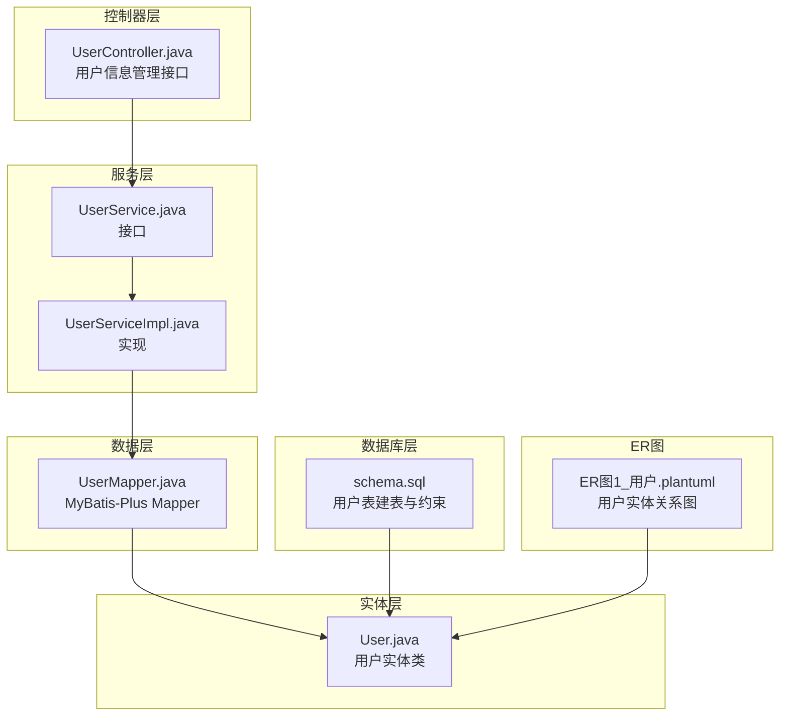
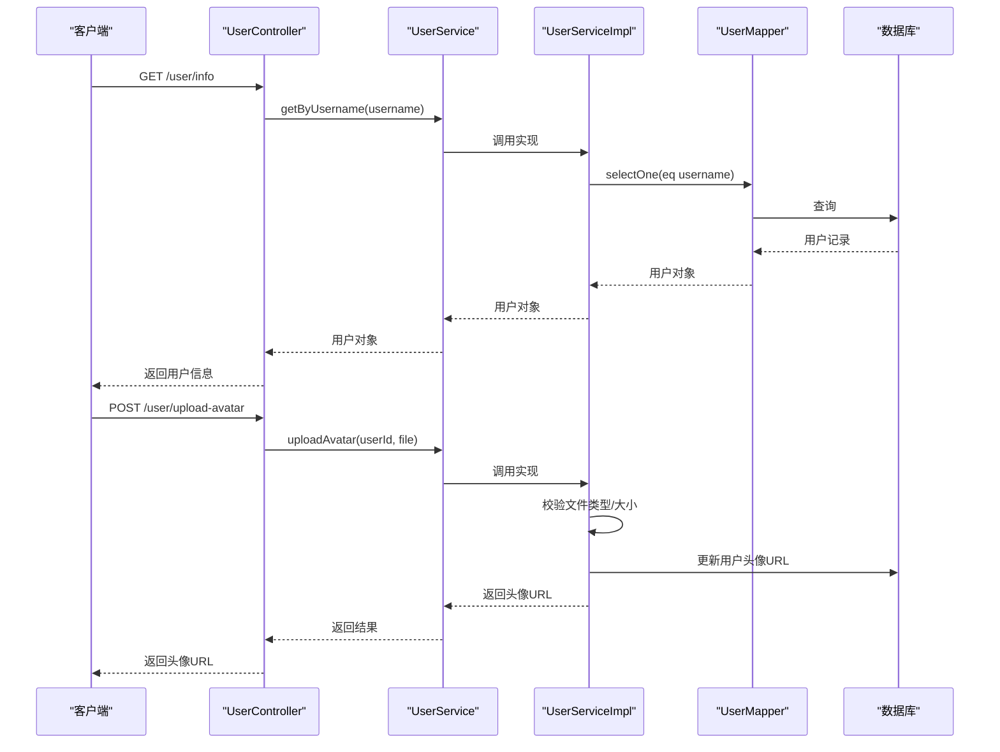
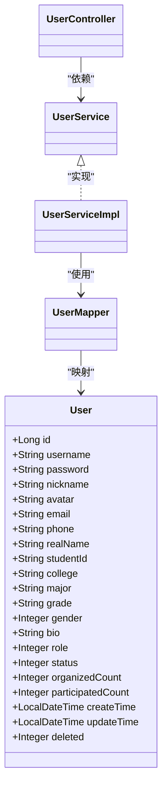
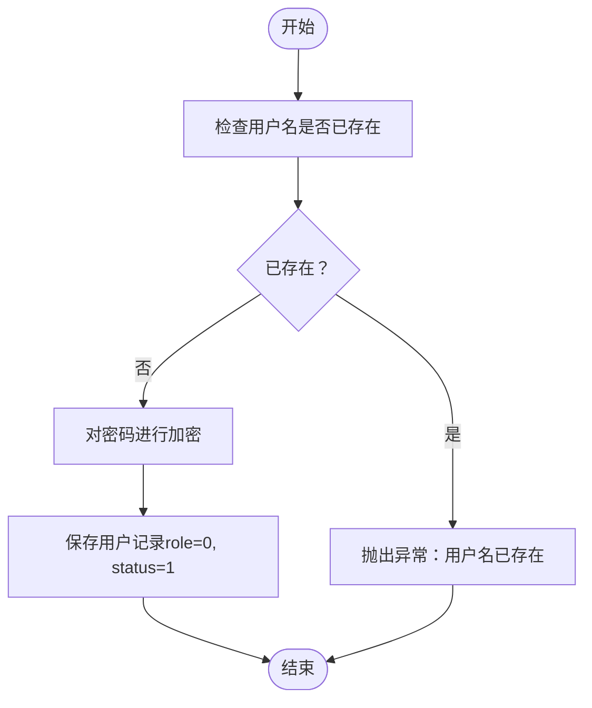
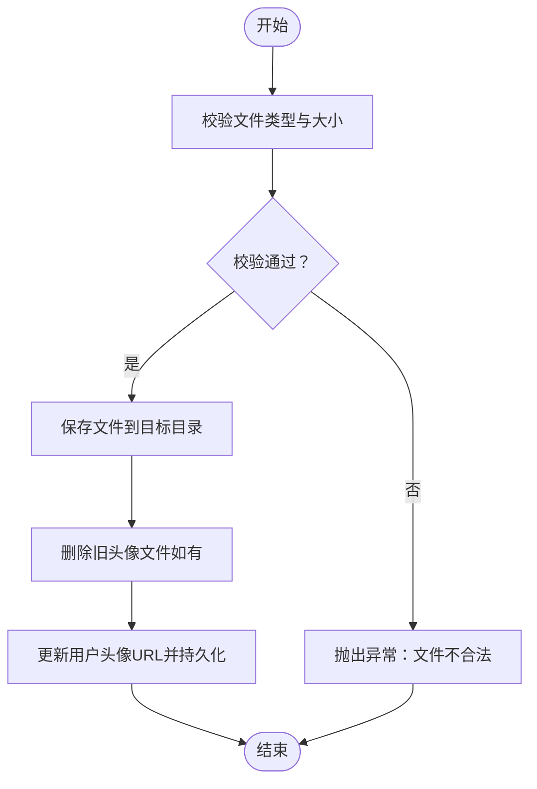
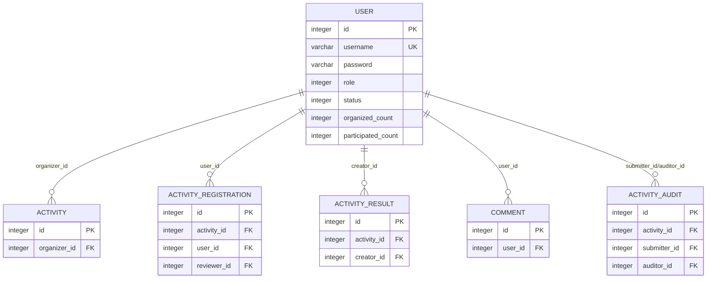

# 用户表 (user)

<cite>
**本文档引用的文件**
- [User.java](file://src/main/java/com/campus/eventsys/entity/User.java)
- [schema.sql](file://src/main/resources/db/schema.sql)
- [UserMapper.java](file://src/main/java/com/campus/eventsys/mapper/UserMapper.java)
- [UserService.java](file://src/main/java/com/campus/eventsys/service/UserService.java)
- [UserServiceImpl.java](file://src/main/java/com/campus/eventsys/service/impl/UserServiceImpl.java)
- [UserController.java](file://src/main/java/com/campus/eventsys/controller/UserController.java)
- [ER图1_用户.plantuml](file://picture/ER图1_用户.plantuml)
- [ActivityRegistration.java](file://src/main/java/com/campus/eventsys/entity/ActivityRegistration.java)
- [Activity.java](file://src/main/java/com/campus/eventsys/entity/Activity.java)
- [ActivityRole.java](file://src/main/java/com/campus/eventsys/enums/ActivityRole.java)
</cite>

## 目录
1. [简介](#简介)
2. [项目结构](#项目结构)
3. [核心组件](#核心组件)
4. [架构总览](#架构总览)
5. [详细组件分析](#详细组件分析)
6. [依赖关系分析](#依赖关系分析)
7. [性能考虑](#性能考虑)
8. [故障排查指南](#故障排查指南)
9. [结论](#结论)
10. [附录](#附录)

## 简介
本文件为用户表(user)的权威技术文档，涵盖字段定义、业务含义、数据库约束、与其他表的关联关系、业务规则与验证要求，并结合实际代码实现进行说明。用户表承载了系统中的身份认证与个人信息管理能力，是活动系统的核心基础数据之一。

## 项目结构
用户表相关代码分布在以下层次：
- 实体层：定义用户实体类及字段映射
- 数据层：MyBatis-Plus Mapper 接口
- 服务层：用户信息服务接口与实现
- 控制器层：用户信息管理接口
- 数据库层：初始化脚本定义表结构与约束
- ER 图：用户表的实体关系图



图表来源
- [User.java:1-85](file://src/main/java/com/campus/eventsys/entity/User.java#L1-L85)
- [UserMapper.java:1-10](file://src/main/java/com/campus/eventsys/mapper/UserMapper.java#L1-L10)
- [UserService.java:1-38](file://src/main/java/com/campus/eventsys/service/UserService.java#L1-L38)
- [UserServiceImpl.java:1-158](file://src/main/java/com/campus/eventsys/service/impl/UserServiceImpl.java#L1-L158)
- [UserController.java:1-146](file://src/main/java/com/campus/eventsys/controller/UserController.java#L1-L146)
- [schema.sql:1-295](file://src/main/resources/db/schema.sql#L1-L295)
- [ER图1_用户.plantuml:1-22](file://picture/ER图1_用户.plantuml#L1-L22)

章节来源
- [User.java:1-85](file://src/main/java/com/campus/eventsys/entity/User.java#L1-L85)
- [schema.sql:1-295](file://src/main/resources/db/schema.sql#L1-L295)

## 核心组件
- 用户实体类：定义用户表的字段、注解与默认值策略
- 用户 Mapper：基于 MyBatis-Plus 的通用 Mapper 接口
- 用户服务接口与实现：提供按用户名/学号查询、注册、头像上传、信息更新等业务方法
- 用户控制器：提供获取当前用户信息、上传头像、更新用户信息的 REST 接口
- 数据库脚本：定义用户表结构、主键自增、唯一约束、默认值、索引等

章节来源
- [User.java:1-85](file://src/main/java/com/campus/eventsys/entity/User.java#L1-L85)
- [UserMapper.java:1-10](file://src/main/java/com/campus/eventsys/mapper/UserMapper.java#L1-L10)
- [UserService.java:1-38](file://src/main/java/com/campus/eventsys/service/UserService.java#L1-L38)
- [UserServiceImpl.java:1-158](file://src/main/java/com/campus/eventsys/service/impl/UserServiceImpl.java#L1-L158)
- [UserController.java:1-146](file://src/main/java/com/campus/eventsys/controller/UserController.java#L1-L146)
- [schema.sql:1-295](file://src/main/resources/db/schema.sql#L1-L295)

## 架构总览
用户表在系统中的位置与交互如下：

```mermaid
graph TB
U["UserController<br/>用户信息管理接口"] --> USvc["UserService<br/>用户服务"]
USvc --> USvcImpl["UserServiceImpl<br/>用户服务实现"]
USvcImpl --> UM["UserMapper<br/>MyBatis-Plus Mapper"]
UM --> DB["数据库<br/>SQLite 用户表"]
subgraph "关联表"
AR["ActivityRegistration<br/>活动报名"]
A["Activity<br/>活动"]
end
DB <- --> AR
DB <- --> A
```

图表来源
- [UserController.java:1-146](file://src/main/java/com/campus/eventsys/controller/UserController.java#L1-L146)
- [UserService.java:1-38](file://src/main/java/com/campus/eventsys/service/UserService.java#L1-L38)
- [UserServiceImpl.java:1-158](file://src/main/java/com/campus/eventsys/service/impl/UserServiceImpl.java#L1-L158)
- [UserMapper.java:1-10](file://src/main/java/com/campus/eventsys/mapper/UserMapper.java#L1-L10)
- [schema.sql:1-295](file://src/main/resources/db/schema.sql#L1-L295)

## 详细组件分析

### 字段定义与业务含义
用户表包含以下字段，按用途分组说明：

- 基础标识与凭证
  - id：主键，自增
  - username：用户名/学号，唯一
  - password：密码（返回时被隐藏）
  - avatar：头像URL
  - role：角色，0-普通用户，1-管理员
  - status：状态，0-禁用，1-正常
  - deleted：逻辑删除标志，0-未删除，1-已删除
  - createTime/updateTime：创建与更新时间

- 个人信息与扩展字段
  - nickname：昵称
  - email：邮箱
  - phone：手机号
  - realName：真实姓名
  - studentId：学号
  - college：学院
  - major：专业
  - grade：年级
  - gender：性别，0-女，1-男
  - bio：个人简介

- 统计数据
  - organizedCount：举办活动数，默认0
  - participatedCount：参与活动数，默认0

字段来源与默认值依据实体类与数据库脚本定义。

章节来源
- [User.java:17-83](file://src/main/java/com/campus/eventsys/entity/User.java#L17-L83)
- [schema.sql:6-28](file://src/main/resources/db/schema.sql#L6-L28)

### 数据库约束与索引
- 主键与自增：id 为主键且自增
- 唯一约束：username 唯一
- 默认值：gender 默认0，role 默认0，status 默认1，organized_count 默认0，participated_count 默认0，deleted 默认0
- 索引：针对 username、student_id、college、role、status 等常用查询字段建立索引

章节来源
- [schema.sql:6-28](file://src/main/resources/db/schema.sql#L6-L28)
- [schema.sql:243-248](file://src/main/resources/db/schema.sql#L243-L248)

### 与活动系统的关联关系
用户表在活动系统中的关键外键关系：
- 活动表(activity)的 organizer_id 引用 user.id
- 活动报名表(activity_registration)的 user_id 引用 user.id
- 活动报名表(activity_registration)的 reviewer_id 引用 user.id
- 活动成果表(activity_result)的 creator_id 引用 user.id
- 评论表(comment)的 user_id 引用 user.id
- 审核记录表(activity_audit)的 submitter_id 和 auditor_id 引用 user.id

这些关系确保了用户作为活动组织者、报名者、审核者、成果发布者、评论者等角色的数据一致性。

章节来源
- [schema.sql:50-77](file://src/main/resources/db/schema.sql#L50-L77)
- [schema.sql:82-100](file://src/main/resources/db/schema.sql#L82-L100)
- [schema.sql:106-121](file://src/main/resources/db/schema.sql#L106-L121)
- [schema.sql:128-140](file://src/main/resources/db/schema.sql#L128-L140)
- [schema.sql:202-218](file://src/main/resources/db/schema.sql#L202-L218)

### 业务字段作用
- role（角色）：决定用户是否具备管理员权限，用于权限控制
- status（状态）：控制用户是否可登录与使用系统功能
- organizedCount（举办活动数）：统计用户组织的活动数量，用于展示与运营分析
- participatedCount（参与活动数）：统计用户参与的活动数量，用于活跃度评估

章节来源
- [User.java:60-70](file://src/main/java/com/campus/eventsys/entity/User.java#L60-L70)
- [schema.sql:21-24](file://src/main/resources/db/schema.sql#L21-L24)

### 控制器与服务交互流程
用户控制器通过认证上下文获取当前登录用户名，调用用户服务查询用户信息；同时提供头像上传与信息更新接口，服务层负责校验与持久化。



图表来源
- [UserController.java:39-93](file://src/main/java/com/campus/eventsys/controller/UserController.java#L39-L93)
- [UserService.java:9-28](file://src/main/java/com/campus/eventsys/service/UserService.java#L9-L28)
- [UserServiceImpl.java:34-126](file://src/main/java/com/campus/eventsys/service/impl/UserServiceImpl.java#L34-L126)
- [UserMapper.java:1-10](file://src/main/java/com/campus/eventsys/mapper/UserMapper.java#L1-L10)

### 类关系与数据模型
用户实体类采用 MyBatis-Plus 注解映射数据库表，字段与默认值在实体类与数据库脚本中保持一致。



图表来源
- [User.java:15-83](file://src/main/java/com/campus/eventsys/entity/User.java#L15-L83)
- [UserMapper.java:8](file://src/main/java/com/campus/eventsys/mapper/UserMapper.java#L8)
- [UserService.java:7](file://src/main/java/com/campus/eventsys/service/UserService.java#L7)
- [UserServiceImpl.java:24](file://src/main/java/com/campus/eventsys/service/impl/UserServiceImpl.java#L24)
- [UserController.java:34](file://src/main/java/com/campus/eventsys/controller/UserController.java#L34)

### 关键业务流程与规则

#### 用户注册流程
- 输入用户名与密码，服务层检查用户名唯一性
- 密码使用加密存储
- 角色默认为普通用户，状态默认为正常



图表来源
- [UserServiceImpl.java:49-57](file://src/main/java/com/campus/eventsys/service/impl/UserServiceImpl.java#L49-L57)

章节来源
- [UserServiceImpl.java:49-57](file://src/main/java/com/campus/eventsys/service/impl/UserServiceImpl.java#L49-L57)

#### 头像上传流程
- 校验文件类型与大小
- 生成唯一文件名并保存至指定目录
- 删除旧头像文件（若存在）
- 更新用户头像URL并持久化



图表来源
- [UserServiceImpl.java:60-126](file://src/main/java/com/campus/eventsys/service/impl/UserServiceImpl.java#L60-L126)

章节来源
- [UserServiceImpl.java:60-126](file://src/main/java/com/campus/eventsys/service/impl/UserServiceImpl.java#L60-L126)

#### 用户信息更新规则
- 可更新字段：昵称、邮箱、手机号、真实姓名、学院、专业、年级、性别、个人简介
- 不可更新字段：用户名、密码、角色、创建时间等
- 服务层在更新前将不可更新字段置空，避免意外修改

章节来源
- [UserController.java:98-144](file://src/main/java/com/campus/eventsys/controller/UserController.java#L98-L144)
- [UserServiceImpl.java:147-156](file://src/main/java/com/campus/eventsys/service/impl/UserServiceImpl.java#L147-L156)

### 字段验证与业务规则
- 用户名唯一性：数据库唯一约束 + 服务层注册时校验
- 密码安全：注册时加密存储，返回时不暴露明文
- 头像文件：仅允许图片类型，限制大小（实现中为10MB，接口文档为5MB，以实现为准）
- 角色与状态：默认值与权限控制由服务层与控制器共同保障
- 统计字段：由其他业务流程维护（例如活动报名成功后更新参与统计）

章节来源
- [schema.sql:8](file://src/main/resources/db/schema.sql#L8)
- [UserServiceImpl.java:53](file://src/main/java/com/campus/eventsys/service/impl/UserServiceImpl.java#L53)
- [UserServiceImpl.java:68-77](file://src/main/java/com/campus/eventsys/service/impl/UserServiceImpl.java#L68-L77)
- [UserController.java:100](file://src/main/java/com/campus/eventsys/controller/UserController.java#L100)

## 依赖关系分析
用户表与其他表的外键依赖关系如下：



图表来源
- [schema.sql:50-77](file://src/main/resources/db/schema.sql#L50-L77)
- [schema.sql:82-100](file://src/main/resources/db/schema.sql#L82-L100)
- [schema.sql:106-121](file://src/main/resources/db/schema.sql#L106-L121)
- [schema.sql:128-140](file://src/main/resources/db/schema.sql#L128-L140)
- [schema.sql:202-218](file://src/main/resources/db/schema.sql#L202-L218)

## 性能考虑
- 索引优化：针对 username、student_id、college、role、status 等字段建立索引，提升查询效率
- 字段选择：控制器返回用户信息时包含统计字段，建议在高并发场景下根据前端需求裁剪字段
- 头像存储：统一目录与命名策略，定期清理旧文件，避免磁盘膨胀

章节来源
- [schema.sql:243-248](file://src/main/resources/db/schema.sql#L243-L248)
- [UserServiceImpl.java:94-98](file://src/main/java/com/campus/eventsys/service/impl/UserServiceImpl.java#L94-L98)

## 故障排查指南
- 用户名重复：注册时报用户名已存在，检查数据库唯一约束与服务层校验逻辑
- 头像上传失败：检查文件类型、大小限制与上传目录权限；查看服务层日志输出
- 更新信息失败：确认传入字段是否包含不可更新字段；检查服务层对不可更新字段的处理
- 权限问题：角色与状态字段由服务层默认设置，若出现权限异常，检查控制器与服务层逻辑

章节来源
- [UserServiceImpl.java:50-52](file://src/main/java/com/campus/eventsys/service/impl/UserServiceImpl.java#L50-L52)
- [UserServiceImpl.java:68-77](file://src/main/java/com/campus/eventsys/service/impl/UserServiceImpl.java#L68-L77)
- [UserServiceImpl.java:149-155](file://src/main/java/com/campus/eventsys/service/impl/UserServiceImpl.java#L149-L155)

## 结论
用户表(user)在系统中承担着身份认证与个人信息管理的核心职责。通过明确的字段定义、严格的数据库约束、清晰的业务流程与完善的权限控制，确保了用户数据的一致性与安全性。配合活动系统的多处外键引用，用户表成为活动生态的重要基石。

## 附录

### 字段对照表
- id：用户ID（主键，自增）
- username：用户名/学号（唯一）
- password：密码（加密存储）
- nickname：昵称
- avatar：头像URL
- email：邮箱
- phone：手机号
- realName：真实姓名
- studentId：学号
- college：学院
- major：专业
- grade：年级
- gender：性别（0-女，1-男）
- bio：个人简介
- role：角色（0-普通用户，1-管理员）
- status：状态（0-禁用，1-正常）
- organizedCount：举办活动数（默认0）
- participatedCount：参与活动数（默认0）
- createTime/updateTime：创建与更新时间
- deleted：逻辑删除标志（0-未删除，1-已删除）

章节来源
- [User.java:17-83](file://src/main/java/com/campus/eventsys/entity/User.java#L17-L83)
- [schema.sql:6-28](file://src/main/resources/db/schema.sql#L6-L28)