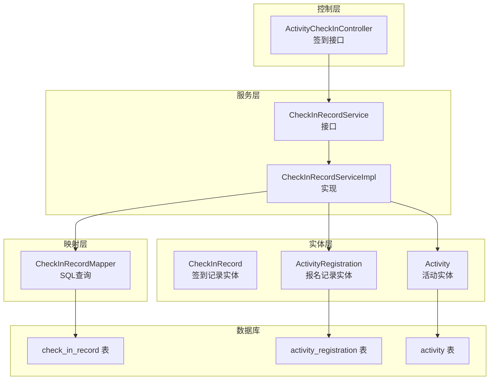
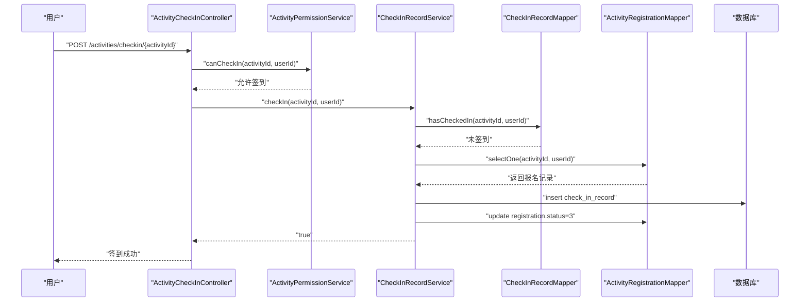
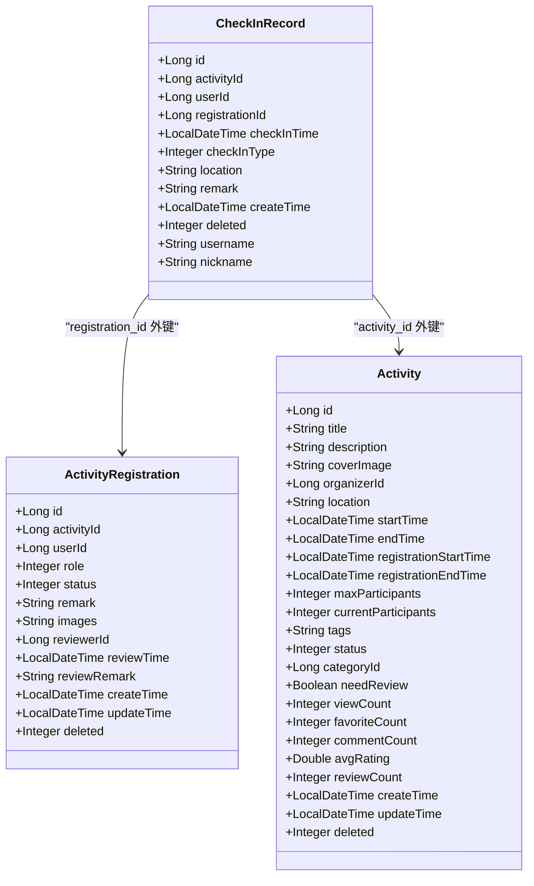
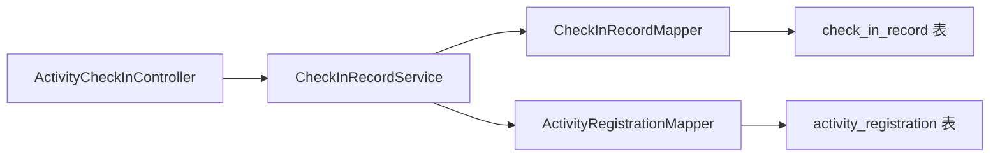

# 签到记录表 (check_in_record)

<cite>
**本文引用的文件**
- [CheckInRecord.java](file://src/main/java/com/campus/eventsys/entity/CheckInRecord.java)
- [CheckInRecordMapper.java](file://src/main/java/com/campus/eventsys/mapper/CheckInRecordMapper.java)
- [CheckInRecordServiceImpl.java](file://src/main/java/com/campus/eventsys/service/impl/CheckInRecordServiceImpl.java)
- [CheckInRecordService.java](file://src/main/java/com/campus/eventsys/service/CheckInRecordService.java)
- [ActivityCheckInController.java](file://src/main/java/com/campus/eventsys/controller/ActivityCheckInController.java)
- [schema.sql](file://src/main/resources/db/schema.sql)
- [data.sql](file://src/main/resources/db/data.sql)
- [ActivityRegistration.java](file://src/main/java/com/campus/eventsys/entity/ActivityRegistration.java)
- [Activity.java](file://src/main/java/com/campus/eventsys/entity/Activity.java)
- [ER图8_签到记录.plantuml](file://picture/ER图8_签到记录.plantuml)
</cite>

## 目录
1. [简介](#简介)
2. [项目结构](#项目结构)
3. [核心组件](#核心组件)
4. [架构总览](#架构总览)
5. [详细组件分析](#详细组件分析)
6. [依赖关系分析](#依赖关系分析)
7. [性能考虑](#性能考虑)
8. [故障排查指南](#故障排查指南)
9. [结论](#结论)
10. [附录](#附录)

## 简介
本文件系统化梳理签到记录表（check_in_record）的设计与实现，覆盖字段定义、业务规则、与活动报名表的关联关系、唯一性与完整性约束，以及在活动管理中的作用与数据统计思路。文档同时给出接口调用序列与时序图，帮助开发者快速理解签到流程。

## 项目结构
签到相关代码采用典型的分层架构：
- 实体层：定义签到记录实体及字段映射
- 映射层：提供签到记录的数据库访问方法
- 服务层：封装签到业务逻辑（含权限校验、重复签到防护、报名状态联动）
- 控制层：对外暴露签到接口（签到、查询签到状态、查询活动签到列表、查询我的签到记录）

图表来源
- [ActivityCheckInController.java:1-172](file://src/main/java/com/campus/eventsys/controller/ActivityCheckInController.java#L1-L172)
- [CheckInRecordService.java:1-47](file://src/main/java/com/campus/eventsys/service/CheckInRecordService.java#L1-L47)
- [CheckInRecordServiceImpl.java:1-102](file://src/main/java/com/campus/eventsys/service/impl/CheckInRecordServiceImpl.java#L1-L102)
- [CheckInRecordMapper.java:1-25](file://src/main/java/com/campus/eventsys/mapper/CheckInRecordMapper.java#L1-L25)
- [CheckInRecord.java:1-59](file://src/main/java/com/campus/eventsys/entity/CheckInRecord.java#L1-L59)
- [ActivityRegistration.java:1-62](file://src/main/java/com/campus/eventsys/entity/ActivityRegistration.java#L1-L62)
- [Activity.java:1-95](file://src/main/java/com/campus/eventsys/entity/Activity.java#L1-L95)
- [schema.sql:156-173](file://src/main/resources/db/schema.sql#L156-L173)

章节来源
- [ActivityCheckInController.java:1-172](file://src/main/java/com/campus/eventsys/controller/ActivityCheckInController.java#L1-L172)
- [CheckInRecordService.java:1-47](file://src/main/java/com/campus/eventsys/service/CheckInRecordService.java#L1-L47)
- [CheckInRecordServiceImpl.java:1-102](file://src/main/java/com/campus/eventsys/service/impl/CheckInRecordServiceImpl.java#L1-L102)
- [CheckInRecordMapper.java:1-25](file://src/main/java/com/campus/eventsys/mapper/CheckInRecordMapper.java#L1-L25)
- [CheckInRecord.java:1-59](file://src/main/java/com/campus/eventsys/entity/CheckInRecord.java#L1-L59)
- [ActivityRegistration.java:1-62](file://src/main/java/com/campus/eventsys/entity/ActivityRegistration.java#L1-L62)
- [Activity.java:1-95](file://src/main/java/com/campus/eventsys/entity/Activity.java#L1-L95)
- [schema.sql:156-173](file://src/main/resources/db/schema.sql#L156-L173)

## 核心组件
- 签到记录实体：定义签到记录的全部字段，包括活动ID、用户ID、报名ID、签到时间、签到类型、签到地点、备注信息等，并标注逻辑删除字段与自动填充字段。
- 签到记录映射器：提供按活动查询签到记录（含用户信息）的方法。
- 签到记录服务：实现签到业务逻辑（重复签到检查、报名状态联动、查询接口）。
- 签到控制器：对外提供签到、查询签到状态、查询活动签到列表、查询我的签到记录等接口。

章节来源
- [CheckInRecord.java:1-59](file://src/main/java/com/campus/eventsys/entity/CheckInRecord.java#L1-L59)
- [CheckInRecordMapper.java:12-23](file://src/main/java/com/campus/eventsys/mapper/CheckInRecordMapper.java#L12-L23)
- [CheckInRecordServiceImpl.java:24-101](file://src/main/java/com/campus/eventsys/service/impl/CheckInRecordServiceImpl.java#L24-L101)
- [CheckInRecordService.java:11-46](file://src/main/java/com/campus/eventsys/service/CheckInRecordService.java#L11-L46)
- [ActivityCheckInController.java:35-171](file://src/main/java/com/campus/eventsys/controller/ActivityCheckInController.java#L35-L171)

## 架构总览
签到流程的关键交互如下：

图表来源
- [ActivityCheckInController.java:56-84](file://src/main/java/com/campus/eventsys/controller/ActivityCheckInController.java#L56-L84)
- [CheckInRecordServiceImpl.java:29-74](file://src/main/java/com/campus/eventsys/service/impl/CheckInRecordServiceImpl.java#L29-L74)
- [CheckInRecordMapper.java:13-23](file://src/main/java/com/campus/eventsys/mapper/CheckInRecordMapper.java#L13-L23)
- [CheckInRecordService.java:14-20](file://src/main/java/com/campus/eventsys/service/CheckInRecordService.java#L14-L20)

## 详细组件分析

### 字段定义与含义
- id：签到记录主键
- activity_id：活动ID，外键关联活动表
- user_id：用户ID，外键关联用户表
- registration_id：报名ID，外键关联活动报名表
- check_in_time：签到时间，默认值为当前时间戳
- check_in_type：签到类型，1-扫码，2-手动，3-自动
- location：签到地点
- remark：备注信息
- create_time：创建时间（自动填充）
- deleted：逻辑删除标志（0-未删除，1-已删除）

章节来源
- [CheckInRecord.java:17-49](file://src/main/java/com/campus/eventsys/entity/CheckInRecord.java#L17-L49)
- [schema.sql:159-172](file://src/main/resources/db/schema.sql#L159-L172)
- [ER图8_签到记录.plantuml:6-17](file://picture/ER图8_签到记录.plantuml#L6-L17)

### 签到类型定义与业务含义
- 1-扫码：通过扫描二维码等方式完成签到
- 2-手动：组织者或参与者手动录入签到
- 3-自动：系统根据规则自动完成签到（例如到达开始时间前30分钟自动变为“即将开始”状态，但具体自动签到逻辑需结合业务规则）

章节来源
- [CheckInRecord.java:33-34](file://src/main/java/com/campus/eventsys/entity/CheckInRecord.java#L33-L34)
- [ActivityCheckInController.java:27-31](file://src/main/java/com/campus/eventsys/controller/ActivityCheckInController.java#L27-L31)

### 与活动报名表的关联关系
- 签到记录通过 registration_id 关联活动报名表，确保签到行为基于有效的报名记录
- 服务层在执行签到时先查询报名记录，若无有效报名则拒绝签到
- 签到成功后，报名状态更新为“已签到”

章节来源
- [CheckInRecordServiceImpl.java:39-66](file://src/main/java/com/campus/eventsys/service/impl/CheckInRecordServiceImpl.java#L39-L66)
- [ActivityRegistration.java:18-32](file://src/main/java/com/campus/eventsys/entity/ActivityRegistration.java#L18-L32)

### 唯一性与完整性约束
- 外键约束：activity_id、user_id、registration_id 均引用对应表，保证数据一致性
- 索引：对 activity_id、user_id、registration_id 建立索引，优化查询性能
- 逻辑删除：deleted 字段支持软删除，避免物理删除造成的数据丢失

章节来源
- [schema.sql:159-172](file://src/main/resources/db/schema.sql#L159-L172)
- [schema.sql:277-280](file://src/main/resources/db/schema.sql#L277-L280)
- [CheckInRecord.java:46-49](file://src/main/java/com/campus/eventsys/entity/CheckInRecord.java#L46-L49)

### 签到数据在活动管理中的作用
- 参与统计：签到记录可用于统计活动实际参与人数与签到率
- 评价前置：部分业务场景下，仅已签到的参与者可进行活动评价
- 审核与状态联动：签到成功后报名状态更新为“已签到”，便于后续流程推进

章节来源
- [data.sql:327-334](file://src/main/resources/db/data.sql#L327-L334)
- [CheckInRecordServiceImpl.java:64-66](file://src/main/java/com/campus/eventsys/service/impl/CheckInRecordServiceImpl.java#L64-L66)

### 业务规则
- 签到前提：用户必须是活动的参与者（报名已通过），且活动处于进行中状态
- 重复签到防护：同一用户在同一活动不可重复签到
- 签到类型默认：手动签到（check_in_type=2）
- 地点与备注：location 与 remark 可扩展填写

章节来源
- [ActivityCheckInController.java:27-31](file://src/main/java/com/campus/eventsys/controller/ActivityCheckInController.java#L27-L31)
- [CheckInRecordServiceImpl.java:31-36](file://src/main/java/com/campus/eventsys/service/impl/CheckInRecordServiceImpl.java#L31-L36)
- [CheckInRecordServiceImpl.java:57-60](file://src/main/java/com/campus/eventsys/service/impl/CheckInRecordServiceImpl.java#L57-L60)

### 数据统计功能
- 活动维度：按活动ID查询签到列表，支持组织者查看
- 用户维度：按用户ID查询历史签到记录，按签到时间倒序排列
- 统计口径：可通过签到记录计算签到率、活跃度等指标

章节来源
- [CheckInRecordMapper.java:13-23](file://src/main/java/com/campus/eventsys/mapper/CheckInRecordMapper.java#L13-L23)
- [CheckInRecordServiceImpl.java:87-100](file://src/main/java/com/campus/eventsys/service/impl/CheckInRecordServiceImpl.java#L87-L100)

### 类关系图

图表来源
- [CheckInRecord.java:15-58](file://src/main/java/com/campus/eventsys/entity/CheckInRecord.java#L15-L58)
- [ActivityRegistration.java:16-61](file://src/main/java/com/campus/eventsys/entity/ActivityRegistration.java#L16-L61)
- [Activity.java:15-94](file://src/main/java/com/campus/eventsys/entity/Activity.java#L15-L94)

## 依赖关系分析
- 控制器依赖服务层接口，服务层依赖映射器与报名映射器
- 签到记录实体与数据库表一一对应，包含逻辑删除与自动填充字段
- 签到记录与活动报名表通过 registration_id 强关联，确保签到合法性

图表来源
- [ActivityCheckInController.java:37-40](file://src/main/java/com/campus/eventsys/controller/ActivityCheckInController.java#L37-L40)
- [CheckInRecordService.java:11](file://src/main/java/com/campus/eventsys/service/CheckInRecordService.java#L11)
- [CheckInRecordMapper.java:12](file://src/main/java/com/campus/eventsys/mapper/CheckInRecordMapper.java#L12)
- [CheckInRecordServiceImpl.java:27](file://src/main/java/com/campus/eventsys/service/impl/CheckInRecordServiceImpl.java#L27)
- [schema.sql:159-172](file://src/main/resources/db/schema.sql#L159-L172)
- [schema.sql:82-100](file://src/main/resources/db/schema.sql#L82-L100)

章节来源
- [ActivityCheckInController.java:37-40](file://src/main/java/com/campus/eventsys/controller/ActivityCheckInController.java#L37-L40)
- [CheckInRecordService.java:11](file://src/main/java/com/campus/eventsys/service/CheckInRecordService.java#L11)
- [CheckInRecordMapper.java:12](file://src/main/java/com/campus/eventsys/mapper/CheckInRecordMapper.java#L12)
- [CheckInRecordServiceImpl.java:27](file://src/main/java/com/campus/eventsys/service/impl/CheckInRecordServiceImpl.java#L27)
- [schema.sql:159-172](file://src/main/resources/db/schema.sql#L159-L172)
- [schema.sql:82-100](file://src/main/resources/db/schema.sql#L82-L100)

## 性能考虑
- 查询优化：对 activity_id、user_id、registration_id 建立索引，提升按活动与用户维度的查询效率
- 逻辑删除：使用 deleted 字段进行软删除，避免全表扫描
- 批量统计：签到列表查询支持按活动维度聚合，便于前端展示与统计

章节来源
- [schema.sql:277-280](file://src/main/resources/db/schema.sql#L277-L280)
- [CheckInRecordMapper.java:13-23](file://src/main/java/com/campus/eventsys/mapper/CheckInRecordMapper.java#L13-L23)

## 故障排查指南
- 签到失败（已签到）：检查是否已存在同一活动下的签到记录
- 无权限签到：确认用户是否为活动参与者且活动状态为进行中
- 查询不到签到记录：确认 deleted 字段是否为 0，以及索引是否生效

章节来源
- [CheckInRecordServiceImpl.java:31-36](file://src/main/java/com/campus/eventsys/service/impl/CheckInRecordServiceImpl.java#L31-L36)
- [CheckInRecordServiceImpl.java:77-85](file://src/main/java/com/campus/eventsys/service/impl/CheckInRecordServiceImpl.java#L77-L85)
- [ActivityCheckInController.java:72-75](file://src/main/java/com/campus/eventsys/controller/ActivityCheckInController.java#L72-L75)

## 结论
签到记录表（check_in_record）通过清晰的字段定义、严格的外键与索引约束，以及与活动报名表的强关联，实现了可靠的签到业务支撑。配合服务层的重复签到防护与报名状态联动，确保了活动管理流程的完整性与可追溯性。通过接口层提供的查询能力，可满足组织者与用户对签到数据的多样化需求。

## 附录

### 字段与约束对照表
- 主键：id
- 外键：activity_id → activity(id)，user_id → user(id)，registration_id → activity_registration(id)
- 默认值：check_in_time 默认当前时间戳；check_in_type 默认 1（扫码）
- 索引：activity_id、user_id、registration_id
- 逻辑删除：deleted=0 表示未删除

章节来源
- [schema.sql:159-172](file://src/main/resources/db/schema.sql#L159-L172)
- [schema.sql:277-280](file://src/main/resources/db/schema.sql#L277-L280)
- [CheckInRecord.java:33-34](file://src/main/java/com/campus/eventsys/entity/CheckInRecord.java#L33-L34)