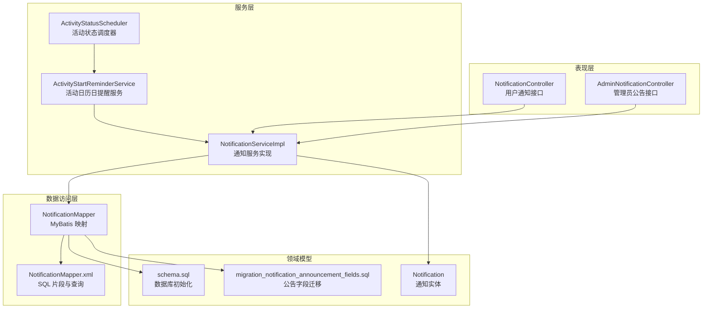
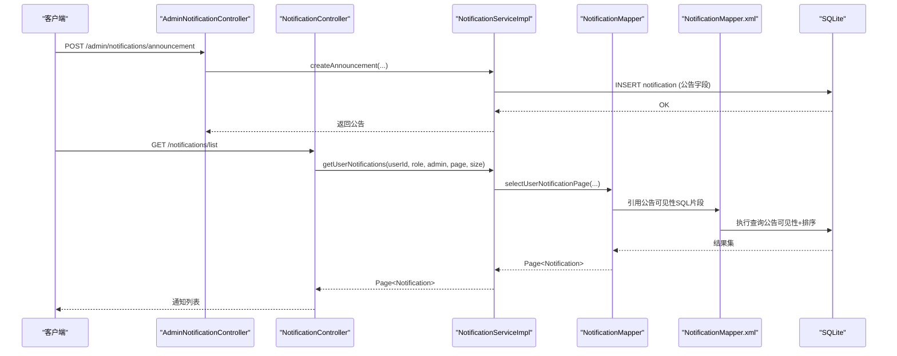
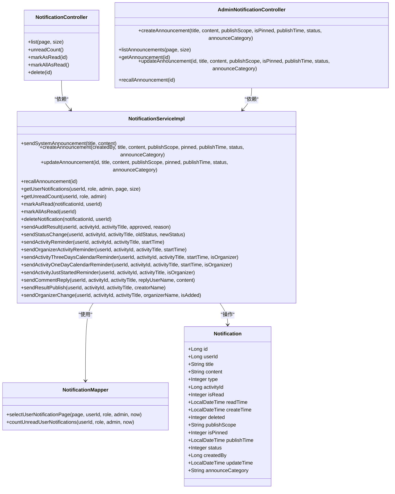

# 系统通知表 (notification)

<cite>
**本文档引用的文件**
- [Notification.java](file://src/main/java/com/campus/eventsys/entity/Notification.java)
- [NotificationMapper.java](file://src/main/java/com/campus/eventsys/mapper/NotificationMapper.java)
- [NotificationMapper.xml](file://src/main/resources/mapper/NotificationMapper.xml)
- [NotificationServiceImpl.java](file://src/main/java/com/campus/eventsys/service/impl/NotificationServiceImpl.java)
- [NotificationService.java](file://src/main/java/com/campus/eventsys/service/NotificationService.java)
- [NotificationController.java](file://src/main/java/com/campus/eventsys/controller/NotificationController.java)
- [AdminNotificationController.java](file://src/main/java/com/campus/eventsys/controller/AdminNotificationController.java)
- [ActivityStartReminderService.java](file://src/main/java/com/campus/eventsys/service/ActivityStartReminderService.java)
- [ActivityStatusScheduler.java](file://src/main/java/com/campus/eventsys/scheduler/ActivityStatusScheduler.java)
- [schema.sql](file://src/main/resources/db/schema.sql)
- [migration_notification_announcement_fields.sql](file://src/main/resources/db/migration_notification_announcement_fields.sql)
- [ER图9_系统通知.plantuml](file://picture/ER图9_系统通知.plantuml)
</cite>

## 目录
1. [简介](#简介)
2. [项目结构](#项目结构)
3. [核心组件](#核心组件)
4. [架构总览](#架构总览)
5. [详细组件分析](#详细组件分析)
6. [依赖关系分析](#依赖关系分析)
7. [性能考量](#性能考量)
8. [故障排查指南](#故障排查指南)
9. [结论](#结论)
10. [附录](#附录)

## 简介
本文件系统性地文档化“系统通知表(notification)”的设计与实现，涵盖字段定义、发布机制、用户范围控制、类型分类与状态管理，并阐明通知表与用户表、活动表的关联关系及生命周期管理。同时，说明通知在消息推送系统中的作用与实现原理，包括管理员公告与个人业务通知两类场景，以及基于定时任务的自动化提醒流程。

## 项目结构
通知系统围绕实体类、持久层映射、服务层实现、控制器接口与数据库脚本展开，形成清晰的分层架构：
- 实体层：定义通知表结构与字段语义
- 映射层：MyBatis XML 定义用户可见性过滤与分页查询
- 服务层：封装公告与个人通知的创建、更新、撤回、标记已读、删除等业务逻辑
- 控制器层：对外暴露用户通知管理与管理员公告管理接口
- 调度层：定时任务触发活动状态更新与日历日提醒
- 数据库层：初始化脚本与公告字段迁移脚本

图表来源
- [NotificationController.java:1-235](file://src/main/java/com/campus/eventsys/controller/NotificationController.java#L1-235)
- [AdminNotificationController.java:1-219](file://src/main/java/com/campus/eventsys/controller/AdminNotificationController.java#L1-219)
- [NotificationServiceImpl.java:1-455](file://src/main/java/com/campus/eventsys/service/impl/NotificationServiceImpl.java#L1-455)
- [NotificationMapper.java:1-26](file://src/main/java/com/campus/eventsys/mapper/NotificationMapper.java#L1-26)
- [NotificationMapper.xml:1-51](file://src/main/resources/mapper/NotificationMapper.xml#L1-51)
- [ActivityStartReminderService.java:1-91](file://src/main/java/com/campus/eventsys/service/ActivityStartReminderService.java#L1-91)
- [ActivityStatusScheduler.java:1-42](file://src/main/java/com/campus/eventsys/scheduler/ActivityStatusScheduler.java#L1-42)
- [schema.sql:175-197](file://src/main/resources/db/schema.sql#L175-L197)
- [migration_notification_announcement_fields.sql:1-22](file://src/main/resources/db/migration_notification_announcement_fields.sql#L1-L22)

章节来源
- [NotificationController.java:1-235](file://src/main/java/com/campus/eventsys/controller/NotificationController.java#L1-235)
- [AdminNotificationController.java:1-219](file://src/main/java/com/campus/eventsys/controller/AdminNotificationController.java#L1-219)
- [NotificationServiceImpl.java:1-455](file://src/main/java/com/campus/eventsys/service/impl/NotificationServiceImpl.java#L1-455)
- [NotificationMapper.java:1-26](file://src/main/java/com/campus/eventsys/mapper/NotificationMapper.java#L1-26)
- [NotificationMapper.xml:1-51](file://src/main/resources/mapper/NotificationMapper.xml#L1-51)
- [ActivityStartReminderService.java:1-91](file://src/main/java/com/campus/eventsys/service/ActivityStartReminderService.java#L1-91)
- [ActivityStatusScheduler.java:1-42](file://src/main/java/com/campus/eventsys/scheduler/ActivityStatusScheduler.java#L1-42)
- [schema.sql:175-197](file://src/main/resources/db/schema.sql#L175-L197)
- [migration_notification_announcement_fields.sql:1-22](file://src/main/resources/db/migration_notification_announcement_fields.sql#L1-L22)

## 核心组件
- 通知实体：定义通知表的完整字段与默认值策略，包含公告专用字段（发布范围、置顶、发布时间、状态、创建人、分类）与通用字段（用户ID、标题、内容、类型、活动ID、已读状态、阅读时间、创建/更新时间、逻辑删除）
- 通知映射：提供用户通知分页查询与未读计数的 SQL 片段，实现公告可见性与排序规则
- 通知服务：封装公告创建/更新/撤回、个人通知发送、标记已读/全部已读、删除、未读统计等业务逻辑
- 控制器：用户通知管理接口（列表、未读数、标记已读、全部已读、删除）与管理员公告管理接口（创建、更新、撤回、列表、详情）
- 调度与提醒：定时任务驱动活动状态更新与日历日提醒，自动发送活动开始前3天/1天的个人通知

章节来源
- [Notification.java:1-81](file://src/main/java/com/campus/eventsys/entity/Notification.java#L1-L81)
- [NotificationMapper.xml:1-51](file://src/main/resources/mapper/NotificationMapper.xml#L1-L51)
- [NotificationServiceImpl.java:1-455](file://src/main/java/com/campus/eventsys/service/impl/NotificationServiceImpl.java#L1-L455)
- [NotificationController.java:1-235](file://src/main/java/com/campus/eventsys/controller/NotificationController.java#L1-L235)
- [AdminNotificationController.java:1-219](file://src/main/java/com/campus/eventsys/controller/AdminNotificationController.java#L1-L219)
- [ActivityStatusScheduler.java:1-42](file://src/main/java/com/campus/eventsys/scheduler/ActivityStatusScheduler.java#L1-L42)
- [ActivityStartReminderService.java:1-91](file://src/main/java/com/campus/eventsys/service/ActivityStartReminderService.java#L1-L91)

## 架构总览
通知系统采用“控制器-服务-数据访问-数据库”的分层设计，结合定时任务实现自动化业务提醒。管理员通过后台接口管理公告，用户通过移动端/网页端查看通知并进行交互；服务层统一处理公告与个人通知的差异化逻辑，确保公告可见性与排序规则正确。

图表来源
- [AdminNotificationController.java:76-94](file://src/main/java/com/campus/eventsys/controller/AdminNotificationController.java#L76-L94)
- [NotificationController.java:61-76](file://src/main/java/com/campus/eventsys/controller/NotificationController.java#L61-L76)
- [NotificationServiceImpl.java:396-403](file://src/main/java/com/campus/eventsys/service/impl/NotificationServiceImpl.java#L396-L403)
- [NotificationMapper.java:15-19](file://src/main/java/com/campus/eventsys/mapper/NotificationMapper.java#L15-L19)
- [NotificationMapper.xml:35-42](file://src/main/resources/mapper/NotificationMapper.xml#L35-L42)
- [schema.sql:175-197](file://src/main/resources/db/schema.sql#L175-L197)

## 详细组件分析

### 字段定义与语义
通知表字段覆盖公告与个人通知两类场景，关键字段如下：
- id：通知主键（自增）
- user_id：接收用户ID，0表示系统公告面向全体
- title：通知标题
- content：通知内容
- type：通知类型（1-系统公告，2-活动提醒，3-审核结果，4-状态变更，5-评论回复）
- activity_id：关联活动ID（可选）
- is_read：是否已读（0-未读，1-已读）
- read_time：阅读时间
- create_time/update_time：创建/更新时间
- deleted：逻辑删除标志
- publish_scope：公告发布范围（ALL/USER/ADMIN；仅type=1有效）
- is_pinned：是否置顶（0/1；仅type=1参与排序）
- publish_time：计划/实际发布时间（个人通知可为创建时间）
- status：公告状态（0-草稿，1-已发布，2-已撤回；仅type=1）
- created_by：公告创建人（管理员ID；仅type=1）
- announce_category：公告展示子类（SYSTEM/ACTIVITY/URGENT；仅type=1）

章节来源
- [Notification.java:19-80](file://src/main/java/com/campus/eventsys/entity/Notification.java#L19-L80)
- [schema.sql:178-197](file://src/main/resources/db/schema.sql#L178-L197)
- [migration_notification_announcement_fields.sql:7-13](file://src/main/resources/db/migration_notification_announcement_fields.sql#L7-L13)

### 发布机制与可见性控制
- 公告可见性规则：
  - 仅当公告状态为已发布且到达发布时间，且发布范围与用户角色匹配时才对用户可见
  - 管理员可看到草稿与已撤回公告
  - 公告排序优先级：置顶 > 发布时间 > 创建时间
- 个人通知：
  - 仅对指定用户可见（user_id=目标用户）
  - 个人通知默认状态为已发布，发布时间为创建时间

章节来源
- [NotificationMapper.xml:5-16](file://src/main/resources/mapper/NotificationMapper.xml#L5-L16)
- [NotificationMapper.xml:18-33](file://src/main/resources/mapper/NotificationMapper.xml#L18-L33)
- [NotificationMapper.xml:35-42](file://src/main/resources/mapper/NotificationMapper.xml#L35-L42)
- [NotificationServiceImpl.java:37-42](file://src/main/java/com/campus/eventsys/service/impl/NotificationServiceImpl.java#L37-L42)

### 类型分类与状态管理
- 类型分类：
  - 1：系统公告（管理员发送，user_id=0）
  - 2：活动提醒（日历日提醒、即将开始等）
  - 3：审核结果（活动/报名审核）
  - 4：状态变更（活动状态变化、成果发布等）
  - 5：评论回复
- 状态管理（仅公告适用）：
  - 0：草稿（不对外展示）
  - 1：已发布（按可见性规则展示）
  - 2：已撤回（用户不可见，管理员可见）

章节来源
- [Notification.java:28-36](file://src/main/java/com/campus/eventsys/entity/Notification.java#L28-L36)
- [NotificationMapper.xml:8-16](file://src/main/resources/mapper/NotificationMapper.xml#L8-L16)
- [AdminNotificationController.java:32-41](file://src/main/java/com/campus/eventsys/controller/AdminNotificationController.java#L32-L41)

### 生命周期管理
- 创建：管理员创建公告或服务层创建个人通知
- 发布：公告状态为已发布且到达发布时间后对用户可见
- 更新：可修改标题、内容、发布范围、置顶、发布时间、状态、分类等
- 撤回：将公告状态改为已撤回，用户不再可见
- 删除：逻辑删除，用户与管理员均不可见
- 标记已读：用户可单条或批量标记已读，记录阅读时间

章节来源
- [NotificationServiceImpl.java:44-116](file://src/main/java/com/campus/eventsys/service/impl/NotificationServiceImpl.java#L44-L116)
- [NotificationServiceImpl.java:414-440](file://src/main/java/com/campus/eventsys/service/impl/NotificationServiceImpl.java#L414-L440)
- [NotificationServiceImpl.java:442-453](file://src/main/java/com/campus/eventsys/service/impl/NotificationServiceImpl.java#L442-L453)

### 通知与用户表、活动表的关联关系
- 通知与用户：user_id=0 表示系统公告，其他值表示个人通知
- 通知与活动：activity_id 关联活动表，用于活动相关通知（提醒、状态变更、成果发布等）
- 外键约束：通知表对活动表存在外键引用

章节来源
- [schema.sql:175-197](file://src/main/resources/db/schema.sql#L175-L197)
- [schema.sql:75-77](file://src/main/resources/db/schema.sql#L75-L77)

### 消息推送系统中的作用与实现原理
- 管理员公告：通过管理员接口创建/更新/撤回公告，公告字段（发布范围、置顶、发布时间、状态、分类）决定可见性与排序
- 个人通知：由业务服务调用通知服务生成，如活动审核结果、状态变更、日历日提醒、评论回复等
- 自动化提醒：定时任务扫描即将开始的活动，按日历日向已批准/签到的用户发送提醒通知，避免重复发送
- 用户交互：用户通过接口查看通知列表、未读数、标记已读、全部已读、删除通知

章节来源
- [AdminNotificationController.java:76-94](file://src/main/java/com/campus/eventsys/controller/AdminNotificationController.java#L76-L94)
- [NotificationServiceImpl.java:160-394](file://src/main/java/com/campus/eventsys/service/impl/NotificationServiceImpl.java#L160-L394)
- [ActivityStatusScheduler.java:31-40](file://src/main/java/com/campus/eventsys/scheduler/ActivityStatusScheduler.java#L31-L40)
- [ActivityStartReminderService.java:34-84](file://src/main/java/com/campus/eventsys/service/ActivityStartReminderService.java#L34-L84)
- [NotificationController.java:61-180](file://src/main/java/com/campus/eventsys/controller/NotificationController.java#L61-L180)

## 依赖关系分析

图表来源
- [Notification.java:1-81](file://src/main/java/com/campus/eventsys/entity/Notification.java#L1-L81)
- [NotificationMapper.java:1-26](file://src/main/java/com/campus/eventsys/mapper/NotificationMapper.java#L1-L26)
- [NotificationServiceImpl.java:1-455](file://src/main/java/com/campus/eventsys/service/impl/NotificationServiceImpl.java#L1-L455)
- [NotificationController.java:1-235](file://src/main/java/com/campus/eventsys/controller/NotificationController.java#L1-L235)
- [AdminNotificationController.java:1-219](file://src/main/java/com/campus/eventsys/controller/AdminNotificationController.java#L1-L219)

## 性能考量
- 查询优化：
  - 通知表对 user_id、type、is_read 建有索引，提升用户通知列表与未读统计的查询效率
  - 公告可见性判断在 SQL 层完成，减少应用层过滤成本
- 排序策略：
  - 公告优先按置顶降序，再按发布时间降序，最后按创建时间降序，确保重要公告优先展示
- 时间处理：
  - 公告可见性使用东八区时间（Asia/Shanghai），避免 SQLite 本地时间与时区差异导致的展示问题
- 去重策略：
  - 日历日提醒通过标题包含特定标记进行去重，避免重复发送相同类型的提醒

章节来源
- [schema.sql:282-286](file://src/main/resources/db/schema.sql#L282-L286)
- [NotificationMapper.xml:39-41](file://src/main/resources/mapper/NotificationMapper.xml#L39-L41)
- [NotificationServiceImpl.java:29-30](file://src/main/java/com/campus/eventsys/service/impl/NotificationServiceImpl.java#L29-L30)
- [ActivityStartReminderService.java:26-28](file://src/main/java/com/campus/eventsys/service/ActivityStartReminderService.java#L26-L28)

## 故障排查指南
- 公告未显示：
  - 检查公告状态是否为已发布且发布时间已到达
  - 确认发布范围与用户角色匹配（ALL/USER/ADMIN）
  - 管理员可查看草稿与已撤回公告
- 个人通知未收到：
  - 确认 user_id 是否为目标用户
  - 检查 deleted 是否为 0（逻辑删除）
- 重复提醒：
  - 确认标题包含去重标记（如“【3天后开始】”、“【明天开始】”）
  - 使用 hasActivityReminderSent 方法进行去重判断
- 标记已读失败：
  - 确认通知属于当前用户或为系统公告（user_id=0）
  - 检查通知是否存在且未被删除

章节来源
- [NotificationMapper.xml:8-16](file://src/main/resources/mapper/NotificationMapper.xml#L8-L16)
- [NotificationServiceImpl.java:414-440](file://src/main/java/com/campus/eventsys/service/impl/NotificationServiceImpl.java#L414-L440)
- [ActivityStartReminderService.java:70-82](file://src/main/java/com/campus/eventsys/service/ActivityStartReminderService.java#L70-L82)

## 结论
通知系统通过清晰的字段设计、严格的公告可见性规则与完善的生命周期管理，实现了管理员公告与个人业务通知的统一管理。结合定时任务的自动化提醒机制，提升了用户体验与运营效率。建议在生产环境中持续监控公告可见性与提醒去重策略，确保消息推送的准确性与时效性。

## 附录

### 字段对照表
- id：通知主键
- user_id：接收用户ID（0表示系统公告）
- title：通知标题
- content：通知内容
- type：通知类型（1-公告，2-活动提醒，3-审核结果，4-状态变更，5-评论回复）
- activity_id：关联活动ID
- is_read：是否已读（0-未读，1-已读）
- read_time：阅读时间
- create_time/update_time：创建/更新时间
- deleted：逻辑删除
- publish_scope：公告发布范围（ALL/USER/ADMIN）
- is_pinned：是否置顶（0/1）
- publish_time：发布时间
- status：公告状态（0-草稿，1-已发布，2-已撤回）
- created_by：公告创建人（管理员ID）
- announce_category：公告分类（SYSTEM/ACTIVITY/URGENT）

章节来源
- [Notification.java:19-80](file://src/main/java/com/campus/eventsys/entity/Notification.java#L19-L80)
- [schema.sql:178-197](file://src/main/resources/db/schema.sql#L178-L197)
- [migration_notification_announcement_fields.sql:7-13](file://src/main/resources/db/migration_notification_announcement_fields.sql#L7-L13)