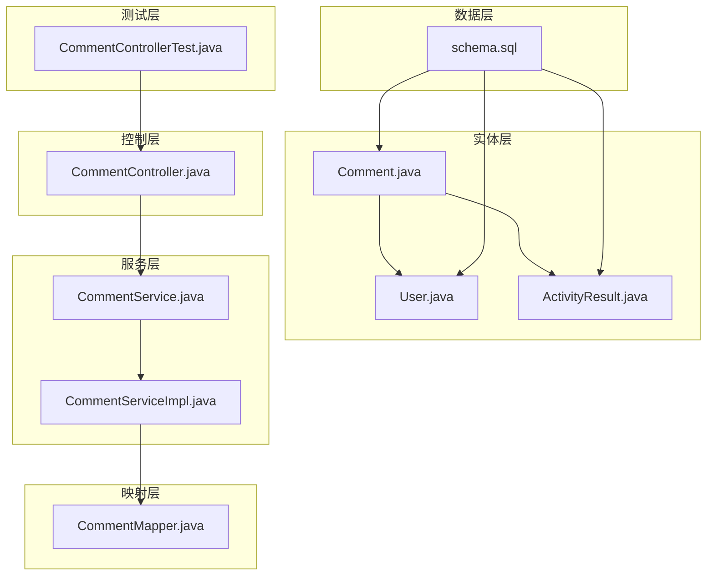
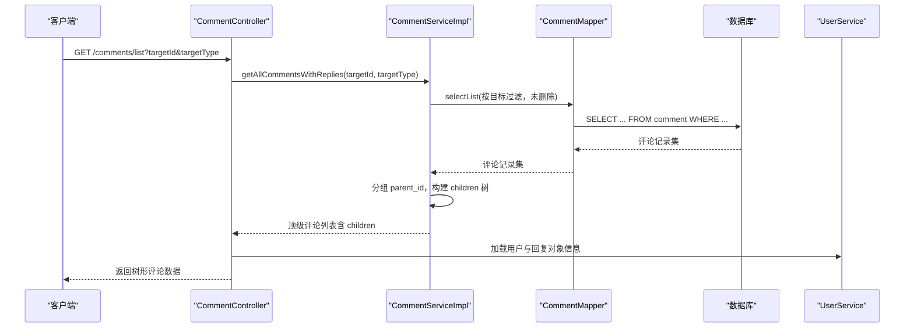
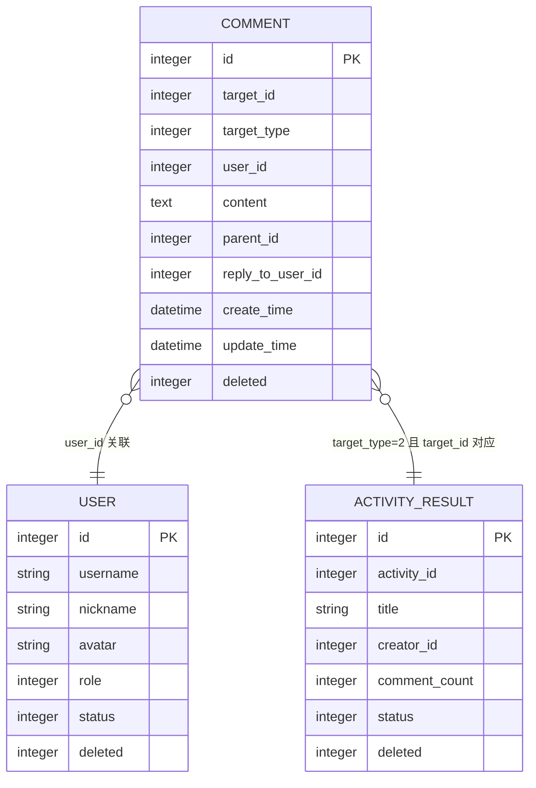
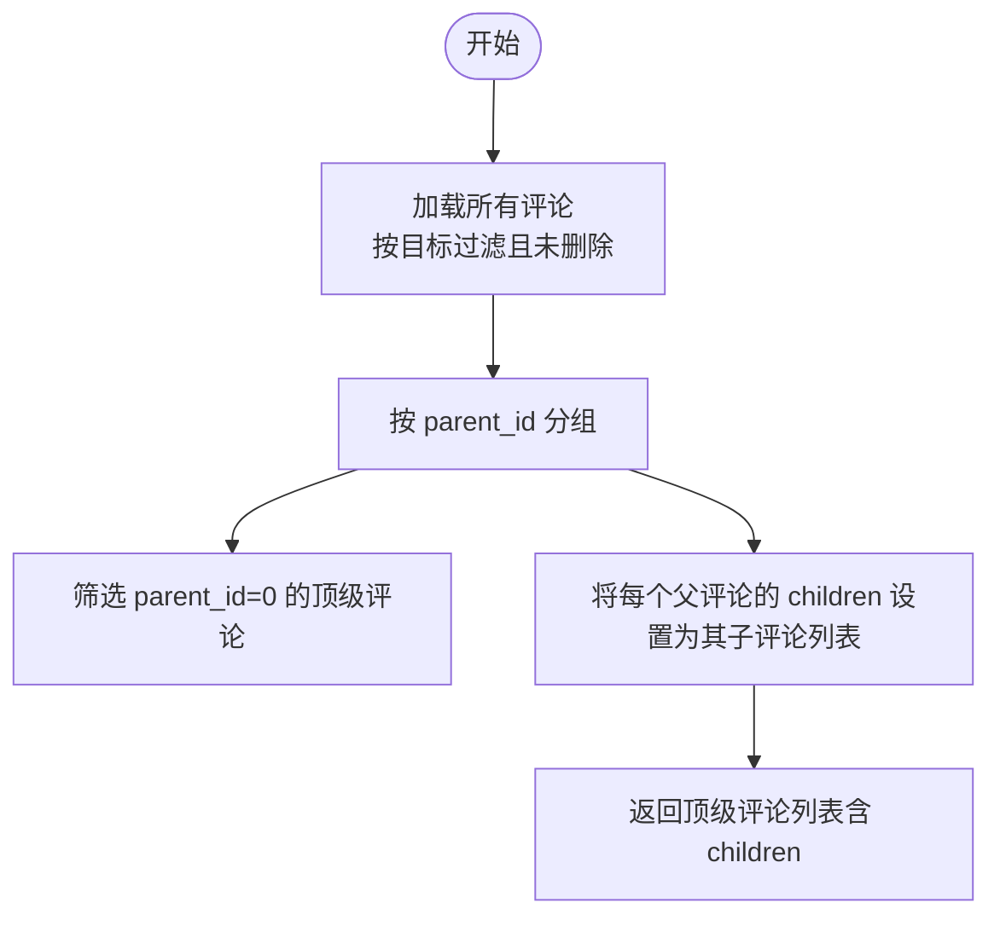
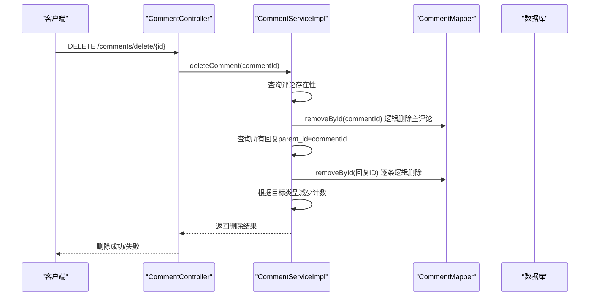
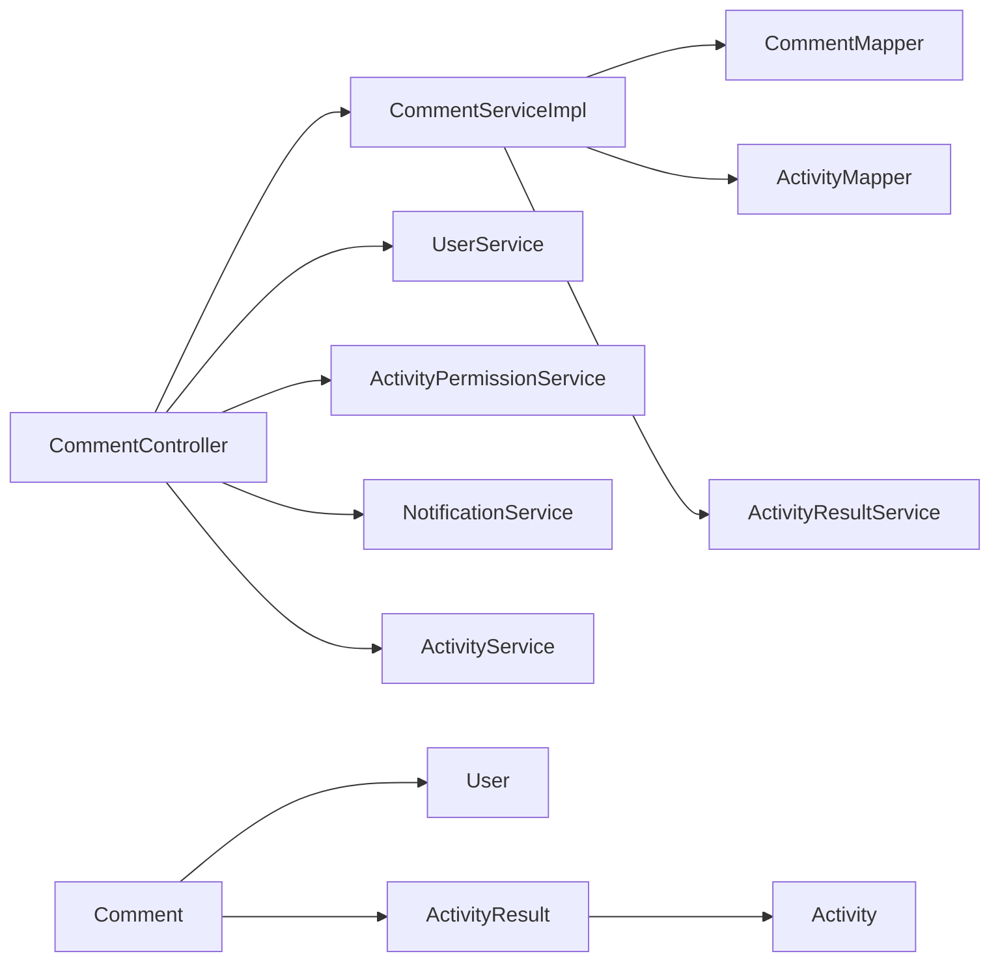

# 评论表 (comment)

<cite>
**本文引用的文件**
- [Comment.java](file://src/main/java/com/campus/eventsys/entity/Comment.java)
- [CommentMapper.java](file://src/main/java/com/campus/eventsys/mapper/CommentMapper.java)
- [CommentServiceImpl.java](file://src/main/java/com/campus/eventsys/service/impl/CommentServiceImpl.java)
- [CommentService.java](file://src/main/java/com/campus/eventsys/service/CommentService.java)
- [CommentController.java](file://src/main/java/com/campus/eventsys/controller/CommentController.java)
- [schema.sql](file://src/main/resources/db/schema.sql)
- [ER图6_评论.plantuml](file://picture/ER图6_评论.plantuml)
- [CommentControllerTest.java](file://src/test/java/com/campus/eventsys/controller/CommentControllerTest.java)
- [User.java](file://src/main/java/com/campus/eventsys/entity/User.java)
- [ActivityResult.java](file://src/main/java/com/campus/eventsys/entity/ActivityResult.java)
</cite>

## 目录
1. [简介](#简介)
2. [项目结构](#项目结构)
3. [核心组件](#核心组件)
4. [架构总览](#架构总览)
5. [详细组件分析](#详细组件分析)
6. [依赖关系分析](#依赖关系分析)
7. [性能考量](#性能考量)
8. [故障排查指南](#故障排查指南)
9. [结论](#结论)
10. [附录](#附录)

## 简介
本文件系统性地文档化评论表（comment）的设计与实现，涵盖字段定义、目标类型语义、层级回复机制、与用户表的关联关系、审核与删除机制，以及在内容管理中的作用与数据结构设计原理。评论表支持对两类目标进行评论：
- 目标类型 1：活动（activity）
- 目标类型 2：活动成果展示贴（activity_result）

评论采用树形层级结构，通过父评论 ID（parent_id）实现多级回复；同时支持对特定用户进行回复标记（reply_to_user_id），便于通知与交互追踪。

## 项目结构
围绕评论功能的相关文件分布如下：
- 实体层：Comment 实体类定义评论的数据模型
- 映射层：CommentMapper 接口继承通用 Mapper，提供基础 CRUD 能力
- 服务层：CommentService 接口与 CommentServiceImpl 实现业务逻辑（查询树形评论、添加评论、删除评论、统计数量）
- 控制器层：CommentController 提供对外 API（获取列表/数量、发表评论、回复评论、删除评论）
- 数据库层：schema.sql 定义评论表结构及索引
- 测试层：CommentControllerTest 验证控制器行为与边界条件

图表来源
- [Comment.java:1-67](file://src/main/java/com/campus/eventsys/entity/Comment.java#L1-L67)
- [CommentMapper.java:1-10](file://src/main/java/com/campus/eventsys/mapper/CommentMapper.java#L1-L10)
- [CommentService.java:1-66](file://src/main/java/com/campus/eventsys/service/CommentService.java#L1-L66)
- [CommentServiceImpl.java:1-173](file://src/main/java/com/campus/eventsys/service/impl/CommentServiceImpl.java#L1-L173)
- [CommentController.java:1-327](file://src/main/java/com/campus/eventsys/controller/CommentController.java#L1-L327)
- [schema.sql:123-140](file://src/main/resources/db/schema.sql#L123-L140)
- [User.java:1-85](file://src/main/java/com/campus/eventsys/entity/User.java#L1-L85)
- [ActivityResult.java:1-69](file://src/main/java/com/campus/eventsys/entity/ActivityResult.java#L1-L69)
- [CommentControllerTest.java:1-378](file://src/test/java/com/campus/eventsys/controller/CommentControllerTest.java#L1-L378)

章节来源
- [Comment.java:1-67](file://src/main/java/com/campus/eventsys/entity/Comment.java#L1-L67)
- [CommentMapper.java:1-10](file://src/main/java/com/campus/eventsys/mapper/CommentMapper.java#L1-L10)
- [CommentService.java:1-66](file://src/main/java/com/campus/eventsys/service/CommentService.java#L1-L66)
- [CommentServiceImpl.java:1-173](file://src/main/java/com/campus/eventsys/service/impl/CommentServiceImpl.java#L1-L173)
- [CommentController.java:1-327](file://src/main/java/com/campus/eventsys/controller/CommentController.java#L1-L327)
- [schema.sql:123-140](file://src/main/resources/db/schema.sql#L123-L140)
- [User.java:1-85](file://src/main/java/com/campus/eventsys/entity/User.java#L1-L85)
- [ActivityResult.java:1-69](file://src/main/java/com/campus/eventsys/entity/ActivityResult.java#L1-L69)
- [CommentControllerTest.java:1-378](file://src/test/java/com/campus/eventsys/controller/CommentControllerTest.java#L1-L378)

## 核心组件
- 评论实体（Comment）
  - 字段：id、target_id、target_type、user_id、content、parent_id、reply_to_user_id、create_time、update_time、deleted
  - 非持久化字段：user（评论用户）、replyToUser（回复目标用户）、children（子评论列表）
- 评论映射（CommentMapper）
  - 继承 MyBatis-Plus 的 BaseMapper，提供通用 CRUD 能力
- 评论服务（CommentService/CommentServiceImpl）
  - 查询：顶级评论、回复列表、树形评论集合、评论数量
  - 业务：添加评论（含默认值处理与计数更新）、删除评论（逻辑删除与级联删除）
- 评论控制器（CommentController）
  - 对外接口：获取评论列表、获取评论数量、发表评论、回复评论、删除评论
  - 权限校验：作者、目标所有者（组织者/创建者）、管理员
- 数据库表（comment）
  - 结构：包含目标标识、目标类型、用户关联、内容、层级关系、时间戳、逻辑删除
  - 索引：针对 target_id+target_type、user_id、parent_id 的复合索引

章节来源
- [Comment.java:10-67](file://src/main/java/com/campus/eventsys/entity/Comment.java#L10-L67)
- [CommentMapper.java:1-10](file://src/main/java/com/campus/eventsys/mapper/CommentMapper.java#L1-L10)
- [CommentService.java:8-66](file://src/main/java/com/campus/eventsys/service/CommentService.java#L8-L66)
- [CommentServiceImpl.java:21-173](file://src/main/java/com/campus/eventsys/service/impl/CommentServiceImpl.java#L21-L173)
- [CommentController.java:25-327](file://src/main/java/com/campus/eventsys/controller/CommentController.java#L25-L327)
- [schema.sql:123-140](file://src/main/resources/db/schema.sql#L123-L140)

## 架构总览
评论功能遵循典型的分层架构：控制器负责请求接入与权限校验，服务层封装业务规则与数据一致性，映射层对接数据库，实体层承载数据模型。评论树形结构通过服务层聚合，控制器仅负责组装展示所需信息。

图表来源
- [CommentController.java:51-74](file://src/main/java/com/campus/eventsys/controller/CommentController.java#L51-L74)
- [CommentServiceImpl.java:55-82](file://src/main/java/com/campus/eventsys/service/impl/CommentServiceImpl.java#L55-L82)
- [CommentMapper.java:1-10](file://src/main/java/com/campus/eventsys/mapper/CommentMapper.java#L1-L10)
- [User.java:1-85](file://src/main/java/com/campus/eventsys/entity/User.java#L1-L85)

## 详细组件分析

### 字段定义与语义
- id：评论唯一标识
- target_id：目标对象 ID，对应活动 ID 或成果展示贴 ID
- target_type：目标类型
  - 1：活动（activity）
  - 2：活动成果展示贴（activity_result）
- user_id：评论作者用户 ID
- content：评论内容（文本）
- parent_id：父评论 ID，0 表示顶级评论
- reply_to_user_id：回复给的用户 ID，用于标记被回复对象
- create_time/update_time：创建与更新时间
- deleted：逻辑删除标志（0 未删除，1 已删除）

图表来源
- [schema.sql:123-140](file://src/main/resources/db/schema.sql#L123-L140)
- [schema.sql:103-121](file://src/main/resources/db/schema.sql#L103-L121)
- [User.java:15-85](file://src/main/java/com/campus/eventsys/entity/User.java#L15-L85)
- [Comment.java:17-67](file://src/main/java/com/campus/eventsys/entity/Comment.java#L17-L67)

章节来源
- [Comment.java:19-52](file://src/main/java/com/campus/eventsys/entity/Comment.java#L19-L52)
- [schema.sql:123-140](file://src/main/resources/db/schema.sql#L123-L140)

### 目标类型定义与用途
- 目标类型 1：活动（activity）
  - 评论计数直接维护在活动表的 comment_count 字段中
- 目标类型 2：活动成果展示贴（activity_result）
  - 评论计数维护在成果表的 comment_count 字段中

章节来源
- [CommentServiceImpl.java:99-111](file://src/main/java/com/campus/eventsys/service/impl/CommentServiceImpl.java#L99-L111)
- [schema.sql:47-77](file://src/main/resources/db/schema.sql#L47-L77)
- [schema.sql:103-121](file://src/main/resources/db/schema.sql#L103-L121)

### 层级结构与回复机制
- 顶级评论：parent_id = 0
- 子评论：parent_id 指向父评论 ID
- 回复用户：reply_to_user_id 标记被回复的用户 ID
- 树形构建：服务层将所有评论按 parent_id 分组，将子评论挂载到对应父评论的 children 列表中

图表来源
- [CommentServiceImpl.java:55-82](file://src/main/java/com/campus/eventsys/service/impl/CommentServiceImpl.java#L55-L82)

章节来源
- [CommentServiceImpl.java:34-82](file://src/main/java/com/campus/eventsys/service/impl/CommentServiceImpl.java#L34-L82)
- [CommentController.java:51-74](file://src/main/java/com/campus/eventsys/controller/CommentController.java#L51-L74)

### 评论与用户表的关联关系
- 评论表通过 user_id 外键关联用户表
- 控制器在返回数据时，加载评论作者与被回复用户的简要信息（id、nickname、avatar），避免泄露敏感字段
- 被回复用户信息通过 reply_to_user_id 进行标记与加载

章节来源
- [schema.sql:139](file://src/main/resources/db/schema.sql#L139)
- [CommentController.java:304-325](file://src/main/java/com/campus/eventsys/controller/CommentController.java#L304-L325)
- [User.java:15-85](file://src/main/java/com/campus/eventsys/entity/User.java#L15-L85)

### 评论的审核与删除机制
- 逻辑删除：deleted 字段为 1 表示已删除，查询时默认过滤 deleted=0
- 删除流程：
  - 主评论逻辑删除
  - 递归删除该主评论下的所有回复（基于 parent_id）
  - 根据目标类型减少相应计数（活动或成果）
- 权限控制：
  - 评论作者可删除自己的评论
  - 目标所有者（活动组织者或成果创建者）可删除目标下的评论
  - 管理员可删除任何评论

图表来源
- [CommentController.java:224-254](file://src/main/java/com/campus/eventsys/controller/CommentController.java#L224-L254)
- [CommentServiceImpl.java:120-161](file://src/main/java/com/campus/eventsys/service/impl/CommentServiceImpl.java#L120-L161)
- [CommentMapper.java:1-10](file://src/main/java/com/campus/eventsys/mapper/CommentMapper.java#L1-L10)

章节来源
- [CommentController.java:209-283](file://src/main/java/com/campus/eventsys/controller/CommentController.java#L209-L283)
- [CommentServiceImpl.java:120-161](file://src/main/java/com/campus/eventsys/service/impl/CommentServiceImpl.java#L120-L161)

### 内容管理中的作用与设计原理
- 作用：
  - 提供活动与成果展示贴的互动入口
  - 支持树形评论与回复，增强社区互动体验
  - 通过逻辑删除保障数据完整性与审计需求
- 设计原理：
  - 单表统一存储：通过 target_type 区分不同目标类型，避免重复建表
  - 层级结构：parent_id 实现无限级回复，children 聚合提升前端渲染效率
  - 计数维护：分别维护活动与成果的评论计数，便于快速统计与排序
  - 权限分离：作者、目标所有者、管理员三级权限，确保内容治理

章节来源
- [CommentController.java:30-35](file://src/main/java/com/campus/eventsys/controller/CommentController.java#L30-L35)
- [CommentServiceImpl.java:99-111](file://src/main/java/com/campus/eventsys/service/impl/CommentServiceImpl.java#L99-L111)

## 依赖关系分析
- 控制器依赖服务层与多个外部服务（用户、活动、成果、通知、权限）
- 服务层依赖映射层与外部实体（活动、成果）
- 实体层之间存在外键约束（评论->用户；评论->成果；成果->活动）
- 数据库层面为评论表建立复合索引以优化查询性能

图表来源
- [CommentController.java:41-46](file://src/main/java/com/campus/eventsys/controller/CommentController.java#L41-L46)
- [CommentServiceImpl.java:30-31](file://src/main/java/com/campus/eventsys/service/impl/CommentServiceImpl.java#L30-L31)
- [schema.sql:139](file://src/main/resources/db/schema.sql#L139)
- [schema.sql:119](file://src/main/resources/db/schema.sql#L119)

章节来源
- [CommentController.java:41-46](file://src/main/java/com/campus/eventsys/controller/CommentController.java#L41-L46)
- [CommentServiceImpl.java:30-31](file://src/main/java/com/campus/eventsys/service/impl/CommentServiceImpl.java#L30-L31)
- [schema.sql:119](file://src/main/resources/db/schema.sql#L119)

## 性能考量
- 索引策略
  - 复合索引 idx_comment_target(target_id, target_type)：加速按目标查询
  - 索引 idx_comment_user(user_id)：加速按用户查询
  - 索引 idx_comment_parent(parent_id)：加速按父评论查询
- 查询优化
  - 默认过滤 deleted=0，避免扫描已删除数据
  - 树形构建在内存中完成，适合中小规模评论场景
- 写入优化
  - 逻辑删除替代物理删除，降低写放大
  - 批量删除时逐条移除，确保一致性

章节来源
- [schema.sql:268-271](file://src/main/resources/db/schema.sql#L268-L271)
- [CommentServiceImpl.java:34-82](file://src/main/java/com/campus/eventsys/service/impl/CommentServiceImpl.java#L34-L82)

## 故障排查指南
- 常见问题与定位
  - 评论列表为空：确认 target_id 与 target_type 是否正确，检查 deleted 过滤条件
  - 无法回复：确认父评论存在且未被删除，检查 content 是否为空
  - 删除失败：确认当前用户权限（作者/目标所有者/管理员），检查评论是否存在
  - 通知未发送：确认 reply_to_user_id 与当前用户不一致，否则不会发送通知
- 单元测试参考
  - 测试覆盖了用户不存在、内容为空、父评论不存在、权限不足、管理员删除等边界场景

章节来源
- [CommentControllerTest.java:111-377](file://src/test/java/com/campus/eventsys/controller/CommentControllerTest.java#L111-L377)
- [CommentController.java:118-121](file://src/main/java/com/campus/eventsys/controller/CommentController.java#L118-L121)
- [CommentController.java:175-178](file://src/main/java/com/campus/eventsys/controller/CommentController.java#L175-L178)
- [CommentController.java:236-246](file://src/main/java/com/campus/eventsys/controller/CommentController.java#L236-L246)

## 结论
评论表（comment）通过统一的目标类型与层级结构设计，实现了对活动与成果展示贴的通用评论能力。配合逻辑删除、权限控制与计数维护，既满足了内容管理的需求，也兼顾了性能与可维护性。树形结构与非持久化字段的使用提升了前端展示效率与安全性。

## 附录
- 数据库表定义与索引
  - 评论表：包含主键、目标标识、类型、用户外键、内容、层级与时间戳、逻辑删除
  - 索引：target_id+target_type、user_id、parent_id
- 实体 ER 图
  - 评论与用户、成果展示贴之间的关系清晰明确

章节来源
- [schema.sql:123-140](file://src/main/resources/db/schema.sql#L123-L140)
- [schema.sql:268-271](file://src/main/resources/db/schema.sql#L268-L271)
- [ER图6_评论.plantuml:1-20](file://picture/ER图6_评论.plantuml#L1-L20)