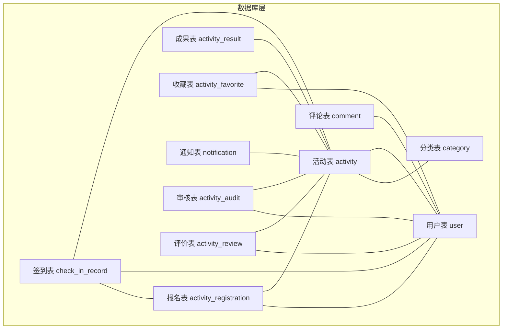
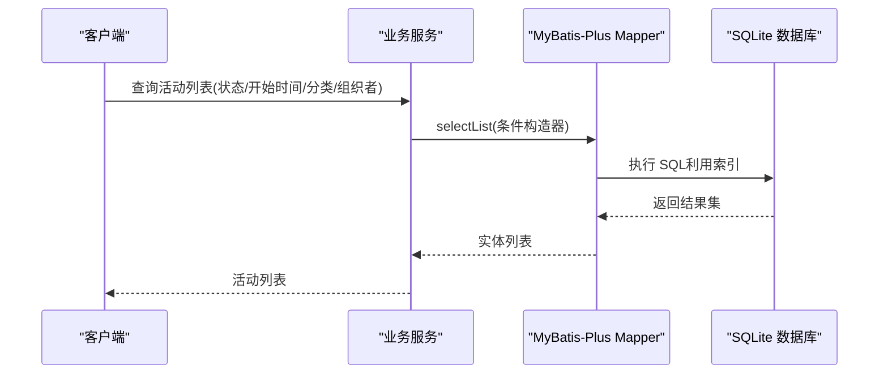
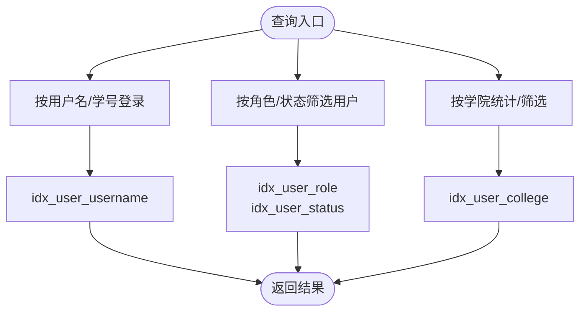
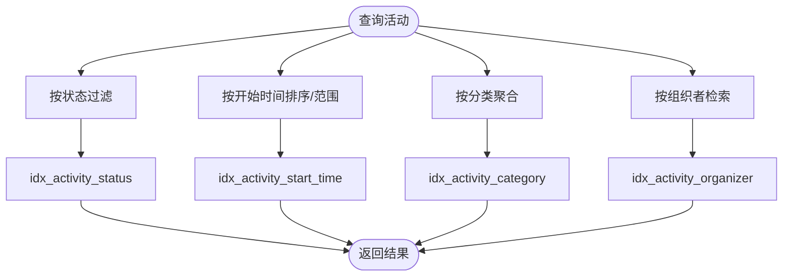
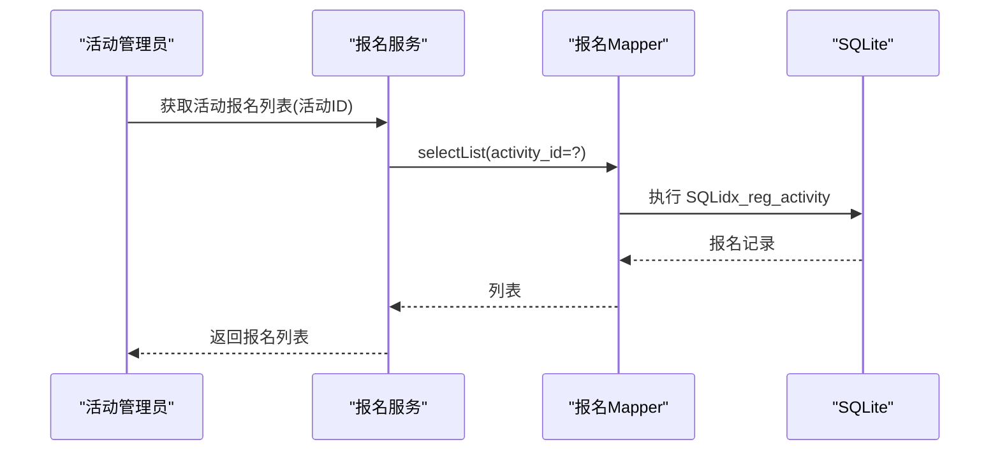
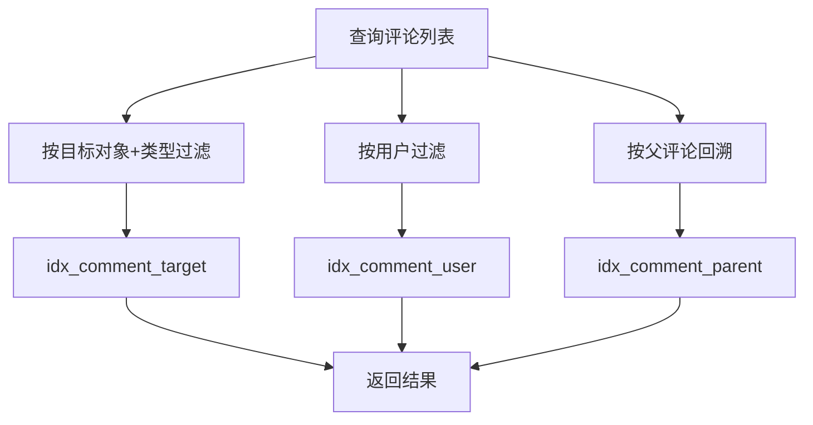
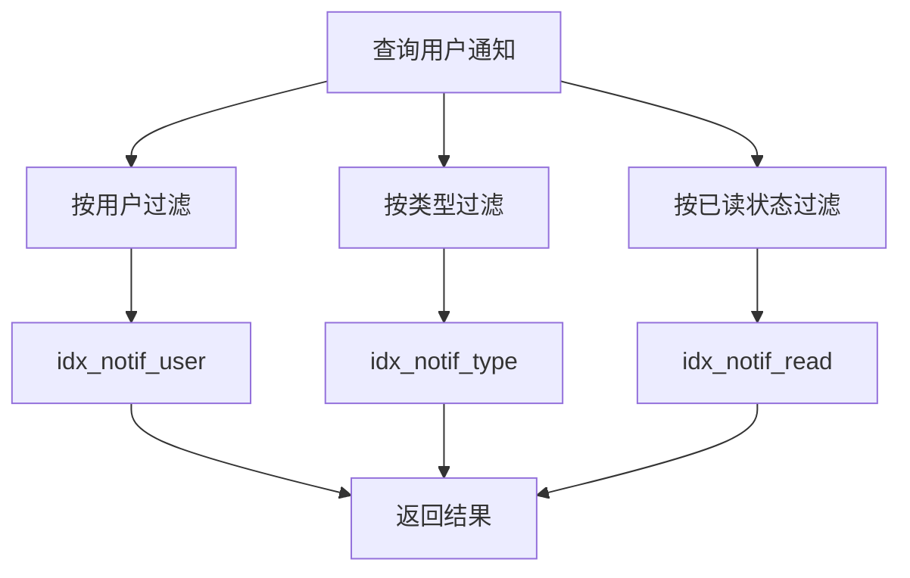

# 索引设计

<cite>
**本文引用的文件**
- [schema.sql](file://src/main/resources/db/schema.sql)
- [data.sql](file://src/main/resources/db/data.sql)
- [migration_notification_announcement_fields.sql](file://src/main/resources/db/migration_notification_announcement_fields.sql)
- [表设计.md](file://picture/表设计.md)
- [Activity.java](file://src/main/java/com/campus/eventsys/entity/Activity.java)
- [User.java](file://src/main/java/com/campus/eventsys/entity/User.java)
- [ActivityRegistration.java](file://src/main/java/com/campus/eventsys/entity/ActivityRegistration.java)
- [CheckInRecord.java](file://src/main/java/com/campus/eventsys/entity/CheckInRecord.java)
- [Comment.java](file://src/main/java/com/campus/eventsys/entity/Comment.java)
- [ActivityReview.java](file://src/main/java/com/campus/eventsys/entity/ActivityReview.java)
- [ActivityFavorite.java](file://src/main/java/com/campus/eventsys/entity/ActivityFavorite.java)
</cite>

## 目录
1. [引言](#引言)
2. [项目结构](#项目结构)
3. [核心组件](#核心组件)
4. [架构总览](#架构总览)
5. [详细组件分析](#详细组件分析)
6. [依赖分析](#依赖分析)
7. [性能考量](#性能考量)
8. [故障排查指南](#故障排查指南)
9. [结论](#结论)
10. [附录](#附录)

## 引言
本文件面向数据库性能调优专家，系统化梳理“校园活动管理系统”的数据库索引设计方案。文档基于实际的建表脚本与实体模型，逐表解析现有索引的创建目的、查询优化效果与潜在性能影响，并提出复合索引设计策略、单列索引选择原则、不同查询场景下的索引使用模式、维护与监控建议，以及最佳实践与常见问题解决方案。

## 项目结构
系统采用 SQLite 初始化脚本定义表结构与索引，MyBatis-Plus 实体映射与业务层服务支撑查询与写入。索引覆盖用户、活动、报名、签到、评论、收藏、通知、审核、评价等核心业务表，服务于活动检索、用户画像、报名审核、签到统计、通知分发、评价聚合等高频场景。



图表来源
- [schema.sql:240-295](file://src/main/resources/db/schema.sql#L240-L295)
- [Activity.java:50-77](file://src/main/java/com/campus/eventsys/entity/Activity.java#L50-L77)
- [User.java:13-22](file://src/main/java/com/campus/eventsys/entity/User.java#L13-L22)
- [ActivityRegistration.java:22-26](file://src/main/java/com/campus/eventsys/entity/ActivityRegistration.java#L22-L26)
- [CheckInRecord.java:21-28](file://src/main/java/com/campus/eventsys/entity/CheckInRecord.java#L21-L28)
- [Comment.java:23-27](file://src/main/java/com/campus/eventsys/entity/Comment.java#L23-L27)
- [ActivityReview.java:23-27](file://src/main/java/com/campus/eventsys/entity/ActivityReview.java#L23-L27)
- [ActivityFavorite.java:19-23](file://src/main/java/com/campus/eventsys/entity/ActivityFavorite.java#L19-L23)

章节来源
- [schema.sql:1-295](file://src/main/resources/db/schema.sql#L1-L295)
- [表设计.md:1-206](file://picture/表设计.md#L1-L206)

## 核心组件
- 用户表 user：支持按用户名、学号、学院、角色、状态等维度检索，索引覆盖 username、student_id、college、role、status。
- 活动表 activity：支持按组织者、分类、状态、开始时间检索，索引覆盖 organizer_id、category_id、status、start_time。
- 活动报名表 activity_registration：支持按活动、用户、状态检索，索引覆盖 activity_id、user_id、status。
- 活动成果表 activity_result：支持按活动唯一成果检索，索引覆盖 activity_id。
- 评论表 comment：支持按目标对象与类型组合检索，索引覆盖 (target_id, target_type)、user_id、parent_id。
- 活动收藏表 activity_favorite：支持按活动与用户检索，索引覆盖 activity_id、user_id。
- 签到记录表 check_in_record：支持按活动、用户、报名记录检索，索引覆盖 activity_id、user_id、registration_id。
- 通知表 notification：支持按用户、类型、已读状态检索，索引覆盖 user_id、type、is_read；同时提供发布范围、置顶、发布时间、状态、分类等扩展字段。
- 活动审核表 activity_audit：支持按活动、状态、提交人检索，索引覆盖 activity_id、status、submitter_id。
- 活动评价表 activity_review：支持按活动与用户检索，索引覆盖 activity_id、user_id。

章节来源
- [schema.sql:243-295](file://src/main/resources/db/schema.sql#L243-L295)
- [migration_notification_announcement_fields.sql:7-22](file://src/main/resources/db/migration_notification_announcement_fields.sql#L7-L22)

## 架构总览
索引设计遵循“查询驱动、最小冗余、成本可控”的原则，围绕以下核心查询模式构建：
- 活动检索：按状态、开始时间、分类、组织者过滤，必要时结合报名状态与报名人数。
- 用户检索：按用户名、学号、角色、状态、学院等条件过滤。
- 报名与签到：按活动/用户维度快速定位记录，支持报名状态与签到统计。
- 通知与评价：按用户与类型分发，按活动聚合统计。
- 评论树：按目标对象+类型快速定位，支持父子关系回溯。



图表来源
- [schema.sql:254-258](file://src/main/resources/db/schema.sql#L254-L258)
- [Activity.java:58-62](file://src/main/java/com/campus/eventsys/entity/Activity.java#L58-L62)

## 详细组件分析

### 用户表 user 索引设计
- 索引策略
  - idx_user_username：用户名/学号等登录与识别字段，保障登录与唯一性校验高效。
  - idx_user_student_id：学号检索，支持按学号查询用户信息。
  - idx_user_college：按学院维度统计与筛选。
  - idx_user_role：按角色（普通用户/管理员）过滤。
  - idx_user_status：按状态（启用/禁用）过滤。
- 查询优化效果
  - 登录与身份校验：基于 username 的等值查询走 idx_user_username。
  - 管理端筛选：按 role/status/college 过滤时可利用相应单列索引。
- 性能影响
  - 写入开销：每次插入/更新 user 记录需维护上述索引。
  - 空间占用：单列索引开销相对较小，适合高频查询字段。
- 设计要点
  - username 建议保持唯一性，避免重复导致的查询歧义。
  - role/status 组合过滤时，优先考虑复合索引以减少回表。



图表来源
- [schema.sql:244-248](file://src/main/resources/db/schema.sql#L244-L248)
- [User.java:21-22](file://src/main/java/com/campus/eventsys/entity/User.java#L21-L22)

章节来源
- [schema.sql:243-248](file://src/main/resources/db/schema.sql#L243-L248)
- [User.java:13-22](file://src/main/java/com/campus/eventsys/entity/User.java#L13-L22)

### 活动表 activity 索引设计
- 索引策略
  - idx_activity_organizer：组织者维度查询活动列表。
  - idx_activity_category：按分类聚合活动。
  - idx_activity_status：按状态过滤（草稿/待审/报名中/进行中/已结束等）。
  - idx_activity_start_time：按开始时间排序/范围查询。
- 查询优化效果
  - 活动列表页：按 status/start_time 排序，按 category/organizer 过滤。
  - 报名页：按 status=start_time/end_time 范围过滤可命中 idx_activity_status 与 idx_activity_start_time。
- 性能影响
  - 写入成本：活动状态变更、时间调整会触发索引更新。
  - 复合索引建议：status+start_time 或 category_id+status 可进一步降低回表。
- 设计要点
  - 状态枚举与时间字段是核心过滤条件，应优先保证索引覆盖。



图表来源
- [schema.sql:255-258](file://src/main/resources/db/schema.sql#L255-L258)
- [Activity.java:58-62](file://src/main/java/com/campus/eventsys/entity/Activity.java#L58-L62)

章节来源
- [schema.sql:254-258](file://src/main/resources/db/schema.sql#L254-L258)
- [Activity.java:50-77](file://src/main/java/com/campus/eventsys/entity/Activity.java#L50-L77)

### 活动报名表 activity_registration 索引设计
- 索引策略
  - idx_reg_activity：查询某活动的所有报名记录。
  - idx_reg_user：查询某用户的报名历史。
  - idx_reg_status：按报名状态（待审/通过/拒绝/签到/取消）过滤。
- 查询优化效果
  - 活动管理后台：按 activity_id 查询报名列表。
  - 用户中心：按 user_id 查询历史报名。
  - 审核页面：按 status 快速筛选待审/通过/拒绝。
- 性能影响
  - 报名高峰时写入频繁，需关注索引维护成本。
  - 若存在“用户+活动”唯一约束，可考虑复合索引以减少冲突与回表。
- 设计要点
  - 唯一约束 (activity_id, user_id) 已存在，可结合 idx_reg_activity 与 idx_reg_user 使用。



图表来源
- [schema.sql:261-263](file://src/main/resources/db/schema.sql#L261-L263)
- [ActivityRegistration.java:22-32](file://src/main/java/com/campus/eventsys/entity/ActivityRegistration.java#L22-L32)

章节来源
- [schema.sql:260-264](file://src/main/resources/db/schema.sql#L260-L264)
- [ActivityRegistration.java:14-32](file://src/main/java/com/campus/eventsys/entity/ActivityRegistration.java#L14-L32)

### 活动成果表 activity_result 索引设计
- 索引策略
  - idx_result_activity：按活动唯一成果检索，满足一对一关系的高效查询。
- 查询优化效果
  - 成果详情页：按 activity_id 查询成果，避免全表扫描。
- 性能影响
  - 写入成本低，查询收益高，适合一对一外键字段建立单列索引。

章节来源
- [schema.sql:266](file://src/main/resources/db/schema.sql#L266)
- [表设计.md:92-108](file://picture/表设计.md#L92-L108)

### 评论表 comment 索引设计
- 索引策略
  - idx_comment_target：(target_id, target_type) 复合索引，支持按目标对象与类型快速定位。
  - idx_comment_user：按用户维度查询其评论。
  - idx_comment_parent：按父评论 ID 回溯评论树。
- 查询优化效果
  - 活动/成果评论列表：按 (target_id, target_type) 等值查询。
  - 用户评论历史：按 user_id 过滤。
  - 评论树渲染：按 parent_id 回溯子评论。
- 性能影响
  - 复合索引 idx_comment_target 对目标对象查询收益显著。
  - 评论树查询可能涉及多次回表，建议结合业务限制层级深度。



图表来源
- [schema.sql:269-271](file://src/main/resources/db/schema.sql#L269-L271)
- [Comment.java:23-39](file://src/main/java/com/campus/eventsys/entity/Comment.java#L23-L39)

章节来源
- [schema.sql:268-272](file://src/main/resources/db/schema.sql#L268-L272)
- [Comment.java:14-39](file://src/main/java/com/campus/eventsys/entity/Comment.java#L14-L39)

### 活动收藏表 activity_favorite 索引设计
- 索引策略
  - idx_fav_activity：按活动查询收藏用户。
  - idx_fav_user：按用户查询收藏活动。
- 查询优化效果
  - 活动详情页：统计/判断收藏。
  - 用户中心：展示收藏列表。
- 性能影响
  - 收藏/取消收藏操作频繁，需平衡写入与查询成本。

章节来源
- [schema.sql:274-275](file://src/main/resources/db/schema.sql#L274-L275)
- [ActivityFavorite.java:19-23](file://src/main/java/com/campus/eventsys/entity/ActivityFavorite.java#L19-L23)

### 签到记录表 check_in_record 索引设计
- 索引策略
  - idx_checkin_activity：按活动统计签到。
  - idx_checkin_user：按用户统计参与。
  - idx_checkin_reg：按报名记录关联签到。
- 查询优化效果
  - 活动签到统计：按 activity_id 聚合。
  - 用户参与统计：按 user_id 聚合。
  - 签到明细：按 registration_id 关联。
- 性能影响
  - 签到高峰写入密集，建议在业务低峰期维护索引。

章节来源
- [schema.sql:278-280](file://src/main/resources/db/schema.sql#L278-L280)
- [CheckInRecord.java:21-28](file://src/main/java/com/campus/eventsys/entity/CheckInRecord.java#L21-L28)

### 通知表 notification 索引设计
- 索引策略
  - idx_notif_user：按用户分发通知。
  - idx_notif_type：按通知类型过滤。
  - idx_notif_read：按已读状态过滤。
- 查询优化效果
  - 用户通知中心：按 user_id/type/read 筛选。
- 性能影响
  - 通知表扩展字段（发布范围、置顶、发布时间、状态、分类、更新时间、创建人）为后续精细化推送提供基础，但需注意新增列的索引策略。



图表来源
- [schema.sql:283-285](file://src/main/resources/db/schema.sql#L283-L285)
- [migration_notification_announcement_fields.sql:7-22](file://src/main/resources/db/migration_notification_announcement_fields.sql#L7-L22)

章节来源
- [schema.sql:282-286](file://src/main/resources/db/schema.sql#L282-L286)
- [migration_notification_announcement_fields.sql:7-22](file://src/main/resources/db/migration_notification_announcement_fields.sql#L7-L22)

### 活动审核表 activity_audit 索引设计
- 索引策略
  - idx_audit_activity：按活动查询审核记录。
  - idx_audit_status：按状态（待审/通过/拒绝）过滤。
  - idx_audit_submitter：按提交人过滤。
- 查询优化效果
  - 审核列表：按 activity_id/status/submitter_id 过滤。
- 性能影响
  - 审核流程写入相对稳定，索引维护成本适中。

章节来源
- [schema.sql:288-290](file://src/main/resources/db/schema.sql#L288-L290)
- [表设计.md:175-191](file://picture/表设计.md#L175-L191)

### 活动评价表 activity_review 索引设计
- 索引策略
  - idx_review_activity：按活动聚合评价。
  - idx_review_user：按用户评价历史。
- 查询优化效果
  - 活动评价列表：按 activity_id 查询。
  - 用户评价历史：按 user_id 查询。
- 性能影响
  - 评价写入频率较低，索引收益高。

章节来源
- [schema.sql:293-294](file://src/main/resources/db/schema.sql#L293-L294)
- [ActivityReview.java:23-27](file://src/main/java/com/campus/eventsys/entity/ActivityReview.java#L23-L27)

## 依赖分析
- 外键依赖
  - activity → user(id)、category(id)
  - activity_registration → activity(id)、user(id)、user(id)（审核人）
  - check_in_record → activity(id)、user(id)、activity_registration(id)
  - activity_result → activity(id)、user(id)
  - comment → user(id)
  - notification → activity(id)
  - activity_audit → activity(id)、user(id)、user(id)
  - activity_review → activity(id)、user(id)、(activity_id,user_id) 唯一约束
- 索引与外键协同
  - 外键字段常作为查询过滤条件，配合单列/复合索引可显著提升 JOIN 与过滤效率。
  - 唯一约束 (activity_id, user_id) 在报名与评价表上确保业务一致性，同时利于索引命中。

```mermaid
erDiagram
USER {
integer id PK
varchar username UK
integer role
integer status
}
CATEGORY {
integer id PK
integer status
integer sort_order
}
ACTIVITY {
integer id PK
integer organizer_id FK
integer category_id FK
integer status
datetime start_time
}
ACTIVITY_REGISTRATION {
integer id PK
integer activity_id FK
integer user_id FK
integer status
}
CHECK_IN_RECORD {
integer id PK
integer activity_id FK
integer user_id FK
integer registration_id FK
}
ACTIVITY_RESULT {
integer id PK
integer activity_id FK UK
integer creator_id FK
}
COMMENT {
integer id PK
integer target_id
integer target_type
integer user_id FK
integer parent_id
}
ACTIVITY_FAVORITE {
integer id PK
integer activity_id FK
integer user_id FK
}
NOTIFICATION {
integer id PK
integer user_id
integer type
integer is_read
integer activity_id FK
}
ACTIVITY_AUDIT {
integer id PK
integer activity_id FK
integer status
integer submitter_id FK
}
ACTIVITY_REVIEW {
integer id PK
integer activity_id FK
integer user_id FK
}
USER ||--o{ ACTIVITY : "organizer"
CATEGORY ||--o{ ACTIVITY : "category"
ACTIVITY ||--o{ ACTIVITY_REGISTRATION : "registrations"
USER ||--o{ ACTIVITY_REGISTRATION : "registrations"
ACTIVITY ||--o{ CHECK_IN_RECORD : "checkins"
USER ||--o{ CHECK_IN_RECORD : "checkins"
ACTIVITY_REGISTRATION ||--o{ CHECK_IN_RECORD : "checkins"
ACTIVITY ||--o{ ACTIVITY_RESULT : "result"
USER ||--o{ ACTIVITY_RESULT : "creator"
USER ||--o{ COMMENT : "comments"
ACTIVITY ||--o{ COMMENT : "comments"
ACTIVITY ||--o{ NOTIFICATION : "activity"
USER ||--o{ NOTIFICATION : "user"
ACTIVITY ||--o{ ACTIVITY_AUDIT : "audit_records"
USER ||--o{ ACTIVITY_AUDIT : "submitters"
ACTIVITY ||--o{ ACTIVITY_REVIEW : "reviews"
USER ||--o{ ACTIVITY_REVIEW : "reviews"
```

图表来源
- [schema.sql:50-237](file://src/main/resources/db/schema.sql#L50-L237)
- [表设计.md:2-206](file://picture/表设计.md#L2-L206)

章节来源
- [schema.sql:50-237](file://src/main/resources/db/schema.sql#L50-L237)
- [表设计.md:2-206](file://picture/表设计.md#L2-L206)

## 性能考量
- 单列 vs 复合索引
  - 单列索引：username、student_id、role、status、category.sort_order、activity.start_time 等独立过滤条件。
  - 复合索引：(target_id, target_type)、(activity_id, user_id) 唯一索引等，减少回表与排序成本。
- 写入与读取权衡
  - 高频写入（报名、签到、通知）场景下，索引维护成本上升，建议在业务低峰期批量维护。
- 统计信息与直方图
  - SQLite 缺乏统计信息收集工具，可通过查询计划与执行时间对比评估索引效果。
- 逻辑删除字段
  - 所有表均含 deleted 字段，建议在过滤条件中统一加上 deleted=0，必要时可考虑复合索引 (deleted, status) 等。

## 故障排查指南
- 索引缺失导致慢查询
  - 现象：按 status/start_time/category/organizer 查询活动列表缓慢。
  - 处理：确认是否缺少 idx_activity_status、idx_activity_start_time、idx_activity_category。
- 复合索引未命中
  - 现象：按 (target_id, target_type) 查询评论列表未命中索引。
  - 处理：检查查询条件是否严格匹配索引列顺序与类型。
- 唯一约束冲突
  - 现象：重复报名或重复评价导致唯一约束冲突。
  - 处理：确认 (activity_id, user_id) 唯一约束，避免重复提交。
- 通知字段扩展
  - 现象：历史数据缺少扩展字段导致筛选异常。
  - 处理：执行迁移脚本补齐默认值，确保筛选与排序一致。

章节来源
- [schema.sql:240-295](file://src/main/resources/db/schema.sql#L240-L295)
- [migration_notification_announcement_fields.sql:15-22](file://src/main/resources/db/migration_notification_announcement_fields.sql#L15-L22)

## 结论
现有索引设计基本覆盖核心查询路径，单列与复合索引搭配合理。建议在以下方面持续优化：
- 针对高频过滤组合（如 status+start_time、category_id+status）引入复合索引。
- 在管理端报表场景（如按状态/时间/组织者/分类统计）增加覆盖索引以消除回表。
- 对通知表扩展字段建立针对性索引，支撑未来精细化推送。
- 建立索引维护与性能监控机制，定期评估索引使用率与回表情况。

## 附录
- 索引清单与用途概览
  - user：username、student_id、college、role、status
  - category：status、sort_order
  - activity：organizer_id、category_id、status、start_time
  - activity_registration：activity_id、user_id、status
  - activity_result：activity_id
  - comment：(target_id, target_type)、user_id、parent_id
  - activity_favorite：activity_id、user_id
  - check_in_record：activity_id、user_id、registration_id
  - notification：user_id、type、is_read
  - activity_audit：activity_id、status、submitter_id
  - activity_review：activity_id、user_id

章节来源
- [schema.sql:243-295](file://src/main/resources/db/schema.sql#L243-L295)
- [表设计.md:2-206](file://picture/表设计.md#L2-L206)