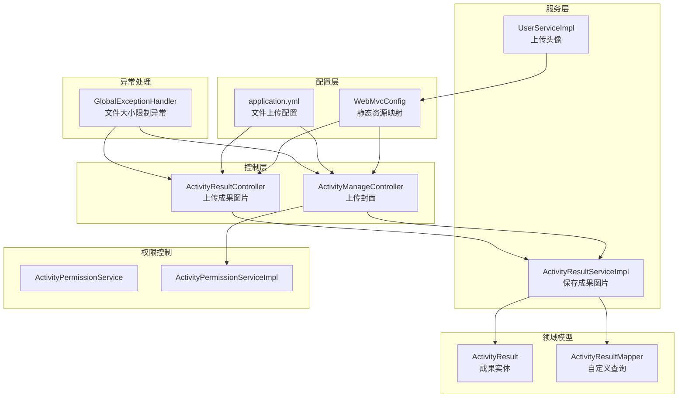
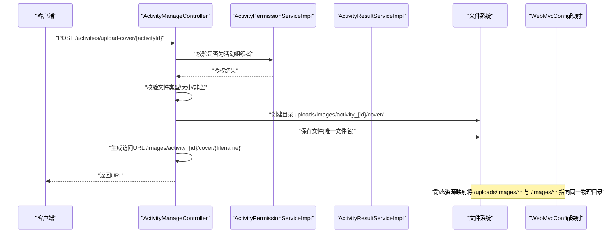
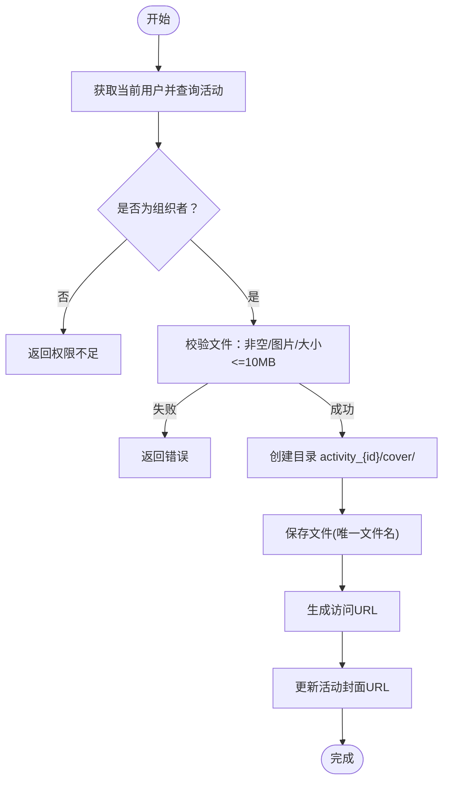
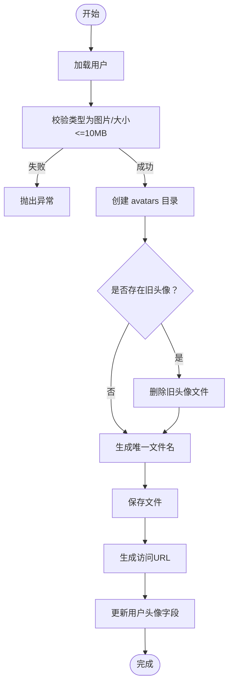
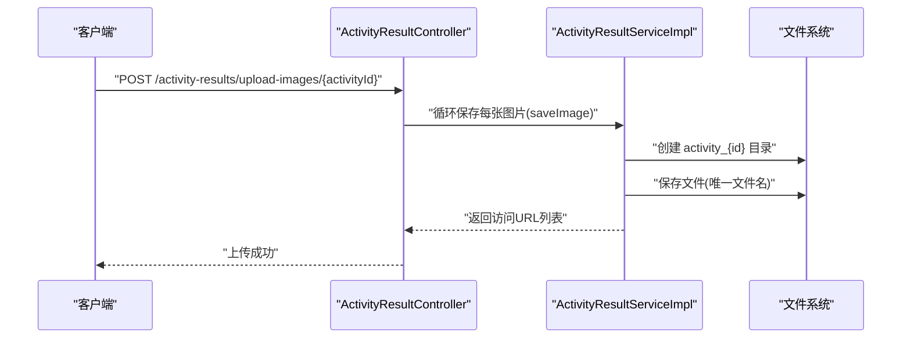
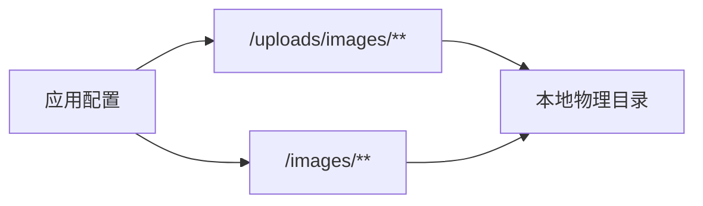
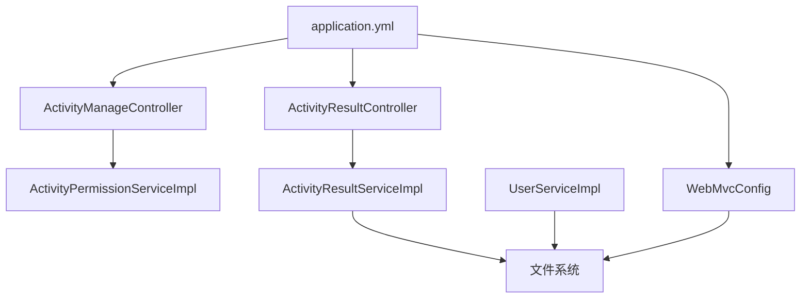

# 文件管理模块

<cite>
**本文引用的文件**
- [application.yml](file://src/main/resources/application.yml)
- [WebMvcConfig.java](file://src/main/java/com/campus/eventsys/config/WebMvcConfig.java)
- [ActivityManageController.java](file://src/main/java/com/campus/eventsys/controller/ActivityManageController.java)
- [ActivityResultServiceImpl.java](file://src/main/java/com/campus/eventsys/service/impl/ActivityResultServiceImpl.java)
- [UserServiceImpl.java](file://src/main/java/com/campus/eventsys/service/impl/UserServiceImpl.java)
- [ActivityResult.java](file://src/main/java/com/campus/eventsys/entity/ActivityResult.java)
- [ActivityResultMapper.java](file://src/main/java/com/campus/eventsys/mapper/ActivityResultMapper.java)
- [GlobalExceptionHandler.java](file://src/main/java/com/campus/eventsys/common/GlobalExceptionHandler.java)
- [ActivityPermissionService.java](file://src/main/java/com/campus/eventsys/service/ActivityPermissionService.java)
- [ActivityPermissionServiceImpl.java](file://src/main/java/com/campus/eventsys/service/impl/ActivityPermissionServiceImpl.java)
- [ActivityResultController.java](file://src/main/java/com/campus/eventsys/controller/ActivityResultController.java)
</cite>

## 目录
1. [简介](#简介)
2. [项目结构](#项目结构)
3. [核心组件](#核心组件)
4. [架构总览](#架构总览)
5. [详细组件分析](#详细组件分析)
6. [依赖关系分析](#依赖关系分析)
7. [性能考虑](#性能考虑)
8. [故障排查指南](#故障排查指南)
9. [结论](#结论)
10. [附录](#附录)

## 简介
本文件管理模块围绕“图片上传、存储策略与访问控制”展开，覆盖以下场景：
- 活动封面图片上传与权限控制
- 用户头像上传与命名规则
- 活动成果图片上传与存储路径
- 文件访问路径映射与缓存策略
- 错误处理与安全防护
- 性能优化与扩展指南

## 项目结构
文件管理相关代码主要分布在以下位置：
- 控制层：活动封面上传、成果图片上传
- 服务层：图片保存、命名、访问URL生成
- 配置层：静态资源映射、文件上传大小限制
- 异常处理：统一捕获文件上传异常
- 权限控制：组织者权限校验

**图表来源**
- [WebMvcConfig.java:15-37](file://src/main/java/com/campus/eventsys/config/WebMvcConfig.java#L15-L37)
- [application.yml:21-27](file://src/main/resources/application.yml#L21-L27)
- [ActivityManageController.java:793-881](file://src/main/java/com/campus/eventsys/controller/ActivityManageController.java#L793-L881)
- [ActivityResultController.java:328-347](file://src/main/java/com/campus/eventsys/controller/ActivityResultController.java#L328-L347)
- [ActivityResultServiceImpl.java:25-146](file://src/main/java/com/campus/eventsys/service/impl/ActivityResultServiceImpl.java#L25-L146)
- [UserServiceImpl.java:24-126](file://src/main/java/com/campus/eventsys/service/impl/UserServiceImpl.java#L24-L126)
- [ActivityResult.java:14-69](file://src/main/java/com/campus/eventsys/entity/ActivityResult.java#L14-L69)
- [ActivityResultMapper.java:9-18](file://src/main/java/com/campus/eventsys/mapper/ActivityResultMapper.java#L9-L18)
- [GlobalExceptionHandler.java:99-106](file://src/main/java/com/campus/eventsys/common/GlobalExceptionHandler.java#L99-L106)
- [ActivityPermissionService.java:13-41](file://src/main/java/com/campus/eventsys/service/ActivityPermissionService.java#L13-L41)
- [ActivityPermissionServiceImpl.java:51-62](file://src/main/java/com/campus/eventsys/service/impl/ActivityPermissionServiceImpl.java#L51-L62)

**章节来源**
- [WebMvcConfig.java:15-37](file://src/main/java/com/campus/eventsys/config/WebMvcConfig.java#L15-L37)
- [application.yml:21-27](file://src/main/resources/application.yml#L21-L27)

## 核心组件
- 静态资源映射与访问路径
  - 通过配置类将 /uploads/images/** 与 /images/** 映射到本地上传根目录，并启用缓存。
  - 访问URL前缀由配置项决定，确保前后端一致。

- 文件上传大小限制
  - Spring Servlet 配置了单文件最大10MB、请求总大小20MB。
  - 全局异常处理器捕获超限异常并返回统一错误响应。

- 活动封面图片上传
  - 控制器负责鉴权（仅活动组织者）、文件类型与大小校验、目录创建、唯一文件名生成、保存与URL回写。

- 用户头像上传
  - 严格限制图片类型与大小；独立 avatars 目录；删除旧头像文件；生成唯一文件名并更新用户头像字段。

- 活动成果图片上传
  - 成果图片按活动ID分目录存储；服务层统一生成访问URL；支持批量上传与异常保护。

**章节来源**
- [WebMvcConfig.java:22-35](file://src/main/java/com/campus/eventsys/config/WebMvcConfig.java#L22-L35)
- [application.yml:22-26](file://src/main/resources/application.yml#L22-L26)
- [GlobalExceptionHandler.java:102-106](file://src/main/java/com/campus/eventsys/common/GlobalExceptionHandler.java#L102-L106)
- [ActivityManageController.java:810-879](file://src/main/java/com/campus/eventsys/controller/ActivityManageController.java#L810-L879)
- [UserServiceImpl.java:60-126](file://src/main/java/com/campus/eventsys/service/impl/UserServiceImpl.java#L60-L126)
- [ActivityResultServiceImpl.java:115-146](file://src/main/java/com/campus/eventsys/service/impl/ActivityResultServiceImpl.java#L115-L146)

## 架构总览
文件管理的端到端流程如下：

**图表来源**
- [ActivityManageController.java:810-879](file://src/main/java/com/campus/eventsys/controller/ActivityManageController.java#L810-L879)
- [ActivityPermissionServiceImpl.java:51-62](file://src/main/java/com/campus/eventsys/service/impl/ActivityPermissionServiceImpl.java#L51-L62)
- [WebMvcConfig.java:22-35](file://src/main/java/com/campus/eventsys/config/WebMvcConfig.java#L22-L35)

## 详细组件分析

### 活动封面图片上传
- 权限控制
  - 仅活动组织者可上传封面；通过权限服务判断用户是否为组织者且报名状态已通过。
- 文件校验
  - 校验文件非空、类型为图片、大小不超过10MB。
- 存储策略
  - 目录：uploads/images/activity_{activityId}/cover/
  - 命名：UUID生成唯一文件名，保留原扩展名
  - 访问URL：/images/activity_{activityId}/cover/{filename}
- 数据库更新
  - 将活动实体的封面字段更新为生成的URL。

**图表来源**
- [ActivityManageController.java:810-879](file://src/main/java/com/campus/eventsys/controller/ActivityManageController.java#L810-L879)
- [ActivityPermissionServiceImpl.java:51-62](file://src/main/java/com/campus/eventsys/service/impl/ActivityPermissionServiceImpl.java#L51-L62)

**章节来源**
- [ActivityManageController.java:793-881](file://src/main/java/com/campus/eventsys/controller/ActivityManageController.java#L793-L881)
- [ActivityPermissionService.java:13-41](file://src/main/java/com/campus/eventsys/service/ActivityPermissionService.java#L13-L41)
- [ActivityPermissionServiceImpl.java:51-62](file://src/main/java/com/campus/eventsys/service/impl/ActivityPermissionServiceImpl.java#L51-L62)

### 用户头像上传
- 目录与命名
  - 目录：uploads/images/avatars/
  - 命名：user_{userId}_8位随机串.扩展名（保留原扩展名）
- 安全与清理
  - 若存在旧头像URL，解析文件名并删除旧文件，避免磁盘冗余。
- 访问与持久化
  - 生成访问URL并更新用户实体的头像字段。

**图表来源**
- [UserServiceImpl.java:60-126](file://src/main/java/com/campus/eventsys/service/impl/UserServiceImpl.java#L60-L126)

**章节来源**
- [UserServiceImpl.java:60-126](file://src/main/java/com/campus/eventsys/service/impl/UserServiceImpl.java#L60-L126)

### 活动成果图片上传
- 存储策略
  - 目录：uploads/images/activity_{activityId}/
  - 命名：UUID生成唯一文件名，保留原扩展名
  - 访问URL：/uploads/images/activity_{activityId}/{filename}
- 服务层职责
  - 统一创建目录、保存文件、生成访问URL
  - 支持批量上传，逐个处理并聚合结果
- 实体与查询
  - 成果实体包含图片字段（JSON数组格式），支持多图
  - 自定义Mapper提供“包含已删除”的查询能力，用于恢复场景

**图表来源**
- [ActivityResultController.java:328-347](file://src/main/java/com/campus/eventsys/controller/ActivityResultController.java#L328-L347)
- [ActivityResultServiceImpl.java:115-146](file://src/main/java/com/campus/eventsys/service/impl/ActivityResultServiceImpl.java#L115-L146)

**章节来源**
- [ActivityResultController.java:328-347](file://src/main/java/com/campus/eventsys/controller/ActivityResultController.java#L328-L347)
- [ActivityResultServiceImpl.java:25-146](file://src/main/java/com/campus/eventsys/service/impl/ActivityResultServiceImpl.java#L25-L146)
- [ActivityResult.java:14-69](file://src/main/java/com/campus/eventsys/entity/ActivityResult.java#L14-L69)
- [ActivityResultMapper.java:9-18](file://src/main/java/com/campus/eventsys/mapper/ActivityResultMapper.java#L9-L18)

### 文件访问路径与静态资源映射
- 路径映射
  - /uploads/images/** 与 /images/** 均映射到本地上传根目录
  - 启用1小时缓存，减少重复请求
- 访问URL生成
  - 活动封面：/images/activity_{id}/cover/{filename}
  - 成果图片：/uploads/images/activity_{id}/{filename}
  - 用户头像：/uploads/images/avatars/{filename}

**图表来源**
- [WebMvcConfig.java:22-35](file://src/main/java/com/campus/eventsys/config/WebMvcConfig.java#L22-L35)
- [application.yml:64-70](file://src/main/resources/application.yml#L64-L70)

**章节来源**
- [WebMvcConfig.java:15-37](file://src/main/java/com/campus/eventsys/config/WebMvcConfig.java#L15-L37)
- [application.yml:64-70](file://src/main/resources/application.yml#L64-L70)

### 错误处理与安全防护
- 错误处理
  - 文件大小超限：捕获 MaxUploadSizeExceededException，返回统一错误
  - IO异常：上传失败抛出运行时异常，由全局异常处理器捕获并返回友好提示
- 安全防护
  - 文件类型限制：仅允许图片类型
  - 文件大小限制：统一限制为10MB
  - 权限控制：活动封面仅组织者可上传
  - 唯一文件名：避免同名冲突与路径暴露敏感信息
  - 旧头像清理：防止磁盘空间膨胀

**章节来源**
- [GlobalExceptionHandler.java:102-106](file://src/main/java/com/campus/eventsys/common/GlobalExceptionHandler.java#L102-L106)
- [ActivityManageController.java:834-848](file://src/main/java/com/campus/eventsys/controller/ActivityManageController.java#L834-L848)
- [UserServiceImpl.java:68-77](file://src/main/java/com/campus/eventsys/service/impl/UserServiceImpl.java#L68-L77)
- [UserServiceImpl.java:131-144](file://src/main/java/com/campus/eventsys/service/impl/UserServiceImpl.java#L131-L144)

## 依赖关系分析
- 控制层依赖
  - ActivityManageController 依赖权限服务与上传路径配置
  - ActivityResultController 依赖服务层图片保存能力
- 服务层依赖
  - ActivityResultServiceImpl 依赖文件系统与访问URL配置
  - UserServiceImpl 依赖文件系统与头像目录
- 配置依赖
  - WebMvcConfig 依赖上传根目录配置
  - application.yml 决定文件上传大小与访问URL前缀

**图表来源**
- [ActivityManageController.java:810-879](file://src/main/java/com/campus/eventsys/controller/ActivityManageController.java#L810-L879)
- [ActivityPermissionServiceImpl.java:51-62](file://src/main/java/com/campus/eventsys/service/impl/ActivityPermissionServiceImpl.java#L51-L62)
- [ActivityResultController.java:328-347](file://src/main/java/com/campus/eventsys/controller/ActivityResultController.java#L328-L347)
- [ActivityResultServiceImpl.java:25-146](file://src/main/java/com/campus/eventsys/service/impl/ActivityResultServiceImpl.java#L25-L146)
- [UserServiceImpl.java:24-126](file://src/main/java/com/campus/eventsys/service/impl/UserServiceImpl.java#L24-L126)
- [WebMvcConfig.java:15-37](file://src/main/java/com/campus/eventsys/config/WebMvcConfig.java#L15-L37)
- [application.yml:21-27](file://src/main/resources/application.yml#L21-L27)

**章节来源**
- [ActivityManageController.java:810-879](file://src/main/java/com/campus/eventsys/controller/ActivityManageController.java#L810-L879)
- [ActivityResultController.java:328-347](file://src/main/java/com/campus/eventsys/controller/ActivityResultController.java#L328-L347)
- [ActivityResultServiceImpl.java:25-146](file://src/main/java/com/campus/eventsys/service/impl/ActivityResultServiceImpl.java#L25-L146)
- [UserServiceImpl.java:24-126](file://src/main/java/com/campus/eventsys/service/impl/UserServiceImpl.java#L24-L126)
- [WebMvcConfig.java:15-37](file://src/main/java/com/campus/eventsys/config/WebMvcConfig.java#L15-L37)
- [application.yml:21-27](file://src/main/resources/application.yml#L21-L27)

## 性能考虑
- 缓存策略
  - 静态资源映射启用1小时缓存，降低服务器压力
- I/O优化
  - 使用 transferTo 直接写入文件，避免内存拷贝
  - 按活动ID分目录存储，避免单目录文件过多导致I/O瓶颈
- 并发与命名
  - UUID保证文件名唯一，避免并发写入冲突
- 建议
  - 对于大流量场景，可引入CDN加速静态资源
  - 对头像可提供缩略图策略，前端按需加载
  - 对成果图片可增加压缩与格式转换（如WebP）

## 故障排查指南
- 上传失败
  - 检查文件类型是否为图片、大小是否超过10MB
  - 检查上传目录权限与磁盘空间
- 权限不足
  - 确认当前用户是否为活动组织者且报名状态已通过
- 访问404
  - 确认访问URL前缀与静态资源映射一致
  - 确认文件是否正确保存至对应目录
- 头像未更新
  - 检查旧头像URL解析与删除逻辑是否执行
  - 确认用户实体头像字段已更新

**章节来源**
- [GlobalExceptionHandler.java:102-106](file://src/main/java/com/campus/eventsys/common/GlobalExceptionHandler.java#L102-L106)
- [ActivityManageController.java:829-832](file://src/main/java/com/campus/eventsys/controller/ActivityManageController.java#L829-L832)
- [WebMvcConfig.java:22-35](file://src/main/java/com/campus/eventsys/config/WebMvcConfig.java#L22-L35)
- [UserServiceImpl.java:131-144](file://src/main/java/com/campus/eventsys/service/impl/UserServiceImpl.java#L131-L144)

## 结论
本模块以清晰的分层设计实现了活动封面、用户头像与活动成果图片的上传与访问控制。通过统一的静态资源映射、严格的文件校验与权限控制，以及良好的命名与目录策略，保障了功能的可用性与安全性。建议在生产环境中结合CDN与缓存策略进一步提升性能，并持续监控磁盘空间与访问日志。

## 附录

### 配置项说明
- 文件上传大小
  - 单文件最大：10MB
  - 请求总大小：20MB
- 访问URL前缀
  - /images/ 与 /uploads/images/ 均可访问
- 上传根目录
  - 默认：uploads/images（可通过配置调整）

**章节来源**
- [application.yml:22-26](file://src/main/resources/application.yml#L22-L26)
- [application.yml:64-70](file://src/main/resources/application.yml#L64-L70)
- [WebMvcConfig.java:18-29](file://src/main/java/com/campus/eventsys/config/WebMvcConfig.java#L18-L29)

### 存储路径与命名规则
- 活动封面
  - 目录：uploads/images/activity_{activityId}/cover/
  - 命名：UUID.扩展名
  - 访问：/images/activity_{activityId}/cover/{filename}
- 用户头像
  - 目录：uploads/images/avatars/
  - 命名：user_{userId}_8位随机串.扩展名
  - 访问：/uploads/images/avatars/{filename}
- 活动成果图片
  - 目录：uploads/images/activity_{activityId}/
  - 命名：UUID.扩展名
  - 访问：/uploads/images/activity_{activityId}/{filename}

**章节来源**
- [ActivityManageController.java:798-800](file://src/main/java/com/campus/eventsys/controller/ActivityManageController.java#L798-L800)
- [UserServiceImpl.java:100-106](file://src/main/java/com/campus/eventsys/service/impl/UserServiceImpl.java#L100-L106)
- [ActivityResultServiceImpl.java:124-140](file://src/main/java/com/campus/eventsys/service/impl/ActivityResultServiceImpl.java#L124-L140)

### 权限控制要点
- 活动封面上传
  - 必须为活动组织者且报名状态已通过
- 成果图片上传
  - 由业务场景决定权限（建议与活动组织者或创建者关联）
- 头像上传
  - 仅限用户本人操作

**章节来源**
- [ActivityPermissionServiceImpl.java:51-62](file://src/main/java/com/campus/eventsys/service/impl/ActivityPermissionServiceImpl.java#L51-L62)
- [ActivityPermissionService.java:13-41](file://src/main/java/com/campus/eventsys/service/ActivityPermissionService.java#L13-L41)