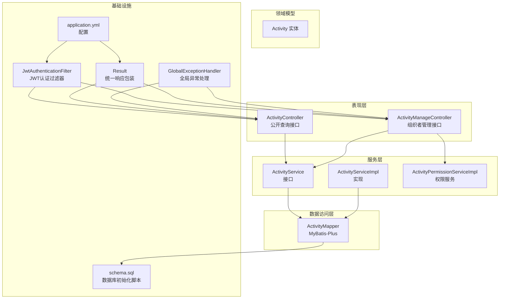
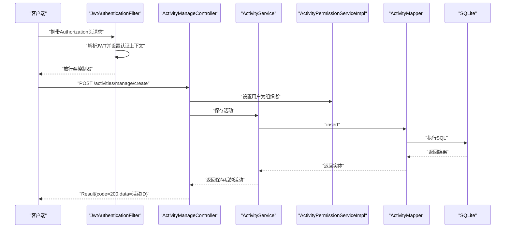
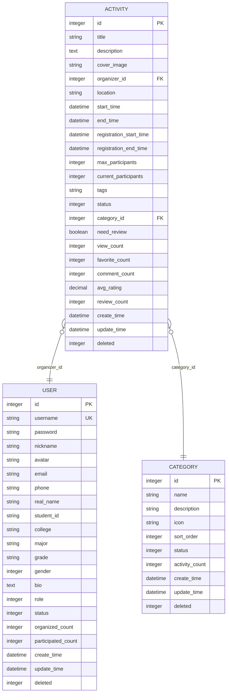
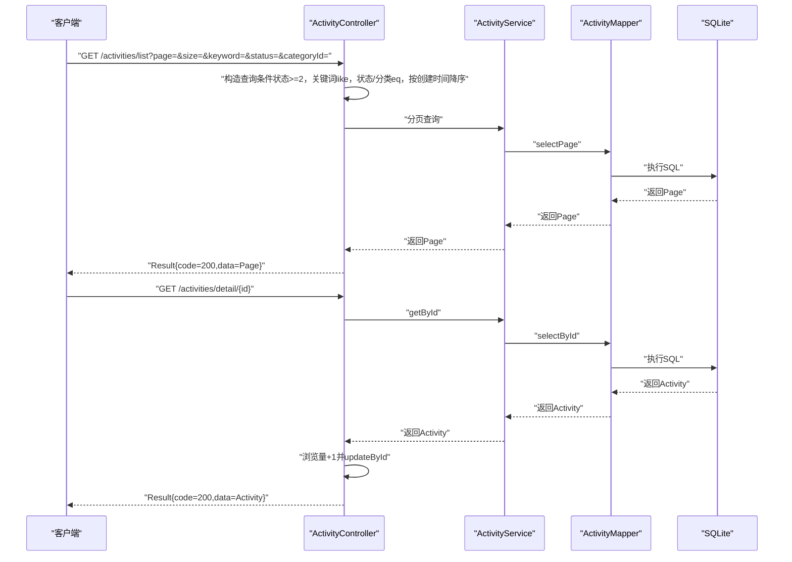
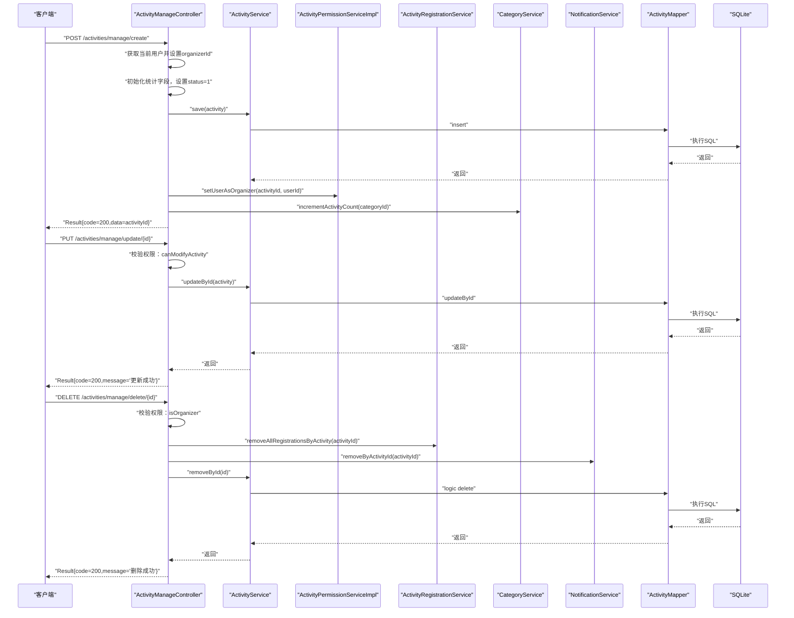
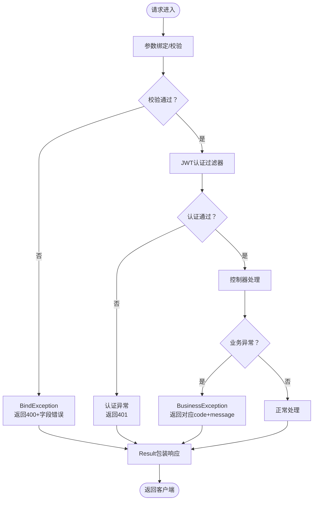
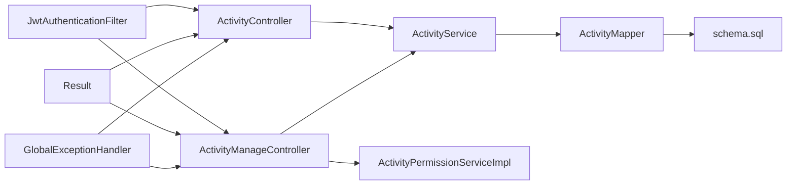

# 活动增删改查操作

<cite>
**本文引用的文件**
- [Activity.java](file://src/main/java/com/campus/eventsys/entity/Activity.java)
- [ActivityController.java](file://src/main/java/com/campus/eventsys/controller/ActivityController.java)
- [ActivityManageController.java](file://src/main/java/com/campus/eventsys/controller/ActivityManageController.java)
- [ActivityServiceImpl.java](file://src/main/java/com/campus/eventsys/service/impl/ActivityServiceImpl.java)
- [ActivityMapper.java](file://src/main/java/com/campus/eventsys/mapper/ActivityMapper.java)
- [ActivityService.java](file://src/main/java/com/campus/eventsys/service/ActivityService.java)
- [Result.java](file://src/main/java/com/campus/eventsys/common/Result.java)
- [GlobalExceptionHandler.java](file://src/main/java/com/campus/eventsys/common/GlobalExceptionHandler.java)
- [JwtAuthenticationFilter.java](file://src/main/java/com/campus/eventsys/security/JwtAuthenticationFilter.java)
- [ActivityPermissionServiceImpl.java](file://src/main/java/com/campus/eventsys/service/impl/ActivityPermissionServiceImpl.java)
- [ActivityStatusUtil.java](file://src/main/java/com/campus/eventsys/utils/ActivityStatusUtil.java)
- [ActivityRole.java](file://src/main/java/com/campus/eventsys/enums/ActivityRole.java)
- [application.yml](file://src/main/resources/application.yml)
- [schema.sql](file://src/main/resources/db/schema.sql)
</cite>

## 目录
1. [简介](#简介)
2. [项目结构](#项目结构)
3. [核心组件](#核心组件)
4. [架构总览](#架构总览)
5. [详细组件分析](#详细组件分析)
6. [依赖关系分析](#依赖关系分析)
7. [性能考虑](#性能考虑)
8. [故障排查指南](#故障排查指南)
9. [结论](#结论)
10. [附录](#附录)

## 简介
本文件围绕“活动增删改查”操作，系统性梳理活动数据模型、CRUD接口实现、参数校验与错误处理、权限控制与数据安全、以及分页查询、条件筛选与排序能力。重点覆盖以下方面：
- 活动数据模型设计与字段约束
- 公开展示接口（查询、详情）与组织者管理接口（创建、修改、删除、报名管理、管理者管理）
- 参数验证、数据校验与全局异常处理机制
- 权限控制与数据安全（基于JWT与角色）
- API接口文档与使用示例（含分页、筛选、排序）

## 项目结构
系统采用分层架构：控制器层负责HTTP接口与参数解析；服务层封装业务逻辑；持久层通过MyBatis-Plus访问SQLite数据库；安全层通过JWT过滤器注入认证上下文。

图表来源
- [ActivityController.java:1-111](file://src/main/java/com/campus/eventsys/controller/ActivityController.java#L1-L111)
- [ActivityManageController.java:1-882](file://src/main/java/com/campus/eventsys/controller/ActivityManageController.java#L1-L882)
- [ActivityServiceImpl.java:1-12](file://src/main/java/com/campus/eventsys/service/impl/ActivityServiceImpl.java#L1-L12)
- [ActivityMapper.java:1-10](file://src/main/java/com/campus/eventsys/mapper/ActivityMapper.java#L1-L10)
- [ActivityService.java:1-8](file://src/main/java/com/campus/eventsys/service/ActivityService.java#L1-L8)
- [JwtAuthenticationFilter.java:1-58](file://src/main/java/com/campus/eventsys/security/JwtAuthenticationFilter.java#L1-L58)
- [Result.java:1-55](file://src/main/java/com/campus/eventsys/common/Result.java#L1-L55)
- [GlobalExceptionHandler.java:1-108](file://src/main/java/com/campus/eventsys/common/GlobalExceptionHandler.java#L1-L108)
- [application.yml:1-76](file://src/main/resources/application.yml#L1-L76)
- [schema.sql:1-295](file://src/main/resources/db/schema.sql#L1-L295)

章节来源
- [ActivityController.java:1-111](file://src/main/java/com/campus/eventsys/controller/ActivityController.java#L1-L111)
- [ActivityManageController.java:1-882](file://src/main/java/com/campus/eventsys/controller/ActivityManageController.java#L1-L882)
- [ActivityServiceImpl.java:1-12](file://src/main/java/com/campus/eventsys/service/impl/ActivityServiceImpl.java#L1-L12)
- [ActivityMapper.java:1-10](file://src/main/java/com/campus/eventsys/mapper/ActivityMapper.java#L1-L10)
- [ActivityService.java:1-8](file://src/main/java/com/campus/eventsys/service/ActivityService.java#L1-L8)
- [JwtAuthenticationFilter.java:1-58](file://src/main/java/com/campus/eventsys/security/JwtAuthenticationFilter.java#L1-L58)
- [Result.java:1-55](file://src/main/java/com/campus/eventsys/common/Result.java#L1-L55)
- [GlobalExceptionHandler.java:1-108](file://src/main/java/com/campus/eventsys/common/GlobalExceptionHandler.java#L1-L108)
- [application.yml:1-76](file://src/main/resources/application.yml#L1-L76)
- [schema.sql:1-295](file://src/main/resources/db/schema.sql#L1-L295)

## 核心组件
- 活动实体：定义活动的核心字段与注解（主键策略、逻辑删除、自动填充时间等）
- 控制器：
  - 公开展示接口：活动列表、详情（公开查询）
  - 组织者管理接口：创建、修改、删除、报名管理、管理者管理
- 服务层：基础服务接口与实现，权限服务实现
- 数据访问层：MyBatis-Plus Mapper
- 安全层：JWT过滤器注入认证上下文
- 统一响应与异常处理：Result包装与全局异常处理器

章节来源
- [Activity.java:1-95](file://src/main/java/com/campus/eventsys/entity/Activity.java#L1-L95)
- [ActivityController.java:1-111](file://src/main/java/com/campus/eventsys/controller/ActivityController.java#L1-L111)
- [ActivityManageController.java:1-882](file://src/main/java/com/campus/eventsys/controller/ActivityManageController.java#L1-L882)
- [ActivityServiceImpl.java:1-12](file://src/main/java/com/campus/eventsys/service/impl/ActivityServiceImpl.java#L1-L12)
- [ActivityMapper.java:1-10](file://src/main/java/com/campus/eventsys/mapper/ActivityMapper.java#L1-L10)
- [ActivityService.java:1-8](file://src/main/java/com/campus/eventsys/service/ActivityService.java#L1-L8)
- [JwtAuthenticationFilter.java:1-58](file://src/main/java/com/campus/eventsys/security/JwtAuthenticationFilter.java#L1-L58)
- [Result.java:1-55](file://src/main/java/com/campus/eventsys/common/Result.java#L1-L55)
- [GlobalExceptionHandler.java:1-108](file://src/main/java/com/campus/eventsys/common/GlobalExceptionHandler.java#L1-L108)

## 架构总览
系统通过REST接口对外提供活动相关能力，前端通过JWT进行认证，控制器层负责参数接收与校验，服务层执行业务规则，持久层完成数据读写。全局异常处理器统一捕获异常并返回标准响应。

图表来源
- [JwtAuthenticationFilter.java:1-58](file://src/main/java/com/campus/eventsys/security/JwtAuthenticationFilter.java#L1-L58)
- [ActivityManageController.java:1-882](file://src/main/java/com/campus/eventsys/controller/ActivityManageController.java#L1-L882)
- [ActivityServiceImpl.java:1-12](file://src/main/java/com/campus/eventsys/service/impl/ActivityServiceImpl.java#L1-L12)
- [ActivityMapper.java:1-10](file://src/main/java/com/campus/eventsys/mapper/ActivityMapper.java#L1-L10)
- [application.yml:1-76](file://src/main/resources/application.yml#L1-L76)

## 详细组件分析

### 活动数据模型与字段约束
- 主键策略：INPUT模式（SQLite不支持getGeneratedKeys），需显式传入ID
- 逻辑删除：deleted字段，0未删除，1已删除
- 时间字段：自动填充创建/更新时间
- 核心字段说明（节选）：
  - 标题、描述、封面图片URL
  - 组织者ID、地点
  - 开始/结束时间、报名开始/结束时间
  - 最大参与人数（0表示不限制）、当前报名人数
  - 标签、状态（-2~5）、分类ID、是否需要审核报名
  - 统计字段：浏览次数、收藏次数、评论数量、平均评分、评价数量

图表来源
- [Activity.java:1-95](file://src/main/java/com/campus/eventsys/entity/Activity.java#L1-L95)
- [schema.sql:46-77](file://src/main/resources/db/schema.sql#L46-L77)

章节来源
- [Activity.java:1-95](file://src/main/java/com/campus/eventsys/entity/Activity.java#L1-L95)
- [schema.sql:46-77](file://src/main/resources/db/schema.sql#L46-L77)

### 公开展示接口（查询与详情）
- 接口：GET /activities/list（分页、关键词、状态、分类筛选，按创建时间倒序）
- 接口：GET /activities/detail/{id}（详情，浏览量+1并持久化）
- 查询范围：仅返回状态>=2的活动（已通过审核）

图表来源
- [ActivityController.java:1-111](file://src/main/java/com/campus/eventsys/controller/ActivityController.java#L1-L111)
- [ActivityServiceImpl.java:1-12](file://src/main/java/com/campus/eventsys/service/impl/ActivityServiceImpl.java#L1-L12)
- [ActivityMapper.java:1-10](file://src/main/java/com/campus/eventsys/mapper/ActivityMapper.java#L1-L10)

章节来源
- [ActivityController.java:44-110](file://src/main/java/com/campus/eventsys/controller/ActivityController.java#L44-L110)

### 组织者管理接口（创建、修改、删除、报名与管理者管理）
- 创建活动：设置组织者ID、初始状态为待审核、初始化统计字段，返回活动ID
- 修改活动：仅组织者可修改，禁止修改组织者字段
- 删除活动：逻辑删除，清理报名记录、成果贴，更新分类与用户统计
- 报名管理：查看报名列表/参与者列表、审核报名、移除参与者
- 管理者管理：查看管理者列表、添加/移除管理者

图表来源
- [ActivityManageController.java:1-882](file://src/main/java/com/campus/eventsys/controller/ActivityManageController.java#L1-L882)
- [ActivityServiceImpl.java:1-12](file://src/main/java/com/campus/eventsys/service/impl/ActivityServiceImpl.java#L1-L12)
- [ActivityPermissionServiceImpl.java:1-266](file://src/main/java/com/campus/eventsys/service/impl/ActivityPermissionServiceImpl.java#L1-L266)

章节来源
- [ActivityManageController.java:78-253](file://src/main/java/com/campus/eventsys/controller/ActivityManageController.java#L78-L253)
- [ActivityPermissionServiceImpl.java:31-62](file://src/main/java/com/campus/eventsys/service/impl/ActivityPermissionServiceImpl.java#L31-L62)

### 参数验证、数据校验与错误处理机制
- 参数绑定异常：统一返回400与字段级错误提示
- 认证异常：401未登录/凭证失效
- 权限异常：403无权限
- 业务异常：BusinessException透传业务码与消息
- 文件上传大小限制：MaxUploadSizeExceededException统一处理
- 统一响应：Result包装code/message/data

图表来源
- [GlobalExceptionHandler.java:1-108](file://src/main/java/com/campus/eventsys/common/GlobalExceptionHandler.java#L1-L108)
- [Result.java:1-55](file://src/main/java/com/campus/eventsys/common/Result.java#L1-L55)
- [JwtAuthenticationFilter.java:1-58](file://src/main/java/com/campus/eventsys/security/JwtAuthenticationFilter.java#L1-L58)

章节来源
- [GlobalExceptionHandler.java:20-107](file://src/main/java/com/campus/eventsys/common/GlobalExceptionHandler.java#L20-L107)
- [Result.java:12-55](file://src/main/java/com/campus/eventsys/common/Result.java#L12-L55)
- [JwtAuthenticationFilter.java:26-48](file://src/main/java/com/campus/eventsys/security/JwtAuthenticationFilter.java#L26-L48)

### 权限控制与数据安全
- 认证：JWT过滤器从Authorization头提取Bearer Token，解析用户名并注入SecurityContext
- 授权：
  - canModifyActivity：必须是组织者且状态为已通过
  - isOrganizer/isParticipant：基于活动报名记录判断
  - canCheckIn：参与者且活动状态为进行中且已开始
- 角色枚举：组织者/参与者
- 状态工具：统一映射状态中文名

```mermaid
classDiagram
class ActivityPermissionServiceImpl {
+isOrganizer(activityId, userId) boolean
+isParticipant(activityId, userId) boolean
+canModifyActivity(activityId, userId) boolean
+canCheckIn(activityId, userId) boolean
+setUserAsOrganizer(activityId, userId) boolean
+addOrganizer(activityId, userId, operatorId) boolean
+removeOrganizer(activityId, userId, operatorId) boolean
}
class ActivityRole {
<<enum>>
+ORGANIZER
+PARTICIPANT
}
class ActivityStatusUtil {
+getActivityStatusName(status) String
+getRegistrationStatusName(status) String
}
ActivityPermissionServiceImpl --> ActivityRole : "使用"
ActivityPermissionServiceImpl --> ActivityStatusUtil : "使用"
```

图表来源
- [ActivityPermissionServiceImpl.java:1-266](file://src/main/java/com/campus/eventsys/service/impl/ActivityPermissionServiceImpl.java#L1-L266)
- [ActivityRole.java:1-38](file://src/main/java/com/campus/eventsys/enums/ActivityRole.java#L1-L38)
- [ActivityStatusUtil.java:1-46](file://src/main/java/com/campus/eventsys/utils/ActivityStatusUtil.java#L1-L46)

章节来源
- [ActivityPermissionServiceImpl.java:31-82](file://src/main/java/com/campus/eventsys/service/impl/ActivityPermissionServiceImpl.java#L31-L82)
- [ActivityRole.java:9-37](file://src/main/java/com/campus/eventsys/enums/ActivityRole.java#L9-L37)
- [ActivityStatusUtil.java:15-44](file://src/main/java/com/campus/eventsys/utils/ActivityStatusUtil.java#L15-L44)

### API接口文档与使用示例
- 公开展示接口
  - GET /activities/list
    - 查询参数：page（默认1）、size（默认10）、keyword（标题关键词）、status（2/3/4/5）、categoryId
    - 返回：分页结果，仅返回状态>=2的活动，按创建时间倒序
  - GET /activities/detail/{id}
    - 路径参数：id（活动ID）
    - 返回：活动详情，浏览量+1
- 组织者管理接口
  - POST /activities/manage/create
    - 请求体：Activity对象（除ID外）
    - 返回：Result{code=200, data=活动ID}
  - PUT /activities/manage/update/{id}
    - 路径参数：id
    - 请求体：Activity对象（不含organizerId）
    - 返回：Result{code=200, message='更新成功'}
  - DELETE /activities/manage/delete/{id}
    - 路径参数：id
    - 返回：Result{code=200, message='删除成功'}
  - GET /activities/manage/my-created
    - 返回：当前用户创建的所有活动（含草稿/待审核/进行中/已结束）
  - GET /activities/manage/{activityId}/registrations
    - 返回：活动报名列表（含组织者与参与者）
  - GET /activities/manage/{activityId}/participants
    - 返回：活动参与者列表（不含组织者）
  - POST /activities/manage/registrations/{registrationId}/review
    - 请求体：{status: 1|2, remark: 可选}
    - 返回：Result{code=200, message='审核通过'/'审核拒绝'}
  - POST /activities/manage/registrations/{registrationId}/remove
    - 返回：Result{code=200, message='移除成功'}
  - GET /activities/manage/{activityId}/organizers
    - 返回：活动管理者列表（组织者+被添加的管理者）
  - POST /activities/manage/{activityId}/organizers
    - 请求体：{userId}
    - 返回：Result{code=200, message='添加管理者成功'}
  - POST /activities/manage/{activityId}/organizers/{targetUserId}/remove
    - 返回：Result{code=200, message='移除管理者成功'}

章节来源
- [ActivityController.java:44-110](file://src/main/java/com/campus/eventsys/controller/ActivityController.java#L44-L110)
- [ActivityManageController.java:78-882](file://src/main/java/com/campus/eventsys/controller/ActivityManageController.java#L78-L882)

## 依赖关系分析
- 控制器依赖服务接口与权限服务
- 服务实现依赖Mapper
- Mapper依赖数据库Schema
- 安全过滤器依赖JWT工具与UserDetailsService
- 统一响应与异常处理贯穿各层

图表来源
- [ActivityController.java:1-111](file://src/main/java/com/campus/eventsys/controller/ActivityController.java#L1-L111)
- [ActivityManageController.java:1-882](file://src/main/java/com/campus/eventsys/controller/ActivityManageController.java#L1-L882)
- [ActivityServiceImpl.java:1-12](file://src/main/java/com/campus/eventsys/service/impl/ActivityServiceImpl.java#L1-L12)
- [ActivityMapper.java:1-10](file://src/main/java/com/campus/eventsys/mapper/ActivityMapper.java#L1-L10)
- [schema.sql:1-295](file://src/main/resources/db/schema.sql#L1-L295)
- [JwtAuthenticationFilter.java:1-58](file://src/main/java/com/campus/eventsys/security/JwtAuthenticationFilter.java#L1-L58)
- [Result.java:1-55](file://src/main/java/com/campus/eventsys/common/Result.java#L1-L55)
- [GlobalExceptionHandler.java:1-108](file://src/main/java/com/campus/eventsys/common/GlobalExceptionHandler.java#L1-L108)

章节来源
- [ActivityController.java:1-111](file://src/main/java/com/campus/eventsys/controller/ActivityController.java#L1-L111)
- [ActivityManageController.java:1-882](file://src/main/java/com/campus/eventsys/controller/ActivityManageController.java#L1-L882)
- [ActivityServiceImpl.java:1-12](file://src/main/java/com/campus/eventsys/service/impl/ActivityServiceImpl.java#L1-L12)
- [ActivityMapper.java:1-10](file://src/main/java/com/campus/eventsys/mapper/ActivityMapper.java#L1-L10)
- [schema.sql:1-295](file://src/main/resources/db/schema.sql#L1-L295)
- [JwtAuthenticationFilter.java:1-58](file://src/main/java/com/campus/eventsys/security/JwtAuthenticationFilter.java#L1-L58)
- [Result.java:1-55](file://src/main/java/com/campus/eventsys/common/Result.java#L1-L55)
- [GlobalExceptionHandler.java:1-108](file://src/main/java/com/campus/eventsys/common/GlobalExceptionHandler.java#L1-L108)

## 性能考虑
- 分页查询：使用MyBatis-Plus Page，避免一次性加载大量数据
- 索引优化：数据库脚本中为常用查询字段建立索引（如活动状态、开始时间、报名状态等）
- 时间字段：统一时区与时钟源，减少跨时区计算误差
- 逻辑删除：避免物理删除带来的统计与关联维护成本

## 故障排查指南
- 401未登录/凭证失效：检查Authorization头格式与JWT有效性
- 403无权限：确认当前用户是否为活动组织者或具备相应角色
- 404活动不存在：确认活动ID与软删除状态
- 400参数错误：关注字段校验失败的具体字段与提示
- 文件上传超限：检查multipart大小配置与实际文件大小

章节来源
- [GlobalExceptionHandler.java:32-106](file://src/main/java/com/campus/eventsys/common/GlobalExceptionHandler.java#L32-L106)
- [application.yml:21-26](file://src/main/resources/application.yml#L21-L26)

## 结论
本系统围绕活动的增删改查提供了完善的接口与安全保障：通过清晰的数据模型、严格的权限控制、统一的响应与异常处理机制，以及合理的分页与筛选能力，满足组织者与用户的多样化需求。建议在生产环境中进一步补充参数校验注解、接口幂等性与审计日志等能力。

## 附录
- 配置要点
  - JWT密钥与过期时间
  - 文件上传路径与大小限制
  - MyBatis-Plus ID策略与逻辑删除配置
- 数据库初始化
  - schema.sql定义了活动、用户、分类、报名、成果、评论、收藏、签到、通知、审核、评价等表及索引

章节来源
- [application.yml:49-76](file://src/main/resources/application.yml#L49-L76)
- [schema.sql:1-295](file://src/main/resources/db/schema.sql#L1-L295)