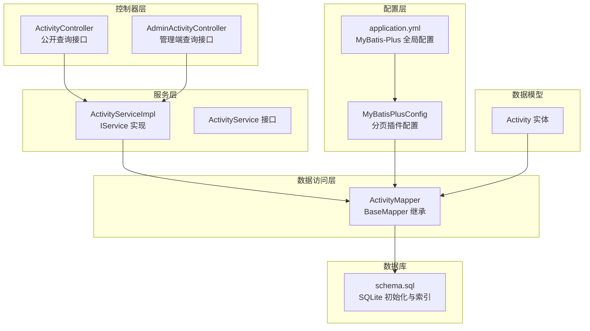
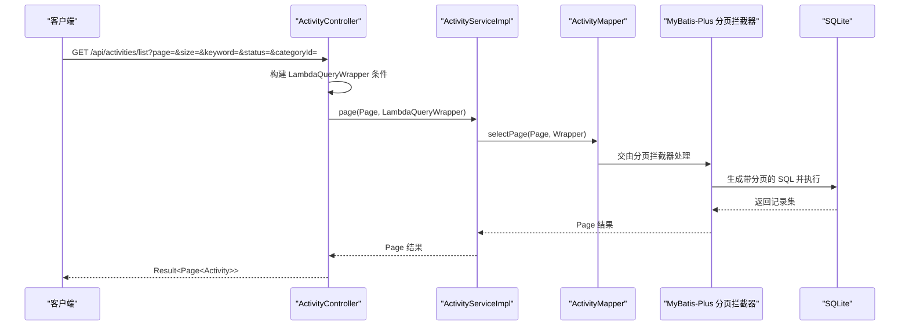
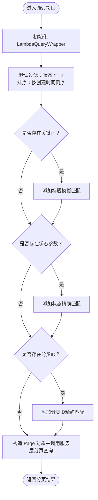
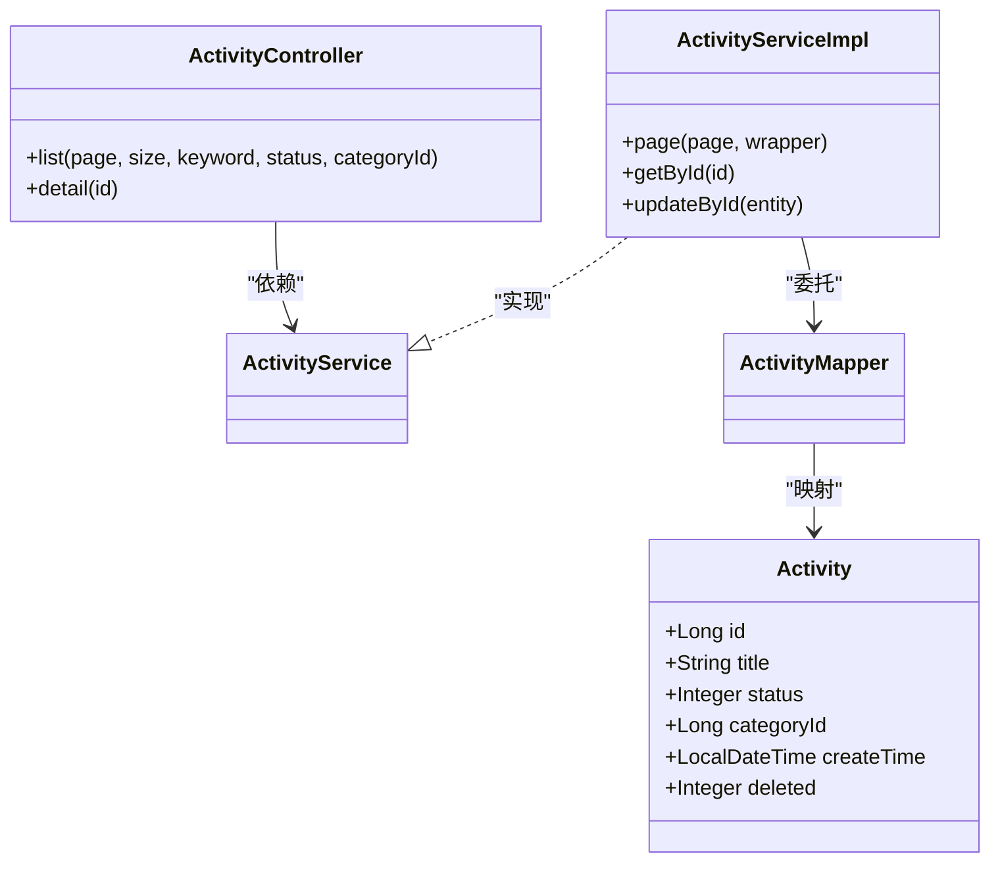
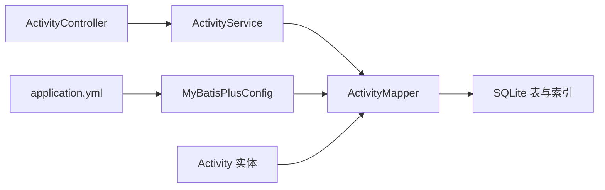

# 活动搜索与筛选

<cite>
**本文引用的文件**
- [ActivityController.java](file://src/main/java/com/campus/eventsys/controller/ActivityController.java)
- [ActivityServiceImpl.java](file://src/main/java/com/campus/eventsys/service/impl/ActivityServiceImpl.java)
- [ActivityService.java](file://src/main/java/com/campus/eventsys/service/ActivityService.java)
- [ActivityMapper.java](file://src/main/java/com/campus/eventsys/mapper/ActivityMapper.java)
- [Activity.java](file://src/main/java/com/campus/eventsys/entity/Activity.java)
- [MyBatisPlusConfig.java](file://src/main/java/com/campus/eventsys/config/MyBatisPlusConfig.java)
- [application.yml](file://src/main/resources/application.yml)
- [schema.sql](file://src/main/resources/db/schema.sql)
- [ActivityControllerTest.java](file://src/test/java/com/campus/eventsys/controller/ActivityControllerTest.java)
- [AdminActivityController.java](file://src/main/java/com/campus/eventsys/controller/AdminActivityController.java)
</cite>

## 目录
1. [简介](#简介)
2. [项目结构](#项目结构)
3. [核心组件](#核心组件)
4. [架构总览](#架构总览)
5. [详细组件分析](#详细组件分析)
6. [依赖关系分析](#依赖关系分析)
7. [性能考虑](#性能考虑)
8. [故障排查指南](#故障排查指南)
9. [结论](#结论)
10. [附录](#附录)

## 简介
本技术文档聚焦于“活动搜索与筛选”功能，围绕活动列表查询的实现机制展开，涵盖关键词搜索、状态筛选、分类筛选等多维度过滤能力；详解 LambdaQueryWrapper 的使用方式与查询条件构建逻辑；阐述分页查询的实现原理与性能优化策略；并结合数据库索引设计，给出搜索算法与索引使用的现状说明。文末提供查询接口示例与最佳实践建议，帮助开发者理解与优化该功能。

## 项目结构
活动搜索与筛选功能主要涉及以下层次：
- 控制器层：对外暴露公开查询接口，负责参数接收与结果封装
- 服务层：基于 MyBatis-Plus 的 IService 实现，提供分页查询能力
- 数据访问层：继承 BaseMapper，配合分页拦截器执行 SQL
- 配置层：MyBatis-Plus 分页插件与全局配置
- 数据模型：Activity 实体映射数据库表结构
- 数据库：SQLite 初始化脚本与索引设计

图表来源
- [ActivityController.java:44-87](file://src/main/java/com/campus/eventsys/controller/ActivityController.java#L44-L87)
- [ActivityServiceImpl.java:10](file://src/main/java/com/campus/eventsys/service/impl/ActivityServiceImpl.java#L10)
- [ActivityMapper.java:8](file://src/main/java/com/campus/eventsys/mapper/ActivityMapper.java#L8)
- [MyBatisPlusConfig.java:25-34](file://src/main/java/com/campus/eventsys/config/MyBatisPlusConfig.java#L25-L34)
- [application.yml:34-47](file://src/main/resources/application.yml#L34-L47)
- [Activity.java:15-94](file://src/main/java/com/campus/eventsys/entity/Activity.java#L15-L94)
- [schema.sql:240-294](file://src/main/resources/db/schema.sql#L240-L294)

章节来源
- [ActivityController.java:44-87](file://src/main/java/com/campus/eventsys/controller/ActivityController.java#L44-L87)
- [ActivityServiceImpl.java:10](file://src/main/java/com/campus/eventsys/service/impl/ActivityServiceImpl.java#L10)
- [ActivityMapper.java:8](file://src/main/java/com/campus/eventsys/mapper/ActivityMapper.java#L8)
- [MyBatisPlusConfig.java:25-34](file://src/main/java/com/campus/eventsys/config/MyBatisPlusConfig.java#L25-L34)
- [application.yml:34-47](file://src/main/resources/application.yml#L34-L47)
- [Activity.java:15-94](file://src/main/java/com/campus/eventsys/entity/Activity.java#L15-L94)
- [schema.sql:240-294](file://src/main/resources/db/schema.sql#L240-L294)

## 核心组件
- 控制器：提供公开查询接口，支持分页、关键词、状态、分类筛选
- 服务：基于 MyBatis-Plus 的 IService，提供 page 方法
- Mapper：继承 BaseMapper，承载 SQL 映射
- 配置：分页拦截器与全局 MyBatis-Plus 配置
- 实体：Activity 映射数据库表字段
- 数据库：SQLite 初始化脚本与索引

章节来源
- [ActivityController.java:44-87](file://src/main/java/com/campus/eventsys/controller/ActivityController.java#L44-L87)
- [ActivityServiceImpl.java:10](file://src/main/java/com/campus/eventsys/service/impl/ActivityServiceImpl.java#L10)
- [ActivityMapper.java:8](file://src/main/java/com/campus/eventsys/mapper/ActivityMapper.java#L8)
- [MyBatisPlusConfig.java:25-34](file://src/main/java/com/campus/eventsys/config/MyBatisPlusConfig.java#L25-L34)
- [Activity.java:15-94](file://src/main/java/com/campus/eventsys/entity/Activity.java#L15-L94)
- [schema.sql:240-294](file://src/main/resources/db/schema.sql#L240-L294)

## 架构总览
活动搜索与筛选采用典型的分层架构：
- 控制器接收请求参数，构建 LambdaQueryWrapper 查询条件
- 服务层调用分页方法，将查询条件传递给 Mapper
- MyBatis-Plus 分页拦截器生成带 LIMIT/OFFSET 的 SQL
- 数据库执行查询并返回结果，控制器封装为分页响应

图表来源
- [ActivityController.java:54-87](file://src/main/java/com/campus/eventsys/controller/ActivityController.java#L54-L87)
- [ActivityServiceImpl.java:10](file://src/main/java/com/campus/eventsys/service/impl/ActivityServiceImpl.java#L10)
- [MyBatisPlusConfig.java:25-34](file://src/main/java/com/campus/eventsys/config/MyBatisPlusConfig.java#L25-L34)

## 详细组件分析

### 控制器：ActivityController
- 接口职责：提供公开查询接口，支持分页、关键词、状态、分类筛选
- 默认过滤：仅返回已通过审核的活动（状态 ≥ 2），按创建时间倒序
- 查询条件构建：
  - 关键词搜索：对标题进行模糊匹配
  - 状态筛选：精确匹配状态
  - 分类筛选：精确匹配分类 ID
- 分页调用：将 Page 对象与 LambdaQueryWrapper 传入服务层

图表来源
- [ActivityController.java:62-87](file://src/main/java/com/campus/eventsys/controller/ActivityController.java#L62-L87)

章节来源
- [ActivityController.java:44-87](file://src/main/java/com/campus/eventsys/controller/ActivityController.java#L44-L87)

### 服务层：ActivityServiceImpl
- 基于 MyBatis-Plus 的 ServiceImpl，继承 BaseMapper 的通用 CRUD 能力
- 提供 page 方法，内部委托底层执行分页查询

章节来源
- [ActivityServiceImpl.java:10](file://src/main/java/com/campus/eventsys/service/impl/ActivityServiceImpl.java#L10)

### 数据访问层：ActivityMapper
- 继承 BaseMapper，提供通用的 SQL 映射能力
- 与分页拦截器协作，生成带分页的 SQL

章节来源
- [ActivityMapper.java:8](file://src/main/java/com/campus/eventsys/mapper/ActivityMapper.java#L8)

### 配置层：MyBatisPlusConfig 与 application.yml
- 分页拦截器：针对 SQLite 的 PaginationInnerInterceptor，设置溢出控制与最大限制
- 全局配置：MyBatis-Plus mapper locations、类型别名包、驼峰映射、逻辑删除字段与值

章节来源
- [MyBatisPlusConfig.java:25-34](file://src/main/java/com/campus/eventsys/config/MyBatisPlusConfig.java#L25-L34)
- [application.yml:34-47](file://src/main/resources/application.yml#L34-L47)

### 数据模型：Activity 实体
- 字段覆盖活动表关键字段，包括标题、状态、分类 ID、创建时间等
- 逻辑删除字段 deleted 与全局配置一致

章节来源
- [Activity.java:15-94](file://src/main/java/com/campus/eventsys/entity/Activity.java#L15-L94)

### 数据库：schema.sql 与索引
- 初始化脚本包含活动表及索引
- 活动表关键索引：organizer_id、category_id、status、start_time
- 索引有助于提升按状态、分类、组织者等维度的查询性能

章节来源
- [schema.sql:240-294](file://src/main/resources/db/schema.sql#L240-L294)

### 类关系图

图表来源
- [ActivityController.java:44-87](file://src/main/java/com/campus/eventsys/controller/ActivityController.java#L44-L87)
- [ActivityServiceImpl.java:10](file://src/main/java/com/campus/eventsys/service/impl/ActivityServiceImpl.java#L10)
- [ActivityService.java:6](file://src/main/java/com/campus/eventsys/service/ActivityService.java#L6)
- [ActivityMapper.java:8](file://src/main/java/com/campus/eventsys/mapper/ActivityMapper.java#L8)
- [Activity.java:15-94](file://src/main/java/com/campus/eventsys/entity/Activity.java#L15-L94)

## 依赖关系分析
- 控制器依赖服务接口，服务实现依赖 Mapper
- Mapper 依赖数据库表结构与索引
- 分页拦截器依赖 MyBatis-Plus 配置
- 应用配置影响逻辑删除与全局映射行为

图表来源
- [ActivityController.java:44-87](file://src/main/java/com/campus/eventsys/controller/ActivityController.java#L44-L87)
- [ActivityServiceImpl.java:10](file://src/main/java/com/campus/eventsys/service/impl/ActivityServiceImpl.java#L10)
- [ActivityMapper.java:8](file://src/main/java/com/campus/eventsys/mapper/ActivityMapper.java#L8)
- [MyBatisPlusConfig.java:25-34](file://src/main/java/com/campus/eventsys/config/MyBatisPlusConfig.java#L25-L34)
- [application.yml:34-47](file://src/main/resources/application.yml#L34-L47)
- [Activity.java:15-94](file://src/main/java/com/campus/eventsys/entity/Activity.java#L15-L94)
- [schema.sql:240-294](file://src/main/resources/db/schema.sql#L240-L294)

章节来源
- [ActivityController.java:44-87](file://src/main/java/com/campus/eventsys/controller/ActivityController.java#L44-L87)
- [ActivityServiceImpl.java:10](file://src/main/java/com/campus/eventsys/service/impl/ActivityServiceImpl.java#L10)
- [ActivityMapper.java:8](file://src/main/java/com/campus/eventsys/mapper/ActivityMapper.java#L8)
- [MyBatisPlusConfig.java:25-34](file://src/main/java/com/campus/eventsys/config/MyBatisPlusConfig.java#L25-L34)
- [application.yml:34-47](file://src/main/resources/application.yml#L34-L47)
- [Activity.java:15-94](file://src/main/java/com/campus/eventsys/entity/Activity.java#L15-L94)
- [schema.sql:240-294](file://src/main/resources/db/schema.sql#L240-L294)

## 性能考虑
- 分页拦截器配置
  - SQLite 分页插件：PaginationInnerInterceptor(DbType.SQLITE)
  - 溢出控制：overflow=false，防止越界
  - 最大限制：maxLimit=1000L，避免超大分页导致性能问题
- 数据库索引
  - 活动表关键索引：category_id、status、organizer_id、start_time
  - 有利于按分类、状态、组织者、开始时间等维度高效查询
- 查询条件构建
  - 默认仅返回已通过审核的活动（状态 ≥ 2），减少无效扫描
  - 标题模糊匹配使用 like，建议在高频关键词场景下评估全文检索替代方案
- 逻辑删除
  - 全局配置启用逻辑删除，避免物理删除带来的维护成本

章节来源
- [MyBatisPlusConfig.java:25-34](file://src/main/java/com/campus/eventsys/config/MyBatisPlusConfig.java#L25-L34)
- [schema.sql:240-294](file://src/main/resources/db/schema.sql#L240-L294)
- [application.yml:34-47](file://src/main/resources/application.yml#L34-L47)

## 故障排查指南
- 参数校验
  - 关键词为空字符串时会被忽略，确保前端传参规范
  - 状态与分类 ID 为空时不会添加对应条件
- 默认过滤
  - 公开查询默认仅返回状态 ≥ 2 的活动，若出现空结果，请检查状态值
- 分页异常
  - 若出现分页过大或越界，检查 maxLimit 与 overflow 配置
- 单元测试参考
  - 提供了关键词、状态、分类、全参组合与空结果的测试用例，可作为集成测试参考

章节来源
- [ActivityController.java:62-87](file://src/main/java/com/campus/eventsys/controller/ActivityController.java#L62-L87)
- [ActivityControllerTest.java:55-172](file://src/test/java/com/campus/eventsys/controller/ActivityControllerTest.java#L55-L172)

## 结论
活动搜索与筛选功能以 LambdaQueryWrapper 为核心，结合 MyBatis-Plus 分页拦截器与数据库索引，实现了高效的多维度过滤与分页查询。通过合理的默认过滤、参数校验与分页配置，系统在公开查询场景下具备良好的可用性与性能表现。建议在高频关键词场景下进一步评估全文检索或二级索引策略，以获得更优的搜索体验。

## 附录

### 查询接口示例
- 公开查询接口
  - 地址：GET /api/activities/list
  - 参数：
    - page：页码，默认1
    - size：每页大小，默认10
    - keyword：关键词（活动标题）
    - status：活动状态（2-报名中, 3-即将开始, 4-进行中, 5-已结束）
    - categoryId：活动分类ID
  - 返回：Result<Page<Activity>>

- 管理端查询接口（对比）
  - 地址：GET /api/admin/activities/list
  - 参数：
    - page、size、status、keyword
  - 返回：Result<Page<ActivityWithOrganizerVO>>

章节来源
- [ActivityController.java:54-87](file://src/main/java/com/campus/eventsys/controller/ActivityController.java#L54-L87)
- [AdminActivityController.java:110-142](file://src/main/java/com/campus/eventsys/controller/AdminActivityController.java#L110-L142)

### 最佳实践建议
- 参数规范
  - 前端传参时确保 keyword 非空字符串，避免误触发空条件
  - 状态与分类 ID 传参应与业务枚举保持一致
- 查询优化
  - 在高频关键词场景下，评估建立标题全文索引或引入全文检索中间件
  - 合理设置分页 size，避免一次性返回过多数据
- 索引利用
  - 优先使用已存在的索引字段（category_id、status、organizer_id、start_time）
  - 如需新增过滤维度，建议先评估索引成本与收益
- 错误处理
  - 对空结果进行明确提示，避免误导用户
  - 在接口文档中明确状态码与含义，便于前后端协同