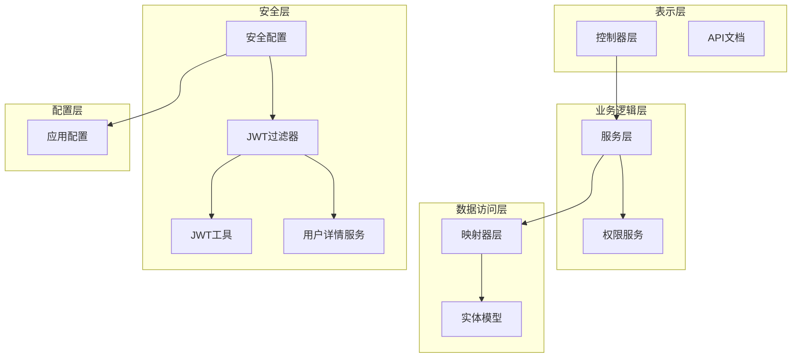
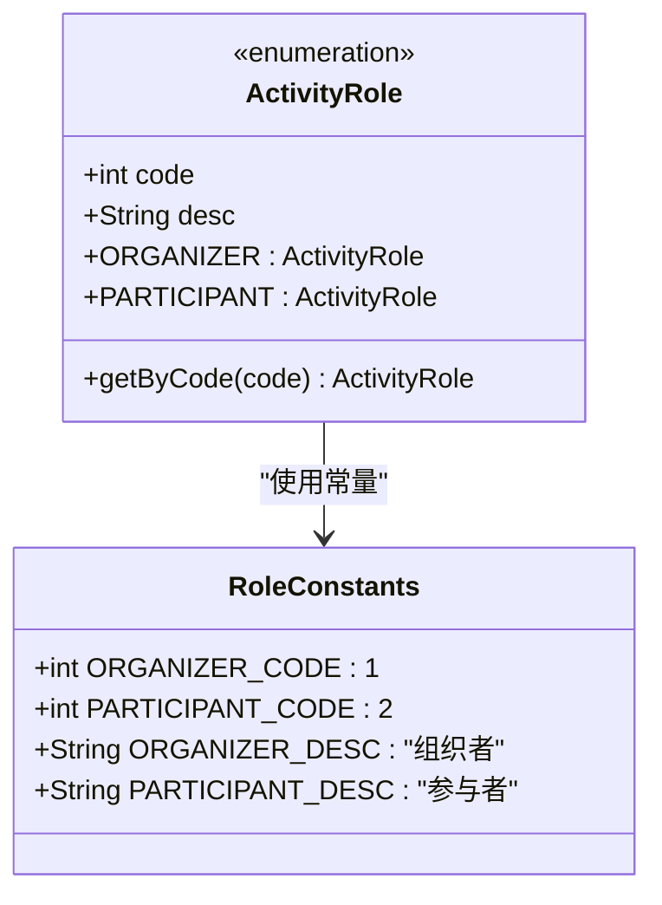
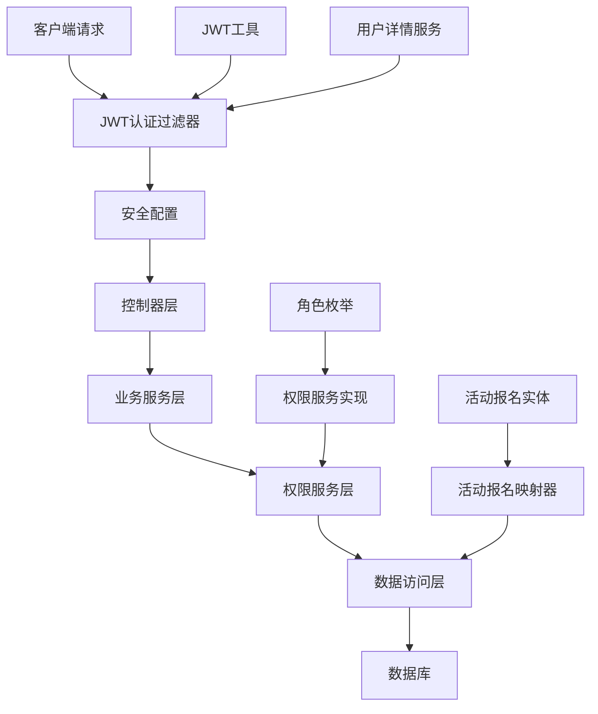
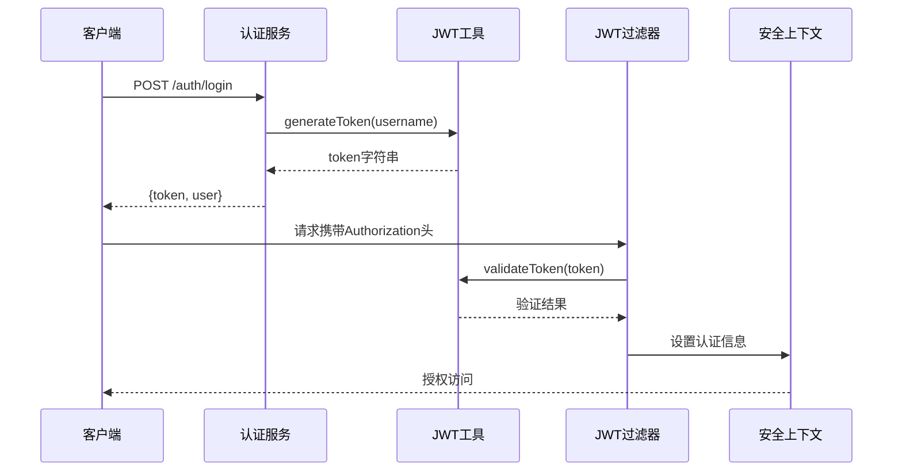
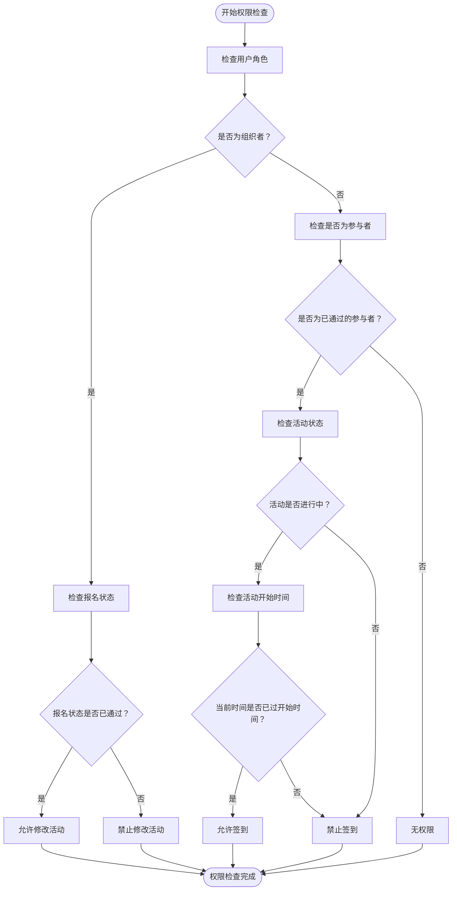
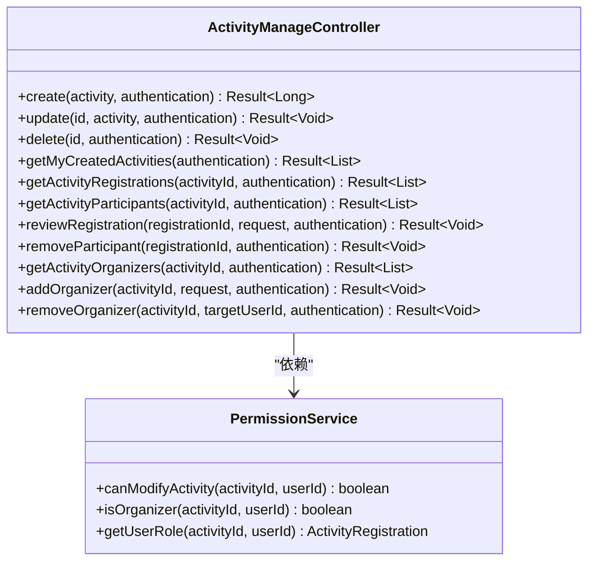
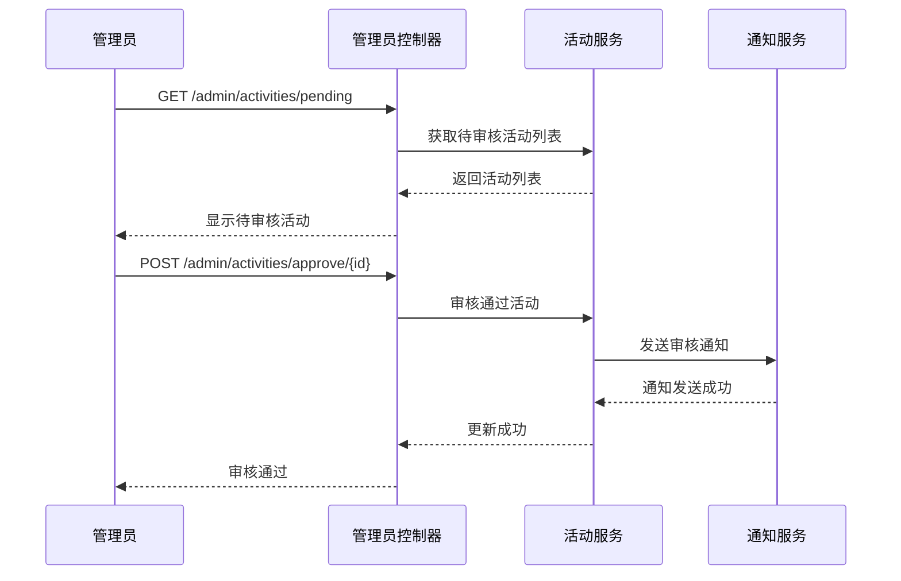
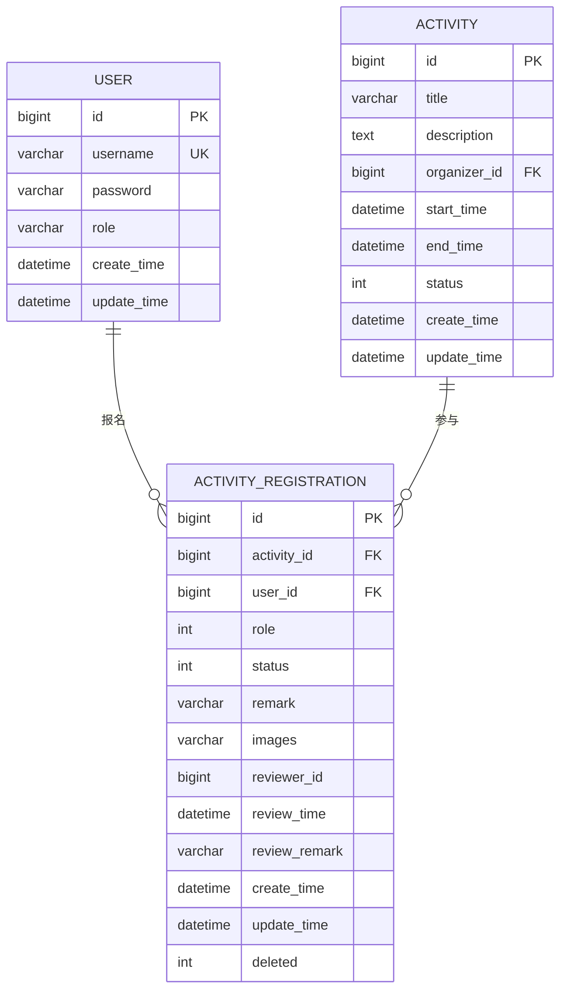
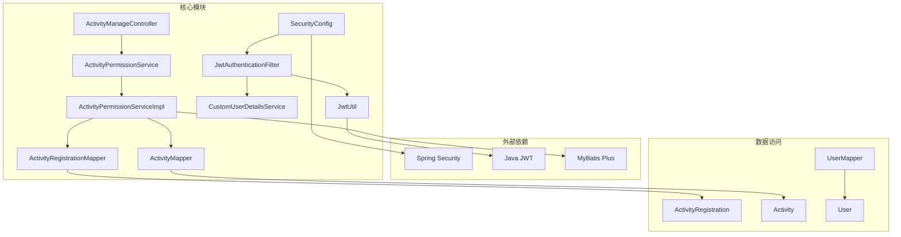

# 活动权限控制系统

<cite>
**本文档引用的文件**
- [ActivityRole.java](file://src/main/java/com/campus/eventsys/enums/ActivityRole.java)
- [ActivityPermissionService.java](file://src/main/java/com/campus/eventsys/service/ActivityPermissionService.java)
- [ActivityPermissionServiceImpl.java](file://src/main/java/com/campus/eventsys/service/impl/ActivityPermissionServiceImpl.java)
- [ActivityRegistration.java](file://src/main/java/com/campus/eventsys/entity/ActivityRegistration.java)
- [ActivityRegistrationMapper.java](file://src/main/java/com/campus/eventsys/mapper/ActivityRegistrationMapper.java)
- [ActivityManageController.java](file://src/main/java/com/campus/eventsys/controller/ActivityManageController.java)
- [AdminActivityController.java](file://src/main/java/com/campus/eventsys/controller/AdminActivityController.java)
- [ActivityController.java](file://src/main/java/com/campus/eventsys/controller/ActivityController.java)
- [JwtUtil.java](file://src/main/java/com/campus/eventsys/security/JwtUtil.java)
- [JwtAuthenticationFilter.java](file://src/main/java/com/campus/eventsys/security/JwtAuthenticationFilter.java)
- [CustomUserDetailsService.java](file://src/main/java/com/campus/eventsys/security/CustomUserDetailsService.java)
- [SecurityConfig.java](file://src/main/java/com/campus/eventsys/config/SecurityConfig.java)
- [application.yml](file://src/main/resources/application.yml)
</cite>

## 目录
1. [简介](#简介)
2. [项目结构](#项目结构)
3. [核心组件](#核心组件)
4. [架构概览](#架构概览)
5. [详细组件分析](#详细组件分析)
6. [依赖关系分析](#依赖关系分析)
7. [性能考虑](#性能考虑)
8. [故障排除指南](#故障排除指南)
9. [结论](#结论)

## 简介

活动权限控制系统是校园活动管理系统中的核心安全模块，负责管理不同用户角色对活动的各种操作权限。该系统实现了基于JWT令牌的身份认证和基于角色的访问控制机制，确保活动数据的安全性和操作的合规性。

系统支持三种主要用户角色：
- **普通用户**：可以参与活动、查看活动信息、进行活动报名
- **活动组织者**：拥有活动的完全管理权限，包括创建、修改、删除活动等
- **管理员**：拥有系统的最高权限，可以审核活动、管理所有活动

## 项目结构

活动权限控制系统采用分层架构设计，主要包含以下层次：



**图表来源**
- [SecurityConfig.java:35-71](file://src/main/java/com/campus/eventsys/config/SecurityConfig.java#L35-L71)
- [JwtAuthenticationFilter.java:26-48](file://src/main/java/com/campus/eventsys/security/JwtAuthenticationFilter.java#L26-L48)

**章节来源**
- [SecurityConfig.java:1-100](file://src/main/java/com/campus/eventsys/config/SecurityConfig.java#L1-L100)
- [application.yml:1-76](file://src/main/resources/application.yml#L1-L76)

## 核心组件

### 角色枚举定义

系统定义了活动参与者角色枚举，用于标识用户在活动中的身份和权限级别：



**图表来源**
- [ActivityRole.java:9-37](file://src/main/java/com/campus/eventsys/enums/ActivityRole.java#L9-L37)

系统支持两种基本角色：
- **组织者（代码1）**：活动的创建者和管理者，拥有最高权限
- **参与者（代码2）**：普通的活动参与者，具有有限的操作权限

**章节来源**
- [ActivityRole.java:1-38](file://src/main/java/com/campus/eventsys/enums/ActivityRole.java#L1-L38)

### 权限服务接口

权限服务接口定义了活动权限检查的核心方法：

```mermaid
interface ActivityPermissionService {
+boolean isOrganizer(activityId, userId) boolean
+boolean isParticipant(activityId, userId) boolean
+boolean canModifyActivity(activityId, userId) boolean
+boolean canCheckIn(activityId, userId) boolean
+ActivityRegistration getUserRole(activityId, userId) ActivityRegistration
+boolean setUserAsOrganizer(activityId, userId) boolean
+boolean addParticipant(activityId, userId, role) boolean
+boolean addParticipantWithImages(activityId, userId, role, remark, images) boolean
+boolean addOrganizer(activityId, userId, operatorId) boolean
+boolean removeOrganizer(activityId, userId, operatorId) boolean
+List~ActivityRegistration~ getActivityOrganizers(activityId) List
}
```

**图表来源**
- [ActivityPermissionService.java:13-123](file://src/main/java/com/campus/eventsys/service/ActivityPermissionService.java#L13-L123)

**章节来源**
- [ActivityPermissionService.java:1-124](file://src/main/java/com/campus/eventsys/service/ActivityPermissionService.java#L1-L124)

## 架构概览

活动权限控制系统的整体架构采用分层设计，确保了职责分离和代码的可维护性：



**图表来源**
- [SecurityConfig.java:36-70](file://src/main/java/com/campus/eventsys/config/SecurityConfig.java#L36-L70)
- [JwtAuthenticationFilter.java:23-42](file://src/main/java/com/campus/eventsys/security/JwtAuthenticationFilter.java#L23-L42)

系统的核心特点：
1. **无状态认证**：使用JWT令牌实现无状态的用户认证
2. **细粒度权限控制**：基于角色和活动状态的多维度权限检查
3. **事务一致性**：关键操作使用事务保证数据一致性
4. **逻辑删除**：支持软删除，保护历史数据完整性

## 详细组件分析

### JWT认证机制

JWT（JSON Web Token）认证是系统安全机制的核心组件：



**图表来源**
- [JwtUtil.java:25-44](file://src/main/java/com/campus/eventsys/security/JwtUtil.java#L25-L44)
- [JwtAuthenticationFilter.java:33-42](file://src/main/java/com/campus/eventsys/security/JwtAuthenticationFilter.java#L33-L42)

JWT令牌包含以下关键信息：
- **头部（Header）**：算法和令牌类型信息
- **载荷（Payload）**：用户身份信息和权限声明
- **签名（Signature）**：用于验证令牌完整性的签名

**章节来源**
- [JwtUtil.java:1-71](file://src/main/java/com/campus/eventsys/security/JwtUtil.java#L1-L71)
- [JwtAuthenticationFilter.java:1-58](file://src/main/java/com/campus/eventsys/security/JwtAuthenticationFilter.java#L1-L58)

### 权限检查流程

权限检查是系统中最复杂的业务逻辑，涉及多个条件的综合判断：



**图表来源**
- [ActivityPermissionServiceImpl.java:51-82](file://src/main/java/com/campus/eventsys/service/impl/ActivityPermissionServiceImpl.java#L51-L82)

**章节来源**
- [ActivityPermissionServiceImpl.java:31-82](file://src/main/java/com/campus/eventsys/service/impl/ActivityPermissionServiceImpl.java#L31-L82)

### 活动管理控制器

活动管理控制器提供了组织者对活动的各种管理操作：



**图表来源**
- [ActivityManageController.java:93-183](file://src/main/java/com/campus/eventsys/controller/ActivityManageController.java#L93-L183)
- [ActivityManageController.java:188-253](file://src/main/java/com/campus/eventsys/controller/ActivityManageController.java#L188-L253)

**章节来源**
- [ActivityManageController.java:1-882](file://src/main/java/com/campus/eventsys/controller/ActivityManageController.java#L1-L882)

### 管理员权限控制

管理员拥有系统的最高权限，可以对所有活动进行管理：



**图表来源**
- [AdminActivityController.java:178-201](file://src/main/java/com/campus/eventsys/controller/AdminActivityController.java#L178-L201)

**章节来源**
- [AdminActivityController.java:1-485](file://src/main/java/com/campus/eventsys/controller/AdminActivityController.java#L1-L485)

### 数据模型设计

系统使用活动报名表来记录用户与活动的关系：



**图表来源**
- [ActivityRegistration.java:16-61](file://src/main/java/com/campus/eventsys/entity/ActivityRegistration.java#L16-L61)

**章节来源**
- [ActivityRegistration.java:1-62](file://src/main/java/com/campus/eventsys/entity/ActivityRegistration.java#L1-L62)

## 依赖关系分析

系统各组件之间的依赖关系体现了清晰的分层架构：



**图表来源**
- [SecurityConfig.java:32-33](file://src/main/java/com/campus/eventsys/config/SecurityConfig.java#L32-L33)
- [JwtAuthenticationFilter.java:23-24](file://src/main/java/com/campus/eventsys/security/JwtAuthenticationFilter.java#L23-L24)

**章节来源**
- [SecurityConfig.java:1-100](file://src/main/java/com/campus/eventsys/config/SecurityConfig.java#L1-L100)
- [JwtAuthenticationFilter.java:1-58](file://src/main/java/com/campus/eventsys/security/JwtAuthenticationFilter.java#L1-L58)

## 性能考虑

系统在设计时充分考虑了性能优化：

### 缓存策略
- **JWT令牌缓存**：避免重复解析和验证JWT令牌
- **用户权限缓存**：缓存用户的活动权限信息
- **活动状态缓存**：缓存活动的实时状态信息

### 数据库优化
- **索引优化**：在活动ID和用户ID上建立复合索引
- **查询优化**：使用条件查询减少不必要的数据加载
- **批量操作**：支持批量权限检查和批量更新

### 并发控制
- **事务隔离**：使用适当的事务隔离级别防止并发冲突
- **乐观锁**：对关键数据使用版本号控制并发更新
- **连接池**：合理配置数据库连接池参数

## 故障排除指南

### 常见问题及解决方案

**JWT令牌验证失败**
- 检查JWT密钥配置是否正确
- 验证令牌是否过期
- 确认请求头格式是否符合"Bearer "前缀要求

**权限检查异常**
- 验证用户是否已登录
- 检查活动是否存在且未被删除
- 确认用户的报名状态是否有效

**数据库操作失败**
- 检查数据库连接配置
- 验证表结构是否正确
- 查看事务是否正确提交

**章节来源**
- [JwtUtil.java:46-69](file://src/main/java/com/campus/eventsys/security/JwtUtil.java#L46-L69)
- [ActivityPermissionServiceImpl.java:114-118](file://src/main/java/com/campus/eventsys/service/impl/ActivityPermissionServiceImpl.java#L114-L118)

### 调试建议

1. **启用详细日志**：在application.yml中调整日志级别
2. **监控性能指标**：关注JWT验证和权限检查的响应时间
3. **测试边界条件**：验证各种异常情况的处理逻辑
4. **压力测试**：模拟高并发场景下的系统表现

## 结论

活动权限控制系统通过精心设计的架构和完善的权限控制机制，为校园活动管理提供了安全可靠的支撑。系统的主要优势包括：

1. **清晰的权限层次**：明确的角色定义和权限边界
2. **灵活的扩展性**：模块化的架构便于功能扩展
3. **良好的安全性**：基于JWT的无状态认证机制
4. **完善的错误处理**：全面的异常处理和日志记录

该系统为类似的企业级权限管理提供了优秀的参考模板，其设计理念和实现方式值得在其他项目中借鉴和应用。