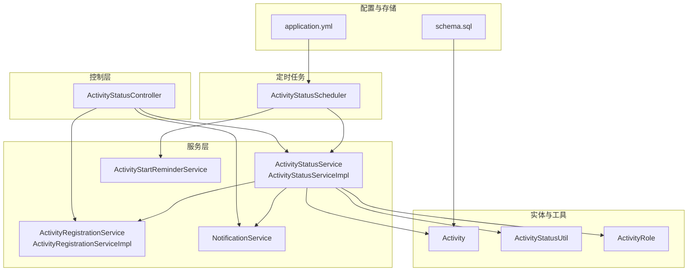
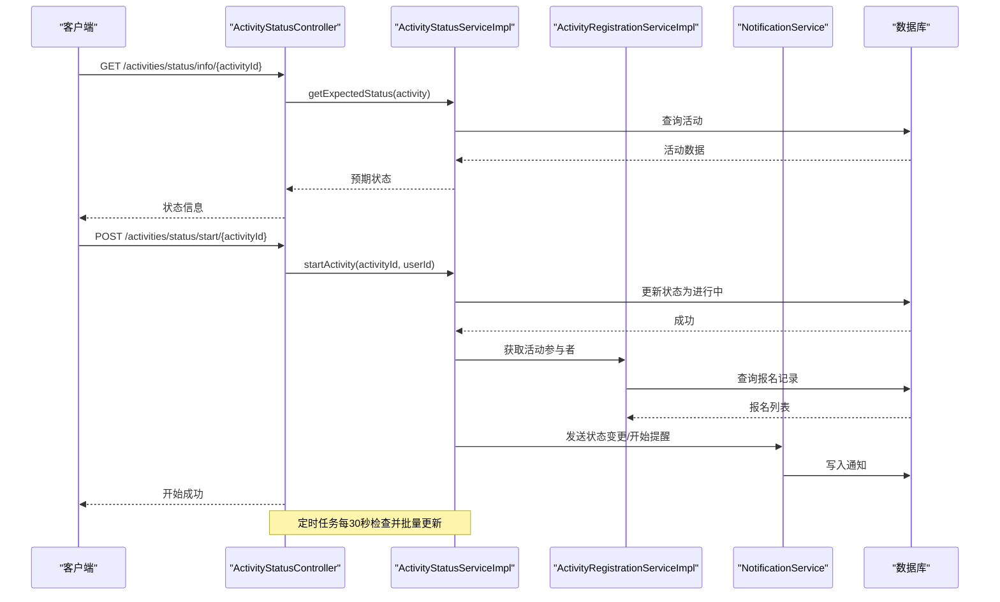
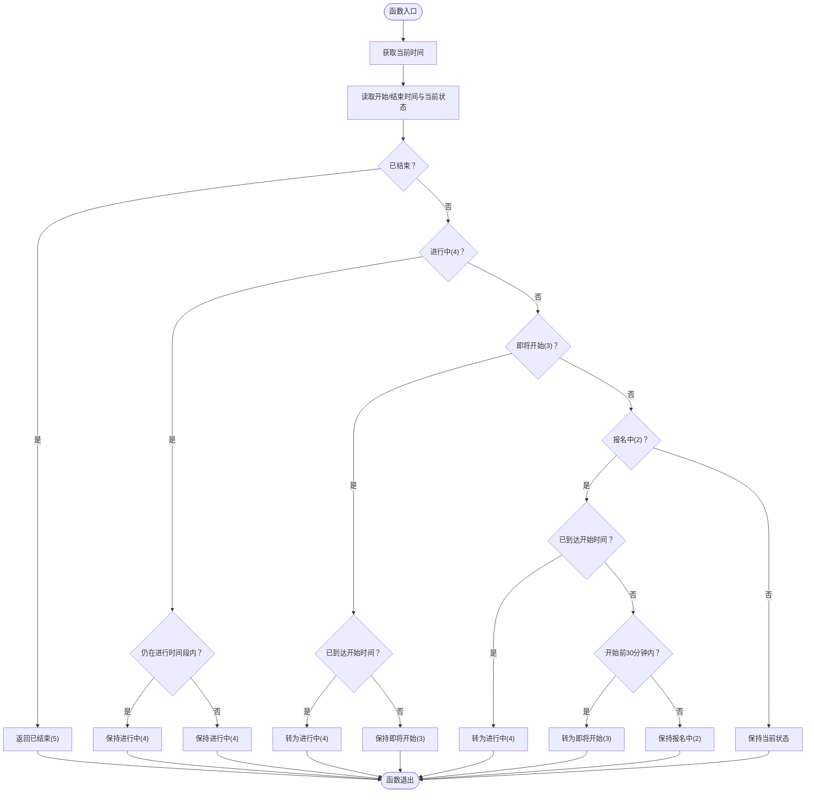
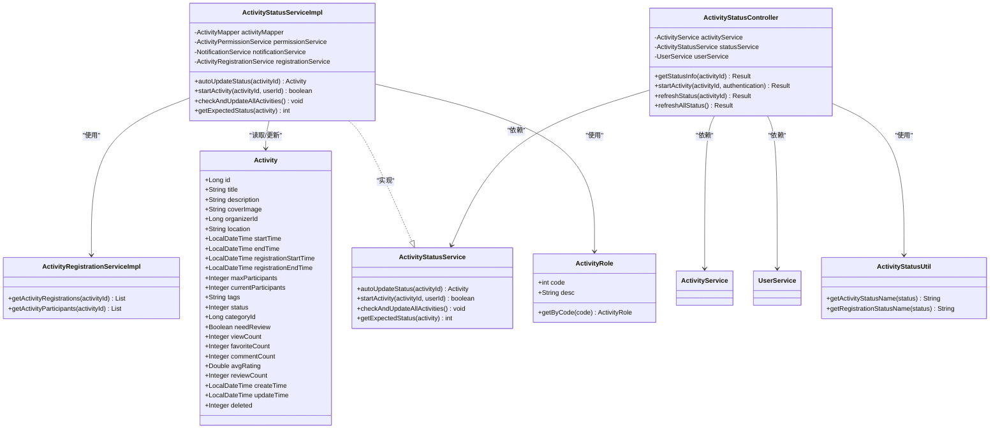
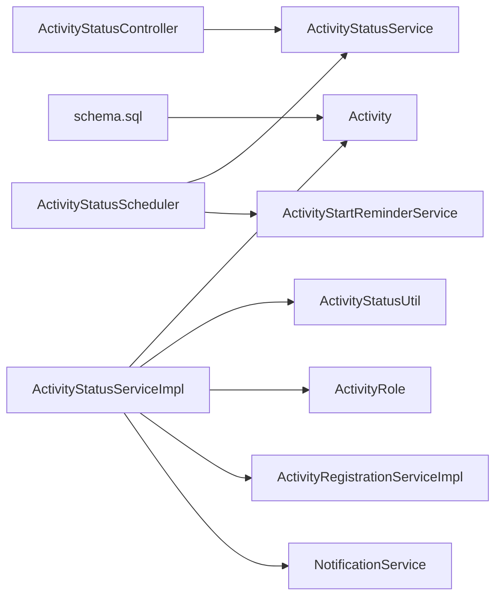
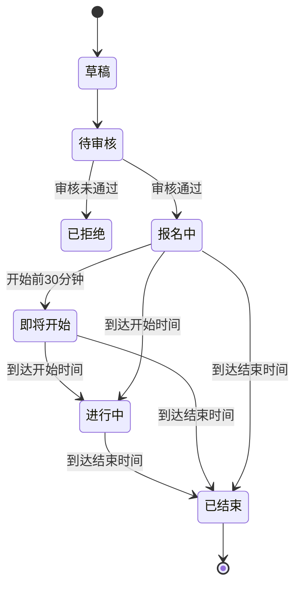

# 活动生命周期管理

<cite>
**本文引用的文件**
- [Activity.java](file://src/main/java/com/campus/eventsys/entity/Activity.java)
- [ActivityStatusUtil.java](file://src/main/java/com/campus/eventsys/utils/ActivityStatusUtil.java)
- [ActivityStatusService.java](file://src/main/java/com/campus/eventsys/service/ActivityStatusService.java)
- [ActivityStatusServiceImpl.java](file://src/main/java/com/campus/eventsys/service/impl/ActivityStatusServiceImpl.java)
- [ActivityStatusController.java](file://src/main/java/com/campus/eventsys/controller/ActivityStatusController.java)
- [ActivityStatusScheduler.java](file://src/main/java/com/campus/eventsys/scheduler/ActivityStatusScheduler.java)
- [ActivityRegistrationServiceImpl.java](file://src/main/java/com/campus/eventsys/service/impl/ActivityRegistrationServiceImpl.java)
- [ActivityRole.java](file://src/main/java/com/campus/eventsys/enums/ActivityRole.java)
- [application.yml](file://src/main/resources/application.yml)
- [schema.sql](file://src/main/resources/db/schema.sql)
- [ActivityStatusControllerTest.java](file://src/test/java/com/campus/eventsys/controller/ActivityStatusControllerTest.java)
</cite>

## 目录
1. [简介](#简介)
2. [项目结构](#项目结构)
3. [核心组件](#核心组件)
4. [架构总览](#架构总览)
5. [详细组件分析](#详细组件分析)
6. [依赖关系分析](#依赖关系分析)
7. [性能考量](#性能考量)
8. [故障排查指南](#故障排查指南)
9. [结论](#结论)
10. [附录](#附录)

## 简介
本文件面向开发者，系统性阐述活动生命周期管理的完整机制，覆盖从创建到结束的全过程状态流转，包括草稿、待审核、报名中、即将开始、进行中、已结束等状态及其转换条件、触发时机与业务规则。文档还解析状态管理工具类的实现原理与状态计算逻辑，并提供状态转换的API接口说明与使用示例，帮助快速理解与集成。

## 项目结构
活动生命周期管理主要由以下层次构成：
- 实体层：活动实体定义了状态字段及时间维度
- 控制层：对外暴露状态查询、手动开始、刷新状态等REST接口
- 服务层：负责状态计算、自动更新、手动开始、批量刷新与通知发送
- 定时任务：周期性检查并更新所有活动状态
- 工具与枚举：状态名称映射与角色枚举
- 配置与数据库：应用配置与数据库初始化脚本

图表来源
- [ActivityStatusController.java:56-236](file://src/main/java/com/campus/eventsys/controller/ActivityStatusController.java#L56-L236)
- [ActivityStatusServiceImpl.java:25-278](file://src/main/java/com/campus/eventsys/service/impl/ActivityStatusServiceImpl.java#L25-L278)
- [ActivityRegistrationServiceImpl.java:23-200](file://src/main/java/com/campus/eventsys/service/impl/ActivityRegistrationServiceImpl.java#L23-L200)
- [ActivityStatusScheduler.java:14-42](file://src/main/java/com/campus/eventsys/scheduler/ActivityStatusScheduler.java#L14-L42)
- [Activity.java:15-95](file://src/main/java/com/campus/eventsys/entity/Activity.java#L15-L95)
- [ActivityStatusUtil.java:7-46](file://src/main/java/com/campus/eventsys/utils/ActivityStatusUtil.java#L7-L46)
- [ActivityRole.java:8-38](file://src/main/java/com/campus/eventsys/enums/ActivityRole.java#L8-L38)
- [application.yml:1-76](file://src/main/resources/application.yml#L1-L76)
- [schema.sql:47-77](file://src/main/resources/db/schema.sql#L47-L77)

章节来源
- [ActivityStatusController.java:56-236](file://src/main/java/com/campus/eventsys/controller/ActivityStatusController.java#L56-L236)
- [ActivityStatusServiceImpl.java:25-278](file://src/main/java/com/campus/eventsys/service/impl/ActivityStatusServiceImpl.java#L25-L278)
- [ActivityStatusScheduler.java:14-42](file://src/main/java/com/campus/eventsys/scheduler/ActivityStatusScheduler.java#L14-L42)
- [Activity.java:15-95](file://src/main/java/com/campus/eventsys/entity/Activity.java#L15-L95)
- [ActivityStatusUtil.java:7-46](file://src/main/java/com/campus/eventsys/utils/ActivityStatusUtil.java#L7-L46)
- [ActivityRole.java:8-38](file://src/main/java/com/campus/eventsys/enums/ActivityRole.java#L8-L38)
- [application.yml:1-76](file://src/main/resources/application.yml#L1-L76)
- [schema.sql:47-77](file://src/main/resources/db/schema.sql#L47-L77)

## 核心组件
- 活动实体：包含状态字段与时间维度（开始/结束/报名开始/报名结束），用于状态计算与展示
- 状态服务接口与实现：封装状态计算、自动更新、手动开始、批量刷新与通知发送
- 状态控制器：对外提供状态查询、手动开始、刷新状态与批量刷新接口
- 定时调度器：周期性检查并更新所有活动状态
- 工具类：状态名称映射
- 角色枚举：区分组织者与参与者，影响通知内容与权限

章节来源
- [Activity.java:15-95](file://src/main/java/com/campus/eventsys/entity/Activity.java#L15-L95)
- [ActivityStatusService.java:9-43](file://src/main/java/com/campus/eventsys/service/ActivityStatusService.java#L9-L43)
- [ActivityStatusServiceImpl.java:25-278](file://src/main/java/com/campus/eventsys/service/impl/ActivityStatusServiceImpl.java#L25-L278)
- [ActivityStatusController.java:56-236](file://src/main/java/com/campus/eventsys/controller/ActivityStatusController.java#L56-L236)
- [ActivityStatusScheduler.java:14-42](file://src/main/java/com/campus/eventsys/scheduler/ActivityStatusScheduler.java#L14-L42)
- [ActivityStatusUtil.java:7-46](file://src/main/java/com/campus/eventsys/utils/ActivityStatusUtil.java#L7-L46)
- [ActivityRole.java:8-38](file://src/main/java/com/campus/eventsys/enums/ActivityRole.java#L8-L38)

## 架构总览
活动生命周期管理采用“控制器-服务-实体-定时任务”的分层架构，结合数据库中的时间字段驱动状态自动流转，配合通知服务向参与者推送状态变更与提醒。

图表来源
- [ActivityStatusController.java:68-185](file://src/main/java/com/campus/eventsys/controller/ActivityStatusController.java#L68-L185)
- [ActivityStatusServiceImpl.java:35-125](file://src/main/java/com/campus/eventsys/service/impl/ActivityStatusServiceImpl.java#L35-L125)
- [ActivityRegistrationServiceImpl.java:55-63](file://src/main/java/com/campus/eventsys/service/impl/ActivityRegistrationServiceImpl.java#L55-L63)
- [ActivityStatusScheduler.java:31-40](file://src/main/java/com/campus/eventsys/scheduler/ActivityStatusScheduler.java#L31-L40)

## 详细组件分析

### 状态定义与业务规则
- 状态码与含义
  - -2：已下架（管理员强制下架）
  - -1：已拒绝（审核未通过）
  - 0：草稿（预留）
  - 1：待审核（创建后默认状态）
  - 2：报名中（审核通过，未到开始时间）
  - 3：即将开始（开始前30分钟内）
  - 4：进行中（已开始但未结束）
  - 5：已结束（超过结束时间）

- 自动状态流转规则
  - 开始前30分钟：2(报名中) → 3(即将开始)
  - 到达开始时间：2/3 → 4(进行中)
  - 到达结束时间：2/3/4 → 5(已结束)
  - 已结束状态不可回退

- 手动开始规则
  - 仅组织者或管理员可操作
  - 仅当活动处于报名中(2)或即将开始(3)时允许手动开始
  - 手动开始会将状态置为进行中(4)，并更新开始时间为当前时间

- 通知策略
  - 即将开始(3)与已结束(5)：向已通过审核的参与者发送状态变更通知
  - 即将开始(3)：向组织者与普通参与者分别发送不同内容的提醒
  - 进行中(4)：向已通过或已签到的参与者发送“活动已开始”提醒（去重）

章节来源
- [ActivityStatusController.java:27-55](file://src/main/java/com/campus/eventsys/controller/ActivityStatusController.java#L27-L55)
- [ActivityStatusServiceImpl.java:127-184](file://src/main/java/com/campus/eventsys/service/impl/ActivityStatusServiceImpl.java#L127-L184)
- [ActivityStatusServiceImpl.java:192-259](file://src/main/java/com/campus/eventsys/service/impl/ActivityStatusServiceImpl.java#L192-L259)
- [ActivityStatusUtil.java:11-28](file://src/main/java/com/campus/eventsys/utils/ActivityStatusUtil.java#L11-L28)

### 状态计算逻辑
状态计算基于当前时间与活动的时间维度，遵循“不可回退”的原则：
- 若当前状态已是已结束(5)，直接返回
- 若当前时间已超过结束时间，则进入已结束(5)
- 若当前状态为进行中(4)，仅在时间段内保持进行中；若已结束则保持进行中（不回退）
- 若当前状态为即将开始(3)，若已到达开始时间则转为进行中(4)，否则保持
- 若当前状态为报名中(2)，若已到达开始时间则转为进行中(4)，否则若在开始前30分钟内则转为即将开始(3)，否则保持

图表来源
- [ActivityStatusServiceImpl.java:127-184](file://src/main/java/com/campus/eventsys/service/impl/ActivityStatusServiceImpl.java#L127-L184)

章节来源
- [ActivityStatusServiceImpl.java:127-184](file://src/main/java/com/campus/eventsys/service/impl/ActivityStatusServiceImpl.java#L127-L184)

### 状态管理工具类
- ActivityStatusUtil：提供活动状态与报名状态的中文名称映射，便于前端展示与日志输出
- 使用场景：控制器返回状态信息时，将状态码转换为中文名称

章节来源
- [ActivityStatusUtil.java:11-44](file://src/main/java/com/campus/eventsys/utils/ActivityStatusUtil.java#L11-L44)
- [ActivityStatusController.java:208-210](file://src/main/java/com/campus/eventsys/controller/ActivityStatusController.java#L208-L210)

### API接口说明
- 获取活动状态信息
  - 方法：GET /activities/status/info/{activityId}
  - 返回：当前状态码/名称、预期状态码/名称、开始/结束时间、是否需要更新
  - 用途：前端轮询或手动刷新前的预检

- 手动开始活动
  - 方法：POST /activities/status/start/{activityId}
  - 权限：组织者或管理员
  - 规则：仅当状态为报名中(2)或即将开始(3)时允许
  - 结果：状态置为进行中(4)，并更新开始时间为当前时间

- 刷新活动状态
  - 方法：GET /activities/status/refresh/{activityId}
  - 行为：按当前时间自动更新状态并返回最新状态信息
  - 用途：当控制器检测到 needUpdate=true 时调用

- 批量刷新状态
  - 方法：POST /activities/status/refresh-all
  - 权限：管理员
  - 行为：检查并更新所有已通过审核且未结束的活动状态
  - 用途：定时任务或管理员手动触发

章节来源
- [ActivityStatusController.java:68-185](file://src/main/java/com/campus/eventsys/controller/ActivityStatusController.java#L68-L185)

### 定时任务与通知
- 定时任务
  - 每30秒执行一次，检查并批量更新所有活动状态
  - 同时发送日历日提醒（活动开始前3天与1天）

- 通知策略
  - 即将开始(3)/已结束(5)：向已通过审核的参与者发送状态变更通知
  - 即将开始(3)：组织者与普通参与者收到不同内容的提醒
  - 进行中(4)：向已通过或已签到的参与者发送“活动已开始”提醒（去重）

章节来源
- [ActivityStatusScheduler.java:31-40](file://src/main/java/com/campus/eventsys/scheduler/ActivityStatusScheduler.java#L31-L40)
- [ActivityStatusServiceImpl.java:192-259](file://src/main/java/com/campus/eventsys/service/impl/ActivityStatusServiceImpl.java#L192-L259)

### 类关系图

图表来源
- [Activity.java:15-95](file://src/main/java/com/campus/eventsys/entity/Activity.java#L15-L95)
- [ActivityStatusService.java:9-43](file://src/main/java/com/campus/eventsys/service/ActivityStatusService.java#L9-L43)
- [ActivityStatusServiceImpl.java:25-278](file://src/main/java/com/campus/eventsys/service/impl/ActivityStatusServiceImpl.java#L25-L278)
- [ActivityStatusController.java:56-236](file://src/main/java/com/campus/eventsys/controller/ActivityStatusController.java#L56-L236)
- [ActivityRegistrationServiceImpl.java:23-200](file://src/main/java/com/campus/eventsys/service/impl/ActivityRegistrationServiceImpl.java#L23-L200)
- [ActivityStatusUtil.java:7-46](file://src/main/java/com/campus/eventsys/utils/ActivityStatusUtil.java#L7-L46)
- [ActivityRole.java:8-38](file://src/main/java/com/campus/eventsys/enums/ActivityRole.java#L8-L38)

## 依赖关系分析
- 控制器依赖服务接口，服务实现依赖实体与工具类
- 状态服务实现依赖报名服务与通知服务，用于获取参与者与发送通知
- 定时任务依赖状态服务与日历提醒服务
- 数据库脚本定义了状态字段与索引，支撑查询与排序

图表来源
- [ActivityStatusController.java:56-236](file://src/main/java/com/campus/eventsys/controller/ActivityStatusController.java#L56-L236)
- [ActivityStatusServiceImpl.java:25-278](file://src/main/java/com/campus/eventsys/service/impl/ActivityStatusServiceImpl.java#L25-L278)
- [ActivityStatusScheduler.java:14-42](file://src/main/java/com/campus/eventsys/scheduler/ActivityStatusScheduler.java#L14-L42)
- [schema.sql:47-77](file://src/main/resources/db/schema.sql#L47-L77)

章节来源
- [ActivityStatusController.java:56-236](file://src/main/java/com/campus/eventsys/controller/ActivityStatusController.java#L56-L236)
- [ActivityStatusServiceImpl.java:25-278](file://src/main/java/com/campus/eventsys/service/impl/ActivityStatusServiceImpl.java#L25-L278)
- [ActivityStatusScheduler.java:14-42](file://src/main/java/com/campus/eventsys/scheduler/ActivityStatusScheduler.java#L14-L42)
- [schema.sql:47-77](file://src/main/resources/db/schema.sql#L47-L77)

## 性能考量
- 定时任务频率：每30秒执行一次，兼顾实时性与系统负载
- 批量更新策略：仅针对已通过审核且未结束的活动进行筛选，避免全表扫描
- 通知去重：通过通知类型与标题标记进行去重，降低重复推送
- 时间处理：统一使用系统时区配置，避免跨时区误差

[本节为通用性能建议，无需具体文件引用]

## 故障排查指南
- 状态未自动更新
  - 检查定时任务是否正常运行（日志级别与调度注解）
  - 确认活动状态在可自动流转范围内（报名中/即将开始/进行中）
  - 核对当前时间与活动开始/结束时间是否合理

- 手动开始失败
  - 确认当前用户是否为组织者或管理员
  - 确认活动状态是否为报名中(2)或即将开始(3)
  - 查看服务层日志中的权限与状态校验信息

- 通知未送达
  - 检查通知服务是否正常工作
  - 确认报名记录状态为已通过(1)或已签到(3)
  - 核对通知去重逻辑是否误判

- 单元测试参考
  - 提供了状态查询、手动开始、刷新状态与批量刷新的测试用例，可作为集成测试的参考模板

章节来源
- [ActivityStatusControllerTest.java:65-237](file://src/test/java/com/campus/eventsys/controller/ActivityStatusControllerTest.java#L65-L237)
- [ActivityStatusServiceImpl.java:35-125](file://src/main/java/com/campus/eventsys/service/impl/ActivityStatusServiceImpl.java#L35-L125)

## 结论
活动生命周期管理通过明确的状态定义、严谨的自动流转规则与完善的通知机制，实现了从创建到结束的闭环管理。控制器提供清晰的API，服务层封装复杂的业务逻辑，定时任务保障状态的实时性。开发者可据此快速集成与扩展，确保活动状态的准确性与一致性。

[本节为总结性内容，无需具体文件引用]

## 附录

### 状态转换流程图

[本图为概念性流程图，不对应具体源文件，故不提供图表来源]