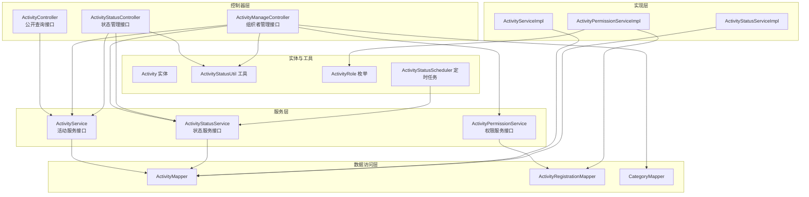
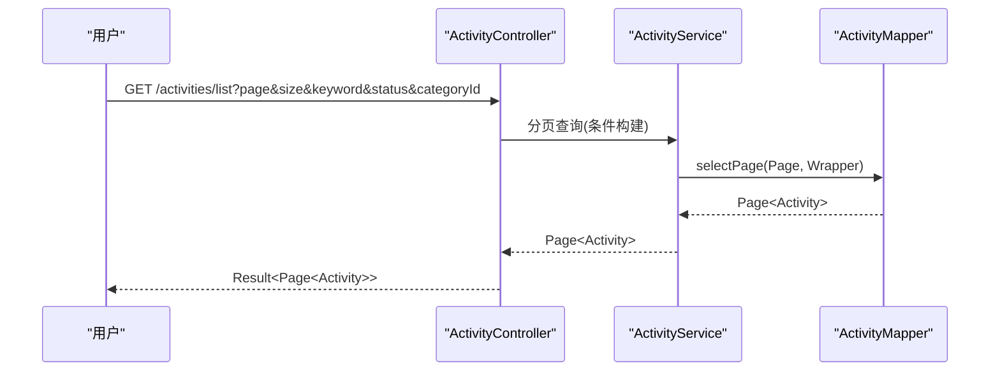
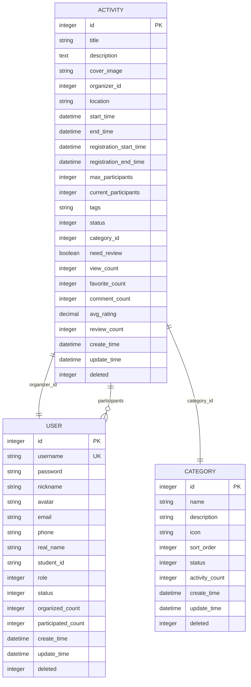
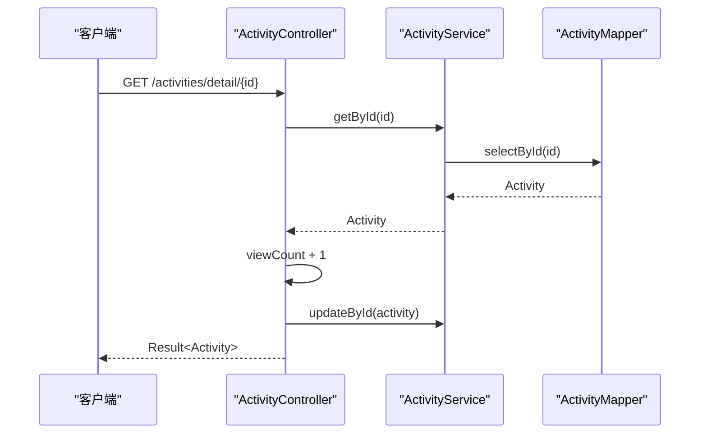
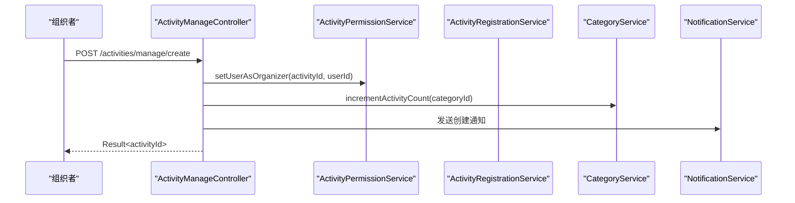
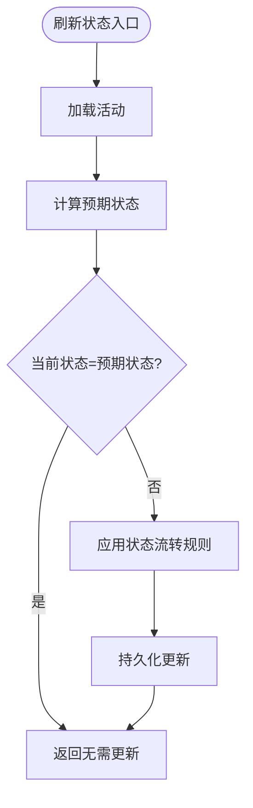
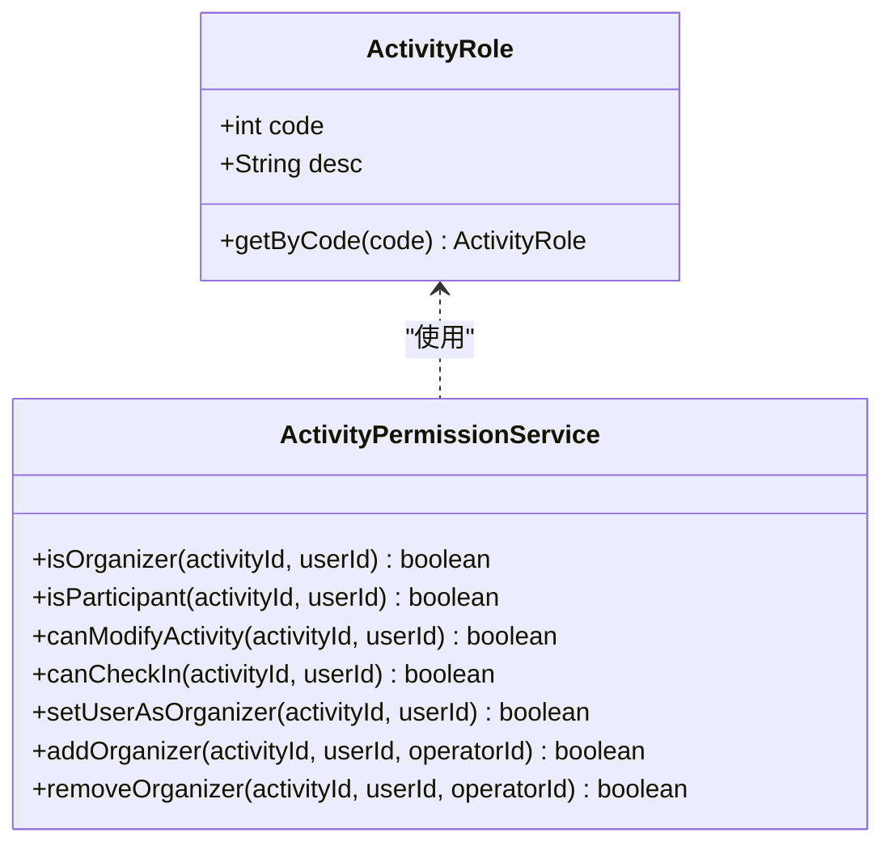
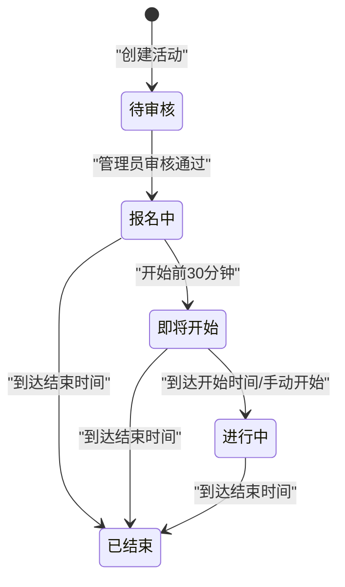
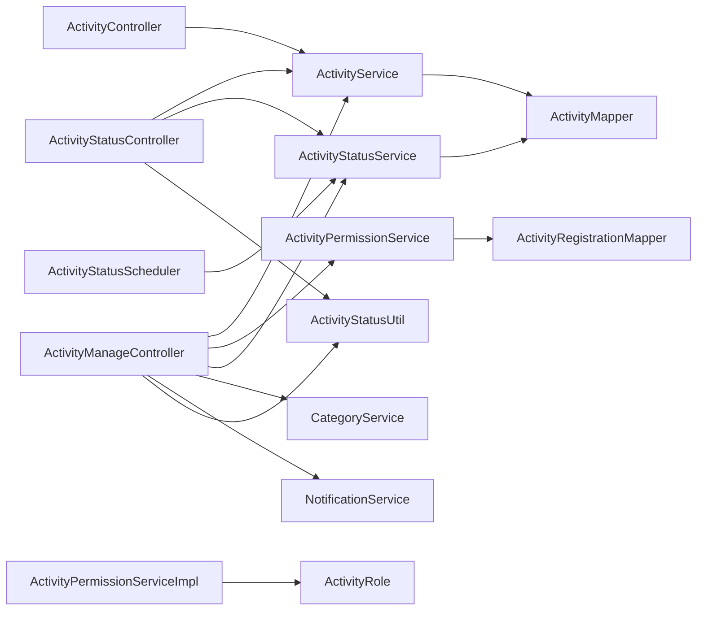

# 活动管理模块

<cite>
**本文档引用的文件**
- [Activity.java](file://src/main/java/com/campus/eventsys/entity/Activity.java)
- [ActivityController.java](file://src/main/java/com/campus/eventsys/controller/ActivityController.java)
- [ActivityManageController.java](file://src/main/java/com/campus/eventsys/controller/ActivityManageController.java)
- [ActivityStatusController.java](file://src/main/java/com/campus/eventsys/controller/ActivityStatusController.java)
- [ActivityServiceImpl.java](file://src/main/java/com/campus/eventsys/service/impl/ActivityServiceImpl.java)
- [ActivityService.java](file://src/main/java/com/campus/eventsys/service/ActivityService.java)
- [ActivityPermissionService.java](file://src/main/java/com/campus/eventsys/service/ActivityPermissionService.java)
- [ActivityPermissionServiceImpl.java](file://src/main/java/com/campus/eventsys/service/impl/ActivityPermissionServiceImpl.java)
- [ActivityStatusService.java](file://src/main/java/com/campus/eventsys/service/ActivityStatusService.java)
- [ActivityStatusUtil.java](file://src/main/java/com/campus/eventsys/utils/ActivityStatusUtil.java)
- [ActivityStatusScheduler.java](file://src/main/java/com/campus/eventsys/scheduler/ActivityStatusScheduler.java)
- [ActivityRole.java](file://src/main/java/com/campus/eventsys/enums/ActivityRole.java)
- [schema.sql](file://src/main/resources/db/schema.sql)
- [application.yml](file://src/main/resources/application.yml)
</cite>

## 目录
1. [简介](#简介)
2. [项目结构](#项目结构)
3. [核心组件](#核心组件)
4. [架构总览](#架构总览)
5. [详细组件分析](#详细组件分析)
6. [依赖关系分析](#依赖关系分析)
7. [性能考虑](#性能考虑)
8. [故障排除指南](#故障排除指南)
9. [结论](#结论)
10. [附录](#附录)

## 简介
本文件为活动管理模块的综合技术文档，覆盖活动的完整生命周期管理，包括创建、编辑、删除、查询、状态管理、审核流程与权限控制策略。文档还涵盖活动分类管理、活动详情展示与搜索过滤、活动数据模型与业务规则、API 接口定义与使用示例，以及扩展建议。

## 项目结构
活动管理模块采用典型的分层架构：
- 控制器层：对外暴露 REST API，负责请求接收、鉴权与响应封装
- 服务层：封装业务逻辑，协调各领域服务与数据访问
- 数据访问层：基于 MyBatis-Plus 的 Mapper 接口与 XML 映射
- 实体与枚举：定义数据模型与状态/角色枚举
- 工具与调度：状态工具类与定时任务调度器
- 配置：数据库初始化、MyBatis-Plus、文件上传、OpenAPI 文档等

**图表来源**
- [ActivityController.java:1-111](file://src/main/java/com/campus/eventsys/controller/ActivityController.java#L1-L111)
- [ActivityManageController.java:1-882](file://src/main/java/com/campus/eventsys/controller/ActivityManageController.java#L1-L882)
- [ActivityStatusController.java:1-236](file://src/main/java/com/campus/eventsys/controller/ActivityStatusController.java#L1-L236)
- [ActivityServiceImpl.java:1-12](file://src/main/java/com/campus/eventsys/service/impl/ActivityServiceImpl.java#L1-L12)
- [ActivityPermissionServiceImpl.java:1-266](file://src/main/java/com/campus/eventsys/service/impl/ActivityPermissionServiceImpl.java#L1-L266)
- [ActivityStatusUtil.java:1-46](file://src/main/java/com/campus/eventsys/utils/ActivityStatusUtil.java#L1-L46)
- [ActivityStatusScheduler.java:1-42](file://src/main/java/com/campus/eventsys/scheduler/ActivityStatusScheduler.java#L1-L42)

**章节来源**
- [ActivityController.java:1-111](file://src/main/java/com/campus/eventsys/controller/ActivityController.java#L1-L111)
- [ActivityManageController.java:1-882](file://src/main/java/com/campus/eventsys/controller/ActivityManageController.java#L1-L882)
- [ActivityStatusController.java:1-236](file://src/main/java/com/campus/eventsys/controller/ActivityStatusController.java#L1-L236)
- [ActivityServiceImpl.java:1-12](file://src/main/java/com/campus/eventsys/service/impl/ActivityServiceImpl.java#L1-L12)
- [ActivityPermissionServiceImpl.java:1-266](file://src/main/java/com/campus/eventsys/service/impl/ActivityPermissionServiceImpl.java#L1-L266)
- [ActivityStatusUtil.java:1-46](file://src/main/java/com/campus/eventsys/utils/ActivityStatusUtil.java#L1-L46)
- [ActivityStatusScheduler.java:1-42](file://src/main/java/com/campus/eventsys/scheduler/ActivityStatusScheduler.java#L1-L42)

## 核心组件
- 活动实体：定义活动的全部属性与字段含义，含状态、时间窗口、统计指标、逻辑删除等
- 公开查询控制器：提供活动列表与详情查询，支持关键词、状态、分类筛选
- 组织者管理控制器：提供活动 CRUD、报名管理、管理者管理、封面上传等
- 状态管理控制器：提供状态查看、手动开始、刷新状态、批量刷新
- 权限服务：校验组织者/参与者身份、签到资格、角色变更
- 状态服务：自动状态流转、手动开始、全量检查
- 状态工具：统一状态名称映射
- 定时任务：周期性检查并更新活动状态

**章节来源**
- [Activity.java:1-95](file://src/main/java/com/campus/eventsys/entity/Activity.java#L1-L95)
- [ActivityController.java:1-111](file://src/main/java/com/campus/eventsys/controller/ActivityController.java#L1-L111)
- [ActivityManageController.java:1-882](file://src/main/java/com/campus/eventsys/controller/ActivityManageController.java#L1-L882)
- [ActivityStatusController.java:1-236](file://src/main/java/com/campus/eventsys/controller/ActivityStatusController.java#L1-L236)
- [ActivityPermissionService.java:1-124](file://src/main/java/com/campus/eventsys/service/ActivityPermissionService.java#L1-L124)
- [ActivityPermissionServiceImpl.java:1-266](file://src/main/java/com/campus/eventsys/service/impl/ActivityPermissionServiceImpl.java#L1-L266)
- [ActivityStatusService.java:1-44](file://src/main/java/com/campus/eventsys/service/ActivityStatusService.java#L1-L44)
- [ActivityStatusUtil.java:1-46](file://src/main/java/com/campus/eventsys/utils/ActivityStatusUtil.java#L1-L46)
- [ActivityStatusScheduler.java:1-42](file://src/main/java/com/campus/eventsys/scheduler/ActivityStatusScheduler.java#L1-L42)

## 架构总览
活动管理模块遵循分层与职责分离原则：
- 控制器层负责 HTTP 请求与响应封装，统一返回 Result 结构
- 服务层封装业务规则与跨域协作，如权限校验、状态流转、统计更新
- 数据访问层通过 MyBatis-Plus 简化 CRUD，结合逻辑删除与索引优化
- 定时任务保障状态一致性，减少人工干预
- 配置文件集中管理数据库、文件上传、OpenAPI 文档与 JWT

**图表来源**
- [ActivityController.java:48-87](file://src/main/java/com/campus/eventsys/controller/ActivityController.java#L48-L87)
- [ActivityServiceImpl.java:1-12](file://src/main/java/com/campus/eventsys/service/impl/ActivityServiceImpl.java#L1-L12)
- [ActivityMapper.java:1-10](file://src/main/java/com/campus/eventsys/mapper/ActivityMapper.java#L1-L10)

**章节来源**
- [ActivityController.java:1-111](file://src/main/java/com/campus/eventsys/controller/ActivityController.java#L1-L111)
- [ActivityServiceImpl.java:1-12](file://src/main/java/com/campus/eventsys/service/impl/ActivityServiceImpl.java#L1-L12)
- [ActivityMapper.java:1-10](file://src/main/java/com/campus/eventsys/mapper/ActivityMapper.java#L1-L10)

## 详细组件分析

### 活动数据模型与业务规则
- 数据模型：活动实体包含标题、描述、封面、组织者、地点、起止时间、报名窗口、最大人数、当前人数、标签、状态、分类、是否需要审核报名、浏览/收藏/评论/评分统计、创建/更新时间、逻辑删除等
- 状态规则：-2 已下架、-1 已拒绝、0 草稿、1 待审核、2 报名中、3 即将开始、4 进行中、5 已结束
- 时间窗口：开始前 30 分钟自动进入“即将开始”，到达开始时间自动进入“进行中”，到达结束时间自动进入“已结束”
- 统计更新：创建/删除活动时同步更新分类活动数与用户统计；报名/退报名时同步更新活动当前人数与用户参与数

**图表来源**
- [Activity.java:1-95](file://src/main/java/com/campus/eventsys/entity/Activity.java#L1-L95)
- [schema.sql:46-77](file://src/main/resources/db/schema.sql#L46-L77)

**章节来源**
- [Activity.java:1-95](file://src/main/java/com/campus/eventsys/entity/Activity.java#L1-L95)
- [schema.sql:46-77](file://src/main/resources/db/schema.sql#L46-L77)

### 公开查询接口（ActivityController）
- 列表查询：支持分页、关键词（标题）、状态、分类筛选；默认仅返回已审核通过（状态 ≥ 2）的活动，按创建时间倒序
- 详情查询：根据 ID 获取活动详情，浏览次数 +1 并持久化

**图表来源**
- [ActivityController.java:93-109](file://src/main/java/com/campus/eventsys/controller/ActivityController.java#L93-L109)
- [ActivityServiceImpl.java:1-12](file://src/main/java/com/campus/eventsys/service/impl/ActivityServiceImpl.java#L1-L12)

**章节来源**
- [ActivityController.java:1-111](file://src/main/java/com/campus/eventsys/controller/ActivityController.java#L1-L111)

### 组织者管理接口（ActivityManageController）
- 创建活动：设置组织者、状态为待审核（1），初始化统计数据，返回活动 ID
- 更新活动：仅组织者可修改，禁止修改组织者 ID
- 删除活动：逻辑删除，清理报名记录、成果贴，更新分类与用户统计
- 我创建的活动：按组织者查询所有状态的活动
- 报名管理：查看报名/参与者列表、审核报名、移除参与者
- 管理者管理：查看管理者、添加/移除管理者，发送通知
- 封面上传：支持 JPG/PNG/GIF，大小限制，返回访问 URL

**图表来源**
- [ActivityManageController.java:78-141](file://src/main/java/com/campus/eventsys/controller/ActivityManageController.java#L78-L141)
- [ActivityPermissionServiceImpl.java:95-118](file://src/main/java/com/campus/eventsys/service/impl/ActivityPermissionServiceImpl.java#L95-L118)
- [schema.sql:32-44](file://src/main/resources/db/schema.sql#L32-L44)

**章节来源**
- [ActivityManageController.java:1-882](file://src/main/java/com/campus/eventsys/controller/ActivityManageController.java#L1-L882)

### 状态管理接口（ActivityStatusController）
- 获取状态：返回当前状态与预期状态、是否需要刷新、开始/结束时间
- 手动开始：组织者/管理员将状态从“报名中”或“即将开始”转为“进行中”
- 刷新状态：按时间自动更新状态并返回最新信息
- 批量刷新：管理员触发全量状态检查与更新

**图表来源**
- [ActivityStatusController.java:151-185](file://src/main/java/com/campus/eventsys/controller/ActivityStatusController.java#L151-L185)
- [ActivityStatusUtil.java:11-28](file://src/main/java/com/campus/eventsys/utils/ActivityStatusUtil.java#L11-L28)

**章节来源**
- [ActivityStatusController.java:1-236](file://src/main/java/com/campus/eventsys/controller/ActivityStatusController.java#L1-L236)
- [ActivityStatusUtil.java:1-46](file://src/main/java/com/campus/eventsys/utils/ActivityStatusUtil.java#L1-L46)

### 权限控制策略
- 角色枚举：组织者（1）、参与者（2）
- 权限判定：
  - 组织者：可修改活动、查看/管理报名、添加/移除管理者
  - 参与者：可报名、签到（满足状态与时间条件）
  - 签到条件：已通过报名、活动状态为进行中、当前时间 ≥ 开始时间
- 管理者变更：组织者可将参与者提升为组织者或添加新管理者；不可移除自己

**图表来源**
- [ActivityRole.java:1-38](file://src/main/java/com/campus/eventsys/enums/ActivityRole.java#L1-L38)
- [ActivityPermissionService.java:1-124](file://src/main/java/com/campus/eventsys/service/ActivityPermissionService.java#L1-L124)

**章节来源**
- [ActivityRole.java:1-38](file://src/main/java/com/campus/eventsys/enums/ActivityRole.java#L1-L38)
- [ActivityPermissionService.java:1-124](file://src/main/java/com/campus/eventsys/service/ActivityPermissionService.java#L1-L124)
- [ActivityPermissionServiceImpl.java:1-266](file://src/main/java/com/campus/eventsys/service/impl/ActivityPermissionServiceImpl.java#L1-L266)

### 审核流程与状态流转
- 审核流程：创建活动 → 状态 1（待审核）→ 管理员审核 → 状态 2（报名中）
- 自动状态流转：
  - 开始前 30 分钟：2 → 3
  - 到达开始时间：2/3 → 4
  - 到达结束时间：2/3/4 → 5
- 手动开始：组织者/管理员在报名中或即将开始状态下手动启动
- 定时任务：每 30 秒检查并更新所有活动状态，确保一致性

**图表来源**
- [ActivityStatusController.java:27-41](file://src/main/java/com/campus/eventsys/controller/ActivityStatusController.java#L27-L41)
- [ActivityStatusScheduler.java:22-40](file://src/main/java/com/campus/eventsys/scheduler/ActivityStatusScheduler.java#L22-L40)

**章节来源**
- [ActivityStatusController.java:1-236](file://src/main/java/com/campus/eventsys/controller/ActivityStatusController.java#L1-L236)
- [ActivityStatusScheduler.java:1-42](file://src/main/java/com/campus/eventsys/scheduler/ActivityStatusScheduler.java#L1-L42)

### 搜索过滤与分类管理
- 搜索过滤：关键词（标题）、状态（2/3/4/5）、分类 ID；默认仅返回已审核通过的活动
- 分类管理：创建/更新分类时维护 activity_count 字段；删除活动时同步递减

**章节来源**
- [ActivityController.java:48-87](file://src/main/java/com/campus/eventsys/controller/ActivityController.java#L48-L87)
- [schema.sql:32-44](file://src/main/resources/db/schema.sql#L32-L44)

## 依赖关系分析
- 控制器依赖服务接口，服务实现依赖 Mapper 与工具类
- 权限服务依赖报名记录与活动表以判定角色与状态
- 状态服务依赖活动表与工具类进行状态计算
- 定时任务依赖状态服务进行全量检查
- 配置文件影响 MyBatis-Plus 主键生成策略、逻辑删除与文件上传大小

**图表来源**
- [ActivityController.java:1-111](file://src/main/java/com/campus/eventsys/controller/ActivityController.java#L1-L111)
- [ActivityManageController.java:1-882](file://src/main/java/com/campus/eventsys/controller/ActivityManageController.java#L1-L882)
- [ActivityStatusController.java:1-236](file://src/main/java/com/campus/eventsys/controller/ActivityStatusController.java#L1-L236)
- [ActivityPermissionServiceImpl.java:1-266](file://src/main/java/com/campus/eventsys/service/impl/ActivityPermissionServiceImpl.java#L1-L266)
- [ActivityStatusUtil.java:1-46](file://src/main/java/com/campus/eventsys/utils/ActivityStatusUtil.java#L1-L46)
- [ActivityStatusScheduler.java:1-42](file://src/main/java/com/campus/eventsys/scheduler/ActivityStatusScheduler.java#L1-L42)

**章节来源**
- [ActivityController.java:1-111](file://src/main/java/com/campus/eventsys/controller/ActivityController.java#L1-L111)
- [ActivityManageController.java:1-882](file://src/main/java/com/campus/eventsys/controller/ActivityManageController.java#L1-L882)
- [ActivityStatusController.java:1-236](file://src/main/java/com/campus/eventsys/controller/ActivityStatusController.java#L1-L236)
- [ActivityPermissionServiceImpl.java:1-266](file://src/main/java/com/campus/eventsys/service/impl/ActivityPermissionServiceImpl.java#L1-L266)
- [ActivityStatusUtil.java:1-46](file://src/main/java/com/campus/eventsys/utils/ActivityStatusUtil.java#L1-L46)
- [ActivityStatusScheduler.java:1-42](file://src/main/java/com/campus/eventsys/scheduler/ActivityStatusScheduler.java#L1-L42)

## 性能考虑
- 索引优化：活动表按状态、开始时间建立索引；报名表按状态、用户建立索引；评论、收藏、签到、通知、审核、评价表均建立必要索引
- 分页查询：列表接口使用分页插件，避免一次性加载大量数据
- 逻辑删除：统一使用 deleted 字段，MyBatis-Plus 配置逻辑删除字段与值，避免物理删除带来的性能问题
- 定时任务：每 30 秒执行一次状态检查，兼顾实时性与系统负载
- 文件上传：限制单文件与请求总大小，避免内存溢出

**章节来源**
- [schema.sql:240-295](file://src/main/resources/db/schema.sql#L240-L295)
- [application.yml:21-26](file://src/main/resources/application.yml#L21-L26)
- [ActivityStatusScheduler.java:31-40](file://src/main/java/com/campus/eventsys/scheduler/ActivityStatusScheduler.java#L31-L40)

## 故障排除指南
- 401 未登录：确认携带有效的 Bearer Token
- 403 权限不足：确认当前用户是否为活动组织者或具备相应角色
- 404 资源不存在：确认活动/用户/报名记录 ID 是否有效
- 审核状态异常：检查活动状态是否符合预期，必要时调用“刷新状态”或“批量刷新”
- 文件上传失败：检查文件格式与大小限制，确认上传目录可写

**章节来源**
- [ActivityManageController.java:146-183](file://src/main/java/com/campus/eventsys/controller/ActivityManageController.java#L146-L183)
- [ActivityStatusController.java:109-149](file://src/main/java/com/campus/eventsys/controller/ActivityStatusController.java#L109-L149)

## 结论
活动管理模块通过清晰的分层设计、完善的权限控制与状态机机制，实现了从创建到结束的全生命周期管理。公开查询与组织者管理接口覆盖了主要业务场景，配合定时任务与索引优化，保障了系统的稳定性与性能。开发者可在此基础上扩展更多功能，如活动评价、成果发布、通知推送等。

## 附录

### API 接口文档概览
- 公开查询
  - GET /activities/list：分页查询活动，支持关键词、状态、分类筛选
  - GET /activities/detail/{id}：获取活动详情，浏览次数 +1
- 组织者管理
  - POST /activities/manage/create：创建活动，返回活动 ID
  - PUT /activities/manage/update/{id}：更新活动信息
  - DELETE /activities/manage/delete/{id}：删除活动（逻辑删除）
  - GET /activities/manage/my-created：获取我创建的活动
  - GET /activities/manage/{activityId}/registrations：获取报名列表
  - GET /activities/manage/{activityId}/participants：获取参与者列表
  - POST /activities/manage/registrations/{registrationId}/review：审核报名
  - POST /activities/manage/registrations/{registrationId}/remove：移除参与者
  - GET /activities/manage/{activityId}/organizers：获取管理者列表
  - POST /activities/manage/{activityId}/organizers：添加管理者
  - POST /activities/manage/{activityId}/organizers/{targetUserId}/remove：移除管理者
  - POST /activities/manage/upload-cover/{activityId}：上传封面图片
- 状态管理
  - GET /activities/status/info/{activityId}：获取状态信息
  - POST /activities/status/start/{activityId}：手动开始活动
  - GET /activities/status/refresh/{activityId}：刷新状态
  - POST /activities/status/refresh-all：批量刷新状态（管理员）

**章节来源**
- [ActivityController.java:48-109](file://src/main/java/com/campus/eventsys/controller/ActivityController.java#L48-L109)
- [ActivityManageController.java:78-882](file://src/main/java/com/campus/eventsys/controller/ActivityManageController.java#L78-L882)
- [ActivityStatusController.java:65-203](file://src/main/java/com/campus/eventsys/controller/ActivityStatusController.java#L65-L203)