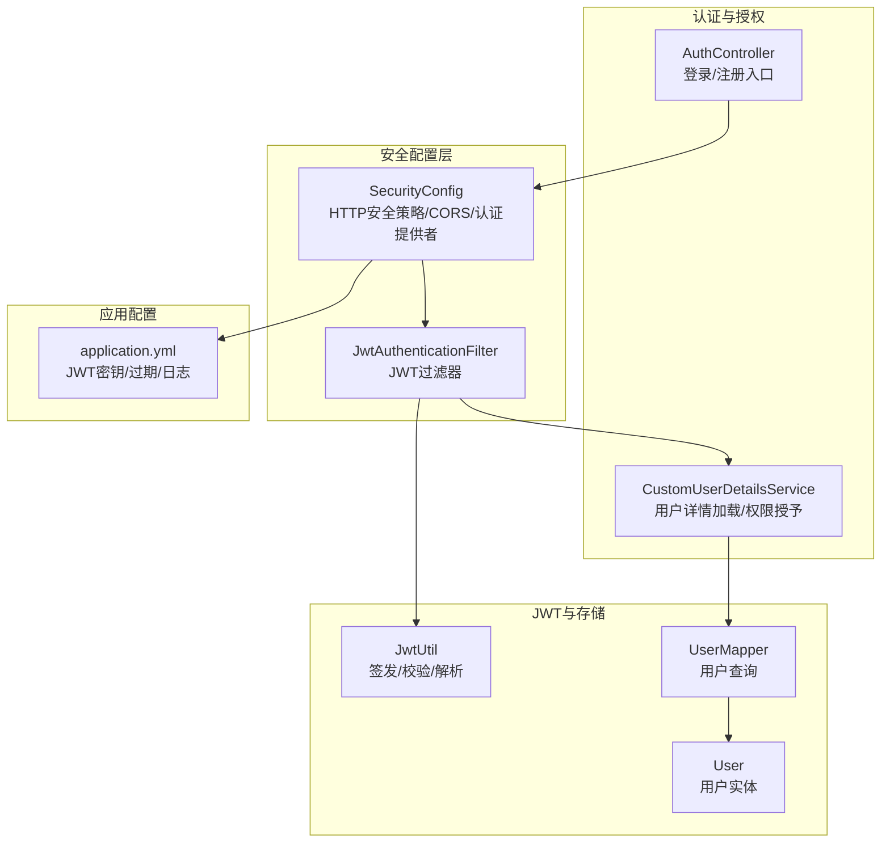
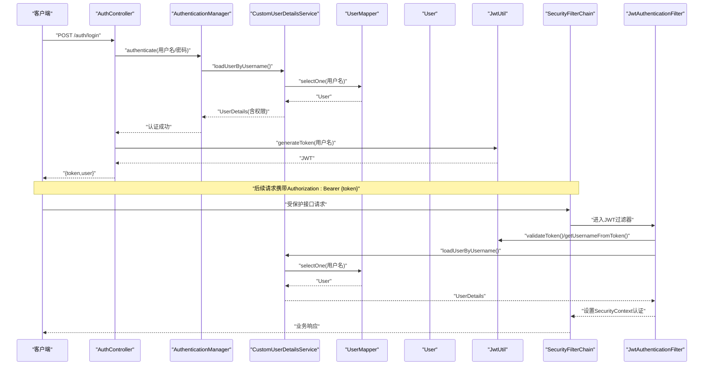
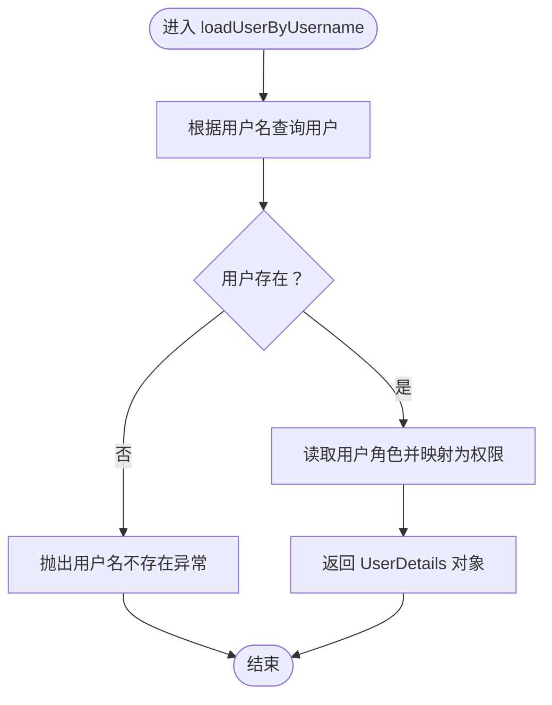
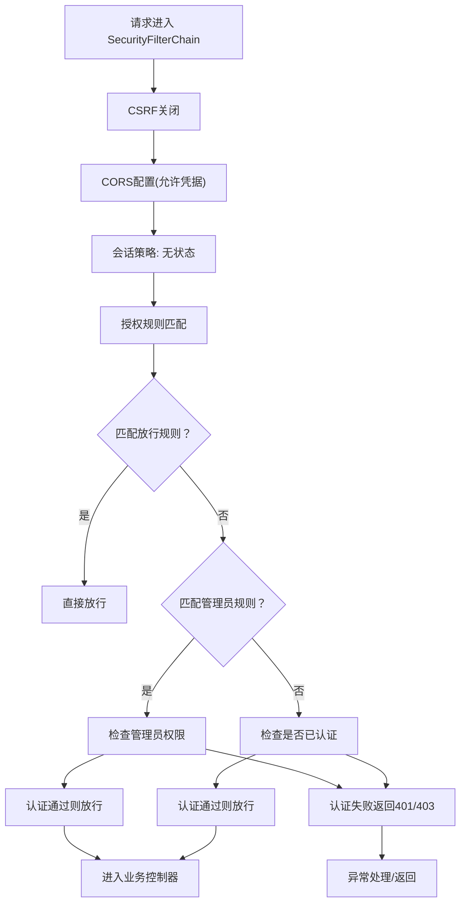
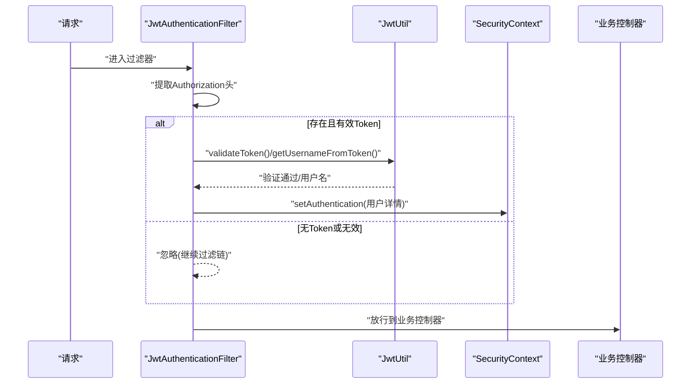
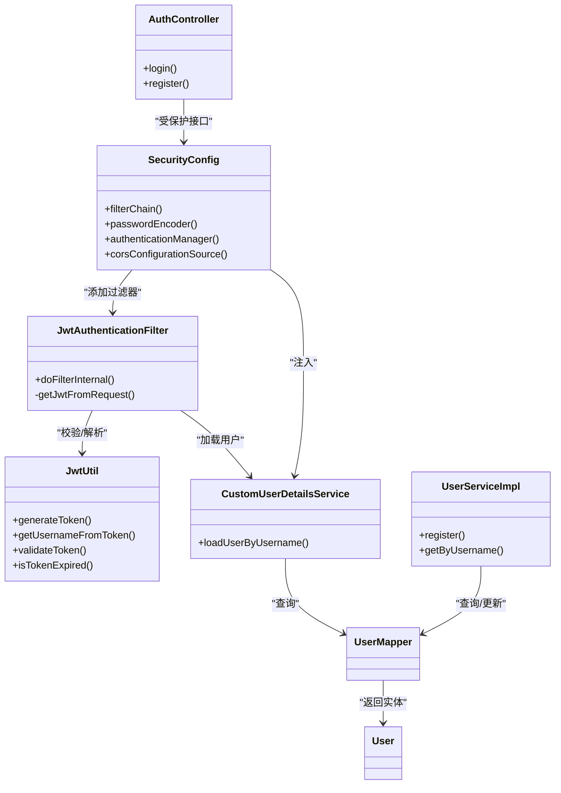

# 安全配置管理

<cite>
**本文引用的文件**
- [CustomUserDetailsService.java](file://src/main/java/com/campus/eventsys/security/CustomUserDetailsService.java)
- [SecurityConfig.java](file://src/main/java/com/campus/eventsys/config/SecurityConfig.java)
- [JwtAuthenticationFilter.java](file://src/main/java/com/campus/eventsys/security/JwtAuthenticationFilter.java)
- [JwtUtil.java](file://src/main/java/com/campus/eventsys/security/JwtUtil.java)
- [AuthController.java](file://src/main/java/com/campus/eventsys/controller/AuthController.java)
- [UserServiceImpl.java](file://src/main/java/com/campus/eventsys/service/impl/UserServiceImpl.java)
- [User.java](file://src/main/java/com/campus/eventsys/entity/User.java)
- [UserMapper.java](file://src/main/java/com/campus/eventsys/mapper/UserMapper.java)
- [application.yml](file://src/main/resources/application.yml)
</cite>

## 目录
1. [引言](#引言)
2. [项目结构](#项目结构)
3. [核心组件](#核心组件)
4. [架构总览](#架构总览)
5. [详细组件分析](#详细组件分析)
6. [依赖关系分析](#依赖关系分析)
7. [性能考量](#性能考量)
8. [故障排查指南](#故障排查指南)
9. [结论](#结论)
10. [附录](#附录)

## 引言
本文件面向开发者与运维人员，系统性阐述本项目的安全配置管理能力，重点覆盖以下方面：
- 自定义用户详情加载服务（CustomUserDetailsService）的实现原理与权限授予机制
- 安全配置类（SecurityConfig）的HTTP安全策略、CORS跨域、密码编码器与认证提供者配置
- Spring Security拦截规则（放行与受控接口）、异常处理与调试建议
- 结合JWT的认证过滤链工作流与最佳实践
- 常见安全问题与解决方案

## 项目结构
围绕安全主题的关键文件分布如下：
- 安全配置与过滤链：config/SecurityConfig.java
- 用户详情加载：security/CustomUserDetailsService.java
- JWT工具与过滤器：security/JwtUtil.java、security/JwtAuthenticationFilter.java
- 认证控制器：controller/AuthController.java
- 用户服务与实体：service/impl/UserServiceImpl.java、entity/User.java、mapper/UserMapper.java
- 应用配置：resources/application.yml

图表来源
- [SecurityConfig.java:35-98](file://src/main/java/com/campus/eventsys/config/SecurityConfig.java#L35-L98)
- [JwtAuthenticationFilter.java:21-57](file://src/main/java/com/campus/eventsys/security/JwtAuthenticationFilter.java#L21-L57)
- [CustomUserDetailsService.java:17-38](file://src/main/java/com/campus/eventsys/security/CustomUserDetailsService.java#L17-L38)
- [JwtUtil.java:13-70](file://src/main/java/com/campus/eventsys/security/JwtUtil.java#L13-L70)
- [UserMapper.java:1-10](file://src/main/java/com/campus/eventsys/mapper/UserMapper.java#L1-L10)
- [application.yml:49-52](file://src/main/resources/application.yml#L49-L52)

章节来源
- [SecurityConfig.java:35-98](file://src/main/java/com/campus/eventsys/config/SecurityConfig.java#L35-L98)
- [application.yml:1-76](file://src/main/resources/application.yml#L1-L76)

## 核心组件
- 自定义用户详情加载服务：负责按用户名加载用户详情，并基于角色授予相应权限（管理员/普通用户）
- 安全配置类：定义HTTP安全策略、CORS跨域、密码编码器、认证提供者与拦截规则
- JWT过滤器：从请求头提取JWT，校验有效性，加载用户详情并写入安全上下文
- JWT工具：签发、校验与解析JWT令牌
- 认证控制器：对外暴露登录/注册接口，使用认证管理器完成认证并签发JWT
- 用户服务：注册时对密码进行BCrypt编码，查询用户详情

章节来源
- [CustomUserDetailsService.java:17-38](file://src/main/java/com/campus/eventsys/security/CustomUserDetailsService.java#L17-L38)
- [SecurityConfig.java:35-98](file://src/main/java/com/campus/eventsys/config/SecurityConfig.java#L35-L98)
- [JwtAuthenticationFilter.java:21-57](file://src/main/java/com/campus/eventsys/security/JwtAuthenticationFilter.java#L21-L57)
- [JwtUtil.java:13-70](file://src/main/java/com/campus/eventsys/security/JwtUtil.java#L13-L70)
- [AuthController.java:36-105](file://src/main/java/com/campus/eventsys/controller/AuthController.java#L36-L105)
- [UserServiceImpl.java:24-57](file://src/main/java/com/campus/eventsys/service/impl/UserServiceImpl.java#L24-L57)

## 架构总览
下图展示了从客户端到后端的完整认证与授权流程，以及各组件之间的交互关系。

图表来源
- [AuthController.java:57-73](file://src/main/java/com/campus/eventsys/controller/AuthController.java#L57-L73)
- [CustomUserDetailsService.java:21-37](file://src/main/java/com/campus/eventsys/security/CustomUserDetailsService.java#L21-L37)
- [JwtAuthenticationFilter.java:26-47](file://src/main/java/com/campus/eventsys/security/JwtAuthenticationFilter.java#L26-L47)
- [JwtUtil.java:25-44](file://src/main/java/com/campus/eventsys/security/JwtUtil.java#L25-L44)
- [UserMapper.java:1-10](file://src/main/java/com/campus/eventsys/mapper/UserMapper.java#L1-L10)

## 详细组件分析

### 自定义用户详情加载服务（CustomUserDetailsService）
- 职责
  - 根据用户名查询用户，若不存在抛出“用户名不存在”异常
  - 将用户角色映射为“管理员/普通用户”的权限标识
  - 返回Spring Security标准的UserDetails对象，包含用户名、密码与权限集合
- 权限授予机制
  - 当用户角色为管理员时授予“管理员”权限；否则授予“普通用户”权限
- 复杂度
  - 单次查询与常量时间的权限映射，时间复杂度O(1)，空间复杂度O(1)
- 错误处理
  - 用户不存在时抛出用户名不存在异常，交由上层统一处理

图表来源
- [CustomUserDetailsService.java:21-37](file://src/main/java/com/campus/eventsys/security/CustomUserDetailsService.java#L21-L37)

章节来源
- [CustomUserDetailsService.java:17-38](file://src/main/java/com/campus/eventsys/security/CustomUserDetailsService.java#L17-L38)
- [UserMapper.java:1-10](file://src/main/java/com/campus/eventsys/mapper/UserMapper.java#L1-L10)
- [User.java:60-61](file://src/main/java/com/campus/eventsys/entity/User.java#L60-L61)

### 安全配置类（SecurityConfig）
- HTTP安全配置
  - 关闭CSRF保护（适用于无状态JWT）
  - 启用CORS并允许凭据（credentials），支持跨域资源访问
  - 会话策略设为无状态（STATELESS），避免服务器端会话
- 拦截规则
  - 明确放行的公开接口：认证接口、活动/分类/成果/评论/收藏等公开查询接口、接口文档、静态图片资源
  - 管理员接口统一拦截，要求具备管理员权限
  - 其余接口均需认证
- 认证提供者与密码编码器
  - 使用DaoAuthenticationProvider结合自定义UserDetailsService与BCryptPasswordEncoder
  - AuthenticationManager由ProviderManager承载
- CORS配置
  - 允许所有来源、方法与头部，支持凭据

图表来源
- [SecurityConfig.java:36-71](file://src/main/java/com/campus/eventsys/config/SecurityConfig.java#L36-L71)
- [SecurityConfig.java:86-98](file://src/main/java/com/campus/eventsys/config/SecurityConfig.java#L86-L98)

章节来源
- [SecurityConfig.java:35-98](file://src/main/java/com/campus/eventsys/config/SecurityConfig.java#L35-L98)

### JWT过滤器（JwtAuthenticationFilter）
- 工作流程
  - 从请求头提取Authorization中的Bearer Token
  - 校验Token有效性，解析出用户名
  - 通过CustomUserDetailsService加载用户详情
  - 构造认证对象并写入SecurityContextHolder
  - 继续过滤链执行业务逻辑
- 异常处理
  - 过滤过程中出现异常会记录错误日志但不会中断请求（不影响公开接口）

图表来源
- [JwtAuthenticationFilter.java:26-47](file://src/main/java/com/campus/eventsys/security/JwtAuthenticationFilter.java#L26-L47)
- [JwtUtil.java:46-56](file://src/main/java/com/campus/eventsys/security/JwtUtil.java#L46-L56)

章节来源
- [JwtAuthenticationFilter.java:21-57](file://src/main/java/com/campus/eventsys/security/JwtAuthenticationFilter.java#L21-L57)
- [JwtUtil.java:13-70](file://src/main/java/com/campus/eventsys/security/JwtUtil.java#L13-L70)

### JWT工具（JwtUtil）
- 功能
  - 基于密钥签发JWT，设置签发时间与过期时间
  - 解析并校验JWT，提取用户名
  - 判断令牌是否过期
- 配置
  - 密钥与过期时间来源于application.yml

章节来源
- [JwtUtil.java:13-70](file://src/main/java/com/campus/eventsys/security/JwtUtil.java#L13-L70)
- [application.yml:49-52](file://src/main/resources/application.yml#L49-L52)

### 认证控制器（AuthController）
- 登录流程
  - 使用AuthenticationManager执行用户名/密码认证
  - 认证成功后调用JwtUtil签发JWT
  - 通过UserService按用户名查询用户详情返回给前端
- 注册流程
  - 调用UserService注册，内部对密码进行BCrypt编码

章节来源
- [AuthController.java:36-105](file://src/main/java/com/campus/eventsys/controller/AuthController.java#L36-L105)
- [UserServiceImpl.java:48-57](file://src/main/java/com/campus/eventsys/service/impl/UserServiceImpl.java#L48-L57)

## 依赖关系分析
- 组件耦合
  - SecurityConfig依赖JwtAuthenticationFilter与UserDetailsService
  - JwtAuthenticationFilter依赖JwtUtil与UserDetailsService
  - CustomUserDetailsService依赖UserMapper与User实体
  - AuthController依赖AuthenticationManager、JwtUtil与UserService
  - UserServiceImpl依赖PasswordEncoder与UserMapper
- 外部依赖
  - Spring Security、BCryptPasswordEncoder、JWT库
  - SQLite数据源（application.yml配置）

图表来源
- [SecurityConfig.java:32-33](file://src/main/java/com/campus/eventsys/config/SecurityConfig.java#L32-L33)
- [JwtAuthenticationFilter.java:23-24](file://src/main/java/com/campus/eventsys/security/JwtAuthenticationFilter.java#L23-L24)
- [CustomUserDetailsService.java:19](file://src/main/java/com/campus/eventsys/security/CustomUserDetailsService.java#L19)
- [UserMapper.java:1-10](file://src/main/java/com/campus/eventsys/mapper/UserMapper.java#L1-L10)

## 性能考量
- 无状态设计
  - 采用JWT与无状态会话策略，降低服务器端会话开销
- 查询优化
  - CustomUserDetailsService仅做一次用户名查询与常量时间权限映射，复杂度低
- 缓存建议
  - 可考虑在高并发场景下对热点用户信息进行缓存，减少数据库压力
- 日志级别
  - 生产环境建议调整日志级别，避免过多调试日志影响性能

## 故障排查指南
- 登录失败（401）
  - 检查用户名是否存在与密码是否正确
  - 确认密码在注册与登录时均使用BCrypt编码
  - 查看SecurityConfig的拦截规则是否误拦截
- JWT无效或过期
  - 核对Authorization头格式是否为“Bearer {token}”
  - 检查application.yml中的JWT密钥与过期时间配置
  - 验证JwtUtil的签名密钥与过期判断逻辑
- CORS跨域问题
  - 确认CORS配置允许来源、方法与头部，并开启凭据
- 权限不足（403）
  - 管理员接口需管理员角色，确认用户角色映射与权限授予逻辑
- 调试技巧
  - 在application.yml中提高Spring Security与应用包的日志级别
  - 使用Swagger UI测试接口，观察响应状态码与返回内容
  - 在JwtAuthenticationFilter中增加必要的日志输出定位问题

章节来源
- [application.yml:72-75](file://src/main/resources/application.yml#L72-L75)
- [SecurityConfig.java:86-98](file://src/main/java/com/campus/eventsys/config/SecurityConfig.java#L86-L98)
- [JwtAuthenticationFilter.java:43-45](file://src/main/java/com/campus/eventsys/security/JwtAuthenticationFilter.java#L43-L45)

## 结论
本项目通过自定义用户详情加载、JWT无状态认证与细粒度的HTTP安全策略，构建了清晰、可维护的安全体系。配合明确的拦截规则与CORS配置，既保证了易用性，也兼顾了安全性。建议在生产环境中进一步完善缓存策略、监控与审计机制，并持续关注Spring Security与JWT库的版本升级与安全公告。

## 附录

### 安全最佳实践
- 密码安全
  - 始终使用强哈希算法（如BCrypt）存储密码
  - 定期轮换JWT密钥，严格控制密钥访问范围
- 接口安全
  - 对敏感接口启用管理员权限校验
  - 限制请求频率，防止暴力破解
- 传输安全
  - 使用HTTPS，避免明文传输
  - 严格控制CORS白名单，避免过度放行
- 日志与监控
  - 记录关键安全事件（登录失败、权限拒绝）
  - 设置告警阈值，及时发现异常行为

### 常见安全问题与解决方案
- 明文密码存储
  - 现状：注册时对密码进行BCrypt编码
  - 建议：确保所有用户密码均经过BCrypt处理，避免明文残留
- CSRF攻击
  - 现状：已关闭CSRF（无状态JWT）
  - 建议：如引入会话，请启用CSRF保护
- 权限提升
  - 现状：管理员接口统一拦截
  - 建议：定期审查权限映射与拦截规则，避免误放行
- JWT泄露
  - 现状：客户端妥善保管Authorization头
  - 建议：短令牌过期时间+刷新令牌机制，必要时支持黑名单

### 配置示例与调试要点
- JWT配置（application.yml）
  - 密钥与过期时间：参考[application.yml:49-52]
- CORS配置（SecurityConfig）
  - 允许凭据与跨域：参考[SecurityConfig.java:86-98]
- 认证提供者（SecurityConfig）
  - DaoAuthenticationProvider与BCrypt：参考[SecurityConfig.java:78-84]
- 登录流程（AuthController）
  - 认证与签发：参考[AuthController.java:57-73]
- 用户详情加载（CustomUserDetailsService）
  - 角色映射与权限授予：参考[CustomUserDetailsService.java:31-37]