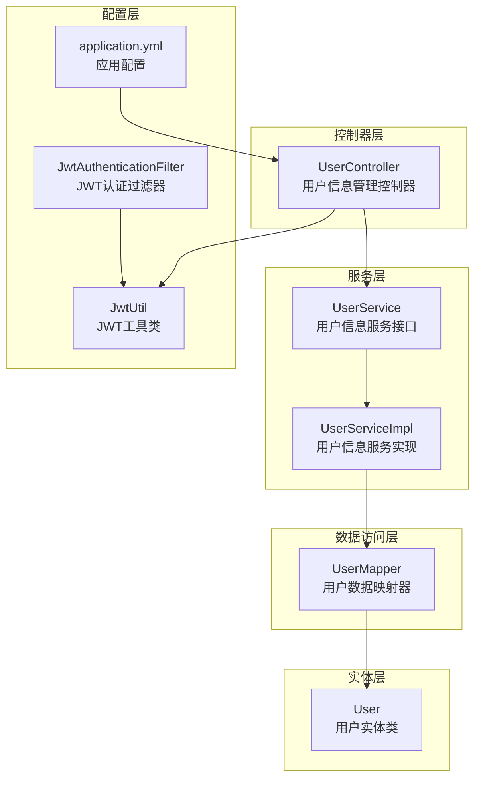
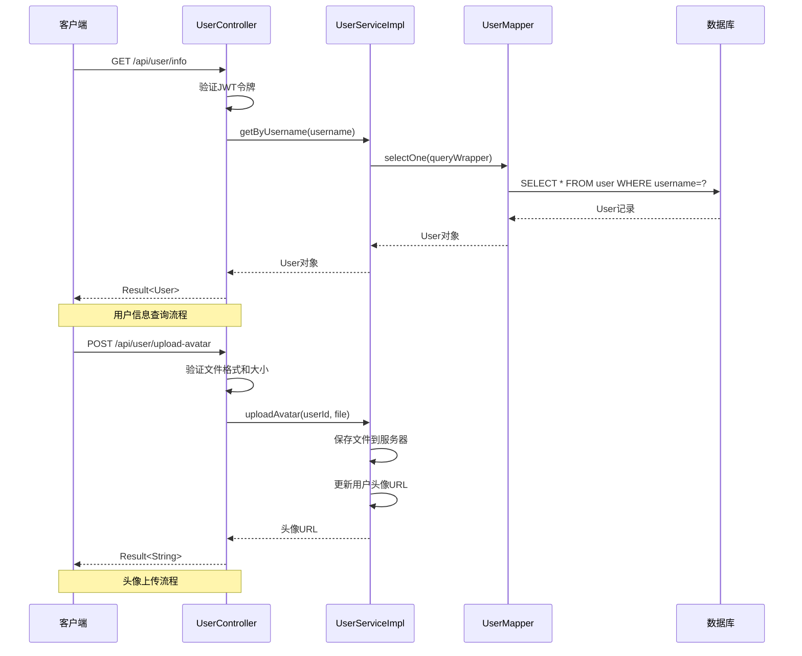
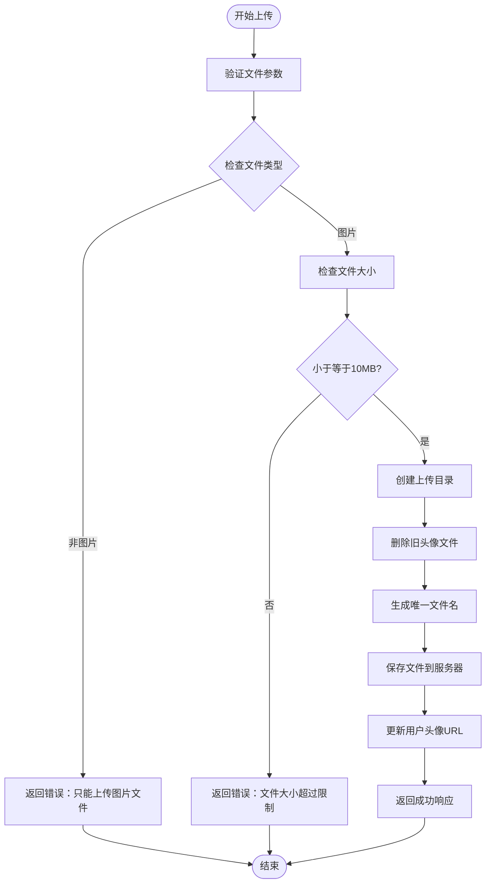
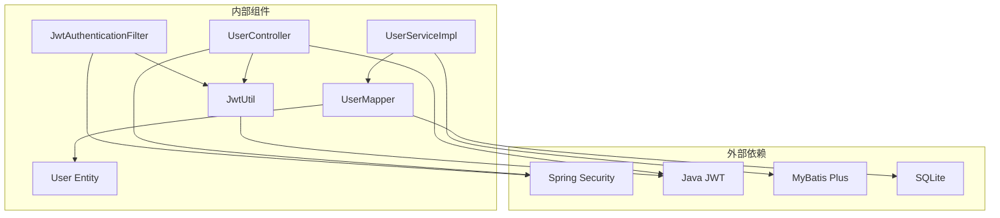

# 用户信息管理

<cite>
**本文档引用的文件**
- [UserController.java](file://src/main/java/com/campus/eventsys/controller/UserController.java)
- [UserService.java](file://src/main/java/com/campus/eventsys/service/UserService.java)
- [UserServiceImpl.java](file://src/main/java/com/campus/eventsys/service/impl/UserServiceImpl.java)
- [User.java](file://src/main/java/com/campus/eventsys/entity/User.java)
- [UserMapper.java](file://src/main/java/com/campus/eventsys/mapper/UserMapper.java)
- [Result.java](file://src/main/java/com/campus/eventsys/common/Result.java)
- [BusinessException.java](file://src/main/java/com/campus/eventsys/common/BusinessException.java)
- [application.yml](file://src/main/resources/application.yml)
- [JwtUtil.java](file://src/main/java/com/campus/eventsys/security/JwtUtil.java)
- [JwtAuthenticationFilter.java](file://src/main/java/com/campus/eventsys/security/JwtAuthenticationFilter.java)
- [url.txt](file://url.txt)
</cite>

## 目录
1. [简介](#简介)
2. [项目结构](#项目结构)
3. [核心组件](#核心组件)
4. [架构概览](#架构概览)
5. [详细组件分析](#详细组件分析)
6. [依赖分析](#依赖分析)
7. [性能考虑](#性能考虑)
8. [故障排除指南](#故障排除指南)
9. [结论](#结论)
10. [附录](#附录)

## 简介

用户信息管理功能是事件管理系统中的核心模块，负责处理当前登录用户的个人信息查看、修改和头像上传功能。该模块采用Spring Boot + MyBatis Plus技术栈构建，实现了RESTful API接口，支持JWT令牌认证和文件上传功能。

本功能模块的主要特点：
- 基于JWT的用户认证机制
- 完整的用户信息管理接口
- 安全的头像上传和存储
- 统一的响应格式和错误处理
- 基于注解的API文档生成

## 项目结构

用户信息管理功能在项目中的组织结构如下：



**图表来源**
- [UserController.java:1-146](file://src/main/java/com/campus/eventsys/controller/UserController.java#L1-L146)
- [UserService.java:1-38](file://src/main/java/com/campus/eventsys/service/UserService.java#L1-L38)
- [UserServiceImpl.java:1-158](file://src/main/java/com/campus/eventsys/service/impl/UserServiceImpl.java#L1-L158)
- [UserMapper.java:1-10](file://src/main/java/com/campus/eventsys/mapper/UserMapper.java#L1-L10)
- [User.java:1-85](file://src/main/java/com/campus/eventsys/entity/User.java#L1-L85)

**章节来源**
- [UserController.java:1-146](file://src/main/java/com/campus/eventsys/controller/UserController.java#L1-L146)
- [application.yml:1-76](file://src/main/resources/application.yml#L1-L76)

## 核心组件

### 控制器层 - UserController

UserController是用户信息管理功能的入口点，提供了三个主要接口：
- 获取当前用户信息
- 上传用户头像
- 更新用户基本信息

每个接口都使用了Spring Security的@SecurityRequirement注解，要求Bearer Token认证。

### 服务层 - UserService 和 UserServiceImpl

服务层实现了业务逻辑处理：
- 用户信息查询（按用户名、学号）
- 用户注册功能
- 头像上传和文件管理
- 用户信息更新

### 数据访问层 - UserMapper

基于MyBatis Plus的BaseMapper，提供了标准的数据访问操作。

### 实体层 - User

用户实体类定义了完整的用户信息字段，包括基础信息、联系方式、教育背景等。

**章节来源**
- [UserController.java:36-144](file://src/main/java/com/campus/eventsys/controller/UserController.java#L36-L144)
- [UserService.java:7-37](file://src/main/java/com/campus/eventsys/service/UserService.java#L7-L37)
- [UserServiceImpl.java:24-157](file://src/main/java/com/campus/eventsys/service/impl/UserServiceImpl.java#L24-L157)
- [User.java:15-84](file://src/main/java/com/campus/eventsys/entity/User.java#L15-L84)

## 架构概览

用户信息管理功能采用经典的三层架构设计，结合Spring Security实现安全控制：



**图表来源**
- [UserController.java:49-93](file://src/main/java/com/campus/eventsys/controller/UserController.java#L49-L93)
- [UserServiceImpl.java:60-126](file://src/main/java/com/campus/eventsys/service/impl/UserServiceImpl.java#L60-L126)

## 详细组件分析

### 用户信息查询接口

#### 接口定义
- **URL**: `/api/user/info`
- **方法**: GET
- **认证**: Bearer Token
- **描述**: 获取当前登录用户的详细信息

#### 返回数据结构
接口返回Result包装的User对象，包含以下字段：
- 基础信息：id、username、nickname、avatar
- 联系方式：email、phone
- 个人信息：realName、college、major、grade、studentId、gender、bio
- 系统信息：role、status、participatedCount、organizedCount
- 时间信息：createTime、updateTime

#### 错误处理
- 401: 未登录或令牌无效
- 500: 用户不存在

**章节来源**
- [UserController.java:39-55](file://src/main/java/com/campus/eventsys/controller/UserController.java#L39-L55)
- [User.java:17-84](file://src/main/java/com/campus/eventsys/entity/User.java#L17-L84)

### 头像上传接口

#### 接口定义
- **URL**: `/api/user/upload-avatar`
- **方法**: POST
- **认证**: Bearer Token
- **内容类型**: multipart/form-data
- **描述**: 上传用户头像，支持jpg/png/gif格式，大小不超过10MB

#### 请求参数
- **avatar**: 图片文件（必填）

#### 响应数据
- **成功**: 返回头像URL路径
- **失败**: 返回错误信息

#### 文件处理流程


**图表来源**
- [UserServiceImpl.java:60-126](file://src/main/java/com/campus/eventsys/service/impl/UserServiceImpl.java#L60-L126)

#### 错误处理
- 400: 文件为空、非图片格式、超过10MB
- 500: 用户不存在、文件上传失败

**章节来源**
- [UserController.java:61-93](file://src/main/java/com/campus/eventsys/controller/UserController.java#L61-L93)
- [UserServiceImpl.java:68-77](file://src/main/java/com/campus/eventsys/service/impl/UserServiceImpl.java#L68-L77)

### 用户信息更新接口

#### 接口定义
- **URL**: `/api/user/update-info`
- **方法**: PUT
- **认证**: Bearer Token
- **描述**: 更新当前登录用户的基本信息，所有字段均为可选

#### 可更新字段
- nickname: 昵称
- email: 邮箱
- phone: 手机号
- realName: 真实姓名
- college: 学院
- major: 专业
- grade: 年级
- gender: 性别（0-女，1-男）
- bio: 个人简介

#### 不可更新字段
- username: 用户名（不可修改）
- password: 密码（请使用修改密码接口）
- role: 角色（角色不可改）
- status: 状态（状态不可改）

#### 错误处理
- 400: 参数错误
- 500: 用户不存在、更新失败

**章节来源**
- [UserController.java:98-144](file://src/main/java/com/campus/eventsys/controller/UserController.java#L98-L144)
- [UserServiceImpl.java:147-156](file://src/main/java/com/campus/eventsys/service/impl/UserServiceImpl.java#L147-L156)

### 服务层业务逻辑

#### 用户查询服务
UserServiceImpl继承了MyBatis Plus的ServiceImpl，提供了多种用户查询方法：
- getByUsername: 按用户名查询用户
- getByStudentId: 按学号查询用户
- register: 用户注册（密码加密、角色和状态设置）

#### 头像上传服务
头像上传功能实现了完整的文件管理：
- 文件类型验证（必须为图片）
- 文件大小限制（10MB）
- 旧头像文件清理
- 唯一文件名生成
- 数据库URL更新

#### 用户信息更新服务
更新服务确保了数据安全：
- 自动清理不允许修改的字段（username、password、role、createTime）
- 使用updateById进行精确更新

**章节来源**
- [UserServiceImpl.java:34-57](file://src/main/java/com/campus/eventsys/service/impl/UserServiceImpl.java#L34-L57)
- [UserServiceImpl.java:147-156](file://src/main/java/com/campus/eventsys/service/impl/UserServiceImpl.java#L147-L156)

## 依赖分析

用户信息管理功能的依赖关系如下：



**图表来源**
- [UserController.java:14-17](file://src/main/java/com/campus/eventsys/controller/UserController.java#L14-L17)
- [UserServiceImpl.java:3-13](file://src/main/java/com/campus/eventsys/service/impl/UserServiceImpl.java#L3-L13)
- [JwtUtil.java:13-23](file://src/main/java/com/campus/eventsys/security/JwtUtil.java#L13-L23)

### 关键依赖说明

1. **Spring Security**: 提供JWT认证和授权功能
2. **MyBatis Plus**: 简化数据库操作，提供分页查询
3. **Java JWT**: JWT令牌生成和验证
4. **SQLite**: 轻量级数据库，适合开发环境

**章节来源**
- [application.yml:10-15](file://src/main/resources/application.yml#L10-L15)
- [JwtUtil.java:15-19](file://src/main/java/com/campus/eventsys/security/JwtUtil.java#L15-L19)

## 性能考虑

### 数据库优化
- 使用LambdaQueryWrapper进行高效查询
- 合理的索引设计（username、studentId字段）
- MyBatis Plus的批量操作支持

### 缓存策略
- JWT令牌验证结果可以缓存
- 用户信息可以短期缓存
- 头像文件可以CDN加速

### 文件上传优化
- 10MB文件大小限制防止资源滥用
- 异步文件处理减少请求阻塞
- 文件名唯一性避免冲突

## 故障排除指南

### 常见问题及解决方案

#### 认证失败
**症状**: 返回401状态码
**原因**: 令牌无效或过期
**解决**: 重新登录获取新令牌

#### 文件上传失败
**症状**: 返回400状态码
**原因**: 文件格式不支持或大小超限
**解决**: 确保文件为jpg/png/gif格式且小于10MB

#### 用户不存在
**症状**: 返回500状态码，消息为"用户不存在"
**原因**: 用户会话失效或用户被删除
**解决**: 重新登录或联系管理员

#### 数据库连接问题
**症状**: 数据库操作失败
**原因**: SQLite数据库文件损坏
**解决**: 检查数据库文件完整性

**章节来源**
- [BusinessException.java:6-19](file://src/main/java/com/campus/eventsys/common/BusinessException.java#L6-L19)
- [Result.java:31-53](file://src/main/java/com/campus/eventsys/common/Result.java#L31-L53)

## 结论

用户信息管理功能是一个完整、安全、易用的用户管理模块。它采用了现代的Spring Boot技术栈，实现了RESTful API设计，提供了完善的认证和授权机制。通过清晰的分层架构和良好的错误处理机制，该模块能够满足大多数用户信息管理场景的需求。

主要优势：
- 安全的JWT认证机制
- 完整的用户信息管理功能
- 简洁的API设计
- 良好的错误处理
- 清晰的代码结构

## 附录

### API调用示例

#### 获取用户信息
```bash
curl -X GET "http://localhost:8080/api/user/info" \
  -H "Authorization: Bearer YOUR_JWT_TOKEN"
```

#### 上传头像
```bash
curl -X POST "http://localhost:8080/api/user/upload-avatar" \
  -H "Authorization: Bearer YOUR_JWT_TOKEN" \
  -F "avatar=@/path/to/avatar.jpg"
```

#### 更新用户信息
```bash
curl -X PUT "http://localhost:8080/api/user/update-info" \
  -H "Authorization: Bearer YOUR_JWT_TOKEN" \
  -d "nickname=新昵称&email=new@email.com&phone=13800138000"
```

### 配置说明

#### 应用配置
- **服务器端口**: 8080
- **上下文路径**: /api
- **文件上传大小**: 10MB
- **JWT过期时间**: 24小时

#### 数据库配置
- **数据库类型**: SQLite
- **主键策略**: INPUT（手动指定）
- **逻辑删除**: 支持软删除

**章节来源**
- [application.yml:1-76](file://src/main/resources/application.yml#L1-L76)
- [url.txt:1-9](file://url.txt#L1-L9)