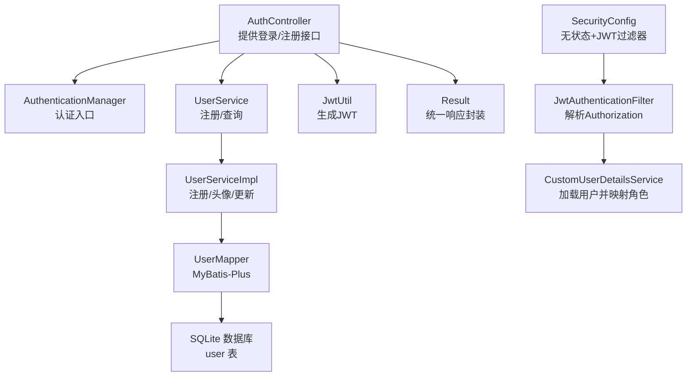
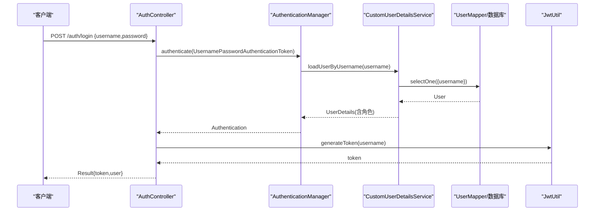
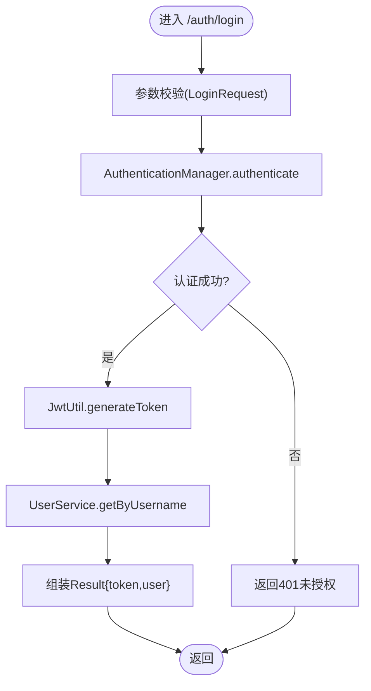
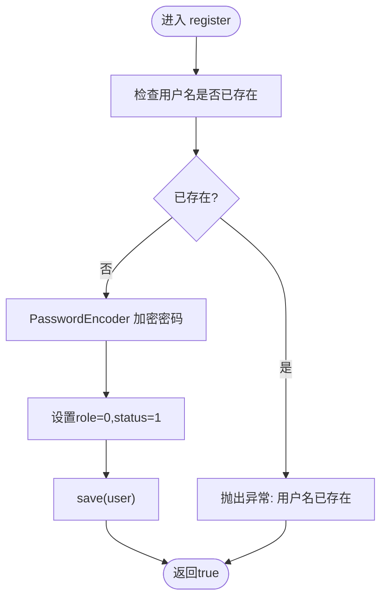
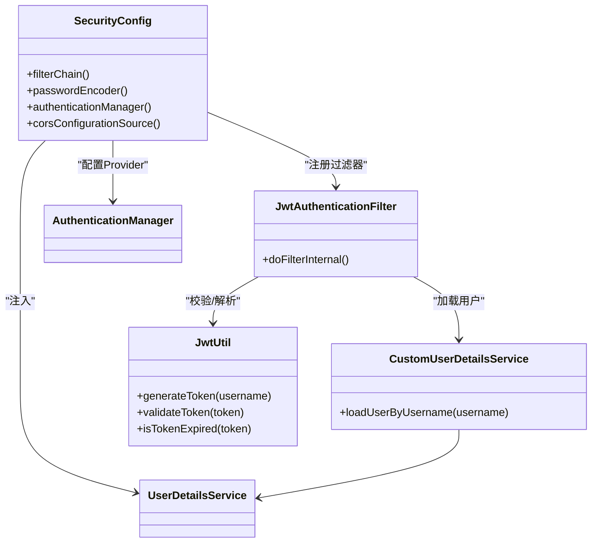
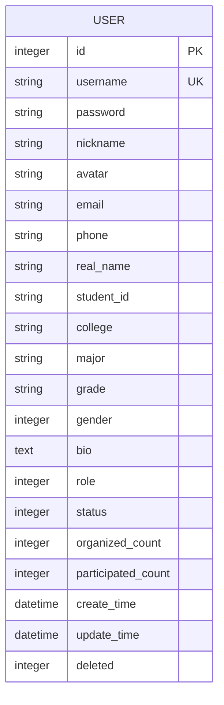
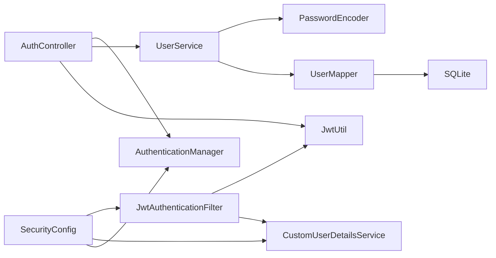

# 用户注册登录

<cite>
**本文引用的文件**
- [AuthController.java](file://src/main/java/com/campus/eventsys/controller/AuthController.java)
- [UserService.java](file://src/main/java/com/campus/eventsys/service/UserService.java)
- [UserServiceImpl.java](file://src/main/java/com/campus/eventsys/service/impl/UserServiceImpl.java)
- [User.java](file://src/main/java/com/campus/eventsys/entity/User.java)
- [UserMapper.java](file://src/main/java/com/campus/eventsys/mapper/UserMapper.java)
- [CustomUserDetailsService.java](file://src/main/java/com/campus/eventsys/security/CustomUserDetailsService.java)
- [JwtUtil.java](file://src/main/java/com/campus/eventsys/security/JwtUtil.java)
- [JwtAuthenticationFilter.java](file://src/main/java/com/campus/eventsys/security/JwtAuthenticationFilter.java)
- [SecurityConfig.java](file://src/main/java/com/campus/eventsys/config/SecurityConfig.java)
- [Result.java](file://src/main/java/com/campus/eventsys/common/Result.java)
- [BusinessException.java](file://src/main/java/com/campus/eventsys/common/BusinessException.java)
- [application.yml](file://src/main/resources/application.yml)
- [schema.sql](file://src/main/resources/db/schema.sql)
- [AuthControllerTest.java](file://src/test/java/com/campus/eventsys/controller/AuthControllerTest.java)
</cite>

## 目录
1. [简介](#简介)
2. [项目结构](#项目结构)
3. [核心组件](#核心组件)
4. [架构总览](#架构总览)
5. [详细组件分析](#详细组件分析)
6. [依赖关系分析](#依赖关系分析)
7. [性能考虑](#性能考虑)
8. [故障排查指南](#故障排查指南)
9. [结论](#结论)
10. [附录](#附录)

## 简介
本文件面向开发者，系统化阐述用户注册与登录功能的技术实现，覆盖以下要点：
- 注册流程：用户名唯一性校验、密码加密存储、用户信息入库与默认角色/状态设置
- 登录机制：用户名密码验证、AuthenticationManager认证、JWT令牌签发与返回
- 控制器接口：AuthController 的 /auth/login 与 /auth/register 的参数校验、业务处理与统一响应封装
- 角色与权限：基于用户角色的权限控制策略（普通用户/管理员）
- 错误处理：异常捕获、业务异常与统一响应的映射
- API 调用示例与最佳实践：请求格式、鉴权头、常见错误场景

## 项目结构
围绕用户认证的关键模块与文件如下：
- 控制层：AuthController 提供 /auth/login 与 /auth/register 接口
- 安全层：SecurityConfig 配置无状态会话、跨域、JWT过滤器链；CustomUserDetailsService 实现用户加载与角色映射；JwtUtil 负责令牌生成与解析；JwtAuthenticationFilter 在请求进入时解析并注入认证上下文
- 服务层：UserService 接口与 UserServiceImpl 实现，负责注册、按用户名/学号查询、头像上传、用户信息更新
- 数据模型：User 实体与 UserMapper 映射
- 配置：application.yml 中 JWT 密钥与过期时间、文件上传路径与访问URL、MyBatis Plus 配置
- 统一响应：Result 封装统一返回结构；BusinessException 自定义业务异常

图表来源
- [AuthController.java:1-106](file://src/main/java/com/campus/eventsys/controller/AuthController.java#L1-L106)
- [UserService.java:1-38](file://src/main/java/com/campus/eventsys/service/UserService.java#L1-L38)
- [UserServiceImpl.java:1-158](file://src/main/java/com/campus/eventsys/service/impl/UserServiceImpl.java#L1-L158)
- [UserMapper.java:1-10](file://src/main/java/com/campus/eventsys/mapper/UserMapper.java#L1-L10)
- [SecurityConfig.java:1-100](file://src/main/java/com/campus/eventsys/config/SecurityConfig.java#L1-L100)
- [JwtAuthenticationFilter.java:1-58](file://src/main/java/com/campus/eventsys/security/JwtAuthenticationFilter.java#L1-L58)
- [CustomUserDetailsService.java:1-40](file://src/main/java/com/campus/eventsys/security/CustomUserDetailsService.java#L1-L40)
- [JwtUtil.java:1-71](file://src/main/java/com/campus/eventsys/security/JwtUtil.java#L1-L71)
- [Result.java:1-55](file://src/main/java/com/campus/eventsys/common/Result.java#L1-L55)
- [schema.sql:1-295](file://src/main/resources/db/schema.sql#L1-L295)

章节来源
- [AuthController.java:1-106](file://src/main/java/com/campus/eventsys/controller/AuthController.java#L1-L106)
- [SecurityConfig.java:1-100](file://src/main/java/com/campus/eventsys/config/SecurityConfig.java#L1-L100)
- [application.yml:1-76](file://src/main/resources/application.yml#L1-L76)

## 核心组件
- AuthController：暴露 /auth/login 与 /auth/register，使用 @Valid 参数校验，结合 AuthenticationManager 与 UserService 完成认证与注册，返回 Result 统一结构
- UserService/UserServiceImpl：注册时检查用户名唯一性、使用 BCrypt 加密密码、设置默认角色与状态、保存用户；提供按用户名/学号查询、头像上传与用户信息更新
- CustomUserDetailsService：从数据库加载用户，将 role 字段映射为 ROLE_USER 或 ROLE_ADMIN，并返回 UserDetails
- JwtUtil：基于 HMAC-SHA 的 JWT 生成、解析、校验与过期判断
- JwtAuthenticationFilter：从 Authorization 请求头解析 Bearer Token，校验后将认证信息写入 SecurityContext
- SecurityConfig：无状态会话策略、放行公开接口、拦截管理员接口、注册 JWT 过滤器链与认证提供者
- Result：统一响应结构，包含 code、message、data
- application.yml：JWT 密钥与过期时间、文件上传路径与访问URL、MyBatis Plus 配置

章节来源
- [AuthController.java:38-106](file://src/main/java/com/campus/eventsys/controller/AuthController.java#L38-L106)
- [UserService.java:7-38](file://src/main/java/com/campus/eventsys/service/UserService.java#L7-L38)
- [UserServiceImpl.java:48-57](file://src/main/java/com/campus/eventsys/service/impl/UserServiceImpl.java#L48-L57)
- [CustomUserDetailsService.java:21-38](file://src/main/java/com/campus/eventsys/security/CustomUserDetailsService.java#L21-L38)
- [JwtUtil.java:25-56](file://src/main/java/com/campus/eventsys/security/JwtUtil.java#L25-L56)
- [JwtAuthenticationFilter.java:26-48](file://src/main/java/com/campus/eventsys/security/JwtAuthenticationFilter.java#L26-L48)
- [SecurityConfig.java:35-84](file://src/main/java/com/campus/eventsys/config/SecurityConfig.java#L35-L84)
- [Result.java:12-55](file://src/main/java/com/campus/eventsys/common/Result.java#L12-L55)
- [application.yml:49-70](file://src/main/resources/application.yml#L49-L70)

## 架构总览
用户认证采用“无状态 + JWT”的架构：
- 登录时，客户端提交用户名/密码，由 AuthenticationManager 委托 CustomUserDetailsService 从数据库加载用户并比对密码
- 认证通过后，服务端使用 JwtUtil 生成 JWT，连同用户信息一并返回
- 后续请求在 Header 中携带 Authorization: Bearer {token}，JwtAuthenticationFilter 解析并注入认证上下文，供方法级权限注解使用

图表来源
- [AuthController.java:57-73](file://src/main/java/com/campus/eventsys/controller/AuthController.java#L57-L73)
- [CustomUserDetailsService.java:21-38](file://src/main/java/com/campus/eventsys/security/CustomUserDetailsService.java#L21-L38)
- [JwtUtil.java:25-35](file://src/main/java/com/campus/eventsys/security/JwtUtil.java#L25-L35)

## 详细组件分析

### AuthController：登录与注册接口
- 登录接口 /auth/login
  - 参数：LoginRequest（用户名、密码），使用 @NotBlank 与 Swagger 注解进行校验
  - 流程：AuthenticationManager.authenticate 创建认证令牌并执行认证；认证通过后使用 JwtUtil 生成 token；通过 UserService.getByUsername 获取用户信息；组装 Result 返回
  - 响应：Result 包含 token 与 user 对象
- 注册接口 /auth/register
  - 参数：User 对象（必填 username、password，其他字段可选）
  - 流程：调用 UserService.register 完成注册；返回 Result.success
  - 响应：Result 成功提示

图表来源
- [AuthController.java:57-73](file://src/main/java/com/campus/eventsys/controller/AuthController.java#L57-L73)

章节来源
- [AuthController.java:57-93](file://src/main/java/com/campus/eventsys/controller/AuthController.java#L57-L93)

### UserService 与 UserServiceImpl：注册与查询
- 注册逻辑
  - 检查用户名是否已存在，存在则抛出运行时异常
  - 使用 PasswordEncoder 对密码进行加密
  - 设置默认角色 role=0、状态 status=1
  - 调用 save 写入数据库
- 查询逻辑
  - getByUsername：按用户名精确查询
  - getByStudentId：按学号查询
- 头像上传与更新
  - uploadAvatar：校验文件类型与大小、创建上传目录、删除旧头像、生成唯一文件名、保存并返回访问URL
  - updateUserInfo：屏蔽不允许修改的字段（如用户名、密码、角色、创建时间），仅更新允许字段

图表来源
- [UserServiceImpl.java:48-57](file://src/main/java/com/campus/eventsys/service/impl/UserServiceImpl.java#L48-L57)

章节来源
- [UserService.java:9-37](file://src/main/java/com/campus/eventsys/service/UserService.java#L9-L37)
- [UserServiceImpl.java:48-57](file://src/main/java/com/campus/eventsys/service/impl/UserServiceImpl.java#L48-L57)
- [UserServiceImpl.java:59-126](file://src/main/java/com/campus/eventsys/service/impl/UserServiceImpl.java#L59-L126)

### 安全与权限：AuthenticationManager、JwtUtil、JwtAuthenticationFilter、CustomUserDetailsService
- AuthenticationManager
  - 通过 SecurityConfig 配置 DaoAuthenticationProvider，绑定 UserDetailsService 与 PasswordEncoder
- CustomUserDetailsService
  - 从 UserMapper 查询用户，若不存在抛出 UsernameNotFoundException
  - 将 role=1 映射为 ROLE_ADMIN，否则为 ROLE_USER
- JwtUtil
  - 从 application.yml 读取 jwt.secret 与 jwt.expiration
  - 生成 token（subject=username，带签发时间与过期时间）
  - 校验 token 有效性与是否过期
- JwtAuthenticationFilter
  - 从 Authorization 头解析 Bearer token
  - 校验 token 并从 UserDetailsService 加载用户，构建 UsernamePasswordAuthenticationToken 注入 SecurityContextHolder

图表来源
- [SecurityConfig.java:35-84](file://src/main/java/com/campus/eventsys/config/SecurityConfig.java#L35-L84)
- [CustomUserDetailsService.java:21-38](file://src/main/java/com/campus/eventsys/security/CustomUserDetailsService.java#L21-L38)
- [JwtUtil.java:25-56](file://src/main/java/com/campus/eventsys/security/JwtUtil.java#L25-L56)
- [JwtAuthenticationFilter.java:26-48](file://src/main/java/com/campus/eventsys/security/JwtAuthenticationFilter.java#L26-L48)

章节来源
- [SecurityConfig.java:35-84](file://src/main/java/com/campus/eventsys/config/SecurityConfig.java#L35-L84)
- [CustomUserDetailsService.java:21-38](file://src/main/java/com/campus/eventsys/security/CustomUserDetailsService.java#L21-L38)
- [JwtUtil.java:25-56](file://src/main/java/com/campus/eventsys/security/JwtUtil.java#L25-L56)
- [JwtAuthenticationFilter.java:26-48](file://src/main/java/com/campus/eventsys/security/JwtAuthenticationFilter.java#L26-L48)

### 数据模型与持久层：User 与 UserMapper
- User 实体包含用户基本信息、角色与状态、时间戳等字段
- UserMapper 继承 MyBatis-Plus BaseMapper，提供通用 CRUD 能力
- schema.sql 定义了 user 表结构，其中 username 唯一约束，role 默认 0，status 默认 1

图表来源
- [User.java:15-84](file://src/main/java/com/campus/eventsys/entity/User.java#L15-L84)
- [schema.sql:6-28](file://src/main/resources/db/schema.sql#L6-L28)

章节来源
- [User.java:15-84](file://src/main/java/com/campus/eventsys/entity/User.java#L15-L84)
- [UserMapper.java:8](file://src/main/java/com/campus/eventsys/mapper/UserMapper.java#L8)
- [schema.sql:6-28](file://src/main/resources/db/schema.sql#L6-L28)

### 统一响应与错误处理
- Result：统一返回结构，包含 code、message、data；提供 success/error 工厂方法
- BusinessException：自定义业务异常，可指定 code 与 message
- AuthController 在登录成功时返回 Result.success，注册成功时返回 Result.success；注册时 UserServiceImpl 抛出的运行时异常将被上层异常处理器捕获并转换为 Result.error

章节来源
- [Result.java:12-55](file://src/main/java/com/campus/eventsys/common/Result.java#L12-L55)
- [BusinessException.java:6-19](file://src/main/java/com/campus/eventsys/common/BusinessException.java#L6-L19)
- [AuthController.java:57-93](file://src/main/java/com/campus/eventsys/controller/AuthController.java#L57-L93)

## 依赖关系分析
- 控制器依赖 AuthenticationManager、JwtUtil、UserService
- 服务层依赖 PasswordEncoder、UserMapper
- 安全配置依赖 JwtAuthenticationFilter、UserDetailsService、PasswordEncoder
- JwtAuthenticationFilter 依赖 JwtUtil、UserDetailsService
- 数据层依赖 MyBatis-Plus 与 SQLite

图表来源
- [AuthController.java:38-40](file://src/main/java/com/campus/eventsys/controller/AuthController.java#L38-L40)
- [UserService.java:26](file://src/main/java/com/campus/eventsys/service/UserService.java#L26)
- [SecurityConfig.java:32-33](file://src/main/java/com/campus/eventsys/config/SecurityConfig.java#L32-L33)
- [JwtAuthenticationFilter.java:23-24](file://src/main/java/com/campus/eventsys/security/JwtAuthenticationFilter.java#L23-L24)
- [UserMapper.java:8](file://src/main/java/com/campus/eventsys/mapper/UserMapper.java#L8)

章节来源
- [AuthController.java:38-40](file://src/main/java/com/campus/eventsys/controller/AuthController.java#L38-L40)
- [SecurityConfig.java:32-33](file://src/main/java/com/campus/eventsys/config/SecurityConfig.java#L32-L33)
- [JwtAuthenticationFilter.java:23-24](file://src/main/java/com/campus/eventsys/security/JwtAuthenticationFilter.java#L23-L24)
- [UserMapper.java:8](file://src/main/java/com/campus/eventsys/mapper/UserMapper.java#L8)

## 性能考虑
- 无状态会话：采用 JWT 无状态认证，减少服务器端会话存储开销
- 密码加密：使用 BCrypt，安全性高但计算成本较高，建议在高并发场景下评估认证延迟
- 数据库索引：用户表对 username、student_id、role、status 建有索引，有利于高频查询
- 文件上传：头像上传限制最大 10MB，避免过大文件占用带宽与磁盘空间
- CORS：允许凭据与通配符来源，便于前端开发调试，生产环境建议收敛来源

## 故障排查指南
- 登录返回 401 未授权
  - 可能原因：用户名或密码错误；用户不存在；密码未正确加密
  - 排查步骤：确认用户名存在且密码正确；检查 SecurityConfig 中的 DaoAuthenticationProvider 与 PasswordEncoder 配置；确认数据库中用户密码为加密后的值
- 注册返回“用户名已存在”
  - 可能原因：用户名重复
  - 排查步骤：检查 schema.sql 中 username 的唯一约束；确认注册前未重复提交
- JWT 校验失败或过期
  - 可能原因：secret 不一致；token 过期；请求头未携带 Authorization: Bearer
  - 排查步骤：核对 application.yml 中 jwt.secret 与 jwt.expiration；确保每次请求携带正确的 Authorization 头
- 头像上传失败
  - 可能原因：文件类型非 image/*；文件大小超过 10MB；上传目录不可写
  - 排查步骤：确认文件类型与大小限制；检查 uploads/images 目录权限与路径配置

章节来源
- [SecurityConfig.java:78-84](file://src/main/java/com/campus/eventsys/config/SecurityConfig.java#L78-L84)
- [JwtUtil.java:46-69](file://src/main/java/com/campus/eventsys/security/JwtUtil.java#L46-L69)
- [UserServiceImpl.java:68-77](file://src/main/java/com/campus/eventsys/service/impl/UserServiceImpl.java#L68-L77)
- [application.yml:49-70](file://src/main/resources/application.yml#L49-L70)

## 结论
本系统采用 Spring Security + JWT 的无状态认证方案，登录与注册流程清晰、职责分离明确。注册流程通过用户名唯一性检查与 BCrypt 密码加密保障安全；登录流程通过 AuthenticationManager 与 JwtUtil 完成认证与令牌签发；统一响应 Result 与异常处理机制提升接口一致性与可维护性。配合方法级权限注解与管理员接口拦截，形成完整的权限控制体系。

## 附录

### API 调用示例
- 登录
  - 方法与路径：POST /api/auth/login
  - 请求体：包含 username 与 password
  - 成功响应：包含 token 与 user 对象
  - 鉴权头：Authorization: Bearer {token}
- 注册
  - 方法与路径：POST /api/auth/register
  - 请求体：User 对象（至少包含 username 与 password）

章节来源
- [AuthController.java:57-93](file://src/main/java/com/campus/eventsys/controller/AuthController.java#L57-L93)
- [application.yml:1-5](file://src/main/resources/application.yml#L1-L5)

### 角色与权限说明
- 用户角色
  - role=0：普通用户
  - role=1：管理员
- 权限策略
  - /admin/** 需要具备 ADMIN 角色
  - 其他接口默认需登录

章节来源
- [CustomUserDetailsService.java:31](file://src/main/java/com/campus/eventsys/security/CustomUserDetailsService.java#L31)
- [SecurityConfig.java:64](file://src/main/java/com/campus/eventsys/config/SecurityConfig.java#L64)

### 单元测试参考
- 登录成功：验证返回 code=200、包含 token 与 user
- 注册成功：验证返回 code=200、message=注册成功
- 头像上传：验证文件类型、大小、目录创建与URL返回
- 异常场景：用户名已存在、用户不存在、文件为空等

章节来源
- [AuthControllerTest.java:58-96](file://src/test/java/com/campus/eventsys/controller/AuthControllerTest.java#L58-L96)
- [AuthControllerTest.java:114-131](file://src/test/java/com/campus/eventsys/controller/AuthControllerTest.java#L114-L131)
- [AuthControllerTest.java:134-148](file://src/test/java/com/campus/eventsys/controller/AuthControllerTest.java#L134-L148)