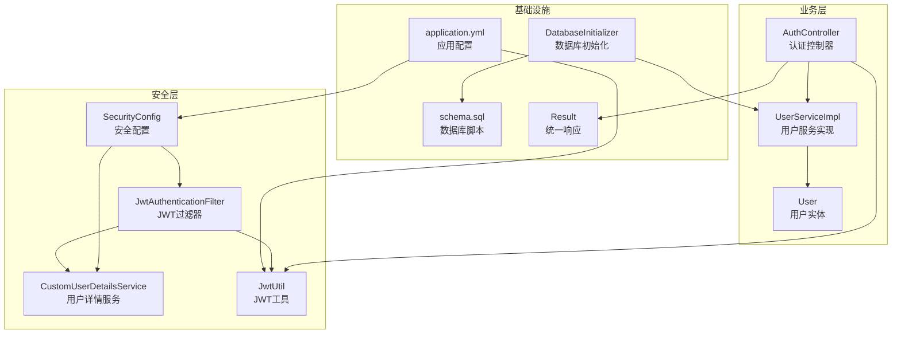
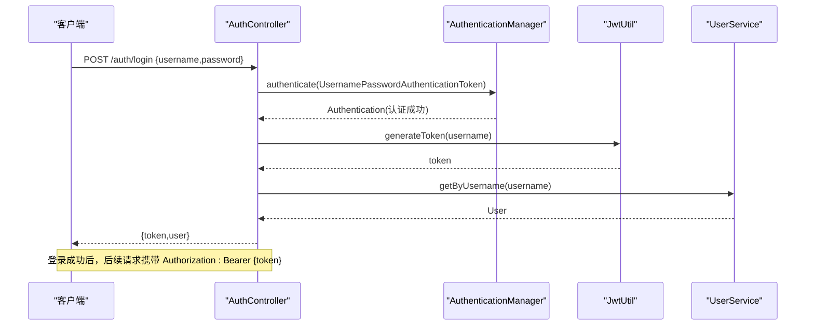
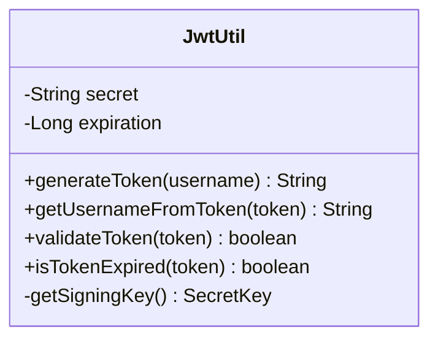
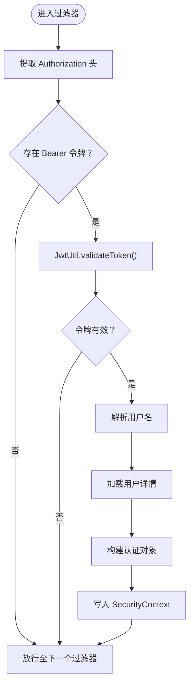
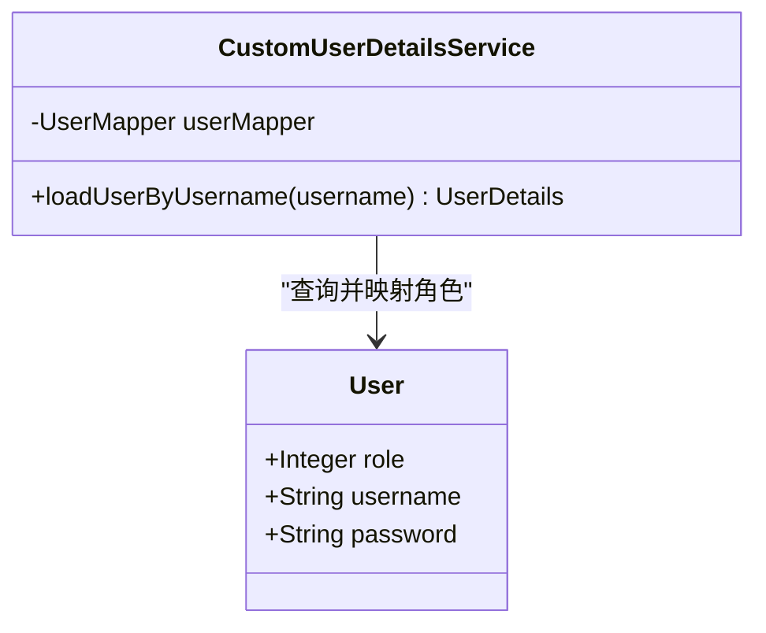
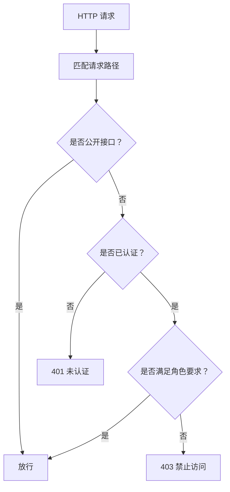
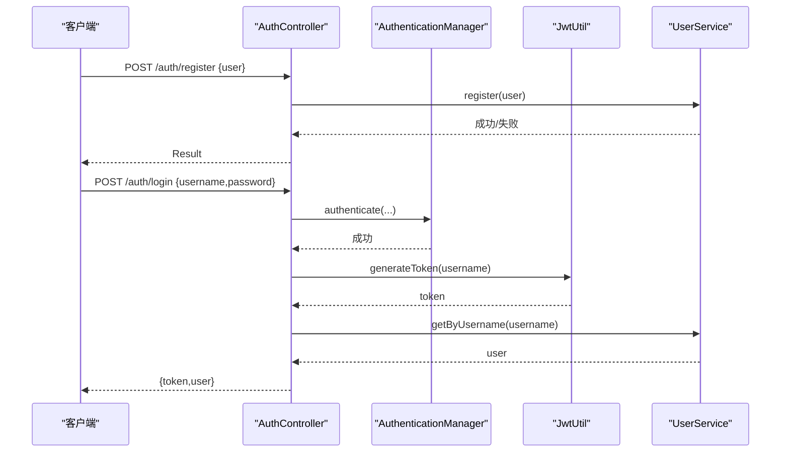
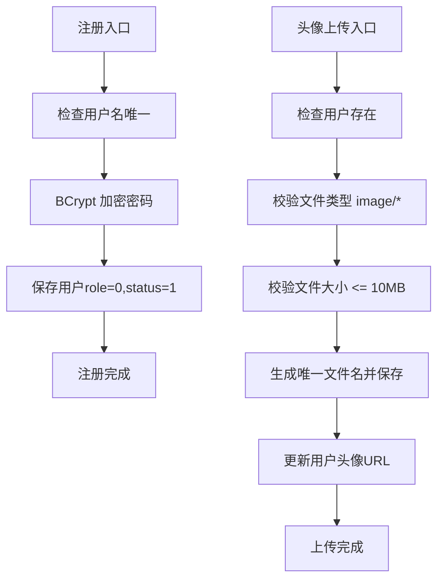
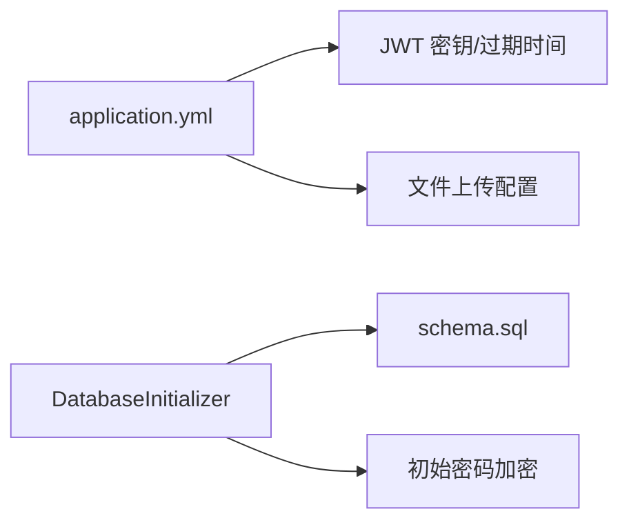
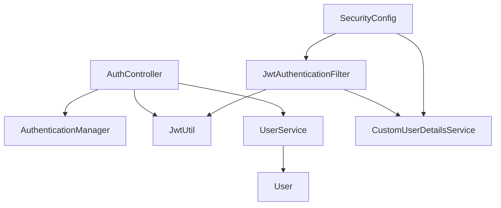

# 用户认证模块

<cite>
**本文档引用的文件**
- [JwtUtil.java](file://src/main/java/com/campus/eventsys/security/JwtUtil.java)
- [JwtAuthenticationFilter.java](file://src/main/java/com/campus/eventsys/security/JwtAuthenticationFilter.java)
- [CustomUserDetailsService.java](file://src/main/java/com/campus/eventsys/security/CustomUserDetailsService.java)
- [SecurityConfig.java](file://src/main/java/com/campus/eventsys/config/SecurityConfig.java)
- [AuthController.java](file://src/main/java/com/campus/eventsys/controller/AuthController.java)
- [UserService.java](file://src/main/java/com/campus/eventsys/service/UserService.java)
- [UserServiceImpl.java](file://src/main/java/com/campus/eventsys/service/impl/UserServiceImpl.java)
- [User.java](file://src/main/java/com/campus/eventsys/entity/User.java)
- [application.yml](file://src/main/resources/application.yml)
- [Result.java](file://src/main/java/com/campus/eventsys/common/Result.java)
- [DatabaseInitializer.java](file://src/main/java/com/campus/eventsys/config/DatabaseInitializer.java)
- [schema.sql](file://src/main/resources/db/schema.sql)
- [AdminUserController.java](file://src/main/java/com/campus/eventsys/controller/AdminUserController.java)
</cite>

## 目录
1. [简介](#简介)
2. [项目结构](#项目结构)
3. [核心组件](#核心组件)
4. [架构总览](#架构总览)
5. [详细组件分析](#详细组件分析)
6. [依赖关系分析](#依赖关系分析)
7. [性能考虑](#性能考虑)
8. [故障排查指南](#故障排查指南)
9. [结论](#结论)
10. [附录](#附录)

## 简介
本文件面向开发者与运维人员，系统性阐述用户认证模块的设计与实现，涵盖以下要点：
- JWT 令牌生成、验证与过期判断机制
- Spring Security 安全配置、权限控制与拦截器工作原理
- 用户注册、登录与权限验证的具体实现细节
- 安全最佳实践与常见安全问题的防护建议
- 结合统一响应封装与数据库初始化流程的完整认证链路

## 项目结构
认证模块位于以下包与文件中：
- 安全工具与过滤器：security/JwtUtil.java、security/JwtAuthenticationFilter.java、security/CustomUserDetailsService.java
- 安全配置：config/SecurityConfig.java
- 认证接口：controller/AuthController.java
- 用户服务与实体：service/UserService.java、service/impl/UserServiceImpl.java、entity/User.java
- 配置与基础设施：resources/application.yml、config/DatabaseInitializer.java、resources/db/schema.sql
- 权限控制示例：controller/AdminUserController.java
- 统一响应：common/Result.java

图表来源
- [SecurityConfig.java:35-71](file://src/main/java/com/campus/eventsys/config/SecurityConfig.java#L35-L71)
- [JwtAuthenticationFilter.java:21-48](file://src/main/java/com/campus/eventsys/security/JwtAuthenticationFilter.java#L21-L48)
- [CustomUserDetailsService.java:17-38](file://src/main/java/com/campus/eventsys/security/CustomUserDetailsService.java#L17-L38)
- [JwtUtil.java:25-56](file://src/main/java/com/campus/eventsys/security/JwtUtil.java#L25-L56)
- [AuthController.java:38-73](file://src/main/java/com/campus/eventsys/controller/AuthController.java#L38-L73)
- [UserServiceImpl.java:24-57](file://src/main/java/com/campus/eventsys/service/impl/UserServiceImpl.java#L24-L57)
- [application.yml:49-52](file://src/main/resources/application.yml#L49-L52)
- [DatabaseInitializer.java:34-53](file://src/main/java/com/campus/eventsys/config/DatabaseInitializer.java#L34-L53)

章节来源
- [SecurityConfig.java:35-71](file://src/main/java/com/campus/eventsys/config/SecurityConfig.java#L35-L71)
- [JwtAuthenticationFilter.java:21-48](file://src/main/java/com/campus/eventsys/security/JwtAuthenticationFilter.java#L21-L48)
- [CustomUserDetailsService.java:17-38](file://src/main/java/com/campus/eventsys/security/CustomUserDetailsService.java#L17-L38)
- [JwtUtil.java:25-56](file://src/main/java/com/campus/eventsys/security/JwtUtil.java#L25-L56)
- [AuthController.java:38-73](file://src/main/java/com/campus/eventsys/controller/AuthController.java#L38-L73)
- [UserServiceImpl.java:24-57](file://src/main/java/com/campus/eventsys/service/impl/UserServiceImpl.java#L24-L57)
- [application.yml:49-52](file://src/main/resources/application.yml#L49-L52)
- [DatabaseInitializer.java:34-53](file://src/main/java/com/campus/eventsys/config/DatabaseInitializer.java#L34-L53)

## 核心组件
- JWT 工具（JwtUtil）：负责密钥生成、令牌签发、载荷解析与校验、过期判断
- JWT 过滤器（JwtAuthenticationFilter）：从请求头提取 Bearer 令牌，验证有效性，加载用户详情，写入安全上下文
- 用户详情服务（CustomUserDetailsService）：基于用户名查询用户，构建 Spring Security 用户对象及角色
- 安全配置（SecurityConfig）：禁用 CSRF/CORS 配置、无状态会话策略、公开与受控接口映射、添加 JWT 过滤器
- 认证控制器（AuthController）：提供登录与注册接口，登录成功后签发 JWT 并返回用户信息
- 用户服务（UserServiceImpl）：注册时密码加密、保存用户；头像上传与更新用户信息
- 应用配置（application.yml）：JWT 密钥与过期时间、文件上传、OpenAPI 文档路径等
- 数据库初始化（DatabaseInitializer）：首次启动创建表与初始化数据，并对初始密码进行 BCrypt 加密

章节来源
- [JwtUtil.java:25-56](file://src/main/java/com/campus/eventsys/security/JwtUtil.java#L25-L56)
- [JwtAuthenticationFilter.java:21-48](file://src/main/java/com/campus/eventsys/security/JwtAuthenticationFilter.java#L21-L48)
- [CustomUserDetailsService.java:17-38](file://src/main/java/com/campus/eventsys/security/CustomUserDetailsService.java#L17-L38)
- [SecurityConfig.java:35-71](file://src/main/java/com/campus/eventsys/config/SecurityConfig.java#L35-L71)
- [AuthController.java:38-73](file://src/main/java/com/campus/eventsys/controller/AuthController.java#L38-L73)
- [UserServiceImpl.java:24-57](file://src/main/java/com/campus/eventsys/service/impl/UserServiceImpl.java#L24-L57)
- [application.yml:49-52](file://src/main/resources/application.yml#L49-L52)
- [DatabaseInitializer.java:58-78](file://src/main/java/com/campus/eventsys/config/DatabaseInitializer.java#L58-L78)

## 架构总览
认证模块采用“无状态 + JWT + Spring Security”的经典组合：
- 请求进入时，JWT 过滤器从 Authorization 头解析 Bearer 令牌
- 若令牌有效，解析出用户名并加载用户详情，注入到 SecurityContext
- 后续业务控制器可通过方法级安全注解（如 @PreAuthorize）进行角色校验
- 登录接口在认证通过后签发 JWT 返回给客户端

图表来源
- [AuthController.java:57-73](file://src/main/java/com/campus/eventsys/controller/AuthController.java#L57-L73)
- [JwtUtil.java:25-35](file://src/main/java/com/campus/eventsys/security/JwtUtil.java#L25-L35)
- [UserService.java:9](file://src/main/java/com/campus/eventsys/service/UserService.java#L9)

章节来源
- [AuthController.java:57-73](file://src/main/java/com/campus/eventsys/controller/AuthController.java#L57-L73)
- [JwtUtil.java:25-35](file://src/main/java/com/campus/eventsys/security/JwtUtil.java#L25-L35)
- [UserService.java:9](file://src/main/java/com/campus/eventsys/service/UserService.java#L9)

## 详细组件分析

### JWT 工具（JwtUtil）
- 密钥与签名：基于配置中的密钥字符串生成 HMAC-SHA 密钥
- 令牌生成：设置主题（用户名）、签发时间与过期时间，使用密钥签名
- 载荷解析：解析签名并获取主题（即用户名）
- 校验与过期：验证签名有效性；解析过期时间判断是否过期

图表来源
- [JwtUtil.java:13-70](file://src/main/java/com/campus/eventsys/security/JwtUtil.java#L13-L70)

章节来源
- [JwtUtil.java:13-70](file://src/main/java/com/campus/eventsys/security/JwtUtil.java#L13-L70)
- [application.yml:50-52](file://src/main/resources/application.yml#L50-L52)

### JWT 过滤器（JwtAuthenticationFilter）
- 请求处理：从 Authorization 头提取 Bearer 令牌
- 令牌验证：委托 JwtUtil 校验令牌有效性
- 用户加载：通过 CustomUserDetailsService 加载用户详情
- 上下文注入：构造 UsernamePasswordAuthenticationToken 并写入 SecurityContextHolder

图表来源
- [JwtAuthenticationFilter.java:26-47](file://src/main/java/com/campus/eventsys/security/JwtAuthenticationFilter.java#L26-L47)
- [JwtUtil.java:46-56](file://src/main/java/com/campus/eventsys/security/JwtUtil.java#L46-L56)
- [CustomUserDetailsService.java:21-38](file://src/main/java/com/campus/eventsys/security/CustomUserDetailsService.java#L21-L38)

章节来源
- [JwtAuthenticationFilter.java:21-48](file://src/main/java/com/campus/eventsys/security/JwtAuthenticationFilter.java#L21-L48)
- [JwtUtil.java:46-56](file://src/main/java/com/campus/eventsys/security/JwtUtil.java#L46-L56)
- [CustomUserDetailsService.java:21-38](file://src/main/java/com/campus/eventsys/security/CustomUserDetailsService.java#L21-L38)

### 用户详情服务（CustomUserDetailsService）
- 用户查询：按用户名查询用户，不存在则抛出异常
- 角色映射：role=1 映射为 ROLE_ADMIN，否则为 ROLE_USER
- 用户对象：返回 Spring Security 用户对象（包含用户名、密码、权限集合）

图表来源
- [CustomUserDetailsService.java:17-38](file://src/main/java/com/campus/eventsys/security/CustomUserDetailsService.java#L17-L38)
- [User.java:60](file://src/main/java/com/campus/eventsys/entity/User.java#L60)

章节来源
- [CustomUserDetailsService.java:17-38](file://src/main/java/com/campus/eventsys/security/CustomUserDetailsService.java#L17-L38)
- [User.java:60](file://src/main/java/com/campus/eventsys/entity/User.java#L60)

### 安全配置（SecurityConfig）
- 无状态策略：禁用会话，使用 STATELESS
- 公开接口：认证接口、部分公开查询接口直接放行
- 受控接口：其余接口需认证；管理员接口要求 ADMIN 角色
- 过滤器链：在用户名密码过滤器之前插入 JWT 过滤器
- CORS：允许任意来源、凭证、跨域方法与头部

图表来源
- [SecurityConfig.java:41-68](file://src/main/java/com/campus/eventsys/config/SecurityConfig.java#L41-L68)

章节来源
- [SecurityConfig.java:35-71](file://src/main/java/com/campus/eventsys/config/SecurityConfig.java#L35-L71)

### 认证控制器（AuthController）
- 登录：接收用户名与密码，交由 AuthenticationManager 认证；认证通过后使用 JwtUtil 生成令牌并返回用户信息
- 注册：调用 UserService.register，内部对密码进行 BCrypt 加密并保存用户

图表来源
- [AuthController.java:57-93](file://src/main/java/com/campus/eventsys/controller/AuthController.java#L57-L93)
- [UserServiceImpl.java:49-57](file://src/main/java/com/campus/eventsys/service/impl/UserServiceImpl.java#L49-L57)

章节来源
- [AuthController.java:57-93](file://src/main/java/com/campus/eventsys/controller/AuthController.java#L57-L93)
- [UserServiceImpl.java:49-57](file://src/main/java/com/campus/eventsys/service/impl/UserServiceImpl.java#L49-L57)

### 用户服务（UserServiceImpl）
- 注册：检查用户名唯一性，对密码进行 BCrypt 加密，设置默认角色与状态后保存
- 头像上传：校验文件类型与大小，生成唯一文件名，保存到指定目录，更新用户头像字段
- 更新用户信息：排除不允许修改的字段后更新

图表来源
- [UserServiceImpl.java:49-57](file://src/main/java/com/campus/eventsys/service/impl/UserServiceImpl.java#L49-L57)
- [UserServiceImpl.java:60-126](file://src/main/java/com/campus/eventsys/service/impl/UserServiceImpl.java#L60-L126)

章节来源
- [UserServiceImpl.java:49-57](file://src/main/java/com/campus/eventsys/service/impl/UserServiceImpl.java#L49-L57)
- [UserServiceImpl.java:60-126](file://src/main/java/com/campus/eventsys/service/impl/UserServiceImpl.java#L60-L126)

### 数据库与配置
- 应用配置：JWT 密钥与过期时间、文件上传路径与访问 URL、OpenAPI 文档路径
- 初始化脚本：创建用户表与索引，确保数据库首次启动可用
- 初始密码加密：启动时对非 BCrypt 格式的初始密码进行加密并更新

图表来源
- [application.yml:49-70](file://src/main/resources/application.yml#L49-L70)
- [DatabaseInitializer.java:58-78](file://src/main/java/com/campus/eventsys/config/DatabaseInitializer.java#L58-L78)
- [schema.sql:6-28](file://src/main/resources/db/schema.sql#L6-L28)

章节来源
- [application.yml:49-70](file://src/main/resources/application.yml#L49-L70)
- [DatabaseInitializer.java:58-78](file://src/main/java/com/campus/eventsys/config/DatabaseInitializer.java#L58-L78)
- [schema.sql:6-28](file://src/main/resources/db/schema.sql#L6-L28)

### 权限控制示例（AdminUserController）
- 方法级安全：使用 @PreAuthorize("hasRole('ADMIN')") 保护管理员接口
- 角色校验：依赖 SecurityContext 中的认证信息与用户角色进行判断
- 统一响应：返回 Result 包装的响应体

章节来源
- [AdminUserController.java:35](file://src/main/java/com/campus/eventsys/controller/AdminUserController.java#L35)
- [AdminUserController.java:52](file://src/main/java/com/campus/eventsys/controller/AdminUserController.java#L52)

## 依赖关系分析
- 控制器依赖：AuthController 依赖 AuthenticationManager、JwtUtil、UserService
- 过滤器依赖：JwtAuthenticationFilter 依赖 JwtUtil、UserDetailsService
- 服务依赖：UserServiceImpl 依赖 PasswordEncoder、UserMapper（通过 MyBatis-Plus）
- 配置依赖：SecurityConfig 依赖 JwtAuthenticationFilter、UserDetailsService、PasswordEncoder
- 实体依赖：User 实体映射数据库 user 表，包含角色与状态字段

图表来源
- [AuthController.java:38-40](file://src/main/java/com/campus/eventsys/controller/AuthController.java#L38-L40)
- [JwtAuthenticationFilter.java:23-24](file://src/main/java/com/campus/eventsys/security/JwtAuthenticationFilter.java#L23-L24)
- [SecurityConfig.java:32-33](file://src/main/java/com/campus/eventsys/config/SecurityConfig.java#L32-L33)

章节来源
- [AuthController.java:38-40](file://src/main/java/com/campus/eventsys/controller/AuthController.java#L38-L40)
- [JwtAuthenticationFilter.java:23-24](file://src/main/java/com/campus/eventsys/security/JwtAuthenticationFilter.java#L23-L24)
- [SecurityConfig.java:32-33](file://src/main/java/com/campus/eventsys/config/SecurityConfig.java#L32-L33)

## 性能考虑
- 令牌有效期：默认 24 小时，建议结合刷新策略（当前仓库未实现刷新接口）降低频繁登录成本
- 过滤器链：JWT 过滤器仅做令牌解析与用户加载，避免复杂逻辑，保持低延迟
- 密码加密：注册与初始化均使用 BCrypt，安全性高但计算开销较大，建议在批量导入场景优化批处理策略
- 数据库索引：用户表对 username、role、status 等字段建立索引，提升查询效率

## 故障排查指南
- 401 未认证
  - 检查请求头是否包含正确的 Authorization: Bearer {token}
  - 校验令牌是否过期或签名无效
- 403 禁止访问
  - 确认用户角色是否满足接口所需 ADMIN 或其他角色
- 登录失败
  - 核对用户名与密码是否正确
  - 检查用户状态是否被封禁
- 注册失败
  - 检查用户名是否重复
  - 确认密码长度与格式符合要求
- 头像上传失败
  - 检查文件类型是否为 image/*、大小是否超过 10MB
  - 确认上传目录可写且路径配置正确

章节来源
- [JwtAuthenticationFilter.java:30-47](file://src/main/java/com/campus/eventsys/security/JwtAuthenticationFilter.java#L30-L47)
- [SecurityConfig.java:64](file://src/main/java/com/campus/eventsys/config/SecurityConfig.java#L64)
- [UserServiceImpl.java:50-52](file://src/main/java/com/campus/eventsys/service/impl/UserServiceImpl.java#L50-L52)
- [UserServiceImpl.java:68-77](file://src/main/java/com/campus/eventsys/service/impl/UserServiceImpl.java#L68-L77)

## 结论
本认证模块通过 JWT 与 Spring Security 的组合实现了无状态、可扩展的用户认证与授权体系。登录流程简洁高效，注册与权限控制完善，配合统一响应与数据库初始化，形成完整的开发与部署基础。建议后续补充令牌刷新与登出机制，进一步增强用户体验与安全性。

## 附录

### API 调用示例（路径参考）
- 登录
  - POST /api/auth/login
  - 请求体：{ username, password }
  - 返回：{ token, user }
- 注册
  - POST /api/auth/register
  - 请求体：用户对象（包含必填字段 username、password）
  - 返回：Result<Void>

章节来源
- [AuthController.java:57-93](file://src/main/java/com/campus/eventsys/controller/AuthController.java#L57-L93)

### 安全最佳实践
- 传输安全：生产环境必须启用 HTTPS
- 密钥管理：JWT 密钥应妥善保管，定期轮换
- 令牌策略：短有效期 + 刷新令牌（建议实现）
- 输入校验：严格校验用户名与密码长度与格式
- 权限最小化：接口尽量细粒度控制角色与资源
- 日志审计：记录认证与授权事件，便于追踪