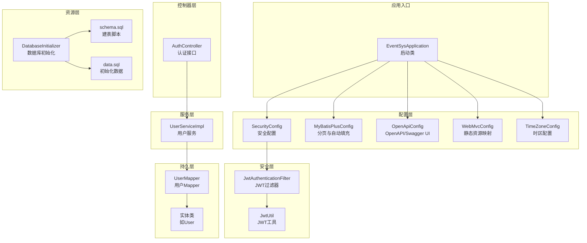
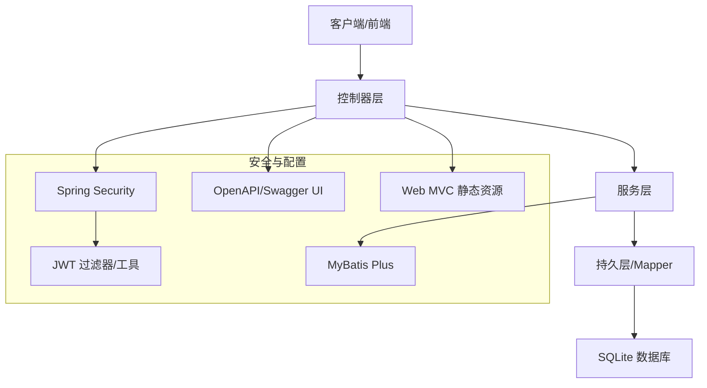
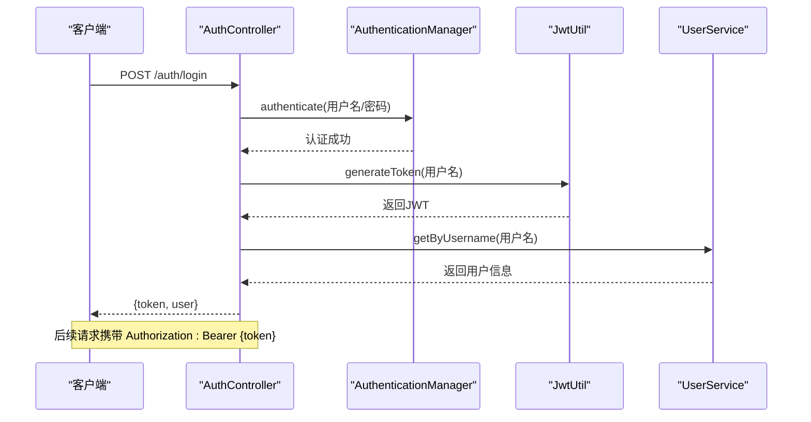
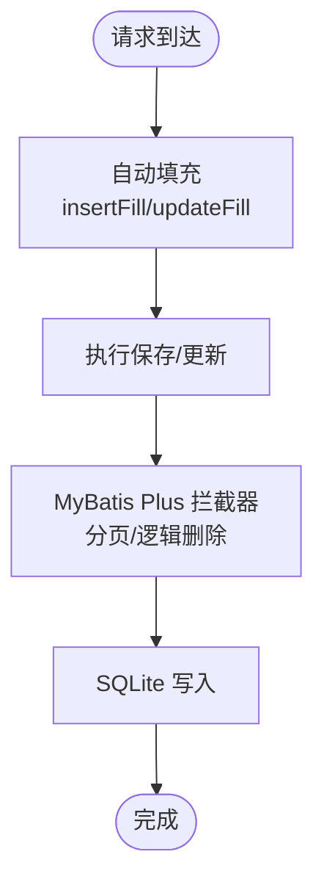
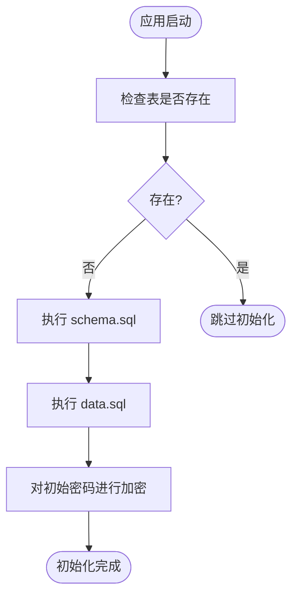
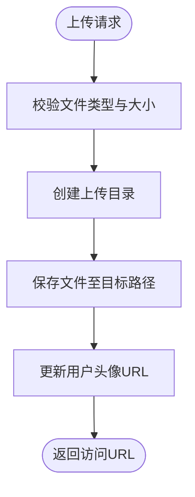
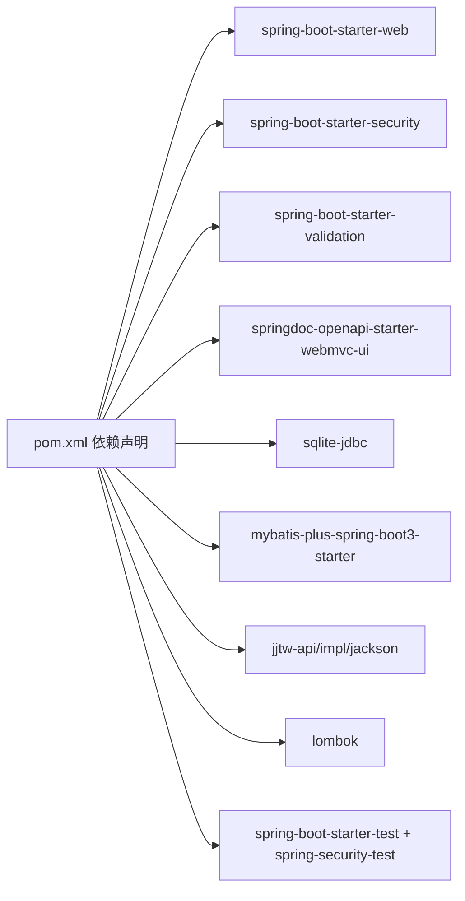

# 技术栈详解

<cite>
**本文引用的文件**
- [pom.xml](file://pom.xml)
- [application.yml](file://src/main/resources/application.yml)
- [EventSysApplication.java](file://src/main/java/com/campus/eventsys/EventSysApplication.java)
- [SecurityConfig.java](file://src/main/java/com/campus/eventsys/config/SecurityConfig.java)
- [MyBatisPlusConfig.java](file://src/main/java/com/campus/eventsys/config/MyBatisPlusConfig.java)
- [JwtUtil.java](file://src/main/java/com/campus/eventsys/security/JwtUtil.java)
- [JwtAuthenticationFilter.java](file://src/main/java/com/campus/eventsys/security/JwtAuthenticationFilter.java)
- [TimeZoneConfig.java](file://src/main/java/com/campus/eventsys/config/TimeZoneConfig.java)
- [WebMvcConfig.java](file://src/main/java/com/campus/eventsys/config/WebMvcConfig.java)
- [OpenApiConfig.java](file://src/main/java/com/campus/eventsys/config/OpenApiConfig.java)
- [User.java](file://src/main/java/com/campus/eventsys/entity/User.java)
- [AuthController.java](file://src/main/java/com/campus/eventsys/controller/AuthController.java)
- [UserServiceImpl.java](file://src/main/java/com/campus/eventsys/service/impl/UserServiceImpl.java)
- [UserMapper.java](file://src/main/java/com/campus/eventsys/mapper/UserMapper.java)
- [schema.sql](file://src/main/resources/db/schema.sql)
- [data.sql](file://src/main/resources/db/data.sql)
- [DatabaseInitializer.java](file://src/main/java/com/campus/eventsys/config/DatabaseInitializer.java)
</cite>

## 目录
1. [引言](#引言)
2. [项目结构](#项目结构)
3. [核心组件](#核心组件)
4. [架构总览](#架构总览)
5. [详细组件分析](#详细组件分析)
6. [依赖分析](#依赖分析)
7. [性能考虑](#性能考虑)
8. [故障排查指南](#故障排查指南)
9. [结论](#结论)
10. [附录](#附录)

## 引言
本文件面向技术决策者与开发者，系统化梳理校园活动管理系统的技术栈选择与实现细节。重点覆盖以下技术组件：
- Spring Boot 3.2.0：应用框架与自动装配
- MyBatis Plus 3.5.5：持久层增强与代码生成
- Spring Security + JWT：无状态认证与授权
- SQLite：轻量级本地数据库
- 其他支撑组件：OpenAPI/Swagger UI、文件上传、时区与自动填充

文档将从功能定位、版本要求、配置要点、依赖关系、版本兼容性、性能与可维护性权衡等方面展开，并提供可视化图示与排障建议。

## 项目结构
项目采用标准的 Spring Boot 多模块结构，按领域与层次划分清晰：
- 配置层：Security、MyBatis Plus、OpenAPI、Web MVC、时区与时钟
- 安全层：JWT 工具与过滤器、用户细节服务
- 控制器层：REST API 控制器
- 服务层：业务逻辑与数据处理
- 持久层：Mapper 接口与 XML 映射
- 实体层：MyBatis Plus 注解实体
- 资源层：数据库脚本、YAML 配置、OpenAPI 文档

图表来源
- [EventSysApplication.java:1-17](file://src/main/java/com/campus/eventsys/EventSysApplication.java#L1-L17)
- [SecurityConfig.java:1-100](file://src/main/java/com/campus/eventsys/config/SecurityConfig.java#L1-L100)
- [MyBatisPlusConfig.java:1-58](file://src/main/java/com/campus/eventsys/config/MyBatisPlusConfig.java#L1-L58)
- [OpenApiConfig.java:1-52](file://src/main/java/com/campus/eventsys/config/OpenApiConfig.java#L1-L52)
- [WebMvcConfig.java:1-38](file://src/main/java/com/campus/eventsys/config/WebMvcConfig.java#L1-L38)
- [TimeZoneConfig.java:1-34](file://src/main/java/com/campus/eventsys/config/TimeZoneConfig.java#L1-L34)
- [JwtUtil.java:1-71](file://src/main/java/com/campus/eventsys/security/JwtUtil.java#L1-L71)
- [JwtAuthenticationFilter.java:1-58](file://src/main/java/com/campus/eventsys/security/JwtAuthenticationFilter.java#L1-L58)
- [AuthController.java:1-106](file://src/main/java/com/campus/eventsys/controller/AuthController.java#L1-L106)
- [UserServiceImpl.java:1-158](file://src/main/java/com/campus/eventsys/service/impl/UserServiceImpl.java#L1-L158)
- [UserMapper.java:1-10](file://src/main/java/com/campus/eventsys/mapper/UserMapper.java#L1-L10)
- [User.java:1-85](file://src/main/java/com/campus/eventsys/entity/User.java#L1-L85)
- [DatabaseInitializer.java:1-115](file://src/main/java/com/campus/eventsys/config/DatabaseInitializer.java#L1-L115)
- [schema.sql:1-295](file://src/main/resources/db/schema.sql#L1-L295)
- [data.sql:1-335](file://src/main/resources/db/data.sql#L1-L335)

章节来源
- [EventSysApplication.java:1-17](file://src/main/java/com/campus/eventsys/EventSysApplication.java#L1-L17)
- [pom.xml:1-131](file://pom.xml#L1-L131)
- [application.yml:1-76](file://src/main/resources/application.yml#L1-L76)

## 核心组件
本节从“为什么选”“如何用”“注意点”三个维度解析核心技术栈。

- Spring Boot 3.2.0
  - 选择原因：稳定的企业级开发框架，提供自动配置、内嵌服务器、生产就绪特性；与 Java 17 生态契合。
  - 版本要求：Java 17；与 Spring Security 6.x、MyBatis Plus 3.x 兼容良好。
  - 配置要点：启动类启用 Mapper 扫描与定时任务；YAML 中集中配置数据源、MyBatis Plus、OpenAPI、文件上传等。
  - 权衡考虑：开发效率高、生态成熟，但对初学者学习曲线较陡；通过合理分层与配置可保持可维护性。

- MyBatis Plus 3.5.5
  - 选择原因：简化 CRUD、内置分页、自动填充、逻辑删除；对 SQLite 的分页与主键策略适配完善。
  - 版本要求：与 Spring Boot 3.x Starter 兼容；需显式声明分页插件 DbType 为 SQLITE。
  - 配置要点：全局配置驼峰映射、XML 扫描路径、逻辑删除字段；实体使用注解定义主键与自动填充。
  - 权衡考虑：减少样板代码、提升开发效率；复杂 SQL 场景仍需 XML 或条件构造器配合。

- Spring Security + JWT
  - 选择原因：无状态认证适合微服务与移动端；JWT 解耦鉴权与会话。
  - 版本要求：Spring Security 6.x 使用响应式与函数式安全配置；BCrypt 密码编码器。
  - 配置要点：禁用 CSRF、配置 CORS、无状态 Session、放行公开接口、添加 JWT 过滤器链；控制器返回 token 与用户信息。
  - 权衡考虑：安全性与可扩展性较好；需关注 token 生命周期与刷新策略。

- SQLite
  - 选择原因：零配置、单文件、适合教学与演示；与 MyBatis Plus 配置兼容。
  - 版本要求：驱动版本与 JDBC 兼容；MyBatis Plus 需指定 DbType 为 SQLITE。
  - 配置要点：YAML 配置驱动类、JDBC URL、初始化模式；应用启动时自动执行 schema 与 data 脚本。
  - 权衡考虑：I/O 性能不及 MySQL/PostgreSQL；并发写入受限；适合中小规模场景。

- OpenAPI/Swagger UI
  - 选择原因：快速生成 API 文档，便于前后端协作。
  - 配置要点：定义安全方案、路径与排序；与 Spring MVC 集成。
  - 权衡考虑：文档即代码，需同步维护；生产环境建议控制访问。

- 文件上传与静态资源
  - 选择原因：支持图片上传与访问；静态资源映射便于调试与部署。
  - 配置要点：上传路径、访问 URL、Multipart 参数、静态资源 handler。
  - 权衡考虑：需注意文件类型与大小限制、磁盘空间与缓存策略。

章节来源
- [pom.xml:21-104](file://pom.xml#L21-L104)
- [application.yml:10-76](file://src/main/resources/application.yml#L10-L76)
- [MyBatisPlusConfig.java:25-56](file://src/main/java/com/campus/eventsys/config/MyBatisPlusConfig.java#L25-L56)
- [SecurityConfig.java:35-98](file://src/main/java/com/campus/eventsys/config/SecurityConfig.java#L35-L98)
- [JwtUtil.java:25-56](file://src/main/java/com/campus/eventsys/security/JwtUtil.java#L25-L56)
- [OpenApiConfig.java:24-50](file://src/main/java/com/campus/eventsys/config/OpenApiConfig.java#L24-L50)
- [WebMvcConfig.java:18-36](file://src/main/java/com/campus/eventsys/config/WebMvcConfig.java#L18-L36)
- [DatabaseInitializer.java:34-78](file://src/main/java/com/campus/eventsys/config/DatabaseInitializer.java#L34-L78)

## 架构总览
系统采用经典的分层架构：控制器层接收请求，服务层编排业务，持久层负责数据访问，安全层贯穿认证与授权，配置层统一管理外部依赖与行为。

图表来源
- [AuthController.java:34-73](file://src/main/java/com/campus/eventsys/controller/AuthController.java#L34-L73)
- [SecurityConfig.java:35-71](file://src/main/java/com/campus/eventsys/config/SecurityConfig.java#L35-L71)
- [JwtAuthenticationFilter.java:26-48](file://src/main/java/com/campus/eventsys/security/JwtAuthenticationFilter.java#L26-L48)
- [JwtUtil.java:25-56](file://src/main/java/com/campus/eventsys/security/JwtUtil.java#L25-L56)
- [MyBatisPlusConfig.java:25-56](file://src/main/java/com/campus/eventsys/config/MyBatisPlusConfig.java#L25-L56)
- [OpenApiConfig.java:24-50](file://src/main/java/com/campus/eventsys/config/OpenApiConfig.java#L24-L50)
- [WebMvcConfig.java:22-36](file://src/main/java/com/campus/eventsys/config/WebMvcConfig.java#L22-L36)

## 详细组件分析

### Spring Security + JWT 认证流程
该流程确保登录成功后颁发 JWT，后续请求通过 Authorization 头携带，过滤器解析并注入认证上下文。

图表来源
- [AuthController.java:57-73](file://src/main/java/com/campus/eventsys/controller/AuthController.java#L57-L73)
- [JwtUtil.java:25-35](file://src/main/java/com/campus/eventsys/security/JwtUtil.java#L25-L35)
- [UserServiceImpl.java:34-46](file://src/main/java/com/campus/eventsys/service/impl/UserServiceImpl.java#L34-L46)

章节来源
- [SecurityConfig.java:35-71](file://src/main/java/com/campus/eventsys/config/SecurityConfig.java#L35-L71)
- [JwtAuthenticationFilter.java:26-48](file://src/main/java/com/campus/eventsys/security/JwtAuthenticationFilter.java#L26-L48)
- [JwtUtil.java:25-70](file://src/main/java/com/campus/eventsys/security/JwtUtil.java#L25-L70)
- [AuthController.java:57-73](file://src/main/java/com/campus/eventsys/controller/AuthController.java#L57-L73)

### MyBatis Plus 自动填充与分页
- 自动填充：插入与更新时统一填充 createTime/updateTime/deleted 字段，使用 GMT+8 时区。
- 分页插件：针对 SQLite 的分页拦截器，设置最大限制与溢出策略。
- 逻辑删除：基于 deleted 字段的软删除策略，避免误删。

图表来源
- [MyBatisPlusConfig.java:40-56](file://src/main/java/com/campus/eventsys/config/MyBatisPlusConfig.java#L40-L56)
- [User.java:72-83](file://src/main/java/com/campus/eventsys/entity/User.java#L72-L83)

章节来源
- [MyBatisPlusConfig.java:25-56](file://src/main/java/com/campus/eventsys/config/MyBatisPlusConfig.java#L25-L56)
- [User.java:17-83](file://src/main/java/com/campus/eventsys/entity/User.java#L17-L83)

### 数据库初始化与迁移
- 初始化策略：应用启动时检测表是否存在，不存在则执行 schema.sql 与 data.sql，并对初始明文密码进行 BCrypt 加密。
- 脚本位置：resources/db 下的 schema.sql 与 data.sql。
- 与 YAML 配置联动：关闭 Spring 默认初始化，改用自定义初始化器。

图表来源
- [DatabaseInitializer.java:34-78](file://src/main/java/com/campus/eventsys/config/DatabaseInitializer.java#L34-L78)
- [schema.sql:1-295](file://src/main/resources/db/schema.sql#L1-L295)
- [data.sql:1-335](file://src/main/resources/db/data.sql#L1-L335)
- [application.yml:18-19](file://src/main/resources/application.yml#L18-L19)

章节来源
- [DatabaseInitializer.java:34-114](file://src/main/java/com/campus/eventsys/config/DatabaseInitializer.java#L34-L114)
- [application.yml:10-19](file://src/main/resources/application.yml#L10-L19)

### 文件上传与静态资源访问
- 上传限制：最大文件 10MB，请求总大小 20MB。
- 存储路径：配置项 file.upload.path，默认 uploads/images。
- 访问路径：/uploads/images/** 与 /images/** 均可访问。
- 头像上传：用户头像独立目录 avatars，支持替换旧头像。

图表来源
- [UserServiceImpl.java:60-126](file://src/main/java/com/campus/eventsys/service/impl/UserServiceImpl.java#L60-L126)
- [WebMvcConfig.java:22-36](file://src/main/java/com/campus/eventsys/config/WebMvcConfig.java#L22-L36)
- [application.yml:65-69](file://src/main/resources/application.yml#L65-L69)

章节来源
- [UserServiceImpl.java:28-126](file://src/main/java/com/campus/eventsys/service/impl/UserServiceImpl.java#L28-L126)
- [WebMvcConfig.java:18-36](file://src/main/java/com/campus/eventsys/config/WebMvcConfig.java#L18-L36)
- [application.yml:22-26](file://src/main/resources/application.yml#L22-L26)

## 依赖分析
- 核心依赖
  - spring-boot-starter-web：提供 Web 开发所需依赖
  - spring-boot-starter-security：安全与认证
  - spring-boot-starter-validation：参数校验
  - springdoc-openapi-starter-webmvc-ui：OpenAPI/Swagger UI
  - sqlite-jdbc：SQLite 驱动
  - mybatis-plus-spring-boot3-starter：MyBatis Plus
  - jjwt-api/impl/jackson：JWT
  - lombok：简化实体与配置类
- 构建与测试
  - spring-boot-maven-plugin：打包
  - maven-surefire-plugin：测试执行

图表来源
- [pom.xml:27-104](file://pom.xml#L27-L104)

章节来源
- [pom.xml:21-104](file://pom.xml#L21-L104)

## 性能考虑
- 数据库层面
  - SQLite 单机、无事务并发写入限制；建议读多写少场景或低并发演示。
  - 合理使用索引（schema.sql 中已创建常用索引），避免全表扫描。
- ORM 层面
  - MyBatis Plus 分页插件对 SQLite 有效；注意最大限制与溢出策略。
  - 自动填充减少冗余字段，逻辑删除降低误删风险。
- 安全与网络
  - JWT 无状态，减少会话存储开销；注意 token 大小与传输安全。
  - CORS 放行策略应最小化暴露，生产环境谨慎放开 credentials。
- 文件上传
  - 限制文件大小与类型，避免磁盘耗尽；静态资源设置缓存周期提升访问速度。

## 故障排查指南
- 登录失败
  - 检查用户名/密码是否正确；确认密码已被 BCrypt 加密。
  - 关注 SecurityConfig 的认证提供器与密码编码器配置。
- JWT 校验失败
  - 检查 Authorization 头格式是否为 Bearer Token；核对密钥与过期时间。
- 数据库初始化异常
  - 查看初始化器日志，确认 schema.sql 与 data.sql 是否存在；检查 SQLite 驱动版本。
- 文件上传失败
  - 检查上传目录权限、磁盘空间、文件类型与大小限制；确认静态资源映射路径。

章节来源
- [SecurityConfig.java:78-84](file://src/main/java/com/campus/eventsys/config/SecurityConfig.java#L78-L84)
- [JwtAuthenticationFilter.java:30-45](file://src/main/java/com/campus/eventsys/security/JwtAuthenticationFilter.java#L30-L45)
- [JwtUtil.java:46-69](file://src/main/java/com/campus/eventsys/security/JwtUtil.java#L46-L69)
- [DatabaseInitializer.java:34-53](file://src/main/java/com/campus/eventsys/config/DatabaseInitializer.java#L34-L53)
- [UserServiceImpl.java:60-126](file://src/main/java/com/campus/eventsys/service/impl/UserServiceImpl.java#L60-L126)

## 结论
本项目以 Spring Boot 3.2.0 为核心，结合 MyBatis Plus 3.5.5、Spring Security + JWT、SQLite 与 OpenAPI/Swagger UI，构建了一个功能完备、易于维护的教学演示系统。技术选型在易用性、可维护性与扩展性之间取得平衡，适合中小型校园场景与教学实践。若未来业务增长，可逐步引入缓存、异步任务、分布式限流与更强大的数据库。

## 附录
- 版本兼容性摘要
  - Spring Boot 3.2.0 + Java 17 + Spring Security 6.x + MyBatis Plus 3.5.5 + SQLite JDBC 3.44.1.0 + jjwt 0.12.3
- 关键配置清单
  - 数据源与 MyBatis Plus：application.yml 中 datasource、mybatis-plus
  - JWT：application.yml 中 jwt.secret 与 jwt.expiration
  - 文件上传：application.yml 中 file.upload.path 与 file.access.url
  - OpenAPI：application.yml 中 springdoc 配置
- 建议
  - 生产环境关闭 Swagger UI 或限制访问
  - 对敏感操作增加方法级安全注解与审计日志
  - 为高并发场景评估引入 Redis 缓存与数据库连接池优化