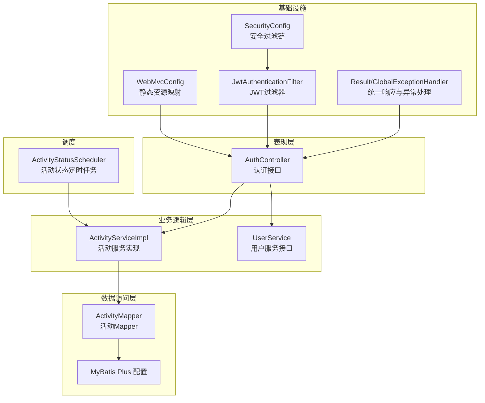
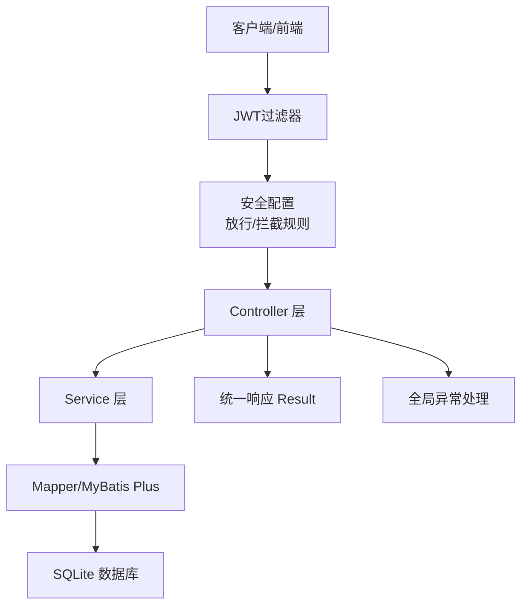
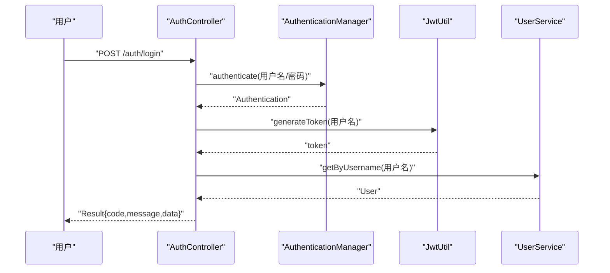
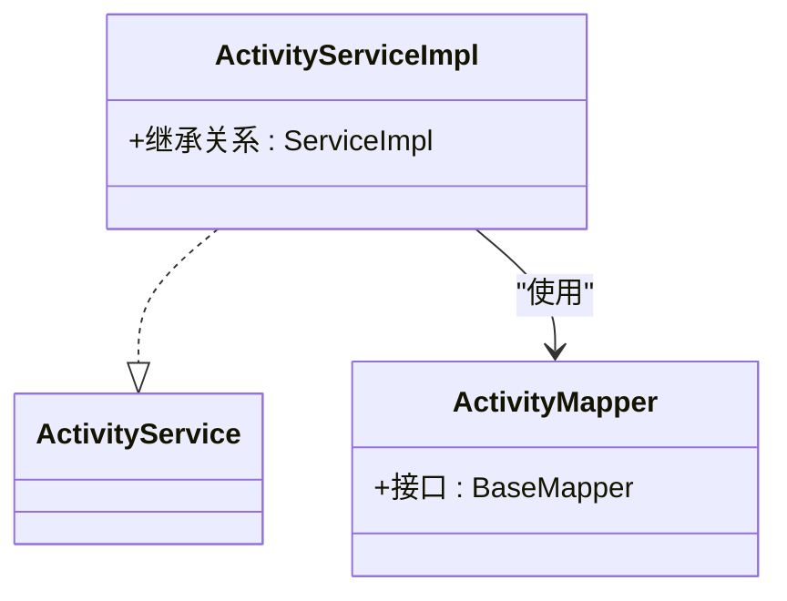
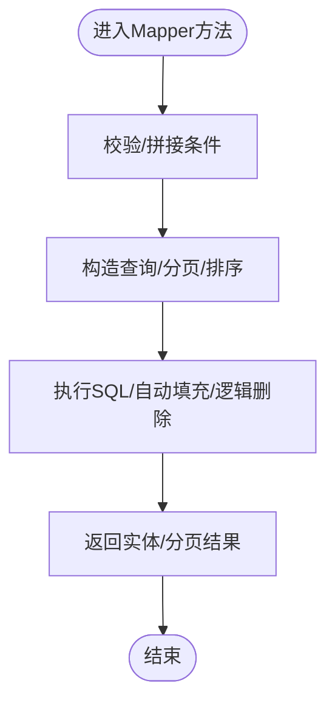
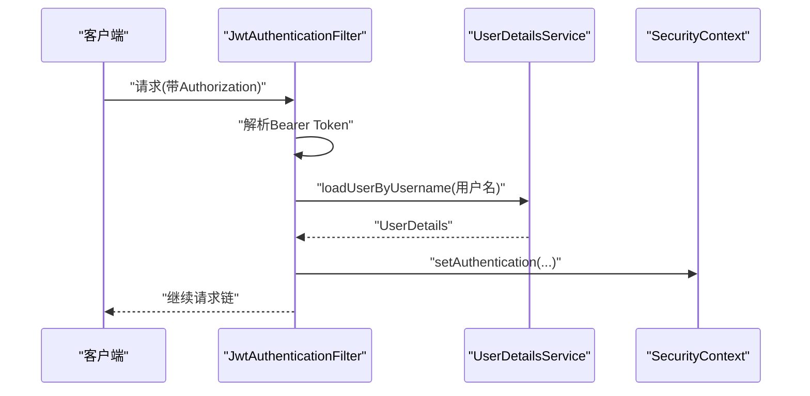
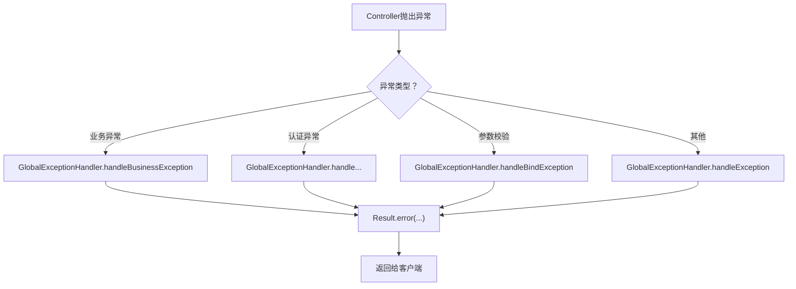
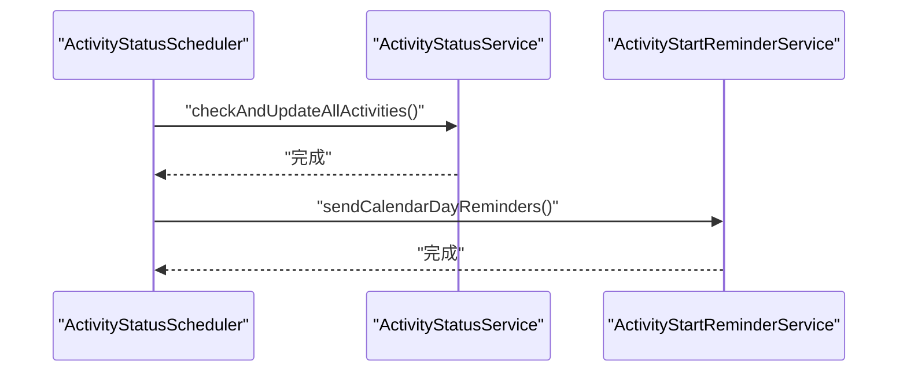
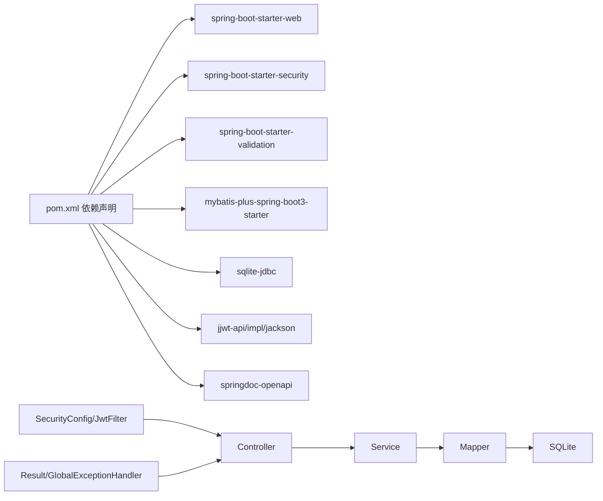

# 整体架构设计

<cite>
**本文引用的文件**
- [EventSysApplication.java](file://src/main/java/com/campus/eventsys/EventSysApplication.java)
- [pom.xml](file://pom.xml)
- [application.yml](file://src/main/resources/application.yml)
- [Result.java](file://src/main/java/com/campus/eventsys/common/Result.java)
- [GlobalExceptionHandler.java](file://src/main/java/com/campus/eventsys/common/GlobalExceptionHandler.java)
- [SecurityConfig.java](file://src/main/java/com/campus/eventsys/config/SecurityConfig.java)
- [WebMvcConfig.java](file://src/main/java/com/campus/eventsys/config/WebMvcConfig.java)
- [MyBatisPlusConfig.java](file://src/main/java/com/campus/eventsys/config/MyBatisPlusConfig.java)
- [JwtAuthenticationFilter.java](file://src/main/java/com/campus/eventsys/security/JwtAuthenticationFilter.java)
- [AuthController.java](file://src/main/java/com/campus/eventsys/controller/AuthController.java)
- [ActivityServiceImpl.java](file://src/main/java/com/campus/eventsys/service/impl/ActivityServiceImpl.java)
- [ActivityMapper.java](file://src/main/java/com/campus/eventsys/mapper/ActivityMapper.java)
- [Activity.java](file://src/main/java/com/campus/eventsys/entity/Activity.java)
- [ActivityStatusScheduler.java](file://src/main/java/com/campus/eventsys/scheduler/ActivityStatusScheduler.java)
- [表设计.md](file://picture/表设计.md)
</cite>

## 目录
1. [引言](#引言)
2. [项目结构](#项目结构)
3. [核心组件](#核心组件)
4. [架构总览](#架构总览)
5. [详细组件分析](#详细组件分析)
6. [依赖分析](#依赖分析)
7. [性能考虑](#性能考虑)
8. [故障排查指南](#故障排查指南)
9. [结论](#结论)
10. [附录](#附录)

## 引言
本文件面向架构师与开发者，系统性阐述“校园活动管理系统”的整体架构设计。项目采用分层架构与MVC模式相结合的方式，围绕表现层（Controller）、业务逻辑层（Service）、数据访问层（Mapper/MyBatis Plus）构建清晰的职责边界与交互关系；同时通过统一响应包装、全局异常处理、基于JWT的安全过滤链、静态资源映射与MyBatis Plus配置，形成稳定、可扩展且易于维护的系统视图。

## 项目结构
项目采用标准的Spring Boot多模块分层组织方式：
- 表现层：controller 包，负责HTTP接口暴露与请求参数封装
- 业务逻辑层：service 与 service/impl 包，封装领域业务规则与流程编排
- 数据访问层：mapper 包与 MyBatis Plus XML映射，完成数据库CRUD与复杂查询
- 实体模型：entity 包，承载持久化对象与字段元数据
- 安全与配置：config 包，涵盖安全过滤、跨域、MVC资源映射、MyBatis Plus配置
- 安全工具：security 包，JWT解析与认证上下文注入
- 通用工具：common 包，统一响应与全局异常处理
- 调度：scheduler 包，定时任务驱动活动状态与提醒
- 资源与测试：resources、uploads、test

图表来源
- [EventSysApplication.java:1-17](file://src/main/java/com/campus/eventsys/EventSysApplication.java#L1-L17)
- [SecurityConfig.java:35-71](file://src/main/java/com/campus/eventsys/config/SecurityConfig.java#L35-L71)
- [WebMvcConfig.java:16-37](file://src/main/java/com/campus/eventsys/config/WebMvcConfig.java#L16-L37)
- [MyBatisPlusConfig.java:18-57](file://src/main/java/com/campus/eventsys/config/MyBatisPlusConfig.java#L18-L57)
- [JwtAuthenticationFilter.java:19-57](file://src/main/java/com/campus/eventsys/security/JwtAuthenticationFilter.java#L19-L57)
- [AuthController.java:33-105](file://src/main/java/com/campus/eventsys/controller/AuthController.java#L33-L105)
- [ActivityServiceImpl.java:9-11](file://src/main/java/com/campus/eventsys/service/impl/ActivityServiceImpl.java#L9-L11)
- [ActivityMapper.java:7-9](file://src/main/java/com/campus/eventsys/mapper/ActivityMapper.java#L7-L9)
- [ActivityStatusScheduler.java:14-41](file://src/main/java/com/campus/eventsys/scheduler/ActivityStatusScheduler.java#L14-L41)

章节来源
- [EventSysApplication.java:1-17](file://src/main/java/com/campus/eventsys/EventSysApplication.java#L1-L17)
- [pom.xml:27-104](file://pom.xml#L27-L104)
- [application.yml:1-76](file://src/main/resources/application.yml#L1-L76)

## 核心组件
- 应用入口与扫描
  - 启动类启用Mapper扫描与定时任务，作为应用装配入口
- 统一响应与异常处理
  - 统一响应包装类用于标准化接口返回
  - 全局异常处理器集中处理业务异常、认证异常、参数校验异常、文件大小异常等
- 安全与认证
  - 基于JWT的无状态认证，通过过滤器在每次请求时解析令牌并注入认证上下文
  - 安全配置对公开接口与受保护接口进行细粒度放行与拦截
- 数据访问与ORM
  - MyBatis Plus提供分页、自动填充、逻辑删除等能力，并针对SQLite进行适配
- 静态资源映射
  - 将上传目录映射为可访问的静态资源路径，支持Swagger与图片访问
- 定时任务
  - 自动检查与更新活动状态、发送开始提醒，保障业务状态一致性

章节来源
- [Result.java:10-54](file://src/main/java/com/campus/eventsys/common/Result.java#L10-L54)
- [GlobalExceptionHandler.java:16-107](file://src/main/java/com/campus/eventsys/common/GlobalExceptionHandler.java#L16-L107)
- [SecurityConfig.java:35-84](file://src/main/java/com/campus/eventsys/config/SecurityConfig.java#L35-L84)
- [JwtAuthenticationFilter.java:26-48](file://src/main/java/com/campus/eventsys/security/JwtAuthenticationFilter.java#L26-L48)
- [MyBatisPlusConfig.java:25-56](file://src/main/java/com/campus/eventsys/config/MyBatisPlusConfig.java#L25-L56)
- [WebMvcConfig.java:21-36](file://src/main/java/com/campus/eventsys/config/WebMvcConfig.java#L21-L36)
- [ActivityStatusScheduler.java:31-40](file://src/main/java/com/campus/eventsys/scheduler/ActivityStatusScheduler.java#L31-L40)

## 架构总览
系统采用分层架构与MVC模式：
- 表现层（Controller）：接收HTTP请求，调用Service，返回Result包装的响应
- 业务层（Service）：编排领域逻辑，协调多个Mapper与外部服务
- 数据访问层（Mapper/MyBatis Plus）：执行SQL与映射，提供数据存取能力
- 基础设施层：安全过滤、静态资源、ORM配置、异常处理

图表来源
- [SecurityConfig.java:35-71](file://src/main/java/com/campus/eventsys/config/SecurityConfig.java#L35-L71)
- [JwtAuthenticationFilter.java:26-48](file://src/main/java/com/campus/eventsys/security/JwtAuthenticationFilter.java#L26-L48)
- [AuthController.java:33-105](file://src/main/java/com/campus/eventsys/controller/AuthController.java#L33-L105)
- [Result.java:31-53](file://src/main/java/com/campus/eventsys/common/Result.java#L31-L53)
- [GlobalExceptionHandler.java:20-106](file://src/main/java/com/campus/eventsys/common/GlobalExceptionHandler.java#L20-L106)

## 详细组件分析

### 控制器层（Controller）
- 职责边界
  - 负责HTTP接口定义、参数校验、调用Service、组装Result响应
  - 对公开查询接口进行放行，对管理端接口进行角色校验
- 典型实现
  - 认证控制器：登录、注册接口，返回token与用户信息
  - 活动相关控制器：活动列表、详情、报名、签到、收藏、评价、状态查询等
- 与Service交互
  - 通过依赖注入获取Service实例，按需调用业务方法
- 与安全集成
  - 通过安全配置与JWT过滤器确保受保护接口的认证有效性

图表来源
- [AuthController.java:57-73](file://src/main/java/com/campus/eventsys/controller/AuthController.java#L57-L73)
- [SecurityConfig.java:41-67](file://src/main/java/com/campus/eventsys/config/SecurityConfig.java#L41-L67)

章节来源
- [AuthController.java:33-105](file://src/main/java/com/campus/eventsys/controller/AuthController.java#L33-L105)
- [SecurityConfig.java:41-67](file://src/main/java/com/campus/eventsys/config/SecurityConfig.java#L41-L67)

### 业务逻辑层（Service）
- 职责边界
  - 封装业务规则与流程，协调多个Mapper与领域服务
  - 事务边界与幂等性保障（由Service层策略与Mapper配合实现）
- 典型实现
  - 活动服务实现：继承MyBatis Plus的ServiceImpl，直接获得常用CRUD能力
  - 用户服务：注册、查询等用户相关业务
- 与Mapper交互
  - 通过Mapper执行数据存取，必要时组合多个Mapper以完成复杂业务

图表来源
- [ActivityServiceImpl.java:9-11](file://src/main/java/com/campus/eventsys/service/impl/ActivityServiceImpl.java#L9-L11)
- [ActivityMapper.java:7-9](file://src/main/java/com/campus/eventsys/mapper/ActivityMapper.java#L7-L9)

章节来源
- [ActivityServiceImpl.java:9-11](file://src/main/java/com/campus/eventsys/service/impl/ActivityServiceImpl.java#L9-L11)
- [ActivityMapper.java:7-9](file://src/main/java/com/campus/eventsys/mapper/ActivityMapper.java#L7-L9)

### 数据访问层（Mapper/MyBatis Plus）
- 职责边界
  - 提供实体对象的增删改查能力，支持分页、条件构造、自动填充与逻辑删除
- ORM特性
  - 分页插件针对SQLite优化
  - 自动填充插入/更新时间与逻辑删除字段
- 实体映射
  - 通过注解与XML映射，实现驼峰命名与字段填充

图表来源
- [MyBatisPlusConfig.java:25-56](file://src/main/java/com/campus/eventsys/config/MyBatisPlusConfig.java#L25-L56)
- [ActivityMapper.java:7-9](file://src/main/java/com/campus/eventsys/mapper/ActivityMapper.java#L7-L9)
- [Activity.java:17-94](file://src/main/java/com/campus/eventsys/entity/Activity.java#L17-L94)

章节来源
- [MyBatisPlusConfig.java:18-57](file://src/main/java/com/campus/eventsys/config/MyBatisPlusConfig.java#L18-L57)
- [Activity.java:13-94](file://src/main/java/com/campus/eventsys/entity/Activity.java#L13-L94)

### 安全与认证（Security/JWT）
- 过滤器链
  - 禁用CSRF，开启跨域，无状态会话，公开接口放行，其余接口需认证
  - JWT过滤器从请求头提取令牌，验证后注入认证上下文
- 认证与授权
  - 认证管理器使用UserDetailsService与BCrypt密码编码器
  - 管理员接口统一拦截并要求ADMIN角色

图表来源
- [JwtAuthenticationFilter.java:26-48](file://src/main/java/com/campus/eventsys/security/JwtAuthenticationFilter.java#L26-L48)
- [SecurityConfig.java:35-84](file://src/main/java/com/campus/eventsys/config/SecurityConfig.java#L35-L84)

章节来源
- [SecurityConfig.java:35-84](file://src/main/java/com/campus/eventsys/config/SecurityConfig.java#L35-L84)
- [JwtAuthenticationFilter.java:19-57](file://src/main/java/com/campus/eventsys/security/JwtAuthenticationFilter.java#L19-L57)

### 统一响应与异常处理
- 统一响应
  - Result类提供成功/错误模板方法，统一返回状态码、消息与数据
- 全局异常
  - 捕获业务异常、认证异常、参数校验异常、文件大小异常等，返回对应状态码与提示

图表来源
- [Result.java:31-53](file://src/main/java/com/campus/eventsys/common/Result.java#L31-L53)
- [GlobalExceptionHandler.java:20-106](file://src/main/java/com/campus/eventsys/common/GlobalExceptionHandler.java#L20-L106)

章节来源
- [Result.java:10-54](file://src/main/java/com/campus/eventsys/common/Result.java#L10-L54)
- [GlobalExceptionHandler.java:16-107](file://src/main/java/com/campus/eventsys/common/GlobalExceptionHandler.java#L16-L107)

### 定时任务与状态流转
- 作用
  - 定时检查活动状态并自动更新，发送开始提醒，保证业务状态一致性
- 触发频率
  - 固定周期执行，捕获异常并记录日志，不影响其他任务

图表来源
- [ActivityStatusScheduler.java:31-40](file://src/main/java/com/campus/eventsys/scheduler/ActivityStatusScheduler.java#L31-L40)

章节来源
- [ActivityStatusScheduler.java:14-41](file://src/main/java/com/campus/eventsys/scheduler/ActivityStatusScheduler.java#L14-L41)

## 依赖分析
- 外部依赖
  - Spring Boot Starter Web/Security/Validation/Test
  - MyBatis Plus 3.x 与 SQLite JDBC
  - JWT（jjwt）
  - SpringDoc OpenAPI（Swagger UI）
- 内部模块耦合
  - Controller 依赖 Service；Service 依赖 Mapper；Mapper 依赖 MyBatis Plus 与数据库
  - 安全过滤器链贯穿请求生命周期，Controller 与 Service 无需感知认证细节
  - 统一响应与异常处理横切于所有Controller

图表来源
- [pom.xml:27-104](file://pom.xml#L27-L104)
- [SecurityConfig.java:35-84](file://src/main/java/com/campus/eventsys/config/SecurityConfig.java#L35-L84)
- [JwtAuthenticationFilter.java:26-48](file://src/main/java/com/campus/eventsys/security/JwtAuthenticationFilter.java#L26-L48)
- [AuthController.java:33-105](file://src/main/java/com/campus/eventsys/controller/AuthController.java#L33-L105)

章节来源
- [pom.xml:27-104](file://pom.xml#L27-L104)

## 性能考虑
- ORM与分页
  - 使用MyBatis Plus分页插件，SQLite场景下合理设置最大限制，避免超大分页
- 自动填充与逻辑删除
  - 减少重复代码，提升写入效率；逻辑删除降低删除成本
- 定时任务节流
  - 固定周期执行，避免频繁扫描；异常捕获与日志记录，防止任务风暴
- 静态资源缓存
  - 静态资源映射设置缓存周期，减少重复请求
- 安全过滤开销
  - 无状态认证与一次性令牌解析，降低会话存储压力

## 故障排查指南
- 认证失败/未登录
  - 检查请求头是否携带正确的Bearer Token，确认令牌未过期
  - 查看全局异常处理对认证异常的统一返回
- 参数校验失败
  - 关注绑定异常的字段错误信息，修正请求体字段
- 文件上传失败
  - 检查上传大小限制与路径映射，确认静态资源可访问
- 业务异常
  - 查看业务异常的统一返回码与消息，定位具体业务规则触发点

章节来源
- [GlobalExceptionHandler.java:26-106](file://src/main/java/com/campus/eventsys/common/GlobalExceptionHandler.java#L26-L106)
- [WebMvcConfig.java:21-36](file://src/main/java/com/campus/eventsys/config/WebMvcConfig.java#L21-L36)
- [application.yml:21-26](file://src/main/resources/application.yml#L21-L26)

## 结论
本系统通过清晰的分层架构与MVC模式，实现了表现层、业务层与数据访问层的职责分离；借助JWT无状态认证、统一响应与异常处理、MyBatis Plus ORM与定时任务，构建了高内聚、低耦合、易扩展的校园活动管理平台。建议在后续迭代中持续完善领域模型与业务规则抽象，增强监控与可观测性，进一步提升系统稳定性与可维护性。

## 附录
- 数据模型概览（部分）
  - 用户、活动、分类、报名、成果、评论、收藏、签到、通知、审核、评价等表，支撑完整的活动生命周期与交互生态

章节来源
- [表设计.md:2-206](file://picture/表设计.md#L2-L206)