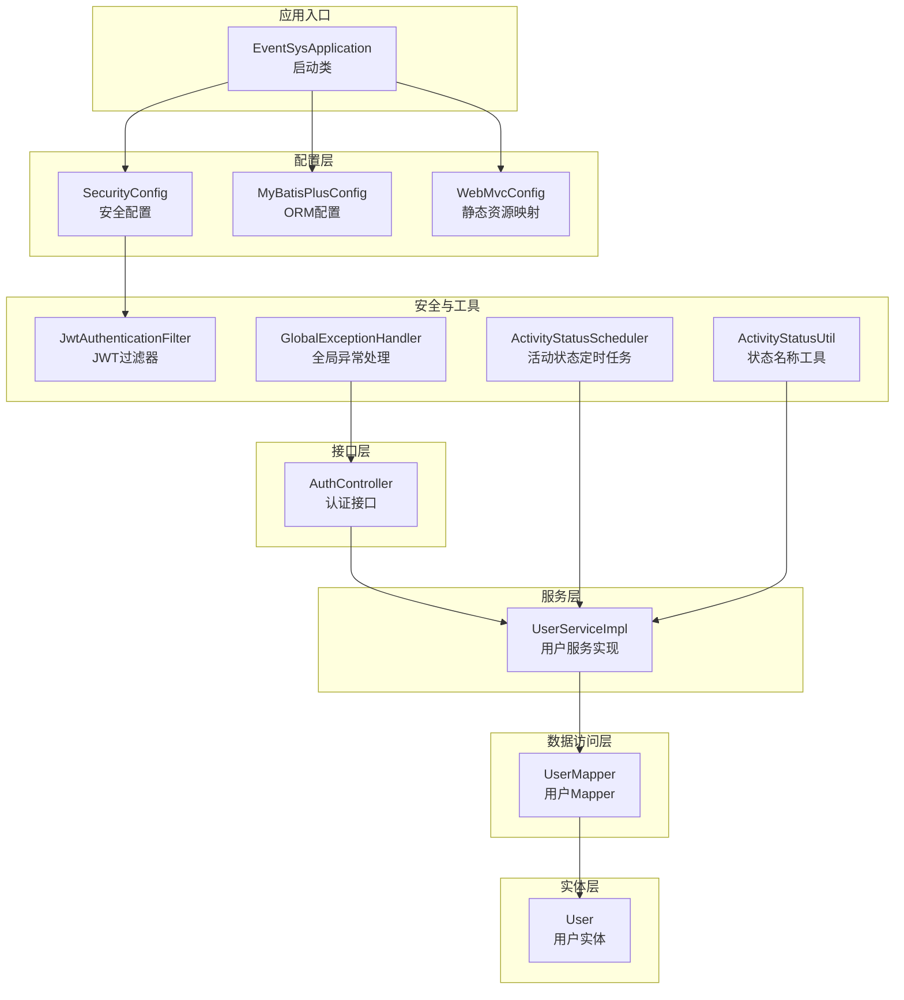
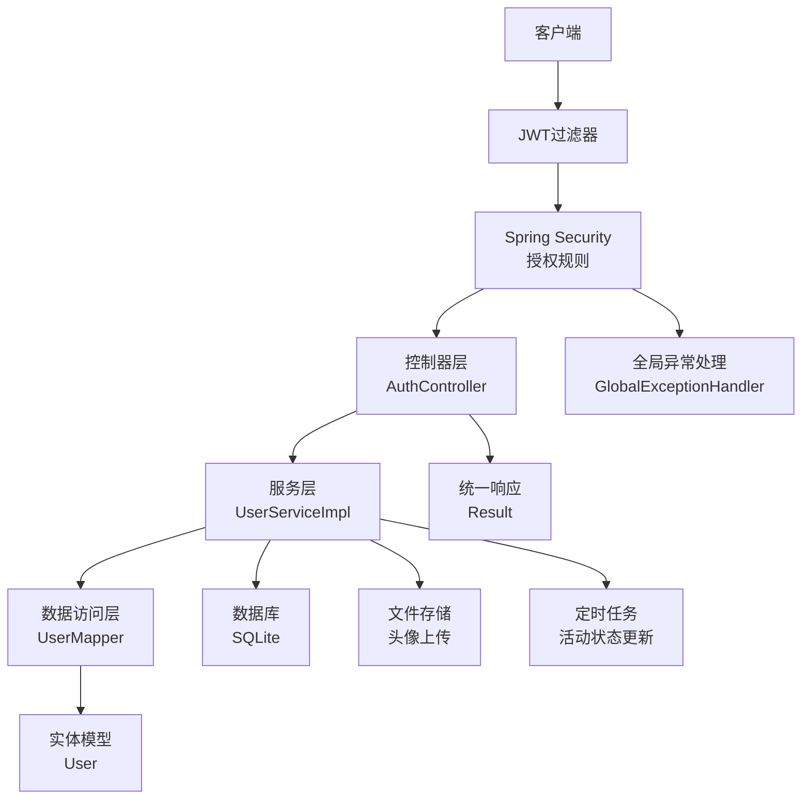
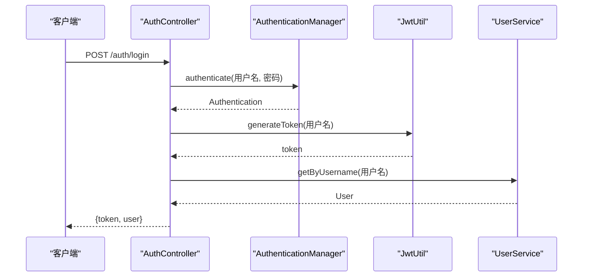
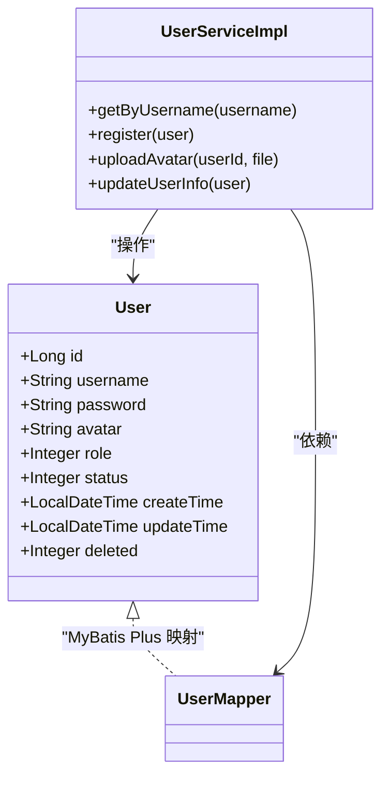
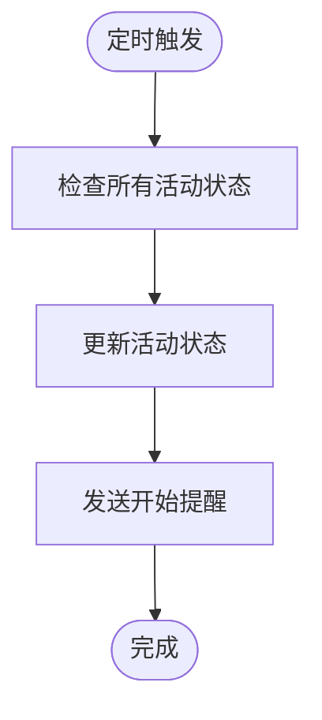
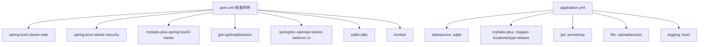
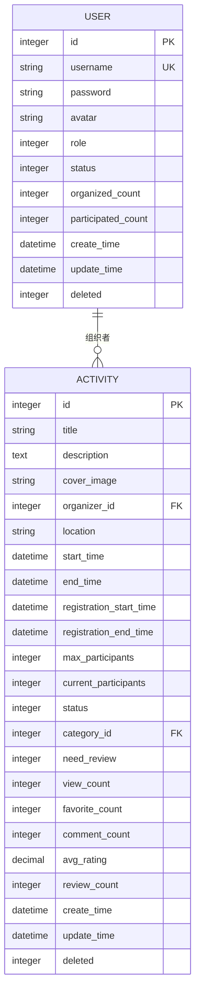

# 系统架构

<cite>
**本文引用的文件**
- [EventSysApplication.java](file://src/main/java/com/campus/eventsys/EventSysApplication.java)
- [application.yml](file://src/main/resources/application.yml)
- [pom.xml](file://pom.xml)
- [SecurityConfig.java](file://src/main/java/com/campus/eventsys/config/SecurityConfig.java)
- [MyBatisPlusConfig.java](file://src/main/java/com/campus/eventsys/config/MyBatisPlusConfig.java)
- [WebMvcConfig.java](file://src/main/java/com/campus/eventsys/config/WebMvcConfig.java)
- [JwtAuthenticationFilter.java](file://src/main/java/com/campus/eventsys/security/JwtAuthenticationFilter.java)
- [GlobalExceptionHandler.java](file://src/main/java/com/campus/eventsys/common/GlobalExceptionHandler.java)
- [AuthController.java](file://src/main/java/com/campus/eventsys/controller/AuthController.java)
- [UserServiceImpl.java](file://src/main/java/com/campus/eventsys/service/impl/UserServiceImpl.java)
- [User.java](file://src/main/java/com/campus/eventsys/entity/User.java)
- [UserMapper.java](file://src/main/java/com/campus/eventsys/mapper/UserMapper.java)
- [ActivityStatusScheduler.java](file://src/main/java/com/campus/eventsys/scheduler/ActivityStatusScheduler.java)
- [ActivityStatusUtil.java](file://src/main/java/com/campus/eventsys/utils/ActivityStatusUtil.java)
- [表设计.md](file://picture/表设计.md)
</cite>

## 目录
1. [引言](#引言)
2. [项目结构](#项目结构)
3. [核心组件](#核心组件)
4. [架构总览](#架构总览)
5. [详细组件分析](#详细组件分析)
6. [依赖分析](#依赖分析)
7. [性能考量](#性能考量)
8. [故障排查指南](#故障排查指南)
9. [结论](#结论)
10. [附录](#附录)

## 引言
本系统为校园活动综合管理平台，采用分层架构与MVC设计模式，围绕Spring Boot构建，结合MyBatis Plus实现数据持久化，Spring Security与JWT保障安全认证，配合定时任务与统一异常处理，形成高内聚、低耦合的现代化后端架构。本文档面向架构师与高级开发者，系统阐述技术栈选择、分层职责、组件交互、数据流与控制流，并提供架构图与组件关系图以帮助快速理解与扩展。

## 项目结构
系统采用按功能域分层的目录组织方式：
- config：应用配置与安全策略
- controller：HTTP接口层（MVC中的C）
- service：业务服务层（MVC中的C与V之间的协调）
- impl：业务实现层（MVC中的V）
- mapper：数据访问层（MVC中的M）
- entity：领域模型（MVC中的M）
- scheduler：定时任务调度
- security：安全过滤与工具
- utils：工具类
- common：全局异常处理与通用响应封装
- resources：配置文件与SQL脚本
- tests：控制器测试

**图表来源**
- [EventSysApplication.java:1-17](file://src/main/java/com/campus/eventsys/EventSysApplication.java#L1-L17)
- [SecurityConfig.java:1-100](file://src/main/java/com/campus/eventsys/config/SecurityConfig.java#L1-L100)
- [MyBatisPlusConfig.java:1-58](file://src/main/java/com/campus/eventsys/config/MyBatisPlusConfig.java#L1-L58)
- [WebMvcConfig.java:1-38](file://src/main/java/com/campus/eventsys/config/WebMvcConfig.java#L1-L38)
- [JwtAuthenticationFilter.java:1-58](file://src/main/java/com/campus/eventsys/security/JwtAuthenticationFilter.java#L1-L58)
- [GlobalExceptionHandler.java:1-108](file://src/main/java/com/campus/eventsys/common/GlobalExceptionHandler.java#L1-L108)
- [AuthController.java:1-106](file://src/main/java/com/campus/eventsys/controller/AuthController.java#L1-L106)
- [UserServiceImpl.java:1-158](file://src/main/java/com/campus/eventsys/service/impl/UserServiceImpl.java#L1-L158)
- [UserMapper.java:1-10](file://src/main/java/com/campus/eventsys/mapper/UserMapper.java#L1-L10)
- [User.java:1-85](file://src/main/java/com/campus/eventsys/entity/User.java#L1-L85)
- [ActivityStatusScheduler.java:1-42](file://src/main/java/com/campus/eventsys/scheduler/ActivityStatusScheduler.java#L1-L42)
- [ActivityStatusUtil.java:1-46](file://src/main/java/com/campus/eventsys/utils/ActivityStatusUtil.java#L1-L46)

**章节来源**
- [EventSysApplication.java:1-17](file://src/main/java/com/campus/eventsys/EventSysApplication.java#L1-L17)
- [application.yml:1-76](file://src/main/resources/application.yml#L1-L76)
- [pom.xml:1-131](file://pom.xml#L1-L131)

## 核心组件
- 应用启动与扫描
  - 启动类启用包扫描与定时任务，统一扫描mapper包，开启调度能力。
- 安全与认证
  - 基于Spring Security的无状态会话策略，JWT过滤器在请求链路中解析与验证令牌，授权规则区分公开接口与受保护接口，管理员接口强制ADMIN角色。
- ORM与数据访问
  - MyBatis Plus提供分页、自动填充与SQLite适配；实体标注逻辑删除与驼峰映射。
- 控制器与服务
  - 控制器负责HTTP协议与参数校验，服务层编排业务逻辑，实现类基于MyBatis Plus模板方法。
- 全局异常处理
  - 统一封装异常响应，覆盖认证、权限、参数绑定、JWT过期、文件上传大小限制等场景。
- 定时任务
  - 自动检查与更新活动状态，发送开始提醒，保证状态一致性与用户体验。

**章节来源**
- [SecurityConfig.java:1-100](file://src/main/java/com/campus/eventsys/config/SecurityConfig.java#L1-L100)
- [JwtAuthenticationFilter.java:1-58](file://src/main/java/com/campus/eventsys/security/JwtAuthenticationFilter.java#L1-L58)
- [MyBatisPlusConfig.java:1-58](file://src/main/java/com/campus/eventsys/config/MyBatisPlusConfig.java#L1-L58)
- [GlobalExceptionHandler.java:1-108](file://src/main/java/com/campus/eventsys/common/GlobalExceptionHandler.java#L1-L108)
- [ActivityStatusScheduler.java:1-42](file://src/main/java/com/campus/eventsys/scheduler/ActivityStatusScheduler.java#L1-L42)

## 架构总览
系统采用分层架构与MVC模式：
- 表现层（Controller）：接收HTTP请求，调用服务层，返回统一结果包装。
- 业务层（Service/Impl）：编排领域操作，处理业务规则与事务边界。
- 数据访问层（Mapper/Entity）：基于MyBatis Plus的CRUD与条件构造器，配合自动填充与逻辑删除。
- 基础设施层（配置、安全、定时任务、异常处理）：提供横切能力与运行时支撑。

**图表来源**
- [JwtAuthenticationFilter.java:1-58](file://src/main/java/com/campus/eventsys/security/JwtAuthenticationFilter.java#L1-L58)
- [SecurityConfig.java:1-100](file://src/main/java/com/campus/eventsys/config/SecurityConfig.java#L1-L100)
- [AuthController.java:1-106](file://src/main/java/com/campus/eventsys/controller/AuthController.java#L1-L106)
- [UserServiceImpl.java:1-158](file://src/main/java/com/campus/eventsys/service/impl/UserServiceImpl.java#L1-L158)
- [UserMapper.java:1-10](file://src/main/java/com/campus/eventsys/mapper/UserMapper.java#L1-L10)
- [User.java:1-85](file://src/main/java/com/campus/eventsys/entity/User.java#L1-L85)
- [GlobalExceptionHandler.java:1-108](file://src/main/java/com/campus/eventsys/common/GlobalExceptionHandler.java#L1-L108)

## 详细组件分析

### 安全与认证组件
- 过滤链与授权
  - 禁用CSRF，配置跨域支持，无状态会话，公开接口白名单，管理员接口强制ADMIN角色，其余接口需认证。
- JWT过滤器
  - 从请求头提取Bearer令牌，校验有效性，加载用户详情，注入认证上下文。
- 认证控制器
  - 提供登录与注册接口，登录成功生成JWT并返回用户信息。

**图表来源**
- [AuthController.java:1-106](file://src/main/java/com/campus/eventsys/controller/AuthController.java#L1-L106)
- [SecurityConfig.java:1-100](file://src/main/java/com/campus/eventsys/config/SecurityConfig.java#L1-L100)
- [JwtAuthenticationFilter.java:1-58](file://src/main/java/com/campus/eventsys/security/JwtAuthenticationFilter.java#L1-L58)

**章节来源**
- [SecurityConfig.java:1-100](file://src/main/java/com/campus/eventsys/config/SecurityConfig.java#L1-L100)
- [JwtAuthenticationFilter.java:1-58](file://src/main/java/com/campus/eventsys/security/JwtAuthenticationFilter.java#L1-L58)
- [AuthController.java:1-106](file://src/main/java/com/campus/eventsys/controller/AuthController.java#L1-L106)

### 数据访问与ORM配置
- MyBatis Plus配置
  - 分页插件针对SQLite，自动填充插入/更新时间与逻辑删除字段，GMT+8时区。
- 实体与Mapper
  - User实体映射数据库表，标注主键策略、逻辑删除与字段填充；Mapper继承BaseMapper。
- 文件上传与静态资源
  - WebMvc配置映射上传目录至/上传与/图片两类路径，支持缓存与跨域访问。

**图表来源**
- [User.java:1-85](file://src/main/java/com/campus/eventsys/entity/User.java#L1-L85)
- [UserMapper.java:1-10](file://src/main/java/com/campus/eventsys/mapper/UserMapper.java#L1-L10)
- [UserServiceImpl.java:1-158](file://src/main/java/com/campus/eventsys/service/impl/UserServiceImpl.java#L1-L158)

**章节来源**
- [MyBatisPlusConfig.java:1-58](file://src/main/java/com/campus/eventsys/config/MyBatisPlusConfig.java#L1-L58)
- [WebMvcConfig.java:1-38](file://src/main/java/com/campus/eventsys/config/WebMvcConfig.java#L1-L38)
- [User.java:1-85](file://src/main/java/com/campus/eventsys/entity/User.java#L1-L85)
- [UserMapper.java:1-10](file://src/main/java/com/campus/eventsys/mapper/UserMapper.java#L1-L10)
- [UserServiceImpl.java:1-158](file://src/main/java/com/campus/eventsys/service/impl/UserServiceImpl.java#L1-L158)

### 定时任务与状态管理
- 定时任务
  - 每固定周期检查并更新活动状态，同时发送开始提醒，确保状态与实际时间一致。
- 状态名称工具
  - 统一活动与报名状态的中文名称映射，便于前端展示与日志输出。

**图表来源**
- [ActivityStatusScheduler.java:1-42](file://src/main/java/com/campus/eventsys/scheduler/ActivityStatusScheduler.java#L1-L42)
- [ActivityStatusUtil.java:1-46](file://src/main/java/com/campus/eventsys/utils/ActivityStatusUtil.java#L1-L46)

**章节来源**
- [ActivityStatusScheduler.java:1-42](file://src/main/java/com/campus/eventsys/scheduler/ActivityStatusScheduler.java#L1-L42)
- [ActivityStatusUtil.java:1-46](file://src/main/java/com/campus/eventsys/utils/ActivityStatusUtil.java#L1-L46)

### 全局异常处理
- 覆盖常见异常类型：业务异常、认证失败、权限不足、参数校验失败、JWT过期/无效、认证不足、凭证过期、通用认证异常、文件大小超限。
- 返回统一响应结构，便于前端统一处理。

**章节来源**
- [GlobalExceptionHandler.java:1-108](file://src/main/java/com/campus/eventsys/common/GlobalExceptionHandler.java#L1-L108)

## 依赖分析
- 技术栈与版本
  - Spring Boot 3.2.0、MyBatis Plus 3.5.5、Spring Security、JWT（jjwt）、Swagger UI（SpringDoc）、SQLite JDBC。
- 运行时依赖
  - Web、Security、Validation、OpenAPI、测试与安全测试。
- 配置驱动
  - application.yml集中管理服务器端口、上下文路径、数据源（SQLite）、MyBatis Plus、JWT、文件上传、日志级别与OpenAPI路径。

**图表来源**
- [pom.xml:1-131](file://pom.xml#L1-L131)
- [application.yml:1-76](file://src/main/resources/application.yml#L1-L76)

**章节来源**
- [pom.xml:1-131](file://pom.xml#L1-L131)
- [application.yml:1-76](file://src/main/resources/application.yml#L1-L76)

## 性能考量
- 无状态认证与JWT
  - 减少服务器端会话存储开销，提升横向扩展能力；建议合理设置过期时间与刷新策略。
- 分页与自动填充
  - 分页插件限制最大每页条数，避免大页扫描；自动填充减少冗余字段写入。
- 文件上传与静态资源
  - 限制单文件与请求总大小，启用静态资源缓存，降低I/O压力。
- 定时任务频率
  - 固定周期检查活动状态，建议根据业务量调整频率，避免频繁数据库扫描。

[本节为通用指导，无需特定文件引用]

## 故障排查指南
- 认证失败
  - 检查用户名/密码是否正确，确认密码编码器与BCrypt匹配。
- 权限不足
  - 确认用户角色与接口授权规则，管理员接口需ADMIN角色。
- JWT过期或无效
  - 检查JWT密钥与过期时间配置，客户端需重新登录获取新令牌。
- 参数校验失败
  - 关注字段缺失或格式错误，查看全局异常返回的具体字段提示。
- 文件上传失败
  - 检查文件类型、大小限制与上传目录权限，确认静态资源映射路径有效。
- 数据库初始化
  - 使用自定义初始化器而非Spring Boot默认初始化，避免schema与数据冲突。

**章节来源**
- [GlobalExceptionHandler.java:1-108](file://src/main/java/com/campus/eventsys/common/GlobalExceptionHandler.java#L1-L108)
- [SecurityConfig.java:1-100](file://src/main/java/com/campus/eventsys/config/SecurityConfig.java#L1-L100)
- [application.yml:1-76](file://src/main/resources/application.yml#L1-L76)

## 结论
本系统通过清晰的分层架构与MVC模式，结合Spring Security与JWT实现无状态认证，利用MyBatis Plus简化数据访问与自动填充，配合定时任务与统一异常处理，形成稳定、可扩展且易于维护的后端架构。面向未来，可在认证刷新机制、缓存策略、异步任务与可观测性方面进一步增强。

[本节为总结性内容，无需特定文件引用]

## 附录
- 数据模型概览（用户与活动相关）
  - 用户表包含基础信息、角色与状态、计数字段与时间戳；活动表关联组织者、分类与报名状态；报名、收藏、签到、通知、审核与评价等表支撑完整生命周期。

**图表来源**
- [表设计.md:1-206](file://picture/表设计.md#L1-L206)
- [User.java:1-85](file://src/main/java/com/campus/eventsys/entity/User.java#L1-L85)