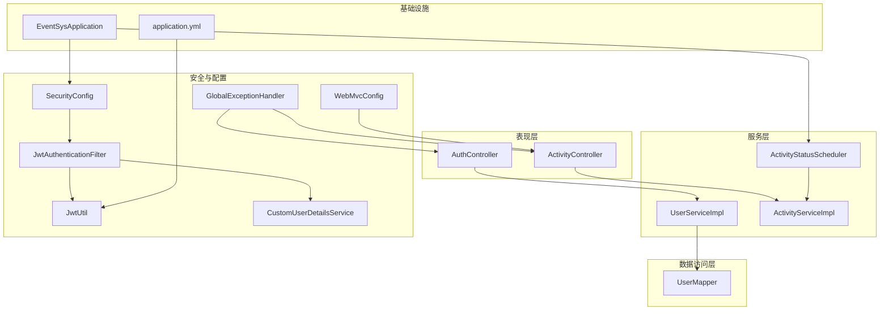
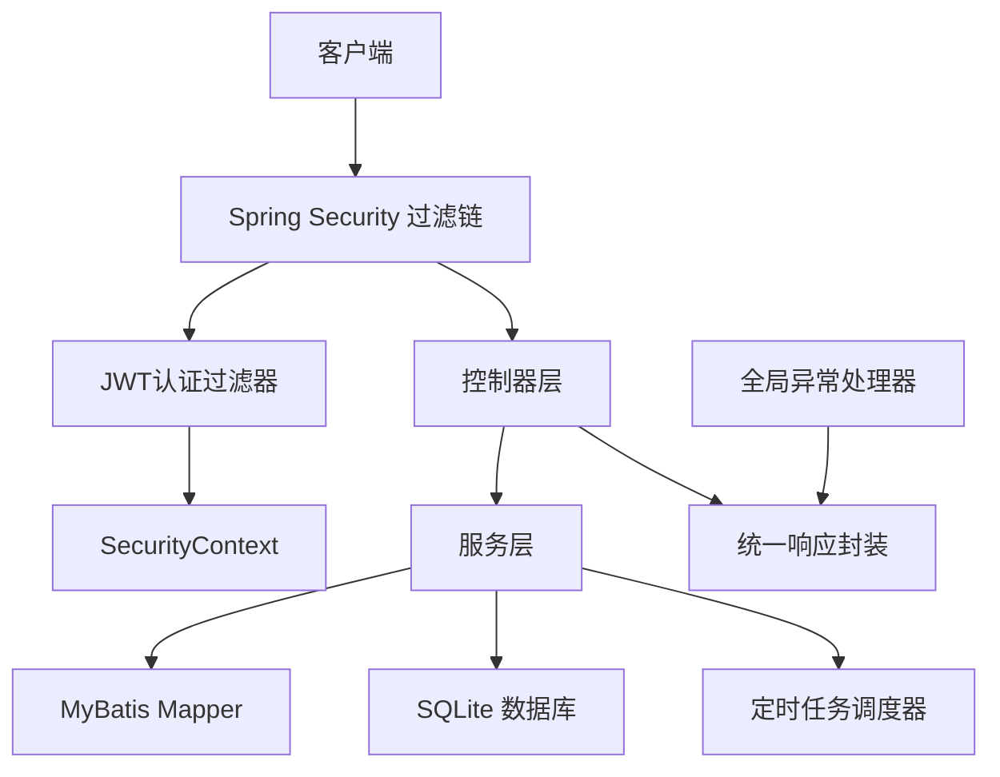
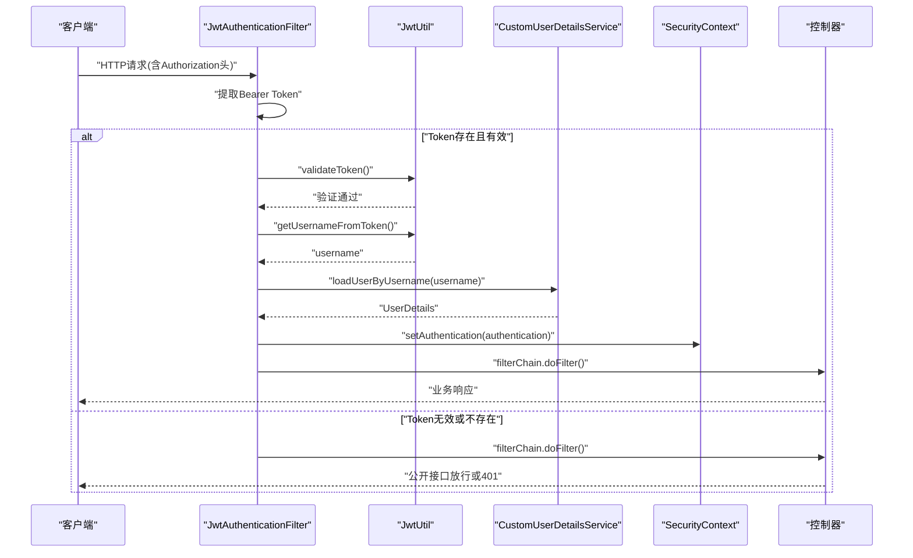
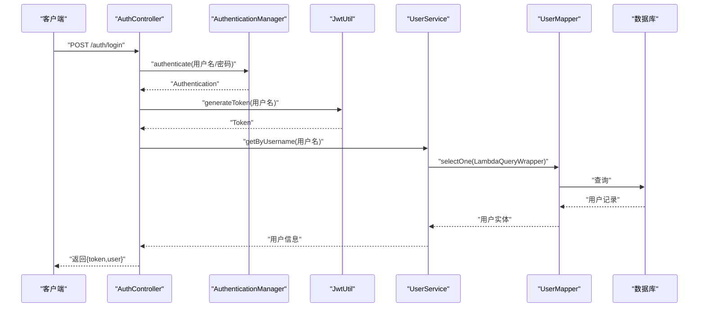
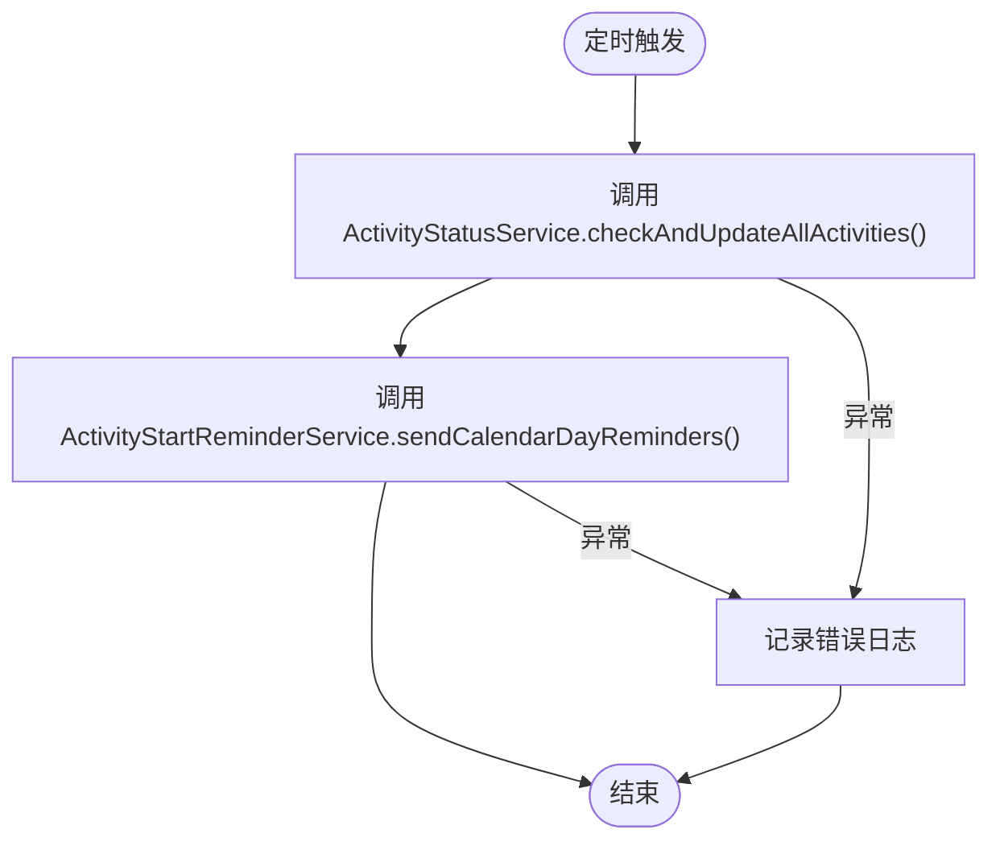
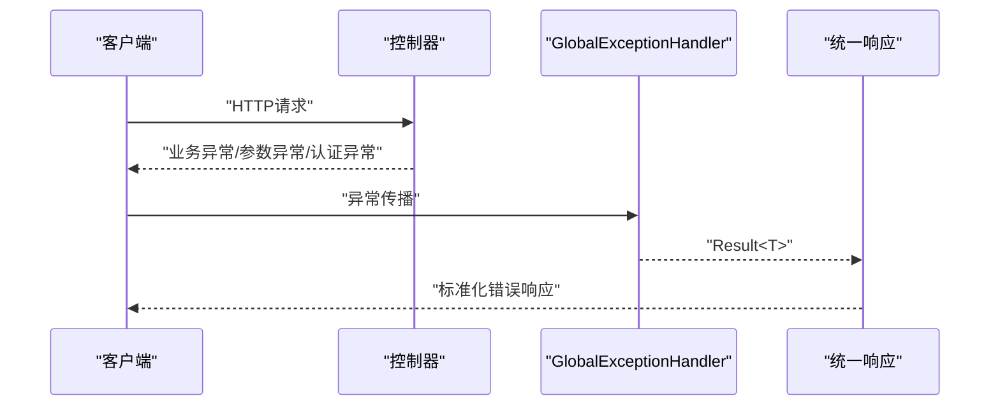
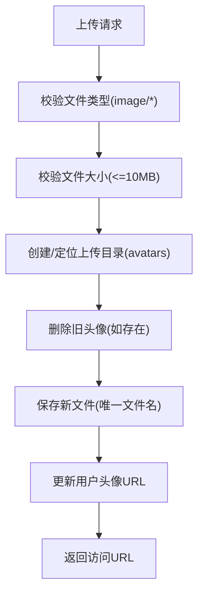
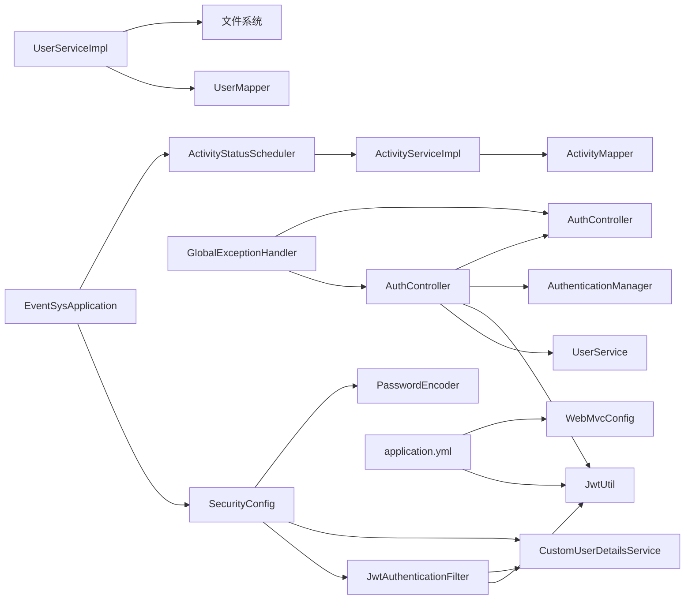

# 组件交互机制

<cite>
**本文引用的文件**
- [EventSysApplication.java](file://src/main/java/com/campus/eventsys/EventSysApplication.java)
- [SecurityConfig.java](file://src/main/java/com/campus/eventsys/config/SecurityConfig.java)
- [JwtAuthenticationFilter.java](file://src/main/java/com/campus/eventsys/security/JwtAuthenticationFilter.java)
- [JwtUtil.java](file://src/main/java/com/campus/eventsys/security/JwtUtil.java)
- [CustomUserDetailsService.java](file://src/main/java/com/campus/eventsys/security/CustomUserDetailsService.java)
- [GlobalExceptionHandler.java](file://src/main/java/com/campus/eventsys/common/GlobalExceptionHandler.java)
- [ActivityStatusScheduler.java](file://src/main/java/com/campus/eventsys/scheduler/ActivityStatusScheduler.java)
- [AuthController.java](file://src/main/java/com/campus/eventsys/controller/AuthController.java)
- [ActivityController.java](file://src/main/java/com/campus/eventsys/controller/ActivityController.java)
- [UserServiceImpl.java](file://src/main/java/com/campus/eventsys/service/impl/UserServiceImpl.java)
- [UserMapper.java](file://src/main/java/com/campus/eventsys/mapper/UserMapper.java)
- [WebMvcConfig.java](file://src/main/java/com/campus/eventsys/config/WebMvcConfig.java)
- [application.yml](file://src/main/resources/application.yml)
</cite>

## 目录
1. [引言](#引言)
2. [项目结构](#项目结构)
3. [核心组件](#核心组件)
4. [架构总览](#架构总览)
5. [详细组件分析](#详细组件分析)
6. [依赖分析](#依赖分析)
7. [性能考虑](#性能考虑)
8. [故障排查指南](#故障排查指南)
9. [结论](#结论)
10. [附录](#附录)

## 引言
本文件面向开发者，系统化梳理校园活动管理系统的组件交互机制，覆盖以下主题：
- 控制器与服务层的调用关系
- 服务层与持久层（Mapper/MyBatis）的数据访问模式
- 安全组件的认证流程与拦截器链执行顺序
- JWT认证过滤器的工作原理
- 定时任务调度器与业务逻辑的交互机制
- 异常处理机制在系统中的传播路径
- 典型业务场景下的时序图与交互图

## 项目结构
系统采用典型的分层架构：控制器层（Controller）、服务层（Service）、数据访问层（Mapper/MyBatis）、安全层（Spring Security + JWT）、定时任务（Scheduler）、全局异常处理（GlobalExceptionHandler），以及配置类（WebMvc、Security、MyBatis Plus、OpenAPI、时区等）。

图表来源
- [EventSysApplication.java:1-17](file://src/main/java/com/campus/eventsys/EventSysApplication.java#L1-L17)
- [SecurityConfig.java:1-100](file://src/main/java/com/campus/eventsys/config/SecurityConfig.java#L1-L100)
- [JwtAuthenticationFilter.java:1-58](file://src/main/java/com/campus/eventsys/security/JwtAuthenticationFilter.java#L1-L58)
- [JwtUtil.java:1-71](file://src/main/java/com/campus/eventsys/security/JwtUtil.java#L1-L71)
- [CustomUserDetailsService.java:1-40](file://src/main/java/com/campus/eventsys/security/CustomUserDetailsService.java#L1-L40)
- [GlobalExceptionHandler.java:1-108](file://src/main/java/com/campus/eventsys/common/GlobalExceptionHandler.java#L1-L108)
- [ActivityStatusScheduler.java:1-42](file://src/main/java/com/campus/eventsys/scheduler/ActivityStatusScheduler.java#L1-L42)
- [AuthController.java:1-106](file://src/main/java/com/campus/eventsys/controller/AuthController.java#L1-L106)
- [ActivityController.java:1-111](file://src/main/java/com/campus/eventsys/controller/ActivityController.java#L1-L111)
- [UserServiceImpl.java:1-158](file://src/main/java/com/campus/eventsys/service/impl/UserServiceImpl.java#L1-L158)
- [UserMapper.java:1-10](file://src/main/java/com/campus/eventsys/mapper/UserMapper.java#L1-L10)
- [WebMvcConfig.java:1-38](file://src/main/java/com/campus/eventsys/config/WebMvcConfig.java#L1-L38)
- [application.yml:1-76](file://src/main/resources/application.yml#L1-L76)

章节来源
- [EventSysApplication.java:1-17](file://src/main/java/com/campus/eventsys/EventSysApplication.java#L1-L17)
- [application.yml:1-76](file://src/main/resources/application.yml#L1-L76)

## 核心组件
- 应用入口与扫描
  - 应用启动类启用调度与Mapper扫描，确保定时任务与MyBatis Mapper被容器管理。
- 安全配置
  - 基于Spring Security的无状态会话策略，开放部分公开接口，其余接口需认证；配置CORS与密码编码器；注册JWT过滤器。
- JWT认证过滤器
  - 从请求头提取Bearer Token，验证有效性并解析用户名，加载用户详情，构建认证对象写入SecurityContext。
- 自定义用户详情服务
  - 依据用户名查询用户，映射角色为“ROLE_USER”或“ROLE_ADMIN”，返回UserDetails。
- JWT工具
  - 生成、解析、校验与过期判断，密钥与过期时间来自配置。
- 全局异常处理
  - 统一捕获各类异常（业务异常、认证异常、参数绑定异常、JWT异常、文件大小异常等），返回标准化结果。
- 定时任务调度器
  - 固定周期检查并更新活动状态，发送开始提醒。
- 控制器与服务层
  - 控制器负责HTTP请求与响应封装；服务层实现业务逻辑；服务实现类继承MyBatis-Plus的ServiceImpl，直接复用Mapper能力。
- Web资源配置
  - 将上传目录映射为静态资源，支持图片访问。

章节来源
- [SecurityConfig.java:1-100](file://src/main/java/com/campus/eventsys/config/SecurityConfig.java#L1-L100)
- [JwtAuthenticationFilter.java:1-58](file://src/main/java/com/campus/eventsys/security/JwtAuthenticationFilter.java#L1-L58)
- [JwtUtil.java:1-71](file://src/main/java/com/campus/eventsys/security/JwtUtil.java#L1-L71)
- [CustomUserDetailsService.java:1-40](file://src/main/java/com/campus/eventsys/security/CustomUserDetailsService.java#L1-L40)
- [GlobalExceptionHandler.java:1-108](file://src/main/java/com/campus/eventsys/common/GlobalExceptionHandler.java#L1-L108)
- [ActivityStatusScheduler.java:1-42](file://src/main/java/com/campus/eventsys/scheduler/ActivityStatusScheduler.java#L1-L42)
- [UserServiceImpl.java:1-158](file://src/main/java/com/campus/eventsys/service/impl/UserServiceImpl.java#L1-L158)
- [WebMvcConfig.java:1-38](file://src/main/java/com/campus/eventsys/config/WebMvcConfig.java#L1-L38)

## 架构总览
系统采用前后端分离，后端以REST API提供能力。安全层通过JWT无状态认证贯穿请求生命周期；服务层通过MyBatis-Plus简化数据访问；定时任务保障活动状态与提醒的自动化；全局异常处理保证错误信息的一致性输出。

图表来源
- [SecurityConfig.java:35-71](file://src/main/java/com/campus/eventsys/config/SecurityConfig.java#L35-L71)
- [JwtAuthenticationFilter.java:26-48](file://src/main/java/com/campus/eventsys/security/JwtAuthenticationFilter.java#L26-L48)
- [GlobalExceptionHandler.java:20-107](file://src/main/java/com/campus/eventsys/common/GlobalExceptionHandler.java#L20-L107)
- [UserServiceImpl.java:24-57](file://src/main/java/com/campus/eventsys/service/impl/UserServiceImpl.java#L24-L57)
- [ActivityStatusScheduler.java:31-40](file://src/main/java/com/campus/eventsys/scheduler/ActivityStatusScheduler.java#L31-L40)

## 详细组件分析

### 安全组件与认证流程
- 拦截器链执行顺序
  - 在Spring Security中，JWT过滤器在用户名密码过滤器之前执行，确保在进入方法级安全或业务处理前完成认证上下文设置。
- 认证流程要点
  - 从请求头读取Authorization头，提取Bearer Token；
  - 校验Token有效性与未过期；
  - 解析用户名并加载用户详情；
  - 构造认证对象并写入SecurityContext；
  - 放行至后续过滤器与控制器。
- 角色与权限
  - 用户角色映射为“ROLE_USER”或“ROLE_ADMIN”，用于URL级与方法级权限控制。

图表来源
- [JwtAuthenticationFilter.java:26-48](file://src/main/java/com/campus/eventsys/security/JwtAuthenticationFilter.java#L26-L48)
- [JwtUtil.java:37-56](file://src/main/java/com/campus/eventsys/security/JwtUtil.java#L37-L56)
- [CustomUserDetailsService.java:21-38](file://src/main/java/com/campus/eventsys/security/CustomUserDetailsService.java#L21-L38)
- [SecurityConfig.java:35-71](file://src/main/java/com/campus/eventsys/config/SecurityConfig.java#L35-L71)

章节来源
- [SecurityConfig.java:35-71](file://src/main/java/com/campus/eventsys/config/SecurityConfig.java#L35-L71)
- [JwtAuthenticationFilter.java:26-48](file://src/main/java/com/campus/eventsys/security/JwtAuthenticationFilter.java#L26-L48)
- [JwtUtil.java:25-56](file://src/main/java/com/campus/eventsys/security/JwtUtil.java#L25-L56)
- [CustomUserDetailsService.java:21-38](file://src/main/java/com/campus/eventsys/security/CustomUserDetailsService.java#L21-L38)

### 控制器与服务层调用关系
- 控制器职责
  - AuthController：处理登录与注册，使用AuthenticationManager进行认证，使用JwtUtil生成Token，使用UserService查询用户。
  - ActivityController：提供公开的活动查询接口，内部调用服务层进行分页与条件查询。
- 服务层职责
  - UserServiceImpl：实现用户相关业务（注册、头像上传、信息更新），内部使用UserMapper与文件系统。
  - ActivityServiceImpl：基于MyBatis-Plus的ServiceImpl，直接复用Mapper能力。
- 数据访问模式
  - 服务层通过继承的ServiceImpl调用BaseMapper，使用LambdaQueryWrapper构造查询条件，实现分页与条件查询。

图表来源
- [AuthController.java:57-73](file://src/main/java/com/campus/eventsys/controller/AuthController.java#L57-L73)
- [JwtUtil.java:25-35](file://src/main/java/com/campus/eventsys/security/JwtUtil.java#L25-L35)
- [UserServiceImpl.java:34-57](file://src/main/java/com/campus/eventsys/service/impl/UserServiceImpl.java#L34-L57)
- [UserMapper.java:1-10](file://src/main/java/com/campus/eventsys/mapper/UserMapper.java#L1-L10)

章节来源
- [AuthController.java:57-73](file://src/main/java/com/campus/eventsys/controller/AuthController.java#L57-L73)
- [UserServiceImpl.java:34-57](file://src/main/java/com/campus/eventsys/service/impl/UserServiceImpl.java#L34-L57)
- [ActivityController.java:54-87](file://src/main/java/com/campus/eventsys/controller/ActivityController.java#L54-L87)

### 定时任务调度器与业务交互
- 调度策略
  - 固定速率执行（毫秒级），周期性触发活动状态检查与开始提醒发送。
- 业务交互
  - 调用ActivityStatusService与ActivityStartReminderService，分别负责状态更新与提醒发送。
- 错误处理
  - 任务执行包裹异常日志，避免影响其他任务或应用稳定性。

图表来源
- [ActivityStatusScheduler.java:31-40](file://src/main/java/com/campus/eventsys/scheduler/ActivityStatusScheduler.java#L31-L40)

章节来源
- [ActivityStatusScheduler.java:31-40](file://src/main/java/com/campus/eventsys/scheduler/ActivityStatusScheduler.java#L31-L40)

### 异常处理机制传播路径
- 全局异常处理器
  - 捕获通用异常、业务异常、认证异常、参数绑定异常、JWT异常、文件大小异常等，统一返回标准化结果。
- 传播路径
  - 控制器抛出异常 → Spring MVC → 全局异常处理器 → 统一响应封装 → 客户端。

图表来源
- [GlobalExceptionHandler.java:20-107](file://src/main/java/com/campus/eventsys/common/GlobalExceptionHandler.java#L20-L107)

章节来源
- [GlobalExceptionHandler.java:20-107](file://src/main/java/com/campus/eventsys/common/GlobalExceptionHandler.java#L20-L107)

### 文件上传与静态资源映射
- 上传策略
  - UserServiceImpl负责头像上传：校验类型与大小、创建目录、生成唯一文件名、删除旧头像、更新用户头像字段。
- 静态资源映射
  - WebMvcConfig将上传目录映射为静态资源，支持“/uploads/images/**”与“/images/**”访问。

图表来源
- [UserServiceImpl.java:60-126](file://src/main/java/com/campus/eventsys/service/impl/UserServiceImpl.java#L60-L126)
- [WebMvcConfig.java:22-36](file://src/main/java/com/campus/eventsys/config/WebMvcConfig.java#L22-L36)

章节来源
- [UserServiceImpl.java:60-126](file://src/main/java/com/campus/eventsys/service/impl/UserServiceImpl.java#L60-L126)
- [WebMvcConfig.java:22-36](file://src/main/java/com/campus/eventsys/config/WebMvcConfig.java#L22-L36)

## 依赖分析
- 组件耦合
  - 控制器依赖服务接口；服务实现依赖Mapper；安全配置注入过滤器与用户详情服务；全局异常处理对控制器与服务层透明。
- 外部依赖
  - Spring Security、Spring MVC、MyBatis-Plus、SQLite、JWT库、Swagger/OpenAPI。
- 配置依赖
  - application.yml提供JWT密钥、过期时间、文件上传路径与访问URL、数据库连接、MyBatis-Plus配置等。

图表来源
- [AuthController.java:38-40](file://src/main/java/com/campus/eventsys/controller/AuthController.java#L38-L40)
- [UserServiceImpl.java:26](file://src/main/java/com/campus/eventsys/service/impl/UserServiceImpl.java#L26)
- [SecurityConfig.java:32-34](file://src/main/java/com/campus/eventsys/config/SecurityConfig.java#L32-L34)
- [JwtAuthenticationFilter.java:23-24](file://src/main/java/com/campus/eventsys/security/JwtAuthenticationFilter.java#L23-L24)
- [GlobalExceptionHandler.java:16-17](file://src/main/java/com/campus/eventsys/common/GlobalExceptionHandler.java#L16-L17)
- [ActivityStatusScheduler.java:19-20](file://src/main/java/com/campus/eventsys/scheduler/ActivityStatusScheduler.java#L19-L20)
- [EventSysApplication.java:8-10](file://src/main/java/com/campus/eventsys/EventSysApplication.java#L8-L10)
- [application.yml:49-76](file://src/main/resources/application.yml#L49-L76)

章节来源
- [application.yml:49-76](file://src/main/resources/application.yml#L49-L76)

## 性能考虑
- 无状态认证
  - JWT无状态策略降低服务器会话存储压力，适合高并发场景。
- 定时任务频率
  - 固定速率任务应结合业务量评估，避免频繁数据库扫描；可考虑分批处理或索引优化。
- 文件上传
  - 限制文件大小与类型，避免大文件占用带宽与磁盘空间；建议开启CDN或对象存储。
- 缓存与静态资源
  - 静态资源设置缓存周期，减少重复请求；图片访问路径兼容两种前缀，提升可用性。

## 故障排查指南
- 认证失败
  - 检查Authorization头格式是否为“Bearer {token}”，确认Token未过期，核对用户名是否存在。
- 权限不足
  - 确认用户角色映射正确（role=1对应管理员），检查URL匹配规则与方法级注解。
- 参数校验失败
  - 查看全局异常返回的字段错误提示，修正请求体字段。
- 文件上传失败
  - 检查文件类型与大小限制、上传目录权限、旧头像删除异常日志。
- 定时任务未执行
  - 确认@EnableScheduling生效、任务方法可见性与异常日志。

章节来源
- [JwtAuthenticationFilter.java:50-56](file://src/main/java/com/campus/eventsys/security/JwtAuthenticationFilter.java#L50-L56)
- [CustomUserDetailsService.java:21-38](file://src/main/java/com/campus/eventsys/security/CustomUserDetailsService.java#L21-L38)
- [GlobalExceptionHandler.java:44-52](file://src/main/java/com/campus/eventsys/common/GlobalExceptionHandler.java#L44-L52)
- [UserServiceImpl.java:122-126](file://src/main/java/com/campus/eventsys/service/impl/UserServiceImpl.java#L122-L126)
- [ActivityStatusScheduler.java:37-40](file://src/main/java/com/campus/eventsys/scheduler/ActivityStatusScheduler.java#L37-L40)

## 结论
本系统通过清晰的分层与标准组件实现了稳定的业务交互：控制器专注接口契约，服务层承载业务逻辑，安全层以JWT无状态认证贯穿始终，定时任务保障活动生命周期自动化，全局异常处理统一错误输出。开发者可据此建立一致的组件协作规范，并在扩展新功能时遵循现有交互模式。

## 附录
- 典型业务场景参考
  - 用户登录：控制器发起认证，生成Token并返回；前端在后续请求头携带Token。
  - 活动公开查询：控制器直接调用服务层分页查询，无需认证。
  - 头像上传：服务层校验与落盘，更新用户信息并返回访问URL。